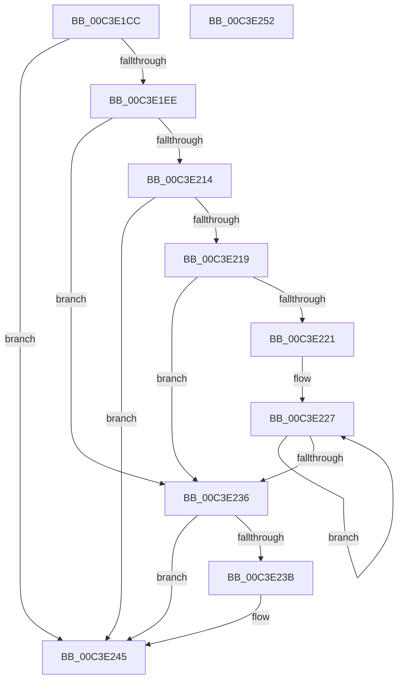

# PopReadWheaBootErrorCount

- RVA: `0x00C3E1CC`–`0x00C3E253` (길이 `135` bytes)
- VA: `0x0000000140C3E1CC`
- 실행 섹션: `INIT`
- PDB 이름 있음: `예`; PDB Function 태그: `아니요`
- unwind 정보 RVA: `0x000CBDD4`
- 디코드: `42`개 명령, `135/135` bytes 표시
- 미해석 바이트: `0` (있으면 어셈블리에 `.byte`로 보존)

> 이 문서는 커널 이미지의 기계어와 PDB 기호를 분석해 생성했습니다. 4번과 5번은 함수 원형과 자료형을 바이너리 사용 방식에서 추정한 C 해석이며 원본 소스 복구 결과는 아닙니다.

## 1. Dependencies

- 직접 호출 지점: **2**; 고유 호출 대상: **2**
- 직접 호출자로 확인된 함수: **1**
- RIP 상대 이미지 참조: **0**

### Outgoing calls
- `0x00C3E204` → [WheaGetErrorSourceInfo](../../page/7D/WheaGetErrorSourceInfo_function_007D7480.md) (function, `0x007D7480`)
- `0x00C3E240` → [ExFreePoolWithTag](../../poolcode/B8/ExFreePoolWithTag_function_00B82870.md) (function, `0x00B82870`)

### Direct callers
- [PopCheckShutdownMarker](PopCheckShutdownMarker_function_00C3DAD4.md) at `0x00C3E182`

### Static image references
- 디코드된 RIP-relative 메모리 참조가 없습니다.

## 2. Other-region calls and transfers

- 다른 실행 섹션으로 향하는 call: **2**
  - `0x00C3E204` → [WheaGetErrorSourceInfo](../../page/7D/WheaGetErrorSourceInfo_function_007D7480.md) (`INIT` → `PAGE`)
  - `0x00C3E240` → [ExFreePoolWithTag](../../poolcode/B8/ExFreePoolWithTag_function_00B82870.md) (`INIT` → `POOLCODE`)
- 별도 외부 분기/꼬리 이동을 확인하지 못했습니다.

## 3. Assembly (complete function range)

```asm
00C3E1CC  48 8B C4                        mov rax, rsp
00C3E1CF  48 89 58 18                     mov qword ptr [rax + 0x18], rbx
00C3E1D3  57                              push rdi
00C3E1D4  48 83 EC 20                     sub rsp, 0x20
00C3E1D8  83 60 08 00                     and dword ptr [rax + 8], 0
00C3E1DC  48 8B D9                        mov rbx, rcx
00C3E1DF  48 83 60 10 00                  and qword ptr [rax + 0x10], 0
00C3E1E4  BF 01 00 00 C0                  mov edi, 0xc0000001
00C3E1E9  48 85 C9                        test rcx, rcx
00C3E1EC  74 57                           je 0x140c3e245
00C3E1EE  83 21 00                        and dword ptr [rcx], 0
00C3E1F1  4C 8D 40 10                     lea r8, [rax + 0x10]
00C3E1F5  B9 07 00 00 00                  mov ecx, 7
00C3E1FA  48 8D 50 08                     lea rdx, [rax + 8]
00C3E1FE  41 B9 54 56 45 50               mov r9d, 0x50455654
00C3E204  E8 77 92 B9 FF                  call 0x1407d7480
00C3E209  48 8B 4C 24 38                  mov rcx, qword ptr [rsp + 0x38]
00C3E20E  8B F8                           mov edi, eax
00C3E210  85 C0                           test eax, eax
00C3E212  78 22                           js 0x140c3e236
00C3E214  48 85 C9                        test rcx, rcx
00C3E217  74 2C                           je 0x140c3e245
00C3E219  8B 44 24 30                     mov eax, dword ptr [rsp + 0x30]
00C3E21D  85 C0                           test eax, eax
00C3E21F  74 15                           je 0x140c3e236
00C3E221  4C 8B C1                        mov r8, rcx
00C3E224  44 8B C8                        mov r9d, eax
00C3E227  41 8B 00                        mov eax, dword ptr [r8]
00C3E22A  4D 8D 40 08                     lea r8, [r8 + 8]
00C3E22E  01 03                           add dword ptr [rbx], eax
00C3E230  49 83 E9 01                     sub r9, 1
00C3E234  75 F1                           jne 0x140c3e227
00C3E236  48 85 C9                        test rcx, rcx
00C3E239  74 0A                           je 0x140c3e245
00C3E23B  BA 54 56 45 50                  mov edx, 0x50455654
00C3E240  E8 2B 46 F4 FF                  call 0x140b82870
00C3E245  48 8B 5C 24 40                  mov rbx, qword ptr [rsp + 0x40]
00C3E24A  8B C7                           mov eax, edi
00C3E24C  48 83 C4 20                     add rsp, 0x20
00C3E250  5F                              pop rdi
00C3E251  C3                              ret
00C3E252  CC                              int3
```

## 4. C-style interpretation (structured pseudocode)

```c
__int64 __fastcall PopReadWheaBootErrorCount(__int64 a1)
{
    __int64 result;
    __int64 v_rsp;
    unsigned __int64 v_stack_p10;
    unsigned __int64 v_stack_p18;
    unsigned int v_stack_p8;

    *(unsigned __int64 *)(v_rsp + 24) = v_rbx;
    v_rsp = (v_rsp) - (32);
    if (a1 == 0) goto loc_00C3E245;
    result = WheaGetErrorSourceInfo(7, v_rsp + 8, v_rsp + 16, (unsigned int)(0x50455654ULL));
    if (sign_flag) goto loc_00C3E236;
    if (v_stack_p10 == 0) goto loc_00C3E245;
    if ((unsigned int)((unsigned int)(v_stack_p8)) == 0) goto loc_00C3E236;
loc_00C3E227:
    a4 = ((unsigned int)((unsigned int)((unsigned int)(v_stack_p8)))) - (1);
    if (condition_is_not_equal) goto loc_00C3E227;
loc_00C3E236:
    result = (unsigned int)(*(unsigned int *)(v_stack_p10));
    if (v_stack_p10 != 0) {
        a2 = 0x50455654ULL;
        result = ExFreePoolWithTag(v_stack_p10, a2, v_stack_p10 + 8, a4);
    }
    v_rsp = (v_rsp) + (32);
    return (unsigned int)((unsigned int)((unsigned int)((unsigned int)(result))));
}
```

## 5. (Beta) C Style

```c
int64_t PopReadWheaBootErrorCount(void *Arg1)
{
    uint8_t *arg1 = (uint8_t *)Arg1;

    int64_t result;
    int64_t local_rsp;
    uint64_t v_stack_p10;
    uint64_t v_stack_p18;
    uint32_t v_stack_p8;

    *(uint64_t *)(local_rsp + 0x18) = local_rbx;
    local_rsp = (local_rsp) - (32);
    if (Arg1 == NULL) goto loc_00C3E245;
    result = WheaGetErrorSourceInfo(7, local_rsp + 8, local_rsp + 16, (uint32_t)(0x50455654ULL));
    if (sign_flag) goto loc_00C3E236;
    if (v_stack_p10 == 0) goto loc_00C3E245;
    if ((uint32_t)((uint32_t)(v_stack_p8)) == 0) goto loc_00C3E236;
loc_00C3E227:
    a4 = ((uint32_t)((uint32_t)((uint32_t)(v_stack_p8)))) - (1);
    if (condition_is_not_equal) goto loc_00C3E227;
loc_00C3E236:
    result = (uint32_t)(*(uint32_t *)(v_stack_p10));
    if (v_stack_p10 != 0) {
        a2 = 0x50455654ULL;
        result = ExFreePoolWithTag(v_stack_p10, a2, v_stack_p10 + 8, a4);
    }
    local_rsp = (local_rsp) + (32);
    return (uint32_t)((uint32_t)((uint32_t)((uint32_t)(result))));
}
```

### 관측된 메모리 오프셋

구조체 형식이 확인되지 않은 접근은 인자 기준의 오프셋으로만 기록했습니다.

| 기준 인자 | 오프셋 표현 | 폭 (bit) | 접근 |
|---|---:|---:|---|
| `Arg1` | `+ 0x0` | `32` | `R/W` |

## 6. Execution-region graph

[열기: 2D/3D 그래프와 함수 탐색 컨트롤 패널](../../../control-panel.html?section=init&rva=0x00C3E1CC&view=graph)

- 2D 그래프는 위에서 아래로 흐르고, 3D 그래프는 빈 공간을 드래그해 회전합니다. Shift+드래그는 이동, 휠은 확대·축소, 함수 노드 선택은 대상 보고서 이동입니다.

### Static fallback


