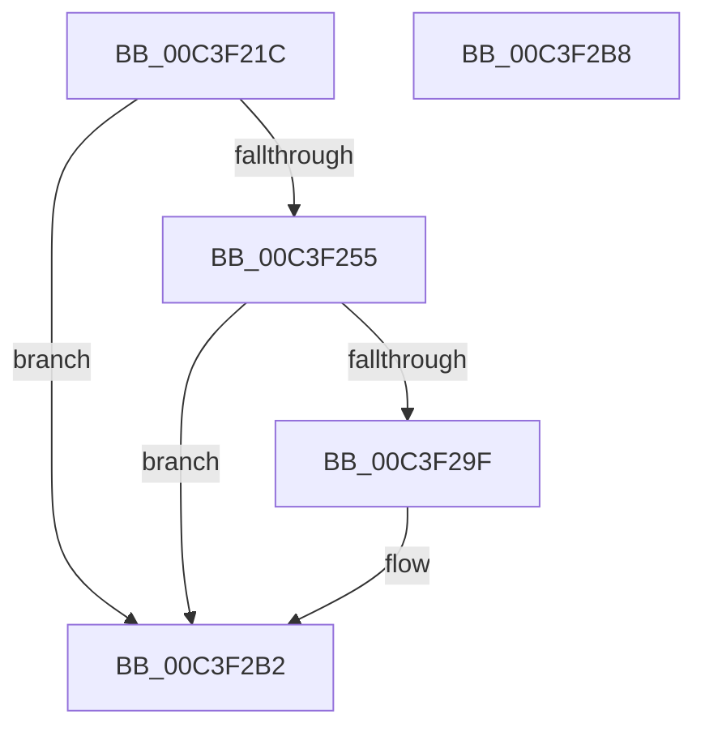

# PopSetupKsrCallbacks

- RVA: `0x00C3F21C`–`0x00C3F2B9` (길이 `157` bytes)
- VA: `0x0000000140C3F21C`
- 실행 섹션: `INIT`
- PDB 이름 있음: `예`; PDB Function 태그: `아니요`
- unwind 정보 RVA: `0x0008A308`
- 디코드: `41`개 명령, `157/157` bytes 표시
- 미해석 바이트: `0` (있으면 어셈블리에 `.byte`로 보존)

> 이 문서는 커널 이미지의 기계어와 PDB 기호를 분석해 생성했습니다. 4번과 5번은 함수 원형과 자료형을 바이너리 사용 방식에서 추정한 C 해석이며 원본 소스 복구 결과는 아닙니다.

## 1. Dependencies

- 직접 호출 지점: **4**; 고유 호출 대상: **4**
- 직접 호출자로 확인된 함수: **1**
- RIP 상대 이미지 참조: **3**

### Outgoing calls
- `0x00C3F245` → `ext-ms-win-ntos-ksr-l1-1-5.dll!KsrGetFirmwareInformation` (import, 간접 대상; import `ext-ms-win-ntos-ksr-l1-1-5.dll!KsrGetFirmwareInformation`)
- `0x00C3F260` → [RtlInitUnicodeString](../../text/42/RtlInitUnicodeString_function_0042A780.md) (function, `0x0042A780`)
- `0x00C3F296` → [ExCreateCallback](../../page/A7/ExCreateCallback_function_00A7B9D0.md) (function, `0x00A7B9D0`)
- `0x00C3F2AD` → [ExRegisterCallback](../../text/4B/ExRegisterCallback_function_004BDFC0.md) (function, `0x004BDFC0`)

### Direct callers
- [PoInitSystem](../C7/PoInitSystem_function_00C72358.md) at `0x00C73227`

### Static image references
- `0x00C3F245` → RVA `0x00151318` (`ext-ms-win-ntos-ksr-l1-1-5.dll!KsrGetFirmwareInformation (IAT)`; read)
- `0x00C3F255` → RVA `0x00C7B230` (` ?? ::PBOPGDP::`string'`; read)
- `0x00C3F2A3` → RVA `0x005D5B10` (`PopKsrCallback`; read)

## 2. Other-region calls and transfers

- 다른 실행 섹션으로 향하는 call: **3**
  - `0x00C3F260` → [RtlInitUnicodeString](../../text/42/RtlInitUnicodeString_function_0042A780.md) (`INIT` → `.text`)
  - `0x00C3F296` → [ExCreateCallback](../../page/A7/ExCreateCallback_function_00A7B9D0.md) (`INIT` → `PAGE`)
  - `0x00C3F2AD` → [ExRegisterCallback](../../text/4B/ExRegisterCallback_function_004BDFC0.md) (`INIT` → `.text`)
- 별도 외부 분기/꼬리 이동을 확인하지 못했습니다.

## 3. Assembly (complete function range)

```asm
00C3F21C  40 55                           push rbp
00C3F21E  48 8B EC                        mov rbp, rsp
00C3F221  48 83 EC 60                     sub rsp, 0x60
00C3F225  48 83 65 10 00                  and qword ptr [rbp + 0x10], 0
00C3F22A  48 8D 4D 18                     lea rcx, [rbp + 0x18]
00C3F22E  48 83 65 18 00                  and qword ptr [rbp + 0x18], 0
00C3F233  33 C0                           xor eax, eax
00C3F235  21 45 EC                        and dword ptr [rbp - 0x14], eax
00C3F238  0F 57 C0                        xorps xmm0, xmm0
00C3F23B  89 45 D4                        mov dword ptr [rbp - 0x2c], eax
00C3F23E  21 45 D4                        and dword ptr [rbp - 0x2c], eax
00C3F241  0F 11 45 C0                     movups xmmword ptr [rbp - 0x40], xmm0
00C3F245  48 FF 15 CC 20 51 FF            call qword ptr [rip - 0xaedf34]
00C3F24C  0F 1F 44 00 00                  nop dword ptr [rax + rax]
00C3F251  85 C0                           test eax, eax
00C3F253  78 5D                           js 0x140c3f2b2
00C3F255  48 8D 15 D4 BF 03 00            lea rdx, [rip + 0x3bfd4]
00C3F25C  48 8D 4D C0                     lea rcx, [rbp - 0x40]
00C3F260  E8 1B B5 7E FF                  call 0x14042a780
00C3F265  48 83 65 D8 00                  and qword ptr [rbp - 0x28], 0
00C3F26A  48 8D 45 C0                     lea rax, [rbp - 0x40]
00C3F26E  0F 57 C0                        xorps xmm0, xmm0
00C3F271  48 89 45 E0                     mov qword ptr [rbp - 0x20], rax
00C3F275  41 B1 01                        mov r9b, 1
00C3F278  C7 45 D0 30 00 00 00            mov dword ptr [rbp - 0x30], 0x30
00C3F27F  45 33 C0                        xor r8d, r8d
00C3F282  C7 45 E8 50 00 00 00            mov dword ptr [rbp - 0x18], 0x50
00C3F289  48 8D 55 D0                     lea rdx, [rbp - 0x30]
00C3F28D  48 8D 4D 10                     lea rcx, [rbp + 0x10]
00C3F291  F3 0F 7F 45 F0                  movdqu xmmword ptr [rbp - 0x10], xmm0
00C3F296  E8 35 C7 E3 FF                  call 0x140a7b9d0
00C3F29B  85 C0                           test eax, eax
00C3F29D  78 13                           js 0x140c3f2b2
00C3F29F  48 8B 4D 10                     mov rcx, qword ptr [rbp + 0x10]
00C3F2A3  48 8D 15 66 68 99 FF            lea rdx, [rip - 0x66979a]
00C3F2AA  45 33 C0                        xor r8d, r8d
00C3F2AD  E8 0E ED 87 FF                  call 0x1404bdfc0
00C3F2B2  48 83 C4 60                     add rsp, 0x60
00C3F2B6  5D                              pop rbp
00C3F2B7  C3                              ret
00C3F2B8  CC                              int3
```

## 4. C-style interpretation (structured pseudocode)

```c
__int64 __fastcall PopSetupKsrCallbacks(__int64 a1, __int64 a2, int a3)
{
    __int64 result;
    __int64 v_rsp;
    unsigned __int64 v_stack_m18;
    unsigned int v_stack_m1C;
    unsigned int v_stack_m20;
    unsigned __int64 v_stack_m28;
    unsigned __int64 v_stack_m30;
    unsigned int v_stack_m34;
    unsigned int v_stack_m38;
    unsigned __int64 v_stack_m48;
    unsigned __int64 v_stack_p10;
    unsigned __int64 v_stack_p8;

    v_rsp = (v_rsp) - (96);
    result = 0;
    v_stack_m34 = 0;
    v_stack_m48 = v_xmm0;
    result = ext_ms_win_ntos_ksr_l1_1_5_dll_KsrGetFirmwareInformation(v_stack_p10, a2, a3, a4);
    if (sign_flag) goto loc_00C3F2B2;
    result = RtlInitUnicodeString(v_stack_m48, v_rip + 245716, a3, a4);
    v_stack_m28 = v_stack_m48;
    v_stack_m38 = 48;
    a3 = 0;
    v_stack_m20 = 80;
    v_stack_m18 = v_xmm0;
    result = ExCreateCallback(v_stack_p8, v_stack_m38, a3, 1);
    if (!(sign_flag)) {
        a1 = v_stack_p8;
        a2 = v_rip - 6723482;
        a3 = 0;
        result = ExRegisterCallback(a1, a2, a3, 1);
    }
    v_rsp = (v_rsp) + (96);
    return result;
}
```

## 5. (Beta) C Style

```c
int64_t PopSetupKsrCallbacks(int64_t Arg1, int64_t Arg2, int32_t Arg3)
{
    int64_t result;
    int64_t local_rsp;
    uint64_t v_stack_m18;
    uint32_t v_stack_m1C;
    uint32_t v_stack_m20;
    uint64_t v_stack_m28;
    uint64_t v_stack_m30;
    uint32_t v_stack_m34;
    uint32_t v_stack_m38;
    uint64_t v_stack_m48;
    uint64_t v_stack_p10;
    uint64_t v_stack_p8;

    local_rsp = (local_rsp) - (96);
    result = 0;
    v_stack_m34 = 0;
    v_stack_m48 = v_xmm0;
    result = kernel_indirect_call(v_stack_p10, Arg2, Arg3, a4);
    if (sign_flag) goto loc_00C3F2B2;
    result = RtlInitUnicodeString(v_stack_m48, v_rip + 245716, Arg3, a4);
    v_stack_m28 = v_stack_m48;
    v_stack_m38 = 48;
    Arg3 = 0;
    v_stack_m20 = 80;
    v_stack_m18 = v_xmm0;
    result = ExCreateCallback(v_stack_p8, v_stack_m38, Arg3, 1);
    if (!(sign_flag)) {
        Arg1 = v_stack_p8;
        Arg2 = v_rip - 6723482;
        Arg3 = 0;
        result = ExRegisterCallback(Arg1, Arg2, Arg3, 1);
    }
    local_rsp = (local_rsp) + (96);
    return result;
}
```

## 6. Execution-region graph

[열기: 2D/3D 그래프와 함수 탐색 컨트롤 패널](../../../control-panel.html?section=init&rva=0x00C3F21C&view=graph)

- 2D 그래프는 위에서 아래로 흐르고, 3D 그래프는 빈 공간을 드래그해 회전합니다. Shift+드래그는 이동, 휠은 확대·축소, 함수 노드 선택은 대상 보고서 이동입니다.

### Static fallback


