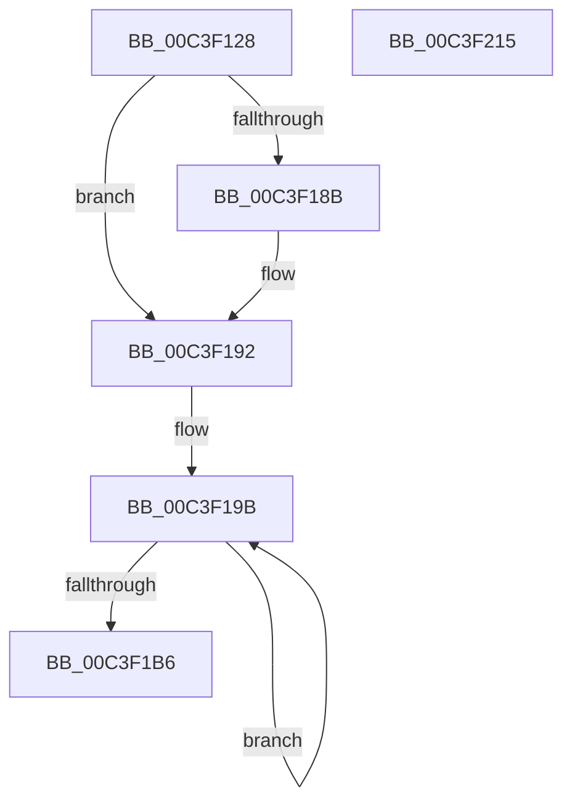

# PopThermalInit

- RVA: `0x00C3F128`–`0x00C3F216` (길이 `238` bytes)
- VA: `0x0000000140C3F128`
- 실행 섹션: `INIT`
- PDB 이름 있음: `예`; PDB Function 태그: `아니요`
- unwind 정보 RVA: `0x00064C80`
- 디코드: `48`개 명령, `238/238` bytes 표시
- 미해석 바이트: `0` (있으면 어셈블리에 `.byte`로 보존)

> 이 문서는 커널 이미지의 기계어와 PDB 기호를 분석해 생성했습니다. 4번과 5번은 함수 원형과 자료형을 바이너리 사용 방식에서 추정한 C 해석이며 원본 소스 복구 결과는 아닙니다.

## 1. Dependencies

- 직접 호출 지점: **3**; 고유 호출 대상: **3**
- 직접 호출자로 확인된 함수: **1**
- RIP 상대 이미지 참조: **23**

### Outgoing calls
- `0x00C3F17E` → [PopInitializeTimer](../../page/75/PopInitializeTimer_function_00754078.md) (function, `0x00754078`)
- `0x00C3F1D1` → [KiInitializeTimer2](../../text/3A/KiInitializeTimer2_function_003A3288.md) (function, `0x003A3288`)
- `0x00C3F1F5` → [PopInitializeWorkItem](../../page/75/PopInitializeWorkItem_function_007540C8.md) (function, `0x007540C8`)

### Direct callers
- [PoInitSystem](../C7/PoInitSystem_function_00C72358.md) at `0x00C72A03`

### Static image references
- `0x00C3F130` → RVA `0x00F0BB10` (`.data`; write)
- `0x00C3F137` → RVA `0x005D57F0` (`PopThermalTelemetryWorker`; read)
- `0x00C3F13E` → RVA `0x00F0C718` (`.data`; write)
- `0x00C3F148` → RVA `0x00F0C710` (`.data`; write)
- `0x00C3F14F` → RVA `0x005D57C0` (`PopThermalTelemetryCallback`; read)
- `0x00C3F156` → RVA `0x00F0C8E8` (`.data`; write)
- `0x00C3F15D` → RVA `0x00F0BA40` (`.data`; read)
- `0x00C3F164` → RVA `0x00F0C8E0` (`.data`; write)
- `0x00C3F16B` → RVA `0x00F0BB08` (`.data`; write)
- `0x00C3F172` → RVA `0x00F0BB00` (`.data`; write)
- `0x00C3F183` → RVA `0x00F0C960` (`.data`; read)
- `0x00C3F18B` → RVA `0x00F0C964` (`.data`; write)
- `0x00C3F192` → RVA `0x00F0C940` (`.data`; read)
- `0x00C3F1B9` → RVA `0x00F0B9B2` (`.data`; write)
- `0x00C3F1C3` → RVA `0x005D5550` (`PopThermalEventTransitionTimerCallback`; read)
- `0x00C3F1CA` → RVA `0x00F0B9B0` (`.data`; read)
- `0x00C3F1D6` → RVA `0x00F0B9AC` (`.data`; read/write)
- `0x00C3F1DD` → RVA `0x0075F820` (`PopThermalStateTransitionWorker`; read)
- `0x00C3F1E7` → RVA `0x00F0B9A8` (`.data`; write)
- `0x00C3F1EE` → RVA `0x00F0B940` (`.data`; read)
- `0x00C3F1FA` → RVA `0x00F0B988` (`.data`; write)
- `0x00C3F201` → RVA `0x00F0B980` (`.data`; write)
- `0x00C3F208` → RVA `0x00F0B990` (`.data`; write)

## 2. Other-region calls and transfers

- 다른 실행 섹션으로 향하는 call: **3**
  - `0x00C3F17E` → [PopInitializeTimer](../../page/75/PopInitializeTimer_function_00754078.md) (`INIT` → `PAGE`)
  - `0x00C3F1D1` → [KiInitializeTimer2](../../text/3A/KiInitializeTimer2_function_003A3288.md) (`INIT` → `.text`)
  - `0x00C3F1F5` → [PopInitializeWorkItem](../../page/75/PopInitializeWorkItem_function_007540C8.md) (`INIT` → `PAGE`)
- 별도 외부 분기/꼬리 이동을 확인하지 못했습니다.

## 3. Assembly (complete function range)

```asm
00C3F128  40 53                           push rbx
00C3F12A  48 83 EC 30                     sub rsp, 0x30
00C3F12E  33 DB                           xor ebx, ebx
00C3F130  C6 05 D9 C9 2C 00 01            mov byte ptr [rip + 0x2cc9d9], 1
00C3F137  4C 8D 0D B2 66 99 FF            lea r9, [rip - 0x66994e]
00C3F13E  48 89 1D D3 D5 2C 00            mov qword ptr [rip + 0x2cd5d3], rbx
00C3F145  45 33 C0                        xor r8d, r8d
00C3F148  48 89 1D C1 D5 2C 00            mov qword ptr [rip + 0x2cd5c1], rbx
00C3F14F  48 8D 15 6A 66 99 FF            lea rdx, [rip - 0x669996]
00C3F156  48 89 1D 8B D7 2C 00            mov qword ptr [rip + 0x2cd78b], rbx
00C3F15D  48 8D 0D DC C8 2C 00            lea rcx, [rip + 0x2cc8dc]
00C3F164  48 89 1D 75 D7 2C 00            mov qword ptr [rip + 0x2cd775], rbx
00C3F16B  48 89 1D 96 C9 2C 00            mov qword ptr [rip + 0x2cc996], rbx
00C3F172  48 89 1D 87 C9 2C 00            mov qword ptr [rip + 0x2cc987], rbx
00C3F179  48 89 5C 24 20                  mov qword ptr [rsp + 0x20], rbx
00C3F17E  E8 F5 4E B1 FF                  call 0x140754078
00C3F183  39 1D D7 D7 2C 00               cmp dword ptr [rip + 0x2cd7d7], ebx
00C3F189  74 07                           je 0x140c3f192
00C3F18B  C6 05 D2 D7 2C 00 01            mov byte ptr [rip + 0x2cd7d2], 1
00C3F192  4C 8D 05 A7 D7 2C 00            lea r8, [rip + 0x2cd7a7]
00C3F199  8B CB                           mov ecx, ebx
00C3F19B  B8 CD CC CC CC                  mov eax, 0xcccccccd
00C3F1A0  F7 E1                           mul ecx
00C3F1A2  83 C1 64                        add ecx, 0x64
00C3F1A5  C1 EA 04                        shr edx, 4
00C3F1A8  41 88 10                        mov byte ptr [r8], dl
00C3F1AB  49 FF C0                        inc r8
00C3F1AE  81 F9 34 08 00 00               cmp ecx, 0x834
00C3F1B4  72 E5                           jb 0x140c3f19b
00C3F1B6  45 33 C9                        xor r9d, r9d
00C3F1B9  66 89 1D F2 C7 2C 00            mov word ptr [rip + 0x2cc7f2], bx
00C3F1C0  45 33 C0                        xor r8d, r8d
00C3F1C3  48 8D 15 86 63 99 FF            lea rdx, [rip - 0x669c7a]
00C3F1CA  48 8D 0D DF C7 2C 00            lea rcx, [rip + 0x2cc7df]
00C3F1D1  E8 B2 40 76 FF                  call 0x1403a3288
00C3F1D6  83 0D CF C7 2C 00 FF            or dword ptr [rip + 0x2cc7cf], 0xffffffff
00C3F1DD  48 8D 15 3C 06 B2 FF            lea rdx, [rip - 0x4df9c4]
00C3F1E4  45 33 C0                        xor r8d, r8d
00C3F1E7  C6 05 BA C7 2C 00 01            mov byte ptr [rip + 0x2cc7ba], 1
00C3F1EE  48 8D 0D 4B C7 2C 00            lea rcx, [rip + 0x2cc74b]
00C3F1F5  E8 CE 4E B1 FF                  call 0x1407540c8
00C3F1FA  48 89 1D 87 C7 2C 00            mov qword ptr [rip + 0x2cc787], rbx
00C3F201  48 89 1D 78 C7 2C 00            mov qword ptr [rip + 0x2cc778], rbx
00C3F208  C6 05 81 C7 2C 00 01            mov byte ptr [rip + 0x2cc781], 1
00C3F20F  48 83 C4 30                     add rsp, 0x30
00C3F213  5B                              pop rbx
00C3F214  C3                              ret
00C3F215  CC                              int3
```

## 4. C-style interpretation (structured pseudocode)

```c
__int64 __fastcall PopThermalInit(__int64 a1, __int64 a2, int a3)
{
    __int64 result;
    __int64 v_rbx;
    __int64 v_rsp;
    unsigned __int64 v_stack_m18;

    v_rsp = (v_rsp) - (48);
    v_rbx = 0;
    *(unsigned __int8 *)(v_rip + 2935257) = 1;
    *(unsigned __int64 *)(v_rip + 2938323) = 0;
    a3 = 0;
    *(unsigned __int64 *)(v_rip + 2938305) = 0;
    *(unsigned __int64 *)(v_rip + 2938763) = 0;
    *(unsigned __int64 *)(v_rip + 2938741) = 0;
    *(unsigned __int64 *)(v_rip + 2935190) = 0;
    *(unsigned __int64 *)(v_rip + 2935175) = 0;
    v_stack_m18 = 0;
    result = PopInitializeTimer(v_rip + 2935004, v_rip - 6723990, a3, v_rip - 6723918);
    if ((*(unsigned int *)(v_rip + 2938839)) != 0) {
        *(unsigned __int8 *)(v_rip + 2938834) = 1;
    }
loc_00C3F19B:
    a1 = (unsigned int)((0) + (100));
    a2 = (unsigned int)((v_rip - 6723990) >> (4));
    *(unsigned __int8 *)(v_rip + 2938791) = (unsigned __int8)(a2);
    a3 = (v_rip + 2938791) + 1;
    if (((unsigned int)(a1)) < 0x834ULL) goto loc_00C3F19B;
    a4 = 0;
    *(unsigned __int16 *)(v_rip + 2934770) = 0;
    a3 = 0;
    result = KiInitializeTimer2(v_rip + 2934751, v_rip - 6724730, a3, a4);
    a3 = 0;
    *(unsigned __int8 *)(v_rip + 2934714) = 1;
    result = PopInitializeWorkItem(v_rip + 2934603, v_rip - 5110212, a3, a4);
    *(unsigned __int64 *)(v_rip + 2934663) = 0;
    *(unsigned __int64 *)(v_rip + 2934648) = 0;
    *(unsigned __int8 *)(v_rip + 2934657) = 1;
    v_rsp = (v_rsp) + (48);
    return result;
}
```

## 5. (Beta) C Style

```c
int64_t PopThermalInit(int64_t Arg1, int64_t Arg2, int32_t Arg3)
{
    int64_t result;
    int64_t local_rbx;
    int64_t local_rsp;
    uint64_t v_stack_m18;

    local_rsp = (local_rsp) - (48);
    local_rbx = 0;
    *(uint8_t *)(v_rip + 0x2CC9D9) = 1;
    *(uint64_t *)(v_rip + 0x2CD5D3) = 0;
    Arg3 = 0;
    *(uint64_t *)(v_rip + 0x2CD5C1) = 0;
    *(uint64_t *)(v_rip + 0x2CD78B) = 0;
    *(uint64_t *)(v_rip + 0x2CD775) = 0;
    *(uint64_t *)(v_rip + 0x2CC996) = 0;
    *(uint64_t *)(v_rip + 0x2CC987) = 0;
    v_stack_m18 = 0;
    result = PopInitializeTimer(v_rip + 2935004, v_rip - 6723990, Arg3, v_rip - 6723918);
    if ((*(uint32_t *)(v_rip + 0x2CD7D7)) != 0) {
        *(uint8_t *)(v_rip + 0x2CD7D2) = 1;
    }
loc_00C3F19B:
    Arg1 = (uint32_t)((0) + (100));
    Arg2 = (uint32_t)((v_rip - 6723990) >> (4));
    *(uint8_t *)(v_rip + 0x2CD7A7) = (uint8_t)(Arg2);
    Arg3 = (v_rip + 2938791) + 1;
    if (((uint32_t)(Arg1)) < 0x834ULL) goto loc_00C3F19B;
    a4 = 0;
    *(uint16_t *)(v_rip + 0x2CC7F2) = 0;
    Arg3 = 0;
    result = KiInitializeTimer2(v_rip + 2934751, v_rip - 6724730, Arg3, a4);
    Arg3 = 0;
    *(uint8_t *)(v_rip + 0x2CC7BA) = 1;
    result = PopInitializeWorkItem(v_rip + 2934603, v_rip - 5110212, Arg3, a4);
    *(uint64_t *)(v_rip + 0x2CC787) = 0;
    *(uint64_t *)(v_rip + 0x2CC778) = 0;
    *(uint8_t *)(v_rip + 0x2CC781) = 1;
    local_rsp = (local_rsp) + (48);
    return result;
}
```

## 6. Execution-region graph

[열기: 2D/3D 그래프와 함수 탐색 컨트롤 패널](../../../control-panel.html?section=init&rva=0x00C3F128&view=graph)

- 2D 그래프는 위에서 아래로 흐르고, 3D 그래프는 빈 공간을 드래그해 회전합니다. Shift+드래그는 이동, 휠은 확대·축소, 함수 노드 선택은 대상 보고서 이동입니다.

### Static fallback


