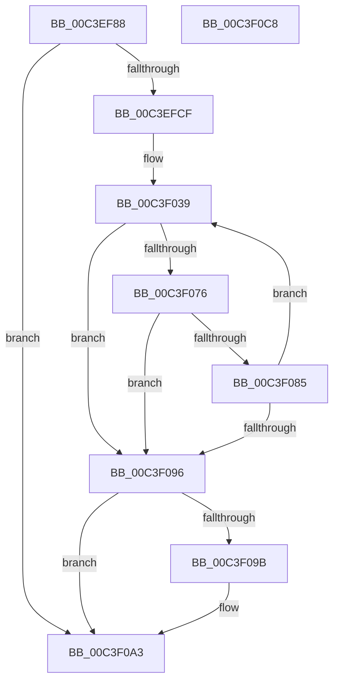

# PopUserShutdownInitializeSleepstudyDiagnostics

- RVA: `0x00C3EF88`–`0x00C3F0C9` (길이 `321` bytes)
- VA: `0x0000000140C3EF88`
- 실행 섹션: `INIT`
- PDB 이름 있음: `예`; PDB Function 태그: `아니요`
- unwind 정보 RVA: `0x000CC5B0`
- 디코드: `76`개 명령, `321/321` bytes 표시
- 미해석 바이트: `0` (있으면 어셈블리에 `.byte`로 보존)

> 이 문서는 커널 이미지의 기계어와 PDB 기호를 분석해 생성했습니다. 4번과 5번은 함수 원형과 자료형을 바이너리 사용 방식에서 추정한 C 해석이며 원본 소스 복구 결과는 아닙니다.

## 1. Dependencies

- 직접 호출 지점: **7**; 고유 호출 대상: **6**
- 직접 호출자로 확인된 함수: **1**
- RIP 상대 이미지 참조: **8**

### Outgoing calls
- `0x00C3EFC2` → [SleepstudyHelperCreateLibrary](../../page/AB/SleepstudyHelperCreateLibrary_function_00AB70F0.md) (function, `0x00AB70F0`)
- `0x00C3EFFC` → [RtlInitUnicodeString](../../text/42/RtlInitUnicodeString_function_0042A780.md) (function, `0x0042A780`)
- `0x00C3F023` → [RtlInitUnicodeString](../../text/42/RtlInitUnicodeString_function_0042A780.md) (function, `0x0042A780`)
- `0x00C3F069` → [SleepstudyHelperCreateBlockerFromGuid](../../text/3D/SleepstudyHelperCreateBlockerFromGuid_function_003D3F70.md) (function, `0x003D3F70`)
- `0x00C3F07C` → [SleepstudyHelperBuildBlocker](../../page/A2/SleepstudyHelperBuildBlocker_function_00A2DAD0.md) (function, `0x00A2DAD0`)
- `0x00C3F09E` → [SleepstudyHelperDestroyBlockerBuilder](../../page/A2/SleepstudyHelperDestroyBlockerBuilder_function_00A2DE80.md) (function, `0x00A2DE80`)
- `0x00C3F0AA` → [_security_check_cookie](../../text/6A/_security_check_cookie_function_006AC640.md) (function, `0x006AC640`)

### Direct callers
- [PopUserShutdownScenarioInitialize](PopUserShutdownScenarioInitialize_function_00C3F0D0.md) at `0x00C3F114`

### Static image references
- `0x00C3EFA3` → RVA `0x00E0A740` (`.data`; read)
- `0x00C3EFB6` → RVA `0x00F0CFF8` (`.data`; read)
- `0x00C3EFCF` → RVA `0x000292F0` (`.rdata`; read)
- `0x00C3EFD6` → RVA `0x00C7C1B0` (` ?? ::PBOPGDP::`string'`; read)
- `0x00C3F001` → RVA `0x00029300` (`.rdata`; read)
- `0x00C3F008` → RVA `0x00F0CFE0` (`.data`; read)
- `0x00C3F00F` → RVA `0x00C7C1D0` (` ?? ::PBOPGDP::`string'`; read)
- `0x00C3F028` → RVA `0x00F0CFE8` (`.data`; read)

## 2. Other-region calls and transfers

- 다른 실행 섹션으로 향하는 call: **7**
  - `0x00C3EFC2` → [SleepstudyHelperCreateLibrary](../../page/AB/SleepstudyHelperCreateLibrary_function_00AB70F0.md) (`INIT` → `PAGE`)
  - `0x00C3EFFC` → [RtlInitUnicodeString](../../text/42/RtlInitUnicodeString_function_0042A780.md) (`INIT` → `.text`)
  - `0x00C3F023` → [RtlInitUnicodeString](../../text/42/RtlInitUnicodeString_function_0042A780.md) (`INIT` → `.text`)
  - `0x00C3F069` → [SleepstudyHelperCreateBlockerFromGuid](../../text/3D/SleepstudyHelperCreateBlockerFromGuid_function_003D3F70.md) (`INIT` → `.text`)
  - `0x00C3F07C` → [SleepstudyHelperBuildBlocker](../../page/A2/SleepstudyHelperBuildBlocker_function_00A2DAD0.md) (`INIT` → `PAGE`)
  - `0x00C3F09E` → [SleepstudyHelperDestroyBlockerBuilder](../../page/A2/SleepstudyHelperDestroyBlockerBuilder_function_00A2DE80.md) (`INIT` → `PAGE`)
  - `0x00C3F0AA` → [_security_check_cookie](../../text/6A/_security_check_cookie_function_006AC640.md) (`INIT` → `.text`)
- 별도 외부 분기/꼬리 이동을 확인하지 못했습니다.

## 3. Assembly (complete function range)

```asm
00C3EF88  48 8B C4                        mov rax, rsp
00C3EF8B  48 89 58 08                     mov qword ptr [rax + 8], rbx
00C3EF8F  48 89 70 10                     mov qword ptr [rax + 0x10], rsi
00C3EF93  48 89 78 18                     mov qword ptr [rax + 0x18], rdi
00C3EF97  55                              push rbp
00C3EF98  48 8D 68 A1                     lea rbp, [rax - 0x5f]
00C3EF9C  48 81 EC A0 00 00 00            sub rsp, 0xa0
00C3EFA3  48 8B 05 96 B7 1C 00            mov rax, qword ptr [rip + 0x1cb796]
00C3EFAA  48 33 C4                        xor rax, rsp
00C3EFAD  48 89 45 4F                     mov qword ptr [rbp + 0x4f], rax
00C3EFB1  48 83 65 F7 00                  and qword ptr [rbp - 9], 0
00C3EFB6  48 8D 15 3B E0 2C 00            lea rdx, [rip + 0x2ce03b]
00C3EFBD  B9 54 57 53 50                  mov ecx, 0x50535754
00C3EFC2  E8 29 81 E7 FF                  call 0x140ab70f0
00C3EFC7  85 C0                           test eax, eax
00C3EFC9  0F 88 D4 00 00 00               js 0x140c3f0a3
00C3EFCF  0F 10 05 1A A3 3E FF            movups xmm0, xmmword ptr [rip - 0xc15ce6]
00C3EFD6  48 8D 15 D3 D1 03 00            lea rdx, [rip + 0x3d1d3]
00C3EFDD  C7 45 E7 DD AA DD AA            mov dword ptr [rbp - 0x19], 0xaaddaadd
00C3EFE4  48 8D 4D 0F                     lea rcx, [rbp + 0xf]
00C3EFE8  C7 45 EB 05 00 00 00            mov dword ptr [rbp - 0x15], 5
00C3EFEF  F3 0F 7F 45 2F                  movdqu xmmword ptr [rbp + 0x2f], xmm0
00C3EFF4  48 C7 45 EF 78 00 00 00         mov qword ptr [rbp - 0x11], 0x78
00C3EFFC  E8 7F B7 7E FF                  call 0x14042a780
00C3F001  0F 10 05 F8 A2 3E FF            movups xmm0, xmmword ptr [rip - 0xc15d08]
00C3F008  48 8D 05 D1 DF 2C 00            lea rax, [rip + 0x2cdfd1]
00C3F00F  48 8D 15 BA D1 03 00            lea rdx, [rip + 0x3d1ba]
00C3F016  48 89 45 FF                     mov qword ptr [rbp - 1], rax
00C3F01A  48 8D 4D 1F                     lea rcx, [rbp + 0x1f]
00C3F01E  F3 0F 7F 45 3F                  movdqu xmmword ptr [rbp + 0x3f], xmm0
00C3F023  E8 58 B7 7E FF                  call 0x14042a780
00C3F028  48 8D 05 B9 DF 2C 00            lea rax, [rip + 0x2cdfb9]
00C3F02F  33 FF                           xor edi, edi
00C3F031  48 89 45 07                     mov qword ptr [rbp + 7], rax
00C3F035  48 8D 75 FF                     lea rsi, [rbp - 1]
00C3F039  48 8B 0D B8 DF 2C 00            mov rcx, qword ptr [rip + 0x2cdfb8]
00C3F040  4C 8D 4D 0F                     lea r9, [rbp + 0xf]
00C3F044  8B C7                           mov eax, edi
00C3F046  4C 8D 45 2F                     lea r8, [rbp + 0x2f]
00C3F04A  48 C1 E0 04                     shl rax, 4
00C3F04E  48 8D 55 E7                     lea rdx, [rbp - 0x19]
00C3F052  4C 03 C8                        add r9, rax
00C3F055  4C 03 C0                        add r8, rax
00C3F058  48 8D 45 F7                     lea rax, [rbp - 9]
00C3F05C  48 89 44 24 28                  mov qword ptr [rsp + 0x28], rax
00C3F061  C7 44 24 20 04 00 00 00         mov dword ptr [rsp + 0x20], 4
00C3F069  E8 02 4F 79 FF                  call 0x1403d3f70
00C3F06E  48 8B 5D F7                     mov rbx, qword ptr [rbp - 9]
00C3F072  85 C0                           test eax, eax
00C3F074  78 20                           js 0x140c3f096
00C3F076  48 8B 16                        mov rdx, qword ptr [rsi]
00C3F079  48 8B CB                        mov rcx, rbx
00C3F07C  E8 4F EA DE FF                  call 0x140a2dad0
00C3F081  85 C0                           test eax, eax
00C3F083  78 11                           js 0x140c3f096
00C3F085  33 DB                           xor ebx, ebx
00C3F087  FF C7                           inc edi
00C3F089  48 83 C6 08                     add rsi, 8
00C3F08D  48 89 5D F7                     mov qword ptr [rbp - 9], rbx
00C3F091  83 FF 02                        cmp edi, 2
00C3F094  72 A3                           jb 0x140c3f039
00C3F096  48 85 DB                        test rbx, rbx
00C3F099  74 08                           je 0x140c3f0a3
00C3F09B  48 8B CB                        mov rcx, rbx
00C3F09E  E8 DD ED DE FF                  call 0x140a2de80
00C3F0A3  48 8B 4D 4F                     mov rcx, qword ptr [rbp + 0x4f]
00C3F0A7  48 33 CC                        xor rcx, rsp
00C3F0AA  E8 91 D5 A6 FF                  call 0x1406ac640
00C3F0AF  4C 8D 9C 24 A0 00 00 00         lea r11, [rsp + 0xa0]
00C3F0B7  49 8B 5B 10                     mov rbx, qword ptr [r11 + 0x10]
00C3F0BB  49 8B 73 18                     mov rsi, qword ptr [r11 + 0x18]
00C3F0BF  49 8B 7B 20                     mov rdi, qword ptr [r11 + 0x20]
00C3F0C3  49 8B E3                        mov rsp, r11
00C3F0C6  5D                              pop rbp
00C3F0C7  C3                              ret
00C3F0C8  CC                              int3
```

## 4. C-style interpretation (structured pseudocode)

```c
__int64 __fastcall PopUserShutdownInitializeSleepstudyDiagnostics(void)
{
    __int64 result;
    __int64 v_rbx;
    __int64 v_rdi;
    __int64 v_rsi;
    __int64 v_rsp;
    unsigned __int64 v_stack_m8;
    unsigned __int64 v_stack_m80;
    unsigned int v_stack_m88;

    *(unsigned __int64 *)(v_rsp + 8) = v_rbx;
    *(unsigned __int64 *)(v_rsp + 16) = v_rsi;
    *(unsigned __int64 *)(v_rsp + 24) = v_rdi;
    v_rsp = (v_rsp) - (160);
    result = (*(unsigned __int64 *)(v_rip + 1882006)) ^ (v_rsp);
    *(unsigned __int64 *)(v_rsp - 95 + 79) = result;
    result = SleepstudyHelperCreateLibrary((unsigned int)(0x50535754ULL), v_rip + 2940987, a3, a4);
    if (sign_flag) goto loc_00C3F0A3;
    *(unsigned int *)(v_rsp - 95 - 25) = 0xAADDAADDULL;
    *(unsigned int *)(v_rsp - 95 - 21) = 5;
    *(unsigned __int64 *)(v_rsp - 95 + 47) = v_xmm0;
    *(unsigned __int64 *)(v_rsp - 95 - 17) = 120;
    result = RtlInitUnicodeString(v_rsp - 95 + 15, v_rip + 250323, a3, a4);
    *(unsigned __int64 *)(v_rsp - 95 - 1) = v_rip + 2940881;
    *(unsigned __int64 *)(v_rsp - 95 + 63) = v_xmm0;
    result = RtlInitUnicodeString(v_rsp - 95 + 31, v_rip + 250298, a3, a4);
    v_rdi = 0;
    *(unsigned __int64 *)(v_rsp - 95 + 7) = v_rip + 2940857;
loc_00C3F039:
    result = (0) << (4);
    a4 = (v_rsp - 95 + 15) + (result);
    a3 = (v_rsp - 95 + 47) + (result);
    v_stack_m80 = v_rsp - 95 - 9;
    v_stack_m88 = 4;
    result = SleepstudyHelperCreateBlockerFromGuid(*(unsigned __int64 *)(v_rip + 2940856), v_rsp - 95 - 25, a3, a4);
    if (sign_flag) goto loc_00C3F096;
    result = SleepstudyHelperBuildBlocker(*(unsigned __int64 *)(v_rsp - 95 - 9), *(unsigned __int64 *)(v_rsp - 95 - 1), a3, a4);
    if (sign_flag) goto loc_00C3F096;
    v_rbx = 0;
    v_rdi = (unsigned int)((v_rdi) + 1);
    v_rsi = (v_rsp - 95 - 1) + (8);
    *(unsigned __int64 *)(v_rsp - 95 - 9) = 0;
    if (((unsigned int)(v_rdi)) < 2) goto loc_00C3F039;
loc_00C3F096:
    if (0 != 0) {
        a1 = 0;
        result = SleepstudyHelperDestroyBlockerBuilder(a1, *(unsigned __int64 *)(v_rsp - 95 - 1), a3, a4);
    }
    a1 = (*(unsigned __int64 *)(v_rsp - 95 + 79)) ^ (v_rsp);
    result = _security_check_cookie(a1, *(unsigned __int64 *)(v_rsp - 95 - 1), a3, a4);
    return result;
}
```

## 5. (Beta) C Style

```c
void PopUserShutdownInitializeSleepstudyDiagnostics(void)
{
    int64_t result;
    int64_t local_rbx;
    int64_t local_rdi;
    int64_t local_rsi;
    int64_t local_rsp;
    uint64_t v_stack_m8;
    uint64_t v_stack_m80;
    uint32_t v_stack_m88;

    *(uint64_t *)(local_rsp + 0x8) = local_rbx;
    *(uint64_t *)(local_rsp + 0x10) = local_rsi;
    *(uint64_t *)(local_rsp + 0x18) = local_rdi;
    local_rsp = (local_rsp) - (160);
    result = (*(uint64_t *)(v_rip + 0x1CB796)) ^ (local_rsp);
    *(uint64_t *)(local_rsp - 0x5F + 0x4F) = result;
    result = SleepstudyHelperCreateLibrary((uint32_t)(0x50535754ULL), v_rip + 2940987, a3, a4);
    if (sign_flag) goto loc_00C3F0A3;
    *(uint32_t *)(local_rsp - 0x5F - 0x19) = 0xAADDAADDULL;
    *(uint32_t *)(local_rsp - 0x5F - 0x15) = 5;
    *(uint64_t *)(local_rsp - 0x5F + 0x2F) = v_xmm0;
    *(uint64_t *)(local_rsp - 0x5F - 0x11) = 120;
    result = RtlInitUnicodeString(local_rsp - 95 + 15, v_rip + 250323, a3, a4);
    *(uint64_t *)(local_rsp - 0x5F - 0x1) = v_rip + 2940881;
    *(uint64_t *)(local_rsp - 0x5F + 0x3F) = v_xmm0;
    result = RtlInitUnicodeString(local_rsp - 95 + 31, v_rip + 250298, a3, a4);
    local_rdi = 0;
    *(uint64_t *)(local_rsp - 0x5F + 0x7) = v_rip + 2940857;
loc_00C3F039:
    result = (0) << (4);
    a4 = (local_rsp - 95 + 15) + (result);
    a3 = (local_rsp - 95 + 47) + (result);
    v_stack_m80 = local_rsp - 95 - 9;
    v_stack_m88 = 4;
    result = SleepstudyHelperCreateBlockerFromGuid(*(uint64_t *)(v_rip + 0x2CDFB8), local_rsp - 95 - 25, a3, a4);
    if (sign_flag) goto loc_00C3F096;
    result = SleepstudyHelperBuildBlocker(*(uint64_t *)(local_rsp - 0x5F - 0x9), *(uint64_t *)(local_rsp - 0x5F - 0x1), a3, a4);
    if (sign_flag) goto loc_00C3F096;
    local_rbx = 0;
    local_rdi = (uint32_t)((local_rdi) + 1);
    local_rsi = (local_rsp - 95 - 1) + (8);
    *(uint64_t *)(local_rsp - 0x5F - 0x9) = 0;
    if (((uint32_t)(local_rdi)) < 2) goto loc_00C3F039;
loc_00C3F096:
    if (0 != 0) {
        a1 = 0;
        result = SleepstudyHelperDestroyBlockerBuilder(a1, *(uint64_t *)(local_rsp - 0x5F - 0x1), a3, a4);
    }
    a1 = (*(uint64_t *)(local_rsp - 0x5F + 0x4F)) ^ (local_rsp);
    result = _security_check_cookie(a1, *(uint64_t *)(local_rsp - 0x5F - 0x1), a3, a4);
    return result;
}
```

## 6. Execution-region graph

[열기: 2D/3D 그래프와 함수 탐색 컨트롤 패널](../../../control-panel.html?section=init&rva=0x00C3EF88&view=graph)

- 2D 그래프는 위에서 아래로 흐르고, 3D 그래프는 빈 공간을 드래그해 회전합니다. Shift+드래그는 이동, 휠은 확대·축소, 함수 노드 선택은 대상 보고서 이동입니다.

### Static fallback


