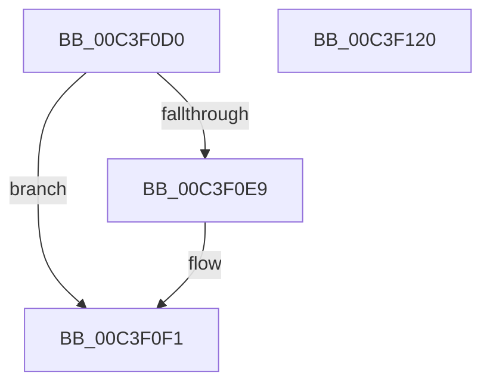

# PopUserShutdownScenarioInitialize

- RVA: `0x00C3F0D0`–`0x00C3F121` (길이 `81` bytes)
- VA: `0x0000000140C3F0D0`
- 실행 섹션: `INIT`
- PDB 이름 있음: `예`; PDB Function 태그: `아니요`
- unwind 정보 RVA: `0x0005D2F4`
- 디코드: `18`개 명령, `81/81` bytes 표시
- 미해석 바이트: `0` (있으면 어셈블리에 `.byte`로 보존)

> 이 문서는 커널 이미지의 기계어와 PDB 기호를 분석해 생성했습니다. 4번과 5번은 함수 원형과 자료형을 바이너리 사용 방식에서 추정한 C 해석이며 원본 소스 복구 결과는 아닙니다.

## 1. Dependencies

- 직접 호출 지점: **3**; 고유 호출 대상: **3**
- 직접 호출자로 확인된 함수: **1**
- RIP 상대 이미지 참조: **5**

### Outgoing calls
- `0x00C3F0E0` → [PdcTaskClientRegister](../../page/79/PdcTaskClientRegister_function_0079B49C.md) (function, `0x0079B49C`)
- `0x00C3F10F` → [PopInitializeTimer](../../page/75/PopInitializeTimer_function_00754078.md) (function, `0x00754078`)
- `0x00C3F114` → [PopUserShutdownInitializeSleepstudyDiagnostics](PopUserShutdownInitializeSleepstudyDiagnostics_function_00C3EF88.md) (function, `0x00C3EF88`)

### Direct callers
- [PoInitSystem](../C7/PoInitSystem_function_00C72358.md) at `0x00C72F10`

### Static image references
- `0x00C3F0D4` → RVA `0x00F0D0B0` (`.data`; read)
- `0x00C3F0E9` → RVA `0x00F0D0B0` (`.data`; read/write)
- `0x00C3F0F7` → RVA `0x0075F3C0` (`PopUserShutdownCalloutDelayTimerWorker`; read)
- `0x00C3F101` → RVA `0x005D53D0` (`PopUserShutdownCalloutDelayTimerCallback`; read)
- `0x00C3F108` → RVA `0x00F0D000` (`.data`; read)

## 2. Other-region calls and transfers

- 다른 실행 섹션으로 향하는 call: **2**
  - `0x00C3F0E0` → [PdcTaskClientRegister](../../page/79/PdcTaskClientRegister_function_0079B49C.md) (`INIT` → `PAGE`)
  - `0x00C3F10F` → [PopInitializeTimer](../../page/75/PopInitializeTimer_function_00754078.md) (`INIT` → `PAGE`)
- 별도 외부 분기/꼬리 이동을 확인하지 못했습니다.

## 3. Assembly (complete function range)

```asm
00C3F0D0  48 83 EC 38                     sub rsp, 0x38
00C3F0D4  48 8D 15 D5 DF 2C 00            lea rdx, [rip + 0x2cdfd5]
00C3F0DB  B9 78 00 00 00                  mov ecx, 0x78
00C3F0E0  E8 B7 C3 B5 FF                  call 0x14079b49c
00C3F0E5  85 C0                           test eax, eax
00C3F0E7  79 08                           jns 0x140c3f0f1
00C3F0E9  48 83 25 BF DF 2C 00 00         and qword ptr [rip + 0x2cdfbf], 0
00C3F0F1  48 83 64 24 20 00               and qword ptr [rsp + 0x20], 0
00C3F0F7  4C 8D 0D C2 02 B2 FF            lea r9, [rip - 0x4dfd3e]
00C3F0FE  45 33 C0                        xor r8d, r8d
00C3F101  48 8D 15 C8 62 99 FF            lea rdx, [rip - 0x669d38]
00C3F108  48 8D 0D F1 DE 2C 00            lea rcx, [rip + 0x2cdef1]
00C3F10F  E8 64 4F B1 FF                  call 0x140754078
00C3F114  E8 6F FE FF FF                  call 0x140c3ef88
00C3F119  33 C0                           xor eax, eax
00C3F11B  48 83 C4 38                     add rsp, 0x38
00C3F11F  C3                              ret
00C3F120  CC                              int3
```

## 4. C-style interpretation (structured pseudocode)

```c
__int64 __fastcall PopUserShutdownScenarioInitialize(__int64 a1, __int64 a2, int a3)
{
    __int64 result;
    __int64 v_rsp;
    unsigned __int64 v_stack_m18;

    v_rsp = (v_rsp) - (56);
    result = PdcTaskClientRegister(120, v_rip + 2940885, a3, a4);
    if (sign_flag) {
    }
    a3 = 0;
    result = PopInitializeTimer(v_rip + 2940657, v_rip - 6724920, a3, v_rip - 5111102);
    result = PopUserShutdownInitializeSleepstudyDiagnostics(v_rip + 2940657, v_rip - 6724920, a3, v_rip - 5111102);
    result = 0;
    v_rsp = (v_rsp) + (56);
    return result;
}
```

## 5. (Beta) C Style

```c
int64_t PopUserShutdownScenarioInitialize(int64_t Arg1, int64_t Arg2, int32_t Arg3)
{
    int64_t result;
    int64_t local_rsp;
    uint64_t v_stack_m18;

    local_rsp = (local_rsp) - (56);
    result = PdcTaskClientRegister(120, v_rip + 2940885, Arg3, a4);
    if (sign_flag) {
    }
    Arg3 = 0;
    result = PopInitializeTimer(v_rip + 2940657, v_rip - 6724920, Arg3, v_rip - 5111102);
    result = PopUserShutdownInitializeSleepstudyDiagnostics(v_rip + 2940657, v_rip - 6724920, Arg3, v_rip - 5111102);
    result = 0;
    local_rsp = (local_rsp) + (56);
    return result;
}
```

## 6. Execution-region graph

[열기: 2D/3D 그래프와 함수 탐색 컨트롤 패널](../../../control-panel.html?section=init&rva=0x00C3F0D0&view=graph)

- 2D 그래프는 위에서 아래로 흐르고, 3D 그래프는 빈 공간을 드래그해 회전합니다. Shift+드래그는 이동, 휠은 확대·축소, 함수 노드 선택은 대상 보고서 이동입니다.

### Static fallback


