# PpDevCfgInit

- RVA: `0x00C351A4`–`0x00C35529` (길이 `901` bytes)
- VA: `0x0000000140C351A4`
- 실행 섹션: `INIT`
- PDB 이름 있음: `예`; PDB Function 태그: `아니요`
- unwind 정보 RVA: `0x00098698`
- 디코드: `219`개 명령, `901/901` bytes 표시
- 미해석 바이트: `0` (있으면 어셈블리에 `.byte`로 보존)

> 이 문서는 커널 이미지의 기계어와 PDB 기호를 분석해 생성했습니다. 4번과 5번은 함수 원형과 자료형을 바이너리 사용 방식에서 추정한 C 해석이며 원본 소스 복구 결과는 아닙니다.

## 1. Dependencies

- 직접 호출 지점: **18**; 고유 호출 대상: **14**
- 직접 호출자로 확인된 함수: **1**
- RIP 상대 이미지 참조: **18**

### Outgoing calls
- `0x00C3520A` → [memset](../../text/6C/memset_function_006C6C40.md) (function, `0x006C6C40`)
- `0x00C35292` → [PiDevCfgQueryObjectProperties](../../page/97/PiDevCfgQueryObjectProperties_function_0097776C.md) (function, `0x0097776C`)
- `0x00C352F5` → [PipOpenServiceEnumKeys](../../page/99/PipOpenServiceEnumKeys_function_00998E94.md) (function, `0x00998E94`)
- `0x00C35338` → [PnpCtxRegOpenKey](../../page/8E/PnpCtxRegOpenKey_function_008EF7B8.md) (function, `0x008EF7B8`)
- `0x00C35345` → [RtlIsStateSeparationEnabled](../../page/A3/RtlIsStateSeparationEnabled_function_00A3C560.md) (function, `0x00A3C560`)
- `0x00C35377` → [PnpCtxRegQueryValue](../../page/99/PnpCtxRegQueryValue_function_009940FC.md) (function, `0x009940FC`)
- `0x00C353BE` → [PnpCtxRegQueryValue](../../page/99/PnpCtxRegQueryValue_function_009940FC.md) (function, `0x009940FC`)
- `0x00C353DD` → [ZwClose](../../text/6A/ZwClose_function_006AD2B0.md) (function, `0x006AD2B0`)
- `0x00C353E6` → [ZwClose](../../text/6A/ZwClose_function_006AD2B0.md) (function, `0x006AD2B0`)
- `0x00C353FA` → [PpDevCfgRequestDeviceInstall](../../page/70/PpDevCfgRequestDeviceInstall_function_00704520.md) (function, `0x00704520`)
- `0x00C35423` → [PiDevCfgReadDriverPolicy](../../page/73/PiDevCfgReadDriverPolicy_function_00735638.md) (function, `0x00735638`)
- `0x00C3544C` → [PiDrvDbQuerySyncNodesUpdated](../../page/74/PiDrvDbQuerySyncNodesUpdated_function_00741F70.md) (function, `0x00741F70`)
- `0x00C3547E` → [RtlIsStateSeparationEnabled](../../page/A3/RtlIsStateSeparationEnabled_function_00A3C560.md) (function, `0x00A3C560`)
- `0x00C35487` → [PiDrvDbEnumNodes](../../page/74/PiDrvDbEnumNodes_function_0074103C.md) (function, `0x0074103C`)
- `0x00C354A0` → [PiDmEnumObjectsWithCallback](../../page/8E/PiDmEnumObjectsWithCallback_function_008E3920.md) (function, `0x008E3920`)
- `0x00C354E6` → [PiDevCfgSetObjectProperty](../../page/A8/PiDevCfgSetObjectProperty_function_00A8DB50.md) (function, `0x00A8DB50`)
- `0x00C354F4` → [PiDrvDbQuerySyncNodesUpdated](../../page/74/PiDrvDbQuerySyncNodesUpdated_function_00741F70.md) (function, `0x00741F70`)
- `0x00C35502` → [_security_check_cookie](../../text/6A/_security_check_cookie_function_006AC640.md) (function, `0x006AC640`)

### Direct callers
- [IopInitializePlugPlayServices](../C2/IopInitializePlugPlayServices_function_00C2F298.md) at `0x00C2F953`

### Static image references
- `0x00C351C7` → RVA `0x00E0A740` (`.data`; read)
- `0x00C3520F` → RVA `0x00022A18` (`.rdata`; read)
- `0x00C35236` → RVA `0x00023230` (`.rdata`; read)
- `0x00C35245` → RVA `0x00022B38` (`.rdata`; read)
- `0x00C3526D` → RVA `0x00C7A7A0` (` ?? ::PBOPGDP::`string'`; read)
- `0x00C352CE` → RVA `0x00C7AF60` (` ?? ::PBOPGDP::`string'`; read)
- `0x00C3530A` → RVA `0x00E66398` (`.data`; read)
- `0x00C35311` → RVA `0x00C7AF80` (` ?? ::PBOPGDP::`string'`; read)
- `0x00C3536B` → RVA `0x00C7AFA0` (` ?? ::PBOPGDP::`string'`; read)
- `0x00C353B2` → RVA `0x00C7AFD0` (` ?? ::PBOPGDP::`string'`; read)
- `0x00C353EF` → RVA `0x00FD8030` (`PAGEDATA`; read/write)
- `0x00C3540A` → RVA `0x00FD82E0` (`PAGEDATA`; read)
- `0x00C35411` → RVA `0x00FD8054` (`PAGEDATA`; write)
- `0x00C3541D` → RVA `0x00FD80B4` (`PAGEDATA`; write)
- `0x00C35428` → RVA `0x00FD8054` (`PAGEDATA`; read)
- `0x00C35431` → RVA `0x00FD80B4` (`PAGEDATA`; read)
- `0x00C3543B` → RVA `0x00FD8030` (`PAGEDATA`; read)
- `0x00C35495` → RVA `0x00733800` (`PiDevCfgInitDeviceCallback`; read)

## 2. Other-region calls and transfers

- 다른 실행 섹션으로 향하는 call: **18**
  - `0x00C3520A` → [memset](../../text/6C/memset_function_006C6C40.md) (`INIT` → `.text`)
  - `0x00C35292` → [PiDevCfgQueryObjectProperties](../../page/97/PiDevCfgQueryObjectProperties_function_0097776C.md) (`INIT` → `PAGE`)
  - `0x00C352F5` → [PipOpenServiceEnumKeys](../../page/99/PipOpenServiceEnumKeys_function_00998E94.md) (`INIT` → `PAGE`)
  - `0x00C35338` → [PnpCtxRegOpenKey](../../page/8E/PnpCtxRegOpenKey_function_008EF7B8.md) (`INIT` → `PAGE`)
  - `0x00C35345` → [RtlIsStateSeparationEnabled](../../page/A3/RtlIsStateSeparationEnabled_function_00A3C560.md) (`INIT` → `PAGE`)
  - `0x00C35377` → [PnpCtxRegQueryValue](../../page/99/PnpCtxRegQueryValue_function_009940FC.md) (`INIT` → `PAGE`)
  - `0x00C353BE` → [PnpCtxRegQueryValue](../../page/99/PnpCtxRegQueryValue_function_009940FC.md) (`INIT` → `PAGE`)
  - `0x00C353DD` → [ZwClose](../../text/6A/ZwClose_function_006AD2B0.md) (`INIT` → `.text`)
  - `0x00C353E6` → [ZwClose](../../text/6A/ZwClose_function_006AD2B0.md) (`INIT` → `.text`)
  - `0x00C353FA` → [PpDevCfgRequestDeviceInstall](../../page/70/PpDevCfgRequestDeviceInstall_function_00704520.md) (`INIT` → `PAGE`)
  - `0x00C35423` → [PiDevCfgReadDriverPolicy](../../page/73/PiDevCfgReadDriverPolicy_function_00735638.md) (`INIT` → `PAGE`)
  - `0x00C3544C` → [PiDrvDbQuerySyncNodesUpdated](../../page/74/PiDrvDbQuerySyncNodesUpdated_function_00741F70.md) (`INIT` → `PAGE`)
  - `0x00C3547E` → [RtlIsStateSeparationEnabled](../../page/A3/RtlIsStateSeparationEnabled_function_00A3C560.md) (`INIT` → `PAGE`)
  - `0x00C35487` → [PiDrvDbEnumNodes](../../page/74/PiDrvDbEnumNodes_function_0074103C.md) (`INIT` → `PAGE`)
  - `0x00C354A0` → [PiDmEnumObjectsWithCallback](../../page/8E/PiDmEnumObjectsWithCallback_function_008E3920.md) (`INIT` → `PAGE`)
  - `0x00C354E6` → [PiDevCfgSetObjectProperty](../../page/A8/PiDevCfgSetObjectProperty_function_00A8DB50.md) (`INIT` → `PAGE`)
  - `0x00C354F4` → [PiDrvDbQuerySyncNodesUpdated](../../page/74/PiDrvDbQuerySyncNodesUpdated_function_00741F70.md) (`INIT` → `PAGE`)
  - `0x00C35502` → [_security_check_cookie](../../text/6A/_security_check_cookie_function_006AC640.md) (`INIT` → `.text`)
- 별도 외부 분기/꼬리 이동을 확인하지 못했습니다.

## 3. Assembly (complete function range)

```asm
00C351A4  48 8B C4                        mov rax, rsp
00C351A7  48 89 58 08                     mov qword ptr [rax + 8], rbx
00C351AB  48 89 70 10                     mov qword ptr [rax + 0x10], rsi
00C351AF  48 89 78 18                     mov qword ptr [rax + 0x18], rdi
00C351B3  4C 89 60 20                     mov qword ptr [rax + 0x20], r12
00C351B7  55                              push rbp
00C351B8  41 56                           push r14
00C351BA  41 57                           push r15
00C351BC  48 8D 68 B8                     lea rbp, [rax - 0x48]
00C351C0  48 81 EC 30 01 00 00            sub rsp, 0x130
00C351C7  48 8B 05 72 55 1D 00            mov rax, qword ptr [rip + 0x1d5572]
00C351CE  48 33 C4                        xor rax, rsp
00C351D1  48 89 45 20                     mov qword ptr [rbp + 0x20], rax
00C351D5  45 33 FF                        xor r15d, r15d
00C351D8  48 8D 4D A0                     lea rcx, [rbp - 0x60]
00C351DC  33 D2                           xor edx, edx
00C351DE  44 89 7C 24 68                  mov dword ptr [rsp + 0x68], r15d
00C351E3  44 89 7C 24 70                  mov dword ptr [rsp + 0x70], r15d
00C351E8  45 8A F7                        mov r14b, r15b
00C351EB  44 88 7C 24 60                  mov byte ptr [rsp + 0x60], r15b
00C351F0  45 8D 47 78                     lea r8d, [r15 + 0x78]
00C351F4  44 88 7C 24 61                  mov byte ptr [rsp + 0x61], r15b
00C351F9  44 89 7D 94                     mov dword ptr [rbp - 0x6c], r15d
00C351FD  4C 89 7D 88                     mov qword ptr [rbp - 0x78], r15
00C35201  4C 89 7D 80                     mov qword ptr [rbp - 0x80], r15
00C35205  44 89 7C 24 6C                  mov dword ptr [rsp + 0x6c], r15d
00C3520A  E8 31 1A A9 FF                  call 0x1406c6c40
00C3520F  48 8D 05 02 D8 3E FF            lea rax, [rip - 0xc127fe]
00C35216  C7 45 A8 07 00 00 00            mov dword ptr [rbp - 0x58], 7
00C3521D  48 89 45 A0                     mov qword ptr [rbp - 0x60], rax
00C35221  45 8D 67 04                     lea r12d, [r15 + 4]
00C35225  48 8D 44 24 68                  lea rax, [rsp + 0x68]
00C3522A  44 89 65 B8                     mov dword ptr [rbp - 0x48], r12d
00C3522E  48 89 45 B0                     mov qword ptr [rbp - 0x50], rax
00C35232  41 8D 5F 03                     lea ebx, [r15 + 3]
00C35236  48 8D 05 F3 DF 3E FF            lea rax, [rip - 0xc1200d]
00C3523D  89 5C 24 28                     mov dword ptr [rsp + 0x28], ebx
00C35241  48 89 45 C8                     mov qword ptr [rbp - 0x38], rax
00C35245  48 8D 3D EC D8 3E FF            lea rdi, [rip - 0xc12714]
00C3524C  48 8D 44 24 70                  lea rax, [rsp + 0x70]
00C35251  C7 45 D0 07 00 00 00            mov dword ptr [rbp - 0x30], 7
00C35258  48 89 45 D8                     mov qword ptr [rbp - 0x28], rax
00C3525C  45 8D 47 07                     lea r8d, [r15 + 7]
00C35260  48 8D 44 24 60                  lea rax, [rsp + 0x60]
00C35265  44 89 65 E0                     mov dword ptr [rbp - 0x20], r12d
00C35269  48 89 45 00                     mov qword ptr [rbp], rax
00C3526D  48 8D 15 2C 55 04 00            lea rdx, [rip + 0x4552c]
00C35274  48 8D 45 A0                     lea rax, [rbp - 0x60]
00C35278  48 89 7D F0                     mov qword ptr [rbp - 0x10], rdi
00C3527C  45 33 C9                        xor r9d, r9d
00C3527F  48 89 44 24 20                  mov qword ptr [rsp + 0x20], rax
00C35284  C7 45 F8 11 00 00 00            mov dword ptr [rbp - 8], 0x11
00C3528B  C7 45 08 01 00 00 00            mov dword ptr [rbp + 8], 1
00C35292  E8 D5 24 D4 FF                  call 0x14097776c
00C35297  8B F0                           mov esi, eax
00C35299  85 C0                           test eax, eax
00C3529B  0F 88 58 02 00 00               js 0x140c354f9
00C352A1  44 39 7D C0                     cmp dword ptr [rbp - 0x40], r15d
00C352A5  7D 06                           jge 0x140c352ad
00C352A7  89 5C 24 68                     mov dword ptr [rsp + 0x68], ebx
00C352AB  EB 0B                           jmp 0x140c352b8
00C352AD  84 5C 24 68                     test byte ptr [rsp + 0x68], bl
00C352B1  75 05                           jne 0x140c352b8
00C352B3  44 89 7C 24 68                  mov dword ptr [rsp + 0x68], r15d
00C352B8  44 39 7D E8                     cmp dword ptr [rbp - 0x18], r15d
00C352BC  7D 05                           jge 0x140c352c3
00C352BE  44 89 7C 24 70                  mov dword ptr [rsp + 0x70], r15d
00C352C3  44 39 7D 10                     cmp dword ptr [rbp + 0x10], r15d
00C352C7  7D 05                           jge 0x140c352ce
00C352C9  44 88 7C 24 60                  mov byte ptr [rsp + 0x60], r15b
00C352CE  48 8D 05 8B 5C 04 00            lea rax, [rip + 0x45c8b]
00C352D5  C7 45 90 1A 00 1C 00            mov dword ptr [rbp - 0x70], 0x1c001a
00C352DC  45 33 C9                        xor r9d, r9d
00C352DF  48 89 45 98                     mov qword ptr [rbp - 0x68], rax
00C352E3  4C 8D 45 88                     lea r8, [rbp - 0x78]
00C352E7  44 88 7C 24 20                  mov byte ptr [rsp + 0x20], r15b
00C352EC  BA 19 00 02 00                  mov edx, 0x20019
00C352F1  48 8D 4D 90                     lea rcx, [rbp - 0x70]
00C352F5  E8 9A 3B D6 FF                  call 0x140998e94
00C352FA  85 C0                           test eax, eax
00C352FC  0F 88 04 01 00 00               js 0x140c35406
00C35302  48 8B 55 88                     mov rdx, qword ptr [rbp - 0x78]
00C35306  48 8D 45 80                     lea rax, [rbp - 0x80]
00C3530A  48 8B 0D 87 10 23 00            mov rcx, qword ptr [rip + 0x231087]
00C35311  4C 8D 05 68 5C 04 00            lea r8, [rip + 0x45c68]
00C35318  48 89 44 24 28                  mov qword ptr [rsp + 0x28], rax
00C3531D  BF 01 00 00 00                  mov edi, 1
00C35322  41 8B DF                        mov ebx, r15d
00C35325  C7 44 24 20 19 00 02 00         mov dword ptr [rsp + 0x20], 0x20019
00C3532D  45 33 C9                        xor r9d, r9d
00C35330  89 7C 24 74                     mov dword ptr [rsp + 0x74], edi
00C35334  89 5C 24 78                     mov dword ptr [rsp + 0x78], ebx
00C35338  E8 7B A4 CB FF                  call 0x1408ef7b8
00C3533D  85 C0                           test eax, eax
00C3533F  0F 88 9D 00 00 00               js 0x140c353e2
00C35345  E8 16 72 E0 FF                  call 0x140a3c560
00C3534A  84 C0                           test al, al
00C3534C  74 47                           je 0x140c35395
00C3534E  48 8B 55 80                     mov rdx, qword ptr [rbp - 0x80]
00C35352  48 8D 44 24 64                  lea rax, [rsp + 0x64]
00C35357  48 89 44 24 28                  mov qword ptr [rsp + 0x28], rax
00C3535C  4C 8D 4C 24 6C                  lea r9, [rsp + 0x6c]
00C35361  48 8D 44 24 74                  lea rax, [rsp + 0x74]
00C35366  44 89 64 24 64                  mov dword ptr [rsp + 0x64], r12d
00C3536B  4C 8D 05 2E 5C 04 00            lea r8, [rip + 0x45c2e]
00C35372  48 89 44 24 20                  mov qword ptr [rsp + 0x20], rax
00C35377  E8 80 ED D5 FF                  call 0x1409940fc
00C3537C  85 C0                           test eax, eax
00C3537E  78 12                           js 0x140c35392
00C35380  44 39 64 24 6C                  cmp dword ptr [rsp + 0x6c], r12d
00C35385  75 0B                           jne 0x140c35392
00C35387  8B 7C 24 74                     mov edi, dword ptr [rsp + 0x74]
00C3538B  44 39 64 24 64                  cmp dword ptr [rsp + 0x64], r12d
00C35390  74 03                           je 0x140c35395
00C35392  41 8B FF                        mov edi, r15d
00C35395  48 8B 55 80                     mov rdx, qword ptr [rbp - 0x80]
00C35399  48 8D 44 24 64                  lea rax, [rsp + 0x64]
00C3539E  48 89 44 24 28                  mov qword ptr [rsp + 0x28], rax
00C353A3  4C 8D 4C 24 6C                  lea r9, [rsp + 0x6c]
00C353A8  48 8D 44 24 78                  lea rax, [rsp + 0x78]
00C353AD  44 89 64 24 64                  mov dword ptr [rsp + 0x64], r12d
00C353B2  4C 8D 05 17 5C 04 00            lea r8, [rip + 0x45c17]
00C353B9  48 89 44 24 20                  mov qword ptr [rsp + 0x20], rax
00C353BE  E8 39 ED D5 FF                  call 0x1409940fc
00C353C3  85 C0                           test eax, eax
00C353C5  78 12                           js 0x140c353d9
00C353C7  44 39 64 24 6C                  cmp dword ptr [rsp + 0x6c], r12d
00C353CC  75 0B                           jne 0x140c353d9
00C353CE  44 39 64 24 64                  cmp dword ptr [rsp + 0x64], r12d
00C353D3  75 04                           jne 0x140c353d9
00C353D5  8B 5C 24 78                     mov ebx, dword ptr [rsp + 0x78]
00C353D9  48 8B 4D 80                     mov rcx, qword ptr [rbp - 0x80]
00C353DD  E8 CE 7E A7 FF                  call 0x1406ad2b0
00C353E2  48 8B 4D 88                     mov rcx, qword ptr [rbp - 0x78]
00C353E6  E8 C5 7E A7 FF                  call 0x1406ad2b0
00C353EB  85 FF                           test edi, edi
00C353ED  74 10                           je 0x140c353ff
00C353EF  83 0D 3A 2C 3A 00 02            or dword ptr [rip + 0x3a2c3a], 2
00C353F6  85 DB                           test ebx, ebx
00C353F8  74 05                           je 0x140c353ff
00C353FA  E8 21 F1 AC FF                  call 0x140704520
00C353FF  48 8D 3D 32 D7 3E FF            lea rdi, [rip - 0xc128ce]
00C35406  8B 44 24 68                     mov eax, dword ptr [rsp + 0x68]
00C3540A  48 8D 15 CF 2E 3A 00            lea rdx, [rip + 0x3a2ecf]
00C35411  89 05 3D 2C 3A 00               mov dword ptr [rip + 0x3a2c3d], eax
00C35417  B1 01                           mov cl, 1
00C35419  8B 44 24 70                     mov eax, dword ptr [rsp + 0x70]
00C3541D  89 05 91 2C 3A 00               mov dword ptr [rip + 0x3a2c91], eax
00C35423  E8 10 02 B0 FF                  call 0x140735638
00C35428  44 39 3D 25 2C 3A 00            cmp dword ptr [rip + 0x3a2c25], r15d
00C3542F  74 43                           je 0x140c35474
00C35431  8B 05 7D 2C 3A 00               mov eax, dword ptr [rip + 0x3a2c7d]
00C35437  A8 20                           test al, 0x20
00C35439  75 0A                           jne 0x140c35445
00C3543B  8B 05 EF 2B 3A 00               mov eax, dword ptr [rip + 0x3a2bef]
00C35441  A8 02                           test al, 2
00C35443  75 21                           jne 0x140c35466
00C35445  48 8D 54 24 61                  lea rdx, [rsp + 0x61]
00C3544A  33 C9                           xor ecx, ecx
00C3544C  E8 1F CB B0 FF                  call 0x140741f70
00C35451  44 8A 74 24 61                  mov r14b, byte ptr [rsp + 0x61]
00C35456  85 C0                           test eax, eax
00C35458  78 0C                           js 0x140c35466
00C3545A  45 84 F6                        test r14b, r14b
00C3545D  74 07                           je 0x140c35466
00C3545F  83 0D CA 2B 3A 00 01            or dword ptr [rip + 0x3a2bca], 1
00C35466  80 7C 24 60 FF                  cmp byte ptr [rsp + 0x60], 0xff
00C3546B  75 07                           jne 0x140c35474
00C3546D  83 0D BC 2B 3A 00 01            or dword ptr [rip + 0x3a2bbc], 1
00C35474  8B 05 B6 2B 3A 00               mov eax, dword ptr [rip + 0x3a2bb6]
00C3547A  A8 01                           test al, 1
00C3547C  74 7B                           je 0x140c354f9
00C3547E  E8 DD 70 E0 FF                  call 0x140a3c560
00C35483  84 C0                           test al, al
00C35485  74 0B                           je 0x140c35492
00C35487  E8 B0 BB B0 FF                  call 0x14074103c
00C3548C  8B F0                           mov esi, eax
00C3548E  85 C0                           test eax, eax
00C35490  78 67                           js 0x140c354f9
00C35492  45 33 C0                        xor r8d, r8d
00C35495  48 8D 15 64 E3 AF FF            lea rdx, [rip - 0x501c9c]
00C3549C  41 8D 48 01                     lea ecx, [r8 + 1]
00C354A0  E8 7B E4 CA FF                  call 0x1408e3920
00C354A5  8B F0                           mov esi, eax
00C354A7  85 C0                           test eax, eax
00C354A9  78 4E                           js 0x140c354f9
00C354AB  80 7C 24 60 FF                  cmp byte ptr [rsp + 0x60], 0xff
00C354B0  75 39                           jne 0x140c354eb
00C354B2  48 8B 0D DF 0E 23 00            mov rcx, qword ptr [rip + 0x230edf]
00C354B9  4C 8D 05 E0 52 04 00            lea r8, [rip + 0x452e0]
00C354C0  44 89 7C 24 50                  mov dword ptr [rsp + 0x50], r15d
00C354C5  41 B9 07 00 00 00               mov r9d, 7
00C354CB  44 89 7C 24 48                  mov dword ptr [rsp + 0x48], r15d
00C354D0  33 D2                           xor edx, edx
00C354D2  4C 89 7C 24 40                  mov qword ptr [rsp + 0x40], r15
00C354D7  44 89 7C 24 38                  mov dword ptr [rsp + 0x38], r15d
00C354DC  48 89 7C 24 30                  mov qword ptr [rsp + 0x30], rdi
00C354E1  4C 89 7C 24 20                  mov qword ptr [rsp + 0x20], r15
00C354E6  E8 65 86 E5 FF                  call 0x140a8db50
00C354EB  45 84 F6                        test r14b, r14b
00C354EE  74 09                           je 0x140c354f9
00C354F0  33 D2                           xor edx, edx
00C354F2  B1 01                           mov cl, 1
00C354F4  E8 77 CA B0 FF                  call 0x140741f70
00C354F9  8B C6                           mov eax, esi
00C354FB  48 8B 4D 20                     mov rcx, qword ptr [rbp + 0x20]
00C354FF  48 33 CC                        xor rcx, rsp
00C35502  E8 39 71 A7 FF                  call 0x1406ac640
00C35507  4C 8D 9C 24 30 01 00 00         lea r11, [rsp + 0x130]
00C3550F  49 8B 5B 20                     mov rbx, qword ptr [r11 + 0x20]
00C35513  49 8B 73 28                     mov rsi, qword ptr [r11 + 0x28]
00C35517  49 8B 7B 30                     mov rdi, qword ptr [r11 + 0x30]
00C3551B  4D 8B 63 38                     mov r12, qword ptr [r11 + 0x38]
00C3551F  49 8B E3                        mov rsp, r11
00C35522  41 5F                           pop r15
00C35524  41 5E                           pop r14
00C35526  5D                              pop rbp
00C35527  C3                              ret
00C35528  CC                              int3
```

## 4. C-style interpretation (structured pseudocode)

```c
__int64 __fastcall PpDevCfgInit(__int64 a1, int a2, __int64 a3, int a4)
{
    __int64 result;
    __int64 v_r15;
    __int64 v_rbx;
    __int64 v_rdi;
    __int64 v_rsp;
    unsigned int v_stack_m100;
    unsigned __int64 v_stack_m108;
    unsigned int v_stack_m110;
    unsigned __int64 v_stack_m118;
    unsigned int v_stack_m120;
    unsigned __int64 v_stack_m128;
    unsigned __int64 v_stack_m18;
    unsigned int v_stack_mD0;
    unsigned int v_stack_mD4;
    unsigned int v_stack_mD8;
    unsigned int v_stack_mDC;
    unsigned int v_stack_mE0;
    unsigned __int64 v_stack_mE4;
    unsigned __int8 v_stack_mE7;
    unsigned __int8 v_stack_mE8;
    unsigned int v_stack_mF8;

    *(unsigned __int64 *)(v_rsp + 8) = v_rbx;
    *(unsigned __int64 *)(v_rsp + 16) = v_rsi;
    *(unsigned __int64 *)(v_rsp + 24) = v_rdi;
    *(unsigned __int64 *)(v_rsp + 32) = v_r12;
    v_rsp = (v_rsp) - (304);
    result = (*(unsigned __int64 *)(v_rip + 1922418)) ^ (v_rsp);
    *(unsigned __int64 *)(v_rsp - 72 + 32) = result;
    v_r15 = 0;
    a2 = 0;
    v_stack_mE0 = 0;
    v_stack_mD8 = 0;
    v_stack_mE8 = 0;
    v_stack_mE7 = 0;
    *(unsigned int *)(v_rsp - 72 - 108) = 0;
    *(unsigned __int64 *)(v_rsp - 72 - 120) = 0;
    *(unsigned __int64 *)(v_rsp - 72 - 128) = 0;
    v_stack_mDC = 0;
    result = memset(v_rsp - 72 - 96, a2, v_r15 + 120, a4);
    *(unsigned int *)(v_rsp - 72 - 88) = 7;
    *(unsigned __int64 *)(v_rsp - 72 - 96) = v_rip - 12658686;
    *(unsigned int *)(v_rsp - 72 - 72) = (unsigned int)(v_r15 + 4);
    *(unsigned __int64 *)(v_rsp - 72 - 80) = v_stack_mE0;
    v_stack_m120 = (unsigned int)(v_r15 + 3);
    *(unsigned __int64 *)(v_rsp - 72 - 56) = v_rip - 12656653;
    *(unsigned int *)(v_rsp - 72 - 48) = 7;
    *(unsigned __int64 *)(v_rsp - 72 - 40) = v_stack_mD8;
    *(unsigned int *)(v_rsp - 72 - 32) = (unsigned int)(v_r15 + 4);
    *(unsigned __int64 *)(v_rsp - 72) = v_stack_mE8;
    *(unsigned __int64 *)(v_rsp - 72 - 16) = v_rip - 12658452;
    a4 = 0;
    v_stack_m128 = v_rsp - 72 - 96;
    *(unsigned int *)(v_rsp - 72 - 8) = 17;
    *(unsigned int *)(v_rsp - 72 + 8) = 1;
    result = PiDevCfgQueryObjectProperties(v_rsp - 72 - 96, v_rip + 283948, v_r15 + 7, a4);
    if (sign_flag) goto loc_00C354F9;
    if ((*(unsigned int *)(v_rsp - 72 - 64)) >= 0) goto loc_00C352AD;
    v_stack_mE0 = (unsigned int)(v_r15 + 3);
    goto loc_00C352B8;
loc_00C352AD:
    if (((v_stack_mE0) & ((unsigned __int8)(v_r15 + 3))) == 0) {
        v_stack_mE0 = 0;
    }
    if ((*(unsigned int *)(v_rsp - 72 - 24)) < 0) {
        v_stack_mD8 = 0;
    }
    if ((*(unsigned int *)(v_rsp - 72 + 16)) < 0) {
        v_stack_mE8 = 0;
    }
    *(unsigned int *)(v_rsp - 72 - 112) = 0x1C001AULL;
    a4 = 0;
    *(unsigned __int64 *)(v_rsp - 72 - 104) = v_rip + 285835;
    v_stack_m128 = 0;
    result = PipOpenServiceEnumKeys(v_rsp - 72 - 112, (unsigned int)(0x20019ULL), v_rsp - 72 - 120, a4);
    if (sign_flag) goto loc_00C35406;
    v_stack_m120 = v_rsp - 72 - 128;
    v_stack_m128 = 0x20019ULL;
    a4 = 0;
    v_stack_mD4 = 1;
    v_stack_mD0 = 0;
    result = PnpCtxRegOpenKey(*(unsigned __int64 *)(v_rip + 2297991), *(unsigned __int64 *)(v_rsp - 72 - 120), v_rip + 285800, a4);
    if (sign_flag) goto loc_00C353E2;
    result = RtlIsStateSeparationEnabled(*(unsigned __int64 *)(v_rip + 2297991), *(unsigned __int64 *)(v_rsp - 72 - 120), v_rip + 285800, a4);
    if ((unsigned __int8)(result) == 0) goto loc_00C35395;
    v_stack_m120 = v_stack_mE4;
    v_stack_mE4 = (unsigned int)(v_r15 + 4);
    v_stack_m128 = v_stack_mD4;
    result = PnpCtxRegQueryValue(*(unsigned __int64 *)(v_rip + 2297991), *(unsigned __int64 *)(v_rsp - 72 - 128), v_rip + 285742, v_stack_mDC);
    if (sign_flag) goto loc_00C35392;
    if (v_stack_mDC != ((unsigned int)(v_r15 + 4))) goto loc_00C35392;
    v_rdi = (unsigned int)(v_stack_mD4);
    if (v_stack_mE4 != ((unsigned int)(v_r15 + 4))) {
        v_rdi = 0;
    }
    v_stack_m120 = v_stack_mE4;
    v_stack_mE4 = (unsigned int)(v_r15 + 4);
    v_stack_m128 = v_stack_mD0;
    result = PnpCtxRegQueryValue(*(unsigned __int64 *)(v_rip + 2297991), *(unsigned __int64 *)(v_rsp - 72 - 128), v_rip + 285719, v_stack_mDC);
    if (sign_flag) goto loc_00C353D9;
    if (v_stack_mDC != ((unsigned int)(v_r15 + 4))) goto loc_00C353D9;
    v_rbx = 0;
    if (v_stack_mE4 == ((unsigned int)(v_r15 + 4))) {
        v_rbx = v_stack_mD0;
    }
    result = ZwClose(*(unsigned __int64 *)(v_rsp - 72 - 128), *(unsigned __int64 *)(v_rsp - 72 - 128), v_rip + 285719, v_stack_mDC);
loc_00C353E2:
    result = ZwClose(*(unsigned __int64 *)(v_rsp - 72 - 120), *(unsigned __int64 *)(v_rsp - 72 - 128), v_rip + 285719, v_stack_mDC);
    if ((unsigned int)(v_rdi) == 0) goto loc_00C353FF;
    if ((unsigned int)(v_rbx) != 0) {
        result = PpDevCfgRequestDeviceInstall(*(unsigned __int64 *)(v_rsp - 72 - 120), *(unsigned __int64 *)(v_rsp - 72 - 128), v_rip + 285719, v_stack_mDC);
    }
loc_00C35406:
    *(unsigned int *)(v_rip + 3812413) = (unsigned int)((unsigned int)(v_stack_mE0));
    *(unsigned int *)(v_rip + 3812497) = (unsigned int)((unsigned int)(v_stack_mD8));
    result = PiDevCfgReadDriverPolicy(1, v_rip + 3813071, v_rip + 285719, v_stack_mDC);
    if ((*(unsigned int *)(v_rip + 3812389)) == 0) goto loc_00C35474;
    if ((((unsigned __int8)((unsigned int)(*(unsigned int *)(v_rip + 3812477)))) & (32)) != 0) goto loc_00C35445;
    if ((((unsigned __int8)((unsigned int)(*(unsigned int *)(v_rip + 3812335)))) & (2)) != 0) goto loc_00C35466;
loc_00C35445:
    a1 = 0;
    result = PiDrvDbQuerySyncNodesUpdated(a1, v_stack_mE7, v_rip + 285719, v_stack_mDC);
    if (sign_flag) goto loc_00C35466;
    if ((unsigned __int8)(v_stack_mE7) != 0) {
    }
    if (v_stack_mE8 == 255) {
    }
    if ((((unsigned __int8)((unsigned int)(*(unsigned int *)(v_rip + 3812278)))) & (1)) == 0) goto loc_00C354F9;
    result = RtlIsStateSeparationEnabled(a1, v_stack_mE7, v_rip + 285719, v_stack_mDC);
    if ((unsigned __int8)(result) == 0) goto loc_00C35492;
    result = PiDrvDbEnumNodes(a1, v_stack_mE7, v_rip + 285719, v_stack_mDC);
    if (sign_flag) goto loc_00C354F9;
loc_00C35492:
    a3 = 0;
    result = PiDmEnumObjectsWithCallback(a3 + 1, v_rip - 5250204, a3, v_stack_mDC);
    if (sign_flag) goto loc_00C354F9;
    if (v_stack_mE8 == 255) {
        a1 = *(unsigned __int64 *)(v_rip + 2297567);
        a3 = v_rip + 283360;
        v_stack_mF8 = 0;
        a4 = 7;
        v_stack_m100 = 0;
        a2 = 0;
        v_stack_m108 = 0;
        v_stack_m110 = 0;
        v_stack_m118 = v_rip - 12658894;
        v_stack_m128 = 0;
        result = PiDevCfgSetObjectProperty(a1, a2, a3, a4);
    }
    if ((unsigned __int8)(v_stack_mE7) != 0) {
        a2 = 0;
        a1 = 1;
        result = PiDrvDbQuerySyncNodesUpdated(a1, a2, a3, a4);
    }
    a1 = (*(unsigned __int64 *)(v_rsp - 72 + 32)) ^ (v_rsp);
    result = _security_check_cookie(a1, a2, a3, a4);
    return result;
}
```

## 5. (Beta) C Style

```c
int64_t PpDevCfgInit(int64_t Arg1, int32_t Arg2, int64_t Arg3, int32_t Arg4)
{
    int64_t result;
    int64_t local_r15;
    int64_t local_rbx;
    int64_t local_rdi;
    int64_t local_rsp;
    uint32_t v_stack_m100;
    uint64_t v_stack_m108;
    uint32_t v_stack_m110;
    uint64_t v_stack_m118;
    uint32_t v_stack_m120;
    uint64_t v_stack_m128;
    uint64_t v_stack_m18;
    uint32_t v_stack_mD0;
    uint32_t v_stack_mD4;
    uint32_t v_stack_mD8;
    uint32_t v_stack_mDC;
    uint32_t v_stack_mE0;
    uint64_t v_stack_mE4;
    uint8_t v_stack_mE7;
    uint8_t v_stack_mE8;
    uint32_t v_stack_mF8;

    *(uint64_t *)(local_rsp + 0x8) = local_rbx;
    *(uint64_t *)(local_rsp + 0x10) = local_rsi;
    *(uint64_t *)(local_rsp + 0x18) = local_rdi;
    *(uint64_t *)(local_rsp + 0x20) = local_r12;
    local_rsp = (local_rsp) - (304);
    result = (*(uint64_t *)(v_rip + 0x1D5572)) ^ (local_rsp);
    *(uint64_t *)(local_rsp - 0x48 + 0x20) = result;
    local_r15 = 0;
    Arg2 = 0;
    v_stack_mE0 = 0;
    v_stack_mD8 = 0;
    v_stack_mE8 = 0;
    v_stack_mE7 = 0;
    *(uint32_t *)(local_rsp - 0x48 - 0x6C) = 0;
    *(uint64_t *)(local_rsp - 0x48 - 0x78) = 0;
    *(uint64_t *)(local_rsp - 0x48 - 0x80) = 0;
    v_stack_mDC = 0;
    result = memset(local_rsp - 72 - 96, Arg2, local_r15 + 120, Arg4);
    *(uint32_t *)(local_rsp - 0x48 - 0x58) = 7;
    *(uint64_t *)(local_rsp - 0x48 - 0x60) = v_rip - 12658686;
    *(uint32_t *)(local_rsp - 0x48 - 0x48) = (uint32_t)(local_r15 + 4);
    *(uint64_t *)(local_rsp - 0x48 - 0x50) = v_stack_mE0;
    v_stack_m120 = (uint32_t)(local_r15 + 3);
    *(uint64_t *)(local_rsp - 0x48 - 0x38) = v_rip - 12656653;
    *(uint32_t *)(local_rsp - 0x48 - 0x30) = 7;
    *(uint64_t *)(local_rsp - 0x48 - 0x28) = v_stack_mD8;
    *(uint32_t *)(local_rsp - 0x48 - 0x20) = (uint32_t)(local_r15 + 4);
    *(uint64_t *)(local_rsp - 0x48) = v_stack_mE8;
    *(uint64_t *)(local_rsp - 0x48 - 0x10) = v_rip - 12658452;
    Arg4 = 0;
    v_stack_m128 = local_rsp - 72 - 96;
    *(uint32_t *)(local_rsp - 0x48 - 0x8) = 17;
    *(uint32_t *)(local_rsp - 0x48 + 0x8) = 1;
    result = PiDevCfgQueryObjectProperties(local_rsp - 72 - 96, v_rip + 283948, local_r15 + 7, Arg4);
    if (sign_flag) goto loc_00C354F9;
    if ((*(uint32_t *)(local_rsp - 0x48 - 0x40)) >= 0) goto loc_00C352AD;
    v_stack_mE0 = (uint32_t)(local_r15 + 3);
    goto loc_00C352B8;
loc_00C352AD:
    if (((v_stack_mE0) & ((uint8_t)(local_r15 + 3))) == 0) {
        v_stack_mE0 = 0;
    }
    if ((*(uint32_t *)(local_rsp - 0x48 - 0x18)) < 0) {
        v_stack_mD8 = 0;
    }
    if ((*(uint32_t *)(local_rsp - 0x48 + 0x10)) < 0) {
        v_stack_mE8 = 0;
    }
    *(uint32_t *)(local_rsp - 0x48 - 0x70) = 0x1C001AULL;
    Arg4 = 0;
    *(uint64_t *)(local_rsp - 0x48 - 0x68) = v_rip + 285835;
    v_stack_m128 = 0;
    result = PipOpenServiceEnumKeys(local_rsp - 72 - 112, (uint32_t)(0x20019ULL), local_rsp - 72 - 120, Arg4);
    if (sign_flag) goto loc_00C35406;
    v_stack_m120 = local_rsp - 72 - 128;
    v_stack_m128 = 0x20019ULL;
    Arg4 = 0;
    v_stack_mD4 = 1;
    v_stack_mD0 = 0;
    result = PnpCtxRegOpenKey(*(uint64_t *)(v_rip + 0x231087), *(uint64_t *)(local_rsp - 0x48 - 0x78), v_rip + 285800, Arg4);
    if (sign_flag) goto loc_00C353E2;
    result = RtlIsStateSeparationEnabled(*(uint64_t *)(v_rip + 0x231087), *(uint64_t *)(local_rsp - 0x48 - 0x78), v_rip + 285800, Arg4);
    if ((uint8_t)(result) == 0) goto loc_00C35395;
    v_stack_m120 = v_stack_mE4;
    v_stack_mE4 = (uint32_t)(local_r15 + 4);
    v_stack_m128 = v_stack_mD4;
    result = PnpCtxRegQueryValue(*(uint64_t *)(v_rip + 0x231087), *(uint64_t *)(local_rsp - 0x48 - 0x80), v_rip + 285742, v_stack_mDC);
    if (sign_flag) goto loc_00C35392;
    if (v_stack_mDC != ((uint32_t)(local_r15 + 4))) goto loc_00C35392;
    local_rdi = (uint32_t)(v_stack_mD4);
    if (v_stack_mE4 != ((uint32_t)(local_r15 + 4))) {
        local_rdi = 0;
    }
    v_stack_m120 = v_stack_mE4;
    v_stack_mE4 = (uint32_t)(local_r15 + 4);
    v_stack_m128 = v_stack_mD0;
    result = PnpCtxRegQueryValue(*(uint64_t *)(v_rip + 0x231087), *(uint64_t *)(local_rsp - 0x48 - 0x80), v_rip + 285719, v_stack_mDC);
    if (sign_flag) goto loc_00C353D9;
    if (v_stack_mDC != ((uint32_t)(local_r15 + 4))) goto loc_00C353D9;
    local_rbx = 0;
    if (v_stack_mE4 == ((uint32_t)(local_r15 + 4))) {
        local_rbx = v_stack_mD0;
    }
    result = ZwClose(*(uint64_t *)(local_rsp - 0x48 - 0x80), *(uint64_t *)(local_rsp - 0x48 - 0x80), v_rip + 285719, v_stack_mDC);
loc_00C353E2:
    result = ZwClose(*(uint64_t *)(local_rsp - 0x48 - 0x78), *(uint64_t *)(local_rsp - 0x48 - 0x80), v_rip + 285719, v_stack_mDC);
    if ((uint32_t)(local_rdi) == 0) goto loc_00C353FF;
    if ((uint32_t)(local_rbx) != 0) {
        result = PpDevCfgRequestDeviceInstall(*(uint64_t *)(local_rsp - 0x48 - 0x78), *(uint64_t *)(local_rsp - 0x48 - 0x80), v_rip + 285719, v_stack_mDC);
    }
loc_00C35406:
    *(uint32_t *)(v_rip + 0x3A2C3D) = (uint32_t)((uint32_t)(v_stack_mE0));
    *(uint32_t *)(v_rip + 0x3A2C91) = (uint32_t)((uint32_t)(v_stack_mD8));
    result = PiDevCfgReadDriverPolicy(1, v_rip + 3813071, v_rip + 285719, v_stack_mDC);
    if ((*(uint32_t *)(v_rip + 0x3A2C25)) == 0) goto loc_00C35474;
    if ((((uint8_t)((uint32_t)(*(uint32_t *)(v_rip + 0x3A2C7D)))) & (32)) != 0) goto loc_00C35445;
    if ((((uint8_t)((uint32_t)(*(uint32_t *)(v_rip + 0x3A2BEF)))) & (2)) != 0) goto loc_00C35466;
loc_00C35445:
    Arg1 = 0;
    result = PiDrvDbQuerySyncNodesUpdated(Arg1, v_stack_mE7, v_rip + 285719, v_stack_mDC);
    if (sign_flag) goto loc_00C35466;
    if ((uint8_t)(v_stack_mE7) != 0) {
    }
    if (v_stack_mE8 == 255) {
    }
    if ((((uint8_t)((uint32_t)(*(uint32_t *)(v_rip + 0x3A2BB6)))) & (1)) == 0) goto loc_00C354F9;
    result = RtlIsStateSeparationEnabled(Arg1, v_stack_mE7, v_rip + 285719, v_stack_mDC);
    if ((uint8_t)(result) == 0) goto loc_00C35492;
    result = PiDrvDbEnumNodes(Arg1, v_stack_mE7, v_rip + 285719, v_stack_mDC);
    if (sign_flag) goto loc_00C354F9;
loc_00C35492:
    Arg3 = 0;
    result = PiDmEnumObjectsWithCallback(Arg3 + 1, v_rip - 5250204, Arg3, v_stack_mDC);
    if (sign_flag) goto loc_00C354F9;
    if (v_stack_mE8 == 255) {
        Arg1 = *(uint64_t *)(v_rip + 0x230EDF);
        Arg3 = v_rip + 283360;
        v_stack_mF8 = 0;
        Arg4 = 7;
        v_stack_m100 = 0;
        Arg2 = 0;
        v_stack_m108 = 0;
        v_stack_m110 = 0;
        v_stack_m118 = v_rip - 12658894;
        v_stack_m128 = 0;
        result = PiDevCfgSetObjectProperty(Arg1, Arg2, Arg3, Arg4);
    }
    if ((uint8_t)(v_stack_mE7) != 0) {
        Arg2 = 0;
        Arg1 = 1;
        result = PiDrvDbQuerySyncNodesUpdated(Arg1, Arg2, Arg3, Arg4);
    }
    Arg1 = (*(uint64_t *)(local_rsp - 0x48 + 0x20)) ^ (local_rsp);
    result = _security_check_cookie(Arg1, Arg2, Arg3, Arg4);
    return result;
}
```

## 6. Execution-region graph

[열기: 2D/3D 그래프와 함수 탐색 컨트롤 패널](../../../control-panel.html?section=init&rva=0x00C351A4&view=graph)

- 2D 그래프는 위에서 아래로 흐르고, 3D 그래프는 빈 공간을 드래그해 회전합니다. Shift+드래그는 이동, 휠은 확대·축소, 함수 노드 선택은 대상 보고서 이동입니다.

### Static fallback

```mermaid
flowchart TD
  bb_00C351A4[BB_00C351A4]
  bb_00C352A1[BB_00C352A1]
  bb_00C352A7[BB_00C352A7]
  bb_00C352AD[BB_00C352AD]
  bb_00C352B3[BB_00C352B3]
  bb_00C352B8[BB_00C352B8]
  bb_00C352BE[BB_00C352BE]
  bb_00C352C3[BB_00C352C3]
  bb_00C352C9[BB_00C352C9]
  bb_00C352CE[BB_00C352CE]
  bb_00C35302[BB_00C35302]
  bb_00C35345[BB_00C35345]
  bb_00C3534E[BB_00C3534E]
  bb_00C35380[BB_00C35380]
  bb_00C35387[BB_00C35387]
  bb_00C35392[BB_00C35392]
  bb_00C35395[BB_00C35395]
  bb_00C353C7[BB_00C353C7]
  bb_00C353CE[BB_00C353CE]
  bb_00C353D5[BB_00C353D5]
  bb_00C353D9[BB_00C353D9]
  bb_00C353E2[BB_00C353E2]
  bb_00C353EF[BB_00C353EF]
  bb_00C353FA[BB_00C353FA]
  bb_00C353FF[BB_00C353FF]
  bb_00C35406[BB_00C35406]
  bb_00C35431[BB_00C35431]
  bb_00C3543B[BB_00C3543B]
  bb_00C35445[BB_00C35445]
  bb_00C3545A[BB_00C3545A]
  bb_00C3545F[BB_00C3545F]
  bb_00C35466[BB_00C35466]
  bb_00C3546D[BB_00C3546D]
  bb_00C35474[BB_00C35474]
  bb_00C3547E[BB_00C3547E]
  bb_00C35487[BB_00C35487]
  bb_00C35492[BB_00C35492]
  bb_00C354AB[BB_00C354AB]
  bb_00C354B2[BB_00C354B2]
  bb_00C354EB[BB_00C354EB]
  bb_00C354F0[BB_00C354F0]
  bb_00C354F9[BB_00C354F9]
  bb_00C35528[BB_00C35528]
  bb_00C351A4 -->|branch| bb_00C354F9
  bb_00C351A4 -->|fallthrough| bb_00C352A1
  bb_00C352A1 -->|branch| bb_00C352AD
  bb_00C352A1 -->|fallthrough| bb_00C352A7
  bb_00C352A7 -->|branch| bb_00C352B8
  bb_00C352AD -->|branch| bb_00C352B8
  bb_00C352AD -->|fallthrough| bb_00C352B3
  bb_00C352B3 -->|flow| bb_00C352B8
  bb_00C352B8 -->|branch| bb_00C352C3
  bb_00C352B8 -->|fallthrough| bb_00C352BE
  bb_00C352BE -->|flow| bb_00C352C3
  bb_00C352C3 -->|branch| bb_00C352CE
  bb_00C352C3 -->|fallthrough| bb_00C352C9
  bb_00C352C9 -->|flow| bb_00C352CE
  bb_00C352CE -->|branch| bb_00C35406
  bb_00C352CE -->|fallthrough| bb_00C35302
  bb_00C35302 -->|branch| bb_00C353E2
  bb_00C35302 -->|fallthrough| bb_00C35345
  bb_00C35345 -->|branch| bb_00C35395
  bb_00C35345 -->|fallthrough| bb_00C3534E
  bb_00C3534E -->|branch| bb_00C35392
  bb_00C3534E -->|fallthrough| bb_00C35380
  bb_00C35380 -->|branch| bb_00C35392
  bb_00C35380 -->|fallthrough| bb_00C35387
  bb_00C35387 -->|branch| bb_00C35395
  bb_00C35387 -->|fallthrough| bb_00C35392
  bb_00C35392 -->|flow| bb_00C35395
  bb_00C35395 -->|branch| bb_00C353D9
  bb_00C35395 -->|fallthrough| bb_00C353C7
  bb_00C353C7 -->|branch| bb_00C353D9
  bb_00C353C7 -->|fallthrough| bb_00C353CE
  bb_00C353CE -->|branch| bb_00C353D9
  bb_00C353CE -->|fallthrough| bb_00C353D5
  bb_00C353D5 -->|flow| bb_00C353D9
  bb_00C353D9 -->|flow| bb_00C353E2
  bb_00C353E2 -->|branch| bb_00C353FF
  bb_00C353E2 -->|fallthrough| bb_00C353EF
  bb_00C353EF -->|branch| bb_00C353FF
  bb_00C353EF -->|fallthrough| bb_00C353FA
  bb_00C353FA -->|flow| bb_00C353FF
  bb_00C353FF -->|flow| bb_00C35406
  bb_00C35406 -->|branch| bb_00C35474
  bb_00C35406 -->|fallthrough| bb_00C35431
  bb_00C35431 -->|branch| bb_00C35445
  bb_00C35431 -->|fallthrough| bb_00C3543B
  bb_00C3543B -->|branch| bb_00C35466
  bb_00C3543B -->|fallthrough| bb_00C35445
  bb_00C35445 -->|branch| bb_00C35466
  bb_00C35445 -->|fallthrough| bb_00C3545A
  bb_00C3545A -->|branch| bb_00C35466
  bb_00C3545A -->|fallthrough| bb_00C3545F
  bb_00C3545F -->|flow| bb_00C35466
  bb_00C35466 -->|branch| bb_00C35474
  bb_00C35466 -->|fallthrough| bb_00C3546D
  bb_00C3546D -->|flow| bb_00C35474
  bb_00C35474 -->|branch| bb_00C354F9
  bb_00C35474 -->|fallthrough| bb_00C3547E
  bb_00C3547E -->|branch| bb_00C35492
  bb_00C3547E -->|fallthrough| bb_00C35487
  bb_00C35487 -->|branch| bb_00C354F9
  bb_00C35487 -->|fallthrough| bb_00C35492
  bb_00C35492 -->|branch| bb_00C354F9
  bb_00C35492 -->|fallthrough| bb_00C354AB
  bb_00C354AB -->|branch| bb_00C354EB
  bb_00C354AB -->|fallthrough| bb_00C354B2
  bb_00C354B2 -->|flow| bb_00C354EB
  bb_00C354EB -->|branch| bb_00C354F9
  bb_00C354EB -->|fallthrough| bb_00C354F0
  bb_00C354F0 -->|flow| bb_00C354F9
```


