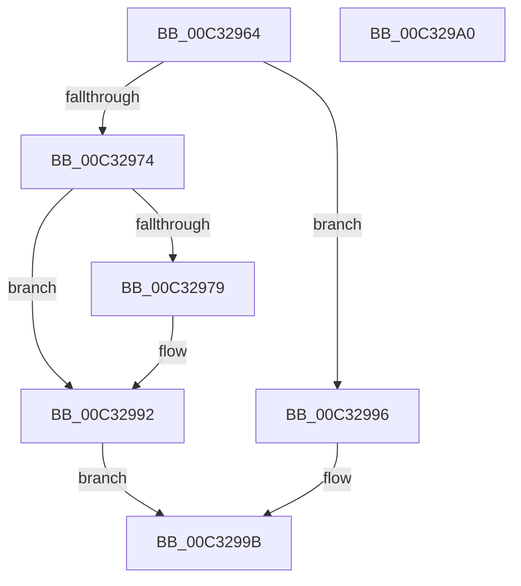

# PpInitSystem

- RVA: `0x00C32964`–`0x00C329A1` (길이 `61` bytes)
- VA: `0x0000000140C32964`
- 실행 섹션: `INIT`
- PDB 이름 있음: `예`; PDB Function 태그: `아니요`
- unwind 정보 RVA: `0x0005D2F4`
- 디코드: `20`개 명령, `61/61` bytes 표시
- 미해석 바이트: `0` (있으면 어셈블리에 `.byte`로 보존)

> 이 문서는 커널 이미지의 기계어와 PDB 기호를 분석해 생성했습니다. 4번과 5번은 함수 원형과 자료형을 바이너리 사용 방식에서 추정한 C 해석이며 원본 소스 복구 결과는 아닙니다.

## 1. Dependencies

- 직접 호출 지점: **2**; 고유 호출 대상: **2**
- 직접 호출자로 확인된 함수: **2**
- RIP 상대 이미지 참조: **1**

### Outgoing calls
- `0x00C3298C` → [KeBugCheckEx](../../text/4F/KeBugCheckEx_function_004FD660.md) (function, `0x004FD660`)
- `0x00C32996` → [PnpInitPhase0](PnpInitPhase0_function_00C32820.md) (function, `0x00C32820`)

### Direct callers
- [InitBootProcessor](../C1/InitBootProcessor_function_00C1B1C8.md) at `0x00C1BD8F`
- [Phase1InitializationDiscard](../C1/Phase1InitializationDiscard_function_00C1C728.md) at `0x00C1D7F8`

### Static image references
- `0x00C32968` → RVA `0x00FC41A0` (`.data`; read)

## 2. Other-region calls and transfers

- 다른 실행 섹션으로 향하는 call: **1**
  - `0x00C3298C` → [KeBugCheckEx](../../text/4F/KeBugCheckEx_function_004FD660.md) (`INIT` → `.text`)
- 별도 외부 분기/꼬리 이동을 확인하지 못했습니다.

## 3. Assembly (complete function range)

```asm
00C32964  48 83 EC 38                     sub rsp, 0x38
00C32968  8B 0D 32 18 39 00               mov ecx, dword ptr [rip + 0x391832]
00C3296E  8B C1                           mov eax, ecx
00C32970  85 C9                           test ecx, ecx
00C32972  74 22                           je 0x140c32996
00C32974  83 F8 01                        cmp eax, 1
00C32977  74 19                           je 0x140c32992
00C32979  48 83 64 24 20 00               and qword ptr [rsp + 0x20], 0
00C3297F  45 33 C9                        xor r9d, r9d
00C32982  44 8B C1                        mov r8d, ecx
00C32985  41 8D 51 02                     lea edx, [r9 + 2]
00C32989  8D 4A 31                        lea ecx, [rdx + 0x31]
00C3298C  E8 CF AC 8C FF                  call 0x1404fd660
00C32991  CC                              int3
00C32992  B0 01                           mov al, 1
00C32994  EB 05                           jmp 0x140c3299b
00C32996  E8 85 FE FF FF                  call 0x140c32820
00C3299B  48 83 C4 38                     add rsp, 0x38
00C3299F  C3                              ret
00C329A0  CC                              int3
```

## 4. C-style interpretation (structured pseudocode)

```c
__int64 __fastcall PpInitSystem(__int64 a1, __int64 a2, __int64 a3, int a4)
{
    __int64 result;
    __int64 v_rsp;
    unsigned __int64 v_stack_m18;

    v_rsp = (v_rsp) - (56);
    if ((unsigned int)((unsigned int)(*(unsigned int *)(v_rip + 3741746))) == 0) goto loc_00C32996;
    result = (unsigned int)((unsigned int)((unsigned int)(*(unsigned int *)(v_rip + 3741746))));
    if (((unsigned int)((unsigned int)((unsigned int)((unsigned int)(*(unsigned int *)(v_rip + 3741746)))))) != 1) {
        a4 = 0;
        a3 = (unsigned int)((unsigned int)(*(unsigned int *)(v_rip + 3741746)));
        a2 = a4 + 2;
        a1 = a2 + 49;
        result = KeBugCheckEx(a1, a2, a3, a4);
    }
    goto loc_00C3299B;
loc_00C32996:
    result = PnpInitPhase0(a1, a2, a3, a4);
loc_00C3299B:
    v_rsp = (v_rsp) + (56);
    return result;
}
```

## 5. (Beta) C Style

```c
int64_t PpInitSystem(int64_t Arg1, int64_t Arg2, int64_t Arg3, int32_t Arg4)
{
    int64_t result;
    int64_t local_rsp;
    uint64_t v_stack_m18;

    local_rsp = (local_rsp) - (56);
    if ((uint32_t)((uint32_t)(*(uint32_t *)(v_rip + 0x391832))) == 0) goto loc_00C32996;
    result = (uint32_t)((uint32_t)((uint32_t)(*(uint32_t *)(v_rip + 0x391832))));
    if (((uint32_t)((uint32_t)((uint32_t)((uint32_t)(*(uint32_t *)(v_rip + 0x391832)))))) != 1) {
        Arg4 = 0;
        Arg3 = (uint32_t)((uint32_t)(*(uint32_t *)(v_rip + 0x391832)));
        Arg2 = Arg4 + 2;
        Arg1 = Arg2 + 49;
        result = KeBugCheckEx(Arg1, Arg2, Arg3, Arg4);
    }
    goto loc_00C3299B;
loc_00C32996:
    result = PnpInitPhase0(Arg1, Arg2, Arg3, Arg4);
loc_00C3299B:
    local_rsp = (local_rsp) + (56);
    return result;
}
```

## 6. Execution-region graph

[열기: 2D/3D 그래프와 함수 탐색 컨트롤 패널](../../../control-panel.html?section=init&rva=0x00C32964&view=graph)

- 2D 그래프는 위에서 아래로 흐르고, 3D 그래프는 빈 공간을 드래그해 회전합니다. Shift+드래그는 이동, 휠은 확대·축소, 함수 노드 선택은 대상 보고서 이동입니다.

### Static fallback


