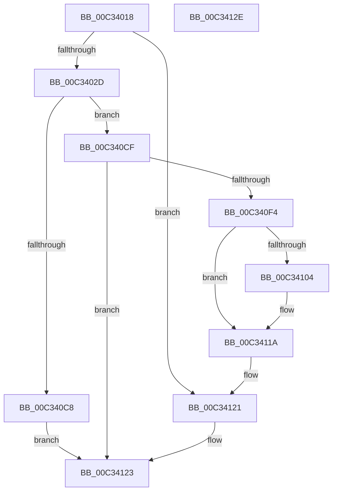

# PpInitializeBootDDB

- RVA: `0x00C34018`–`0x00C3412F` (길이 `279` bytes)
- VA: `0x0000000140C34018`
- 실행 섹션: `INIT`
- PDB 이름 있음: `예`; PDB Function 태그: `아니요`
- unwind 정보 RVA: `0x0005CAAC`
- 디코드: `56`개 명령, `279/279` bytes 표시
- 미해석 바이트: `0` (있으면 어셈블리에 `.byte`로 보존)

> 이 문서는 커널 이미지의 기계어와 PDB 기호를 분석해 생성했습니다. 4번과 5번은 함수 원형과 자료형을 바이너리 사용 방식에서 추정한 C 해석이며 원본 소스 복구 결과는 아닙니다.

## 1. Dependencies

- 직접 호출 지점: **4**; 고유 호출 대상: **3**
- 직접 호출자로 확인된 함수: **1**
- RIP 상대 이미지 참조: **23**

### Outgoing calls
- `0x00C34057` → [ExInitializeResourceLite2](../../text/41/ExInitializeResourceLite2_function_0041F710.md) (function, `0x0041F710`)
- `0x00C3406C` → [memset](../../text/6C/memset_function_006C6C40.md) (function, `0x006C6C40`)
- `0x00C340EB` → [PpBootDDBHelper](../../page/72/PpBootDDBHelper_function_0072E1CC.md) (function, `0x0072E1CC`)
- `0x00C34115` → [PpBootDDBHelper](../../page/72/PpBootDDBHelper_function_0072E1CC.md) (function, `0x0072E1CC`)

### Direct callers
- [IopInitializePlugPlayServices](../C2/IopInitializePlugPlayServices_function_00C2F298.md) at `0x00C2F4E8`
- [IopInitializePlugPlayServices](../C2/IopInitializePlugPlayServices_function_00C2F298.md) at `0x00C3009D`

### Static image references
- `0x00C3402D` → RVA `0x00FD9BF8` (`PAGEDATA`; read/write)
- `0x00C34035` → RVA `0x00F8C280` (`.data`; read)
- `0x00C3403C` → RVA `0x00FD9EB8` (`PAGEDATA`; read/write)
- `0x00C34047` → RVA `0x00FD9D10` (`PAGEDATA`; read/write)
- `0x00C3404F` → RVA `0x00FD9EB0` (`PAGEDATA`; read/write)
- `0x00C3405E` → RVA `0x00FDA490` (`PAGEDATA`; read)
- `0x00C34071` → RVA `0x00FDA4F0` (`PAGEDATA`; read/write)
- `0x00C34079` → RVA `0x00973390` (`PiCompareDDBCacheEntries`; read)
- `0x00C34080` → RVA `0x00FC4148` (`.data`; read)
- `0x00C34087` → RVA `0x00FDA4D8` (`PAGEDATA`; write)
- `0x00C3408E` → RVA `0x00AA16A0` (`PnpAllocateGenericTableEntry`; read)
- `0x00C34095` → RVA `0x00FDA4E0` (`PAGEDATA`; write)
- `0x00C3409C` → RVA `0x00AB4E50` (`CMFFreeFn`; read)
- `0x00C340A3` → RVA `0x00FDA4E8` (`PAGEDATA`; write)
- `0x00C340AA` → RVA `0x00FDA088` (`PAGEDATA`; read)
- `0x00C340B1` → RVA `0x00FDA090` (`PAGEDATA`; write)
- `0x00C340B8` → RVA `0x00FDA088` (`PAGEDATA`; write)
- `0x00C340BF` → RVA `0x00FDA490` (`PAGEDATA`; write)
- `0x00C340D6` → RVA `0x00FD9BF8` (`PAGEDATA`; read)
- `0x00C340DD` → RVA `0x00FD9EB8` (`PAGEDATA`; read)
- `0x00C34107` → RVA `0x00FD9D10` (`PAGEDATA`; read)
- `0x00C3410E` → RVA `0x00FD9EB0` (`PAGEDATA`; read)
- `0x00C3411A` → RVA `0x00FD803E` (`PAGEDATA`; write)

## 2. Other-region calls and transfers

- 다른 실행 섹션으로 향하는 call: **4**
  - `0x00C34057` → [ExInitializeResourceLite2](../../text/41/ExInitializeResourceLite2_function_0041F710.md) (`INIT` → `.text`)
  - `0x00C3406C` → [memset](../../text/6C/memset_function_006C6C40.md) (`INIT` → `.text`)
  - `0x00C340EB` → [PpBootDDBHelper](../../page/72/PpBootDDBHelper_function_0072E1CC.md) (`INIT` → `PAGE`)
  - `0x00C34115` → [PpBootDDBHelper](../../page/72/PpBootDDBHelper_function_0072E1CC.md) (`INIT` → `PAGE`)
- 별도 외부 분기/꼬리 이동을 확인하지 못했습니다.

## 3. Assembly (complete function range)

```asm
00C34018  48 89 5C 24 08                  mov qword ptr [rsp + 8], rbx
00C3401D  57                              push rdi
00C3401E  48 83 EC 20                     sub rsp, 0x20
00C34022  48 8B D9                        mov rbx, rcx
00C34025  85 D2                           test edx, edx
00C34027  0F 85 F4 00 00 00               jne 0x140c34121
00C3402D  48 83 25 C3 5B 3A 00 00         and qword ptr [rip + 0x3a5bc3], 0
00C34035  48 8D 0D 44 82 35 00            lea rcx, [rip + 0x358244]
00C3403C  48 83 25 74 5E 3A 00 00         and qword ptr [rip + 0x3a5e74], 0
00C34044  83 CA FF                        or edx, 0xffffffff
00C34047  48 83 25 C1 5C 3A 00 00         and qword ptr [rip + 0x3a5cc1], 0
00C3404F  48 83 25 59 5E 3A 00 00         and qword ptr [rip + 0x3a5e59], 0
00C34057  E8 B4 B6 7E FF                  call 0x14041f710
00C3405C  33 D2                           xor edx, edx
00C3405E  48 8D 3D 2B 64 3A 00            lea rdi, [rip + 0x3a642b]
00C34065  48 8B CF                        mov rcx, rdi
00C34068  44 8D 42 68                     lea r8d, [rdx + 0x68]
00C3406C  E8 CF 2B A9 FF                  call 0x1406c6c40
00C34071  48 83 25 77 64 3A 00 00         and qword ptr [rip + 0x3a6477], 0
00C34079  48 8D 05 10 F3 D3 FF            lea rax, [rip - 0x2c0cf0]
00C34080  80 3D C1 00 39 00 00            cmp byte ptr [rip + 0x3900c1], 0
00C34087  48 89 05 4A 64 3A 00            mov qword ptr [rip + 0x3a644a], rax
00C3408E  48 8D 05 0B D6 E6 FF            lea rax, [rip - 0x1929f5]
00C34095  48 89 05 44 64 3A 00            mov qword ptr [rip + 0x3a6444], rax
00C3409C  48 8D 05 AD 0D E8 FF            lea rax, [rip - 0x17f253]
00C340A3  48 89 05 3E 64 3A 00            mov qword ptr [rip + 0x3a643e], rax
00C340AA  48 8D 05 D7 5F 3A 00            lea rax, [rip + 0x3a5fd7]
00C340B1  48 89 05 D8 5F 3A 00            mov qword ptr [rip + 0x3a5fd8], rax
00C340B8  48 89 05 C9 5F 3A 00            mov qword ptr [rip + 0x3a5fc9], rax
00C340BF  48 89 3D CA 63 3A 00            mov qword ptr [rip + 0x3a63ca], rdi
00C340C6  74 07                           je 0x140c340cf
00C340C8  B8 01 00 00 C0                  mov eax, 0xc0000001
00C340CD  EB 54                           jmp 0x140c34123
00C340CF  48 8B 8B F0 00 00 00            mov rcx, qword ptr [rbx + 0xf0]
00C340D6  4C 8D 0D 1B 5B 3A 00            lea r9, [rip + 0x3a5b1b]
00C340DD  4C 8D 05 D4 5D 3A 00            lea r8, [rip + 0x3a5dd4]
00C340E4  8B 51 48                        mov edx, dword ptr [rcx + 0x48]
00C340E7  48 8B 49 40                     mov rcx, qword ptr [rcx + 0x40]
00C340EB  E8 DC A0 AF FF                  call 0x14072e1cc
00C340F0  85 C0                           test eax, eax
00C340F2  78 2F                           js 0x140c34123
00C340F4  48 8B 93 F0 00 00 00            mov rdx, qword ptr [rbx + 0xf0]
00C340FB  48 8B 4A 50                     mov rcx, qword ptr [rdx + 0x50]
00C340FF  48 85 C9                        test rcx, rcx
00C34102  74 16                           je 0x140c3411a
00C34104  8B 52 58                        mov edx, dword ptr [rdx + 0x58]
00C34107  4C 8D 0D 02 5C 3A 00            lea r9, [rip + 0x3a5c02]
00C3410E  4C 8D 05 9B 5D 3A 00            lea r8, [rip + 0x3a5d9b]
00C34115  E8 B2 A0 AF FF                  call 0x14072e1cc
00C3411A  C6 05 1D 3F 3A 00 01            mov byte ptr [rip + 0x3a3f1d], 1
00C34121  33 C0                           xor eax, eax
00C34123  48 8B 5C 24 30                  mov rbx, qword ptr [rsp + 0x30]
00C34128  48 83 C4 20                     add rsp, 0x20
00C3412C  5F                              pop rdi
00C3412D  C3                              ret
00C3412E  CC                              int3
```

## 4. C-style interpretation (structured pseudocode)

```c
__int64 __fastcall PpInitializeBootDDB(__int64 a1, int a2)
{
    __int64 result;
    __int64 v_rsp;
    unsigned __int64 v_stack_p8;

    v_stack_p8 = v_rbx;
    v_rsp = (v_rsp) - (32);
    if (a2 != 0) goto loc_00C34121;
    a2 = (unsigned int)((a2) | (0xFFFFFFFFULL));
    result = ExInitializeResourceLite2(v_rip + 3506756, a2, a3, a4);
    a2 = 0;
    result = memset(v_rip + 3826731, a2, a2 + 104, a4);
    *(unsigned __int64 *)(v_rip + 3826762) = v_rip - 2886896;
    *(unsigned __int64 *)(v_rip + 3826756) = v_rip - 1649141;
    *(unsigned __int64 *)(v_rip + 3826750) = v_rip - 1569363;
    *(unsigned __int64 *)(v_rip + 3825624) = v_rip + 3825623;
    *(unsigned __int64 *)(v_rip + 3825609) = v_rip + 3825623;
    *(unsigned __int64 *)(v_rip + 3826634) = v_rip + 3826731;
    if ((*(unsigned __int8 *)(v_rip + 3735745)) == 0) goto loc_00C340CF;
    goto loc_00C34123;
loc_00C340CF:
    result = PpBootDDBHelper(*(unsigned __int64 *)(*(unsigned __int64 *)(a1 + 240) + 64), (unsigned int)(*(unsigned int *)(*(unsigned __int64 *)(a1 + 240) + 72)), v_rip + 3825108, v_rip + 3824411);
    if (sign_flag) goto loc_00C34123;
    if (*(unsigned __int64 *)(*(unsigned __int64 *)(a1 + 240) + 80) != 0) {
        a2 = *(unsigned int *)(*(unsigned __int64 *)(a1 + 240) + 88);
        a4 = v_rip + 3824642;
        a3 = v_rip + 3825051;
        result = PpBootDDBHelper(*(unsigned __int64 *)(*(unsigned __int64 *)(a1 + 240) + 80), a2, a3, a4);
    }
    *(unsigned __int8 *)(v_rip + 3817245) = 1;
loc_00C34121:
    result = 0;
loc_00C34123:
    v_rsp = (v_rsp) + (32);
    return result;
}
```

## 5. (Beta) C Style

```c
int64_t PpInitializeBootDDB(void *Arg1, int32_t Arg2)
{
    uint8_t *arg1 = (uint8_t *)Arg1;

    int64_t result;
    int64_t local_rsp;
    uint64_t v_stack_p8;

    v_stack_p8 = local_rbx;
    local_rsp = (local_rsp) - (32);
    if (Arg2 != 0) goto loc_00C34121;
    Arg2 = (uint32_t)((Arg2) | (0xFFFFFFFFULL));
    result = ExInitializeResourceLite2(v_rip + 3506756, Arg2, a3, a4);
    Arg2 = 0;
    result = memset(v_rip + 3826731, Arg2, Arg2 + 104, a4);
    *(uint64_t *)(v_rip + 0x3A644A) = v_rip - 2886896;
    *(uint64_t *)(v_rip + 0x3A6444) = v_rip - 1649141;
    *(uint64_t *)(v_rip + 0x3A643E) = v_rip - 1569363;
    *(uint64_t *)(v_rip + 0x3A5FD8) = v_rip + 3825623;
    *(uint64_t *)(v_rip + 0x3A5FC9) = v_rip + 3825623;
    *(uint64_t *)(v_rip + 0x3A63CA) = v_rip + 3826731;
    if ((*(uint8_t *)(v_rip + 0x3900C1)) == 0) goto loc_00C340CF;
    goto loc_00C34123;
loc_00C340CF:
    result = PpBootDDBHelper(*(uint64_t *)(*(uint64_t *)(arg1 + 0xF0) + 0x40), (uint32_t)(*(uint32_t *)(*(uint64_t *)(arg1 + 0xF0) + 0x48)), v_rip + 3825108, v_rip + 3824411);
    if (sign_flag) goto loc_00C34123;
    if (*(uint64_t *)(*(uint64_t *)(arg1 + 0xF0) + 0x50) != 0) {
        Arg2 = *(uint32_t *)(*(uint64_t *)(arg1 + 0xF0) + 0x58);
        a4 = v_rip + 3824642;
        a3 = v_rip + 3825051;
        result = PpBootDDBHelper(*(uint64_t *)(*(uint64_t *)(arg1 + 0xF0) + 0x50), Arg2, a3, a4);
    }
    *(uint8_t *)(v_rip + 0x3A3F1D) = 1;
loc_00C34121:
    result = 0;
loc_00C34123:
    local_rsp = (local_rsp) + (32);
    return result;
}
```

### 관측된 메모리 오프셋

구조체 형식이 확인되지 않은 접근은 인자 기준의 오프셋으로만 기록했습니다.

| 기준 인자 | 오프셋 표현 | 폭 (bit) | 접근 |
|---|---:|---:|---|
| `Arg1` | `+ 0xF0` | `64` | `R` |

## 6. Execution-region graph

[열기: 2D/3D 그래프와 함수 탐색 컨트롤 패널](../../../control-panel.html?section=init&rva=0x00C34018&view=graph)

- 2D 그래프는 위에서 아래로 흐르고, 3D 그래프는 빈 공간을 드래그해 회전합니다. Shift+드래그는 이동, 휠은 확대·축소, 함수 노드 선택은 대상 보고서 이동입니다.

### Static fallback


