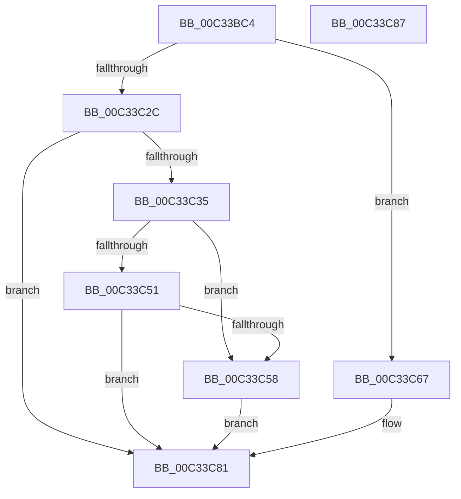

# PpLastGoodDoBootProcessing

- RVA: `0x00C33BC4`–`0x00C33C88` (길이 `196` bytes)
- VA: `0x0000000140C33BC4`
- 실행 섹션: `INIT`
- PDB 이름 있음: `예`; PDB Function 태그: `아니요`
- unwind 정보 RVA: `0x0008A308`
- 디코드: `50`개 명령, `196/196` bytes 표시
- 미해석 바이트: `0` (있으면 어셈블리에 `.byte`로 보존)

> 이 문서는 커널 이미지의 기계어와 PDB 기호를 분석해 생성했습니다. 4번과 5번은 함수 원형과 자료형을 바이너리 사용 방식에서 추정한 C 해석이며 원본 소스 복구 결과는 아닙니다.

## 1. Dependencies

- 직접 호출 지점: **9**; 고유 호출 대상: **5**
- 직접 호출자로 확인된 함수: **1**
- RIP 상대 이미지 참조: **5**

### Outgoing calls
- `0x00C33BEE` → [RtlInitUnicodeString](../../text/42/RtlInitUnicodeString_function_0042A780.md) (function, `0x0042A780`)
- `0x00C33BFE` → [RtlInitUnicodeString](../../text/42/RtlInitUnicodeString_function_0042A780.md) (function, `0x0042A780`)
- `0x00C33C0E` → [RtlInitUnicodeString](../../text/42/RtlInitUnicodeString_function_0042A780.md) (function, `0x0042A780`)
- `0x00C33C1E` → [RtlInitUnicodeString](../../text/42/RtlInitUnicodeString_function_0042A780.md) (function, `0x0042A780`)
- `0x00C33C23` → [CmIsLastKnownGoodBoot](../C5/CmIsLastKnownGoodBoot_function_00C563E4.md) (function, `0x00C563E4`)
- `0x00C33C40` → [IopFileUtilRename](IopFileUtilRename_function_00C3662C.md) (function, `0x00C3662C`)
- `0x00C33C60` → [PiLastGoodCopyKeyContents](PiLastGoodCopyKeyContents_function_00C336E4.md) (function, `0x00C336E4`)
- `0x00C33C6F` → [PiLastGoodRevertLastKnownDirectory](PiLastGoodRevertLastKnownDirectory_function_00C33980.md) (function, `0x00C33980`)
- `0x00C33C7C` → [PiLastGoodRevertLastKnownDirectory](PiLastGoodRevertLastKnownDirectory_function_00C33980.md) (function, `0x00C33980`)

### Direct callers
- [IoInitSystemPreDrivers](../C2/IoInitSystemPreDrivers_function_00C2AC3C.md) at `0x00C2BD1A`

### Static image references
- `0x00C33BD0` → RVA `0x00C7AD40` (` ?? ::PBOPGDP::`string'`; read)
- `0x00C33BF3` → RVA `0x00C7AD70` (` ?? ::PBOPGDP::`string'`; read)
- `0x00C33C03` → RVA `0x00C7ADE0` (` ?? ::PBOPGDP::`string'`; read)
- `0x00C33C13` → RVA `0x00C7ACA0` (` ?? ::PBOPGDP::`string'`; read)
- `0x00C33C2C` → RVA `0x00FC41C4` (`.data`; read)

## 2. Other-region calls and transfers

- 다른 실행 섹션으로 향하는 call: **4**
  - `0x00C33BEE` → [RtlInitUnicodeString](../../text/42/RtlInitUnicodeString_function_0042A780.md) (`INIT` → `.text`)
  - `0x00C33BFE` → [RtlInitUnicodeString](../../text/42/RtlInitUnicodeString_function_0042A780.md) (`INIT` → `.text`)
  - `0x00C33C0E` → [RtlInitUnicodeString](../../text/42/RtlInitUnicodeString_function_0042A780.md) (`INIT` → `.text`)
  - `0x00C33C1E` → [RtlInitUnicodeString](../../text/42/RtlInitUnicodeString_function_0042A780.md) (`INIT` → `.text`)
- 별도 외부 분기/꼬리 이동을 확인하지 못했습니다.

## 3. Assembly (complete function range)

```asm
00C33BC4  40 55                           push rbp
00C33BC6  48 8B EC                        mov rbp, rsp
00C33BC9  48 83 EC 60                     sub rsp, 0x60
00C33BCD  0F 57 C0                        xorps xmm0, xmm0
00C33BD0  48 8D 15 69 71 04 00            lea rdx, [rip + 0x47169]
00C33BD7  0F 57 C9                        xorps xmm1, xmm1
00C33BDA  48 8D 4D D0                     lea rcx, [rbp - 0x30]
00C33BDE  0F 11 45 D0                     movups xmmword ptr [rbp - 0x30], xmm0
00C33BE2  0F 11 4D F0                     movups xmmword ptr [rbp - 0x10], xmm1
00C33BE6  0F 11 45 C0                     movups xmmword ptr [rbp - 0x40], xmm0
00C33BEA  0F 11 4D E0                     movups xmmword ptr [rbp - 0x20], xmm1
00C33BEE  E8 8D 6B 7F FF                  call 0x14042a780
00C33BF3  48 8D 15 76 71 04 00            lea rdx, [rip + 0x47176]
00C33BFA  48 8D 4D C0                     lea rcx, [rbp - 0x40]
00C33BFE  E8 7D 6B 7F FF                  call 0x14042a780
00C33C03  48 8D 15 D6 71 04 00            lea rdx, [rip + 0x471d6]
00C33C0A  48 8D 4D F0                     lea rcx, [rbp - 0x10]
00C33C0E  E8 6D 6B 7F FF                  call 0x14042a780
00C33C13  48 8D 15 86 70 04 00            lea rdx, [rip + 0x47086]
00C33C1A  48 8D 4D E0                     lea rcx, [rbp - 0x20]
00C33C1E  E8 5D 6B 7F FF                  call 0x14042a780
00C33C23  E8 BC 27 02 00                  call 0x140c563e4
00C33C28  84 C0                           test al, al
00C33C2A  75 3B                           jne 0x140c33c67
00C33C2C  83 3D 91 05 39 00 00            cmp dword ptr [rip + 0x390591], 0
00C33C33  75 4C                           jne 0x140c33c81
00C33C35  45 33 C0                        xor r8d, r8d
00C33C38  48 8D 55 F0                     lea rdx, [rbp - 0x10]
00C33C3C  48 8D 4D D0                     lea rcx, [rbp - 0x30]
00C33C40  E8 E7 29 00 00                  call 0x140c3662c
00C33C45  BA 00 00 00 80                  mov edx, 0x80000000
00C33C4A  8D 0C 10                        lea ecx, [rax + rdx]
00C33C4D  85 CA                           test edx, ecx
00C33C4F  75 07                           jne 0x140c33c58
00C33C51  3D 34 00 00 C0                  cmp eax, 0xc0000034
00C33C56  75 29                           jne 0x140c33c81
00C33C58  48 8D 55 E0                     lea rdx, [rbp - 0x20]
00C33C5C  48 8D 4D C0                     lea rcx, [rbp - 0x40]
00C33C60  E8 7F FA FF FF                  call 0x140c336e4
00C33C65  EB 1A                           jmp 0x140c33c81
00C33C67  48 8D 55 C0                     lea rdx, [rbp - 0x40]
00C33C6B  48 8D 4D D0                     lea rcx, [rbp - 0x30]
00C33C6F  E8 0C FD FF FF                  call 0x140c33980
00C33C74  48 8D 55 E0                     lea rdx, [rbp - 0x20]
00C33C78  48 8D 4D F0                     lea rcx, [rbp - 0x10]
00C33C7C  E8 FF FC FF FF                  call 0x140c33980
00C33C81  48 83 C4 60                     add rsp, 0x60
00C33C85  5D                              pop rbp
00C33C86  C3                              ret
00C33C87  CC                              int3
```

## 4. C-style interpretation (structured pseudocode)

```c
__int64 __fastcall PpLastGoodDoBootProcessing(__int64 a1, __int64 a2, int a3)
{
    __int64 result;
    __int64 v_rsp;
    unsigned __int64 v_stack_m18;
    unsigned __int64 v_stack_m28;
    unsigned __int64 v_stack_m38;
    unsigned __int64 v_stack_m48;

    v_rsp = (v_rsp) - (96);
    v_stack_m38 = v_xmm0;
    v_stack_m18 = v_xmm1;
    v_stack_m48 = v_xmm0;
    v_stack_m28 = v_xmm1;
    result = RtlInitUnicodeString(v_stack_m38, v_rip + 291177, a3, a4);
    result = RtlInitUnicodeString(v_stack_m48, v_rip + 291190, a3, a4);
    result = RtlInitUnicodeString(v_stack_m18, v_rip + 291286, a3, a4);
    result = RtlInitUnicodeString(v_stack_m28, v_rip + 290950, a3, a4);
    result = CmIsLastKnownGoodBoot(v_stack_m28, v_rip + 290950, a3, a4);
    if ((unsigned __int8)(result) != 0) goto loc_00C33C67;
    if ((*(unsigned int *)(v_rip + 3736977)) != 0) goto loc_00C33C81;
    a3 = 0;
    result = IopFileUtilRename(v_stack_m38, v_stack_m18, a3, a4);
    if ((((unsigned int)((unsigned int)(0x80000000ULL))) & ((unsigned int)(result + (unsigned int)(0x80000000ULL) * 1))) != 0) goto loc_00C33C58;
    if (((unsigned int)(result)) != 0xC0000034ULL) goto loc_00C33C81;
loc_00C33C58:
    result = PiLastGoodCopyKeyContents(v_stack_m48, v_stack_m28, a3, a4);
    goto loc_00C33C81;
loc_00C33C67:
    result = PiLastGoodRevertLastKnownDirectory(v_stack_m38, v_stack_m48, a3, a4);
    result = PiLastGoodRevertLastKnownDirectory(v_stack_m18, v_stack_m28, a3, a4);
loc_00C33C81:
    v_rsp = (v_rsp) + (96);
    return result;
}
```

## 5. (Beta) C Style

```c
int64_t PpLastGoodDoBootProcessing(int64_t Arg1, int64_t Arg2, int32_t Arg3)
{
    int64_t result;
    int64_t local_rsp;
    uint64_t v_stack_m18;
    uint64_t v_stack_m28;
    uint64_t v_stack_m38;
    uint64_t v_stack_m48;

    local_rsp = (local_rsp) - (96);
    v_stack_m38 = v_xmm0;
    v_stack_m18 = v_xmm1;
    v_stack_m48 = v_xmm0;
    v_stack_m28 = v_xmm1;
    result = RtlInitUnicodeString(v_stack_m38, v_rip + 291177, Arg3, a4);
    result = RtlInitUnicodeString(v_stack_m48, v_rip + 291190, Arg3, a4);
    result = RtlInitUnicodeString(v_stack_m18, v_rip + 291286, Arg3, a4);
    result = RtlInitUnicodeString(v_stack_m28, v_rip + 290950, Arg3, a4);
    result = CmIsLastKnownGoodBoot(v_stack_m28, v_rip + 290950, Arg3, a4);
    if ((uint8_t)(result) != 0) goto loc_00C33C67;
    if ((*(uint32_t *)(v_rip + 0x390591)) != 0) goto loc_00C33C81;
    Arg3 = 0;
    result = IopFileUtilRename(v_stack_m38, v_stack_m18, Arg3, a4);
    if ((((uint32_t)((uint32_t)(0x80000000ULL))) & ((uint32_t)(result + (uint32_t)(0x80000000ULL) * 1))) != 0) goto loc_00C33C58;
    if (((uint32_t)(result)) != 0xC0000034ULL) goto loc_00C33C81;
loc_00C33C58:
    result = PiLastGoodCopyKeyContents(v_stack_m48, v_stack_m28, Arg3, a4);
    goto loc_00C33C81;
loc_00C33C67:
    result = PiLastGoodRevertLastKnownDirectory(v_stack_m38, v_stack_m48, Arg3, a4);
    result = PiLastGoodRevertLastKnownDirectory(v_stack_m18, v_stack_m28, Arg3, a4);
loc_00C33C81:
    local_rsp = (local_rsp) + (96);
    return result;
}
```

## 6. Execution-region graph

[열기: 2D/3D 그래프와 함수 탐색 컨트롤 패널](../../../control-panel.html?section=init&rva=0x00C33BC4&view=graph)

- 2D 그래프는 위에서 아래로 흐르고, 3D 그래프는 빈 공간을 드래그해 회전합니다. Shift+드래그는 이동, 휠은 확대·축소, 함수 노드 선택은 대상 보고서 이동입니다.

### Static fallback


