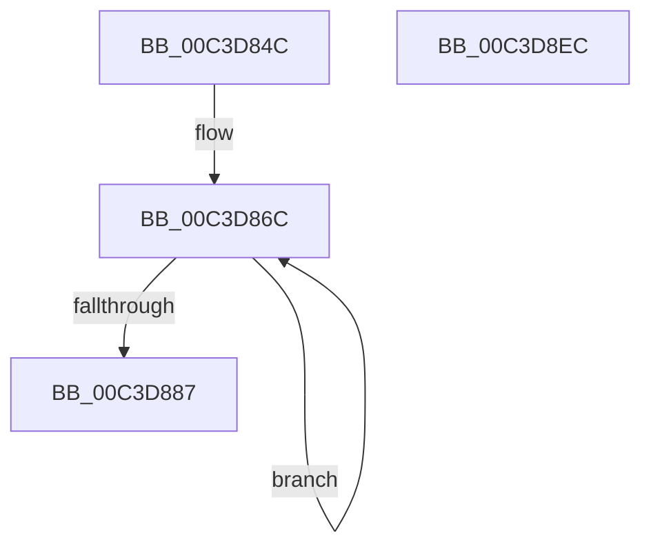

# PpmInitCoreParkingPolicy

- RVA: `0x00C3D84C`–`0x00C3D8ED` (길이 `161` bytes)
- VA: `0x0000000140C3D84C`
- 실행 섹션: `INIT`
- PDB 이름 있음: `예`; PDB Function 태그: `아니요`
- unwind 정보 RVA: `0x000DB714`
- 디코드: `29`개 명령, `161/161` bytes 표시
- 미해석 바이트: `0` (있으면 어셈블리에 `.byte`로 보존)

> 이 문서는 커널 이미지의 기계어와 PDB 기호를 분석해 생성했습니다. 4번과 5번은 함수 원형과 자료형을 바이너리 사용 방식에서 추정한 C 해석이며 원본 소스 복구 결과는 아닙니다.

## 1. Dependencies

- 직접 호출 지점: **0**; 고유 호출 대상: **0**
- 직접 호출자로 확인된 함수: **1**
- RIP 상대 이미지 참조: **17**

### Outgoing calls
- 직접 디코드된 call 명령이 없습니다.

### Direct callers
- [PoInitSystem](../C7/PoInitSystem_function_00C72358.md) at `0x00C729D0`

### Static image references
- `0x00C3D851` → RVA `0x00F07884` (`.data`; write)
- `0x00C3D858` → RVA `0x00F07A6C` (`.data`; write)
- `0x00C3D85F` → RVA `0x00F07A6E` (`.data`; read)
- `0x00C3D887` → RVA `0x00F07878` (`.data`; write)
- `0x00C3D88E` → RVA `0x00F07A60` (`.data`; write)
- `0x00C3D895` → RVA `0x00F07880` (`.data`; write)
- `0x00C3D89C` → RVA `0x00F07A68` (`.data`; write)
- `0x00C3D8A3` → RVA `0x00F0787C` (`.data`; write)
- `0x00C3D8AA` → RVA `0x00F07A64` (`.data`; write)
- `0x00C3D8B1` → RVA `0x00F07874` (`.data`; write)
- `0x00C3D8BA` → RVA `0x00F07A5C` (`.data`; write)
- `0x00C3D8C3` → RVA `0x00F07876` (`.data`; write)
- `0x00C3D8CA` → RVA `0x00F07A5E` (`.data`; write)
- `0x00C3D8D1` → RVA `0x00F079B0` (`.data`; write)
- `0x00C3D8D8` → RVA `0x00F07B98` (`.data`; write)
- `0x00C3D8DF` → RVA `0x00F079B2` (`.data`; write)
- `0x00C3D8E5` → RVA `0x00F07B9A` (`.data`; write)

## 2. Other-region calls and transfers

- 다른 실행 섹션으로 향하는 call: **0**
- 별도 외부 분기/꼬리 이동을 확인하지 못했습니다.

## 3. Assembly (complete function range)

```asm
00C3D84C  B9 02 00 00 00                  mov ecx, 2
00C3D851  C6 05 2C A0 2C 00 64            mov byte ptr [rip + 0x2ca02c], 0x64
00C3D858  C6 05 0D A2 2C 00 64            mov byte ptr [rip + 0x2ca20d], 0x64
00C3D85F  48 8D 05 08 A2 2C 00            lea rax, [rip + 0x2ca208]
00C3D866  33 D2                           xor edx, edx
00C3D868  44 8D 41 FF                     lea r8d, [rcx - 1]
00C3D86C  C6 80 18 FE FF FF 64            mov byte ptr [rax - 0x1e8], 0x64
00C3D873  C6 00 64                        mov byte ptr [rax], 0x64
00C3D876  88 90 03 FE FF FF               mov byte ptr [rax - 0x1fd], dl
00C3D87C  88 50 EB                        mov byte ptr [rax - 0x15], dl
00C3D87F  49 03 C0                        add rax, r8
00C3D882  49 2B C8                        sub rcx, r8
00C3D885  75 E5                           jne 0x140c3d86c
00C3D887  66 89 15 EA 9F 2C 00            mov word ptr [rip + 0x2c9fea], dx
00C3D88E  66 89 15 CB A1 2C 00            mov word ptr [rip + 0x2ca1cb], dx
00C3D895  44 89 05 E4 9F 2C 00            mov dword ptr [rip + 0x2c9fe4], r8d
00C3D89C  44 89 05 C5 A1 2C 00            mov dword ptr [rip + 0x2ca1c5], r8d
00C3D8A3  44 89 05 D2 9F 2C 00            mov dword ptr [rip + 0x2c9fd2], r8d
00C3D8AA  44 89 05 B3 A1 2C 00            mov dword ptr [rip + 0x2ca1b3], r8d
00C3D8B1  66 C7 05 BA 9F 2C 00 46 61      mov word ptr [rip + 0x2c9fba], 0x6146
00C3D8BA  66 C7 05 99 A1 2C 00 46 61      mov word ptr [rip + 0x2ca199], 0x6146
00C3D8C3  C6 05 AC 9F 2C 00 14            mov byte ptr [rip + 0x2c9fac], 0x14
00C3D8CA  C6 05 8D A1 2C 00 14            mov byte ptr [rip + 0x2ca18d], 0x14
00C3D8D1  66 89 15 D8 A0 2C 00            mov word ptr [rip + 0x2ca0d8], dx
00C3D8D8  66 89 15 B9 A2 2C 00            mov word ptr [rip + 0x2ca2b9], dx
00C3D8DF  88 15 CD A0 2C 00               mov byte ptr [rip + 0x2ca0cd], dl
00C3D8E5  88 15 AF A2 2C 00               mov byte ptr [rip + 0x2ca2af], dl
00C3D8EB  C3                              ret
00C3D8EC  CC                              int3
```

## 4. C-style interpretation (structured pseudocode)

```c
__int64 __fastcall PpmInitCoreParkingPolicy(__int64 a1, int a2)
{
    __int64 result;

    *(unsigned __int8 *)(v_rip + 2924588) = 100;
    *(unsigned __int8 *)(v_rip + 2925069) = 100;
    a2 = 0;
loc_00C3D86C:
    *(unsigned __int8 *)(v_rip + 2925064 - 488) = 100;
    *(unsigned __int8 *)(v_rip + 2925064) = 100;
    *(unsigned __int8 *)(v_rip + 2925064 - 509) = 0;
    *(unsigned __int8 *)(v_rip + 2925064 - 21) = 0;
    result = (v_rip + 2925064) + (2 - 1);
    a1 = (2) - (2 - 1);
    if (condition_is_not_equal) goto loc_00C3D86C;
    *(unsigned __int16 *)(v_rip + 2924522) = 0;
    *(unsigned __int16 *)(v_rip + 2925003) = 0;
    *(unsigned int *)(v_rip + 2924516) = (unsigned int)(2 - 1);
    *(unsigned int *)(v_rip + 2924997) = (unsigned int)(2 - 1);
    *(unsigned int *)(v_rip + 2924498) = (unsigned int)(2 - 1);
    *(unsigned int *)(v_rip + 2924979) = (unsigned int)(2 - 1);
    *(unsigned __int16 *)(v_rip + 2924474) = 0x6146ULL;
    *(unsigned __int16 *)(v_rip + 2924953) = 0x6146ULL;
    *(unsigned __int8 *)(v_rip + 2924460) = 20;
    *(unsigned __int8 *)(v_rip + 2924941) = 20;
    *(unsigned __int16 *)(v_rip + 2924760) = 0;
    *(unsigned __int16 *)(v_rip + 2925241) = 0;
    *(unsigned __int8 *)(v_rip + 2924749) = 0;
    *(unsigned __int8 *)(v_rip + 2925231) = 0;
    return result;
}
```

## 5. (Beta) C Style

```c
int64_t PpmInitCoreParkingPolicy(int64_t Arg1, int32_t Arg2)
{
    int64_t result;

    *(uint8_t *)(v_rip + 0x2CA02C) = 100;
    *(uint8_t *)(v_rip + 0x2CA20D) = 100;
    Arg2 = 0;
loc_00C3D86C:
    *(uint8_t *)(v_rip + 0x2CA208 - 0x1E8) = 100;
    *(uint8_t *)(v_rip + 0x2CA208) = 100;
    *(uint8_t *)(v_rip + 0x2CA208 - 0x1FD) = 0;
    *(uint8_t *)(v_rip + 0x2CA208 - 0x15) = 0;
    result = (v_rip + 2925064) + (2 - 1);
    Arg1 = (2) - (2 - 1);
    if (condition_is_not_equal) goto loc_00C3D86C;
    *(uint16_t *)(v_rip + 0x2C9FEA) = 0;
    *(uint16_t *)(v_rip + 0x2CA1CB) = 0;
    *(uint32_t *)(v_rip + 0x2C9FE4) = (uint32_t)(2 - 1);
    *(uint32_t *)(v_rip + 0x2CA1C5) = (uint32_t)(2 - 1);
    *(uint32_t *)(v_rip + 0x2C9FD2) = (uint32_t)(2 - 1);
    *(uint32_t *)(v_rip + 0x2CA1B3) = (uint32_t)(2 - 1);
    *(uint16_t *)(v_rip + 0x2C9FBA) = 0x6146ULL;
    *(uint16_t *)(v_rip + 0x2CA199) = 0x6146ULL;
    *(uint8_t *)(v_rip + 0x2C9FAC) = 20;
    *(uint8_t *)(v_rip + 0x2CA18D) = 20;
    *(uint16_t *)(v_rip + 0x2CA0D8) = 0;
    *(uint16_t *)(v_rip + 0x2CA2B9) = 0;
    *(uint8_t *)(v_rip + 0x2CA0CD) = 0;
    *(uint8_t *)(v_rip + 0x2CA2AF) = 0;
    return result;
}
```

## 6. Execution-region graph

[열기: 2D/3D 그래프와 함수 탐색 컨트롤 패널](../../../control-panel.html?section=init&rva=0x00C3D84C&view=graph)

- 2D 그래프는 위에서 아래로 흐르고, 3D 그래프는 빈 공간을 드래그해 회전합니다. Shift+드래그는 이동, 휠은 확대·축소, 함수 노드 선택은 대상 보고서 이동입니다.

### Static fallback


