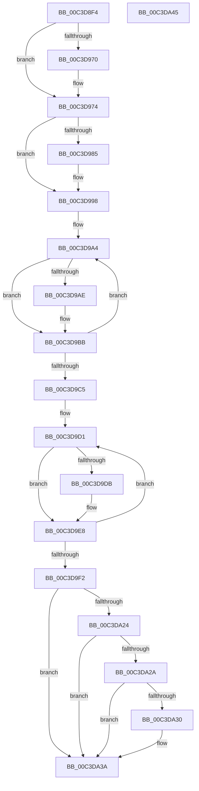

# PpmInitIdlePolicy

- RVA: `0x00C3D8F4`–`0x00C3DA46` (길이 `338` bytes)
- VA: `0x0000000140C3D8F4`
- 실행 섹션: `INIT`
- PDB 이름 있음: `예`; PDB Function 태그: `아니요`
- unwind 정보 RVA: `0x000CBCFC`
- 디코드: `77`개 명령, `338/338` bytes 표시
- 미해석 바이트: `0` (있으면 어셈블리에 `.byte`로 보존)

> 이 문서는 커널 이미지의 기계어와 PDB 기호를 분석해 생성했습니다. 4번과 5번은 함수 원형과 자료형을 바이너리 사용 방식에서 추정한 C 해석이며 원본 소스 복구 결과는 아닙니다.

## 1. Dependencies

- 직접 호출 지점: **5**; 고유 호출 대상: **3**
- 직접 호출자로 확인된 함수: **1**
- RIP 상대 이미지 참조: **18**

### Outgoing calls
- `0x00C3D98C` → [PpmConvertTimeFrom](../../text/44/PpmConvertTimeFrom_function_00447510.md) (function, `0x00447510`)
- `0x00C3D9B3` → [PpmConvertTimeFrom](../../text/44/PpmConvertTimeFrom_function_00447510.md) (function, `0x00447510`)
- `0x00C3D9E0` → [PpmConvertTimeFrom](../../text/44/PpmConvertTimeFrom_function_00447510.md) (function, `0x00447510`)
- `0x00C3D9FD` → [RtlInitUnicodeString](../../text/42/RtlInitUnicodeString_function_0042A780.md) (function, `0x0042A780`)
- `0x00C3DA1B` → [ZwQueryLicenseValue](../../text/6A/ZwQueryLicenseValue_function_006AFCF0.md) (function, `0x006AFCF0`)

### Direct callers
- [PoInitSystem](../C7/PoInitSystem_function_00C72358.md) at `0x00C729C6`

### Static image references
- `0x00C3D901` → RVA `0x00FC6BE0` (`ALMOSTRO`; read)
- `0x00C3D91C` → RVA `0x00F0788C` (`.data`; read/write)
- `0x00C3D924` → RVA `0x00F07A74` (`.data`; read/write)
- `0x00C3D92C` → RVA `0x00E0AA1C` (`.data`; read)
- `0x00C3D933` → RVA `0x00F07890` (`.data`; write)
- `0x00C3D939` → RVA `0x00F07A78` (`.data`; write)
- `0x00C3D943` → RVA `0x00FC6EC8` (`ALMOSTRO`; write)
- `0x00C3D94E` → RVA `0x00F07895` (`.data`; write)
- `0x00C3D957` → RVA `0x00F07A7D` (`.data`; write)
- `0x00C3D960` → RVA `0x00F07894` (`.data`; write)
- `0x00C3D967` → RVA `0x00F07A7C` (`.data`; write)
- `0x00C3D974` → RVA `0x00FC7248` (`ALMOSTRO`; write)
- `0x00C3D97B` → RVA `0x00F0ED18` (`.data`; read)
- `0x00C3D991` → RVA `0x00F0ED10` (`.data`; write)
- `0x00C3D998` → RVA `0x00FC5730` (`ALMOSTRO`; read)
- `0x00C3D9C5` → RVA `0x00FC5BD0` (`ALMOSTRO`; read)
- `0x00C3D9F2` → RVA `0x00C7BFD0` (` ?? ::PBOPGDP::`string'`; read)
- `0x00C3DA33` → RVA `0x00FC6BA6` (`ALMOSTRO`; write)

## 2. Other-region calls and transfers

- 다른 실행 섹션으로 향하는 call: **5**
  - `0x00C3D98C` → [PpmConvertTimeFrom](../../text/44/PpmConvertTimeFrom_function_00447510.md) (`INIT` → `.text`)
  - `0x00C3D9B3` → [PpmConvertTimeFrom](../../text/44/PpmConvertTimeFrom_function_00447510.md) (`INIT` → `.text`)
  - `0x00C3D9E0` → [PpmConvertTimeFrom](../../text/44/PpmConvertTimeFrom_function_00447510.md) (`INIT` → `.text`)
  - `0x00C3D9FD` → [RtlInitUnicodeString](../../text/42/RtlInitUnicodeString_function_0042A780.md) (`INIT` → `.text`)
  - `0x00C3DA1B` → [ZwQueryLicenseValue](../../text/6A/ZwQueryLicenseValue_function_006AFCF0.md) (`INIT` → `.text`)
- 별도 외부 분기/꼬리 이동을 확인하지 못했습니다.

## 3. Assembly (complete function range)

```asm
00C3D8F4  48 89 5C 24 20                  mov qword ptr [rsp + 0x20], rbx
00C3D8F9  55                              push rbp
00C3D8FA  48 8B EC                        mov rbp, rsp
00C3D8FD  48 83 EC 40                     sub rsp, 0x40
00C3D901  48 8B 0D D8 92 38 00            mov rcx, qword ptr [rip + 0x3892d8]
00C3D908  B8 50 C3 00 00                  mov eax, 0xc350
00C3D90D  83 65 20 00                     and dword ptr [rbp + 0x20], 0
00C3D911  0F 57 C0                        xorps xmm0, xmm0
00C3D914  83 65 10 00                     and dword ptr [rbp + 0x10], 0
00C3D918  83 65 18 00                     and dword ptr [rbp + 0x18], 0
00C3D91C  66 83 25 68 9F 2C 00 00         and word ptr [rip + 0x2c9f68], 0
00C3D924  66 83 25 48 A1 2C 00 00         and word ptr [rip + 0x2ca148], 0
00C3D92C  80 3D E9 D0 1C 00 00            cmp byte ptr [rip + 0x1cd0e9], 0
00C3D933  89 05 57 9F 2C 00               mov dword ptr [rip + 0x2c9f57], eax
00C3D939  89 05 39 A1 2C 00               mov dword ptr [rip + 0x2ca139], eax
00C3D93F  48 8D 04 09                     lea rax, [rcx + rcx]
00C3D943  48 89 05 7E 95 38 00            mov qword ptr [rip + 0x38957e], rax
00C3D94A  0F 11 45 F0                     movups xmmword ptr [rbp - 0x10], xmm0
00C3D94E  66 C7 05 3E 9F 2C 00 3C 00      mov word ptr [rip + 0x2c9f3e], 0x3c
00C3D957  66 C7 05 1D A1 2C 00 3C 00      mov word ptr [rip + 0x2ca11d], 0x3c
00C3D960  C6 05 2D 9F 2C 00 28            mov byte ptr [rip + 0x2c9f2d], 0x28
00C3D967  C6 05 0E A1 2C 00 28            mov byte ptr [rip + 0x2ca10e], 0x28
00C3D96E  75 04                           jne 0x140c3d974
00C3D970  48 6B C1 5A                     imul rax, rcx, 0x5a
00C3D974  48 89 05 CD 98 38 00            mov qword ptr [rip + 0x3898cd], rax
00C3D97B  8B 05 97 13 2D 00               mov eax, dword ptr [rip + 0x2d1397]
00C3D981  85 C0                           test eax, eax
00C3D983  74 13                           je 0x140c3d998
00C3D985  8B C8                           mov ecx, eax
00C3D987  BA 40 42 0F 00                  mov edx, 0xf4240
00C3D98C  E8 7F 9B 80 FF                  call 0x140447510
00C3D991  48 89 05 78 13 2D 00            mov qword ptr [rip + 0x2d1378], rax
00C3D998  4C 8D 1D 91 7D 38 00            lea r11, [rip + 0x387d91]
00C3D99F  BB 1A 00 00 00                  mov ebx, 0x1a
00C3D9A4  49 8B 4B 08                     mov rcx, qword ptr [r11 + 8]
00C3D9A8  48 83 F9 FF                     cmp rcx, -1
00C3D9AC  74 0D                           je 0x140c3d9bb
00C3D9AE  BA 80 96 98 00                  mov edx, 0x989680
00C3D9B3  E8 58 9B 80 FF                  call 0x140447510
00C3D9B8  49 89 03                        mov qword ptr [r11], rax
00C3D9BB  49 83 C3 18                     add r11, 0x18
00C3D9BF  48 83 EB 01                     sub rbx, 1
00C3D9C3  75 DF                           jne 0x140c3d9a4
00C3D9C5  4C 8D 1D 04 82 38 00            lea r11, [rip + 0x388204]
00C3D9CC  BB 25 00 00 00                  mov ebx, 0x25
00C3D9D1  49 8B 4B 08                     mov rcx, qword ptr [r11 + 8]
00C3D9D5  48 83 F9 FF                     cmp rcx, -1
00C3D9D9  74 0D                           je 0x140c3d9e8
00C3D9DB  BA 80 96 98 00                  mov edx, 0x989680
00C3D9E0  E8 2B 9B 80 FF                  call 0x140447510
00C3D9E5  49 89 03                        mov qword ptr [r11], rax
00C3D9E8  49 83 C3 18                     add r11, 0x18
00C3D9EC  48 83 EB 01                     sub rbx, 1
00C3D9F0  75 DF                           jne 0x140c3d9d1
00C3D9F2  48 8D 15 D7 E5 03 00            lea rdx, [rip + 0x3e5d7]
00C3D9F9  48 8D 4D F0                     lea rcx, [rbp - 0x10]
00C3D9FD  E8 7E CD 7E FF                  call 0x14042a780
00C3DA02  48 8D 45 10                     lea rax, [rbp + 0x10]
00C3DA06  44 8D 4B 04                     lea r9d, [rbx + 4]
00C3DA0A  48 89 44 24 20                  mov qword ptr [rsp + 0x20], rax
00C3DA0F  4C 8D 45 20                     lea r8, [rbp + 0x20]
00C3DA13  48 8D 55 18                     lea rdx, [rbp + 0x18]
00C3DA17  48 8D 4D F0                     lea rcx, [rbp - 0x10]
00C3DA1B  E8 D0 22 A7 FF                  call 0x1406afcf0
00C3DA20  85 C0                           test eax, eax
00C3DA22  78 16                           js 0x140c3da3a
00C3DA24  83 7D 10 04                     cmp dword ptr [rbp + 0x10], 4
00C3DA28  75 10                           jne 0x140c3da3a
00C3DA2A  83 7D 18 04                     cmp dword ptr [rbp + 0x18], 4
00C3DA2E  75 0A                           jne 0x140c3da3a
00C3DA30  39 5D 20                        cmp dword ptr [rbp + 0x20], ebx
00C3DA33  0F 95 05 6C 91 38 00            setne byte ptr [rip + 0x38916c]
00C3DA3A  48 8B 5C 24 68                  mov rbx, qword ptr [rsp + 0x68]
00C3DA3F  48 83 C4 40                     add rsp, 0x40
00C3DA43  5D                              pop rbp
00C3DA44  C3                              ret
00C3DA45  CC                              int3
```

## 4. C-style interpretation (structured pseudocode)

```c
__int64 __fastcall PpmInitIdlePolicy(void)
{
    __int64 result;
    __int64 v_r11;
    __int64 v_rbx;
    __int64 v_rsp;
    unsigned __int64 v_stack_m18;
    unsigned __int64 v_stack_m28;
    unsigned int v_stack_p10;
    unsigned int v_stack_p18;
    unsigned __int64 v_stack_p20;
    unsigned int v_stack_p8;

    v_stack_p20 = v_rbx;
    v_rsp = (v_rsp) - (64);
    *(unsigned int *)(v_rip + 2924375) = (unsigned int)((unsigned int)(0xC350ULL));
    *(unsigned int *)(v_rip + 2924857) = (unsigned int)((unsigned int)(0xC350ULL));
    *(unsigned __int64 *)(v_rip + 3708286) = *(unsigned __int64 *)(v_rip + 3707608) + *(unsigned __int64 *)(v_rip + 3707608) * 1;
    v_stack_m18 = v_xmm0;
    *(unsigned __int16 *)(v_rip + 2924350) = 60;
    *(unsigned __int16 *)(v_rip + 2924829) = 60;
    *(unsigned __int8 *)(v_rip + 2924333) = 40;
    *(unsigned __int8 *)(v_rip + 2924814) = 40;
    result = *(unsigned __int64 *)(v_rip + 3707608) + *(unsigned __int64 *)(v_rip + 3707608) * 1;
    if ((*(unsigned __int8 *)(v_rip + 1888489)) == 0) {
        result = (*(unsigned __int64 *)(v_rip + 3707608) + *(unsigned __int64 *)(v_rip + 3707608) * 1) * (*(unsigned __int64 *)(v_rip + 3707608));
    }
    *(unsigned __int64 *)(v_rip + 3709133) = result;
    result = (unsigned int)(*(unsigned int *)(v_rip + 2954135));
    if ((unsigned int)((unsigned int)(*(unsigned int *)(v_rip + 2954135))) != 0) {
        a1 = (unsigned int)((unsigned int)(*(unsigned int *)(v_rip + 2954135)));
        a2 = 0xF4240ULL;
        result = PpmConvertTimeFrom(a1, a2, a3, a4);
        *(unsigned __int64 *)(v_rip + 2954104) = result;
    }
loc_00C3D9A4:
    if ((*(unsigned __int64 *)(v_rip + 3702161 + 8)) != -1) {
        a2 = 0x989680ULL;
        result = PpmConvertTimeFrom(*(unsigned __int64 *)(v_rip + 3702161 + 8), a2, a3, a4);
        *(unsigned __int64 *)(v_rip + 3702161) = result;
    }
    v_r11 = (v_rip + 3702161) + (24);
    v_rbx = (26) - (1);
    if (condition_is_not_equal) goto loc_00C3D9A4;
loc_00C3D9D1:
    if ((*(unsigned __int64 *)(v_rip + 3703300 + 8)) != -1) {
        a2 = 0x989680ULL;
        result = PpmConvertTimeFrom(*(unsigned __int64 *)(v_rip + 3703300 + 8), a2, a3, a4);
        *(unsigned __int64 *)(v_rip + 3703300) = result;
    }
    v_r11 = (v_rip + 3703300) + (24);
    v_rbx = (37) - (1);
    if (condition_is_not_equal) goto loc_00C3D9D1;
    result = RtlInitUnicodeString(v_stack_m18, v_rip + 255447, a3, a4);
    v_stack_m28 = v_stack_p8;
    result = ZwQueryLicenseValue(v_stack_m18, v_stack_p10, v_stack_p18, v_rbx + 4);
    if (sign_flag) goto loc_00C3DA3A;
    if (v_stack_p8 != 4) goto loc_00C3DA3A;
    if (v_stack_p10 == 4) {
    }
    v_rsp = (v_rsp) + (64);
    return result;
}
```

## 5. (Beta) C Style

```c
void PpmInitIdlePolicy(void)
{
    int64_t result;
    int64_t local_r11;
    int64_t local_rbx;
    int64_t local_rsp;
    uint64_t v_stack_m18;
    uint64_t v_stack_m28;
    uint32_t v_stack_p10;
    uint32_t v_stack_p18;
    uint64_t v_stack_p20;
    uint32_t v_stack_p8;

    v_stack_p20 = local_rbx;
    local_rsp = (local_rsp) - (64);
    *(uint32_t *)(v_rip + 0x2C9F57) = (uint32_t)((uint32_t)(0xC350ULL));
    *(uint32_t *)(v_rip + 0x2CA139) = (uint32_t)((uint32_t)(0xC350ULL));
    *(uint64_t *)(v_rip + 0x38957E) = *(uint64_t *)(v_rip + 0x3892D8) + *(uint64_t *)(v_rip + 0x3892D8) * 1;
    v_stack_m18 = v_xmm0;
    *(uint16_t *)(v_rip + 0x2C9F3E) = 60;
    *(uint16_t *)(v_rip + 0x2CA11D) = 60;
    *(uint8_t *)(v_rip + 0x2C9F2D) = 40;
    *(uint8_t *)(v_rip + 0x2CA10E) = 40;
    result = *(uint64_t *)(v_rip + 0x3892D8) + *(uint64_t *)(v_rip + 0x3892D8) * 1;
    if ((*(uint8_t *)(v_rip + 0x1CD0E9)) == 0) {
        result = (*(uint64_t *)(v_rip + 0x3892D8) + *(uint64_t *)(v_rip + 0x3892D8) * 1) * (*(uint64_t *)(v_rip + 0x3892D8));
    }
    *(uint64_t *)(v_rip + 0x3898CD) = result;
    result = (uint32_t)(*(uint32_t *)(v_rip + 0x2D1397));
    if ((uint32_t)((uint32_t)(*(uint32_t *)(v_rip + 0x2D1397))) != 0) {
        a1 = (uint32_t)((uint32_t)(*(uint32_t *)(v_rip + 0x2D1397)));
        a2 = 0xF4240ULL;
        result = PpmConvertTimeFrom(a1, a2, a3, a4);
        *(uint64_t *)(v_rip + 0x2D1378) = result;
    }
loc_00C3D9A4:
    if ((*(uint64_t *)(v_rip + 0x387D91 + 0x8)) != -1) {
        a2 = 0x989680ULL;
        result = PpmConvertTimeFrom(*(uint64_t *)(v_rip + 0x387D91 + 0x8), a2, a3, a4);
        *(uint64_t *)(v_rip + 0x387D91) = result;
    }
    local_r11 = (v_rip + 3702161) + (24);
    local_rbx = (26) - (1);
    if (condition_is_not_equal) goto loc_00C3D9A4;
loc_00C3D9D1:
    if ((*(uint64_t *)(v_rip + 0x388204 + 0x8)) != -1) {
        a2 = 0x989680ULL;
        result = PpmConvertTimeFrom(*(uint64_t *)(v_rip + 0x388204 + 0x8), a2, a3, a4);
        *(uint64_t *)(v_rip + 0x388204) = result;
    }
    local_r11 = (v_rip + 3703300) + (24);
    local_rbx = (37) - (1);
    if (condition_is_not_equal) goto loc_00C3D9D1;
    result = RtlInitUnicodeString(v_stack_m18, v_rip + 255447, a3, a4);
    v_stack_m28 = v_stack_p8;
    result = ZwQueryLicenseValue(v_stack_m18, v_stack_p10, v_stack_p18, local_rbx + 4);
    if (sign_flag) goto loc_00C3DA3A;
    if (v_stack_p8 != 4) goto loc_00C3DA3A;
    if (v_stack_p10 == 4) {
    }
    local_rsp = (local_rsp) + (64);
    return result;
}
```

## 6. Execution-region graph

[열기: 2D/3D 그래프와 함수 탐색 컨트롤 패널](../../../control-panel.html?section=init&rva=0x00C3D8F4&view=graph)

- 2D 그래프는 위에서 아래로 흐르고, 3D 그래프는 빈 공간을 드래그해 회전합니다. Shift+드래그는 이동, 휠은 확대·축소, 함수 노드 선택은 대상 보고서 이동입니다.

### Static fallback


