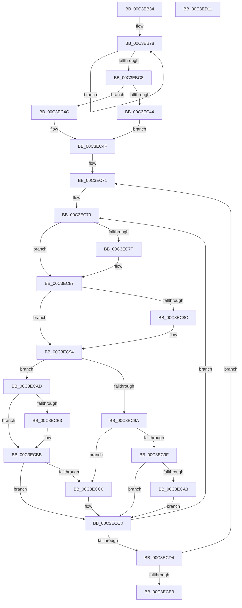

# PpmPerfInitialize

- RVA: `0x00C3EB34`–`0x00C3ED12` (길이 `478` bytes)
- VA: `0x0000000140C3EB34`
- 실행 섹션: `INIT`
- PDB 이름 있음: `예`; PDB Function 태그: `아니요`
- unwind 정보 RVA: `0x000C6858`
- 디코드: `112`개 명령, `478/478` bytes 표시
- 미해석 바이트: `0` (있으면 어셈블리에 `.byte`로 보존)

> 이 문서는 커널 이미지의 기계어와 PDB 기호를 분석해 생성했습니다. 4번과 5번은 함수 원형과 자료형을 바이너리 사용 방식에서 추정한 C 해석이며 원본 소스 복구 결과는 아닙니다.

## 1. Dependencies

- 직접 호출 지점: **1**; 고유 호출 대상: **1**
- 직접 호출자로 확인된 함수: **1**
- RIP 상대 이미지 참조: **27**

### Outgoing calls
- `0x00C3ED01` → [PopInitializeTimer](../../page/75/PopInitializeTimer_function_00754078.md) (function, `0x00754078`)

### Direct callers
- [PoInitSystem](../C7/PoInitSystem_function_00C72358.md) at `0x00C729CB`

### Static image references
- `0x00C3EB3E` → RVA `0x00FC6BA8` (`ALMOSTRO`; read)
- `0x00C3EB4B` → RVA `0x00FC6BB0` (`ALMOSTRO`; write)
- `0x00C3EB55` → RVA `0x00FC6BA8` (`ALMOSTRO`; write)
- `0x00C3EB61` → RVA `0x00F0780C` (`.data`; write)
- `0x00C3EB67` → RVA `0x00F079F4` (`.data`; write)
- `0x00C3EB71` → RVA `0x00F079F8` (`.data`; read)
- `0x00C3EBC8` → RVA `0x00F0E140` (`.data`; read/write)
- `0x00C3EBCF` → RVA `0x002DA680` (`PpmMediaBufferingWorker`; read)
- `0x00C3EBD6` → RVA `0x00F0E168` (`.data`; read/write)
- `0x00C3EBE1` → RVA `0x00F0E150` (`.data`; read/write)
- `0x00C3EBE8` → RVA `0x00F0E138` (`.data`; read/write)
- `0x00C3EBEF` → RVA `0x00F0E120` (`.data`; read/write)
- `0x00C3EBF6` → RVA `0x00FC5050` (`ALMOSTRO`; read)
- `0x00C3EBFF` → RVA `0x00F0E160` (`.data`; write)
- `0x00C3EC06` → RVA `0x003BE910` (`PpmPerfLatencySensitivityHintWorker`; read)
- `0x00C3EC0D` → RVA `0x00F0E130` (`.data`; write)
- `0x00C3EC16` → RVA `0x00F0782C` (`.data`; write)
- `0x00C3EC1C` → RVA `0x00F07A14` (`.data`; write)
- `0x00C3EC22` → RVA `0x00FC506C` (`ALMOSTRO`; read)
- `0x00C3EC2B` → RVA `0x00F07830` (`.data`; write)
- `0x00C3EC32` → RVA `0x00F07A18` (`.data`; write)
- `0x00C3EC56` → RVA `0x00029208` (`.rdata`; read)
- `0x00C3EC5D` → RVA `0x00FC6F58` (`ALMOSTRO`; write)
- `0x00C3EC64` → RVA `0x00FC54E0` (`ALMOSTRO`; read)
- `0x00C3ECE9` → RVA `0x0075AED0` (`PpmPerfTelemetryWorker`; read)
- `0x00C3ECF3` → RVA `0x005D45F0` (`PpmPerfTelemetryCallback`; read)
- `0x00C3ECFA` → RVA `0x00F0E1A0` (`.data`; read)

## 2. Other-region calls and transfers

- 다른 실행 섹션으로 향하는 call: **1**
  - `0x00C3ED01` → [PopInitializeTimer](../../page/75/PopInitializeTimer_function_00754078.md) (`INIT` → `PAGE`)
- 별도 외부 분기/꼬리 이동을 확인하지 못했습니다.

## 3. Assembly (complete function range)

```asm
00C3EB34  48 89 74 24 08                  mov qword ptr [rsp + 8], rsi
00C3EB39  57                              push rdi
00C3EB3A  48 83 EC 30                     sub rsp, 0x30
00C3EB3E  48 8D 05 63 80 38 00            lea rax, [rip + 0x388063]
00C3EB45  41 B8 02 00 00 00               mov r8d, 2
00C3EB4B  48 89 05 5E 80 38 00            mov qword ptr [rip + 0x38805e], rax
00C3EB52  41 8B C8                        mov ecx, r8d
00C3EB55  48 89 05 4C 80 38 00            mov qword ptr [rip + 0x38804c], rax
00C3EB5C  B8 32 00 00 00                  mov eax, 0x32
00C3EB61  89 05 A5 8C 2C 00               mov dword ptr [rip + 0x2c8ca5], eax
00C3EB67  89 05 87 8E 2C 00               mov dword ptr [rip + 0x2c8e87], eax
00C3EB6D  41 8D 50 62                     lea edx, [r8 + 0x62]
00C3EB71  48 8D 05 80 8E 2C 00            lea rax, [rip + 0x2c8e80]
00C3EB78  C6 80 18 FE FF FF 01            mov byte ptr [rax - 0x1e8], 1
00C3EB7F  C6 00 01                        mov byte ptr [rax], 1
00C3EB82  C6 80 28 FE FF FF 46            mov byte ptr [rax - 0x1d8], 0x46
00C3EB89  C6 40 10 46                     mov byte ptr [rax + 0x10], 0x46
00C3EB8D  C6 80 26 FE FF FF 1E            mov byte ptr [rax - 0x1da], 0x1e
00C3EB94  C6 40 0E 1E                     mov byte ptr [rax + 0xe], 0x1e
00C3EB98  88 90 1A FE FF FF               mov byte ptr [rax - 0x1e6], dl
00C3EB9E  88 50 02                        mov byte ptr [rax + 2], dl
00C3EBA1  88 90 1C FE FF FF               mov byte ptr [rax - 0x1e4], dl
00C3EBA7  88 50 04                        mov byte ptr [rax + 4], dl
00C3EBAA  88 90 4F FE FF FF               mov byte ptr [rax - 0x1b1], dl
00C3EBB0  88 50 37                        mov byte ptr [rax + 0x37], dl
00C3EBB3  88 90 9F FE FF FF               mov byte ptr [rax - 0x161], dl
00C3EBB9  88 90 87 00 00 00               mov byte ptr [rax + 0x87], dl
00C3EBBF  48 FF C0                        inc rax
00C3EBC2  48 83 E9 01                     sub rcx, 1
00C3EBC6  75 B0                           jne 0x140c3eb78
00C3EBC8  48 21 0D 71 F5 2C 00            and qword ptr [rip + 0x2cf571], rcx
00C3EBCF  48 8D 05 AA BA 69 FF            lea rax, [rip - 0x964556]
00C3EBD6  48 21 0D 8B F5 2C 00            and qword ptr [rip + 0x2cf58b], rcx
00C3EBDD  41 83 C9 FF                     or r9d, 0xffffffff
00C3EBE1  48 21 0D 68 F5 2C 00            and qword ptr [rip + 0x2cf568], rcx
00C3EBE8  48 21 0D 49 F5 2C 00            and qword ptr [rip + 0x2cf549], rcx
00C3EBEF  48 21 0D 2A F5 2C 00            and qword ptr [rip + 0x2cf52a], rcx
00C3EBF6  8B 0D 54 64 38 00               mov ecx, dword ptr [rip + 0x386454]
00C3EBFC  41 3B C9                        cmp ecx, r9d
00C3EBFF  48 89 05 5A F5 2C 00            mov qword ptr [rip + 0x2cf55a], rax
00C3EC06  48 8D 05 03 FD 77 FF            lea rax, [rip - 0x8802fd]
00C3EC0D  48 89 05 1C F5 2C 00            mov qword ptr [rip + 0x2cf51c], rax
00C3EC14  8B C1                           mov eax, ecx
00C3EC16  89 15 10 8C 2C 00               mov dword ptr [rip + 0x2c8c10], edx
00C3EC1C  89 15 F2 8D 2C 00               mov dword ptr [rip + 0x2c8df2], edx
00C3EC22  8B 15 44 64 38 00               mov edx, dword ptr [rip + 0x386444]
00C3EC28  0F 44 C2                        cmove eax, edx
00C3EC2B  44 89 05 FE 8B 2C 00            mov dword ptr [rip + 0x2c8bfe], r8d
00C3EC32  44 89 05 DF 8D 2C 00            mov dword ptr [rip + 0x2c8ddf], r8d
00C3EC39  41 B8 F4 01 00 00               mov r8d, 0x1f4
00C3EC3F  41 3B C0                        cmp eax, r8d
00C3EC42  76 08                           jbe 0x140c3ec4c
00C3EC44  41 3B C9                        cmp ecx, r9d
00C3EC47  0F 44 CA                        cmove ecx, edx
00C3EC4A  EB 03                           jmp 0x140c3ec4f
00C3EC4C  41 8B C8                        mov ecx, r8d
00C3EC4F  8D 04 89                        lea eax, [rcx + rcx*4]
00C3EC52  33 C9                           xor ecx, ecx
00C3EC54  03 C0                           add eax, eax
00C3EC56  48 8D 35 AB A5 3E FF            lea rsi, [rip - 0xc15a55]
00C3EC5D  48 89 05 F4 82 38 00            mov qword ptr [rip + 0x3882f4], rax
00C3EC64  48 8D 3D 75 68 38 00            lea rdi, [rip + 0x386875]
00C3EC6B  45 33 C0                        xor r8d, r8d
00C3EC6E  4C 8B D6                        mov r10, rsi
00C3EC71  45 8B 1A                        mov r11d, dword ptr [r10]
00C3EC74  45 33 C9                        xor r9d, r9d
00C3EC77  33 D2                           xor edx, edx
00C3EC79  44 3B 1C 96                     cmp r11d, dword ptr [rsi + rdx*4]
00C3EC7D  76 08                           jbe 0x140c3ec87
00C3EC7F  49 8D 04 10                     lea rax, [r8 + rdx]
00C3EC83  C6 04 38 01                     mov byte ptr [rax + rdi], 1
00C3EC87  83 F9 03                        cmp ecx, 3
00C3EC8A  75 08                           jne 0x140c3ec94
00C3EC8C  49 8D 04 10                     lea rax, [r8 + rdx]
00C3EC90  C6 04 38 01                     mov byte ptr [rax + rdi], 1
00C3EC94  41 83 F9 03                     cmp r9d, 3
00C3EC98  75 13                           jne 0x140c3ecad
00C3EC9A  83 F9 04                        cmp ecx, 4
00C3EC9D  74 21                           je 0x140c3ecc0
00C3EC9F  85 C9                           test ecx, ecx
00C3ECA1  74 25                           je 0x140c3ecc8
00C3ECA3  49 8D 04 10                     lea rax, [r8 + rdx]
00C3ECA7  C6 04 38 01                     mov byte ptr [rax + rdi], 1
00C3ECAB  EB 1B                           jmp 0x140c3ecc8
00C3ECAD  41 83 F9 04                     cmp r9d, 4
00C3ECB1  75 08                           jne 0x140c3ecbb
00C3ECB3  49 8D 04 10                     lea rax, [r8 + rdx]
00C3ECB7  C6 04 38 01                     mov byte ptr [rax + rdi], 1
00C3ECBB  83 F9 04                        cmp ecx, 4
00C3ECBE  75 08                           jne 0x140c3ecc8
00C3ECC0  49 8D 04 10                     lea rax, [r8 + rdx]
00C3ECC4  C6 04 38 00                     mov byte ptr [rax + rdi], 0
00C3ECC8  41 FF C1                        inc r9d
00C3ECCB  48 FF C2                        inc rdx
00C3ECCE  41 83 F9 07                     cmp r9d, 7
00C3ECD2  72 A5                           jb 0x140c3ec79
00C3ECD4  FF C1                           inc ecx
00C3ECD6  49 83 C2 04                     add r10, 4
00C3ECDA  49 83 C0 07                     add r8, 7
00C3ECDE  83 F9 07                        cmp ecx, 7
00C3ECE1  72 8E                           jb 0x140c3ec71
00C3ECE3  48 83 64 24 20 00               and qword ptr [rsp + 0x20], 0
00C3ECE9  4C 8D 0D E0 C1 B1 FF            lea r9, [rip - 0x4e3e20]
00C3ECF0  45 33 C0                        xor r8d, r8d
00C3ECF3  48 8D 15 F6 58 99 FF            lea rdx, [rip - 0x66a70a]
00C3ECFA  48 8D 0D 9F F4 2C 00            lea rcx, [rip + 0x2cf49f]
00C3ED01  E8 72 53 B1 FF                  call 0x140754078
00C3ED06  48 8B 74 24 40                  mov rsi, qword ptr [rsp + 0x40]
00C3ED0B  48 83 C4 30                     add rsp, 0x30
00C3ED0F  5F                              pop rdi
00C3ED10  C3                              ret
00C3ED11  CC                              int3
```

## 4. C-style interpretation (structured pseudocode)

```c
__int64 __fastcall PpmPerfInitialize(__int64 a1, __int64 a2, __int64 a3, int a4)
{
    __int64 result;
    __int64 v_r10;
    __int64 v_rsp;
    unsigned __int64 v_stack_m18;
    unsigned __int64 v_stack_p8;

    v_stack_p8 = v_rsi;
    v_rsp = (v_rsp) - (48);
    *(unsigned __int64 *)(v_rip + 3702878) = v_rip + 3702883;
    *(unsigned __int64 *)(v_rip + 3702860) = v_rip + 3702883;
    *(unsigned int *)(v_rip + 2919589) = 50;
    *(unsigned int *)(v_rip + 2920071) = 50;
loc_00C3EB78:
    *(unsigned __int8 *)(v_rip + 2920064 - 488) = 1;
    *(unsigned __int8 *)(v_rip + 2920064) = 1;
    *(unsigned __int8 *)(v_rip + 2920064 - 472) = 70;
    *(unsigned __int8 *)(v_rip + 2920064 + 16) = 70;
    *(unsigned __int8 *)(v_rip + 2920064 - 474) = 30;
    *(unsigned __int8 *)(v_rip + 2920064 + 14) = 30;
    *(unsigned __int8 *)(v_rip + 2920064 - 486) = (unsigned __int8)(2 + 98);
    *(unsigned __int8 *)(v_rip + 2920064 + 2) = (unsigned __int8)(2 + 98);
    *(unsigned __int8 *)(v_rip + 2920064 - 484) = (unsigned __int8)(2 + 98);
    *(unsigned __int8 *)(v_rip + 2920064 + 4) = (unsigned __int8)(2 + 98);
    *(unsigned __int8 *)(v_rip + 2920064 - 433) = (unsigned __int8)(2 + 98);
    *(unsigned __int8 *)(v_rip + 2920064 + 55) = (unsigned __int8)(2 + 98);
    *(unsigned __int8 *)(v_rip + 2920064 - 353) = (unsigned __int8)(2 + 98);
    *(unsigned __int8 *)(v_rip + 2920064 + 135) = (unsigned __int8)(2 + 98);
    result = (v_rip + 2920064) + 1;
    a1 = (2) - (1);
    if (condition_is_not_equal) goto loc_00C3EB78;
    a4 = (unsigned int)((a4) | (0xFFFFFFFFULL));
    *(unsigned __int64 *)(v_rip + 2946394) = v_rip - 9848150;
    *(unsigned __int64 *)(v_rip + 2946332) = v_rip - 8913661;
    *(unsigned int *)(v_rip + 2919440) = (unsigned int)(2 + 98);
    *(unsigned int *)(v_rip + 2919922) = (unsigned int)(2 + 98);
    result = (unsigned int)((unsigned int)((unsigned int)(*(unsigned int *)(v_rip + 3695700))));
    if (((unsigned int)((unsigned int)(*(unsigned int *)(v_rip + 3695700)))) == a4) { result = (unsigned int)((unsigned int)(*(unsigned int *)(v_rip + 3695684))); }
    *(unsigned int *)(v_rip + 2919422) = 2;
    *(unsigned int *)(v_rip + 2919903) = 2;
    if (((unsigned int)(result)) <= 500) goto loc_00C3EC4C;
    a1 = (unsigned int)(*(unsigned int *)(v_rip + 3695700));
    if (((unsigned int)((unsigned int)(*(unsigned int *)(v_rip + 3695700)))) == a4) { a1 = (unsigned int)((unsigned int)(*(unsigned int *)(v_rip + 3695684))); }
    goto loc_00C3EC4F;
loc_00C3EC4C:
loc_00C3EC4F:
    a1 = 0;
    result = (unsigned int)((500 + 500 * 4) + ((unsigned int)(500 + 500 * 4)));
    *(unsigned __int64 *)(v_rip + 3703540) = result;
    a3 = 0;
loc_00C3EC71:
    a4 = 0;
    a2 = 0;
loc_00C3EC79:
    if (((unsigned int)((unsigned int)(*(unsigned int *)(v_rip - 12671573)))) >= = (*(unsigned int *)(v_rip - 12671573 + a2 * 4))) {
        result = a3 + a2 * 1;
        *(unsigned __int8 *)(result + v_rip + 3696757 * 1) = 1;
    }
    if (0 == 3) {
        result = a3 + a2 * 1;
        *(unsigned __int8 *)(result + v_rip + 3696757 * 1) = 1;
    }
    if (0 != 3) goto loc_00C3ECAD;
    if (0 == 4) goto loc_00C3ECC0;
    if (0 == 0) goto loc_00C3ECC8;
    *(unsigned __int8 *)(a3 + a2 * 1 + v_rip + 3696757 * 1) = 1;
    goto loc_00C3ECC8;
loc_00C3ECAD:
    result = a3 + a2 * 1;
    if (0 == 4) {
        result = a3 + a2 * 1;
        *(unsigned __int8 *)(result + v_rip + 3696757 * 1) = 1;
    }
    if (0 == 4) {
        result = a3 + a2 * 1;
        *(unsigned __int8 *)(result + v_rip + 3696757 * 1) = 0;
    }
    a4 = (unsigned int)((a4) + 1);
    a2 = (a2) + 1;
    if (a4 < 7) goto loc_00C3EC79;
    a1 = (unsigned int)((a1) + 1);
    v_r10 = (v_rip - 12671573) + (4);
    a3 = (a3) + (7);
    if (((unsigned int)(a1)) < 7) goto loc_00C3EC71;
    a3 = 0;
    result = PopInitializeTimer(v_rip + 2946207, v_rip - 6727434, a3, v_rip - 5127712);
    v_rsp = (v_rsp) + (48);
    return result;
}
```

## 5. (Beta) C Style

```c
int64_t PpmPerfInitialize(int64_t Arg1, int64_t Arg2, int64_t Arg3, int32_t Arg4)
{
    int64_t result;
    int64_t local_r10;
    int64_t local_rsp;
    uint64_t v_stack_m18;
    uint64_t v_stack_p8;

    v_stack_p8 = local_rsi;
    local_rsp = (local_rsp) - (48);
    *(uint64_t *)(v_rip + 0x38805E) = v_rip + 3702883;
    *(uint64_t *)(v_rip + 0x38804C) = v_rip + 3702883;
    *(uint32_t *)(v_rip + 0x2C8CA5) = 50;
    *(uint32_t *)(v_rip + 0x2C8E87) = 50;
loc_00C3EB78:
    *(uint8_t *)(v_rip + 0x2C8E80 - 0x1E8) = 1;
    *(uint8_t *)(v_rip + 0x2C8E80) = 1;
    *(uint8_t *)(v_rip + 0x2C8E80 - 0x1D8) = 70;
    *(uint8_t *)(v_rip + 0x2C8E80 + 0x10) = 70;
    *(uint8_t *)(v_rip + 0x2C8E80 - 0x1DA) = 30;
    *(uint8_t *)(v_rip + 0x2C8E80 + 0xE) = 30;
    *(uint8_t *)(v_rip + 0x2C8E80 - 0x1E6) = (uint8_t)(2 + 98);
    *(uint8_t *)(v_rip + 0x2C8E80 + 0x2) = (uint8_t)(2 + 98);
    *(uint8_t *)(v_rip + 0x2C8E80 - 0x1E4) = (uint8_t)(2 + 98);
    *(uint8_t *)(v_rip + 0x2C8E80 + 0x4) = (uint8_t)(2 + 98);
    *(uint8_t *)(v_rip + 0x2C8E80 - 0x1B1) = (uint8_t)(2 + 98);
    *(uint8_t *)(v_rip + 0x2C8E80 + 0x37) = (uint8_t)(2 + 98);
    *(uint8_t *)(v_rip + 0x2C8E80 - 0x161) = (uint8_t)(2 + 98);
    *(uint8_t *)(v_rip + 0x2C8E80 + 0x87) = (uint8_t)(2 + 98);
    result = (v_rip + 2920064) + 1;
    Arg1 = (2) - (1);
    if (condition_is_not_equal) goto loc_00C3EB78;
    Arg4 = (uint32_t)((Arg4) | (0xFFFFFFFFULL));
    *(uint64_t *)(v_rip + 0x2CF55A) = v_rip - 9848150;
    *(uint64_t *)(v_rip + 0x2CF51C) = v_rip - 8913661;
    *(uint32_t *)(v_rip + 0x2C8C10) = (uint32_t)(2 + 98);
    *(uint32_t *)(v_rip + 0x2C8DF2) = (uint32_t)(2 + 98);
    result = (uint32_t)((uint32_t)((uint32_t)(*(uint32_t *)(v_rip + 0x386454))));
    if (((uint32_t)((uint32_t)(*(uint32_t *)(v_rip + 0x386454)))) == Arg4) { result = (uint32_t)((uint32_t)(*(uint32_t *)(v_rip + 0x386444))); }
    *(uint32_t *)(v_rip + 0x2C8BFE) = 2;
    *(uint32_t *)(v_rip + 0x2C8DDF) = 2;
    if (((uint32_t)(result)) <= 500) goto loc_00C3EC4C;
    Arg1 = (uint32_t)(*(uint32_t *)(v_rip + 0x386454));
    if (((uint32_t)((uint32_t)(*(uint32_t *)(v_rip + 0x386454)))) == Arg4) { Arg1 = (uint32_t)((uint32_t)(*(uint32_t *)(v_rip + 0x386444))); }
    goto loc_00C3EC4F;
loc_00C3EC4C:
loc_00C3EC4F:
    Arg1 = 0;
    result = (uint32_t)((500 + 500 * 4) + ((uint32_t)(500 + 500 * 4)));
    *(uint64_t *)(v_rip + 0x3882F4) = result;
    Arg3 = 0;
loc_00C3EC71:
    Arg4 = 0;
    Arg2 = 0;
loc_00C3EC79:
    if (((uint32_t)((uint32_t)(*(uint32_t *)(v_rip - 0xC15A55)))) >= = (*(uint32_t *)(v_rip - 0xC15A55 + Arg2 * 4))) {
        result = Arg3 + Arg2 * 1;
        *(uint8_t *)(result + v_rip + 0x386875 * 1) = 1;
    }
    if (0 == 3) {
        result = Arg3 + Arg2 * 1;
        *(uint8_t *)(result + v_rip + 0x386875 * 1) = 1;
    }
    if (0 != 3) goto loc_00C3ECAD;
    if (0 == 4) goto loc_00C3ECC0;
    if (0 == 0) goto loc_00C3ECC8;
    *(uint8_t *)(Arg3 + Arg2 * 1 + v_rip + 0x386875 * 1) = 1;
    goto loc_00C3ECC8;
loc_00C3ECAD:
    result = Arg3 + Arg2 * 1;
    if (0 == 4) {
        result = Arg3 + Arg2 * 1;
        *(uint8_t *)(result + v_rip + 0x386875 * 1) = 1;
    }
    if (0 == 4) {
        result = Arg3 + Arg2 * 1;
        *(uint8_t *)(result + v_rip + 0x386875 * 1) = 0;
    }
    Arg4 = (uint32_t)((Arg4) + 1);
    Arg2 = (Arg2) + 1;
    if (Arg4 < 7) goto loc_00C3EC79;
    Arg1 = (uint32_t)((Arg1) + 1);
    local_r10 = (v_rip - 12671573) + (4);
    Arg3 = (Arg3) + (7);
    if (((uint32_t)(Arg1)) < 7) goto loc_00C3EC71;
    Arg3 = 0;
    result = PopInitializeTimer(v_rip + 2946207, v_rip - 6727434, Arg3, v_rip - 5127712);
    local_rsp = (local_rsp) + (48);
    return result;
}
```

## 6. Execution-region graph

[열기: 2D/3D 그래프와 함수 탐색 컨트롤 패널](../../../control-panel.html?section=init&rva=0x00C3EB34&view=graph)

- 2D 그래프는 위에서 아래로 흐르고, 3D 그래프는 빈 공간을 드래그해 회전합니다. Shift+드래그는 이동, 휠은 확대·축소, 함수 노드 선택은 대상 보고서 이동입니다.

### Static fallback


