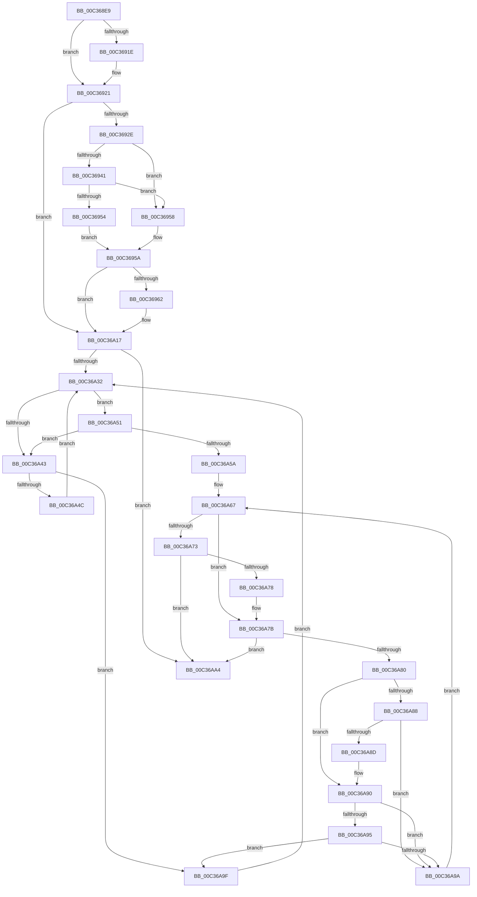

# sub_00C368E9

- RVA: `0x00C368E9`–`0x00C36ACC` (길이 `483` bytes)
- VA: `0x0000000140C368E9`
- 실행 섹션: `INIT`
- PDB 이름 있음: `아니요`; PDB Function 태그: `아니요`
- unwind 정보 RVA: `0x000C9708`
- 디코드: `114`개 명령, `483/483` bytes 표시
- 미해석 바이트: `0` (있으면 어셈블리에 `.byte`로 보존)

> 이 문서는 커널 이미지의 기계어와 PDB 기호를 분석해 생성했습니다. 4번과 5번은 함수 원형과 자료형을 바이너리 사용 방식에서 추정한 C 해석이며 원본 소스 복구 결과는 아닙니다.

## 1. Dependencies

- 직접 호출 지점: **5**; 고유 호출 대상: **5**
- 직접 호출자로 확인된 함수: **0**
- RIP 상대 이미지 참조: **15**

### Outgoing calls
- `0x00C368FD` → [TraceLoggingRegisterEx_EtwRegister_EtwSetInformation](../../page/92/TraceLoggingRegisterEx_EtwRegister_EtwSetInformation_function_009208A0.md) (function, `0x009208A0`)
- `0x00C36A12` → [EtwWriteEx](../../text/25/EtwWriteEx_function_0025F0D0.md) (function, `0x0025F0D0`)
- `0x00C36A1E` → [KeAcquireSpinLockRaiseToDpc](../../text/20/KeAcquireSpinLockRaiseToDpc_function_00208470.md) (function, `0x00208470`)
- `0x00C36A36` → [KasaniSendTelemetryDriver](../../text/5A/KasaniSendTelemetryDriver_function_005ABD40.md) (function, `0x005ABD40`)
- `0x00C36AB6` → [KeReleaseSpinLock](../../text/39/KeReleaseSpinLock_function_00392BA0.md) (function, `0x00392BA0`)

### Direct callers
- 이 함수 시작 RVA로 연결되는 직접 call은 확인되지 않았습니다. 간접 호출은 완전히 역산할 수 없습니다.

### Static image references
- `0x00C368ED` → RVA `0x00E07020` (`.data`; read)
- `0x00C36902` → RVA `0x00F654F8` (`.data`; read)
- `0x00C36915` → RVA `0x00FCEC69` (`ALMOSTRO`; read)
- `0x00C36938` → RVA `0x00E07030` (`.data`; read)
- `0x00C36941` → RVA `0x00E07038` (`.data`; read)
- `0x00C3696D` → RVA `0x00043590` (`.rdata`; read)
- `0x00C36984` → RVA `0x000479EA` (`.rdata`; read)
- `0x00C36994` → RVA `0x00E07028` (`.data`; read)
- `0x00C369C4` → RVA `0x000479F4` (`.rdata`; read)
- `0x00C369CF` → RVA `0x0005BCFD` (`.rdata`; read)
- `0x00C369F0` → RVA `0x00E07040` (`.data`; read)
- `0x00C36A17` → RVA `0x00F65500` (`.data`; read)
- `0x00C36A23` → RVA `0x00E663D8` (`.data`; read)
- `0x00C36A43` → RVA `0x00E663E0` (`.data`; read)
- `0x00C36AA8` → RVA `0x00FCEC6B` (`ALMOSTRO`; write)

## 2. Other-region calls and transfers

- 다른 실행 섹션으로 향하는 call: **5**
  - `0x00C368FD` → [TraceLoggingRegisterEx_EtwRegister_EtwSetInformation](../../page/92/TraceLoggingRegisterEx_EtwRegister_EtwSetInformation_function_009208A0.md) (`INIT` → `PAGE`)
  - `0x00C36A12` → [EtwWriteEx](../../text/25/EtwWriteEx_function_0025F0D0.md) (`INIT` → `.text`)
  - `0x00C36A1E` → [KeAcquireSpinLockRaiseToDpc](../../text/20/KeAcquireSpinLockRaiseToDpc_function_00208470.md) (`INIT` → `.text`)
  - `0x00C36A36` → [KasaniSendTelemetryDriver](../../text/5A/KasaniSendTelemetryDriver_function_005ABD40.md) (`INIT` → `.text`)
  - `0x00C36AB6` → [KeReleaseSpinLock](../../text/39/KeReleaseSpinLock_function_00392BA0.md) (`INIT` → `.text`)
- call이 아닌 외부 분기/꼬리 이동: **1**
  - `0x00C36ACA` → [sub_00C36ACC + 0x8](Unknown_function_00C36ACC.md) (`tail-transfer`)

## 3. Assembly (complete function range)

```asm
00C368E9  49 89 7B 10                     mov qword ptr [r11 + 0x10], rdi
00C368ED  48 8D 0D 2C 07 1D 00            lea rcx, [rip + 0x1d072c]
00C368F4  45 33 C0                        xor r8d, r8d
00C368F7  4D 89 73 18                     mov qword ptr [r11 + 0x18], r14
00C368FB  33 D2                           xor edx, edx
00C368FD  E8 9E 9F CE FF                  call 0x1409208a0
00C36902  40 38 35 EF EB 32 00            cmp byte ptr [rip + 0x32ebef], sil
00C36909  8B D6                           mov edx, esi
00C3690B  41 BE 02 00 00 00               mov r14d, 2
00C36911  41 0F 45 D6                     cmovne edx, r14d
00C36915  40 38 35 4D 83 39 00            cmp byte ptr [rip + 0x39834d], sil
00C3691C  74 03                           je 0x140c36921
00C3691E  83 CA 04                        or edx, 4
00C36921  83 3D F8 06 1D 00 05            cmp dword ptr [rip + 0x1d06f8], 5
00C36928  0F 86 E9 00 00 00               jbe 0x140c36a17
00C3692E  49 B8 00 00 00 00 00 40 00 00   movabs r8, 0x400000000000
00C36938  4C 85 05 F1 06 1D 00            test qword ptr [rip + 0x1d06f1], r8
00C3693F  74 17                           je 0x140c36958
00C36941  48 8B 05 F0 06 1D 00            mov rax, qword ptr [rip + 0x1d06f0]
00C36948  49 23 C0                        and rax, r8
00C3694B  48 3B 05 E6 06 1D 00            cmp rax, qword ptr [rip + 0x1d06e6]
00C36952  75 04                           jne 0x140c36958
00C36954  B0 01                           mov al, 1
00C36956  EB 02                           jmp 0x140c3695a
00C36958  32 C0                           xor al, al
00C3695A  84 C0                           test al, al
00C3695C  0F 84 B5 00 00 00               je 0x140c36a17
00C36962  89 55 C7                        mov dword ptr [rbp - 0x39], edx
00C36965  48 8D 45 D7                     lea rax, [rbp - 0x29]
00C36969  48 89 45 17                     mov qword ptr [rbp + 0x17], rax
00C3696D  48 8D 0D 1C CC 40 FF            lea rcx, [rip - 0xbf33e4]
00C36974  4C 89 45 E7                     mov qword ptr [rbp - 0x19], r8
00C36978  48 8D 45 C7                     lea rax, [rbp - 0x39]
00C3697C  48 89 45 27                     mov qword ptr [rbp + 0x27], rax
00C36980  48 8D 55 DF                     lea rdx, [rbp - 0x21]
00C36984  0F B7 05 5F 10 41 FF            movzx eax, word ptr [rip - 0xbeefa1]
00C3698B  45 33 C9                        xor r9d, r9d
00C3698E  89 45 E3                        mov dword ptr [rbp - 0x1d], eax
00C36991  45 33 C0                        xor r8d, r8d
00C36994  48 8B 05 8D 06 1D 00            mov rax, qword ptr [rip + 0x1d068d]
00C3699B  48 89 45 F7                     mov qword ptr [rbp - 9], rax
00C3699F  48 C7 45 D7 00 00 00 02         mov qword ptr [rbp - 0x29], 0x2000000
00C369A7  48 C7 45 1F 08 00 00 00         mov qword ptr [rbp + 0x1f], 8
00C369AF  48 C7 45 2F 04 00 00 00         mov qword ptr [rbp + 0x2f], 4
00C369B7  C7 45 DF 00 00 00 0B            mov dword ptr [rbp - 0x21], 0xb000000
00C369BE  0F B7 00                        movzx eax, word ptr [rax]
00C369C1  89 45 FF                        mov dword ptr [rbp - 1], eax
00C369C4  48 8D 05 29 10 41 FF            lea rax, [rip - 0xbeefd7]
00C369CB  48 89 45 07                     mov qword ptr [rbp + 7], rax
00C369CF  48 8D 05 27 53 42 FF            lea rax, [rip - 0xbdacd9]
00C369D6  2B C1                           sub eax, ecx
00C369D8  44 89 75 03                     mov dword ptr [rbp + 3], r14d
00C369DC  C7 45 0F 22 00 00 00            mov dword ptr [rbp + 0xf], 0x22
00C369E3  C7 45 13 01 00 00 00            mov dword ptr [rbp + 0x13], 1
00C369EA  89 45 CB                        mov dword ptr [rbp - 0x35], eax
00C369ED  8B 45 CB                        mov eax, dword ptr [rbp - 0x35]
00C369F0  48 8B 0D 49 06 1D 00            mov rcx, qword ptr [rip + 0x1d0649]
00C369F7  48 8D 45 F7                     lea rax, [rbp - 9]
00C369FB  48 89 44 24 38                  mov qword ptr [rsp + 0x38], rax
00C36A00  C7 44 24 30 04 00 00 00         mov dword ptr [rsp + 0x30], 4
00C36A08  48 89 74 24 28                  mov qword ptr [rsp + 0x28], rsi
00C36A0D  48 89 74 24 20                  mov qword ptr [rsp + 0x20], rsi
00C36A12  E8 B9 86 62 FF                  call 0x14025f0d0
00C36A17  48 8D 0D E2 EA 32 00            lea rcx, [rip + 0x32eae2]
00C36A1E  E8 4D 1A 5D FF                  call 0x140208470
00C36A23  48 8B 1D AE F9 22 00            mov rbx, qword ptr [rip + 0x22f9ae]
00C36A2A  0F B6 F8                        movzx edi, al
00C36A2D  48 85 DB                        test rbx, rbx
00C36A30  74 72                           je 0x140c36aa4
00C36A32  48 8B 4B 18                     mov rcx, qword ptr [rbx + 0x18]
00C36A36  E8 05 53 97 FF                  call 0x1405abd40
00C36A3B  48 8B 0B                        mov rcx, qword ptr [rbx]
00C36A3E  48 85 C9                        test rcx, rcx
00C36A41  74 0E                           je 0x140c36a51
00C36A43  F6 05 96 F9 22 00 01            test byte ptr [rip + 0x22f996], 1
00C36A4A  74 53                           je 0x140c36a9f
00C36A4C  48 33 D9                        xor rbx, rcx
00C36A4F  EB E1                           jmp 0x140c36a32
00C36A51  48 8B 4B 08                     mov rcx, qword ptr [rbx + 8]
00C36A55  48 85 C9                        test rcx, rcx
00C36A58  75 E9                           jne 0x140c36a43
00C36A5A  0F B6 15 7F F9 22 00            movzx edx, byte ptr [rip + 0x22f97f]
00C36A61  48 8B C3                        mov rax, rbx
00C36A64  80 E2 01                        and dl, 1
00C36A67  48 8B 40 10                     mov rax, qword ptr [rax + 0x10]
00C36A6B  48 83 E0 FC                     and rax, 0xfffffffffffffffc
00C36A6F  84 D2                           test dl, dl
00C36A71  74 08                           je 0x140c36a7b
00C36A73  48 85 C0                        test rax, rax
00C36A76  74 2C                           je 0x140c36aa4
00C36A78  48 33 C3                        xor rax, rbx
00C36A7B  48 85 C0                        test rax, rax
00C36A7E  74 24                           je 0x140c36aa4
00C36A80  48 8B 48 08                     mov rcx, qword ptr [rax + 8]
00C36A84  84 D2                           test dl, dl
00C36A86  74 08                           je 0x140c36a90
00C36A88  48 85 C9                        test rcx, rcx
00C36A8B  74 0D                           je 0x140c36a9a
00C36A8D  48 33 C8                        xor rcx, rax
00C36A90  48 85 C9                        test rcx, rcx
00C36A93  74 05                           je 0x140c36a9a
00C36A95  48 3B CB                        cmp rcx, rbx
00C36A98  75 05                           jne 0x140c36a9f
00C36A9A  48 8B D8                        mov rbx, rax
00C36A9D  EB C8                           jmp 0x140c36a67
00C36A9F  48 8B D9                        mov rbx, rcx
00C36AA2  EB 8E                           jmp 0x140c36a32
00C36AA4  40 0F B6 D7                     movzx edx, dil
00C36AA8  C6 05 BC 81 39 00 01            mov byte ptr [rip + 0x3981bc], 1
00C36AAF  48 8D 0D 4A EA 32 00            lea rcx, [rip + 0x32ea4a]
00C36AB6  E8 E5 C0 75 FF                  call 0x140392ba0
00C36ABB  40 38 35 36 EA 32 00            cmp byte ptr [rip + 0x32ea36], sil
00C36AC2  48 8B BC 24 E8 00 00 00         mov rdi, qword ptr [rsp + 0xe8]
00C36ACA  74 08                           je 0x140c36ad4
```

## 4. C-style interpretation (structured pseudocode)

```c
__int64 __fastcall sub_00C368E9(__int64 a1, int a2, int a3, int a4, __int64 a5, __int64 a6, __int64 a7, __int64 a8, __int64 a9, __int64 a10, __int64 a11, __int64 a12, __int64 a13, __int64 a14, __int64 a15, __int64 a16, __int64 a17, __int64 a18, __int64 a19, __int64 a20, __int64 a21, __int64 a22, __int64 a23, __int64 a24, __int64 a25, __int64 a26, __int64 a27, __int64 a28, __int64 a29)
{
    __int64 result;
    __int64 v_rbx;
    unsigned __int64 v_stack_p20;
    unsigned __int64 v_stack_p28;
    unsigned int v_stack_p30;
    unsigned __int64 v_stack_p38;

    *(unsigned __int64 *)(v_r11 + 16) = v_rdi;
    a3 = 0;
    *(unsigned __int64 *)(v_r11 + 24) = v_r14;
    a2 = 0;
    result = TraceLoggingRegisterEx_EtwRegister_EtwSetInformation(v_rip + 1902380, a2, a3, a4);
    a2 = (unsigned int)((unsigned int)(v_rsi));
    if ((*(unsigned __int8 *)(v_rip + 3337199)) != ((unsigned __int8)(v_rsi))) { a2 = 2; }
    if ((*(unsigned __int8 *)(v_rip + 3769165)) != ((unsigned __int8)(v_rsi))) {
        a2 = (unsigned int)((a2) | (4));
    }
    if ((*(unsigned int *)(v_rip + 1902328)) <= 5) goto loc_00C36A17;
    if (((*(unsigned __int64 *)(v_rip + 1902321)) & (0)) == 0) goto loc_00C36958;
    result = (*(unsigned __int64 *)(v_rip + 1902320)) & (0);
    if (result != (*(unsigned __int64 *)(v_rip + 1902310))) goto loc_00C36958;
    goto loc_00C3695A;
loc_00C36958:
    result = 0;
loc_00C3695A:
    if (0 != 0) {
        *(unsigned int *)(v_rbp - 57) = a2;
        result = v_rbp - 41;
        *(unsigned __int64 *)(v_rbp + 23) = result;
        a1 = v_rip - 12530660;
        *(unsigned __int64 *)(v_rbp - 25) = 0;
        result = v_rbp - 57;
        *(unsigned __int64 *)(v_rbp + 39) = result;
        a2 = v_rbp - 33;
        result = *(unsigned __int16 *)(v_rip - 12513185);
        a4 = 0;
        *(unsigned int *)(v_rbp - 29) = (unsigned int)(result);
        a3 = 0;
        result = *(unsigned __int64 *)(v_rip + 1902221);
        *(unsigned __int64 *)(v_rbp - 9) = result;
        *(unsigned __int64 *)(v_rbp - 41) = 0x2000000ULL;
        *(unsigned __int64 *)(v_rbp + 31) = 8;
        *(unsigned __int64 *)(v_rbp + 47) = 4;
        *(unsigned int *)(v_rbp - 33) = 0xB000000ULL;
        result = *(unsigned __int16 *)(result);
        *(unsigned int *)(v_rbp - 1) = (unsigned int)(result);
        result = v_rip - 12513239;
        *(unsigned __int64 *)(v_rbp + 7) = result;
        result = v_rip - 12430553;
        result = (unsigned int)((result) - ((unsigned int)(a1)));
        *(unsigned int *)(v_rbp + 3) = 2;
        *(unsigned int *)(v_rbp + 15) = 34;
        *(unsigned int *)(v_rbp + 19) = 1;
        *(unsigned int *)(v_rbp - 53) = (unsigned int)(result);
        result = *(unsigned int *)(v_rbp - 53);
        a1 = *(unsigned __int64 *)(v_rip + 1902153);
        result = v_rbp - 9;
        v_stack_p38 = result;
        v_stack_p30 = 4;
        v_stack_p28 = v_rsi;
        v_stack_p20 = v_rsi;
        result = EtwWriteEx(a1, a2, a3, a4);
    }
    result = KeAcquireSpinLockRaiseToDpc(v_rip + 3336930, a2, a3, a4);
    if (*(unsigned __int64 *)(v_rip + 2292142) == 0) goto loc_00C36AA4;
loc_00C36A32:
    result = KasaniSendTelemetryDriver(*(unsigned __int64 *)(*(unsigned __int64 *)(v_rip + 2292142) + 24), a2, a3, a4);
    if (*(unsigned __int64 *)(*(unsigned __int64 *)(v_rip + 2292142)) == 0) goto loc_00C36A51;
loc_00C36A43:
    if (((*(unsigned __int8 *)(v_rip + 2292118)) & (1)) == 0) goto loc_00C36A9F;
    v_rbx = (*(unsigned __int64 *)(v_rip + 2292142)) ^ (*(unsigned __int64 *)(*(unsigned __int64 *)(v_rip + 2292142)));
    goto loc_00C36A32;
loc_00C36A51:
    if (*(unsigned __int64 *)(v_rbx + 8) != 0) goto loc_00C36A43;
    a2 = (unsigned __int8)((*(unsigned __int8 *)(v_rip + 2292095)) & (1));
loc_00C36A67:
    result = (*(unsigned __int64 *)(v_rbx + 16)) & (-4);
    if ((unsigned __int8)(a2) == 0) goto loc_00C36A7B;
    if (result == 0) goto loc_00C36AA4;
    result = (result) ^ (v_rbx);
loc_00C36A7B:
    if (result == 0) goto loc_00C36AA4;
    if ((unsigned __int8)(a2) == 0) goto loc_00C36A90;
    if (*(unsigned __int64 *)(result + 8) == 0) goto loc_00C36A9A;
    a1 = (*(unsigned __int64 *)(result + 8)) ^ (result);
loc_00C36A90:
    if (a1 == 0) goto loc_00C36A9A;
    if (a1 != v_rbx) goto loc_00C36A9F;
loc_00C36A9A:
    goto loc_00C36A67;
loc_00C36A9F:
    goto loc_00C36A32;
loc_00C36AA4:
    *(unsigned __int8 *)(v_rip + 3768764) = 1;
    result = KeReleaseSpinLock(v_rip + 3336778, (unsigned __int8)((unsigned __int8)(result)), a3, a4);
}
```

## 5. (Beta) C Style

```c
int64_t sub_00C368E9(int64_t Arg1, int32_t Arg2, int32_t Arg3, int32_t Arg4, uint64_t Arg5, uint64_t Arg6, uint64_t Arg7, uint64_t Arg8, uint64_t Arg9, uint64_t Arg10, uint64_t Arg11, uint64_t Arg12, uint64_t Arg13, uint64_t Arg14, uint64_t Arg15, uint64_t Arg16, uint64_t Arg17, uint64_t Arg18, uint64_t Arg19, uint64_t Arg20, uint64_t Arg21, uint64_t Arg22, uint64_t Arg23, uint64_t Arg24, uint64_t Arg25, uint64_t Arg26, uint64_t Arg27, uint64_t Arg28, int64_t Arg29)
{
    int64_t result;
    int64_t local_rbx;
    uint64_t v_stack_p20;
    uint64_t v_stack_p28;
    uint32_t v_stack_p30;
    uint64_t v_stack_p38;

    *(uint64_t *)(local_r11 + 0x10) = local_rdi;
    Arg3 = 0;
    *(uint64_t *)(local_r11 + 0x18) = local_r14;
    Arg2 = 0;
    result = TraceLoggingRegisterEx_EtwRegister_EtwSetInformation(v_rip + 1902380, Arg2, Arg3, Arg4);
    Arg2 = (uint32_t)((uint32_t)(local_rsi));
    if ((*(uint8_t *)(v_rip + 0x32EBEF)) != ((uint8_t)(local_rsi))) { Arg2 = 2; }
    if ((*(uint8_t *)(v_rip + 0x39834D)) != ((uint8_t)(local_rsi))) {
        Arg2 = (uint32_t)((Arg2) | (4));
    }
    if ((*(uint32_t *)(v_rip + 0x1D06F8)) <= 5) goto loc_00C36A17;
    if (((*(uint64_t *)(v_rip + 0x1D06F1)) & (0)) == 0) goto loc_00C36958;
    result = (*(uint64_t *)(v_rip + 0x1D06F0)) & (0);
    if (result != (*(uint64_t *)(v_rip + 0x1D06E6))) goto loc_00C36958;
    goto loc_00C3695A;
loc_00C36958:
    result = 0;
loc_00C3695A:
    if (0 != 0) {
        *(uint32_t *)(local_rbp - 0x39) = Arg2;
        result = local_rbp - 41;
        *(uint64_t *)(local_rbp + 0x17) = result;
        Arg1 = v_rip - 12530660;
        *(uint64_t *)(local_rbp - 0x19) = 0;
        result = local_rbp - 57;
        *(uint64_t *)(local_rbp + 0x27) = result;
        Arg2 = local_rbp - 33;
        result = *(uint16_t *)(v_rip - 0xBEEFA1);
        Arg4 = 0;
        *(uint32_t *)(local_rbp - 0x1D) = (uint32_t)(result);
        Arg3 = 0;
        result = *(uint64_t *)(v_rip + 0x1D068D);
        *(uint64_t *)(local_rbp - 0x9) = result;
        *(uint64_t *)(local_rbp - 0x29) = 0x2000000ULL;
        *(uint64_t *)(local_rbp + 0x1F) = 8;
        *(uint64_t *)(local_rbp + 0x2F) = 4;
        *(uint32_t *)(local_rbp - 0x21) = 0xB000000ULL;
        result = *(uint16_t *)(result);
        *(uint32_t *)(local_rbp - 0x1) = (uint32_t)(result);
        result = v_rip - 12513239;
        *(uint64_t *)(local_rbp + 0x7) = result;
        result = v_rip - 12430553;
        result = (uint32_t)((result) - ((uint32_t)(Arg1)));
        *(uint32_t *)(local_rbp + 0x3) = 2;
        *(uint32_t *)(local_rbp + 0xF) = 34;
        *(uint32_t *)(local_rbp + 0x13) = 1;
        *(uint32_t *)(local_rbp - 0x35) = (uint32_t)(result);
        result = *(uint32_t *)(local_rbp - 0x35);
        Arg1 = *(uint64_t *)(v_rip + 0x1D0649);
        result = local_rbp - 9;
        v_stack_p38 = result;
        v_stack_p30 = 4;
        v_stack_p28 = local_rsi;
        v_stack_p20 = local_rsi;
        result = EtwWriteEx(Arg1, Arg2, Arg3, Arg4);
    }
    result = KeAcquireSpinLockRaiseToDpc(v_rip + 3336930, Arg2, Arg3, Arg4);
    if (*(uint64_t *)(v_rip + 0x22F9AE) == 0) goto loc_00C36AA4;
loc_00C36A32:
    result = KasaniSendTelemetryDriver(*(uint64_t *)(*(uint64_t *)(v_rip + 0x22F9AE) + 0x18), Arg2, Arg3, Arg4);
    if (*(uint64_t *)(*(uint64_t *)(v_rip + 0x22F9AE)) == 0) goto loc_00C36A51;
loc_00C36A43:
    if (((*(uint8_t *)(v_rip + 0x22F996)) & (1)) == 0) goto loc_00C36A9F;
    local_rbx = (*(uint64_t *)(v_rip + 0x22F9AE)) ^ (*(uint64_t *)(*(uint64_t *)(v_rip + 0x22F9AE)));
    goto loc_00C36A32;
loc_00C36A51:
    if (*(uint64_t *)(local_rbx + 0x8) != 0) goto loc_00C36A43;
    Arg2 = (uint8_t)((*(uint8_t *)(v_rip + 0x22F97F)) & (1));
loc_00C36A67:
    result = (*(uint64_t *)(local_rbx + 0x10)) & (-4);
    if ((uint8_t)(Arg2) == 0) goto loc_00C36A7B;
    if (result == 0) goto loc_00C36AA4;
    result = (result) ^ (local_rbx);
loc_00C36A7B:
    if (result == 0) goto loc_00C36AA4;
    if ((uint8_t)(Arg2) == 0) goto loc_00C36A90;
    if (*(uint64_t *)(result + 0x8) == 0) goto loc_00C36A9A;
    Arg1 = (*(uint64_t *)(result + 0x8)) ^ (result);
loc_00C36A90:
    if (Arg1 == 0) goto loc_00C36A9A;
    if (Arg1 != local_rbx) goto loc_00C36A9F;
loc_00C36A9A:
    goto loc_00C36A67;
loc_00C36A9F:
    goto loc_00C36A32;
loc_00C36AA4:
    *(uint8_t *)(v_rip + 0x3981BC) = 1;
    result = KeReleaseSpinLock(v_rip + 3336778, (uint8_t)((uint8_t)(result)), Arg3, Arg4);
}
```

## 6. Execution-region graph

[열기: 2D/3D 그래프와 함수 탐색 컨트롤 패널](../../../control-panel.html?section=init&rva=0x00C368E9&view=graph)

- 2D 그래프는 위에서 아래로 흐르고, 3D 그래프는 빈 공간을 드래그해 회전합니다. Shift+드래그는 이동, 휠은 확대·축소, 함수 노드 선택은 대상 보고서 이동입니다.

### Static fallback


