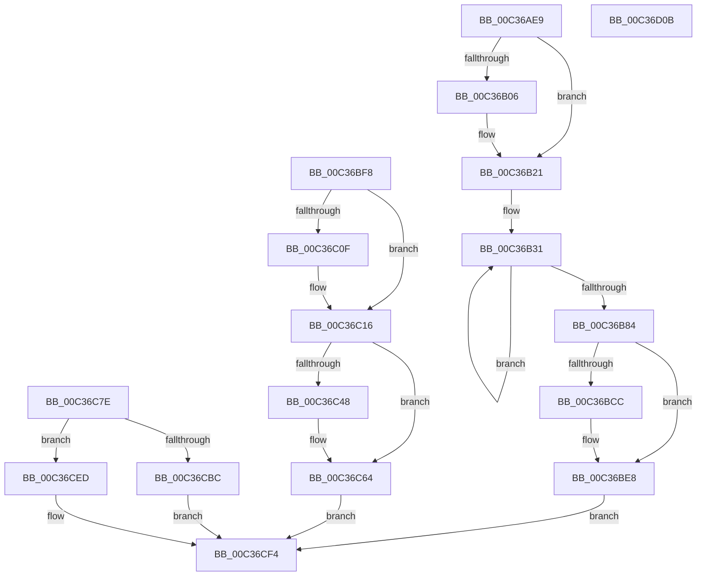

# sub_00C36AE9

- RVA: `0x00C36AE9`–`0x00C36D0C` (길이 `547` bytes)
- VA: `0x0000000140C36AE9`
- 실행 섹션: `INIT`
- PDB 이름 있음: `아니요`; PDB Function 태그: `아니요`
- unwind 정보 RVA: `0x000C9734`
- 디코드: `122`개 명령, `547/547` bytes 표시
- 미해석 바이트: `0` (있으면 어셈블리에 `.byte`로 보존)

> 이 문서는 커널 이미지의 기계어와 PDB 기호를 분석해 생성했습니다. 4번과 5번은 함수 원형과 자료형을 바이너리 사용 방식에서 추정한 C 해석이며 원본 소스 복구 결과는 아닙니다.

## 1. Dependencies

- 직접 호출 지점: **9**; 고유 호출 대상: **7**
- 직접 호출자로 확인된 함수: **0**
- RIP 상대 이미지 참조: **14**

### Outgoing calls
- `0x00C36AF9` → [ExAllocatePool2](../../poolcode/B8/ExAllocatePool2_function_00B820F0.md) (function, `0x00B820F0`)
- `0x00C36B1B` → [KeBugCheckEx](../../text/4F/KeBugCheckEx_function_004FD660.md) (function, `0x004FD660`)
- `0x00C36BC3` → [PsCreateSystemThread](../../page/9E/PsCreateSystemThread_function_009ED0D0.md) (function, `0x009ED0D0`)
- `0x00C36BE2` → [KeBugCheckEx](../../text/4F/KeBugCheckEx_function_004FD660.md) (function, `0x004FD660`)
- `0x00C36BEE` → [ObCloseHandle](../../page/8A/ObCloseHandle_function_008A1870.md) (function, `0x008A1870`)
- `0x00C36C3F` → [KasanTrackAddress](../../text/46/KasanTrackAddress_function_00462520.md) (function, `0x00462520`)
- `0x00C36C5E` → [KeBugCheckEx](../../text/4F/KeBugCheckEx_function_004FD660.md) (function, `0x004FD660`)
- `0x00C36CC6` → [KasanInitializeLoadedModules](KasanInitializeLoadedModules_function_00C36D20.md) (function, `0x00C36D20`)
- `0x00C36CFB` → [_security_check_cookie](../../text/6A/_security_check_cookie_function_006AC640.md) (function, `0x006AC640`)

### Direct callers
- 이 함수 시작 RVA로 연결되는 직접 call은 확인되지 않았습니다. 간접 호출은 완전히 역산할 수 없습니다.

### Static image references
- `0x00C36B24` → RVA `0x00F8A540` (`.data`; read)
- `0x00C36B87` → RVA `0x00FCEC78` (`ALMOSTRO`; write)
- `0x00C36BAE` → RVA `0x005ABEC0` (`KasaniTelemetryThread`; read)
- `0x00C36BF8` → RVA `0x00F654F8` (`.data`; read)
- `0x00C36BFF` → RVA `0x00F65500` (`.data`; write)
- `0x00C36C06` → RVA `0x00F8A520` (`.data`; write)
- `0x00C36C0F` → RVA `0x00F654F0` (`.data`; write)
- `0x00C36C1C` → RVA `0x00FCEC6A` (`ALMOSTRO`; write)
- `0x00C36C6E` → RVA `0x00FC6ED8` (`ALMOSTRO`; read)
- `0x00C36C75` → RVA `0x00FC52D8` (`ALMOSTRO`; write)
- `0x00C36C95` → RVA `0x00F65520` (`.data`; read)
- `0x00C36CBF` → RVA `0x00FCEC68` (`ALMOSTRO`; write)
- `0x00C36CD2` → RVA `0x00F654F8` (`.data`; write)
- `0x00C36CE5` → RVA `0x00FCEC69` (`ALMOSTRO`; write)

## 2. Other-region calls and transfers

- 다른 실행 섹션으로 향하는 call: **8**
  - `0x00C36AF9` → [ExAllocatePool2](../../poolcode/B8/ExAllocatePool2_function_00B820F0.md) (`INIT` → `POOLCODE`)
  - `0x00C36B1B` → [KeBugCheckEx](../../text/4F/KeBugCheckEx_function_004FD660.md) (`INIT` → `.text`)
  - `0x00C36BC3` → [PsCreateSystemThread](../../page/9E/PsCreateSystemThread_function_009ED0D0.md) (`INIT` → `PAGE`)
  - `0x00C36BE2` → [KeBugCheckEx](../../text/4F/KeBugCheckEx_function_004FD660.md) (`INIT` → `.text`)
  - `0x00C36BEE` → [ObCloseHandle](../../page/8A/ObCloseHandle_function_008A1870.md) (`INIT` → `PAGE`)
  - `0x00C36C3F` → [KasanTrackAddress](../../text/46/KasanTrackAddress_function_00462520.md) (`INIT` → `.text`)
  - `0x00C36C5E` → [KeBugCheckEx](../../text/4F/KeBugCheckEx_function_004FD660.md) (`INIT` → `.text`)
  - `0x00C36CFB` → [_security_check_cookie](../../text/6A/_security_check_cookie_function_006AC640.md) (`INIT` → `.text`)
- 별도 외부 분기/꼬리 이동을 확인하지 못했습니다.

## 3. Assembly (complete function range)

```asm
00C36AE9  BA 08 2A 00 00                  mov edx, 0x2a08
00C36AEE  B9 40 00 00 00                  mov ecx, 0x40
00C36AF3  41 B8 4B 61 54 6D               mov r8d, 0x6d54614b
00C36AF9  E8 F2 B5 F4 FF                  call 0x140b820f0
00C36AFE  4C 8B C8                        mov r9, rax
00C36B01  48 85 C0                        test rax, rax
00C36B04  75 1B                           jne 0x140c36b21
00C36B06  8D 50 04                        lea edx, [rax + 4]
00C36B09  48 C7 44 24 20 01 00 00 00      mov qword ptr [rsp + 0x20], 1
00C36B12  B9 F1 01 00 00                  mov ecx, 0x1f1
00C36B17  44 8D 40 08                     lea r8d, [rax + 8]
00C36B1B  E8 40 6B 8C FF                  call 0x1404fd660
00C36B20  CC                              int3
00C36B21  49 8B C9                        mov rcx, r9
00C36B24  48 8D 05 15 3A 35 00            lea rax, [rip + 0x353a15]
00C36B2B  41 B8 05 00 00 00               mov r8d, 5
00C36B31  48 8D 89 80 00 00 00            lea rcx, [rcx + 0x80]
00C36B38  0F 10 00                        movups xmm0, xmmword ptr [rax]
00C36B3B  48 8D 80 80 00 00 00            lea rax, [rax + 0x80]
00C36B42  0F 11 41 80                     movups xmmword ptr [rcx - 0x80], xmm0
00C36B46  0F 10 48 90                     movups xmm1, xmmword ptr [rax - 0x70]
00C36B4A  0F 11 49 90                     movups xmmword ptr [rcx - 0x70], xmm1
00C36B4E  0F 10 40 A0                     movups xmm0, xmmword ptr [rax - 0x60]
00C36B52  0F 11 41 A0                     movups xmmword ptr [rcx - 0x60], xmm0
00C36B56  0F 10 48 B0                     movups xmm1, xmmword ptr [rax - 0x50]
00C36B5A  0F 11 49 B0                     movups xmmword ptr [rcx - 0x50], xmm1
00C36B5E  0F 10 40 C0                     movups xmm0, xmmword ptr [rax - 0x40]
00C36B62  0F 11 41 C0                     movups xmmword ptr [rcx - 0x40], xmm0
00C36B66  0F 10 48 D0                     movups xmm1, xmmword ptr [rax - 0x30]
00C36B6A  0F 11 49 D0                     movups xmmword ptr [rcx - 0x30], xmm1
00C36B6E  0F 10 40 E0                     movups xmm0, xmmword ptr [rax - 0x20]
00C36B72  0F 11 41 E0                     movups xmmword ptr [rcx - 0x20], xmm0
00C36B76  0F 10 48 F0                     movups xmm1, xmmword ptr [rax - 0x10]
00C36B7A  0F 11 49 F0                     movups xmmword ptr [rcx - 0x10], xmm1
00C36B7E  49 83 E8 01                     sub r8, 1
00C36B82  75 AD                           jne 0x140c36b31
00C36B84  0F 10 00                        movups xmm0, xmmword ptr [rax]
00C36B87  4C 89 0D EA 80 39 00            mov qword ptr [rip + 0x3980ea], r9
00C36B8E  BA FF FF 1F 00                  mov edx, 0x1fffff
00C36B93  48 89 74 24 30                  mov qword ptr [rsp + 0x30], rsi
00C36B98  45 33 C9                        xor r9d, r9d
00C36B9B  0F 11 01                        movups xmmword ptr [rcx], xmm0
00C36B9E  0F 10 48 10                     movups xmm1, xmmword ptr [rax + 0x10]
00C36BA2  0F 11 49 10                     movups xmmword ptr [rcx + 0x10], xmm1
00C36BA6  48 8B 40 20                     mov rax, qword ptr [rax + 0x20]
00C36BAA  48 89 41 20                     mov qword ptr [rcx + 0x20], rax
00C36BAE  48 8D 05 0B 53 97 FF            lea rax, [rip - 0x68acf5]
00C36BB5  48 89 44 24 28                  mov qword ptr [rsp + 0x28], rax
00C36BBA  48 8D 4D CF                     lea rcx, [rbp - 0x31]
00C36BBE  48 89 74 24 20                  mov qword ptr [rsp + 0x20], rsi
00C36BC3  E8 08 65 DB FF                  call 0x1409ed0d0
00C36BC8  85 C0                           test eax, eax
00C36BCA  79 1C                           jns 0x140c36be8
00C36BCC  BA 04 00 00 00                  mov edx, 4
00C36BD1  4C 63 C8                        movsxd r9, eax
00C36BD4  B9 F1 01 00 00                  mov ecx, 0x1f1
00C36BD9  48 89 74 24 20                  mov qword ptr [rsp + 0x20], rsi
00C36BDE  44 8D 42 04                     lea r8d, [rdx + 4]
00C36BE2  E8 79 6A 8C FF                  call 0x1404fd660
00C36BE7  CC                              int3
00C36BE8  48 8B 4D CF                     mov rcx, qword ptr [rbp - 0x31]
00C36BEC  33 D2                           xor edx, edx
00C36BEE  E8 7D AC C6 FF                  call 0x1408a1870
00C36BF3  E9 FC 00 00 00                  jmp 0x140c36cf4
00C36BF8  40 38 35 F9 E8 32 00            cmp byte ptr [rip + 0x32e8f9], sil
00C36BFF  48 89 35 FA E8 32 00            mov qword ptr [rip + 0x32e8fa], rsi
00C36C06  48 89 35 13 39 35 00            mov qword ptr [rip + 0x353913], rsi
00C36C0D  74 07                           je 0x140c36c16
00C36C0F  48 89 35 DA E8 32 00            mov qword ptr [rip + 0x32e8da], rsi
00C36C16  8B 89 A0 00 00 00               mov ecx, dword ptr [rcx + 0xa0]
00C36C1C  C6 05 47 80 39 00 01            mov byte ptr [rip + 0x398047], 1
00C36C23  44 8D 04 4D 00 20 00 00         lea r8d, [rcx*2 + 0x2000]
00C36C2B  8D 14 CD 00 80 00 00            lea edx, [rcx*8 + 0x8000]
00C36C32  48 8B 8B 80 00 00 00            mov rcx, qword ptr [rbx + 0x80]
00C36C39  49 2B C8                        sub rcx, r8
00C36C3C  45 33 C0                        xor r8d, r8d
00C36C3F  E8 DC B8 82 FF                  call 0x140462520
00C36C44  85 C0                           test eax, eax
00C36C46  79 1C                           jns 0x140c36c64
00C36C48  BA 04 00 00 00                  mov edx, 4
00C36C4D  4C 63 C8                        movsxd r9, eax
00C36C50  B9 F1 01 00 00                  mov ecx, 0x1f1
00C36C55  48 89 74 24 20                  mov qword ptr [rsp + 0x20], rsi
00C36C5A  44 8D 42 01                     lea r8d, [rdx + 1]
00C36C5E  E8 FD 69 8C FF                  call 0x1404fd660
00C36C63  CC                              int3
00C36C64  48 B9 00 00 00 00 00 10 00 E0   movabs rcx, 0xe000100000000000
00C36C6E  48 03 0D 63 02 39 00            add rcx, qword ptr [rip + 0x390263]
00C36C75  48 89 0D 5C E6 38 00            mov qword ptr [rip + 0x38e65c], rcx
00C36C7C  EB 76                           jmp 0x140c36cf4
00C36C7E  8B 81 A0 00 00 00               mov eax, dword ptr [rcx + 0xa0]
00C36C84  48 8B 93 80 00 00 00            mov rdx, qword ptr [rbx + 0x80]
00C36C8B  8D 0C 45 00 20 00 00            lea ecx, [rax*2 + 0x2000]
00C36C92  48 2B D1                        sub rdx, rcx
00C36C95  48 8D 05 84 E8 32 00            lea rax, [rip + 0x32e884]
00C36C9C  48 C1 EA 03                     shr rdx, 3
00C36CA0  48 2B C2                        sub rax, rdx
00C36CA3  48 89 05 2E E6 38 00            mov qword ptr [rip + 0x38e62e], rax
00C36CAA  48 8B 83 F0 00 00 00            mov rax, qword ptr [rbx + 0xf0]
00C36CB1  8B 88 10 0F 00 00               mov ecx, dword ptr [rax + 0xf10]
00C36CB7  F6 C1 01                        test cl, 1
00C36CBA  74 31                           je 0x140c36ced
00C36CBC  48 8B CB                        mov rcx, rbx
00C36CBF  C6 05 A2 7F 39 00 01            mov byte ptr [rip + 0x397fa2], 1
00C36CC6  E8 55 00 00 00                  call 0x140c36d20
00C36CCB  48 8B 83 F0 00 00 00            mov rax, qword ptr [rbx + 0xf0]
00C36CD2  40 88 35 1F E8 32 00            mov byte ptr [rip + 0x32e81f], sil
00C36CD9  8B 88 10 0F 00 00               mov ecx, dword ptr [rax + 0xf10]
00C36CDF  C1 E9 08                        shr ecx, 8
00C36CE2  80 E1 01                        and cl, 1
00C36CE5  88 0D 7E 7F 39 00               mov byte ptr [rip + 0x397f7e], cl
00C36CEB  EB 07                           jmp 0x140c36cf4
00C36CED  40 88 35 74 7F 39 00            mov byte ptr [rip + 0x397f74], sil
00C36CF4  48 8B 4D 37                     mov rcx, qword ptr [rbp + 0x37]
00C36CF8  48 33 CC                        xor rcx, rsp
00C36CFB  E8 40 59 A7 FF                  call 0x1406ac640
00C36D00  48 81 C4 C0 00 00 00            add rsp, 0xc0
00C36D07  5E                              pop rsi
00C36D08  5B                              pop rbx
00C36D09  5D                              pop rbp
00C36D0A  C3                              ret
00C36D0B  CC                              int3
```

## 4. C-style interpretation (structured pseudocode)

```c
__int64 __fastcall sub_00C36AE9(void)
{
    __int64 result;
    __int64 v_rsp;
    unsigned __int64 v_stack_p20;
    unsigned __int64 v_stack_p28;
    unsigned __int64 v_stack_p30;

    result = ExAllocatePool2(64, (unsigned int)(0x2A08ULL), (unsigned int)(0x6D54614BULL), a4);
    if (result == 0) {
        a2 = result + 4;
        v_stack_p20 = 1;
        a1 = 497;
        a3 = result + 8;
        result = KeBugCheckEx(a1, a2, a3, result);
    }
loc_00C36B31:
    *(unsigned __int64 *)(result + 128 - 128) = v_xmm0;
    *(unsigned __int64 *)(result + 128 - 112) = v_xmm1;
    *(unsigned __int64 *)(result + 128 - 96) = v_xmm0;
    *(unsigned __int64 *)(result + 128 - 80) = v_xmm1;
    *(unsigned __int64 *)(result + 128 - 64) = v_xmm0;
    *(unsigned __int64 *)(result + 128 - 48) = v_xmm1;
    *(unsigned __int64 *)(result + 128 - 32) = v_xmm0;
    *(unsigned __int64 *)(result + 128 - 16) = v_xmm1;
    a3 = (5) - (1);
    if (condition_is_not_equal) goto loc_00C36B31;
    *(unsigned __int64 *)(v_rip + 3768554) = result;
    v_stack_p30 = v_rsi;
    a4 = 0;
    *(unsigned __int64 *)(result + 128) = v_xmm0;
    *(unsigned __int64 *)(result + 128 + 16) = v_xmm1;
    *(unsigned __int64 *)(result + 128 + 32) = *(unsigned __int64 *)(v_rip + 3488277 + 128 + 32);
    v_stack_p28 = v_rip - 6860021;
    v_stack_p20 = v_rsi;
    result = PsCreateSystemThread(v_rbp - 49, (unsigned int)(0x1FFFFFULL), a3, a4);
    if (sign_flag) {
        a2 = 4;
        a4 = (int)((unsigned int)(result));
        a1 = 497;
        v_stack_p20 = v_rsi;
        a3 = a2 + 4;
        result = KeBugCheckEx(a1, a2, a3, a4);
    }
    a2 = 0;
    result = ObCloseHandle(*(unsigned __int64 *)(v_rbp - 49), a2, a3, a4);
    goto loc_00C36CF4;
loc_00C36CF4:
    a1 = (*(unsigned __int64 *)(v_rbp + 55)) ^ (v_rsp);
    result = _security_check_cookie(a1, a2, a3, a4);
    v_rsp = (v_rsp) + (192);
    return result;
}
```

## 5. (Beta) C Style

```c
void sub_00C36AE9(void)
{
    int64_t result;
    int64_t local_rsp;
    uint64_t v_stack_p20;
    uint64_t v_stack_p28;
    uint64_t v_stack_p30;

    result = ExAllocatePool2(64, (uint32_t)(0x2A08ULL), (uint32_t)(0x6D54614BULL), a4);
    if (result == 0) {
        a2 = result + 4;
        v_stack_p20 = 1;
        a1 = 497;
        a3 = result + 8;
        result = KeBugCheckEx(a1, a2, a3, result);
    }
loc_00C36B31:
    *(uint64_t *)(result + 0x80 - 0x80) = v_xmm0;
    *(uint64_t *)(result + 0x80 - 0x70) = v_xmm1;
    *(uint64_t *)(result + 0x80 - 0x60) = v_xmm0;
    *(uint64_t *)(result + 0x80 - 0x50) = v_xmm1;
    *(uint64_t *)(result + 0x80 - 0x40) = v_xmm0;
    *(uint64_t *)(result + 0x80 - 0x30) = v_xmm1;
    *(uint64_t *)(result + 0x80 - 0x20) = v_xmm0;
    *(uint64_t *)(result + 0x80 - 0x10) = v_xmm1;
    a3 = (5) - (1);
    if (condition_is_not_equal) goto loc_00C36B31;
    *(uint64_t *)(v_rip + 0x3980EA) = result;
    v_stack_p30 = local_rsi;
    a4 = 0;
    *(uint64_t *)(result + 0x80) = v_xmm0;
    *(uint64_t *)(result + 0x80 + 0x10) = v_xmm1;
    *(uint64_t *)(result + 0x80 + 0x20) = *(uint64_t *)(v_rip + 0x353A15 + 0x80 + 0x20);
    v_stack_p28 = v_rip - 6860021;
    v_stack_p20 = local_rsi;
    result = PsCreateSystemThread(local_rbp - 49, (uint32_t)(0x1FFFFFULL), a3, a4);
    if (sign_flag) {
        a2 = 4;
        a4 = (int32_t)((uint32_t)(result));
        a1 = 497;
        v_stack_p20 = local_rsi;
        a3 = a2 + 4;
        result = KeBugCheckEx(a1, a2, a3, a4);
    }
    a2 = 0;
    result = ObCloseHandle(*(uint64_t *)(local_rbp - 0x31), a2, a3, a4);
    goto loc_00C36CF4;
loc_00C36CF4:
    a1 = (*(uint64_t *)(local_rbp + 0x37)) ^ (local_rsp);
    result = _security_check_cookie(a1, a2, a3, a4);
    local_rsp = (local_rsp) + (192);
    return result;
}
```

## 6. Execution-region graph

[열기: 2D/3D 그래프와 함수 탐색 컨트롤 패널](../../../control-panel.html?section=init&rva=0x00C36AE9&view=graph)

- 2D 그래프는 위에서 아래로 흐르고, 3D 그래프는 빈 공간을 드래그해 회전합니다. Shift+드래그는 이동, 휠은 확대·축소, 함수 노드 선택은 대상 보고서 이동입니다.

### Static fallback


