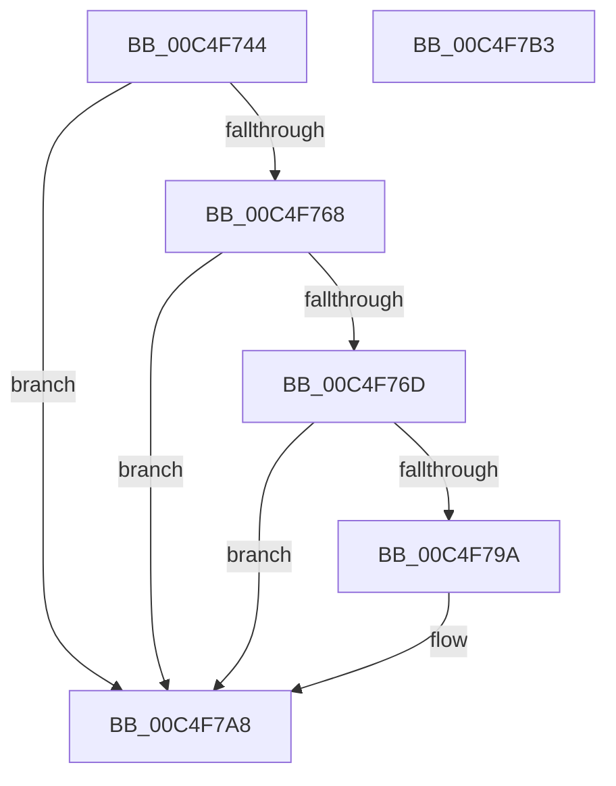

# BapdProcessOslRamdiskInformation

- RVA: `0x00C4F744`–`0x00C4F7B4` (길이 `112` bytes)
- VA: `0x0000000140C4F744`
- 실행 섹션: `INIT`
- PDB 이름 있음: `예`; PDB Function 태그: `아니요`
- unwind 정보 RVA: `0x0005CAAC`
- 디코드: `30`개 명령, `112/112` bytes 표시
- 미해석 바이트: `0` (있으면 어셈블리에 `.byte`로 보존)

> 이 문서는 커널 이미지의 기계어와 PDB 기호를 분석해 생성했습니다. 4번과 5번은 함수 원형과 자료형을 바이너리 사용 방식에서 추정한 C 해석이며 원본 소스 복구 결과는 아닙니다.

## 1. Dependencies

- 직접 호출 지점: **2**; 고유 호출 대상: **2**
- 직접 호출자로 확인된 함수: **1**
- RIP 상대 이미지 참조: **2**

### Outgoing calls
- `0x00C4F789` → [ExAllocatePool2](../../poolcode/B8/ExAllocatePool2_function_00B820F0.md) (function, `0x00B820F0`)
- `0x00C4F7A3` → [memcpy](../../text/6C/memcpy_function_006C6840.md) (function, `0x006C6840`)

### Direct callers
- [BootApplicationPersistentDataProcess](../BE/BootApplicationPersistentDataProcess_function_00BEEBD4.md) at `0x00BEEC2C`

### Static image references
- `0x00C4F74E` → RVA `0x00FC6B20` (`ALMOSTRO`; read)
- `0x00C4F78E` → RVA `0x00EFF030` (`.data`; write)

## 2. Other-region calls and transfers

- 다른 실행 섹션으로 향하는 call: **2**
  - `0x00C4F789` → [ExAllocatePool2](../../poolcode/B8/ExAllocatePool2_function_00B820F0.md) (`INIT` → `POOLCODE`)
  - `0x00C4F7A3` → [memcpy](../../text/6C/memcpy_function_006C6840.md) (`INIT` → `.text`)
- 별도 외부 분기/꼬리 이동을 확인하지 못했습니다.

## 3. Assembly (complete function range)

```asm
00C4F744  48 89 5C 24 08                  mov qword ptr [rsp + 8], rbx
00C4F749  57                              push rdi
00C4F74A  48 83 EC 20                     sub rsp, 0x20
00C4F74E  48 8B 05 CB 73 37 00            mov rax, qword ptr [rip + 0x3773cb]
00C4F755  48 8B 88 F0 00 00 00            mov rcx, qword ptr [rax + 0xf0]
00C4F75C  48 8B 99 60 0F 00 00            mov rbx, qword ptr [rcx + 0xf60]
00C4F763  48 85 DB                        test rbx, rbx
00C4F766  74 40                           je 0x140c4f7a8
00C4F768  83 3B 01                        cmp dword ptr [rbx], 1
00C4F76B  75 3B                           jne 0x140c4f7a8
00C4F76D  8B 43 04                        mov eax, dword ptr [rbx + 4]
00C4F770  41 B8 42 61 50 64               mov r8d, 0x64506142
00C4F776  8D 0C 40                        lea ecx, [rax + rax*2]
00C4F779  8D 0C CD 08 00 00 00            lea ecx, [rcx*8 + 8]
00C4F780  8B F9                           mov edi, ecx
00C4F782  8B D1                           mov edx, ecx
00C4F784  B9 40 00 00 00                  mov ecx, 0x40
00C4F789  E8 62 29 F3 FF                  call 0x140b820f0
00C4F78E  48 89 05 9B F8 2A 00            mov qword ptr [rip + 0x2af89b], rax
00C4F795  48 85 C0                        test rax, rax
00C4F798  74 0E                           je 0x140c4f7a8
00C4F79A  44 8B C7                        mov r8d, edi
00C4F79D  48 8B D3                        mov rdx, rbx
00C4F7A0  48 8B C8                        mov rcx, rax
00C4F7A3  E8 98 70 A7 FF                  call 0x1406c6840
00C4F7A8  48 8B 5C 24 30                  mov rbx, qword ptr [rsp + 0x30]
00C4F7AD  48 83 C4 20                     add rsp, 0x20
00C4F7B1  5F                              pop rdi
00C4F7B2  C3                              ret
00C4F7B3  CC                              int3
```

## 4. C-style interpretation (structured pseudocode)

```c
__int64 __fastcall BapdProcessOslRamdiskInformation(void)
{
    __int64 result;
    __int64 v_rsp;
    unsigned __int64 v_stack_p8;

    v_stack_p8 = v_rbx;
    v_rsp = (v_rsp) - (32);
    if (*(unsigned __int64 *)(*(unsigned __int64 *)(*(unsigned __int64 *)(v_rip + 3634123) + 240) + 3936) == 0) goto loc_00C4F7A8;
    if ((*(unsigned int *)(*(unsigned __int64 *)(*(unsigned __int64 *)(*(unsigned __int64 *)(v_rip + 3634123) + 240) + 3936))) != 1) goto loc_00C4F7A8;
    result = ExAllocatePool2(64, (unsigned int)((unsigned int)((unsigned int)(*(unsigned int *)(*(unsigned __int64 *)(*(unsigned __int64 *)(*(unsigned __int64 *)(v_rip + 3634123) + 240) + 3936) + 4)) + (unsigned int)(*(unsigned int *)(*(unsigned __int64 *)(*(unsigned __int64 *)(*(unsigned __int64 *)(v_rip + 3634123) + 240) + 3936) + 4)) * 2 * 8 + 8)), (unsigned int)(0x64506142ULL), a4);
    *(unsigned __int64 *)(v_rip + 2816155) = result;
    if (result != 0) {
        a3 = (unsigned int)((unsigned int)((unsigned int)((unsigned int)(*(unsigned int *)(*(unsigned __int64 *)(*(unsigned __int64 *)(*(unsigned __int64 *)(v_rip + 3634123) + 240) + 3936) + 4)) + (unsigned int)(*(unsigned int *)(*(unsigned __int64 *)(*(unsigned __int64 *)(*(unsigned __int64 *)(v_rip + 3634123) + 240) + 3936) + 4)) * 2 * 8 + 8)));
        a2 = *(unsigned __int64 *)(*(unsigned __int64 *)(*(unsigned __int64 *)(v_rip + 3634123) + 240) + 3936);
        a1 = result;
        result = memcpy(a1, a2, a3, a4);
    }
    v_rsp = (v_rsp) + (32);
    return result;
}
```

## 5. (Beta) C Style

```c
void BapdProcessOslRamdiskInformation(void)
{
    int64_t result;
    int64_t local_rsp;
    uint64_t v_stack_p8;

    v_stack_p8 = local_rbx;
    local_rsp = (local_rsp) - (32);
    if (*(uint64_t *)(*(uint64_t *)(*(uint64_t *)(v_rip + 0x3773CB) + 0xF0) + 0xF60) == 0) goto loc_00C4F7A8;
    if ((*(uint32_t *)(*(uint64_t *)(*(uint64_t *)(*(uint64_t *)(v_rip + 0x3773CB) + 0xF0) + 0xF60))) != 1) goto loc_00C4F7A8;
    result = ExAllocatePool2(64, (uint32_t)((uint32_t)((uint32_t)(*(uint32_t *)(*(uint64_t *)(*(uint64_t *)(*(uint64_t *)(v_rip + 0x3773CB) + 0xF0) + 0xF60) + 0x4)) + (uint32_t)(*(uint32_t *)(*(uint64_t *)(*(uint64_t *)(*(uint64_t *)(v_rip + 0x3773CB) + 0xF0) + 0xF60) + 0x4)) * 2 * 8 + 8)), (uint32_t)(0x64506142ULL), a4);
    *(uint64_t *)(v_rip + 0x2AF89B) = result;
    if (result != 0) {
        a3 = (uint32_t)((uint32_t)((uint32_t)((uint32_t)(*(uint32_t *)(*(uint64_t *)(*(uint64_t *)(*(uint64_t *)(v_rip + 0x3773CB) + 0xF0) + 0xF60) + 0x4)) + (uint32_t)(*(uint32_t *)(*(uint64_t *)(*(uint64_t *)(*(uint64_t *)(v_rip + 0x3773CB) + 0xF0) + 0xF60) + 0x4)) * 2 * 8 + 8)));
        a2 = *(uint64_t *)(*(uint64_t *)(*(uint64_t *)(v_rip + 0x3773CB) + 0xF0) + 0xF60);
        a1 = result;
        result = memcpy(a1, a2, a3, a4);
    }
    local_rsp = (local_rsp) + (32);
    return result;
}
```

## 6. Execution-region graph

[열기: 2D/3D 그래프와 함수 탐색 컨트롤 패널](../../../control-panel.html?section=init&rva=0x00C4F744&view=graph)

- 2D 그래프는 위에서 아래로 흐르고, 3D 그래프는 빈 공간을 드래그해 회전합니다. Shift+드래그는 이동, 휠은 확대·축소, 함수 노드 선택은 대상 보고서 이동입니다.

### Static fallback


