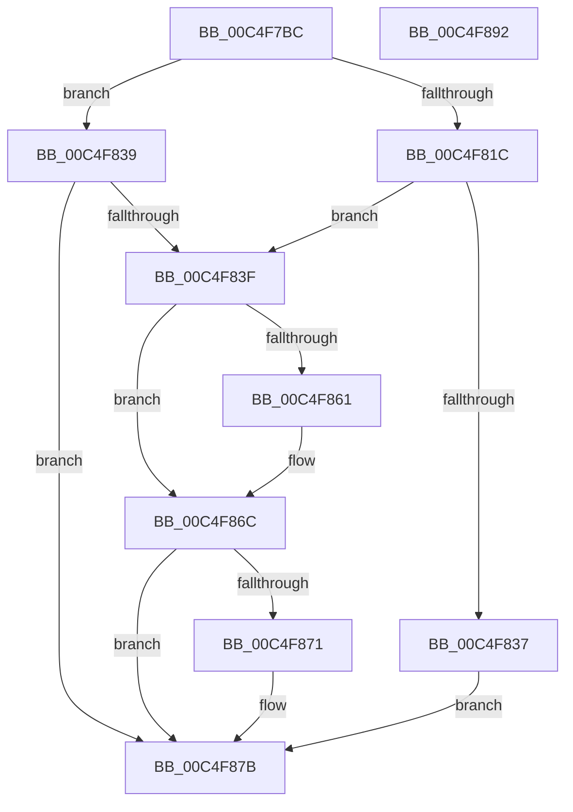

# BapdpProcessBitlockerStatus

- RVA: `0x00C4F7BC`–`0x00C4F893` (길이 `215` bytes)
- VA: `0x0000000140C4F7BC`
- 실행 섹션: `INIT`
- PDB 이름 있음: `예`; PDB Function 태그: `아니요`
- unwind 정보 RVA: `0x000D47B0`
- 디코드: `57`개 명령, `215/215` bytes 표시
- 미해석 바이트: `0` (있으면 어셈블리에 `.byte`로 보존)

> 이 문서는 커널 이미지의 기계어와 PDB 기호를 분석해 생성했습니다. 4번과 5번은 함수 원형과 자료형을 바이너리 사용 방식에서 추정한 C 해석이며 원본 소스 복구 결과는 아닙니다.

## 1. Dependencies

- 직접 호출 지점: **6**; 고유 호출 대상: **5**
- 직접 호출자로 확인된 함수: **1**
- RIP 상대 이미지 참조: **1**

### Outgoing calls
- `0x00C4F810` → [BapdpQueryData](../C5/BapdpQueryData_function_00C50340.md) (function, `0x00C50340`)
- `0x00C4F82A` → [ExAllocatePool2](../../poolcode/B8/ExAllocatePool2_function_00B820F0.md) (function, `0x00B820F0`)
- `0x00C4F858` → [BapdpQueryData](../C5/BapdpQueryData_function_00C50340.md) (function, `0x00C50340`)
- `0x00C4F867` → [BapdpRegisterBitlockerStatus](../C5/BapdpRegisterBitlockerStatus_function_00C50528.md) (function, `0x00C50528`)
- `0x00C4F876` → [ExFreePoolWithTag](../../poolcode/B8/ExFreePoolWithTag_function_00B82870.md) (function, `0x00B82870`)
- `0x00C4F882` → [_security_check_cookie](../../text/6A/_security_check_cookie_function_006AC640.md) (function, `0x006AC640`)

### Direct callers
- [BootApplicationPersistentDataProcess](../BE/BootApplicationPersistentDataProcess_function_00BEEBD4.md) at `0x00BEEC00`

### Static image references
- `0x00C4F7C9` → RVA `0x00E0A740` (`.data`; read)

## 2. Other-region calls and transfers

- 다른 실행 섹션으로 향하는 call: **3**
  - `0x00C4F82A` → [ExAllocatePool2](../../poolcode/B8/ExAllocatePool2_function_00B820F0.md) (`INIT` → `POOLCODE`)
  - `0x00C4F876` → [ExFreePoolWithTag](../../poolcode/B8/ExFreePoolWithTag_function_00B82870.md) (`INIT` → `POOLCODE`)
  - `0x00C4F882` → [_security_check_cookie](../../text/6A/_security_check_cookie_function_006AC640.md) (`INIT` → `.text`)
- 별도 외부 분기/꼬리 이동을 확인하지 못했습니다.

## 3. Assembly (complete function range)

```asm
00C4F7BC  48 89 5C 24 08                  mov qword ptr [rsp + 8], rbx
00C4F7C1  55                              push rbp
00C4F7C2  48 8B EC                        mov rbp, rsp
00C4F7C5  48 83 EC 50                     sub rsp, 0x50
00C4F7C9  48 8B 05 70 AF 1B 00            mov rax, qword ptr [rip + 0x1baf70]
00C4F7D0  48 33 C4                        xor rax, rsp
00C4F7D3  48 89 45 F8                     mov qword ptr [rbp - 8], rax
00C4F7D7  48 83 64 24 28 00               and qword ptr [rsp + 0x28], 0
00C4F7DD  48 8D 45 E0                     lea rax, [rbp - 0x20]
00C4F7E1  83 65 E0 00                     and dword ptr [rbp - 0x20], 0
00C4F7E5  48 8D 55 E8                     lea rdx, [rbp - 0x18]
00C4F7E9  45 33 C9                        xor r9d, r9d
00C4F7EC  48 89 44 24 20                  mov qword ptr [rsp + 0x20], rax
00C4F7F1  45 33 C0                        xor r8d, r8d
00C4F7F4  C7 45 E8 17 02 75 BD            mov dword ptr [rbp - 0x18], 0xbd750217
00C4F7FB  C7 45 EC 5E 2A C6 40            mov dword ptr [rbp - 0x14], 0x40c62a5e
00C4F802  C7 45 F0 AB DF 18 3C            mov dword ptr [rbp - 0x10], 0x3c18dfab
00C4F809  C7 45 F4 C7 76 0F 2B            mov dword ptr [rbp - 0xc], 0x2b0f76c7
00C4F810  E8 2B 0B 00 00                  call 0x140c50340
00C4F815  3D 23 00 00 C0                  cmp eax, 0xc0000023
00C4F81A  75 1D                           jne 0x140c4f839
00C4F81C  8B 55 E0                        mov edx, dword ptr [rbp - 0x20]
00C4F81F  B9 40 00 00 00                  mov ecx, 0x40
00C4F824  41 B8 42 61 50 64               mov r8d, 0x64506142
00C4F82A  E8 C1 28 F3 FF                  call 0x140b820f0
00C4F82F  48 8B D8                        mov rbx, rax
00C4F832  48 85 C0                        test rax, rax
00C4F835  75 08                           jne 0x140c4f83f
00C4F837  EB 42                           jmp 0x140c4f87b
00C4F839  33 DB                           xor ebx, ebx
00C4F83B  85 C0                           test eax, eax
00C4F83D  78 3C                           js 0x140c4f87b
00C4F83F  48 83 64 24 28 00               and qword ptr [rsp + 0x28], 0
00C4F845  48 8D 45 E0                     lea rax, [rbp - 0x20]
00C4F849  4C 8B CB                        mov r9, rbx
00C4F84C  48 89 44 24 20                  mov qword ptr [rsp + 0x20], rax
00C4F851  45 33 C0                        xor r8d, r8d
00C4F854  48 8D 55 E8                     lea rdx, [rbp - 0x18]
00C4F858  E8 E3 0A 00 00                  call 0x140c50340
00C4F85D  85 C0                           test eax, eax
00C4F85F  78 0B                           js 0x140c4f86c
00C4F861  8B 55 E0                        mov edx, dword ptr [rbp - 0x20]
00C4F864  48 8B CB                        mov rcx, rbx
00C4F867  E8 BC 0C 00 00                  call 0x140c50528
00C4F86C  48 85 DB                        test rbx, rbx
00C4F86F  74 0A                           je 0x140c4f87b
00C4F871  33 D2                           xor edx, edx
00C4F873  48 8B CB                        mov rcx, rbx
00C4F876  E8 F5 2F F3 FF                  call 0x140b82870
00C4F87B  48 8B 4D F8                     mov rcx, qword ptr [rbp - 8]
00C4F87F  48 33 CC                        xor rcx, rsp
00C4F882  E8 B9 CD A5 FF                  call 0x1406ac640
00C4F887  48 8B 5C 24 60                  mov rbx, qword ptr [rsp + 0x60]
00C4F88C  48 83 C4 50                     add rsp, 0x50
00C4F890  5D                              pop rbp
00C4F891  C3                              ret
00C4F892  CC                              int3
```

## 4. C-style interpretation (structured pseudocode)

```c
__int64 __fastcall BapdpProcessBitlockerStatus(__int64 a1, __int64 a2, int a3, int a4)
{
    __int64 result;
    __int64 v_rbx;
    __int64 v_rsp;
    unsigned __int64 v_stack_m10;
    unsigned int v_stack_m14;
    unsigned int v_stack_m18;
    unsigned int v_stack_m1C;
    unsigned __int64 v_stack_m20;
    unsigned __int64 v_stack_m28;
    unsigned __int64 v_stack_m30;
    unsigned __int64 v_stack_m38;
    unsigned __int64 v_stack_p8;

    v_stack_p8 = v_rbx;
    v_rsp = (v_rsp) - (80);
    result = (*(unsigned __int64 *)(v_rip + 1814384)) ^ (v_rsp);
    v_stack_m10 = result;
    a4 = 0;
    v_stack_m38 = v_stack_m28;
    a3 = 0;
    v_stack_m20 = 0xBD750217ULL;
    v_stack_m1C = 0x40C62A5EULL;
    v_stack_m18 = 0x3C18DFABULL;
    v_stack_m14 = 0x2B0F76C7ULL;
    result = BapdpQueryData(a1, v_stack_m20, a3, a4);
    if (((unsigned int)(result)) != 0xC0000023ULL) goto loc_00C4F839;
    result = ExAllocatePool2(64, (unsigned int)(v_stack_m28), (unsigned int)(0x64506142ULL), a4);
    if (result != 0) goto loc_00C4F83F;
    goto loc_00C4F87B;
loc_00C4F839:
    v_rbx = 0;
    if (sign_flag) goto loc_00C4F87B;
loc_00C4F83F:
    v_stack_m38 = v_stack_m28;
    a3 = 0;
    result = BapdpQueryData(64, v_stack_m20, a3, 0);
    if (!(sign_flag)) {
        a2 = v_stack_m28;
        a1 = 0;
        result = BapdpRegisterBitlockerStatus(a1, a2, a3, 0);
    }
    if (0 != 0) {
        a2 = 0;
        a1 = 0;
        result = ExFreePoolWithTag(a1, a2, a3, 0);
    }
    a1 = (v_stack_m10) ^ (v_rsp);
    result = _security_check_cookie(a1, a2, a3, 0);
    v_rsp = (v_rsp) + (80);
    return result;
}
```

## 5. (Beta) C Style

```c
int64_t BapdpProcessBitlockerStatus(int64_t Arg1, int64_t Arg2, int32_t Arg3, int32_t Arg4)
{
    int64_t result;
    int64_t local_rbx;
    int64_t local_rsp;
    uint64_t v_stack_m10;
    uint32_t v_stack_m14;
    uint32_t v_stack_m18;
    uint32_t v_stack_m1C;
    uint64_t v_stack_m20;
    uint64_t v_stack_m28;
    uint64_t v_stack_m30;
    uint64_t v_stack_m38;
    uint64_t v_stack_p8;

    v_stack_p8 = local_rbx;
    local_rsp = (local_rsp) - (80);
    result = (*(uint64_t *)(v_rip + 0x1BAF70)) ^ (local_rsp);
    v_stack_m10 = result;
    Arg4 = 0;
    v_stack_m38 = v_stack_m28;
    Arg3 = 0;
    v_stack_m20 = 0xBD750217ULL;
    v_stack_m1C = 0x40C62A5EULL;
    v_stack_m18 = 0x3C18DFABULL;
    v_stack_m14 = 0x2B0F76C7ULL;
    result = BapdpQueryData(Arg1, v_stack_m20, Arg3, Arg4);
    if (((uint32_t)(result)) != 0xC0000023ULL) goto loc_00C4F839;
    result = ExAllocatePool2(64, (uint32_t)(v_stack_m28), (uint32_t)(0x64506142ULL), Arg4);
    if (result != 0) goto loc_00C4F83F;
    goto loc_00C4F87B;
loc_00C4F839:
    local_rbx = 0;
    if (sign_flag) goto loc_00C4F87B;
loc_00C4F83F:
    v_stack_m38 = v_stack_m28;
    Arg3 = 0;
    result = BapdpQueryData(64, v_stack_m20, Arg3, 0);
    if (!(sign_flag)) {
        Arg2 = v_stack_m28;
        Arg1 = 0;
        result = BapdpRegisterBitlockerStatus(Arg1, Arg2, Arg3, 0);
    }
    if (0 != 0) {
        Arg2 = 0;
        Arg1 = 0;
        result = ExFreePoolWithTag(Arg1, Arg2, Arg3, 0);
    }
    Arg1 = (v_stack_m10) ^ (local_rsp);
    result = _security_check_cookie(Arg1, Arg2, Arg3, 0);
    local_rsp = (local_rsp) + (80);
    return result;
}
```

## 6. Execution-region graph

[열기: 2D/3D 그래프와 함수 탐색 컨트롤 패널](../../../control-panel.html?section=init&rva=0x00C4F7BC&view=graph)

- 2D 그래프는 위에서 아래로 흐르고, 3D 그래프는 빈 공간을 드래그해 회전합니다. Shift+드래그는 이동, 휠은 확대·축소, 함수 노드 선택은 대상 보고서 이동입니다.

### Static fallback


