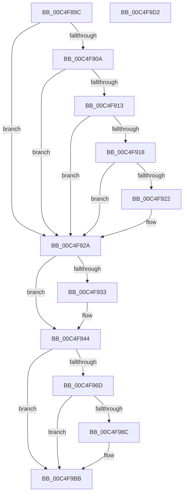

# BapdpProcessBootMetadata

- RVA: `0x00C4F89C`–`0x00C4F9D3` (길이 `311` bytes)
- VA: `0x0000000140C4F89C`
- 실행 섹션: `INIT`
- PDB 이름 있음: `예`; PDB Function 태그: `아니요`
- unwind 정보 RVA: `0x000D47B0`
- 디코드: `71`개 명령, `311/311` bytes 표시
- 미해석 바이트: `0` (있으면 어셈블리에 `.byte`로 보존)

> 이 문서는 커널 이미지의 기계어와 PDB 기호를 분석해 생성했습니다. 4번과 5번은 함수 원형과 자료형을 바이너리 사용 방식에서 추정한 C 해석이며 원본 소스 복구 결과는 아닙니다.

## 1. Dependencies

- 직접 호출 지점: **5**; 고유 호출 대상: **4**
- 직접 호출자로 확인된 함수: **1**
- RIP 상대 이미지 참조: **11**

### Outgoing calls
- `0x00C4F8FA` → `ext-ms-win-ntos-ksr-l1-1-5.dll!KsrGetFirmwareInformation` (import, 간접 대상; import `ext-ms-win-ntos-ksr-l1-1-5.dll!KsrGetFirmwareInformation`)
- `0x00C4F961` → [BapdpQueryData](../C5/BapdpQueryData_function_00C50340.md) (function, `0x00C50340`)
- `0x00C4F97F` → [ExAllocatePool2](../../poolcode/B8/ExAllocatePool2_function_00B820F0.md) (function, `0x00B820F0`)
- `0x00C4F9A6` → [BapdpQueryData](../C5/BapdpQueryData_function_00C50340.md) (function, `0x00C50340`)
- `0x00C4F9C2` → [_security_check_cookie](../../text/6A/_security_check_cookie_function_006AC640.md) (function, `0x006AC640`)

### Direct callers
- [BootApplicationPersistentDataProcess](../BE/BootApplicationPersistentDataProcess_function_00BEEBD4.md) at `0x00BEEC40`

### Static image references
- `0x00C4F8A9` → RVA `0x00E0A740` (`.data`; read)
- `0x00C4F8B7` → RVA `0x00E68544` (`.data`; read/write)
- `0x00C4F8C2` → RVA `0x00E68558` (`.data`; read/write)
- `0x00C4F8C9` → RVA `0x00E68560` (`.data`; read/write)
- `0x00C4F8D1` → RVA `0x00EFF018` (`.data`; read/write)
- `0x00C4F8FA` → RVA `0x00151318` (`ext-ms-win-ntos-ksr-l1-1-5.dll!KsrGetFirmwareInformation (IAT)`; read)
- `0x00C4F92A` → RVA `0x00EFF058` (`.data`; read)
- `0x00C4F938` → RVA `0x00E68558` (`.data`; write)
- `0x00C4F93E` → RVA `0x00E68544` (`.data`; write)
- `0x00C4F9AE` → RVA `0x00EFF008` (`.data`; write)
- `0x00C4F9B4` → RVA `0x00EFF010` (`.data`; write)

## 2. Other-region calls and transfers

- 다른 실행 섹션으로 향하는 call: **2**
  - `0x00C4F97F` → [ExAllocatePool2](../../poolcode/B8/ExAllocatePool2_function_00B820F0.md) (`INIT` → `POOLCODE`)
  - `0x00C4F9C2` → [_security_check_cookie](../../text/6A/_security_check_cookie_function_006AC640.md) (`INIT` → `.text`)
- 별도 외부 분기/꼬리 이동을 확인하지 못했습니다.

## 3. Assembly (complete function range)

```asm
00C4F89C  48 89 5C 24 08                  mov qword ptr [rsp + 8], rbx
00C4F8A1  55                              push rbp
00C4F8A2  48 8B EC                        mov rbp, rsp
00C4F8A5  48 83 EC 50                     sub rsp, 0x50
00C4F8A9  48 8B 05 90 AE 1B 00            mov rax, qword ptr [rip + 0x1bae90]
00C4F8B0  48 33 C4                        xor rax, rsp
00C4F8B3  48 89 45 F8                     mov qword ptr [rbp - 8], rax
00C4F8B7  83 25 86 8C 21 00 00            and dword ptr [rip + 0x218c86], 0
00C4F8BE  48 8D 4D E0                     lea rcx, [rbp - 0x20]
00C4F8C2  83 25 8F 8C 21 00 00            and dword ptr [rip + 0x218c8f], 0
00C4F8C9  48 83 25 8F 8C 21 00 00         and qword ptr [rip + 0x218c8f], 0
00C4F8D1  48 83 25 3F F7 2A 00 00         and qword ptr [rip + 0x2af73f], 0
00C4F8D9  48 83 65 E0 00                  and qword ptr [rbp - 0x20], 0
00C4F8DE  C7 45 E8 6C 3C 04 5B            mov dword ptr [rbp - 0x18], 0x5b043c6c
00C4F8E5  C7 45 EC C5 9B 9C 47            mov dword ptr [rbp - 0x14], 0x479c9bc5
00C4F8EC  C7 45 F0 8F 71 88 67            mov dword ptr [rbp - 0x10], 0x6788718f
00C4F8F3  C7 45 F4 7B 94 E1 3E            mov dword ptr [rbp - 0xc], 0x3ee1947b
00C4F8FA  48 FF 15 17 1A 50 FF            call qword ptr [rip - 0xafe5e9]
00C4F901  0F 1F 44 00 00                  nop dword ptr [rax + rax]
00C4F906  85 C0                           test eax, eax
00C4F908  78 20                           js 0x140c4f92a
00C4F90A  48 8B 45 E0                     mov rax, qword ptr [rbp - 0x20]
00C4F90E  48 85 C0                        test rax, rax
00C4F911  74 17                           je 0x140c4f92a
00C4F913  83 38 08                        cmp dword ptr [rax], 8
00C4F916  72 12                           jb 0x140c4f92a
00C4F918  8B 80 44 01 00 00               mov eax, dword ptr [rax + 0x144]
00C4F91E  A8 01                           test al, 1
00C4F920  74 08                           je 0x140c4f92a
00C4F922  0F BA 2D 1A 8C 21 00 1C         bts dword ptr [rip + 0x218c1a], 0x1c
00C4F92A  F6 05 27 F7 2A 00 04            test byte ptr [rip + 0x2af727], 4
00C4F931  74 11                           je 0x140c4f944
00C4F933  B8 02 00 00 00                  mov eax, 2
00C4F938  89 05 1A 8C 21 00               mov dword ptr [rip + 0x218c1a], eax
00C4F93E  89 05 00 8C 21 00               mov dword ptr [rip + 0x218c00], eax
00C4F944  48 83 64 24 28 00               and qword ptr [rsp + 0x28], 0
00C4F94A  48 8D 45 E0                     lea rax, [rbp - 0x20]
00C4F94E  83 65 E0 00                     and dword ptr [rbp - 0x20], 0
00C4F952  48 8D 55 E8                     lea rdx, [rbp - 0x18]
00C4F956  45 33 C9                        xor r9d, r9d
00C4F959  48 89 44 24 20                  mov qword ptr [rsp + 0x20], rax
00C4F95E  45 33 C0                        xor r8d, r8d
00C4F961  E8 DA 09 00 00                  call 0x140c50340
00C4F966  3D 23 00 00 C0                  cmp eax, 0xc0000023
00C4F96B  75 4E                           jne 0x140c4f9bb
00C4F96D  8B 55 E0                        mov edx, dword ptr [rbp - 0x20]
00C4F970  B9 00 01 00 00                  mov ecx, 0x100
00C4F975  48 83 C2 04                     add rdx, 4
00C4F979  41 B8 42 61 50 64               mov r8d, 0x64506142
00C4F97F  E8 6C 27 F3 FF                  call 0x140b820f0
00C4F984  48 8B D8                        mov rbx, rax
00C4F987  48 85 C0                        test rax, rax
00C4F98A  74 2F                           je 0x140c4f9bb
00C4F98C  48 83 64 24 28 00               and qword ptr [rsp + 0x28], 0
00C4F992  4C 8D 48 04                     lea r9, [rax + 4]
00C4F996  48 8D 45 E0                     lea rax, [rbp - 0x20]
00C4F99A  45 33 C0                        xor r8d, r8d
00C4F99D  48 8D 55 E8                     lea rdx, [rbp - 0x18]
00C4F9A1  48 89 44 24 20                  mov qword ptr [rsp + 0x20], rax
00C4F9A6  E8 95 09 00 00                  call 0x140c50340
00C4F9AB  8B 45 E0                        mov eax, dword ptr [rbp - 0x20]
00C4F9AE  89 05 54 F6 2A 00               mov dword ptr [rip + 0x2af654], eax
00C4F9B4  48 89 1D 55 F6 2A 00            mov qword ptr [rip + 0x2af655], rbx
00C4F9BB  48 8B 4D F8                     mov rcx, qword ptr [rbp - 8]
00C4F9BF  48 33 CC                        xor rcx, rsp
00C4F9C2  E8 79 CC A5 FF                  call 0x1406ac640
00C4F9C7  48 8B 5C 24 60                  mov rbx, qword ptr [rsp + 0x60]
00C4F9CC  48 83 C4 50                     add rsp, 0x50
00C4F9D0  5D                              pop rbp
00C4F9D1  C3                              ret
00C4F9D2  CC                              int3
```

## 4. C-style interpretation (structured pseudocode)

```c
__int64 __fastcall BapdpProcessBootMetadata(__int64 a1, __int64 a2, int a3, int a4)
{
    __int64 result;
    __int64 v_rsp;
    unsigned __int64 v_stack_m10;
    unsigned int v_stack_m14;
    unsigned int v_stack_m18;
    unsigned int v_stack_m1C;
    unsigned int v_stack_m20;
    unsigned __int64 v_stack_m28;
    unsigned __int64 v_stack_m30;
    unsigned __int64 v_stack_m38;
    unsigned __int64 v_stack_p8;

    v_stack_p8 = v_rbx;
    v_rsp = (v_rsp) - (80);
    result = (*(unsigned __int64 *)(v_rip + 1814160)) ^ (v_rsp);
    v_stack_m10 = result;
    v_stack_m20 = 0x5B043C6CULL;
    v_stack_m1C = 0x479C9BC5ULL;
    v_stack_m18 = 0x6788718FULL;
    v_stack_m14 = 0x3EE1947BULL;
    result = ext_ms_win_ntos_ksr_l1_1_5_dll_KsrGetFirmwareInformation(v_stack_m28, a2, a3, a4);
    if (sign_flag) goto loc_00C4F92A;
    if (v_stack_m28 == 0) goto loc_00C4F92A;
    if ((*(unsigned int *)(v_stack_m28)) < 8) goto loc_00C4F92A;
    if ((((unsigned __int8)((unsigned int)(*(unsigned int *)(v_stack_m28 + 324)))) & (1)) != 0) {
    }
    result = (unsigned int)(*(unsigned int *)(v_stack_m28 + 324));
    if (((*(unsigned __int8 *)(v_rip + 2815783)) & (4)) != 0) {
        result = 2;
        *(unsigned int *)(v_rip + 2198554) = (unsigned int)(result);
        *(unsigned int *)(v_rip + 2198528) = (unsigned int)(result);
    }
    a4 = 0;
    v_stack_m38 = v_stack_m28;
    a3 = 0;
    result = BapdpQueryData(v_stack_m28, v_stack_m20, a3, a4);
    if (((unsigned int)(result)) != 0xC0000023ULL) goto loc_00C4F9BB;
    a2 = ((unsigned int)(v_stack_m28)) + (4);
    result = ExAllocatePool2(256, a2, (unsigned int)(0x64506142ULL), a4);
    if (result != 0) {
        a4 = result + 4;
        result = v_stack_m28;
        a3 = 0;
        a2 = v_stack_m20;
        v_stack_m38 = result;
        result = BapdpQueryData(256, a2, a3, a4);
        result = v_stack_m28;
        *(unsigned int *)(v_rip + 2815572) = (unsigned int)(result);
        *(unsigned __int64 *)(v_rip + 2815573) = result;
    }
    a1 = (v_stack_m10) ^ (v_rsp);
    result = _security_check_cookie(a1, a2, a3, a4);
    v_rsp = (v_rsp) + (80);
    return result;
}
```

## 5. (Beta) C Style

```c
int64_t BapdpProcessBootMetadata(int64_t Arg1, int64_t Arg2, int32_t Arg3, int32_t Arg4)
{
    int64_t result;
    int64_t local_rsp;
    uint64_t v_stack_m10;
    uint32_t v_stack_m14;
    uint32_t v_stack_m18;
    uint32_t v_stack_m1C;
    uint32_t v_stack_m20;
    uint64_t v_stack_m28;
    uint64_t v_stack_m30;
    uint64_t v_stack_m38;
    uint64_t v_stack_p8;

    v_stack_p8 = local_rbx;
    local_rsp = (local_rsp) - (80);
    result = (*(uint64_t *)(v_rip + 0x1BAE90)) ^ (local_rsp);
    v_stack_m10 = result;
    v_stack_m20 = 0x5B043C6CULL;
    v_stack_m1C = 0x479C9BC5ULL;
    v_stack_m18 = 0x6788718FULL;
    v_stack_m14 = 0x3EE1947BULL;
    result = kernel_indirect_call(v_stack_m28, Arg2, Arg3, Arg4);
    if (sign_flag) goto loc_00C4F92A;
    if (v_stack_m28 == 0) goto loc_00C4F92A;
    if ((*(uint32_t *)(v_stack_m28)) < 8) goto loc_00C4F92A;
    if ((((uint8_t)((uint32_t)(*(uint32_t *)(v_stack_m28 + 0x144)))) & (1)) != 0) {
    }
    result = (uint32_t)(*(uint32_t *)(v_stack_m28 + 0x144));
    if (((*(uint8_t *)(v_rip + 0x2AF727)) & (4)) != 0) {
        result = 2;
        *(uint32_t *)(v_rip + 0x218C1A) = (uint32_t)(result);
        *(uint32_t *)(v_rip + 0x218C00) = (uint32_t)(result);
    }
    Arg4 = 0;
    v_stack_m38 = v_stack_m28;
    Arg3 = 0;
    result = BapdpQueryData(v_stack_m28, v_stack_m20, Arg3, Arg4);
    if (((uint32_t)(result)) != 0xC0000023ULL) goto loc_00C4F9BB;
    Arg2 = ((uint32_t)(v_stack_m28)) + (4);
    result = ExAllocatePool2(256, Arg2, (uint32_t)(0x64506142ULL), Arg4);
    if (result != 0) {
        Arg4 = result + 4;
        result = v_stack_m28;
        Arg3 = 0;
        Arg2 = v_stack_m20;
        v_stack_m38 = result;
        result = BapdpQueryData(256, Arg2, Arg3, Arg4);
        result = v_stack_m28;
        *(uint32_t *)(v_rip + 0x2AF654) = (uint32_t)(result);
        *(uint64_t *)(v_rip + 0x2AF655) = result;
    }
    Arg1 = (v_stack_m10) ^ (local_rsp);
    result = _security_check_cookie(Arg1, Arg2, Arg3, Arg4);
    local_rsp = (local_rsp) + (80);
    return result;
}
```

## 6. Execution-region graph

[열기: 2D/3D 그래프와 함수 탐색 컨트롤 패널](../../../control-panel.html?section=init&rva=0x00C4F89C&view=graph)

- 2D 그래프는 위에서 아래로 흐르고, 3D 그래프는 빈 공간을 드래그해 회전합니다. Shift+드래그는 이동, 휠은 확대·축소, 함수 노드 선택은 대상 보고서 이동입니다.

### Static fallback


