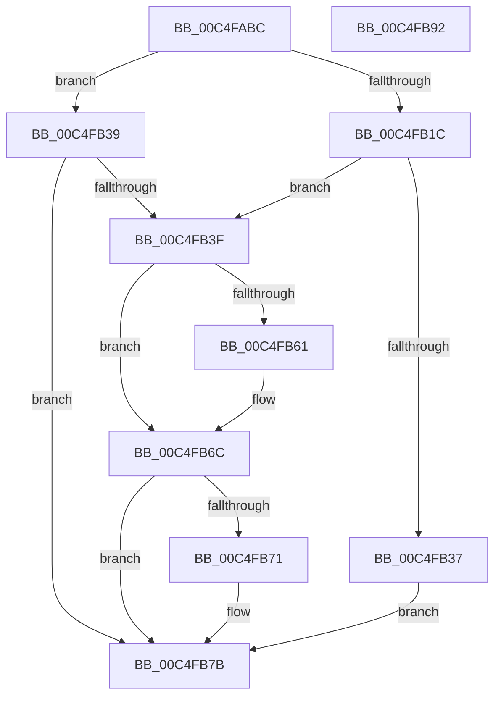

# BapdpProcessFwUpdateResults

- RVA: `0x00C4FABC`–`0x00C4FB93` (길이 `215` bytes)
- VA: `0x0000000140C4FABC`
- 실행 섹션: `INIT`
- PDB 이름 있음: `예`; PDB Function 태그: `아니요`
- unwind 정보 RVA: `0x000D47B0`
- 디코드: `57`개 명령, `215/215` bytes 표시
- 미해석 바이트: `0` (있으면 어셈블리에 `.byte`로 보존)

> 이 문서는 커널 이미지의 기계어와 PDB 기호를 분석해 생성했습니다. 4번과 5번은 함수 원형과 자료형을 바이너리 사용 방식에서 추정한 C 해석이며 원본 소스 복구 결과는 아닙니다.

## 1. Dependencies

- 직접 호출 지점: **6**; 고유 호출 대상: **5**
- 직접 호출자로 확인된 함수: **1**
- RIP 상대 이미지 참조: **1**

### Outgoing calls
- `0x00C4FB10` → [BapdpQueryData](../C5/BapdpQueryData_function_00C50340.md) (function, `0x00C50340`)
- `0x00C4FB2A` → [ExAllocatePool2](../../poolcode/B8/ExAllocatePool2_function_00B820F0.md) (function, `0x00B820F0`)
- `0x00C4FB58` → [BapdpQueryData](../C5/BapdpQueryData_function_00C50340.md) (function, `0x00C50340`)
- `0x00C4FB67` → [BapdpRegisterFwUpdateResults](../C5/BapdpRegisterFwUpdateResults_function_00C507E4.md) (function, `0x00C507E4`)
- `0x00C4FB76` → [ExFreePoolWithTag](../../poolcode/B8/ExFreePoolWithTag_function_00B82870.md) (function, `0x00B82870`)
- `0x00C4FB82` → [_security_check_cookie](../../text/6A/_security_check_cookie_function_006AC640.md) (function, `0x006AC640`)

### Direct callers
- [BootApplicationPersistentDataProcess](../BE/BootApplicationPersistentDataProcess_function_00BEEBD4.md) at `0x00BEEC22`

### Static image references
- `0x00C4FAC9` → RVA `0x00E0A740` (`.data`; read)

## 2. Other-region calls and transfers

- 다른 실행 섹션으로 향하는 call: **3**
  - `0x00C4FB2A` → [ExAllocatePool2](../../poolcode/B8/ExAllocatePool2_function_00B820F0.md) (`INIT` → `POOLCODE`)
  - `0x00C4FB76` → [ExFreePoolWithTag](../../poolcode/B8/ExFreePoolWithTag_function_00B82870.md) (`INIT` → `POOLCODE`)
  - `0x00C4FB82` → [_security_check_cookie](../../text/6A/_security_check_cookie_function_006AC640.md) (`INIT` → `.text`)
- 별도 외부 분기/꼬리 이동을 확인하지 못했습니다.

## 3. Assembly (complete function range)

```asm
00C4FABC  48 89 5C 24 08                  mov qword ptr [rsp + 8], rbx
00C4FAC1  55                              push rbp
00C4FAC2  48 8B EC                        mov rbp, rsp
00C4FAC5  48 83 EC 50                     sub rsp, 0x50
00C4FAC9  48 8B 05 70 AC 1B 00            mov rax, qword ptr [rip + 0x1bac70]
00C4FAD0  48 33 C4                        xor rax, rsp
00C4FAD3  48 89 45 F8                     mov qword ptr [rbp - 8], rax
00C4FAD7  48 83 64 24 28 00               and qword ptr [rsp + 0x28], 0
00C4FADD  48 8D 45 E0                     lea rax, [rbp - 0x20]
00C4FAE1  83 65 E0 00                     and dword ptr [rbp - 0x20], 0
00C4FAE5  48 8D 55 E8                     lea rdx, [rbp - 0x18]
00C4FAE9  45 33 C9                        xor r9d, r9d
00C4FAEC  48 89 44 24 20                  mov qword ptr [rsp + 0x20], rax
00C4FAF1  45 33 C0                        xor r8d, r8d
00C4FAF4  C7 45 E8 BC 1E 65 D5            mov dword ptr [rbp - 0x18], 0xd5651ebc
00C4FAFB  C7 45 EC 2F 15 4F 49            mov dword ptr [rbp - 0x14], 0x494f152f
00C4FB02  C7 45 F0 BB 45 4A 3C            mov dword ptr [rbp - 0x10], 0x3c4a45bb
00C4FB09  C7 45 F4 83 EB D9 EE            mov dword ptr [rbp - 0xc], 0xeed9eb83
00C4FB10  E8 2B 08 00 00                  call 0x140c50340
00C4FB15  3D 23 00 00 C0                  cmp eax, 0xc0000023
00C4FB1A  75 1D                           jne 0x140c4fb39
00C4FB1C  8B 55 E0                        mov edx, dword ptr [rbp - 0x20]
00C4FB1F  B9 40 00 00 00                  mov ecx, 0x40
00C4FB24  41 B8 42 61 50 64               mov r8d, 0x64506142
00C4FB2A  E8 C1 25 F3 FF                  call 0x140b820f0
00C4FB2F  48 8B D8                        mov rbx, rax
00C4FB32  48 85 C0                        test rax, rax
00C4FB35  75 08                           jne 0x140c4fb3f
00C4FB37  EB 42                           jmp 0x140c4fb7b
00C4FB39  33 DB                           xor ebx, ebx
00C4FB3B  85 C0                           test eax, eax
00C4FB3D  78 3C                           js 0x140c4fb7b
00C4FB3F  48 83 64 24 28 00               and qword ptr [rsp + 0x28], 0
00C4FB45  48 8D 45 E0                     lea rax, [rbp - 0x20]
00C4FB49  4C 8B CB                        mov r9, rbx
00C4FB4C  48 89 44 24 20                  mov qword ptr [rsp + 0x20], rax
00C4FB51  45 33 C0                        xor r8d, r8d
00C4FB54  48 8D 55 E8                     lea rdx, [rbp - 0x18]
00C4FB58  E8 E3 07 00 00                  call 0x140c50340
00C4FB5D  85 C0                           test eax, eax
00C4FB5F  78 0B                           js 0x140c4fb6c
00C4FB61  8B 55 E0                        mov edx, dword ptr [rbp - 0x20]
00C4FB64  48 8B CB                        mov rcx, rbx
00C4FB67  E8 78 0C 00 00                  call 0x140c507e4
00C4FB6C  48 85 DB                        test rbx, rbx
00C4FB6F  74 0A                           je 0x140c4fb7b
00C4FB71  33 D2                           xor edx, edx
00C4FB73  48 8B CB                        mov rcx, rbx
00C4FB76  E8 F5 2C F3 FF                  call 0x140b82870
00C4FB7B  48 8B 4D F8                     mov rcx, qword ptr [rbp - 8]
00C4FB7F  48 33 CC                        xor rcx, rsp
00C4FB82  E8 B9 CA A5 FF                  call 0x1406ac640
00C4FB87  48 8B 5C 24 60                  mov rbx, qword ptr [rsp + 0x60]
00C4FB8C  48 83 C4 50                     add rsp, 0x50
00C4FB90  5D                              pop rbp
00C4FB91  C3                              ret
00C4FB92  CC                              int3
```

## 4. C-style interpretation (structured pseudocode)

```c
__int64 __fastcall BapdpProcessFwUpdateResults(__int64 a1, __int64 a2, int a3, int a4)
{
    __int64 result;
    __int64 v_rbx;
    __int64 v_rsp;
    unsigned __int64 v_stack_m10;
    unsigned int v_stack_m14;
    unsigned int v_stack_m18;
    unsigned int v_stack_m1C;
    unsigned __int64 v_stack_m20;
    unsigned __int64 v_stack_m28;
    unsigned __int64 v_stack_m30;
    unsigned __int64 v_stack_m38;
    unsigned __int64 v_stack_p8;

    v_stack_p8 = v_rbx;
    v_rsp = (v_rsp) - (80);
    result = (*(unsigned __int64 *)(v_rip + 1813616)) ^ (v_rsp);
    v_stack_m10 = result;
    a4 = 0;
    v_stack_m38 = v_stack_m28;
    a3 = 0;
    v_stack_m20 = 0xD5651EBCULL;
    v_stack_m1C = 0x494F152FULL;
    v_stack_m18 = 0x3C4A45BBULL;
    v_stack_m14 = 0xEED9EB83ULL;
    result = BapdpQueryData(a1, v_stack_m20, a3, a4);
    if (((unsigned int)(result)) != 0xC0000023ULL) goto loc_00C4FB39;
    result = ExAllocatePool2(64, (unsigned int)(v_stack_m28), (unsigned int)(0x64506142ULL), a4);
    if (result != 0) goto loc_00C4FB3F;
    goto loc_00C4FB7B;
loc_00C4FB39:
    v_rbx = 0;
    if (sign_flag) goto loc_00C4FB7B;
loc_00C4FB3F:
    v_stack_m38 = v_stack_m28;
    a3 = 0;
    result = BapdpQueryData(64, v_stack_m20, a3, 0);
    if (!(sign_flag)) {
        a2 = v_stack_m28;
        a1 = 0;
        result = BapdpRegisterFwUpdateResults(a1, a2, a3, 0);
    }
    if (0 != 0) {
        a2 = 0;
        a1 = 0;
        result = ExFreePoolWithTag(a1, a2, a3, 0);
    }
    a1 = (v_stack_m10) ^ (v_rsp);
    result = _security_check_cookie(a1, a2, a3, 0);
    v_rsp = (v_rsp) + (80);
    return result;
}
```

## 5. (Beta) C Style

```c
int64_t BapdpProcessFwUpdateResults(int64_t Arg1, int64_t Arg2, int32_t Arg3, int32_t Arg4)
{
    int64_t result;
    int64_t local_rbx;
    int64_t local_rsp;
    uint64_t v_stack_m10;
    uint32_t v_stack_m14;
    uint32_t v_stack_m18;
    uint32_t v_stack_m1C;
    uint64_t v_stack_m20;
    uint64_t v_stack_m28;
    uint64_t v_stack_m30;
    uint64_t v_stack_m38;
    uint64_t v_stack_p8;

    v_stack_p8 = local_rbx;
    local_rsp = (local_rsp) - (80);
    result = (*(uint64_t *)(v_rip + 0x1BAC70)) ^ (local_rsp);
    v_stack_m10 = result;
    Arg4 = 0;
    v_stack_m38 = v_stack_m28;
    Arg3 = 0;
    v_stack_m20 = 0xD5651EBCULL;
    v_stack_m1C = 0x494F152FULL;
    v_stack_m18 = 0x3C4A45BBULL;
    v_stack_m14 = 0xEED9EB83ULL;
    result = BapdpQueryData(Arg1, v_stack_m20, Arg3, Arg4);
    if (((uint32_t)(result)) != 0xC0000023ULL) goto loc_00C4FB39;
    result = ExAllocatePool2(64, (uint32_t)(v_stack_m28), (uint32_t)(0x64506142ULL), Arg4);
    if (result != 0) goto loc_00C4FB3F;
    goto loc_00C4FB7B;
loc_00C4FB39:
    local_rbx = 0;
    if (sign_flag) goto loc_00C4FB7B;
loc_00C4FB3F:
    v_stack_m38 = v_stack_m28;
    Arg3 = 0;
    result = BapdpQueryData(64, v_stack_m20, Arg3, 0);
    if (!(sign_flag)) {
        Arg2 = v_stack_m28;
        Arg1 = 0;
        result = BapdpRegisterFwUpdateResults(Arg1, Arg2, Arg3, 0);
    }
    if (0 != 0) {
        Arg2 = 0;
        Arg1 = 0;
        result = ExFreePoolWithTag(Arg1, Arg2, Arg3, 0);
    }
    Arg1 = (v_stack_m10) ^ (local_rsp);
    result = _security_check_cookie(Arg1, Arg2, Arg3, 0);
    local_rsp = (local_rsp) + (80);
    return result;
}
```

## 6. Execution-region graph

[열기: 2D/3D 그래프와 함수 탐색 컨트롤 패널](../../../control-panel.html?section=init&rva=0x00C4FABC&view=graph)

- 2D 그래프는 위에서 아래로 흐르고, 3D 그래프는 빈 공간을 드래그해 회전합니다. Shift+드래그는 이동, 휠은 확대·축소, 함수 노드 선택은 대상 보고서 이동입니다.

### Static fallback


