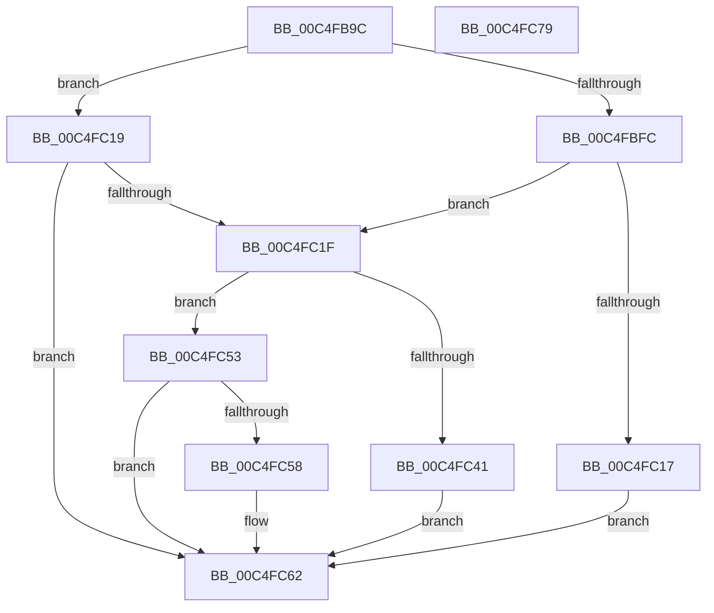

# BapdpProcessHSTIResults

- RVA: `0x00C4FB9C`–`0x00C4FC7A` (길이 `222` bytes)
- VA: `0x0000000140C4FB9C`
- 실행 섹션: `INIT`
- PDB 이름 있음: `예`; PDB Function 태그: `아니요`
- unwind 정보 RVA: `0x000D47B0`
- 디코드: `58`개 명령, `222/222` bytes 표시
- 미해석 바이트: `0` (있으면 어셈블리에 `.byte`로 보존)

> 이 문서는 커널 이미지의 기계어와 PDB 기호를 분석해 생성했습니다. 4번과 5번은 함수 원형과 자료형을 바이너리 사용 방식에서 추정한 C 해석이며 원본 소스 복구 결과는 아닙니다.

## 1. Dependencies

- 직접 호출 지점: **5**; 고유 호출 대상: **4**
- 직접 호출자로 확인된 함수: **1**
- RIP 상대 이미지 참조: **3**

### Outgoing calls
- `0x00C4FBF0` → [BapdpQueryData](../C5/BapdpQueryData_function_00C50340.md) (function, `0x00C50340`)
- `0x00C4FC0A` → [ExAllocatePool2](../../poolcode/B8/ExAllocatePool2_function_00B820F0.md) (function, `0x00B820F0`)
- `0x00C4FC38` → [BapdpQueryData](../C5/BapdpQueryData_function_00C50340.md) (function, `0x00C50340`)
- `0x00C4FC5D` → [ExFreePoolWithTag](../../poolcode/B8/ExFreePoolWithTag_function_00B82870.md) (function, `0x00B82870`)
- `0x00C4FC69` → [_security_check_cookie](../../text/6A/_security_check_cookie_function_006AC640.md) (function, `0x006AC640`)

### Direct callers
- [BootApplicationPersistentDataProcess](../BE/BootApplicationPersistentDataProcess_function_00BEEBD4.md) at `0x00BEEC54`

### Static image references
- `0x00C4FBA9` → RVA `0x00E0A740` (`.data`; read)
- `0x00C4FC44` → RVA `0x00FF3480` (`PAGEDATA`; write)
- `0x00C4FC4A` → RVA `0x00FF3488` (`PAGEDATA`; write)

## 2. Other-region calls and transfers

- 다른 실행 섹션으로 향하는 call: **3**
  - `0x00C4FC0A` → [ExAllocatePool2](../../poolcode/B8/ExAllocatePool2_function_00B820F0.md) (`INIT` → `POOLCODE`)
  - `0x00C4FC5D` → [ExFreePoolWithTag](../../poolcode/B8/ExFreePoolWithTag_function_00B82870.md) (`INIT` → `POOLCODE`)
  - `0x00C4FC69` → [_security_check_cookie](../../text/6A/_security_check_cookie_function_006AC640.md) (`INIT` → `.text`)
- 별도 외부 분기/꼬리 이동을 확인하지 못했습니다.

## 3. Assembly (complete function range)

```asm
00C4FB9C  48 89 5C 24 08                  mov qword ptr [rsp + 8], rbx
00C4FBA1  55                              push rbp
00C4FBA2  48 8B EC                        mov rbp, rsp
00C4FBA5  48 83 EC 50                     sub rsp, 0x50
00C4FBA9  48 8B 05 90 AB 1B 00            mov rax, qword ptr [rip + 0x1bab90]
00C4FBB0  48 33 C4                        xor rax, rsp
00C4FBB3  48 89 45 F8                     mov qword ptr [rbp - 8], rax
00C4FBB7  48 83 64 24 28 00               and qword ptr [rsp + 0x28], 0
00C4FBBD  48 8D 45 E0                     lea rax, [rbp - 0x20]
00C4FBC1  83 65 E0 00                     and dword ptr [rbp - 0x20], 0
00C4FBC5  48 8D 55 E8                     lea rdx, [rbp - 0x18]
00C4FBC9  45 33 C9                        xor r9d, r9d
00C4FBCC  48 89 44 24 20                  mov qword ptr [rsp + 0x20], rax
00C4FBD1  45 33 C0                        xor r8d, r8d
00C4FBD4  C7 45 E8 24 DF D9 C0            mov dword ptr [rbp - 0x18], 0xc0d9df24
00C4FBDB  C7 45 EC DD D1 53 4E            mov dword ptr [rbp - 0x14], 0x4e53d1dd
00C4FBE2  C7 45 F0 95 EB CB D8            mov dword ptr [rbp - 0x10], 0xd8cbeb95
00C4FBE9  C7 45 F4 27 B8 65 86            mov dword ptr [rbp - 0xc], 0x8665b827
00C4FBF0  E8 4B 07 00 00                  call 0x140c50340
00C4FBF5  3D 23 00 00 C0                  cmp eax, 0xc0000023
00C4FBFA  75 1D                           jne 0x140c4fc19
00C4FBFC  8B 55 E0                        mov edx, dword ptr [rbp - 0x20]
00C4FBFF  B9 00 01 00 00                  mov ecx, 0x100
00C4FC04  41 B8 48 53 54 49               mov r8d, 0x49545348
00C4FC0A  E8 E1 24 F3 FF                  call 0x140b820f0
00C4FC0F  48 8B D8                        mov rbx, rax
00C4FC12  48 85 C0                        test rax, rax
00C4FC15  75 08                           jne 0x140c4fc1f
00C4FC17  EB 49                           jmp 0x140c4fc62
00C4FC19  33 DB                           xor ebx, ebx
00C4FC1B  85 C0                           test eax, eax
00C4FC1D  78 43                           js 0x140c4fc62
00C4FC1F  48 83 64 24 28 00               and qword ptr [rsp + 0x28], 0
00C4FC25  48 8D 45 E0                     lea rax, [rbp - 0x20]
00C4FC29  4C 8B CB                        mov r9, rbx
00C4FC2C  48 89 44 24 20                  mov qword ptr [rsp + 0x20], rax
00C4FC31  45 33 C0                        xor r8d, r8d
00C4FC34  48 8D 55 E8                     lea rdx, [rbp - 0x18]
00C4FC38  E8 03 07 00 00                  call 0x140c50340
00C4FC3D  85 C0                           test eax, eax
00C4FC3F  78 12                           js 0x140c4fc53
00C4FC41  8B 45 E0                        mov eax, dword ptr [rbp - 0x20]
00C4FC44  89 05 36 38 3A 00               mov dword ptr [rip + 0x3a3836], eax
00C4FC4A  48 89 1D 37 38 3A 00            mov qword ptr [rip + 0x3a3837], rbx
00C4FC51  EB 0F                           jmp 0x140c4fc62
00C4FC53  48 85 DB                        test rbx, rbx
00C4FC56  74 0A                           je 0x140c4fc62
00C4FC58  33 D2                           xor edx, edx
00C4FC5A  48 8B CB                        mov rcx, rbx
00C4FC5D  E8 0E 2C F3 FF                  call 0x140b82870
00C4FC62  48 8B 4D F8                     mov rcx, qword ptr [rbp - 8]
00C4FC66  48 33 CC                        xor rcx, rsp
00C4FC69  E8 D2 C9 A5 FF                  call 0x1406ac640
00C4FC6E  48 8B 5C 24 60                  mov rbx, qword ptr [rsp + 0x60]
00C4FC73  48 83 C4 50                     add rsp, 0x50
00C4FC77  5D                              pop rbp
00C4FC78  C3                              ret
00C4FC79  CC                              int3
```

## 4. C-style interpretation (structured pseudocode)

```c
__int64 __fastcall BapdpProcessHSTIResults(__int64 a1, __int64 a2, int a3, int a4)
{
    __int64 result;
    __int64 v_rbx;
    __int64 v_rsp;
    unsigned __int64 v_stack_m10;
    unsigned int v_stack_m14;
    unsigned int v_stack_m18;
    unsigned int v_stack_m1C;
    unsigned __int64 v_stack_m20;
    unsigned __int64 v_stack_m28;
    unsigned __int64 v_stack_m30;
    unsigned __int64 v_stack_m38;
    unsigned __int64 v_stack_p8;

    v_stack_p8 = v_rbx;
    v_rsp = (v_rsp) - (80);
    result = (*(unsigned __int64 *)(v_rip + 1813392)) ^ (v_rsp);
    v_stack_m10 = result;
    a4 = 0;
    v_stack_m38 = v_stack_m28;
    a3 = 0;
    v_stack_m20 = 0xC0D9DF24ULL;
    v_stack_m1C = 0x4E53D1DDULL;
    v_stack_m18 = 0xD8CBEB95ULL;
    v_stack_m14 = 0x8665B827ULL;
    result = BapdpQueryData(a1, v_stack_m20, a3, a4);
    if (((unsigned int)(result)) != 0xC0000023ULL) goto loc_00C4FC19;
    result = ExAllocatePool2(256, (unsigned int)(v_stack_m28), (unsigned int)(0x49545348ULL), a4);
    if (result != 0) goto loc_00C4FC1F;
    goto loc_00C4FC62;
loc_00C4FC19:
    v_rbx = 0;
    if (sign_flag) goto loc_00C4FC62;
loc_00C4FC1F:
    v_stack_m38 = v_stack_m28;
    a3 = 0;
    result = BapdpQueryData(256, v_stack_m20, a3, 0);
    if (sign_flag) goto loc_00C4FC53;
    *(unsigned int *)(v_rip + 3815478) = (unsigned int)((unsigned int)(v_stack_m28));
    *(unsigned __int64 *)(v_rip + 3815479) = 0;
    goto loc_00C4FC62;
loc_00C4FC53:
    result = (unsigned int)(v_stack_m28);
    if (0 != 0) {
        a2 = 0;
        a1 = 0;
        result = ExFreePoolWithTag(a1, a2, a3, 0);
    }
    a1 = (v_stack_m10) ^ (v_rsp);
    result = _security_check_cookie(a1, a2, a3, 0);
    v_rsp = (v_rsp) + (80);
    return result;
}
```

## 5. (Beta) C Style

```c
int64_t BapdpProcessHSTIResults(int64_t Arg1, int64_t Arg2, int32_t Arg3, int32_t Arg4)
{
    int64_t result;
    int64_t local_rbx;
    int64_t local_rsp;
    uint64_t v_stack_m10;
    uint32_t v_stack_m14;
    uint32_t v_stack_m18;
    uint32_t v_stack_m1C;
    uint64_t v_stack_m20;
    uint64_t v_stack_m28;
    uint64_t v_stack_m30;
    uint64_t v_stack_m38;
    uint64_t v_stack_p8;

    v_stack_p8 = local_rbx;
    local_rsp = (local_rsp) - (80);
    result = (*(uint64_t *)(v_rip + 0x1BAB90)) ^ (local_rsp);
    v_stack_m10 = result;
    Arg4 = 0;
    v_stack_m38 = v_stack_m28;
    Arg3 = 0;
    v_stack_m20 = 0xC0D9DF24ULL;
    v_stack_m1C = 0x4E53D1DDULL;
    v_stack_m18 = 0xD8CBEB95ULL;
    v_stack_m14 = 0x8665B827ULL;
    result = BapdpQueryData(Arg1, v_stack_m20, Arg3, Arg4);
    if (((uint32_t)(result)) != 0xC0000023ULL) goto loc_00C4FC19;
    result = ExAllocatePool2(256, (uint32_t)(v_stack_m28), (uint32_t)(0x49545348ULL), Arg4);
    if (result != 0) goto loc_00C4FC1F;
    goto loc_00C4FC62;
loc_00C4FC19:
    local_rbx = 0;
    if (sign_flag) goto loc_00C4FC62;
loc_00C4FC1F:
    v_stack_m38 = v_stack_m28;
    Arg3 = 0;
    result = BapdpQueryData(256, v_stack_m20, Arg3, 0);
    if (sign_flag) goto loc_00C4FC53;
    *(uint32_t *)(v_rip + 0x3A3836) = (uint32_t)((uint32_t)(v_stack_m28));
    *(uint64_t *)(v_rip + 0x3A3837) = 0;
    goto loc_00C4FC62;
loc_00C4FC53:
    result = (uint32_t)(v_stack_m28);
    if (0 != 0) {
        Arg2 = 0;
        Arg1 = 0;
        result = ExFreePoolWithTag(Arg1, Arg2, Arg3, 0);
    }
    Arg1 = (v_stack_m10) ^ (local_rsp);
    result = _security_check_cookie(Arg1, Arg2, Arg3, 0);
    local_rsp = (local_rsp) + (80);
    return result;
}
```

## 6. Execution-region graph

[열기: 2D/3D 그래프와 함수 탐색 컨트롤 패널](../../../control-panel.html?section=init&rva=0x00C4FB9C&view=graph)

- 2D 그래프는 위에서 아래로 흐르고, 3D 그래프는 빈 공간을 드래그해 회전합니다. Shift+드래그는 이동, 휠은 확대·축소, 함수 노드 선택은 대상 보고서 이동입니다.

### Static fallback


