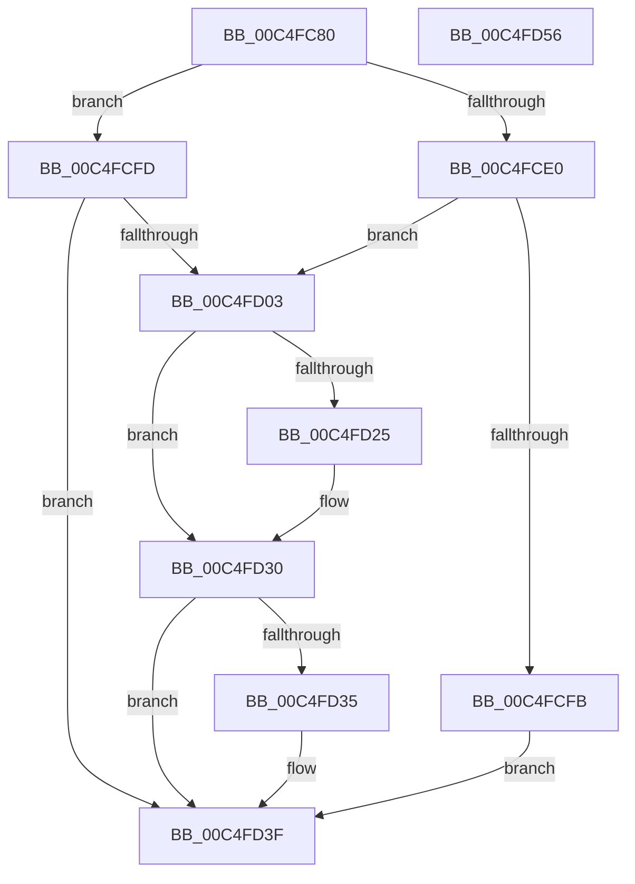

# BapdpProcessResumeInformation

- RVA: `0x00C4FC80`–`0x00C4FD57` (길이 `215` bytes)
- VA: `0x0000000140C4FC80`
- 실행 섹션: `INIT`
- PDB 이름 있음: `예`; PDB Function 태그: `아니요`
- unwind 정보 RVA: `0x000D47B0`
- 디코드: `57`개 명령, `215/215` bytes 표시
- 미해석 바이트: `0` (있으면 어셈블리에 `.byte`로 보존)

> 이 문서는 커널 이미지의 기계어와 PDB 기호를 분석해 생성했습니다. 4번과 5번은 함수 원형과 자료형을 바이너리 사용 방식에서 추정한 C 해석이며 원본 소스 복구 결과는 아닙니다.

## 1. Dependencies

- 직접 호출 지점: **6**; 고유 호출 대상: **5**
- 직접 호출자로 확인된 함수: **1**
- RIP 상대 이미지 참조: **1**

### Outgoing calls
- `0x00C4FCD4` → [BapdpQueryData](../C5/BapdpQueryData_function_00C50340.md) (function, `0x00C50340`)
- `0x00C4FCEE` → [ExAllocatePool2](../../poolcode/B8/ExAllocatePool2_function_00B820F0.md) (function, `0x00B820F0`)
- `0x00C4FD1C` → [BapdpQueryData](../C5/BapdpQueryData_function_00C50340.md) (function, `0x00C50340`)
- `0x00C4FD2B` → [BapdpRegisterResumeInformation](../C5/BapdpRegisterResumeInformation_function_00C509F4.md) (function, `0x00C509F4`)
- `0x00C4FD3A` → [ExFreePoolWithTag](../../poolcode/B8/ExFreePoolWithTag_function_00B82870.md) (function, `0x00B82870`)
- `0x00C4FD46` → [_security_check_cookie](../../text/6A/_security_check_cookie_function_006AC640.md) (function, `0x006AC640`)

### Direct callers
- [BootApplicationPersistentDataProcess](../BE/BootApplicationPersistentDataProcess_function_00BEEBD4.md) at `0x00BEEBFB`

### Static image references
- `0x00C4FC8D` → RVA `0x00E0A740` (`.data`; read)

## 2. Other-region calls and transfers

- 다른 실행 섹션으로 향하는 call: **3**
  - `0x00C4FCEE` → [ExAllocatePool2](../../poolcode/B8/ExAllocatePool2_function_00B820F0.md) (`INIT` → `POOLCODE`)
  - `0x00C4FD3A` → [ExFreePoolWithTag](../../poolcode/B8/ExFreePoolWithTag_function_00B82870.md) (`INIT` → `POOLCODE`)
  - `0x00C4FD46` → [_security_check_cookie](../../text/6A/_security_check_cookie_function_006AC640.md) (`INIT` → `.text`)
- 별도 외부 분기/꼬리 이동을 확인하지 못했습니다.

## 3. Assembly (complete function range)

```asm
00C4FC80  48 89 5C 24 08                  mov qword ptr [rsp + 8], rbx
00C4FC85  55                              push rbp
00C4FC86  48 8B EC                        mov rbp, rsp
00C4FC89  48 83 EC 50                     sub rsp, 0x50
00C4FC8D  48 8B 05 AC AA 1B 00            mov rax, qword ptr [rip + 0x1baaac]
00C4FC94  48 33 C4                        xor rax, rsp
00C4FC97  48 89 45 F8                     mov qword ptr [rbp - 8], rax
00C4FC9B  48 83 64 24 28 00               and qword ptr [rsp + 0x28], 0
00C4FCA1  48 8D 45 E0                     lea rax, [rbp - 0x20]
00C4FCA5  83 65 E0 00                     and dword ptr [rbp - 0x20], 0
00C4FCA9  48 8D 55 E8                     lea rdx, [rbp - 0x18]
00C4FCAD  45 33 C9                        xor r9d, r9d
00C4FCB0  48 89 44 24 20                  mov qword ptr [rsp + 0x20], rax
00C4FCB5  45 33 C0                        xor r8d, r8d
00C4FCB8  C7 45 E8 64 5D C9 60            mov dword ptr [rbp - 0x18], 0x60c95d64
00C4FCBF  C7 45 EC E2 AD 87 42            mov dword ptr [rbp - 0x14], 0x4287ade2
00C4FCC6  C7 45 F0 90 60 F0 33            mov dword ptr [rbp - 0x10], 0x33f06090
00C4FCCD  C7 45 F4 01 19 D0 2E            mov dword ptr [rbp - 0xc], 0x2ed01901
00C4FCD4  E8 67 06 00 00                  call 0x140c50340
00C4FCD9  3D 23 00 00 C0                  cmp eax, 0xc0000023
00C4FCDE  75 1D                           jne 0x140c4fcfd
00C4FCE0  8B 55 E0                        mov edx, dword ptr [rbp - 0x20]
00C4FCE3  B9 40 00 00 00                  mov ecx, 0x40
00C4FCE8  41 B8 42 61 50 64               mov r8d, 0x64506142
00C4FCEE  E8 FD 23 F3 FF                  call 0x140b820f0
00C4FCF3  48 8B D8                        mov rbx, rax
00C4FCF6  48 85 C0                        test rax, rax
00C4FCF9  75 08                           jne 0x140c4fd03
00C4FCFB  EB 42                           jmp 0x140c4fd3f
00C4FCFD  33 DB                           xor ebx, ebx
00C4FCFF  85 C0                           test eax, eax
00C4FD01  78 3C                           js 0x140c4fd3f
00C4FD03  48 83 64 24 28 00               and qword ptr [rsp + 0x28], 0
00C4FD09  48 8D 45 E0                     lea rax, [rbp - 0x20]
00C4FD0D  4C 8B CB                        mov r9, rbx
00C4FD10  48 89 44 24 20                  mov qword ptr [rsp + 0x20], rax
00C4FD15  45 33 C0                        xor r8d, r8d
00C4FD18  48 8D 55 E8                     lea rdx, [rbp - 0x18]
00C4FD1C  E8 1F 06 00 00                  call 0x140c50340
00C4FD21  85 C0                           test eax, eax
00C4FD23  78 0B                           js 0x140c4fd30
00C4FD25  8B 55 E0                        mov edx, dword ptr [rbp - 0x20]
00C4FD28  48 8B CB                        mov rcx, rbx
00C4FD2B  E8 C4 0C 00 00                  call 0x140c509f4
00C4FD30  48 85 DB                        test rbx, rbx
00C4FD33  74 0A                           je 0x140c4fd3f
00C4FD35  33 D2                           xor edx, edx
00C4FD37  48 8B CB                        mov rcx, rbx
00C4FD3A  E8 31 2B F3 FF                  call 0x140b82870
00C4FD3F  48 8B 4D F8                     mov rcx, qword ptr [rbp - 8]
00C4FD43  48 33 CC                        xor rcx, rsp
00C4FD46  E8 F5 C8 A5 FF                  call 0x1406ac640
00C4FD4B  48 8B 5C 24 60                  mov rbx, qword ptr [rsp + 0x60]
00C4FD50  48 83 C4 50                     add rsp, 0x50
00C4FD54  5D                              pop rbp
00C4FD55  C3                              ret
00C4FD56  CC                              int3
```

## 4. C-style interpretation (structured pseudocode)

```c
__int64 __fastcall BapdpProcessResumeInformation(__int64 a1, __int64 a2, int a3, int a4)
{
    __int64 result;
    __int64 v_rbx;
    __int64 v_rsp;
    unsigned __int64 v_stack_m10;
    unsigned int v_stack_m14;
    unsigned int v_stack_m18;
    unsigned int v_stack_m1C;
    unsigned __int64 v_stack_m20;
    unsigned __int64 v_stack_m28;
    unsigned __int64 v_stack_m30;
    unsigned __int64 v_stack_m38;
    unsigned __int64 v_stack_p8;

    v_stack_p8 = v_rbx;
    v_rsp = (v_rsp) - (80);
    result = (*(unsigned __int64 *)(v_rip + 1813164)) ^ (v_rsp);
    v_stack_m10 = result;
    a4 = 0;
    v_stack_m38 = v_stack_m28;
    a3 = 0;
    v_stack_m20 = 0x60C95D64ULL;
    v_stack_m1C = 0x4287ADE2ULL;
    v_stack_m18 = 0x33F06090ULL;
    v_stack_m14 = 0x2ED01901ULL;
    result = BapdpQueryData(a1, v_stack_m20, a3, a4);
    if (((unsigned int)(result)) != 0xC0000023ULL) goto loc_00C4FCFD;
    result = ExAllocatePool2(64, (unsigned int)(v_stack_m28), (unsigned int)(0x64506142ULL), a4);
    if (result != 0) goto loc_00C4FD03;
    goto loc_00C4FD3F;
loc_00C4FCFD:
    v_rbx = 0;
    if (sign_flag) goto loc_00C4FD3F;
loc_00C4FD03:
    v_stack_m38 = v_stack_m28;
    a3 = 0;
    result = BapdpQueryData(64, v_stack_m20, a3, 0);
    if (!(sign_flag)) {
        a2 = v_stack_m28;
        a1 = 0;
        result = BapdpRegisterResumeInformation(a1, a2, a3, 0);
    }
    if (0 != 0) {
        a2 = 0;
        a1 = 0;
        result = ExFreePoolWithTag(a1, a2, a3, 0);
    }
    a1 = (v_stack_m10) ^ (v_rsp);
    result = _security_check_cookie(a1, a2, a3, 0);
    v_rsp = (v_rsp) + (80);
    return result;
}
```

## 5. (Beta) C Style

```c
int64_t BapdpProcessResumeInformation(int64_t Arg1, int64_t Arg2, int32_t Arg3, int32_t Arg4)
{
    int64_t result;
    int64_t local_rbx;
    int64_t local_rsp;
    uint64_t v_stack_m10;
    uint32_t v_stack_m14;
    uint32_t v_stack_m18;
    uint32_t v_stack_m1C;
    uint64_t v_stack_m20;
    uint64_t v_stack_m28;
    uint64_t v_stack_m30;
    uint64_t v_stack_m38;
    uint64_t v_stack_p8;

    v_stack_p8 = local_rbx;
    local_rsp = (local_rsp) - (80);
    result = (*(uint64_t *)(v_rip + 0x1BAAAC)) ^ (local_rsp);
    v_stack_m10 = result;
    Arg4 = 0;
    v_stack_m38 = v_stack_m28;
    Arg3 = 0;
    v_stack_m20 = 0x60C95D64ULL;
    v_stack_m1C = 0x4287ADE2ULL;
    v_stack_m18 = 0x33F06090ULL;
    v_stack_m14 = 0x2ED01901ULL;
    result = BapdpQueryData(Arg1, v_stack_m20, Arg3, Arg4);
    if (((uint32_t)(result)) != 0xC0000023ULL) goto loc_00C4FCFD;
    result = ExAllocatePool2(64, (uint32_t)(v_stack_m28), (uint32_t)(0x64506142ULL), Arg4);
    if (result != 0) goto loc_00C4FD03;
    goto loc_00C4FD3F;
loc_00C4FCFD:
    local_rbx = 0;
    if (sign_flag) goto loc_00C4FD3F;
loc_00C4FD03:
    v_stack_m38 = v_stack_m28;
    Arg3 = 0;
    result = BapdpQueryData(64, v_stack_m20, Arg3, 0);
    if (!(sign_flag)) {
        Arg2 = v_stack_m28;
        Arg1 = 0;
        result = BapdpRegisterResumeInformation(Arg1, Arg2, Arg3, 0);
    }
    if (0 != 0) {
        Arg2 = 0;
        Arg1 = 0;
        result = ExFreePoolWithTag(Arg1, Arg2, Arg3, 0);
    }
    Arg1 = (v_stack_m10) ^ (local_rsp);
    result = _security_check_cookie(Arg1, Arg2, Arg3, 0);
    local_rsp = (local_rsp) + (80);
    return result;
}
```

## 6. Execution-region graph

[열기: 2D/3D 그래프와 함수 탐색 컨트롤 패널](../../../control-panel.html?section=init&rva=0x00C4FC80&view=graph)

- 2D 그래프는 위에서 아래로 흐르고, 3D 그래프는 빈 공간을 드래그해 회전합니다. Shift+드래그는 이동, 휠은 확대·축소, 함수 노드 선택은 대상 보고서 이동입니다.

### Static fallback


