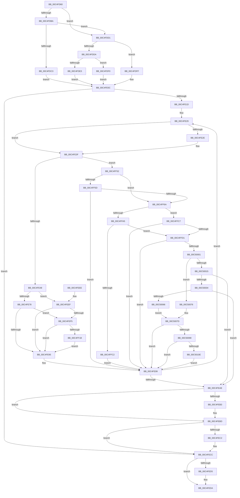

# BapdpProcessVsmKeyBlobs

- RVA: `0x00C4FD60`–`0x00C50154` (길이 `1,012` bytes)
- VA: `0x0000000140C4FD60`
- 실행 섹션: `INIT`
- PDB 이름 있음: `예`; PDB Function 태그: `아니요`
- unwind 정보 RVA: `0x000D47F0`
- 디코드: `273`개 명령, `1,012/1,012` bytes 표시
- 미해석 바이트: `0` (있으면 어셈블리에 `.byte`로 보존)

> 이 문서는 커널 이미지의 기계어와 PDB 기호를 분석해 생성했습니다. 4번과 5번은 함수 원형과 자료형을 바이너리 사용 방식에서 추정한 C 해석이며 원본 소스 복구 결과는 아닙니다.

## 1. Dependencies

- 직접 호출 지점: **28**; 고유 호출 대상: **17**
- 직접 호출자로 확인된 함수: **2**
- RIP 상대 이미지 참조: **6**

### Outgoing calls
- `0x00C4FDB1` → [Feature_3379165498__private_IsEnabledDeviceUsageNoInline](../../text/65/Feature_3379165498__private_IsEnabledDeviceUsageNoInline_function_0065554C.md) (function, `0x0065554C`)
- `0x00C4FDBA` → [Feature_1855570234__private_IsEnabledDeviceUsageNoInline](../../text/65/Feature_1855570234__private_IsEnabledDeviceUsageNoInline_function_006554F8.md) (function, `0x006554F8`)
- `0x00C4FDD1` → [Feature_3379165498__private_IsEnabledDeviceUsageNoInline](../../text/65/Feature_3379165498__private_IsEnabledDeviceUsageNoInline_function_0065554C.md) (function, `0x0065554C`)
- `0x00C4FDDA` → [Feature_1855570234__private_IsEnabledDeviceUsageNoInline](../../text/65/Feature_1855570234__private_IsEnabledDeviceUsageNoInline_function_006554F8.md) (function, `0x006554F8`)
- `0x00C4FE10` → [BapdGetISRegistryKey](../../pagelk/B7/BapdGetISRegistryKey_function_00B7B838.md) (function, `0x00B7B838`)
- `0x00C4FE33` → [ExFreePoolWithTag](../../poolcode/B8/ExFreePoolWithTag_function_00B82870.md) (function, `0x00B82870`)
- `0x00C4FE6C` → [BapdpQueryData](../C5/BapdpQueryData_function_00C50340.md) (function, `0x00C50340`)
- `0x00C4FE86` → [ExAllocatePool2](../../poolcode/B8/ExAllocatePool2_function_00B820F0.md) (function, `0x00B820F0`)
- `0x00C4FEB8` → [ExFreePoolWithTag](../../poolcode/B8/ExFreePoolWithTag_function_00B82870.md) (function, `0x00B82870`)
- `0x00C4FEC7` → [ExFreePoolWithTag](../../poolcode/B8/ExFreePoolWithTag_function_00B82870.md) (function, `0x00B82870`)
- `0x00C4FED5` → [ZwClose](../../text/6A/ZwClose_function_006AD2B0.md) (function, `0x006AD2B0`)
- `0x00C4FF0C` → [BapdpQueryData](../C5/BapdpQueryData_function_00C50340.md) (function, `0x00C50340`)
- `0x00C4FF24` → [RtlInitUnicodeString](../../text/42/RtlInitUnicodeString_function_0042A780.md) (function, `0x0042A780`)
- `0x00C4FF46` → [ZwSetValueKey](../../text/6A/ZwSetValueKey_function_006ADCD0.md) (function, `0x006ADCD0`)
- `0x00C4FF52` → [Feature_3379165498__private_IsEnabledDeviceUsageNoInline](../../text/65/Feature_3379165498__private_IsEnabledDeviceUsageNoInline_function_0065554C.md) (function, `0x0065554C`)
- `0x00C4FF76` → [RtlInitUnicodeString](../../text/42/RtlInitUnicodeString_function_0042A780.md) (function, `0x0042A780`)
- `0x00C4FF99` → [ZwQueryValueKey](../../text/6A/ZwQueryValueKey_function_006AD3B0.md) (function, `0x006AD3B0`)
- `0x00C4FFB3` → [ExAllocatePool2](../../poolcode/B8/ExAllocatePool2_function_00B820F0.md) (function, `0x00B820F0`)
- `0x00C4FFF2` → [ZwQueryValueKey](../../text/6A/ZwQueryValueKey_function_006AD3B0.md) (function, `0x006AD3B0`)
- `0x00C50009` → [ZwDeleteValueKey](../../text/6A/ZwDeleteValueKey_function_006AECB0.md) (function, `0x006AECB0`)
- `0x00C50023` → [ExAllocatePool2](../../poolcode/B8/ExAllocatePool2_function_00B820F0.md) (function, `0x00B820F0`)
- `0x00C50034` → [RtlIsStateSeparationEnabled](../../page/A3/RtlIsStateSeparationEnabled_function_00A3C560.md) (function, `0x00A3C560`)
- `0x00C50059` → [RtlStringCchCopyW](../../text/26/RtlStringCchCopyW_function_0026E9A4.md) (function, `0x0026E9A4`)
- `0x00C50089` → [RtlStringCchCatW](../../text/4C/RtlStringCchCatW_function_004C7500.md) (function, `0x004C7500`)
- `0x00C5009F` → [RtlInitUnicodeStringEx](../../text/46/RtlInitUnicodeStringEx_function_00463960.md) (function, `0x00463960`)
- `0x00C500FF` → [ZwCreateFile](../../text/6A/ZwCreateFile_function_006ADB70.md) (function, `0x006ADB70`)
- `0x00C5013B` → [ZwWriteFile](../../text/6A/ZwWriteFile_function_006AD1D0.md) (function, `0x006AD1D0`)
- `0x00C50144` → [ZwClose](../../text/6A/ZwClose_function_006AD2B0.md) (function, `0x006AD2B0`)

### Direct callers
- [BootApplicationPersistentDataProcess](../BE/BootApplicationPersistentDataProcess_function_00BEEBD4.md) at `0x00BEEC18`
- [BootApplicationPersistentDataProcess](../BE/BootApplicationPersistentDataProcess_function_00BEEBD4.md) at `0x00BEECC6`
- [Phase1InitializationIoReady](../C7/Phase1InitializationIoReady_function_00C70458.md) at `0x00C70658`

### Static image references
- `0x00C4FDC3` → RVA `0x0000BBD0` (`.rdata`; read)
- `0x00C4FDE3` → RVA `0x0000BAF0` (`.rdata`; read)
- `0x00C4FDF0` → RVA `0x0000BCB0` (`.rdata`; read)
- `0x00C4FDFF` → RVA `0x0000BB50` (`.rdata`; read)
- `0x00C5003C` → RVA `0x00C7DA90` (` ?? ::PBOPGDP::`string'`; read)
- `0x00C50043` → RVA `0x00C7AD20` (` ?? ::PBOPGDP::`string'`; read)

## 2. Other-region calls and transfers

- 다른 실행 섹션으로 향하는 call: **26**
  - `0x00C4FDB1` → [Feature_3379165498__private_IsEnabledDeviceUsageNoInline](../../text/65/Feature_3379165498__private_IsEnabledDeviceUsageNoInline_function_0065554C.md) (`INIT` → `.text`)
  - `0x00C4FDBA` → [Feature_1855570234__private_IsEnabledDeviceUsageNoInline](../../text/65/Feature_1855570234__private_IsEnabledDeviceUsageNoInline_function_006554F8.md) (`INIT` → `.text`)
  - `0x00C4FDD1` → [Feature_3379165498__private_IsEnabledDeviceUsageNoInline](../../text/65/Feature_3379165498__private_IsEnabledDeviceUsageNoInline_function_0065554C.md) (`INIT` → `.text`)
  - `0x00C4FDDA` → [Feature_1855570234__private_IsEnabledDeviceUsageNoInline](../../text/65/Feature_1855570234__private_IsEnabledDeviceUsageNoInline_function_006554F8.md) (`INIT` → `.text`)
  - `0x00C4FE10` → [BapdGetISRegistryKey](../../pagelk/B7/BapdGetISRegistryKey_function_00B7B838.md) (`INIT` → `PAGELK`)
  - `0x00C4FE33` → [ExFreePoolWithTag](../../poolcode/B8/ExFreePoolWithTag_function_00B82870.md) (`INIT` → `POOLCODE`)
  - `0x00C4FE86` → [ExAllocatePool2](../../poolcode/B8/ExAllocatePool2_function_00B820F0.md) (`INIT` → `POOLCODE`)
  - `0x00C4FEB8` → [ExFreePoolWithTag](../../poolcode/B8/ExFreePoolWithTag_function_00B82870.md) (`INIT` → `POOLCODE`)
  - `0x00C4FEC7` → [ExFreePoolWithTag](../../poolcode/B8/ExFreePoolWithTag_function_00B82870.md) (`INIT` → `POOLCODE`)
  - `0x00C4FED5` → [ZwClose](../../text/6A/ZwClose_function_006AD2B0.md) (`INIT` → `.text`)
  - `0x00C4FF24` → [RtlInitUnicodeString](../../text/42/RtlInitUnicodeString_function_0042A780.md) (`INIT` → `.text`)
  - `0x00C4FF46` → [ZwSetValueKey](../../text/6A/ZwSetValueKey_function_006ADCD0.md) (`INIT` → `.text`)
  - `0x00C4FF52` → [Feature_3379165498__private_IsEnabledDeviceUsageNoInline](../../text/65/Feature_3379165498__private_IsEnabledDeviceUsageNoInline_function_0065554C.md) (`INIT` → `.text`)
  - `0x00C4FF76` → [RtlInitUnicodeString](../../text/42/RtlInitUnicodeString_function_0042A780.md) (`INIT` → `.text`)
  - `0x00C4FF99` → [ZwQueryValueKey](../../text/6A/ZwQueryValueKey_function_006AD3B0.md) (`INIT` → `.text`)
  - `0x00C4FFB3` → [ExAllocatePool2](../../poolcode/B8/ExAllocatePool2_function_00B820F0.md) (`INIT` → `POOLCODE`)
  - `0x00C4FFF2` → [ZwQueryValueKey](../../text/6A/ZwQueryValueKey_function_006AD3B0.md) (`INIT` → `.text`)
  - `0x00C50009` → [ZwDeleteValueKey](../../text/6A/ZwDeleteValueKey_function_006AECB0.md) (`INIT` → `.text`)
  - `0x00C50023` → [ExAllocatePool2](../../poolcode/B8/ExAllocatePool2_function_00B820F0.md) (`INIT` → `POOLCODE`)
  - `0x00C50034` → [RtlIsStateSeparationEnabled](../../page/A3/RtlIsStateSeparationEnabled_function_00A3C560.md) (`INIT` → `PAGE`)
  - `0x00C50059` → [RtlStringCchCopyW](../../text/26/RtlStringCchCopyW_function_0026E9A4.md) (`INIT` → `.text`)
  - `0x00C50089` → [RtlStringCchCatW](../../text/4C/RtlStringCchCatW_function_004C7500.md) (`INIT` → `.text`)
  - `0x00C5009F` → [RtlInitUnicodeStringEx](../../text/46/RtlInitUnicodeStringEx_function_00463960.md) (`INIT` → `.text`)
  - `0x00C500FF` → [ZwCreateFile](../../text/6A/ZwCreateFile_function_006ADB70.md) (`INIT` → `.text`)
  - `0x00C5013B` → [ZwWriteFile](../../text/6A/ZwWriteFile_function_006AD1D0.md) (`INIT` → `.text`)
  - `0x00C50144` → [ZwClose](../../text/6A/ZwClose_function_006AD2B0.md) (`INIT` → `.text`)
- 별도 외부 분기/꼬리 이동을 확인하지 못했습니다.

## 3. Assembly (complete function range)

```asm
00C4FD60  89 4C 24 08                     mov dword ptr [rsp + 8], ecx
00C4FD64  55                              push rbp
00C4FD65  53                              push rbx
00C4FD66  56                              push rsi
00C4FD67  57                              push rdi
00C4FD68  41 54                           push r12
00C4FD6A  41 55                           push r13
00C4FD6C  41 56                           push r14
00C4FD6E  41 57                           push r15
00C4FD70  48 8D 6C 24 E1                  lea rbp, [rsp - 0x1f]
00C4FD75  48 81 EC C8 00 00 00            sub rsp, 0xc8
00C4FD7C  45 33 E4                        xor r12d, r12d
00C4FD7F  0F 57 C9                        xorps xmm1, xmm1
00C4FD82  0F 57 C0                        xorps xmm0, xmm0
00C4FD85  44 89 65 6F                     mov dword ptr [rbp + 0x6f], r12d
00C4FD89  4C 89 65 7F                     mov qword ptr [rbp + 0x7f], r12
00C4FD8D  41 8B DC                        mov ebx, r12d
00C4FD90  4C 89 65 B7                     mov qword ptr [rbp - 0x49], r12
00C4FD94  41 8B FC                        mov edi, r12d
00C4FD97  0F 11 45 D7                     movups xmmword ptr [rbp - 0x29], xmm0
00C4FD9B  45 8B FC                        mov r15d, r12d
00C4FD9E  44 8B E9                        mov r13d, ecx
00C4FDA1  0F 11 4D E7                     movups xmmword ptr [rbp - 0x19], xmm1
00C4FDA5  0F 11 4D F7                     movups xmmword ptr [rbp - 9], xmm1
00C4FDA9  0F 11 4D 07                     movups xmmword ptr [rbp + 7], xmm1
00C4FDAD  0F 11 45 C7                     movups xmmword ptr [rbp - 0x39], xmm0
00C4FDB1  E8 96 57 A0 FF                  call 0x14065554c
00C4FDB6  85 C0                           test eax, eax
00C4FDB8  74 17                           je 0x140c4fdd1
00C4FDBA  E8 39 57 A0 FF                  call 0x1406554f8
00C4FDBF  85 C0                           test eax, eax
00C4FDC1  74 0E                           je 0x140c4fdd1
00C4FDC3  48 8D 35 06 BE 3B FF            lea rsi, [rip - 0xc441fa]
00C4FDCA  45 8D 74 24 07                  lea r14d, [r12 + 7]
00C4FDCF  EB 3B                           jmp 0x140c4fe0c
00C4FDD1  E8 76 57 A0 FF                  call 0x14065554c
00C4FDD6  85 C0                           test eax, eax
00C4FDD8  75 25                           jne 0x140c4fdff
00C4FDDA  E8 19 57 A0 FF                  call 0x1406554f8
00C4FDDF  85 C0                           test eax, eax
00C4FDE1  75 0D                           jne 0x140c4fdf0
00C4FDE3  48 8D 35 06 BD 3B FF            lea rsi, [rip - 0xc442fa]
00C4FDEA  44 8D 70 03                     lea r14d, [rax + 3]
00C4FDEE  EB 1C                           jmp 0x140c4fe0c
00C4FDF0  48 8D 35 B9 BE 3B FF            lea rsi, [rip - 0xc44147]
00C4FDF7  41 BE 06 00 00 00               mov r14d, 6
00C4FDFD  EB 0D                           jmp 0x140c4fe0c
00C4FDFF  48 8D 35 4A BD 3B FF            lea rsi, [rip - 0xc442b6]
00C4FE06  41 BE 04 00 00 00               mov r14d, 4
00C4FE0C  48 8D 4D 7F                     lea rcx, [rbp + 0x7f]
00C4FE10  E8 23 BA F2 FF                  call 0x140b7b838
00C4FE15  85 C0                           test eax, eax
00C4FE17  0F 88 AF 00 00 00               js 0x140c4fecc
00C4FE1D  41 8B C4                        mov eax, r12d
00C4FE20  33 D2                           xor edx, edx
00C4FE22  89 45 77                        mov dword ptr [rbp + 0x77], eax
00C4FE25  4C 8D 66 18                     lea r12, [rsi + 0x18]
00C4FE29  48 85 DB                        test rbx, rbx
00C4FE2C  74 11                           je 0x140c4fe3f
00C4FE2E  33 D2                           xor edx, edx
00C4FE30  48 8B CB                        mov rcx, rbx
00C4FE33  E8 38 2A F3 FF                  call 0x140b82870
00C4FE38  8B 45 77                        mov eax, dword ptr [rbp + 0x77]
00C4FE3B  33 D2                           xor edx, edx
00C4FE3D  8B DA                           mov ebx, edx
00C4FE3F  45 85 ED                        test r13d, r13d
00C4FE42  0F 85 0A 01 00 00               jne 0x140c4ff52
00C4FE48  44 8B E8                        mov r13d, eax
00C4FE4B  45 33 C9                        xor r9d, r9d
00C4FE4E  48 89 54 24 28                  mov qword ptr [rsp + 0x28], rdx
00C4FE53  48 8D 45 6F                     lea rax, [rbp + 0x6f]
00C4FE57  89 55 6F                        mov dword ptr [rbp + 0x6f], edx
00C4FE5A  45 33 C0                        xor r8d, r8d
00C4FE5D  49 C1 E5 05                     shl r13, 5
00C4FE61  4C 03 EE                        add r13, rsi
00C4FE64  48 89 44 24 20                  mov qword ptr [rsp + 0x20], rax
00C4FE69  49 8B D5                        mov rdx, r13
00C4FE6C  E8 CF 04 00 00                  call 0x140c50340
00C4FE71  3D 23 00 00 C0                  cmp eax, 0xc0000023
00C4FE76  75 77                           jne 0x140c4feef
00C4FE78  8B 55 6F                        mov edx, dword ptr [rbp + 0x6f]
00C4FE7B  B9 40 00 00 00                  mov ecx, 0x40
00C4FE80  41 B8 42 61 50 64               mov r8d, 0x64506142
00C4FE86  E8 65 22 F3 FF                  call 0x140b820f0
00C4FE8B  33 D2                           xor edx, edx
00C4FE8D  48 8B D8                        mov rbx, rax
00C4FE90  48 85 C0                        test rax, rax
00C4FE93  75 60                           jne 0x140c4fef5
00C4FE95  44 8B 6D 67                     mov r13d, dword ptr [rbp + 0x67]
00C4FE99  8B 45 77                        mov eax, dword ptr [rbp + 0x77]
00C4FE9C  49 83 C4 20                     add r12, 0x20
00C4FEA0  FF C0                           inc eax
00C4FEA2  89 45 77                        mov dword ptr [rbp + 0x77], eax
00C4FEA5  41 3B C6                        cmp eax, r14d
00C4FEA8  0F 82 7B FF FF FF               jb 0x140c4fe29
00C4FEAE  48 85 DB                        test rbx, rbx
00C4FEB1  74 0A                           je 0x140c4febd
00C4FEB3  33 D2                           xor edx, edx
00C4FEB5  48 8B CB                        mov rcx, rbx
00C4FEB8  E8 B3 29 F3 FF                  call 0x140b82870
00C4FEBD  48 85 FF                        test rdi, rdi
00C4FEC0  74 0A                           je 0x140c4fecc
00C4FEC2  33 D2                           xor edx, edx
00C4FEC4  48 8B CF                        mov rcx, rdi
00C4FEC7  E8 A4 29 F3 FF                  call 0x140b82870
00C4FECC  48 8B 4D 7F                     mov rcx, qword ptr [rbp + 0x7f]
00C4FED0  48 85 C9                        test rcx, rcx
00C4FED3  74 05                           je 0x140c4feda
00C4FED5  E8 D6 D3 A5 FF                  call 0x1406ad2b0
00C4FEDA  48 81 C4 C8 00 00 00            add rsp, 0xc8
00C4FEE1  41 5F                           pop r15
00C4FEE3  41 5E                           pop r14
00C4FEE5  41 5D                           pop r13
00C4FEE7  41 5C                           pop r12
00C4FEE9  5F                              pop rdi
00C4FEEA  5E                              pop rsi
00C4FEEB  5B                              pop rbx
00C4FEEC  5D                              pop rbp
00C4FEED  C3                              ret
00C4FEEE  CC                              int3
00C4FEEF  33 D2                           xor edx, edx
00C4FEF1  85 C0                           test eax, eax
00C4FEF3  78 A0                           js 0x140c4fe95
00C4FEF5  48 89 54 24 28                  mov qword ptr [rsp + 0x28], rdx
00C4FEFA  48 8D 45 6F                     lea rax, [rbp + 0x6f]
00C4FEFE  49 8B D5                        mov rdx, r13
00C4FF01  48 89 44 24 20                  mov qword ptr [rsp + 0x20], rax
00C4FF06  4C 8B CB                        mov r9, rbx
00C4FF09  45 33 C0                        xor r8d, r8d
00C4FF0C  E8 2F 04 00 00                  call 0x140c50340
00C4FF11  33 D2                           xor edx, edx
00C4FF13  85 C0                           test eax, eax
00C4FF15  0F 88 7A FF FF FF               js 0x140c4fe95
00C4FF1B  49 8B 54 24 F8                  mov rdx, qword ptr [r12 - 8]
00C4FF20  48 8D 4D C7                     lea rcx, [rbp - 0x39]
00C4FF24  E8 57 A8 7D FF                  call 0x14042a780
00C4FF29  8B 45 6F                        mov eax, dword ptr [rbp + 0x6f]
00C4FF2C  48 8D 55 C7                     lea rdx, [rbp - 0x39]
00C4FF30  48 8B 4D 7F                     mov rcx, qword ptr [rbp + 0x7f]
00C4FF34  41 B9 03 00 00 00               mov r9d, 3
00C4FF3A  89 44 24 28                     mov dword ptr [rsp + 0x28], eax
00C4FF3E  45 33 C0                        xor r8d, r8d
00C4FF41  48 89 5C 24 20                  mov qword ptr [rsp + 0x20], rbx
00C4FF46  E8 85 DD A5 FF                  call 0x1406adcd0
00C4FF4B  33 D2                           xor edx, edx
00C4FF4D  E9 43 FF FF FF                  jmp 0x140c4fe95
00C4FF52  E8 F5 55 A0 FF                  call 0x14065554c
00C4FF57  33 D2                           xor edx, edx
00C4FF59  85 C0                           test eax, eax
00C4FF5B  74 0D                           je 0x140c4ff6a
00C4FF5D  49 8B 04 24                     mov rax, qword ptr [r12]
00C4FF61  66 39 10                        cmp word ptr [rax], dx
00C4FF64  0F 84 2F FF FF FF               je 0x140c4fe99
00C4FF6A  89 55 6F                        mov dword ptr [rbp + 0x6f], edx
00C4FF6D  48 8D 4D C7                     lea rcx, [rbp - 0x39]
00C4FF71  49 8B 54 24 F8                  mov rdx, qword ptr [r12 - 8]
00C4FF76  E8 05 A8 7D FF                  call 0x14042a780
00C4FF7B  33 C9                           xor ecx, ecx
00C4FF7D  48 8D 45 6F                     lea rax, [rbp + 0x6f]
00C4FF81  48 89 44 24 28                  mov qword ptr [rsp + 0x28], rax
00C4FF86  48 8D 55 C7                     lea rdx, [rbp - 0x39]
00C4FF8A  89 4C 24 20                     mov dword ptr [rsp + 0x20], ecx
00C4FF8E  45 33 C9                        xor r9d, r9d
00C4FF91  44 8D 41 02                     lea r8d, [rcx + 2]
00C4FF95  48 8B 4D 7F                     mov rcx, qword ptr [rbp + 0x7f]
00C4FF99  E8 12 D4 A5 FF                  call 0x1406ad3b0
00C4FF9E  3D 23 00 00 C0                  cmp eax, 0xc0000023
00C4FFA3  75 22                           jne 0x140c4ffc7
00C4FFA5  8B 55 6F                        mov edx, dword ptr [rbp + 0x6f]
00C4FFA8  B9 40 00 00 00                  mov ecx, 0x40
00C4FFAD  41 B8 42 61 50 64               mov r8d, 0x64506142
00C4FFB3  E8 38 21 F3 FF                  call 0x140b820f0
00C4FFB8  33 D2                           xor edx, edx
00C4FFBA  48 8B D8                        mov rbx, rax
00C4FFBD  48 85 C0                        test rax, rax
00C4FFC0  75 0F                           jne 0x140c4ffd1
00C4FFC2  E9 D2 FE FF FF                  jmp 0x140c4fe99
00C4FFC7  33 D2                           xor edx, edx
00C4FFC9  85 C0                           test eax, eax
00C4FFCB  0F 88 C8 FE FF FF               js 0x140c4fe99
00C4FFD1  48 8B 4D 7F                     mov rcx, qword ptr [rbp + 0x7f]
00C4FFD5  48 8D 45 6F                     lea rax, [rbp + 0x6f]
00C4FFD9  48 89 44 24 28                  mov qword ptr [rsp + 0x28], rax
00C4FFDE  48 8D 55 C7                     lea rdx, [rbp - 0x39]
00C4FFE2  8B 45 6F                        mov eax, dword ptr [rbp + 0x6f]
00C4FFE5  4C 8B CB                        mov r9, rbx
00C4FFE8  41 B8 02 00 00 00               mov r8d, 2
00C4FFEE  89 44 24 20                     mov dword ptr [rsp + 0x20], eax
00C4FFF2  E8 B9 D3 A5 FF                  call 0x1406ad3b0
00C4FFF7  33 D2                           xor edx, edx
00C4FFF9  85 C0                           test eax, eax
00C4FFFB  0F 88 98 FE FF FF               js 0x140c4fe99
00C50001  48 8B 4D 7F                     mov rcx, qword ptr [rbp + 0x7f]
00C50005  48 8D 55 C7                     lea rdx, [rbp - 0x39]
00C50009  E8 A2 EC A5 FF                  call 0x1406aecb0
00C5000E  33 C9                           xor ecx, ecx
00C50010  48 85 FF                        test rdi, rdi
00C50013  75 61                           jne 0x140c50076
00C50015  BA 08 02 00 00                  mov edx, 0x208
00C5001A  8D 4F 40                        lea ecx, [rdi + 0x40]
00C5001D  41 B8 42 61 50 64               mov r8d, 0x64506142
00C50023  E8 C8 20 F3 FF                  call 0x140b820f0
00C50028  48 8B F8                        mov rdi, rax
00C5002B  48 85 C0                        test rax, rax
00C5002E  0F 84 7A FE FF FF               je 0x140c4feae
00C50034  E8 27 C5 DE FF                  call 0x140a3c560
00C50039  44 8A D8                        mov r11b, al
00C5003C  4C 8D 05 4D DA 02 00            lea r8, [rip + 0x2da4d]
00C50043  48 8D 05 D6 AC 02 00            lea rax, [rip + 0x2acd6]
00C5004A  45 84 DB                        test r11b, r11b
00C5004D  BA 04 01 00 00                  mov edx, 0x104
00C50052  48 8B CF                        mov rcx, rdi
00C50055  4C 0F 44 C0                     cmove r8, rax
00C50059  E8 46 E9 61 FF                  call 0x14026e9a4
00C5005E  85 C0                           test eax, eax
00C50060  0F 88 48 FE FF FF               js 0x140c4feae
00C50066  41 F6 DB                        neg r11b
00C50069  45 1B FF                        sbb r15d, r15d
00C5006C  41 83 E7 08                     and r15d, 8
00C50070  41 83 C7 0C                     add r15d, 0xc
00C50074  EB 07                           jmp 0x140c5007d
00C50076  41 8B C7                        mov eax, r15d
00C50079  66 89 0C 47                     mov word ptr [rdi + rax*2], cx
00C5007D  4D 8B 04 24                     mov r8, qword ptr [r12]
00C50081  BA 04 01 00 00                  mov edx, 0x104
00C50086  48 8B CF                        mov rcx, rdi
00C50089  E8 72 74 87 FF                  call 0x1404c7500
00C5008E  33 D2                           xor edx, edx
00C50090  85 C0                           test eax, eax
00C50092  0F 88 01 FE FF FF               js 0x140c4fe99
00C50098  48 8B D7                        mov rdx, rdi
00C5009B  48 8D 4D C7                     lea rcx, [rbp - 0x39]
00C5009F  E8 BC 38 81 FF                  call 0x140463960
00C500A4  33 C9                           xor ecx, ecx
00C500A6  C7 45 E7 30 00 00 00            mov dword ptr [rbp - 0x19], 0x30
00C500AD  89 4C 24 50                     mov dword ptr [rsp + 0x50], ecx
00C500B1  48 8D 45 C7                     lea rax, [rbp - 0x39]
00C500B5  48 89 4C 24 48                  mov qword ptr [rsp + 0x48], rcx
00C500BA  4C 8D 4D D7                     lea r9, [rbp - 0x29]
00C500BE  C7 44 24 40 60 00 00 00         mov dword ptr [rsp + 0x40], 0x60
00C500C6  4C 8D 45 E7                     lea r8, [rbp - 0x19]
00C500CA  89 4C 24 38                     mov dword ptr [rsp + 0x38], ecx
00C500CE  0F 57 C0                        xorps xmm0, xmm0
00C500D1  89 4C 24 30                     mov dword ptr [rsp + 0x30], ecx
00C500D5  BA 00 00 10 40                  mov edx, 0x40100000
00C500DA  48 89 4D EF                     mov qword ptr [rbp - 0x11], rcx
00C500DE  C7 44 24 28 80 00 00 00         mov dword ptr [rsp + 0x28], 0x80
00C500E6  48 89 4C 24 20                  mov qword ptr [rsp + 0x20], rcx
00C500EB  48 8D 4D B7                     lea rcx, [rbp - 0x49]
00C500EF  C7 45 FF 40 02 00 00            mov dword ptr [rbp - 1], 0x240
00C500F6  48 89 45 F7                     mov qword ptr [rbp - 9], rax
00C500FA  F3 0F 7F 45 07                  movdqu xmmword ptr [rbp + 7], xmm0
00C500FF  E8 6C DA A5 FF                  call 0x1406adb70
00C50104  33 D2                           xor edx, edx
00C50106  85 C0                           test eax, eax
00C50108  0F 88 8B FD FF FF               js 0x140c4fe99
00C5010E  8B 43 08                        mov eax, dword ptr [rbx + 8]
00C50111  48 8D 4B 0C                     lea rcx, [rbx + 0xc]
00C50115  48 89 54 24 40                  mov qword ptr [rsp + 0x40], rdx
00C5011A  45 33 C9                        xor r9d, r9d
00C5011D  48 89 54 24 38                  mov qword ptr [rsp + 0x38], rdx
00C50122  45 33 C0                        xor r8d, r8d
00C50125  89 44 24 30                     mov dword ptr [rsp + 0x30], eax
00C50129  48 8D 45 D7                     lea rax, [rbp - 0x29]
00C5012D  48 89 4C 24 28                  mov qword ptr [rsp + 0x28], rcx
00C50132  48 8B 4D B7                     mov rcx, qword ptr [rbp - 0x49]
00C50136  48 89 44 24 20                  mov qword ptr [rsp + 0x20], rax
00C5013B  E8 90 D0 A5 FF                  call 0x1406ad1d0
00C50140  48 8B 4D B7                     mov rcx, qword ptr [rbp - 0x49]
00C50144  E8 67 D1 A5 FF                  call 0x1406ad2b0
00C50149  33 D2                           xor edx, edx
00C5014B  48 89 55 B7                     mov qword ptr [rbp - 0x49], rdx
00C5014F  E9 45 FD FF FF                  jmp 0x140c4fe99
```

## 4. C-style interpretation (structured pseudocode)

```c
__int64 __fastcall BapdpProcessVsmKeyBlobs(int a1, int a2, int a3, int a4)
{
    __int64 result;
    __int64 v_r11;
    __int64 v_r12;
    __int64 v_r13;
    __int64 v_r15;
    __int64 v_rbx;
    __int64 v_rsp;
    unsigned __int64 v_stack_m58;
    unsigned __int64 v_stack_m5F;
    unsigned int v_stack_m60;
    unsigned __int64 v_stack_m68;
    unsigned __int64 v_stack_m70;
    unsigned __int64 v_stack_m78;
    unsigned __int64 v_stack_m88;
    unsigned __int64 v_stack_m98;
    unsigned __int64 v_stack_mA8;
    unsigned __int64 v_stack_mE0;
    unsigned __int64 v_stack_mE8;
    unsigned int v_stack_p10;
    unsigned int v_stack_p18;
    unsigned __int64 v_stack_p20;
    unsigned __int64 v_stack_p28;
    unsigned int v_stack_p30;
    unsigned int v_stack_p38;
    unsigned int v_stack_p40;
    unsigned __int64 v_stack_p48;
    unsigned int v_stack_p50;
    unsigned int v_stack_p8;

    v_stack_p8 = a1;
    v_rsp = (v_rsp) - (200);
    v_r12 = 0;
    v_stack_p10 = 0;
    v_stack_p20 = 0;
    v_stack_mA8 = 0;
    v_stack_m88 = v_xmm0;
    v_stack_m78 = v_xmm1;
    v_stack_m68 = v_xmm1;
    v_stack_m58 = v_xmm1;
    v_stack_m98 = v_xmm0;
    result = Feature_3379165498__private_IsEnabledDeviceUsageNoInline(a1, a2, a3, a4);
    if ((unsigned int)(result) == 0) goto loc_00C4FDD1;
    result = Feature_1855570234__private_IsEnabledDeviceUsageNoInline(a1, a2, a3, a4);
    if ((unsigned int)(result) == 0) goto loc_00C4FDD1;
    goto loc_00C4FE0C;
loc_00C4FDD1:
    result = Feature_3379165498__private_IsEnabledDeviceUsageNoInline(a1, a2, a3, a4);
    if ((unsigned int)(result) != 0) goto loc_00C4FDFF;
    result = Feature_1855570234__private_IsEnabledDeviceUsageNoInline(a1, a2, a3, a4);
    if ((unsigned int)(result) != 0) goto loc_00C4FDF0;
    goto loc_00C4FE0C;
loc_00C4FDF0:
    goto loc_00C4FE0C;
loc_00C4FDFF:
loc_00C4FE0C:
    result = BapdGetISRegistryKey(v_stack_p20, a2, a3, a4);
    if (sign_flag) goto loc_00C4FECC;
    a2 = 0;
    v_stack_p18 = 0;
loc_00C4FE29:
    result = 0;
    v_rbx = 0;
    if (0 != 0) {
        a2 = 0;
        a1 = 0;
        result = ExFreePoolWithTag(a1, a2, a3, a4);
        result = v_stack_p18;
        a2 = 0;
        v_rbx = 0;
    }
    if ((unsigned int)((unsigned int)(a1)) != 0) goto loc_00C4FF52;
    a4 = 0;
    v_stack_mE0 = 0;
    v_stack_p10 = 0;
    a3 = 0;
    v_r13 = ((unsigned int)((unsigned int)(result))) << (5);
    v_r13 = (v_r13) + (v_rip - 12862134);
    v_stack_mE8 = v_stack_p10;
    result = BapdpQueryData(a1, v_r13, a3, a4);
    if (((unsigned int)(result)) != 0xC0000023ULL) goto loc_00C4FEEF;
    result = ExAllocatePool2(64, (unsigned int)(v_stack_p10), (unsigned int)(0x64506142ULL), a4);
    a2 = 0;
    if (result != 0) goto loc_00C4FEF5;
loc_00C4FE95:
loc_00C4FE99:
    v_r12 = (v_rip - 12862134 + 24) + (32);
    result = (unsigned int)(((unsigned int)(v_stack_p18)) + 1);
    v_stack_p18 = (unsigned int)(result);
    if (((unsigned int)(result)) < 4) goto loc_00C4FE29;
loc_00C4FEAE:
    if (result != 0) {
        a2 = 0;
        a1 = result;
        result = ExFreePoolWithTag(a1, a2, (unsigned int)(0x64506142ULL), a4);
    }
    if (0 != 0) {
        a2 = 0;
        a1 = 0;
        result = ExFreePoolWithTag(a1, a2, (unsigned int)(0x64506142ULL), a4);
    }
    if (v_stack_p20 != 0) {
        result = ZwClose(v_stack_p20, a2, (unsigned int)(0x64506142ULL), a4);
    }
    v_rsp = (v_rsp) + (200);
    return result;
loc_00C4FEEF:
    a2 = 0;
    if (sign_flag) goto loc_00C4FE95;
loc_00C4FEF5:
    v_stack_p28 = 0;
    v_stack_p20 = v_stack_p10;
    a3 = 0;
    result = BapdpQueryData(v_stack_p20, (unsigned int)(v_stack_p8), a3, result);
    a2 = 0;
    if (sign_flag) goto loc_00C4FE95;
    result = RtlInitUnicodeString(v_stack_m98, *(unsigned __int64 *)(v_r12 - 8), a3, result);
    v_stack_p28 = (unsigned int)((unsigned int)(v_stack_p10));
    a3 = 0;
    v_stack_p20 = result;
    result = ZwSetValueKey(v_stack_p20, v_stack_m98, a3, 3);
    a2 = 0;
    goto loc_00C4FE95;
loc_00C4FF52:
    result = Feature_3379165498__private_IsEnabledDeviceUsageNoInline(v_stack_p20, a2, a3, 3);
    a2 = 0;
    if ((unsigned int)(result) == 0) goto loc_00C4FF6A;
    if ((*(unsigned __int16 *)(*(unsigned __int64 *)(v_r12))) == 0) goto loc_00C4FE99;
loc_00C4FF6A:
    v_stack_p10 = 0;
    result = RtlInitUnicodeString(v_stack_m98, *(unsigned __int64 *)(v_r12 - 8), a3, 3);
    a1 = 0;
    v_stack_p28 = v_stack_p10;
    v_stack_p20 = 0;
    a4 = 0;
    result = ZwQueryValueKey(v_stack_p20, v_stack_m98, a1 + 2, a4);
    if (((unsigned int)(result)) != 0xC0000023ULL) goto loc_00C4FFC7;
    result = ExAllocatePool2(64, (unsigned int)(v_stack_p10), (unsigned int)(0x64506142ULL), a4);
    a2 = 0;
    if (result != 0) goto loc_00C4FFD1;
    goto loc_00C4FE99;
loc_00C4FFC7:
    a2 = 0;
    if (sign_flag) goto loc_00C4FE99;
loc_00C4FFD1:
    v_stack_p28 = v_stack_p10;
    v_stack_p20 = (unsigned int)((unsigned int)(v_stack_p10));
    result = ZwQueryValueKey(v_stack_p20, v_stack_m98, 2, result);
    a2 = 0;
    if (sign_flag) goto loc_00C4FE99;
    result = ZwDeleteValueKey(v_stack_p20, v_stack_m98, 2, result);
    a1 = 0;
    if (0 != 0) goto loc_00C50076;
    result = ExAllocatePool2(0 + 64, 520, (unsigned int)(0x64506142ULL), result);
    if (result == 0) goto loc_00C4FEAE;
    result = RtlIsStateSeparationEnabled(0 + 64, 520, (unsigned int)(0x64506142ULL), result);
    a3 = v_rip + 186957;
    if ((unsigned __int8)((unsigned __int8)(result)) == 0) { a3 = v_rip + 175318; }
    result = RtlStringCchCopyW(result, 260, a3, result);
    if (sign_flag) goto loc_00C4FEAE;
    v_r11 = (unsigned __int8)(-((unsigned __int8)(result)));
    v_r15 = (unsigned int)((0) & (8));
    v_r15 = (unsigned int)((v_r15) + (12));
    goto loc_00C5007D;
loc_00C50076:
    *(unsigned __int16 *)(result + (unsigned int)((unsigned int)(v_r15)) * 2) = (unsigned __int16)(result);
loc_00C5007D:
    result = RtlStringCchCatW(result, 260, *(unsigned __int64 *)(v_r12), result);
    a2 = 0;
    if (sign_flag) goto loc_00C4FE99;
    result = RtlInitUnicodeStringEx(v_stack_m98, result, *(unsigned __int64 *)(v_r12), result);
    a1 = 0;
    v_stack_m78 = 48;
    v_stack_p50 = 0;
    v_stack_p48 = 0;
    v_stack_p40 = 96;
    v_stack_p38 = 0;
    v_stack_p30 = 0;
    v_stack_m70 = 0;
    v_stack_p28 = 128;
    v_stack_p20 = 0;
    v_stack_m60 = 576;
    v_stack_m68 = v_stack_m98;
    v_stack_m58 = v_xmm0;
    result = ZwCreateFile(v_stack_mA8, (unsigned int)(0x40100000ULL), v_stack_m78, v_stack_m88);
    a2 = 0;
    if (sign_flag) goto loc_00C4FE99;
    v_stack_p40 = 0;
    a4 = 0;
    v_stack_p38 = 0;
    a3 = 0;
    v_stack_p30 = (unsigned int)((unsigned int)(*(unsigned int *)(result + 8)));
    v_stack_p28 = result + 12;
    v_stack_p20 = v_stack_m88;
    result = ZwWriteFile(v_stack_mA8, a2, a3, a4);
    result = ZwClose(v_stack_mA8, a2, a3, a4);
    a2 = 0;
    v_stack_mA8 = 0;
    goto loc_00C4FE99;
}
```

## 5. (Beta) C Style

```c
int64_t BapdpProcessVsmKeyBlobs(int32_t Arg1, int32_t Arg2, int32_t Arg3, int32_t Arg4)
{
    int64_t result;
    int64_t local_r11;
    int64_t local_r12;
    int64_t local_r13;
    int64_t local_r15;
    int64_t local_rbx;
    int64_t local_rsp;
    uint64_t v_stack_m58;
    uint64_t v_stack_m5F;
    uint32_t v_stack_m60;
    uint64_t v_stack_m68;
    uint64_t v_stack_m70;
    uint64_t v_stack_m78;
    uint64_t v_stack_m88;
    uint64_t v_stack_m98;
    uint64_t v_stack_mA8;
    uint64_t v_stack_mE0;
    uint64_t v_stack_mE8;
    uint32_t v_stack_p10;
    uint32_t v_stack_p18;
    uint64_t v_stack_p20;
    uint64_t v_stack_p28;
    uint32_t v_stack_p30;
    uint32_t v_stack_p38;
    uint32_t v_stack_p40;
    uint64_t v_stack_p48;
    uint32_t v_stack_p50;
    uint32_t v_stack_p8;

    v_stack_p8 = Arg1;
    local_rsp = (local_rsp) - (200);
    local_r12 = 0;
    v_stack_p10 = 0;
    v_stack_p20 = 0;
    v_stack_mA8 = 0;
    v_stack_m88 = v_xmm0;
    v_stack_m78 = v_xmm1;
    v_stack_m68 = v_xmm1;
    v_stack_m58 = v_xmm1;
    v_stack_m98 = v_xmm0;
    result = Feature_3379165498__private_IsEnabledDeviceUsageNoInline(Arg1, Arg2, Arg3, Arg4);
    if ((uint32_t)(result) == 0) goto loc_00C4FDD1;
    result = Feature_1855570234__private_IsEnabledDeviceUsageNoInline(Arg1, Arg2, Arg3, Arg4);
    if ((uint32_t)(result) == 0) goto loc_00C4FDD1;
    goto loc_00C4FE0C;
loc_00C4FDD1:
    result = Feature_3379165498__private_IsEnabledDeviceUsageNoInline(Arg1, Arg2, Arg3, Arg4);
    if ((uint32_t)(result) != 0) goto loc_00C4FDFF;
    result = Feature_1855570234__private_IsEnabledDeviceUsageNoInline(Arg1, Arg2, Arg3, Arg4);
    if ((uint32_t)(result) != 0) goto loc_00C4FDF0;
    goto loc_00C4FE0C;
loc_00C4FDF0:
    goto loc_00C4FE0C;
loc_00C4FDFF:
loc_00C4FE0C:
    result = BapdGetISRegistryKey(v_stack_p20, Arg2, Arg3, Arg4);
    if (sign_flag) goto loc_00C4FECC;
    Arg2 = 0;
    v_stack_p18 = 0;
loc_00C4FE29:
    result = 0;
    local_rbx = 0;
    if (0 != 0) {
        Arg2 = 0;
        Arg1 = 0;
        result = ExFreePoolWithTag(Arg1, Arg2, Arg3, Arg4);
        result = v_stack_p18;
        Arg2 = 0;
        local_rbx = 0;
    }
    if ((uint32_t)((uint32_t)(Arg1)) != 0) goto loc_00C4FF52;
    Arg4 = 0;
    v_stack_mE0 = 0;
    v_stack_p10 = 0;
    Arg3 = 0;
    local_r13 = ((uint32_t)((uint32_t)(result))) << (5);
    local_r13 = (local_r13) + (v_rip - 12862134);
    v_stack_mE8 = v_stack_p10;
    result = BapdpQueryData(Arg1, local_r13, Arg3, Arg4);
    if (((uint32_t)(result)) != 0xC0000023ULL) goto loc_00C4FEEF;
    result = ExAllocatePool2(64, (uint32_t)(v_stack_p10), (uint32_t)(0x64506142ULL), Arg4);
    Arg2 = 0;
    if (result != 0) goto loc_00C4FEF5;
loc_00C4FE95:
loc_00C4FE99:
    local_r12 = (v_rip - 12862134 + 24) + (32);
    result = (uint32_t)(((uint32_t)(v_stack_p18)) + 1);
    v_stack_p18 = (uint32_t)(result);
    if (((uint32_t)(result)) < 4) goto loc_00C4FE29;
loc_00C4FEAE:
    if (result != 0) {
        Arg2 = 0;
        Arg1 = result;
        result = ExFreePoolWithTag(Arg1, Arg2, (uint32_t)(0x64506142ULL), Arg4);
    }
    if (0 != 0) {
        Arg2 = 0;
        Arg1 = 0;
        result = ExFreePoolWithTag(Arg1, Arg2, (uint32_t)(0x64506142ULL), Arg4);
    }
    if (v_stack_p20 != 0) {
        result = ZwClose(v_stack_p20, Arg2, (uint32_t)(0x64506142ULL), Arg4);
    }
    local_rsp = (local_rsp) + (200);
    return result;
loc_00C4FEEF:
    Arg2 = 0;
    if (sign_flag) goto loc_00C4FE95;
loc_00C4FEF5:
    v_stack_p28 = 0;
    v_stack_p20 = v_stack_p10;
    Arg3 = 0;
    result = BapdpQueryData(v_stack_p20, (uint32_t)(v_stack_p8), Arg3, result);
    Arg2 = 0;
    if (sign_flag) goto loc_00C4FE95;
    result = RtlInitUnicodeString(v_stack_m98, *(uint64_t *)(local_r12 - 0x8), Arg3, result);
    v_stack_p28 = (uint32_t)((uint32_t)(v_stack_p10));
    Arg3 = 0;
    v_stack_p20 = result;
    result = ZwSetValueKey(v_stack_p20, v_stack_m98, Arg3, 3);
    Arg2 = 0;
    goto loc_00C4FE95;
loc_00C4FF52:
    result = Feature_3379165498__private_IsEnabledDeviceUsageNoInline(v_stack_p20, Arg2, Arg3, 3);
    Arg2 = 0;
    if ((uint32_t)(result) == 0) goto loc_00C4FF6A;
    if ((*(uint16_t *)(*(uint64_t *)(local_r12))) == 0) goto loc_00C4FE99;
loc_00C4FF6A:
    v_stack_p10 = 0;
    result = RtlInitUnicodeString(v_stack_m98, *(uint64_t *)(local_r12 - 0x8), Arg3, 3);
    Arg1 = 0;
    v_stack_p28 = v_stack_p10;
    v_stack_p20 = 0;
    Arg4 = 0;
    result = ZwQueryValueKey(v_stack_p20, v_stack_m98, Arg1 + 2, Arg4);
    if (((uint32_t)(result)) != 0xC0000023ULL) goto loc_00C4FFC7;
    result = ExAllocatePool2(64, (uint32_t)(v_stack_p10), (uint32_t)(0x64506142ULL), Arg4);
    Arg2 = 0;
    if (result != 0) goto loc_00C4FFD1;
    goto loc_00C4FE99;
loc_00C4FFC7:
    Arg2 = 0;
    if (sign_flag) goto loc_00C4FE99;
loc_00C4FFD1:
    v_stack_p28 = v_stack_p10;
    v_stack_p20 = (uint32_t)((uint32_t)(v_stack_p10));
    result = ZwQueryValueKey(v_stack_p20, v_stack_m98, 2, result);
    Arg2 = 0;
    if (sign_flag) goto loc_00C4FE99;
    result = ZwDeleteValueKey(v_stack_p20, v_stack_m98, 2, result);
    Arg1 = 0;
    if (0 != 0) goto loc_00C50076;
    result = ExAllocatePool2(0 + 64, 520, (uint32_t)(0x64506142ULL), result);
    if (result == 0) goto loc_00C4FEAE;
    result = RtlIsStateSeparationEnabled(0 + 64, 520, (uint32_t)(0x64506142ULL), result);
    Arg3 = v_rip + 186957;
    if ((uint8_t)((uint8_t)(result)) == 0) { Arg3 = v_rip + 175318; }
    result = RtlStringCchCopyW(result, 260, Arg3, result);
    if (sign_flag) goto loc_00C4FEAE;
    local_r11 = (uint8_t)(-((uint8_t)(result)));
    local_r15 = (uint32_t)((0) & (8));
    local_r15 = (uint32_t)((local_r15) + (12));
    goto loc_00C5007D;
loc_00C50076:
    *(uint16_t *)(result + (uint32_t)((uint32_t)(local_r15)) * 2) = (uint16_t)(result);
loc_00C5007D:
    result = RtlStringCchCatW(result, 260, *(uint64_t *)(local_r12), result);
    Arg2 = 0;
    if (sign_flag) goto loc_00C4FE99;
    result = RtlInitUnicodeStringEx(v_stack_m98, result, *(uint64_t *)(local_r12), result);
    Arg1 = 0;
    v_stack_m78 = 48;
    v_stack_p50 = 0;
    v_stack_p48 = 0;
    v_stack_p40 = 96;
    v_stack_p38 = 0;
    v_stack_p30 = 0;
    v_stack_m70 = 0;
    v_stack_p28 = 128;
    v_stack_p20 = 0;
    v_stack_m60 = 576;
    v_stack_m68 = v_stack_m98;
    v_stack_m58 = v_xmm0;
    result = ZwCreateFile(v_stack_mA8, (uint32_t)(0x40100000ULL), v_stack_m78, v_stack_m88);
    Arg2 = 0;
    if (sign_flag) goto loc_00C4FE99;
    v_stack_p40 = 0;
    Arg4 = 0;
    v_stack_p38 = 0;
    Arg3 = 0;
    v_stack_p30 = (uint32_t)((uint32_t)(*(uint32_t *)(result + 0x8)));
    v_stack_p28 = result + 12;
    v_stack_p20 = v_stack_m88;
    result = ZwWriteFile(v_stack_mA8, Arg2, Arg3, Arg4);
    result = ZwClose(v_stack_mA8, Arg2, Arg3, Arg4);
    Arg2 = 0;
    v_stack_mA8 = 0;
    goto loc_00C4FE99;
}
```

## 6. Execution-region graph

[열기: 2D/3D 그래프와 함수 탐색 컨트롤 패널](../../../control-panel.html?section=init&rva=0x00C4FD60&view=graph)

- 2D 그래프는 위에서 아래로 흐르고, 3D 그래프는 빈 공간을 드래그해 회전합니다. Shift+드래그는 이동, 휠은 확대·축소, 함수 노드 선택은 대상 보고서 이동입니다.

### Static fallback


