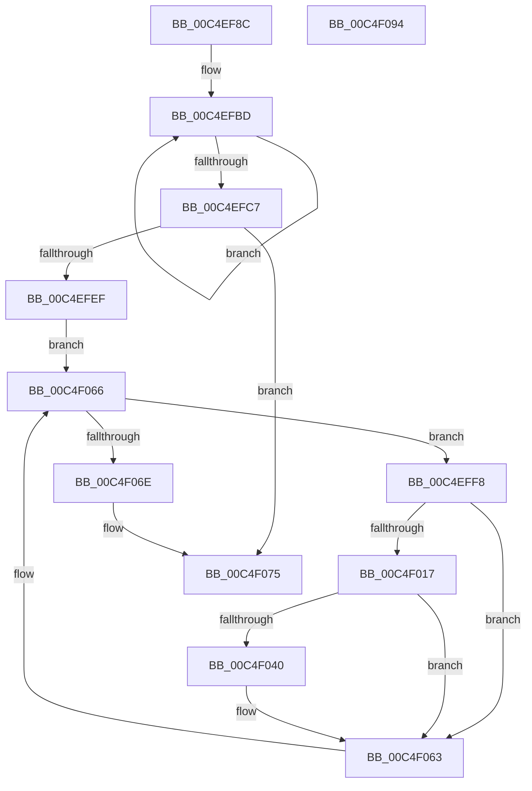

# EtwpEnableBootLoggerRegistryProviders

- RVA: `0x00C4EF8C`–`0x00C4F095` (길이 `265` bytes)
- VA: `0x0000000140C4EF8C`
- 실행 섹션: `INIT`
- PDB 이름 있음: `예`; PDB Function 태그: `아니요`
- unwind 정보 RVA: `0x0008A668`
- 디코드: `73`개 명령, `265/265` bytes 표시
- 미해석 바이트: `0` (있으면 어셈블리에 `.byte`로 보존)

> 이 문서는 커널 이미지의 기계어와 PDB 기호를 분석해 생성했습니다. 4번과 5번은 함수 원형과 자료형을 바이너리 사용 방식에서 추정한 C 해석이며 원본 소스 복구 결과는 아닙니다.

## 1. Dependencies

- 직접 호출 지점: **7**; 고유 호출 대상: **7**
- 직접 호출자로 확인된 함수: **1**
- RIP 상대 이미지 참조: **2**

### Outgoing calls
- `0x00C4EFDE` → [ExAllocatePool2](../../poolcode/B8/ExAllocatePool2_function_00B820F0.md) (function, `0x00B820F0`)
- `0x00C4F00E` → [RtlStringCbPrintfW](../../text/40/RtlStringCbPrintfW_function_0040FB40.md) (function, `0x0040FB40`)
- `0x00C4F01F` → [RtlInitUnicodeString](../../text/42/RtlInitUnicodeString_function_0042A780.md) (function, `0x0042A780`)
- `0x00C4F033` → [EtwpAcquireLoggerContextByLoggerName](../../page/93/EtwpAcquireLoggerContextByLoggerName_function_0093283C.md) (function, `0x0093283C`)
- `0x00C4F054` → [EtwpEnableKeyProviders](../../page/7B/EtwpEnableKeyProviders_function_007BE28C.md) (function, `0x007BE28C`)
- `0x00C4F05E` → [EtwpReleaseLoggerContext](../../page/A0/EtwpReleaseLoggerContext_function_00A04160.md) (function, `0x00A04160`)
- `0x00C4F070` → [ExFreePoolWithTag](../../poolcode/B8/ExFreePoolWithTag_function_00B82870.md) (function, `0x00B82870`)

### Direct callers
- [EtwpInitializeAutoLoggers](../../page/7B/EtwpInitializeAutoLoggers_function_007BE694.md) at `0x007BE7EB`

### Static image references
- `0x00C4EFFC` → RVA `0x00C7D9D0` (` ?? ::PBOPGDP::`string'`; read)
- `0x00C4F024` → RVA `0x00FC6AA8` (`ALMOSTRO`; read)

## 2. Other-region calls and transfers

- 다른 실행 섹션으로 향하는 call: **7**
  - `0x00C4EFDE` → [ExAllocatePool2](../../poolcode/B8/ExAllocatePool2_function_00B820F0.md) (`INIT` → `POOLCODE`)
  - `0x00C4F00E` → [RtlStringCbPrintfW](../../text/40/RtlStringCbPrintfW_function_0040FB40.md) (`INIT` → `.text`)
  - `0x00C4F01F` → [RtlInitUnicodeString](../../text/42/RtlInitUnicodeString_function_0042A780.md) (`INIT` → `.text`)
  - `0x00C4F033` → [EtwpAcquireLoggerContextByLoggerName](../../page/93/EtwpAcquireLoggerContextByLoggerName_function_0093283C.md) (`INIT` → `PAGE`)
  - `0x00C4F054` → [EtwpEnableKeyProviders](../../page/7B/EtwpEnableKeyProviders_function_007BE28C.md) (`INIT` → `PAGE`)
  - `0x00C4F05E` → [EtwpReleaseLoggerContext](../../page/A0/EtwpReleaseLoggerContext_function_00A04160.md) (`INIT` → `PAGE`)
  - `0x00C4F070` → [ExFreePoolWithTag](../../poolcode/B8/ExFreePoolWithTag_function_00B82870.md) (`INIT` → `POOLCODE`)
- 별도 외부 분기/꼬리 이동을 확인하지 못했습니다.

## 3. Assembly (complete function range)

```asm
00C4EF8C  48 8B C4                        mov rax, rsp
00C4EF8F  48 89 58 08                     mov qword ptr [rax + 8], rbx
00C4EF93  48 89 68 10                     mov qword ptr [rax + 0x10], rbp
00C4EF97  48 89 70 18                     mov qword ptr [rax + 0x18], rsi
00C4EF9B  48 89 78 20                     mov qword ptr [rax + 0x20], rdi
00C4EF9F  41 54                           push r12
00C4EFA1  41 56                           push r14
00C4EFA3  41 57                           push r15
00C4EFA5  48 83 EC 40                     sub rsp, 0x40
00C4EFA9  0F 57 C0                        xorps xmm0, xmm0
00C4EFAC  48 8B FA                        mov rdi, rdx
00C4EFAF  0F 11 40 D8                     movups xmmword ptr [rax - 0x28], xmm0
00C4EFB3  48 83 C8 FF                     or rax, 0xffffffffffffffff
00C4EFB7  48 8B E9                        mov rbp, rcx
00C4EFBA  45 33 E4                        xor r12d, r12d
00C4EFBD  48 FF C0                        inc rax
00C4EFC0  66 44 39 24 41                  cmp word ptr [rcx + rax*2], r12w
00C4EFC5  75 F6                           jne 0x140c4efbd
00C4EFC7  8D 04 45 04 01 00 00            lea eax, [rax*2 + 0x104]
00C4EFCE  41 B8 45 74 77 74               mov r8d, 0x74777445
00C4EFD4  8B D0                           mov edx, eax
00C4EFD6  B9 00 01 00 00                  mov ecx, 0x100
00C4EFDB  44 8B F8                        mov r15d, eax
00C4EFDE  E8 0D 31 F3 FF                  call 0x140b820f0
00C4EFE3  48 8B F0                        mov rsi, rax
00C4EFE6  48 85 C0                        test rax, rax
00C4EFE9  0F 84 86 00 00 00               je 0x140c4f075
00C4EFEF  48 83 C7 08                     add rdi, 8
00C4EFF3  48 8B 1F                        mov rbx, qword ptr [rdi]
00C4EFF6  EB 6E                           jmp 0x140c4f066
00C4EFF8  4C 8B 73 10                     mov r14, qword ptr [rbx + 0x10]
00C4EFFC  4C 8D 05 CD E9 02 00            lea r8, [rip + 0x2e9cd]
00C4F003  4C 8B CD                        mov r9, rbp
00C4F006  4C 89 74 24 20                  mov qword ptr [rsp + 0x20], r14
00C4F00B  49 8B D7                        mov rdx, r15
00C4F00E  E8 2D 0B 7C FF                  call 0x14040fb40
00C4F013  85 C0                           test eax, eax
00C4F015  75 4C                           jne 0x140c4f063
00C4F017  49 8B D6                        mov rdx, r14
00C4F01A  48 8D 4C 24 30                  lea rcx, [rsp + 0x30]
00C4F01F  E8 5C B7 7D FF                  call 0x14042a780
00C4F024  48 8B 0D 7D 7A 37 00            mov rcx, qword ptr [rip + 0x377a7d]
00C4F02B  48 8D 54 24 30                  lea rdx, [rsp + 0x30]
00C4F030  45 33 C0                        xor r8d, r8d
00C4F033  E8 04 38 CE FF                  call 0x14093283c
00C4F038  4C 8B F0                        mov r14, rax
00C4F03B  48 85 C0                        test rax, rax
00C4F03E  74 23                           je 0x140c4f063
00C4F040  8B 10                           mov edx, dword ptr [rax]
00C4F042  45 33 C9                        xor r9d, r9d
00C4F045  48 8B 88 50 05 00 00            mov rcx, qword ptr [rax + 0x550]
00C4F04C  4C 8B C6                        mov r8, rsi
00C4F04F  44 89 64 24 20                  mov dword ptr [rsp + 0x20], r12d
00C4F054  E8 33 F2 B6 FF                  call 0x1407be28c
00C4F059  33 D2                           xor edx, edx
00C4F05B  49 8B CE                        mov rcx, r14
00C4F05E  E8 FD 50 DB FF                  call 0x140a04160
00C4F063  48 8B 1B                        mov rbx, qword ptr [rbx]
00C4F066  48 8B CE                        mov rcx, rsi
00C4F069  48 3B DF                        cmp rbx, rdi
00C4F06C  75 8A                           jne 0x140c4eff8
00C4F06E  33 D2                           xor edx, edx
00C4F070  E8 FB 37 F3 FF                  call 0x140b82870
00C4F075  48 8B 5C 24 60                  mov rbx, qword ptr [rsp + 0x60]
00C4F07A  48 8B 6C 24 68                  mov rbp, qword ptr [rsp + 0x68]
00C4F07F  48 8B 74 24 70                  mov rsi, qword ptr [rsp + 0x70]
00C4F084  48 8B 7C 24 78                  mov rdi, qword ptr [rsp + 0x78]
00C4F089  48 83 C4 40                     add rsp, 0x40
00C4F08D  41 5F                           pop r15
00C4F08F  41 5E                           pop r14
00C4F091  41 5C                           pop r12
00C4F093  C3                              ret
00C4F094  CC                              int3
```

## 4. C-style interpretation (structured pseudocode)

```c
__int64 __fastcall EtwpEnableBootLoggerRegistryProviders(__int64 a1, __int64 a2)
{
    __int64 result;
    __int64 v_r12;
    __int64 v_rdi;
    __int64 v_rsp;
    unsigned __int64 v_stack_m28;
    unsigned __int64 v_stack_m38;
    unsigned __int64 v_stack_p10;
    unsigned __int64 v_stack_p18;
    unsigned __int64 v_stack_p20;
    unsigned __int64 v_stack_p8;

    *(unsigned __int64 *)(v_rsp + 8) = v_rbx;
    *(unsigned __int64 *)(v_rsp + 16) = v_rbp;
    *(unsigned __int64 *)(v_rsp + 24) = v_rsi;
    *(unsigned __int64 *)(v_rsp + 32) = v_rdi;
    v_rsp = (v_rsp) - (64);
    *(unsigned __int64 *)(v_rsp - 40) = v_xmm0;
    result = (v_rsp) | (-1);
    v_r12 = 0;
loc_00C4EFBD:
    result = (result) + 1;
    if ((*(unsigned __int16 *)(a1 + result * 2)) != 0) goto loc_00C4EFBD;
    result = ExAllocatePool2(256, (unsigned int)((unsigned int)(result * 2 + 260)), (unsigned int)(0x74777445ULL), a4);
    if (result == 0) goto loc_00C4F075;
    v_rdi = (a2) + (8);
    goto loc_00C4F066;
loc_00C4EFF8:
    v_stack_m38 = *(unsigned __int64 *)(*(unsigned __int64 *)(v_rdi) + 16);
    result = RtlStringCbPrintfW(256, (unsigned int)((unsigned int)(result * 2 + 260)), v_rip + 190925, a1);
    if ((unsigned int)(result) != 0) goto loc_00C4F063;
    result = RtlInitUnicodeString(v_stack_m28, *(unsigned __int64 *)(*(unsigned __int64 *)(v_rdi) + 16), v_rip + 190925, a1);
    a3 = 0;
    result = EtwpAcquireLoggerContextByLoggerName(*(unsigned __int64 *)(v_rip + 3635837), v_stack_m28, a3, a1);
    if (result != 0) {
        a2 = *(unsigned int *)(result);
        a4 = 0;
        a1 = *(unsigned __int64 *)(result + 1360);
        a3 = result;
        v_stack_m38 = 0;
        result = EtwpEnableKeyProviders(a1, a2, a3, a4);
        a2 = 0;
        a1 = result;
        result = EtwpReleaseLoggerContext(a1, a2, a3, a4);
    }
loc_00C4F066:
    if ((*(unsigned __int64 *)(*(unsigned __int64 *)(v_rdi))) != v_rdi) goto loc_00C4EFF8;
    a2 = 0;
    result = ExFreePoolWithTag(result, a2, a3, a4);
loc_00C4F075:
    v_rsp = (v_rsp) + (64);
    return result;
}
```

## 5. (Beta) C Style

```c
int64_t EtwpEnableBootLoggerRegistryProviders(void *Arg1, void *Arg2)
{
    uint8_t *arg1 = (uint8_t *)Arg1;
    uint8_t *arg2 = (uint8_t *)Arg2;

    int64_t result;
    int64_t local_r12;
    int64_t local_rdi;
    int64_t local_rsp;
    uint64_t v_stack_m28;
    uint64_t v_stack_m38;
    uint64_t v_stack_p10;
    uint64_t v_stack_p18;
    uint64_t v_stack_p20;
    uint64_t v_stack_p8;

    *(uint64_t *)(local_rsp + 0x8) = local_rbx;
    *(uint64_t *)(local_rsp + 0x10) = local_rbp;
    *(uint64_t *)(local_rsp + 0x18) = local_rsi;
    *(uint64_t *)(local_rsp + 0x20) = local_rdi;
    local_rsp = (local_rsp) - (64);
    *(uint64_t *)(local_rsp - 0x28) = v_xmm0;
    result = (local_rsp) | (-1);
    local_r12 = 0;
loc_00C4EFBD:
    result = (result) + 1;
    if ((*(uint16_t *)(arg1 + result * 2)) != 0) goto loc_00C4EFBD;
    result = ExAllocatePool2(256, (uint32_t)((uint32_t)(result * 2 + 260)), (uint32_t)(0x74777445ULL), a4);
    if (result == 0) goto loc_00C4F075;
    local_rdi = (Arg2) + (8);
    goto loc_00C4F066;
loc_00C4EFF8:
    v_stack_m38 = *(uint64_t *)(*(uint64_t *)(local_rdi) + 0x10);
    result = RtlStringCbPrintfW(256, (uint32_t)((uint32_t)(result * 2 + 260)), v_rip + 190925, Arg1);
    if ((uint32_t)(result) != 0) goto loc_00C4F063;
    result = RtlInitUnicodeString(v_stack_m28, *(uint64_t *)(*(uint64_t *)(local_rdi) + 0x10), v_rip + 190925, Arg1);
    a3 = 0;
    result = EtwpAcquireLoggerContextByLoggerName(*(uint64_t *)(v_rip + 0x377A7D), v_stack_m28, a3, Arg1);
    if (result != 0) {
        Arg2 = *(uint32_t *)(result);
        a4 = 0;
        Arg1 = *(uint64_t *)(result + 0x550);
        a3 = result;
        v_stack_m38 = 0;
        result = EtwpEnableKeyProviders(Arg1, Arg2, a3, a4);
        Arg2 = 0;
        Arg1 = result;
        result = EtwpReleaseLoggerContext(Arg1, Arg2, a3, a4);
    }
loc_00C4F066:
    if ((*(uint64_t *)(*(uint64_t *)(local_rdi))) != local_rdi) goto loc_00C4EFF8;
    Arg2 = 0;
    result = ExFreePoolWithTag(result, Arg2, a3, a4);
loc_00C4F075:
    local_rsp = (local_rsp) + (64);
    return result;
}
```

### 관측된 메모리 오프셋

구조체 형식이 확인되지 않은 접근은 인자 기준의 오프셋으로만 기록했습니다.

| 기준 인자 | 오프셋 표현 | 폭 (bit) | 접근 |
|---|---:|---:|---|
| `Arg1` | `+ 0x0 + rax*2` | `16` | `R` |
| `Arg2` | `+ 0x0` | `64` | `R` |

## 6. Execution-region graph

[열기: 2D/3D 그래프와 함수 탐색 컨트롤 패널](../../../control-panel.html?section=init&rva=0x00C4EF8C&view=graph)

- 2D 그래프는 위에서 아래로 흐르고, 3D 그래프는 빈 공간을 드래그해 회전합니다. Shift+드래그는 이동, 휠은 확대·축소, 함수 노드 선택은 대상 보고서 이동입니다.

### Static fallback


