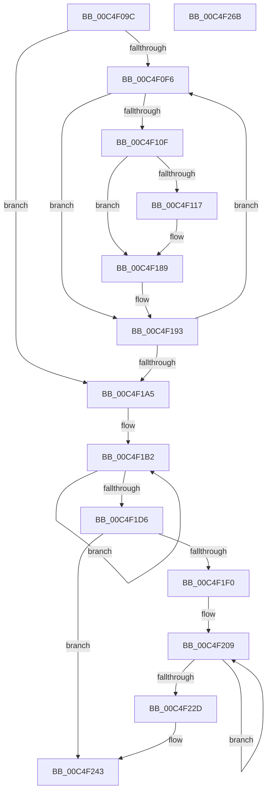

# EtwpFixBootLoggers

- RVA: `0x00C4F09C`–`0x00C4F26C` (길이 `464` bytes)
- VA: `0x0000000140C4F09C`
- 실행 섹션: `INIT`
- PDB 이름 있음: `예`; PDB Function 태그: `아니요`
- unwind 정보 RVA: `0x000CD018`
- 디코드: `112`개 명령, `464/464` bytes 표시
- 미해석 바이트: `0` (있으면 어셈블리에 `.byte`로 보존)

> 이 문서는 커널 이미지의 기계어와 PDB 기호를 분석해 생성했습니다. 4번과 5번은 함수 원형과 자료형을 바이너리 사용 방식에서 추정한 C 해석이며 원본 소스 복구 결과는 아닙니다.

## 1. Dependencies

- 직접 호출 지점: **11**; 고유 호출 대상: **11**
- 직접 호출자로 확인된 함수: **1**
- RIP 상대 이미지 참조: **7**

### Outgoing calls
- `0x00C4F0FE` → [EtwpAcquireLoggerContextByLoggerId](../../page/93/EtwpAcquireLoggerContextByLoggerId_function_00932920.md) (function, `0x00932920`)
- `0x00C4F122` → [EtwpGetSecurityDescriptorByGuid](../../page/8C/EtwpGetSecurityDescriptorByGuid_function_008C04C0.md) (function, `0x008C04C0`)
- `0x00C4F12E` → [EtwpInitializeLoggerSecurityDescriptor](../../page/AA/EtwpInitializeLoggerSecurityDescriptor_function_00AA7590.md) (function, `0x00AA7590`)
- `0x00C4F137` → [EtwpFreeSecurityDescriptor](../../page/A1/EtwpFreeSecurityDescriptor_function_00A1E7DC.md) (function, `0x00A1E7DC`)
- `0x00C4F164` → [SeCreateClientSecurity](../../page/89/SeCreateClientSecurity_function_008911B0.md) (function, `0x008911B0`)
- `0x00C4F184` → [EtwpStartLoggerThread](../../text/4B/EtwpStartLoggerThread_function_004B25C4.md) (function, `0x004B25C4`)
- `0x00C4F18E` → [EtwpReleaseLoggerContext](../../page/A0/EtwpReleaseLoggerContext_function_00A04160.md) (function, `0x00A04160`)
- `0x00C4F1E7` → [EtwpEnableKernelTrace](../../page/A4/EtwpEnableKernelTrace_function_00A4FBCC.md) (function, `0x00A4FBCC`)
- `0x00C4F204` → [KeWaitForSingleObject](../../text/20/KeWaitForSingleObject_function_0020E6B0.md) (function, `0x0020E6B0`)
- `0x00C4F23E` → [KeReleaseMutant](../../text/39/KeReleaseMutant_function_003967D0.md) (function, `0x003967D0`)
- `0x00C4F24C` → [_security_check_cookie](../../text/6A/_security_check_cookie_function_006AC640.md) (function, `0x006AC640`)

### Direct callers
- [EtwpInitialize](EtwpInitialize_function_00C4DBCC.md) at `0x00C4DE74`

### Static image references
- `0x00C4F0B7` → RVA `0x00E0A740` (`.data`; read)
- `0x00C4F0D3` → RVA `0x00FC6AA8` (`ALMOSTRO`; read)
- `0x00C4F173` → RVA `0x00EFFA00` (`.data`; read)
- `0x00C4F1A8` → RVA `0x00FC6B00` (`ALMOSTRO`; read)
- `0x00C4F1B2` → RVA `0x00FC7538` (`ALMOSTRO`; read)
- `0x00C4F1FB` → RVA `0x00EFF7A0` (`.data`; read)
- `0x00C4F214` → RVA `0x00010850` (`.rdata`; read)

## 2. Other-region calls and transfers

- 다른 실행 섹션으로 향하는 call: **11**
  - `0x00C4F0FE` → [EtwpAcquireLoggerContextByLoggerId](../../page/93/EtwpAcquireLoggerContextByLoggerId_function_00932920.md) (`INIT` → `PAGE`)
  - `0x00C4F122` → [EtwpGetSecurityDescriptorByGuid](../../page/8C/EtwpGetSecurityDescriptorByGuid_function_008C04C0.md) (`INIT` → `PAGE`)
  - `0x00C4F12E` → [EtwpInitializeLoggerSecurityDescriptor](../../page/AA/EtwpInitializeLoggerSecurityDescriptor_function_00AA7590.md) (`INIT` → `PAGE`)
  - `0x00C4F137` → [EtwpFreeSecurityDescriptor](../../page/A1/EtwpFreeSecurityDescriptor_function_00A1E7DC.md) (`INIT` → `PAGE`)
  - `0x00C4F164` → [SeCreateClientSecurity](../../page/89/SeCreateClientSecurity_function_008911B0.md) (`INIT` → `PAGE`)
  - `0x00C4F184` → [EtwpStartLoggerThread](../../text/4B/EtwpStartLoggerThread_function_004B25C4.md) (`INIT` → `.text`)
  - `0x00C4F18E` → [EtwpReleaseLoggerContext](../../page/A0/EtwpReleaseLoggerContext_function_00A04160.md) (`INIT` → `PAGE`)
  - `0x00C4F1E7` → [EtwpEnableKernelTrace](../../page/A4/EtwpEnableKernelTrace_function_00A4FBCC.md) (`INIT` → `PAGE`)
  - `0x00C4F204` → [KeWaitForSingleObject](../../text/20/KeWaitForSingleObject_function_0020E6B0.md) (`INIT` → `.text`)
  - `0x00C4F23E` → [KeReleaseMutant](../../text/39/KeReleaseMutant_function_003967D0.md) (`INIT` → `.text`)
  - `0x00C4F24C` → [_security_check_cookie](../../text/6A/_security_check_cookie_function_006AC640.md) (`INIT` → `.text`)
- 별도 외부 분기/꼬리 이동을 확인하지 못했습니다.

## 3. Assembly (complete function range)

```asm
00C4F09C  48 8B C4                        mov rax, rsp
00C4F09F  48 89 58 08                     mov qword ptr [rax + 8], rbx
00C4F0A3  48 89 70 10                     mov qword ptr [rax + 0x10], rsi
00C4F0A7  48 89 78 18                     mov qword ptr [rax + 0x18], rdi
00C4F0AB  4C 89 70 20                     mov qword ptr [rax + 0x20], r14
00C4F0AF  55                              push rbp
00C4F0B0  48 8B EC                        mov rbp, rsp
00C4F0B3  48 83 EC 70                     sub rsp, 0x70
00C4F0B7  48 8B 05 82 B6 1B 00            mov rax, qword ptr [rip + 0x1bb682]
00C4F0BE  48 33 C4                        xor rax, rsp
00C4F0C1  48 89 45 F8                     mov qword ptr [rbp - 8], rax
00C4F0C5  33 C0                           xor eax, eax
00C4F0C7  33 DB                           xor ebx, ebx
00C4F0C9  0F 57 C0                        xorps xmm0, xmm0
00C4F0CC  48 89 45 C0                     mov qword ptr [rbp - 0x40], rax
00C4F0D0  89 45 C8                        mov dword ptr [rbp - 0x38], eax
00C4F0D3  48 8B 05 CE 79 37 00            mov rax, qword ptr [rip + 0x3779ce]
00C4F0DA  8D 7B 04                        lea edi, [rbx + 4]
00C4F0DD  48 89 5D D0                     mov qword ptr [rbp - 0x30], rbx
00C4F0E1  0F 11 45 D8                     movups xmmword ptr [rbp - 0x28], xmm0
00C4F0E5  44 8D 73 02                     lea r14d, [rbx + 2]
00C4F0E9  0F 11 45 E8                     movups xmmword ptr [rbp - 0x18], xmm0
00C4F0ED  39 78 10                        cmp dword ptr [rax + 0x10], edi
00C4F0F0  0F 86 AF 00 00 00               jbe 0x140c4f1a5
00C4F0F6  45 33 C0                        xor r8d, r8d
00C4F0F9  8B D7                           mov edx, edi
00C4F0FB  48 8B C8                        mov rcx, rax
00C4F0FE  E8 1D 38 CE FF                  call 0x140932920
00C4F103  48 8B F0                        mov rsi, rax
00C4F106  48 85 C0                        test rax, rax
00C4F109  0F 84 84 00 00 00               je 0x140c4f193
00C4F10F  39 98 30 03 00 00               cmp dword ptr [rax + 0x330], ebx
00C4F115  7D 72                           jge 0x140c4f189
00C4F117  48 8D 88 14 01 00 00            lea rcx, [rax + 0x114]
00C4F11E  48 8D 55 D0                     lea rdx, [rbp - 0x30]
00C4F122  E8 99 13 C7 FF                  call 0x1408c04c0
00C4F127  48 8B 55 D0                     mov rdx, qword ptr [rbp - 0x30]
00C4F12B  48 8B CE                        mov rcx, rsi
00C4F12E  E8 5D 84 E5 FF                  call 0x140aa7590
00C4F133  48 8D 4D D0                     lea rcx, [rbp - 0x30]
00C4F137  E8 A0 F6 DC FF                  call 0x140a1e7dc
00C4F13C  65 48 8B 0C 25 88 01 00 00      mov rcx, qword ptr gs:[0x188]
00C4F145  4C 8D 8E C0 02 00 00            lea r9, [rsi + 0x2c0]
00C4F14C  45 33 C0                        xor r8d, r8d
00C4F14F  C7 45 C0 0C 00 00 00            mov dword ptr [rbp - 0x40], 0xc
00C4F156  48 8D 55 C0                     lea rdx, [rbp - 0x40]
00C4F15A  44 89 75 C4                     mov dword ptr [rbp - 0x3c], r14d
00C4F15E  66 C7 45 C8 01 01               mov word ptr [rbp - 0x38], 0x101
00C4F164  E8 47 20 C4 FF                  call 0x1408911b0
00C4F169  48 8B 8E 50 05 00 00            mov rcx, qword ptr [rsi + 0x550]
00C4F170  48 8B D6                        mov rdx, rsi
00C4F173  48 8B 05 86 08 2B 00            mov rax, qword ptr [rip + 0x2b0886]
00C4F17A  48 89 86 30 01 00 00            mov qword ptr [rsi + 0x130], rax
00C4F181  48 8B 09                        mov rcx, qword ptr [rcx]
00C4F184  E8 3B 34 86 FF                  call 0x1404b25c4
00C4F189  33 D2                           xor edx, edx
00C4F18B  48 8B CE                        mov rcx, rsi
00C4F18E  E8 CD 4F DB FF                  call 0x140a04160
00C4F193  48 8B 05 0E 79 37 00            mov rax, qword ptr [rip + 0x37790e]
00C4F19A  FF C7                           inc edi
00C4F19C  3B 78 10                        cmp edi, dword ptr [rax + 0x10]
00C4F19F  0F 82 51 FF FF FF               jb 0x140c4f0f6
00C4F1A5  48 8B C3                        mov rax, rbx
00C4F1A8  48 8D 3D 51 79 37 00            lea rdi, [rip + 0x377951]
00C4F1AF  49 8B CE                        mov rcx, r14
00C4F1B2  48 8D 15 7F 83 37 00            lea rdx, [rip + 0x37837f]
00C4F1B9  F3 0F 6F 0C 10                  movdqu xmm1, xmmword ptr [rax + rdx]
00C4F1BE  F3 0F 6F 04 38                  movdqu xmm0, xmmword ptr [rax + rdi]
00C4F1C3  48 8D 40 10                     lea rax, [rax + 0x10]
00C4F1C7  0F 54 C8                        andps xmm1, xmm0
00C4F1CA  F3 0F 7F 4C 05 C8               movdqu xmmword ptr [rbp + rax - 0x38], xmm1
00C4F1D0  48 83 E9 01                     sub rcx, 1
00C4F1D4  75 DC                           jne 0x140c4f1b2
00C4F1D6  4C 8B 05 CB 78 37 00            mov r8, qword ptr [rip + 0x3778cb]
00C4F1DD  48 8D 55 D8                     lea rdx, [rbp - 0x28]
00C4F1E1  45 33 C9                        xor r9d, r9d
00C4F1E4  48 8B CF                        mov rcx, rdi
00C4F1E7  E8 E0 09 E0 FF                  call 0x140a4fbcc
00C4F1EC  85 C0                           test eax, eax
00C4F1EE  79 53                           jns 0x140c4f243
00C4F1F0  45 33 C9                        xor r9d, r9d
00C4F1F3  48 89 5C 24 20                  mov qword ptr [rsp + 0x20], rbx
00C4F1F8  45 33 C0                        xor r8d, r8d
00C4F1FB  48 8D 0D 9E 05 2B 00            lea rcx, [rip + 0x2b059e]
00C4F202  33 D2                           xor edx, edx
00C4F204  E8 A7 F4 5B FF                  call 0x14020e6b0
00C4F209  F3 0F 6F 04 3B                  movdqu xmm0, xmmword ptr [rbx + rdi]
00C4F20E  F3 0F 6F 4C 1D D8               movdqu xmm1, xmmword ptr [rbp + rbx - 0x28]
00C4F214  0F 55 0D 35 16 3C FF            andnps xmm1, xmmword ptr [rip - 0xc3e9cb]
00C4F21B  0F 54 C8                        andps xmm1, xmm0
00C4F21E  F3 0F 7F 0C 3B                  movdqu xmmword ptr [rbx + rdi], xmm1
00C4F223  48 8D 5B 10                     lea rbx, [rbx + 0x10]
00C4F227  49 83 EE 01                     sub r14, 1
00C4F22B  75 DC                           jne 0x140c4f209
00C4F22D  45 33 C9                        xor r9d, r9d
00C4F230  41 8D 56 01                     lea edx, [r14 + 1]
00C4F234  45 33 C0                        xor r8d, r8d
00C4F237  48 8D 0D 62 05 2B 00            lea rcx, [rip + 0x2b0562]
00C4F23E  E8 8D 75 74 FF                  call 0x1403967d0
00C4F243  33 C0                           xor eax, eax
00C4F245  48 8B 4D F8                     mov rcx, qword ptr [rbp - 8]
00C4F249  48 33 CC                        xor rcx, rsp
00C4F24C  E8 EF D3 A5 FF                  call 0x1406ac640
00C4F251  4C 8D 5C 24 70                  lea r11, [rsp + 0x70]
00C4F256  49 8B 5B 10                     mov rbx, qword ptr [r11 + 0x10]
00C4F25A  49 8B 73 18                     mov rsi, qword ptr [r11 + 0x18]
00C4F25E  49 8B 7B 20                     mov rdi, qword ptr [r11 + 0x20]
00C4F262  4D 8B 73 28                     mov r14, qword ptr [r11 + 0x28]
00C4F266  49 8B E3                        mov rsp, r11
00C4F269  5D                              pop rbp
00C4F26A  C3                              ret
00C4F26B  CC                              int3
```

## 4. C-style interpretation (structured pseudocode)

```c
__int64 __fastcall EtwpFixBootLoggers(__int64 a1, __int64 a2, int a3)
{
    __int64 result;
    __int64 v_r14;
    __int64 v_rbx;
    __int64 v_rdi;
    __int64 v_rsp;
    unsigned __int64 v_stack_m10;
    unsigned __int64 v_stack_m20;
    unsigned __int64 v_stack_m30;
    unsigned __int64 v_stack_m38;
    unsigned int v_stack_m40;
    unsigned int v_stack_m44;
    unsigned __int64 v_stack_m48;
    unsigned __int64 v_stack_m58;
    unsigned __int64 v_stack_m8;

    *(unsigned __int64 *)(v_rsp + 8) = v_rbx;
    *(unsigned __int64 *)(v_rsp + 16) = v_rsi;
    *(unsigned __int64 *)(v_rsp + 24) = v_rdi;
    *(unsigned __int64 *)(v_rsp + 32) = v_r14;
    v_rsp = (v_rsp) - (112);
    result = (*(unsigned __int64 *)(v_rip + 1816194)) ^ (v_rsp);
    v_stack_m10 = result;
    result = 0;
    v_rbx = 0;
    v_stack_m48 = 0;
    v_stack_m40 = 0;
    v_stack_m38 = 0;
    v_stack_m30 = v_xmm0;
    v_stack_m20 = v_xmm0;
    if ((*(unsigned int *)(*(unsigned __int64 *)(v_rip + 3635662) + 16)) <= ((unsigned int)(v_rbx + 4))) goto loc_00C4F1A5;
loc_00C4F0F6:
    a3 = 0;
    result = EtwpAcquireLoggerContextByLoggerId(*(unsigned __int64 *)(v_rip + 3635662), (unsigned int)((unsigned int)(v_rbx + 4)), a3, a4);
    if (result == 0) goto loc_00C4F193;
    if ((*(unsigned int *)(result + 816)) < 0) {
        a1 = result + 276;
        a2 = v_stack_m38;
        result = EtwpGetSecurityDescriptorByGuid(a1, a2, a3, a4);
        a2 = v_stack_m38;
        a1 = result;
        result = EtwpInitializeLoggerSecurityDescriptor(a1, a2, a3, a4);
        a1 = v_stack_m38;
        result = EtwpFreeSecurityDescriptor(a1, a2, a3, a4);
        a1 = *(unsigned __int64 *)(gs_base + (0 + 392));
        a4 = result + 704;
        a3 = 0;
        v_stack_m48 = 12;
        a2 = v_stack_m48;
        v_stack_m44 = (unsigned int)(v_rbx + 2);
        v_stack_m40 = 257;
        result = SeCreateClientSecurity(a1, a2, a3, a4);
        a1 = *(unsigned __int64 *)(result + 1360);
        a2 = result;
        result = *(unsigned __int64 *)(v_rip + 2820230);
        *(unsigned __int64 *)(result + 304) = result;
        a1 = *(unsigned __int64 *)(a1);
        result = EtwpStartLoggerThread(a1, a2, a3, a4);
    }
    a2 = 0;
    result = EtwpReleaseLoggerContext(result, a2, a3, a4);
loc_00C4F193:
    v_rdi = (unsigned int)((v_rbx + 4) + 1);
    if (((unsigned int)(v_rdi)) < (*(unsigned int *)(*(unsigned __int64 *)(v_rip + 3635470) + 16))) goto loc_00C4F0F6;
loc_00C4F1A5:
loc_00C4F1B2:
    *(unsigned __int64 *)(v_rsp + 0 + 16 * 1 - 56) = v_xmm1;
    a1 = (v_rbx + 2) - (1);
    if (condition_is_not_equal) goto loc_00C4F1B2;
    a4 = 0;
    result = EtwpEnableKernelTrace(v_rip + 3635537, v_stack_m30, *(unsigned __int64 *)(v_rip + 3635403), a4);
    if (!sign_flag) goto loc_00C4F243;
    a4 = 0;
    v_stack_m58 = 0;
    a3 = 0;
    a2 = 0;
    result = KeWaitForSingleObject(v_rip + 2819486, a2, a3, a4);
loc_00C4F209:
    *(unsigned __int64 *)(v_rbx + v_rip + 3635537 * 1) = v_xmm1;
    v_r14 = (v_rbx + 2) - (1);
    if (condition_is_not_equal) goto loc_00C4F209;
    a4 = 0;
    a3 = 0;
    result = KeReleaseMutant(v_rip + 2819426, v_r14 + 1, a3, a4);
loc_00C4F243:
    result = 0;
    a1 = (v_stack_m10) ^ (v_rsp);
    result = _security_check_cookie(a1, v_r14 + 1, a3, a4);
    return result;
}
```

## 5. (Beta) C Style

```c
int64_t EtwpFixBootLoggers(int64_t Arg1, int64_t Arg2, int32_t Arg3)
{
    int64_t result;
    int64_t local_r14;
    int64_t local_rbx;
    int64_t local_rdi;
    int64_t local_rsp;
    uint64_t v_stack_m10;
    uint64_t v_stack_m20;
    uint64_t v_stack_m30;
    uint64_t v_stack_m38;
    uint32_t v_stack_m40;
    uint32_t v_stack_m44;
    uint64_t v_stack_m48;
    uint64_t v_stack_m58;
    uint64_t v_stack_m8;

    *(uint64_t *)(local_rsp + 0x8) = local_rbx;
    *(uint64_t *)(local_rsp + 0x10) = local_rsi;
    *(uint64_t *)(local_rsp + 0x18) = local_rdi;
    *(uint64_t *)(local_rsp + 0x20) = local_r14;
    local_rsp = (local_rsp) - (112);
    result = (*(uint64_t *)(v_rip + 0x1BB682)) ^ (local_rsp);
    v_stack_m10 = result;
    result = 0;
    local_rbx = 0;
    v_stack_m48 = 0;
    v_stack_m40 = 0;
    v_stack_m38 = 0;
    v_stack_m30 = v_xmm0;
    v_stack_m20 = v_xmm0;
    if ((*(uint32_t *)(*(uint64_t *)(v_rip + 0x3779CE) + 0x10)) <= ((uint32_t)(local_rbx + 4))) goto loc_00C4F1A5;
loc_00C4F0F6:
    Arg3 = 0;
    result = EtwpAcquireLoggerContextByLoggerId(*(uint64_t *)(v_rip + 0x3779CE), (uint32_t)((uint32_t)(local_rbx + 4)), Arg3, a4);
    if (result == 0) goto loc_00C4F193;
    if ((*(uint32_t *)(result + 0x330)) < 0) {
        Arg1 = result + 276;
        Arg2 = v_stack_m38;
        result = EtwpGetSecurityDescriptorByGuid(Arg1, Arg2, Arg3, a4);
        Arg2 = v_stack_m38;
        Arg1 = result;
        result = EtwpInitializeLoggerSecurityDescriptor(Arg1, Arg2, Arg3, a4);
        Arg1 = v_stack_m38;
        result = EtwpFreeSecurityDescriptor(Arg1, Arg2, Arg3, a4);
        Arg1 = *(uint64_t *)(gs_base + (0 + 0x188));
        a4 = result + 704;
        Arg3 = 0;
        v_stack_m48 = 12;
        Arg2 = v_stack_m48;
        v_stack_m44 = (uint32_t)(local_rbx + 2);
        v_stack_m40 = 257;
        result = SeCreateClientSecurity(Arg1, Arg2, Arg3, a4);
        Arg1 = *(uint64_t *)(result + 0x550);
        Arg2 = result;
        result = *(uint64_t *)(v_rip + 0x2B0886);
        *(uint64_t *)(result + 0x130) = result;
        Arg1 = *(uint64_t *)(Arg1);
        result = EtwpStartLoggerThread(Arg1, Arg2, Arg3, a4);
    }
    Arg2 = 0;
    result = EtwpReleaseLoggerContext(result, Arg2, Arg3, a4);
loc_00C4F193:
    local_rdi = (uint32_t)((local_rbx + 4) + 1);
    if (((uint32_t)(local_rdi)) < (*(uint32_t *)(*(uint64_t *)(v_rip + 0x37790E) + 0x10))) goto loc_00C4F0F6;
loc_00C4F1A5:
loc_00C4F1B2:
    *(uint64_t *)(local_rsp + 0x0 + 0x10 * 1 - 0x38) = v_xmm1;
    Arg1 = (local_rbx + 2) - (1);
    if (condition_is_not_equal) goto loc_00C4F1B2;
    a4 = 0;
    result = EtwpEnableKernelTrace(v_rip + 3635537, v_stack_m30, *(uint64_t *)(v_rip + 0x3778CB), a4);
    if (!sign_flag) goto loc_00C4F243;
    a4 = 0;
    v_stack_m58 = 0;
    Arg3 = 0;
    Arg2 = 0;
    result = KeWaitForSingleObject(v_rip + 2819486, Arg2, Arg3, a4);
loc_00C4F209:
    *(uint64_t *)(local_rbx + v_rip + 0x377951 * 1) = v_xmm1;
    local_r14 = (local_rbx + 2) - (1);
    if (condition_is_not_equal) goto loc_00C4F209;
    a4 = 0;
    Arg3 = 0;
    result = KeReleaseMutant(v_rip + 2819426, local_r14 + 1, Arg3, a4);
loc_00C4F243:
    result = 0;
    Arg1 = (v_stack_m10) ^ (local_rsp);
    result = _security_check_cookie(Arg1, local_r14 + 1, Arg3, a4);
    return result;
}
```

## 6. Execution-region graph

[열기: 2D/3D 그래프와 함수 탐색 컨트롤 패널](../../../control-panel.html?section=init&rva=0x00C4F09C&view=graph)

- 2D 그래프는 위에서 아래로 흐르고, 3D 그래프는 빈 공간을 드래그해 회전합니다. Shift+드래그는 이동, 휠은 확대·축소, 함수 노드 선택은 대상 보고서 이동입니다.

### Static fallback


