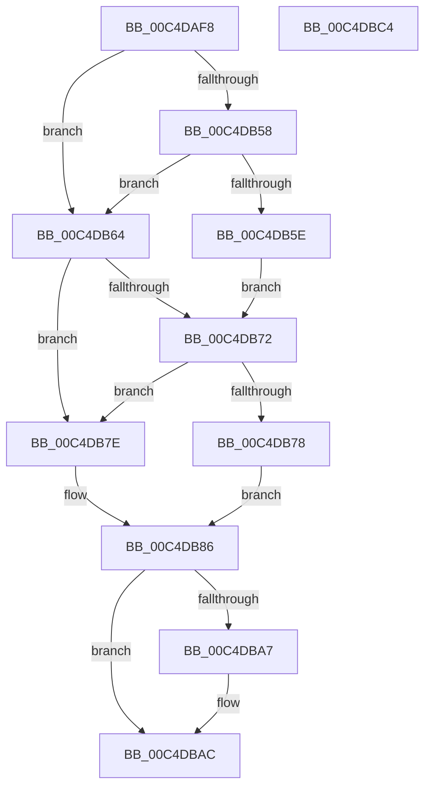

# EtwpFixBootSystemTime

- RVA: `0x00C4DAF8`–`0x00C4DBC5` (길이 `205` bytes)
- VA: `0x0000000140C4DAF8`
- 실행 섹션: `INIT`
- PDB 이름 있음: `예`; PDB Function 태그: `아니요`
- unwind 정보 RVA: `0x000C3C24`
- 디코드: `59`개 명령, `205/205` bytes 표시
- 미해석 바이트: `0` (있으면 어셈블리에 `.byte`로 보존)

> 이 문서는 커널 이미지의 기계어와 PDB 기호를 분석해 생성했습니다. 4번과 5번은 함수 원형과 자료형을 바이너리 사용 방식에서 추정한 C 해석이며 원본 소스 복구 결과는 아닙니다.

## 1. Dependencies

- 직접 호출 지점: **4**; 고유 호출 대상: **4**
- 직접 호출자로 확인된 함수: **1**
- RIP 상대 이미지 참조: **4**

### Outgoing calls
- `0x00C4DB2C` → [KeQueryBootTimeValues](../../text/49/KeQueryBootTimeValues_function_0049F444.md) (function, `0x0049F444`)
- `0x00C4DB4D` → [RtlGetMultiTimePrecise](../../text/4A/RtlGetMultiTimePrecise_function_004A1A30.md) (function, `0x004A1A30`)
- `0x00C4DB66` → [KeQueryPerformanceCounter](../../text/37/KeQueryPerformanceCounter_function_0037E7E0.md) (function, `0x0037E7E0`)
- `0x00C4DB7E` → [RtlGetSystemTimePrecise](../../text/37/RtlGetSystemTimePrecise_function_0037EDD0.md) (function, `0x0037EDD0`)

### Direct callers
- [EtwpInitialize](EtwpInitialize_function_00C4DBCC.md) at `0x00C4DD02`

### Static image references
- `0x00C4DB17` → RVA `0x00EFFA00` (`.data`; read)
- `0x00C4DB46` → RVA `0x00EFF9E0` (`.data`; write)
- `0x00C4DB99` → RVA `0x00EFFA10` (`.data`; read)
- `0x00C4DBB5` → RVA `0x00EFFA00` (`.data`; write)

## 2. Other-region calls and transfers

- 다른 실행 섹션으로 향하는 call: **4**
  - `0x00C4DB2C` → [KeQueryBootTimeValues](../../text/49/KeQueryBootTimeValues_function_0049F444.md) (`INIT` → `.text`)
  - `0x00C4DB4D` → [RtlGetMultiTimePrecise](../../text/4A/RtlGetMultiTimePrecise_function_004A1A30.md) (`INIT` → `.text`)
  - `0x00C4DB66` → [KeQueryPerformanceCounter](../../text/37/KeQueryPerformanceCounter_function_0037E7E0.md) (`INIT` → `.text`)
  - `0x00C4DB7E` → [RtlGetSystemTimePrecise](../../text/37/RtlGetSystemTimePrecise_function_0037EDD0.md) (`INIT` → `.text`)
- 별도 외부 분기/꼬리 이동을 확인하지 못했습니다.

## 3. Assembly (complete function range)

```asm
00C4DAF8  40 55                           push rbp
00C4DAFA  53                              push rbx
00C4DAFB  57                              push rdi
00C4DAFC  48 8B EC                        mov rbp, rsp
00C4DAFF  48 83 EC 40                     sub rsp, 0x40
00C4DB03  48 83 65 28 00                  and qword ptr [rbp + 0x28], 0
00C4DB08  4C 8D 45 30                     lea r8, [rbp + 0x30]
00C4DB0C  48 83 65 30 00                  and qword ptr [rbp + 0x30], 0
00C4DB11  48 8D 55 28                     lea rdx, [rbp + 0x28]
00C4DB15  33 C0                           xor eax, eax
00C4DB17  48 8D 0D E2 1E 2B 00            lea rcx, [rip + 0x2b1ee2]
00C4DB1E  21 45 20                        and dword ptr [rbp + 0x20], eax
00C4DB21  0F 57 C0                        xorps xmm0, xmm0
00C4DB24  0F 11 45 E0                     movups xmmword ptr [rbp - 0x20], xmm0
00C4DB28  48 89 45 F0                     mov qword ptr [rbp - 0x10], rax
00C4DB2C  E8 13 19 85 FF                  call 0x14049f444
00C4DB31  48 8B 45 28                     mov rax, qword ptr [rbp + 0x28]
00C4DB35  4C 8D 45 20                     lea r8, [rbp + 0x20]
00C4DB39  48 2B 45 30                     sub rax, qword ptr [rbp + 0x30]
00C4DB3D  48 8D 4D E0                     lea rcx, [rbp - 0x20]
00C4DB41  BA 05 00 00 00                  mov edx, 5
00C4DB46  48 89 05 93 1E 2B 00            mov qword ptr [rip + 0x2b1e93], rax
00C4DB4D  E8 DE 3E 85 FF                  call 0x1404a1a30
00C4DB52  8B F8                           mov edi, eax
00C4DB54  85 C0                           test eax, eax
00C4DB56  78 0C                           js 0x140c4db64
00C4DB58  F6 45 20 01                     test byte ptr [rbp + 0x20], 1
00C4DB5C  74 06                           je 0x140c4db64
00C4DB5E  48 8B 5D E0                     mov rbx, qword ptr [rbp - 0x20]
00C4DB62  EB 0E                           jmp 0x140c4db72
00C4DB64  33 C9                           xor ecx, ecx
00C4DB66  E8 75 0C 73 FF                  call 0x14037e7e0
00C4DB6B  48 8B D8                        mov rbx, rax
00C4DB6E  85 FF                           test edi, edi
00C4DB70  78 0C                           js 0x140c4db7e
00C4DB72  F6 45 20 04                     test byte ptr [rbp + 0x20], 4
00C4DB76  74 06                           je 0x140c4db7e
00C4DB78  4C 8B 45 F0                     mov r8, qword ptr [rbp - 0x10]
00C4DB7C  EB 08                           jmp 0x140c4db86
00C4DB7E  E8 4D 12 73 FF                  call 0x14037edd0
00C4DB83  4C 8B C0                        mov r8, rax
00C4DB86  A0 69 03 00 00 80 F7 FF FF      movabs al, byte ptr [0xfffff78000000369]
00C4DB8F  48 BA 60 03 00 00 80 F7 FF FF   movabs rdx, 0xfffff78000000360
00C4DB99  48 2B 1D 70 1E 2B 00            sub rbx, qword ptr [rip + 0x2b1e70]
00C4DBA0  48 8B 12                        mov rdx, qword ptr [rdx]
00C4DBA3  84 C0                           test al, al
00C4DBA5  74 05                           je 0x140c4dbac
00C4DBA7  8A C8                           mov cl, al
00C4DBA9  48 D3 E3                        shl rbx, cl
00C4DBAC  48 8B C2                        mov rax, rdx
00C4DBAF  48 F7 E3                        mul rbx
00C4DBB2  4C 2B C2                        sub r8, rdx
00C4DBB5  4C 89 05 44 1E 2B 00            mov qword ptr [rip + 0x2b1e44], r8
00C4DBBC  48 83 C4 40                     add rsp, 0x40
00C4DBC0  5F                              pop rdi
00C4DBC1  5B                              pop rbx
00C4DBC2  5D                              pop rbp
00C4DBC3  C3                              ret
00C4DBC4  CC                              int3
```

## 4. C-style interpretation (structured pseudocode)

```c
__int64 __fastcall EtwpFixBootSystemTime(void)
{
    __int64 result;
    __int64 v_rbx;
    __int64 v_rsp;
    unsigned __int64 v_stack_m28;
    unsigned __int64 v_stack_m38;
    unsigned __int64 v_stack_p10;
    unsigned __int64 v_stack_p18;
    unsigned int v_stack_p8;

    v_rsp = (v_rsp) - (64);
    result = 0;
    v_stack_m38 = v_xmm0;
    v_stack_m28 = 0;
    result = KeQueryBootTimeValues(v_rip + 2825954, v_stack_p10, v_stack_p18, a4);
    result = (v_stack_p10) - (v_stack_p18);
    *(unsigned __int64 *)(v_rip + 2825875) = result;
    result = RtlGetMultiTimePrecise(v_stack_m38, 5, v_stack_p8, a4);
    if (sign_flag) goto loc_00C4DB64;
    if (((v_stack_p8) & (1)) == 0) goto loc_00C4DB64;
    goto loc_00C4DB72;
loc_00C4DB64:
    a1 = 0;
    result = KeQueryPerformanceCounter(a1, 5, v_stack_p8, a4);
    if (sign_flag) goto loc_00C4DB7E;
loc_00C4DB72:
    if (((v_stack_p8) & (4)) == 0) goto loc_00C4DB7E;
    goto loc_00C4DB86;
loc_00C4DB7E:
    result = RtlGetSystemTimePrecise(a1, 5, v_stack_m28, a4);
loc_00C4DB86:
    v_rbx = (result) - (*(unsigned __int64 *)(v_rip + 2825840));
    if ((unsigned __int8)(result) != 0) {
        a1 = (unsigned __int8)(result);
        v_rbx = (v_rbx) << ((unsigned __int8)(a1));
    }
    a3 = (result) - (*(unsigned __int64 *)(5));
    *(unsigned __int64 *)(v_rip + 2825796) = a3;
    v_rsp = (v_rsp) + (64);
    return *(unsigned __int64 *)(5);
}
```

## 5. (Beta) C Style

```c
void EtwpFixBootSystemTime(void)
{
    int64_t result;
    int64_t local_rbx;
    int64_t local_rsp;
    uint64_t v_stack_m28;
    uint64_t v_stack_m38;
    uint64_t v_stack_p10;
    uint64_t v_stack_p18;
    uint32_t v_stack_p8;

    local_rsp = (local_rsp) - (64);
    result = 0;
    v_stack_m38 = v_xmm0;
    v_stack_m28 = 0;
    result = KeQueryBootTimeValues(v_rip + 2825954, v_stack_p10, v_stack_p18, a4);
    result = (v_stack_p10) - (v_stack_p18);
    *(uint64_t *)(v_rip + 0x2B1E93) = result;
    result = RtlGetMultiTimePrecise(v_stack_m38, 5, v_stack_p8, a4);
    if (sign_flag) goto loc_00C4DB64;
    if (((v_stack_p8) & (1)) == 0) goto loc_00C4DB64;
    goto loc_00C4DB72;
loc_00C4DB64:
    a1 = 0;
    result = KeQueryPerformanceCounter(a1, 5, v_stack_p8, a4);
    if (sign_flag) goto loc_00C4DB7E;
loc_00C4DB72:
    if (((v_stack_p8) & (4)) == 0) goto loc_00C4DB7E;
    goto loc_00C4DB86;
loc_00C4DB7E:
    result = RtlGetSystemTimePrecise(a1, 5, v_stack_m28, a4);
loc_00C4DB86:
    local_rbx = (result) - (*(uint64_t *)(v_rip + 0x2B1E70));
    if ((uint8_t)(result) != 0) {
        a1 = (uint8_t)(result);
        local_rbx = (local_rbx) << ((uint8_t)(a1));
    }
    a3 = (result) - (*(uint64_t *)(5));
    *(uint64_t *)(v_rip + 0x2B1E44) = a3;
    local_rsp = (local_rsp) + (64);
    return *(uint64_t *)(5);
}
```

## 6. Execution-region graph

[열기: 2D/3D 그래프와 함수 탐색 컨트롤 패널](../../../control-panel.html?section=init&rva=0x00C4DAF8&view=graph)

- 2D 그래프는 위에서 아래로 흐르고, 3D 그래프는 빈 공간을 드래그해 회전합니다. Shift+드래그는 이동, 휠은 확대·축소, 함수 노드 선택은 대상 보고서 이동입니다.

### Static fallback


