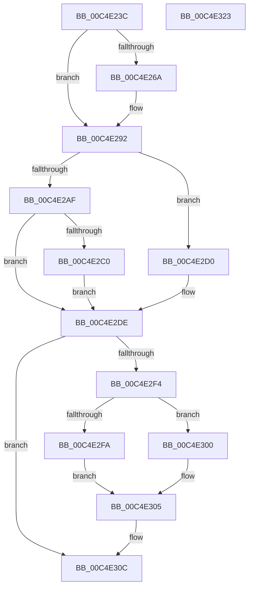

# EtwpInitializeBootTimeStamps

- RVA: `0x00C4E23C`–`0x00C4E324` (길이 `232` bytes)
- VA: `0x0000000140C4E23C`
- 실행 섹션: `INIT`
- PDB 이름 있음: `예`; PDB Function 태그: `아니요`
- unwind 정보 RVA: `0x000D3650`
- 디코드: `59`개 명령, `232/232` bytes 표시
- 미해석 바이트: `0` (있으면 어셈블리에 `.byte`로 보존)

> 이 문서는 커널 이미지의 기계어와 PDB 기호를 분석해 생성했습니다. 4번과 5번은 함수 원형과 자료형을 바이너리 사용 방식에서 추정한 C 해석이며 원본 소스 복구 결과는 아닙니다.

## 1. Dependencies

- 직접 호출 지점: **5**; 고유 호출 대상: **4**
- 직접 호출자로 확인된 함수: **1**
- RIP 상대 이미지 참조: **8**

### Outgoing calls
- `0x00C4E279` → [KeQueryBootTimeValues](../../text/49/KeQueryBootTimeValues_function_0049F444.md) (function, `0x0049F444`)
- `0x00C4E29C` → [RtlGetMultiTimePrecise](../../text/4A/RtlGetMultiTimePrecise_function_004A1A30.md) (function, `0x004A1A30`)
- `0x00C4E2D2` → [KeQueryPerformanceCounter](../../text/37/KeQueryPerformanceCounter_function_0037E7E0.md) (function, `0x0037E7E0`)
- `0x00C4E300` → [RtlGetSystemTimePrecise](../../text/37/RtlGetSystemTimePrecise_function_0037EDD0.md) (function, `0x0037EDD0`)
- `0x00C4E313` → [KeQueryPerformanceCounter](../../text/37/KeQueryPerformanceCounter_function_0037E7E0.md) (function, `0x0037E7E0`)

### Direct callers
- [EtwpInitialize](EtwpInitialize_function_00C4DBCC.md) at `0x00C4DC57`

### Static image references
- `0x00C4E272` → RVA `0x00EFFA00` (`.data`; read)
- `0x00C4E28B` → RVA `0x00EFF9E0` (`.data`; write)
- `0x00C4E2A1` → RVA `0x00EFFA18` (`.data`; read/write)
- `0x00C4E2B7` → RVA `0x00EFFA10` (`.data`; write)
- `0x00C4E2C7` → RVA `0x00EFFA18` (`.data`; write)
- `0x00C4E2E7` → RVA `0x00EFFA08` (`.data`; write)
- `0x00C4E305` → RVA `0x00EFFA00` (`.data`; write)
- `0x00C4E30C` → RVA `0x00EFF258` (`.data`; read)

## 2. Other-region calls and transfers

- 다른 실행 섹션으로 향하는 call: **5**
  - `0x00C4E279` → [KeQueryBootTimeValues](../../text/49/KeQueryBootTimeValues_function_0049F444.md) (`INIT` → `.text`)
  - `0x00C4E29C` → [RtlGetMultiTimePrecise](../../text/4A/RtlGetMultiTimePrecise_function_004A1A30.md) (`INIT` → `.text`)
  - `0x00C4E2D2` → [KeQueryPerformanceCounter](../../text/37/KeQueryPerformanceCounter_function_0037E7E0.md) (`INIT` → `.text`)
  - `0x00C4E300` → [RtlGetSystemTimePrecise](../../text/37/RtlGetSystemTimePrecise_function_0037EDD0.md) (`INIT` → `.text`)
  - `0x00C4E313` → [KeQueryPerformanceCounter](../../text/37/KeQueryPerformanceCounter_function_0037E7E0.md) (`INIT` → `.text`)
- 별도 외부 분기/꼬리 이동을 확인하지 못했습니다.

## 3. Assembly (complete function range)

```asm
00C4E23C  48 89 7C 24 20                  mov qword ptr [rsp + 0x20], rdi
00C4E241  55                              push rbp
00C4E242  48 8B EC                        mov rbp, rsp
00C4E245  48 83 EC 40                     sub rsp, 0x40
00C4E249  48 83 65 18 00                  and qword ptr [rbp + 0x18], 0
00C4E24E  33 C0                           xor eax, eax
00C4E250  21 45 10                        and dword ptr [rbp + 0x10], eax
00C4E253  0F 57 C0                        xorps xmm0, xmm0
00C4E256  48 83 65 20 00                  and qword ptr [rbp + 0x20], 0
00C4E25B  48 89 45 F0                     mov qword ptr [rbp - 0x10], rax
00C4E25F  8D 78 03                        lea edi, [rax + 3]
00C4E262  0F 11 45 E0                     movups xmmword ptr [rbp - 0x20], xmm0
00C4E266  84 C9                           test cl, cl
00C4E268  75 28                           jne 0x140c4e292
00C4E26A  4C 8D 45 20                     lea r8, [rbp + 0x20]
00C4E26E  48 8D 55 18                     lea rdx, [rbp + 0x18]
00C4E272  48 8D 0D 87 17 2B 00            lea rcx, [rip + 0x2b1787]
00C4E279  E8 C6 11 85 FF                  call 0x14049f444
00C4E27E  48 8B 45 18                     mov rax, qword ptr [rbp + 0x18]
00C4E282  BF 07 00 00 00                  mov edi, 7
00C4E287  48 2B 45 20                     sub rax, qword ptr [rbp + 0x20]
00C4E28B  48 89 05 4E 17 2B 00            mov qword ptr [rip + 0x2b174e], rax
00C4E292  4C 8D 45 10                     lea r8, [rbp + 0x10]
00C4E296  8B D7                           mov edx, edi
00C4E298  48 8D 4D E0                     lea rcx, [rbp - 0x20]
00C4E29C  E8 8F 37 85 FF                  call 0x1404a1a30
00C4E2A1  48 83 25 6F 17 2B 00 00         and qword ptr [rip + 0x2b176f], 0
00C4E2A9  F6 45 10 01                     test byte ptr [rbp + 0x10], 1
00C4E2AD  74 21                           je 0x140c4e2d0
00C4E2AF  F6 45 10 02                     test byte ptr [rbp + 0x10], 2
00C4E2B3  48 8B 45 E0                     mov rax, qword ptr [rbp - 0x20]
00C4E2B7  48 89 05 52 17 2B 00            mov qword ptr [rip + 0x2b1752], rax
00C4E2BE  74 1E                           je 0x140c4e2de
00C4E2C0  48 8B 4D E8                     mov rcx, qword ptr [rbp - 0x18]
00C4E2C4  48 2B C8                        sub rcx, rax
00C4E2C7  48 89 0D 4A 17 2B 00            mov qword ptr [rip + 0x2b174a], rcx
00C4E2CE  EB 0E                           jmp 0x140c4e2de
00C4E2D0  33 C9                           xor ecx, ecx
00C4E2D2  E8 09 05 73 FF                  call 0x14037e7e0
00C4E2D7  48 89 05 32 17 2B 00            mov qword ptr [rip + 0x2b1732], rax
00C4E2DE  0F 31                           rdtsc
00C4E2E0  48 C1 E2 20                     shl rdx, 0x20
00C4E2E4  48 0B C2                        or rax, rdx
00C4E2E7  48 89 05 1A 17 2B 00            mov qword ptr [rip + 0x2b171a], rax
00C4E2EE  40 F6 C7 04                     test dil, 4
00C4E2F2  74 18                           je 0x140c4e30c
00C4E2F4  F6 45 10 04                     test byte ptr [rbp + 0x10], 4
00C4E2F8  74 06                           je 0x140c4e300
00C4E2FA  48 8B 45 F0                     mov rax, qword ptr [rbp - 0x10]
00C4E2FE  EB 05                           jmp 0x140c4e305
00C4E300  E8 CB 0A 73 FF                  call 0x14037edd0
00C4E305  48 89 05 F4 16 2B 00            mov qword ptr [rip + 0x2b16f4], rax
00C4E30C  48 8D 0D 45 0F 2B 00            lea rcx, [rip + 0x2b0f45]
00C4E313  E8 C8 04 73 FF                  call 0x14037e7e0
00C4E318  48 8B 7C 24 68                  mov rdi, qword ptr [rsp + 0x68]
00C4E31D  48 83 C4 40                     add rsp, 0x40
00C4E321  5D                              pop rbp
00C4E322  C3                              ret
00C4E323  CC                              int3
```

## 4. C-style interpretation (structured pseudocode)

```c
__int64 __fastcall EtwpInitializeBootTimeStamps(unsigned __int8 a1)
{
    __int64 result;
    __int64 v_rdi;
    __int64 v_rsp;
    unsigned __int64 v_stack_m18;
    unsigned __int64 v_stack_m20;
    unsigned __int64 v_stack_m28;
    unsigned __int64 v_stack_p10;
    unsigned __int64 v_stack_p18;
    unsigned __int64 v_stack_p20;
    unsigned int v_stack_p8;

    v_stack_p20 = v_rdi;
    v_rsp = (v_rsp) - (64);
    result = 0;
    v_stack_m18 = 0;
    v_stack_m28 = v_xmm0;
    v_rdi = result + 3;
    if (a1 == 0) {
        a3 = v_stack_p18;
        a2 = v_stack_p10;
        a1 = v_rip + 2824071;
        result = KeQueryBootTimeValues(a1, a2, a3, a4);
        result = v_stack_p10;
        v_rdi = 7;
        result = (result) - (v_stack_p18);
        *(unsigned __int64 *)(v_rip + 2824014) = result;
    }
    result = RtlGetMultiTimePrecise(v_stack_m28, (unsigned int)((unsigned int)(v_rdi)), v_stack_p8, a4);
    if (((v_stack_p8) & (1)) == 0) goto loc_00C4E2D0;
    *(unsigned __int64 *)(v_rip + 2824018) = v_stack_m28;
    if (((v_stack_p8) & (2)) == 0) goto loc_00C4E2DE;
    a1 = (v_stack_m20) - (v_stack_m28);
    *(unsigned __int64 *)(v_rip + 2824010) = a1;
    goto loc_00C4E2DE;
loc_00C4E2D0:
    a1 = 0;
    result = KeQueryPerformanceCounter(a1, (unsigned int)((unsigned int)(v_rdi)), v_stack_p8, a4);
    *(unsigned __int64 *)(v_rip + 2823986) = result;
loc_00C4E2DE:
    a2 = ((unsigned int)((unsigned int)(v_rdi))) << (32);
    result = (result) | (a2);
    *(unsigned __int64 *)(v_rip + 2823962) = result;
    if ((((unsigned __int8)(v_rdi)) & (4)) == 0) goto loc_00C4E30C;
    if (((v_stack_p8) & (4)) == 0) goto loc_00C4E300;
    goto loc_00C4E305;
loc_00C4E300:
    result = RtlGetSystemTimePrecise(a1, a2, v_stack_p8, a4);
loc_00C4E305:
    *(unsigned __int64 *)(v_rip + 2823924) = result;
loc_00C4E30C:
    result = KeQueryPerformanceCounter(v_rip + 2821957, a2, v_stack_p8, a4);
    v_rsp = (v_rsp) + (64);
    return result;
}
```

## 5. (Beta) C Style

```c
int64_t EtwpInitializeBootTimeStamps(uint8_t Arg1)
{
    int64_t result;
    int64_t local_rdi;
    int64_t local_rsp;
    uint64_t v_stack_m18;
    uint64_t v_stack_m20;
    uint64_t v_stack_m28;
    uint64_t v_stack_p10;
    uint64_t v_stack_p18;
    uint64_t v_stack_p20;
    uint32_t v_stack_p8;

    v_stack_p20 = local_rdi;
    local_rsp = (local_rsp) - (64);
    result = 0;
    v_stack_m18 = 0;
    v_stack_m28 = v_xmm0;
    local_rdi = result + 3;
    if (Arg1 == 0) {
        a3 = v_stack_p18;
        a2 = v_stack_p10;
        Arg1 = v_rip + 2824071;
        result = KeQueryBootTimeValues(Arg1, a2, a3, a4);
        result = v_stack_p10;
        local_rdi = 7;
        result = (result) - (v_stack_p18);
        *(uint64_t *)(v_rip + 0x2B174E) = result;
    }
    result = RtlGetMultiTimePrecise(v_stack_m28, (uint32_t)((uint32_t)(local_rdi)), v_stack_p8, a4);
    if (((v_stack_p8) & (1)) == 0) goto loc_00C4E2D0;
    *(uint64_t *)(v_rip + 0x2B1752) = v_stack_m28;
    if (((v_stack_p8) & (2)) == 0) goto loc_00C4E2DE;
    Arg1 = (v_stack_m20) - (v_stack_m28);
    *(uint64_t *)(v_rip + 0x2B174A) = Arg1;
    goto loc_00C4E2DE;
loc_00C4E2D0:
    Arg1 = 0;
    result = KeQueryPerformanceCounter(Arg1, (uint32_t)((uint32_t)(local_rdi)), v_stack_p8, a4);
    *(uint64_t *)(v_rip + 0x2B1732) = result;
loc_00C4E2DE:
    a2 = ((uint32_t)((uint32_t)(local_rdi))) << (32);
    result = (result) | (a2);
    *(uint64_t *)(v_rip + 0x2B171A) = result;
    if ((((uint8_t)(local_rdi)) & (4)) == 0) goto loc_00C4E30C;
    if (((v_stack_p8) & (4)) == 0) goto loc_00C4E300;
    goto loc_00C4E305;
loc_00C4E300:
    result = RtlGetSystemTimePrecise(Arg1, a2, v_stack_p8, a4);
loc_00C4E305:
    *(uint64_t *)(v_rip + 0x2B16F4) = result;
loc_00C4E30C:
    result = KeQueryPerformanceCounter(v_rip + 2821957, a2, v_stack_p8, a4);
    local_rsp = (local_rsp) + (64);
    return result;
}
```

## 6. Execution-region graph

[열기: 2D/3D 그래프와 함수 탐색 컨트롤 패널](../../../control-panel.html?section=init&rva=0x00C4E23C&view=graph)

- 2D 그래프는 위에서 아래로 흐르고, 3D 그래프는 빈 공간을 드래그해 회전합니다. Shift+드래그는 이동, 휠은 확대·축소, 함수 노드 선택은 대상 보고서 이동입니다.

### Static fallback


