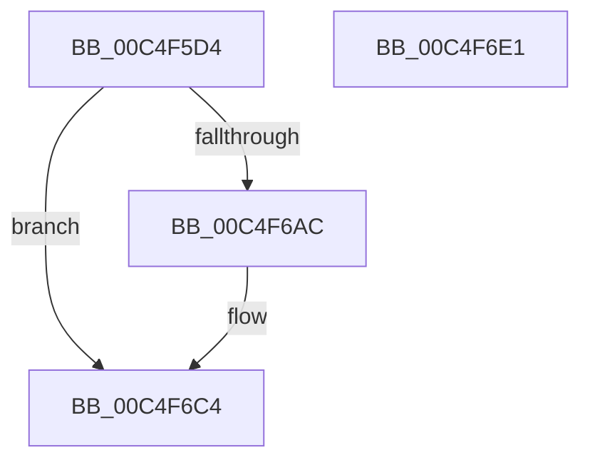

# EtwpInitializeCoverageSampler

- RVA: `0x00C4F5D4`–`0x00C4F6E2` (길이 `270` bytes)
- VA: `0x0000000140C4F5D4`
- 실행 섹션: `INIT`
- PDB 이름 있음: `예`; PDB Function 태그: `아니요`
- unwind 정보 RVA: `0x0006FCAC`
- 디코드: `59`개 명령, `270/270` bytes 표시
- 미해석 바이트: `0` (있으면 어셈블리에 `.byte`로 보존)

> 이 문서는 커널 이미지의 기계어와 PDB 기호를 분석해 생성했습니다. 4번과 5번은 함수 원형과 자료형을 바이너리 사용 방식에서 추정한 C 해석이며 원본 소스 복구 결과는 아닙니다.

## 1. Dependencies

- 직접 호출 지점: **7**; 고유 호출 대상: **7**
- 직접 호출자로 확인된 함수: **1**
- RIP 상대 이미지 참조: **9**

### Outgoing calls
- `0x00C4F607` → [TraceLoggingRegisterEx_EtwRegister_EtwSetInformation](../../page/92/TraceLoggingRegisterEx_EtwRegister_EtwSetInformation_function_009208A0.md) (function, `0x009208A0`)
- `0x00C4F623` → [ExWaitForRundownProtectionRelease](../../text/2A/ExWaitForRundownProtectionRelease_function_002A4CB0.md) (function, `0x002A4CB0`)
- `0x00C4F63F` → [RtlInitUnicodeString](../../text/42/RtlInitUnicodeString_function_0042A780.md) (function, `0x0042A780`)
- `0x00C4F652` → [memset](../../text/6C/memset_function_006C6C40.md) (function, `0x006C6C40`)
- `0x00C4F6A3` → [ObCreateObjectType](../../page/70/ObCreateObjectType_function_00705230.md) (function, `0x00705230`)
- `0x00C4F6BE` → [KeBugCheckEx](../../text/4F/KeBugCheckEx_function_004FD660.md) (function, `0x004FD660`)
- `0x00C4F6CB` → [_security_check_cookie](../../text/6A/_security_check_cookie_function_006AC640.md) (function, `0x006AC640`)

### Direct callers
- [EtwpInitialize](EtwpInitialize_function_00C4DBCC.md) at `0x00C4DEDC`

### Static image references
- `0x00C4F5E6` → RVA `0x00E0A740` (`.data`; read)
- `0x00C4F5F7` → RVA `0x00E09298` (`.data`; read)
- `0x00C4F60C` → RVA `0x00EFF1C0` (`.data`; read/write)
- `0x00C4F614` → RVA `0x00EFF1E0` (`.data`; read)
- `0x00C4F61B` → RVA `0x00EFF1E0` (`.data`; read/write)
- `0x00C4F62D` → RVA `0x00C7DA00` (` ?? ::PBOPGDP::`string'`; read)
- `0x00C4F65B` → RVA `0x007C1F40` (`EtwpCoverageSamplerClose`; read)
- `0x00C4F666` → RVA `0x00EFF1D0` (`.data`; read)
- `0x00C4F66D` → RVA `0x007C2040` (`EtwpCoverageSamplerDelete`; read)

## 2. Other-region calls and transfers

- 다른 실행 섹션으로 향하는 call: **7**
  - `0x00C4F607` → [TraceLoggingRegisterEx_EtwRegister_EtwSetInformation](../../page/92/TraceLoggingRegisterEx_EtwRegister_EtwSetInformation_function_009208A0.md) (`INIT` → `PAGE`)
  - `0x00C4F623` → [ExWaitForRundownProtectionRelease](../../text/2A/ExWaitForRundownProtectionRelease_function_002A4CB0.md) (`INIT` → `.text`)
  - `0x00C4F63F` → [RtlInitUnicodeString](../../text/42/RtlInitUnicodeString_function_0042A780.md) (`INIT` → `.text`)
  - `0x00C4F652` → [memset](../../text/6C/memset_function_006C6C40.md) (`INIT` → `.text`)
  - `0x00C4F6A3` → [ObCreateObjectType](../../page/70/ObCreateObjectType_function_00705230.md) (`INIT` → `PAGE`)
  - `0x00C4F6BE` → [KeBugCheckEx](../../text/4F/KeBugCheckEx_function_004FD660.md) (`INIT` → `.text`)
  - `0x00C4F6CB` → [_security_check_cookie](../../text/6A/_security_check_cookie_function_006AC640.md) (`INIT` → `.text`)
- 별도 외부 분기/꼬리 이동을 확인하지 못했습니다.

## 3. Assembly (complete function range)

```asm
00C4F5D4  48 89 5C 24 08                  mov qword ptr [rsp + 8], rbx
00C4F5D9  55                              push rbp
00C4F5DA  48 8D 6C 24 A9                  lea rbp, [rsp - 0x57]
00C4F5DF  48 81 EC D0 00 00 00            sub rsp, 0xd0
00C4F5E6  48 8B 05 53 B1 1B 00            mov rax, qword ptr [rip + 0x1bb153]
00C4F5ED  48 33 C4                        xor rax, rsp
00C4F5F0  48 89 45 47                     mov qword ptr [rbp + 0x47], rax
00C4F5F4  0F 57 C0                        xorps xmm0, xmm0
00C4F5F7  48 8D 0D 9A 9C 1B 00            lea rcx, [rip + 0x1b9c9a]
00C4F5FE  45 33 C0                        xor r8d, r8d
00C4F601  33 D2                           xor edx, edx
00C4F603  0F 11 45 B7                     movups xmmword ptr [rbp - 0x49], xmm0
00C4F607  E8 94 12 CD FF                  call 0x1409208a0
00C4F60C  48 83 25 AC FB 2A 00 00         and qword ptr [rip + 0x2afbac], 0
00C4F614  48 8D 0D C5 FB 2A 00            lea rcx, [rip + 0x2afbc5]
00C4F61B  48 83 25 BD FB 2A 00 00         and qword ptr [rip + 0x2afbbd], 0
00C4F623  E8 88 56 65 FF                  call 0x1402a4cb0
00C4F628  B8 01 00 00 00                  mov eax, 1
00C4F62D  48 8D 15 CC E3 02 00            lea rdx, [rip + 0x2e3cc]
00C4F634  48 87 05 A5 FB 2A 00            xchg qword ptr [rip + 0x2afba5], rax
00C4F63B  48 8D 4D B7                     lea rcx, [rbp - 0x49]
00C4F63F  E8 3C B1 7D FF                  call 0x14042a780
00C4F644  BB 78 00 00 00                  mov ebx, 0x78
00C4F649  48 8D 4D C7                     lea rcx, [rbp - 0x39]
00C4F64D  44 8B C3                        mov r8d, ebx
00C4F650  33 D2                           xor edx, edx
00C4F652  E8 E9 75 A7 FF                  call 0x1406c6c40
00C4F657  80 4D C9 04                     or byte ptr [rbp - 0x37], 4
00C4F65B  48 8D 05 DE 28 B7 FF            lea rax, [rip - 0x48d722]
00C4F662  48 89 45 07                     mov qword ptr [rbp + 7], rax
00C4F666  4C 8D 0D 63 FB 2A 00            lea r9, [rip + 0x2afb63]
00C4F66D  48 8D 05 CC 29 B7 FF            lea rax, [rip - 0x48d634]
00C4F674  66 89 5D C7                     mov word ptr [rbp - 0x39], bx
00C4F678  45 33 C0                        xor r8d, r8d
00C4F67B  48 89 45 0F                     mov qword ptr [rbp + 0xf], rax
00C4F67F  48 8D 55 C7                     lea rdx, [rbp - 0x39]
00C4F683  C7 45 EB 01 00 00 00            mov dword ptr [rbp - 0x15], 1
00C4F68A  48 8D 4D B7                     lea rcx, [rbp - 0x49]
00C4F68E  C7 45 EF C8 06 00 00            mov dword ptr [rbp - 0x11], 0x6c8
00C4F695  C7 45 CF 92 01 00 00            mov dword ptr [rbp - 0x31], 0x192
00C4F69C  C7 45 E3 01 00 1F 00            mov dword ptr [rbp - 0x1d], 0x1f0001
00C4F6A3  E8 88 5B AB FF                  call 0x140705230
00C4F6A8  85 C0                           test eax, eax
00C4F6AA  79 18                           jns 0x140c4f6c4
00C4F6AC  48 83 64 24 20 00               and qword ptr [rsp + 0x20], 0
00C4F6B2  8D 53 48                        lea edx, [rbx + 0x48]
00C4F6B5  45 33 C9                        xor r9d, r9d
00C4F6B8  8D 4B E6                        lea ecx, [rbx - 0x1a]
00C4F6BB  45 33 C0                        xor r8d, r8d
00C4F6BE  E8 9D DF 8A FF                  call 0x1404fd660
00C4F6C3  CC                              int3
00C4F6C4  48 8B 4D 47                     mov rcx, qword ptr [rbp + 0x47]
00C4F6C8  48 33 CC                        xor rcx, rsp
00C4F6CB  E8 70 CF A5 FF                  call 0x1406ac640
00C4F6D0  48 8B 9C 24 E0 00 00 00         mov rbx, qword ptr [rsp + 0xe0]
00C4F6D8  48 81 C4 D0 00 00 00            add rsp, 0xd0
00C4F6DF  5D                              pop rbp
00C4F6E0  C3                              ret
00C4F6E1  CC                              int3
```

## 4. C-style interpretation (structured pseudocode)

```c
__int64 __fastcall EtwpInitializeCoverageSampler(__int64 a1, int a2, int a3)
{
    __int64 result;
    __int64 v_rsp;
    unsigned __int64 v_stack_m18;
    unsigned __int64 v_stack_m50;
    unsigned __int64 v_stack_m58;
    unsigned __int64 v_stack_m5F;
    unsigned int v_stack_m70;
    unsigned int v_stack_m74;
    unsigned int v_stack_m7C;
    unsigned int v_stack_m90;
    unsigned __int8 v_stack_m96;
    unsigned __int64 v_stack_m98;
    unsigned __int64 v_stack_mA8;
    unsigned __int64 v_stack_mB8;
    unsigned __int64 v_stack_p8;

    v_stack_p8 = v_rbx;
    v_rsp = (v_rsp) - (208);
    result = (*(unsigned __int64 *)(v_rip + 1814867)) ^ (v_rsp);
    v_stack_m18 = result;
    a3 = 0;
    a2 = 0;
    v_stack_mA8 = v_xmm0;
    result = TraceLoggingRegisterEx_EtwRegister_EtwSetInformation(v_rip + 1809562, a2, a3, a4);
    result = ExWaitForRundownProtectionRelease(v_rip + 2816965, a2, a3, a4);
    result = RtlInitUnicodeString(v_stack_mA8, v_rip + 189388, a3, a4);
    a2 = 0;
    result = memset(v_stack_m98, a2, 120, a4);
    v_stack_m58 = v_rip - 4773666;
    v_stack_m98 = 120;
    a3 = 0;
    v_stack_m50 = v_rip - 4773428;
    v_stack_m74 = 1;
    v_stack_m70 = 0x6C8ULL;
    v_stack_m90 = 402;
    v_stack_m7C = 0x1F0001ULL;
    result = ObCreateObjectType(v_stack_mA8, v_stack_m98, a3, v_rip + 2816867);
    if (sign_flag) {
        a2 = 120 + 72;
        a4 = 0;
        a1 = 120 - 26;
        a3 = 0;
        result = KeBugCheckEx(a1, a2, a3, a4);
    }
    a1 = (v_stack_m18) ^ (v_rsp);
    result = _security_check_cookie(a1, a2, a3, a4);
    v_rsp = (v_rsp) + (208);
    return result;
}
```

## 5. (Beta) C Style

```c
int64_t EtwpInitializeCoverageSampler(int64_t Arg1, int32_t Arg2, int32_t Arg3)
{
    int64_t result;
    int64_t local_rsp;
    uint64_t v_stack_m18;
    uint64_t v_stack_m50;
    uint64_t v_stack_m58;
    uint64_t v_stack_m5F;
    uint32_t v_stack_m70;
    uint32_t v_stack_m74;
    uint32_t v_stack_m7C;
    uint32_t v_stack_m90;
    uint8_t v_stack_m96;
    uint64_t v_stack_m98;
    uint64_t v_stack_mA8;
    uint64_t v_stack_mB8;
    uint64_t v_stack_p8;

    v_stack_p8 = local_rbx;
    local_rsp = (local_rsp) - (208);
    result = (*(uint64_t *)(v_rip + 0x1BB153)) ^ (local_rsp);
    v_stack_m18 = result;
    Arg3 = 0;
    Arg2 = 0;
    v_stack_mA8 = v_xmm0;
    result = TraceLoggingRegisterEx_EtwRegister_EtwSetInformation(v_rip + 1809562, Arg2, Arg3, a4);
    result = ExWaitForRundownProtectionRelease(v_rip + 2816965, Arg2, Arg3, a4);
    result = RtlInitUnicodeString(v_stack_mA8, v_rip + 189388, Arg3, a4);
    Arg2 = 0;
    result = memset(v_stack_m98, Arg2, 120, a4);
    v_stack_m58 = v_rip - 4773666;
    v_stack_m98 = 120;
    Arg3 = 0;
    v_stack_m50 = v_rip - 4773428;
    v_stack_m74 = 1;
    v_stack_m70 = 0x6C8ULL;
    v_stack_m90 = 402;
    v_stack_m7C = 0x1F0001ULL;
    result = ObCreateObjectType(v_stack_mA8, v_stack_m98, Arg3, v_rip + 2816867);
    if (sign_flag) {
        Arg2 = 120 + 72;
        a4 = 0;
        Arg1 = 120 - 26;
        Arg3 = 0;
        result = KeBugCheckEx(Arg1, Arg2, Arg3, a4);
    }
    Arg1 = (v_stack_m18) ^ (local_rsp);
    result = _security_check_cookie(Arg1, Arg2, Arg3, a4);
    local_rsp = (local_rsp) + (208);
    return result;
}
```

## 6. Execution-region graph

[열기: 2D/3D 그래프와 함수 탐색 컨트롤 패널](../../../control-panel.html?section=init&rva=0x00C4F5D4&view=graph)

- 2D 그래프는 위에서 아래로 흐르고, 3D 그래프는 빈 공간을 드래그해 회전합니다. Shift+드래그는 이동, 휠은 확대·축소, 함수 노드 선택은 대상 보고서 이동입니다.

### Static fallback


