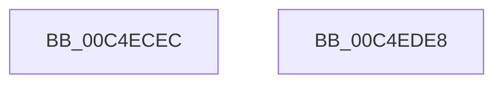

# EtwpInitializeRegistration

- RVA: `0x00C4ECEC`–`0x00C4EDE9` (길이 `253` bytes)
- VA: `0x0000000140C4ECEC`
- 실행 섹션: `INIT`
- PDB 이름 있음: `예`; PDB Function 태그: `아니요`
- unwind 정보 RVA: `0x000C43B4`
- 디코드: `53`개 명령, `253/253` bytes 표시
- 미해석 바이트: `0` (있으면 어셈블리에 `.byte`로 보존)

> 이 문서는 커널 이미지의 기계어와 PDB 기호를 분석해 생성했습니다. 4번과 5번은 함수 원형과 자료형을 바이너리 사용 방식에서 추정한 C 해석이며 원본 소스 복구 결과는 아닙니다.

## 1. Dependencies

- 직접 호출 지점: **5**; 고유 호출 대상: **5**
- 직접 호출자로 확인된 함수: **1**
- RIP 상대 이미지 참조: **12**

### Outgoing calls
- `0x00C4ED22` → [KiInitializeMutant](../../text/45/KiInitializeMutant_function_00456E9C.md) (function, `0x00456E9C`)
- `0x00C4ED52` → [memset](../../text/6C/memset_function_006C6C40.md) (function, `0x006C6C40`)
- `0x00C4EDAF` → [RtlInitUnicodeString](../../text/42/RtlInitUnicodeString_function_0042A780.md) (function, `0x0042A780`)
- `0x00C4EDC6` → [ObCreateObjectType](../../page/70/ObCreateObjectType_function_00705230.md) (function, `0x00705230`)
- `0x00C4EDD2` → [_security_check_cookie](../../text/6A/_security_check_cookie_function_006AC640.md) (function, `0x006AC640`)

### Direct callers
- [EtwpInitialize](EtwpInitialize_function_00C4DBCC.md) at `0x00C4DD79`

### Static image references
- `0x00C4ECFE` → RVA `0x00E0A740` (`.data`; read)
- `0x00C4ED0F` → RVA `0x00EFF220` (`.data`; read)
- `0x00C4ED27` → RVA `0x00EFF200` (`.data`; read/write)
- `0x00C4ED2F` → RVA `0x00EFF1F0` (`.data`; read)
- `0x00C4ED3B` → RVA `0x00EFF1F8` (`.data`; write)
- `0x00C4ED45` → RVA `0x00EFF1F0` (`.data`; write)
- `0x00C4ED57` → RVA `0x00011360` (`.rdata`; read)
- `0x00C4ED62` → RVA `0x00A49730` (`EtwpOpenRealTimeConnectionObject`; read)
- `0x00C4ED6D` → RVA `0x00C7D8C0` (` ?? ::PBOPGDP::`string'`; read)
- `0x00C4ED74` → RVA `0x00A0CEB0` (`EtwpCloseRegistrationObject`; read)
- `0x00C4ED87` → RVA `0x008C1F30` (`EtwpDeleteRegistrationObject`; read)
- `0x00C4EDB4` → RVA `0x00FC6D30` (`ALMOSTRO`; read)

## 2. Other-region calls and transfers

- 다른 실행 섹션으로 향하는 call: **5**
  - `0x00C4ED22` → [KiInitializeMutant](../../text/45/KiInitializeMutant_function_00456E9C.md) (`INIT` → `.text`)
  - `0x00C4ED52` → [memset](../../text/6C/memset_function_006C6C40.md) (`INIT` → `.text`)
  - `0x00C4EDAF` → [RtlInitUnicodeString](../../text/42/RtlInitUnicodeString_function_0042A780.md) (`INIT` → `.text`)
  - `0x00C4EDC6` → [ObCreateObjectType](../../page/70/ObCreateObjectType_function_00705230.md) (`INIT` → `PAGE`)
  - `0x00C4EDD2` → [_security_check_cookie](../../text/6A/_security_check_cookie_function_006AC640.md) (`INIT` → `.text`)
- 별도 외부 분기/꼬리 이동을 확인하지 못했습니다.

## 3. Assembly (complete function range)

```asm
00C4ECEC  48 89 5C 24 08                  mov qword ptr [rsp + 8], rbx
00C4ECF1  55                              push rbp
00C4ECF2  48 8D 6C 24 A9                  lea rbp, [rsp - 0x57]
00C4ECF7  48 81 EC C0 00 00 00            sub rsp, 0xc0
00C4ECFE  48 8B 05 3B BA 1B 00            mov rax, qword ptr [rip + 0x1bba3b]
00C4ED05  48 33 C4                        xor rax, rsp
00C4ED08  48 89 45 47                     mov qword ptr [rbp + 0x47], rax
00C4ED0C  0F 57 C0                        xorps xmm0, xmm0
00C4ED0F  48 8D 0D 0A 05 2B 00            lea rcx, [rip + 0x2b050a]
00C4ED16  45 33 C9                        xor r9d, r9d
00C4ED19  41 B0 01                        mov r8b, 1
00C4ED1C  33 D2                           xor edx, edx
00C4ED1E  0F 11 45 B7                     movups xmmword ptr [rbp - 0x49], xmm0
00C4ED22  E8 75 81 80 FF                  call 0x140456e9c
00C4ED27  48 83 25 D1 04 2B 00 00         and qword ptr [rip + 0x2b04d1], 0
00C4ED2F  48 8D 05 BA 04 2B 00            lea rax, [rip + 0x2b04ba]
00C4ED36  BB 78 00 00 00                  mov ebx, 0x78
00C4ED3B  48 89 05 B6 04 2B 00            mov qword ptr [rip + 0x2b04b6], rax
00C4ED42  44 8B C3                        mov r8d, ebx
00C4ED45  48 89 05 A4 04 2B 00            mov qword ptr [rip + 0x2b04a4], rax
00C4ED4C  33 D2                           xor edx, edx
00C4ED4E  48 8D 4D C7                     lea rcx, [rbp - 0x39]
00C4ED52  E8 E9 7E A7 FF                  call 0x1406c6c40
00C4ED57  0F 10 05 02 26 3C FF            movups xmm0, xmmword ptr [rip - 0xc3d9fe]
00C4ED5E  80 4D C9 18                     or byte ptr [rbp - 0x37], 0x18
00C4ED62  48 8D 05 C7 A9 DF FF            lea rax, [rip - 0x205639]
00C4ED69  48 89 45 FF                     mov qword ptr [rbp - 1], rax
00C4ED6D  48 8D 15 4C EB 02 00            lea rdx, [rip + 0x2eb4c]
00C4ED74  48 8D 05 35 E1 DB FF            lea rax, [rip - 0x241ecb]
00C4ED7B  66 89 5D C7                     mov word ptr [rbp - 0x39], bx
00C4ED7F  48 89 45 07                     mov qword ptr [rbp + 7], rax
00C4ED83  48 8D 4D B7                     lea rcx, [rbp - 0x49]
00C4ED87  48 8D 05 A2 31 C7 FF            lea rax, [rip - 0x38ce5e]
00C4ED8E  C7 45 CF 00 01 00 00            mov dword ptr [rbp - 0x31], 0x100
00C4ED95  48 89 45 0F                     mov qword ptr [rbp + 0xf], rax
00C4ED99  F3 0F 7F 45 D3                  movdqu xmmword ptr [rbp - 0x2d], xmm0
00C4ED9E  C7 45 E3 04 08 00 00            mov dword ptr [rbp - 0x1d], 0x804
00C4EDA5  C7 45 EB 00 02 00 00            mov dword ptr [rbp - 0x15], 0x200
00C4EDAC  89 5D F3                        mov dword ptr [rbp - 0xd], ebx
00C4EDAF  E8 CC B9 7D FF                  call 0x14042a780
00C4EDB4  4C 8D 0D 75 7F 37 00            lea r9, [rip + 0x377f75]
00C4EDBB  45 33 C0                        xor r8d, r8d
00C4EDBE  48 8D 55 C7                     lea rdx, [rbp - 0x39]
00C4EDC2  48 8D 4D B7                     lea rcx, [rbp - 0x49]
00C4EDC6  E8 65 64 AB FF                  call 0x140705230
00C4EDCB  48 8B 4D 47                     mov rcx, qword ptr [rbp + 0x47]
00C4EDCF  48 33 CC                        xor rcx, rsp
00C4EDD2  E8 69 D8 A5 FF                  call 0x1406ac640
00C4EDD7  48 8B 9C 24 D0 00 00 00         mov rbx, qword ptr [rsp + 0xd0]
00C4EDDF  48 81 C4 C0 00 00 00            add rsp, 0xc0
00C4EDE6  5D                              pop rbp
00C4EDE7  C3                              ret
00C4EDE8  CC                              int3
```

## 4. C-style interpretation (structured pseudocode)

```c
__int64 __fastcall EtwpInitializeRegistration(__int64 a1, int a2, __int64 a3, int a4)
{
    __int64 result;
    __int64 v_rsp;
    unsigned __int64 v_stack_m18;
    unsigned __int64 v_stack_m50;
    unsigned __int64 v_stack_m58;
    unsigned __int64 v_stack_m5F;
    unsigned __int64 v_stack_m60;
    unsigned int v_stack_m6C;
    unsigned int v_stack_m74;
    unsigned int v_stack_m7C;
    unsigned __int64 v_stack_m8C;
    unsigned int v_stack_m90;
    unsigned __int8 v_stack_m96;
    unsigned __int64 v_stack_m98;
    unsigned __int64 v_stack_mA8;
    unsigned __int64 v_stack_p8;

    v_stack_p8 = v_rbx;
    v_rsp = (v_rsp) - (192);
    result = (*(unsigned __int64 *)(v_rip + 1817147)) ^ (v_rsp);
    v_stack_m18 = result;
    a4 = 0;
    a2 = 0;
    v_stack_mA8 = v_xmm0;
    result = KiInitializeMutant(v_rip + 2819338, a2, 1, a4);
    *(unsigned __int64 *)(v_rip + 2819254) = v_rip + 2819258;
    *(unsigned __int64 *)(v_rip + 2819236) = v_rip + 2819258;
    a2 = 0;
    result = memset(v_stack_m98, a2, 120, a4);
    v_stack_m60 = v_rip - 2119225;
    v_stack_m98 = 120;
    v_stack_m58 = v_rip - 2367179;
    v_stack_m90 = 256;
    v_stack_m50 = v_rip - 3722846;
    v_stack_m8C = v_xmm0;
    v_stack_m7C = 0x804ULL;
    v_stack_m74 = 512;
    v_stack_m6C = 120;
    result = RtlInitUnicodeString(v_stack_mA8, v_rip + 191308, 120, a4);
    a3 = 0;
    result = ObCreateObjectType(v_stack_mA8, v_stack_m98, a3, v_rip + 3637109);
    a1 = (v_stack_m18) ^ (v_rsp);
    result = _security_check_cookie(a1, v_stack_m98, a3, v_rip + 3637109);
    v_rsp = (v_rsp) + (192);
    return result;
}
```

## 5. (Beta) C Style

```c
int64_t EtwpInitializeRegistration(int64_t Arg1, int32_t Arg2, int64_t Arg3, int32_t Arg4)
{
    int64_t result;
    int64_t local_rsp;
    uint64_t v_stack_m18;
    uint64_t v_stack_m50;
    uint64_t v_stack_m58;
    uint64_t v_stack_m5F;
    uint64_t v_stack_m60;
    uint32_t v_stack_m6C;
    uint32_t v_stack_m74;
    uint32_t v_stack_m7C;
    uint64_t v_stack_m8C;
    uint32_t v_stack_m90;
    uint8_t v_stack_m96;
    uint64_t v_stack_m98;
    uint64_t v_stack_mA8;
    uint64_t v_stack_p8;

    v_stack_p8 = local_rbx;
    local_rsp = (local_rsp) - (192);
    result = (*(uint64_t *)(v_rip + 0x1BBA3B)) ^ (local_rsp);
    v_stack_m18 = result;
    Arg4 = 0;
    Arg2 = 0;
    v_stack_mA8 = v_xmm0;
    result = KiInitializeMutant(v_rip + 2819338, Arg2, 1, Arg4);
    *(uint64_t *)(v_rip + 0x2B04B6) = v_rip + 2819258;
    *(uint64_t *)(v_rip + 0x2B04A4) = v_rip + 2819258;
    Arg2 = 0;
    result = memset(v_stack_m98, Arg2, 120, Arg4);
    v_stack_m60 = v_rip - 2119225;
    v_stack_m98 = 120;
    v_stack_m58 = v_rip - 2367179;
    v_stack_m90 = 256;
    v_stack_m50 = v_rip - 3722846;
    v_stack_m8C = v_xmm0;
    v_stack_m7C = 0x804ULL;
    v_stack_m74 = 512;
    v_stack_m6C = 120;
    result = RtlInitUnicodeString(v_stack_mA8, v_rip + 191308, 120, Arg4);
    Arg3 = 0;
    result = ObCreateObjectType(v_stack_mA8, v_stack_m98, Arg3, v_rip + 3637109);
    Arg1 = (v_stack_m18) ^ (local_rsp);
    result = _security_check_cookie(Arg1, v_stack_m98, Arg3, v_rip + 3637109);
    local_rsp = (local_rsp) + (192);
    return result;
}
```

## 6. Execution-region graph

[열기: 2D/3D 그래프와 함수 탐색 컨트롤 패널](../../../control-panel.html?section=init&rva=0x00C4ECEC&view=graph)

- 2D 그래프는 위에서 아래로 흐르고, 3D 그래프는 빈 공간을 드래그해 회전합니다. Shift+드래그는 이동, 휠은 확대·축소, 함수 노드 선택은 대상 보고서 이동입니다.

### Static fallback


