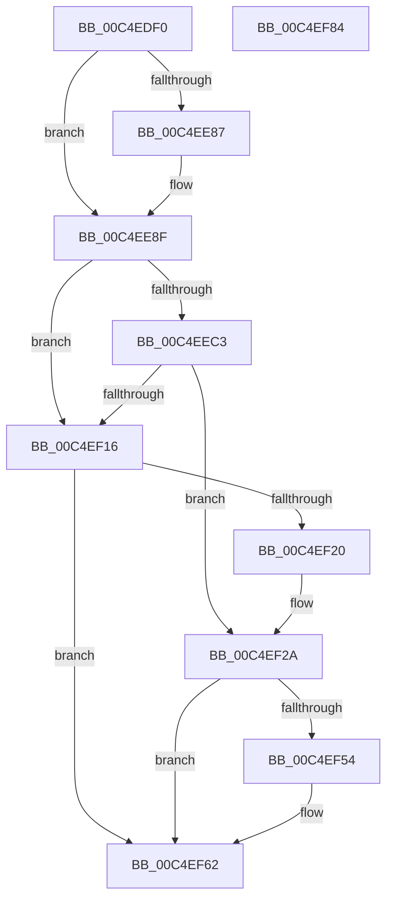

# EtwpInitializeSecurity

- RVA: `0x00C4EDF0`–`0x00C4EF85` (길이 `405` bytes)
- VA: `0x0000000140C4EDF0`
- 실행 섹션: `INIT`
- PDB 이름 있음: `예`; PDB Function 태그: `아니요`
- unwind 정보 RVA: `0x000CBD68`
- 디코드: `85`개 명령, `405/405` bytes 표시
- 미해석 바이트: `0` (있으면 어셈블리에 `.byte`로 보존)

> 이 문서는 커널 이미지의 기계어와 PDB 기호를 분석해 생성했습니다. 4번과 5번은 함수 원형과 자료형을 바이너리 사용 방식에서 추정한 C 해석이며 원본 소스 복구 결과는 아닙니다.

## 1. Dependencies

- 직접 호출 지점: **8**; 고유 호출 대상: **5**
- 직접 호출자로 확인된 함수: **1**
- RIP 상대 이미지 참조: **11**

### Outgoing calls
- `0x00C4EE3F` → [RtlInitUnicodeString](../../text/42/RtlInitUnicodeString_function_0042A780.md) (function, `0x0042A780`)
- `0x00C4EE7E` → [ZwOpenKey](../../text/6A/ZwOpenKey_function_006AD310.md) (function, `0x006AD310`)
- `0x00C4EEB8` → [RtlGetPersistedStateLocation](../../page/8C/RtlGetPersistedStateLocation_function_008C8DE0.md) (function, `0x008C8DE0`)
- `0x00C4EECC` → [RtlInitUnicodeString](../../text/42/RtlInitUnicodeString_function_0042A780.md) (function, `0x0042A780`)
- `0x00C4EF0B` → [ZwOpenKey](../../text/6A/ZwOpenKey_function_006AD310.md) (function, `0x006AD310`)
- `0x00C4EF35` → [RtlInitUnicodeString](../../text/42/RtlInitUnicodeString_function_0042A780.md) (function, `0x0042A780`)
- `0x00C4EF45` → [EtwpGetGuidSecurityDescriptor](../../page/8C/EtwpGetGuidSecurityDescriptor_function_008C05D4.md) (function, `0x008C05D4`)
- `0x00C4EF6E` → [_security_check_cookie](../../text/6A/_security_check_cookie_function_006AC640.md) (function, `0x006AC640`)

### Direct callers
- [EtwpInitialize](EtwpInitialize_function_00C4DBCC.md) at `0x00C4DD07`

### Static image references
- `0x00C4EE05` → RVA `0x00E0A740` (`.data`; read)
- `0x00C4EE18` → RVA `0x00C7D900` (` ?? ::PBOPGDP::`string'`; read)
- `0x00C4EE71` → RVA `0x00EFF140` (`.data`; read)
- `0x00C4EE87` → RVA `0x00EFF140` (`.data`; read/write)
- `0x00C4EE9B` → RVA `0x00C7D8E0` (` ?? ::PBOPGDP::`string'`; read)
- `0x00C4EEFE` → RVA `0x00EFF148` (`.data`; read)
- `0x00C4EF20` → RVA `0x00EFF148` (`.data`; read/write)
- `0x00C4EF2A` → RVA `0x00C7D980` (` ?? ::PBOPGDP::`string'`; read)
- `0x00C4EF3A` → RVA `0x00E68510` (`.data`; read)
- `0x00C4EF54` → RVA `0x00FC6D68` (`ALMOSTRO`; read)
- `0x00C4EF5B` → RVA `0x00E68510` (`.data`; write)

## 2. Other-region calls and transfers

- 다른 실행 섹션으로 향하는 call: **8**
  - `0x00C4EE3F` → [RtlInitUnicodeString](../../text/42/RtlInitUnicodeString_function_0042A780.md) (`INIT` → `.text`)
  - `0x00C4EE7E` → [ZwOpenKey](../../text/6A/ZwOpenKey_function_006AD310.md) (`INIT` → `.text`)
  - `0x00C4EEB8` → [RtlGetPersistedStateLocation](../../page/8C/RtlGetPersistedStateLocation_function_008C8DE0.md) (`INIT` → `PAGE`)
  - `0x00C4EECC` → [RtlInitUnicodeString](../../text/42/RtlInitUnicodeString_function_0042A780.md) (`INIT` → `.text`)
  - `0x00C4EF0B` → [ZwOpenKey](../../text/6A/ZwOpenKey_function_006AD310.md) (`INIT` → `.text`)
  - `0x00C4EF35` → [RtlInitUnicodeString](../../text/42/RtlInitUnicodeString_function_0042A780.md) (`INIT` → `.text`)
  - `0x00C4EF45` → [EtwpGetGuidSecurityDescriptor](../../page/8C/EtwpGetGuidSecurityDescriptor_function_008C05D4.md) (`INIT` → `PAGE`)
  - `0x00C4EF6E` → [_security_check_cookie](../../text/6A/_security_check_cookie_function_006AC640.md) (`INIT` → `.text`)
- 별도 외부 분기/꼬리 이동을 확인하지 못했습니다.

## 3. Assembly (complete function range)

```asm
00C4EDF0  48 89 5C 24 08                  mov qword ptr [rsp + 8], rbx
00C4EDF5  55                              push rbp
00C4EDF6  48 8D AC 24 50 FE FF FF         lea rbp, [rsp - 0x1b0]
00C4EDFE  48 81 EC B0 02 00 00            sub rsp, 0x2b0
00C4EE05  48 8B 05 34 B9 1B 00            mov rax, qword ptr [rip + 0x1bb934]
00C4EE0C  48 33 C4                        xor rax, rsp
00C4EE0F  48 89 85 A0 01 00 00            mov qword ptr [rbp + 0x1a0], rax
00C4EE16  33 C0                           xor eax, eax
00C4EE18  48 8D 15 E1 EA 02 00            lea rdx, [rip + 0x2eae1]
00C4EE1F  21 44 24 6C                     and dword ptr [rsp + 0x6c], eax
00C4EE23  48 8D 4C 24 40                  lea rcx, [rsp + 0x40]
00C4EE28  0F 57 C0                        xorps xmm0, xmm0
00C4EE2B  89 44 24 54                     mov dword ptr [rsp + 0x54], eax
00C4EE2F  21 44 24 54                     and dword ptr [rsp + 0x54], eax
00C4EE33  0F 57 C9                        xorps xmm1, xmm1
00C4EE36  0F 11 45 88                     movups xmmword ptr [rbp - 0x78], xmm0
00C4EE3A  0F 11 4C 24 40                  movups xmmword ptr [rsp + 0x40], xmm1
00C4EE3F  E8 3C B9 7D FF                  call 0x14042a780
00C4EE44  48 83 64 24 58 00               and qword ptr [rsp + 0x58], 0
00C4EE4A  48 8D 44 24 40                  lea rax, [rsp + 0x40]
00C4EE4F  0F 57 C0                        xorps xmm0, xmm0
00C4EE52  48 89 44 24 60                  mov qword ptr [rsp + 0x60], rax
00C4EE57  4C 8D 44 24 50                  lea r8, [rsp + 0x50]
00C4EE5C  C7 44 24 50 30 00 00 00         mov dword ptr [rsp + 0x50], 0x30
00C4EE64  BA 19 00 02 00                  mov edx, 0x20019
00C4EE69  C7 44 24 68 40 02 00 00         mov dword ptr [rsp + 0x68], 0x240
00C4EE71  48 8D 0D C8 02 2B 00            lea rcx, [rip + 0x2b02c8]
00C4EE78  F3 0F 7F 44 24 70               movdqu xmmword ptr [rsp + 0x70], xmm0
00C4EE7E  E8 8D E4 A5 FF                  call 0x1406ad310
00C4EE83  85 C0                           test eax, eax
00C4EE85  79 08                           jns 0x140c4ee8f
00C4EE87  48 83 25 B1 02 2B 00 00         and qword ptr [rip + 0x2b02b1], 0
00C4EE8F  48 8D 45 80                     lea rax, [rbp - 0x80]
00C4EE93  45 33 C9                        xor r9d, r9d
00C4EE96  48 89 44 24 30                  mov qword ptr [rsp + 0x30], rax
00C4EE9B  48 8D 0D 3E EA 02 00            lea rcx, [rip + 0x2ea3e]
00C4EEA2  48 8D 45 A0                     lea rax, [rbp - 0x60]
00C4EEA6  C7 44 24 28 FE 01 00 00         mov dword ptr [rsp + 0x28], 0x1fe
00C4EEAE  45 33 C0                        xor r8d, r8d
00C4EEB1  48 89 44 24 20                  mov qword ptr [rsp + 0x20], rax
00C4EEB6  33 D2                           xor edx, edx
00C4EEB8  E8 23 9F C7 FF                  call 0x1408c8de0
00C4EEBD  8B D8                           mov ebx, eax
00C4EEBF  85 C0                           test eax, eax
00C4EEC1  75 53                           jne 0x140c4ef16
00C4EEC3  48 8D 55 A0                     lea rdx, [rbp - 0x60]
00C4EEC7  48 8D 4C 24 40                  lea rcx, [rsp + 0x40]
00C4EECC  E8 AF B8 7D FF                  call 0x14042a780
00C4EED1  48 83 64 24 58 00               and qword ptr [rsp + 0x58], 0
00C4EED7  48 8D 44 24 40                  lea rax, [rsp + 0x40]
00C4EEDC  0F 57 C0                        xorps xmm0, xmm0
00C4EEDF  48 89 44 24 60                  mov qword ptr [rsp + 0x60], rax
00C4EEE4  4C 8D 44 24 50                  lea r8, [rsp + 0x50]
00C4EEE9  C7 44 24 50 30 00 00 00         mov dword ptr [rsp + 0x50], 0x30
00C4EEF1  BA 19 00 02 00                  mov edx, 0x20019
00C4EEF6  C7 44 24 68 40 02 00 00         mov dword ptr [rsp + 0x68], 0x240
00C4EEFE  48 8D 0D 43 02 2B 00            lea rcx, [rip + 0x2b0243]
00C4EF05  F3 0F 7F 44 24 70               movdqu xmmword ptr [rsp + 0x70], xmm0
00C4EF0B  E8 00 E4 A5 FF                  call 0x1406ad310
00C4EF10  8B D8                           mov ebx, eax
00C4EF12  85 C0                           test eax, eax
00C4EF14  74 14                           je 0x140c4ef2a
00C4EF16  48 83 3D 22 02 2B 00 00         cmp qword ptr [rip + 0x2b0222], 0
00C4EF1E  74 42                           je 0x140c4ef62
00C4EF20  48 83 25 20 02 2B 00 00         and qword ptr [rip + 0x2b0220], 0
00C4EF28  33 DB                           xor ebx, ebx
00C4EF2A  48 8D 15 4F EA 02 00            lea rdx, [rip + 0x2ea4f]
00C4EF31  48 8D 4D 88                     lea rcx, [rbp - 0x78]
00C4EF35  E8 46 B8 7D FF                  call 0x14042a780
00C4EF3A  48 8D 15 CF 95 21 00            lea rdx, [rip + 0x2195cf]
00C4EF41  48 8D 4D 88                     lea rcx, [rbp - 0x78]
00C4EF45  E8 8A 16 C7 FF                  call 0x1408c05d4
00C4EF4A  48 83 3D BE 95 21 00 00         cmp qword ptr [rip + 0x2195be], 0
00C4EF52  75 0E                           jne 0x140c4ef62
00C4EF54  48 8B 05 0D 7E 37 00            mov rax, qword ptr [rip + 0x377e0d]
00C4EF5B  48 89 05 AE 95 21 00            mov qword ptr [rip + 0x2195ae], rax
00C4EF62  8B C3                           mov eax, ebx
00C4EF64  48 8B 8D A0 01 00 00            mov rcx, qword ptr [rbp + 0x1a0]
00C4EF6B  48 33 CC                        xor rcx, rsp
00C4EF6E  E8 CD D6 A5 FF                  call 0x1406ac640
00C4EF73  48 8B 9C 24 C0 02 00 00         mov rbx, qword ptr [rsp + 0x2c0]
00C4EF7B  48 81 C4 B0 02 00 00            add rsp, 0x2b0
00C4EF82  5D                              pop rbp
00C4EF83  C3                              ret
00C4EF84  CC                              int3
```

## 4. C-style interpretation (structured pseudocode)

```c
__int64 __fastcall EtwpInitializeSecurity(__int64 a1, __int64 a2, __int64 a3, int a4)
{
    __int64 result;
    __int64 v_rbx;
    __int64 v_rsp;
    unsigned __int64 v_stack_m18;
    unsigned __int64 v_stack_m1B8;
    unsigned __int64 v_stack_m218;
    unsigned __int64 v_stack_m230;
    unsigned __int64 v_stack_m238;
    unsigned __int64 v_stack_m248;
    unsigned int v_stack_m24C;
    unsigned int v_stack_m250;
    unsigned __int64 v_stack_m258;
    unsigned __int64 v_stack_m260;
    unsigned int v_stack_m264;
    unsigned __int64 v_stack_m268;
    unsigned __int64 v_stack_m278;
    unsigned __int64 v_stack_m288;
    unsigned int v_stack_m290;
    unsigned __int64 v_stack_m298;
    unsigned __int64 v_stack_p8;

    v_stack_p8 = v_rbx;
    v_rsp = (v_rsp) - (688);
    result = (*(unsigned __int64 *)(v_rip + 1816884)) ^ (v_rsp);
    v_stack_m18 = result;
    result = 0;
    v_stack_m264 = 0;
    v_stack_m230 = v_xmm0;
    v_stack_m278 = v_xmm1;
    result = RtlInitUnicodeString(v_stack_m278, v_rip + 191201, a3, a4);
    v_stack_m258 = v_stack_m278;
    v_stack_m268 = 48;
    v_stack_m250 = 576;
    v_stack_m248 = v_xmm0;
    result = ZwOpenKey(v_rip + 2818760, (unsigned int)(0x20019ULL), v_stack_m268, a4);
    if (sign_flag) {
    }
    a4 = 0;
    v_stack_m288 = v_stack_m238;
    v_stack_m290 = 510;
    a3 = 0;
    v_stack_m298 = v_stack_m218;
    a2 = 0;
    result = RtlGetPersistedStateLocation(v_rip + 191038, a2, a3, a4);
    if ((unsigned int)(result) != 0) goto loc_00C4EF16;
    result = RtlInitUnicodeString(v_stack_m278, v_stack_m218, a3, a4);
    v_stack_m258 = v_stack_m278;
    v_stack_m268 = 48;
    v_stack_m250 = 576;
    v_stack_m248 = v_xmm0;
    result = ZwOpenKey(v_rip + 2818627, (unsigned int)(0x20019ULL), v_stack_m268, a4);
    if ((unsigned int)(result) == 0) goto loc_00C4EF2A;
loc_00C4EF16:
    if ((*(unsigned __int64 *)(v_rip + 2818594)) == 0) goto loc_00C4EF62;
    v_rbx = 0;
loc_00C4EF2A:
    result = RtlInitUnicodeString(v_stack_m230, v_rip + 191055, v_stack_m268, a4);
    result = EtwpGetGuidSecurityDescriptor(v_stack_m230, v_rip + 2201039, v_stack_m268, a4);
    if ((*(unsigned __int64 *)(v_rip + 2201022)) == 0) {
        result = *(unsigned __int64 *)(v_rip + 3636749);
        *(unsigned __int64 *)(v_rip + 2201006) = result;
    }
    a1 = (v_stack_m18) ^ (v_rsp);
    result = _security_check_cookie(a1, v_rip + 2201039, v_stack_m268, a4);
    v_rsp = (v_rsp) + (688);
    return result;
}
```

## 5. (Beta) C Style

```c
int64_t EtwpInitializeSecurity(int64_t Arg1, int64_t Arg2, int64_t Arg3, int32_t Arg4)
{
    int64_t result;
    int64_t local_rbx;
    int64_t local_rsp;
    uint64_t v_stack_m18;
    uint64_t v_stack_m1B8;
    uint64_t v_stack_m218;
    uint64_t v_stack_m230;
    uint64_t v_stack_m238;
    uint64_t v_stack_m248;
    uint32_t v_stack_m24C;
    uint32_t v_stack_m250;
    uint64_t v_stack_m258;
    uint64_t v_stack_m260;
    uint32_t v_stack_m264;
    uint64_t v_stack_m268;
    uint64_t v_stack_m278;
    uint64_t v_stack_m288;
    uint32_t v_stack_m290;
    uint64_t v_stack_m298;
    uint64_t v_stack_p8;

    v_stack_p8 = local_rbx;
    local_rsp = (local_rsp) - (688);
    result = (*(uint64_t *)(v_rip + 0x1BB934)) ^ (local_rsp);
    v_stack_m18 = result;
    result = 0;
    v_stack_m264 = 0;
    v_stack_m230 = v_xmm0;
    v_stack_m278 = v_xmm1;
    result = RtlInitUnicodeString(v_stack_m278, v_rip + 191201, Arg3, Arg4);
    v_stack_m258 = v_stack_m278;
    v_stack_m268 = 48;
    v_stack_m250 = 576;
    v_stack_m248 = v_xmm0;
    result = ZwOpenKey(v_rip + 2818760, (uint32_t)(0x20019ULL), v_stack_m268, Arg4);
    if (sign_flag) {
    }
    Arg4 = 0;
    v_stack_m288 = v_stack_m238;
    v_stack_m290 = 510;
    Arg3 = 0;
    v_stack_m298 = v_stack_m218;
    Arg2 = 0;
    result = RtlGetPersistedStateLocation(v_rip + 191038, Arg2, Arg3, Arg4);
    if ((uint32_t)(result) != 0) goto loc_00C4EF16;
    result = RtlInitUnicodeString(v_stack_m278, v_stack_m218, Arg3, Arg4);
    v_stack_m258 = v_stack_m278;
    v_stack_m268 = 48;
    v_stack_m250 = 576;
    v_stack_m248 = v_xmm0;
    result = ZwOpenKey(v_rip + 2818627, (uint32_t)(0x20019ULL), v_stack_m268, Arg4);
    if ((uint32_t)(result) == 0) goto loc_00C4EF2A;
loc_00C4EF16:
    if ((*(uint64_t *)(v_rip + 0x2B0222)) == 0) goto loc_00C4EF62;
    local_rbx = 0;
loc_00C4EF2A:
    result = RtlInitUnicodeString(v_stack_m230, v_rip + 191055, v_stack_m268, Arg4);
    result = EtwpGetGuidSecurityDescriptor(v_stack_m230, v_rip + 2201039, v_stack_m268, Arg4);
    if ((*(uint64_t *)(v_rip + 0x2195BE)) == 0) {
        result = *(uint64_t *)(v_rip + 0x377E0D);
        *(uint64_t *)(v_rip + 0x2195AE) = result;
    }
    Arg1 = (v_stack_m18) ^ (local_rsp);
    result = _security_check_cookie(Arg1, v_rip + 2201039, v_stack_m268, Arg4);
    local_rsp = (local_rsp) + (688);
    return result;
}
```

## 6. Execution-region graph

[열기: 2D/3D 그래프와 함수 탐색 컨트롤 패널](../../../control-panel.html?section=init&rva=0x00C4EDF0&view=graph)

- 2D 그래프는 위에서 아래로 흐르고, 3D 그래프는 빈 공간을 드래그해 회전합니다. Shift+드래그는 이동, 휠은 확대·축소, 함수 노드 선택은 대상 보고서 이동입니다.

### Static fallback


