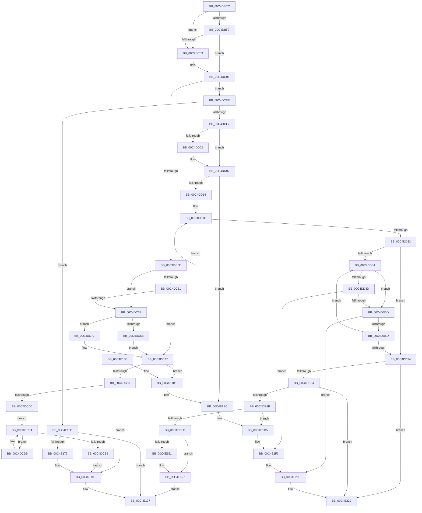

# EtwpInitialize

- RVA: `0x00C4DBCC`–`0x00C4E234` (길이 `1,640` bytes)
- VA: `0x0000000140C4DBCC`
- 실행 섹션: `INIT`
- PDB 이름 있음: `예`; PDB Function 태그: `아니요`
- unwind 정보 RVA: `0x000D3660`
- 디코드: `348`개 명령, `1,640/1,640` bytes 표시
- 미해석 바이트: `0` (있으면 어셈블리에 `.byte`로 보존)

> 이 문서는 커널 이미지의 기계어와 PDB 기호를 분석해 생성했습니다. 4번과 5번은 함수 원형과 자료형을 바이너리 사용 방식에서 추정한 C 해석이며 원본 소스 복구 결과는 아닙니다.

## 1. Dependencies

- 직접 호출 지점: **66**; 고유 호출 대상: **43**
- 직접 호출자로 확인된 함수: **1**
- RIP 상대 이미지 참조: **91**

### Outgoing calls
- `0x00C4DC1D` → [KiInitializeMutant](../../text/45/KiInitializeMutant_function_00456E9C.md) (function, `0x00456E9C`)
- `0x00C4DC31` → [KiInitializeMutant](../../text/45/KiInitializeMutant_function_00456E9C.md) (function, `0x00456E9C`)
- `0x00C4DC3D` → [EtwpInitializeStackLookasideList](../../page/7B/EtwpInitializeStackLookasideList_function_007BA578.md) (function, `0x007BA578`)
- `0x00C4DC57` → [EtwpInitializeBootTimeStamps](EtwpInitializeBootTimeStamps_function_00C4E23C.md) (function, `0x00C4E23C`)
- `0x00C4DC6B` → [EtwpGetCurrentSiloMaxLoggers](../../text/64/EtwpGetCurrentSiloMaxLoggers_function_0064E86C.md) (function, `0x0064E86C`)
- `0x00C4DC7B` → [EtwpPreInitializeSiloState](../../page/7B/EtwpPreInitializeSiloState_function_007B76BC.md) (function, `0x007B76BC`)
- `0x00C4DC8A` → [PsGetServerSiloGlobals](../../text/22/PsGetServerSiloGlobals_function_002250A0.md) (function, `0x002250A0`)
- `0x00C4DCA6` → [EtwInitializeProcessor](../../page/7B/EtwInitializeProcessor_function_007B4EBC.md) (function, `0x007B4EBC`)
- `0x00C4DCDC` → [EtwpStartBootLogger](EtwpStartBootLogger_function_00C4F274.md) (function, `0x00C4F274`)
- `0x00C4DD02` → [EtwpFixBootSystemTime](EtwpFixBootSystemTime_function_00C4DAF8.md) (function, `0x00C4DAF8`)
- `0x00C4DD07` → [EtwpInitializeSecurity](EtwpInitializeSecurity_function_00C4EDF0.md) (function, `0x00C4EDF0`)
- `0x00C4DD3C` → [KeGetPrcb](../../text/2D/KeGetPrcb_function_002D85D0.md) (function, `0x002D85D0`)
- `0x00C4DD50` → [EtwInitializeProcessor](../../page/7B/EtwInitializeProcessor_function_007B4EBC.md) (function, `0x007B4EBC`)
- `0x00C4DD60` → [EtwInitializeProcessorActivityId](../../page/7B/EtwInitializeProcessorActivityId_function_007B508C.md) (function, `0x007B508C`)
- `0x00C4DD74` → [EtwpReadConfigParameters](EtwpReadConfigParameters_function_00C4E32C.md) (function, `0x00C4E32C`)
- `0x00C4DD79` → [EtwpInitializeRegistration](EtwpInitializeRegistration_function_00C4ECEC.md) (function, `0x00C4ECEC`)
- `0x00C4DD7E` → [EtwpInitializePrivateSessionDemuxObject](../../page/7B/EtwpInitializePrivateSessionDemuxObject_function_007BC7E4.md) (function, `0x007BC7E4`)
- `0x00C4DD83` → [EtwpInitializeRealTimeConnection](EtwpInitializeRealTimeConnection_function_00C4F4FC.md) (function, `0x00C4F4FC`)
- `0x00C4DD8A` → [KeGetPrcb](../../text/2D/KeGetPrcb_function_002D85D0.md) (function, `0x002D85D0`)
- `0x00C4DD98` → [EtwpInitializeLastBranchTracing](../../page/7C/EtwpInitializeLastBranchTracing_function_007C0E04.md) (function, `0x007C0E04`)
- `0x00C4DD9D` → [EtwpInitializeProcessorTrace](../../page/7C/EtwpInitializeProcessorTrace_function_007C114C.md) (function, `0x007C114C`)
- `0x00C4DE0B` → [KiInitializeTimer2](../../text/3A/KiInitializeTimer2_function_003A3288.md) (function, `0x003A3288`)
- `0x00C4DE10` → [EtwpInitializeProviderTraits](../../page/7C/EtwpInitializeProviderTraits_function_007C12D4.md) (function, `0x007C12D4`)
- `0x00C4DE26` → [ExRegisterCallback](../../text/4B/ExRegisterCallback_function_004BDFC0.md) (function, `0x004BDFC0`)
- `0x00C4DE34` → [EtwpInitializeKsrSupport](EtwpInitializeKsrSupport_function_00C4F458.md) (function, `0x00C4F458`)
- `0x00C4DE39` → [EtwpLoadMicroarchitecturalPmcs](../../page/7B/EtwpLoadMicroarchitecturalPmcs_function_007B6D48.md) (function, `0x007B6D48`)
- `0x00C4DE6F` → [EtwpMapEnableFlags](../../page/A4/EtwpMapEnableFlags_function_00A46450.md) (function, `0x00A46450`)
- `0x00C4DE74` → [EtwpFixBootLoggers](EtwpFixBootLoggers_function_00C4F09C.md) (function, `0x00C4F09C`)
- `0x00C4DE7E` → [EtwpInitializeSiloState](../../page/7B/EtwpInitializeSiloState_function_007B6A3C.md) (function, `0x007B6A3C`)
- `0x00C4DEAB` → [KeRegisterBugCheckReasonCallback](../../text/47/KeRegisterBugCheckReasonCallback_function_004720A0.md) (function, `0x004720A0`)
- `0x00C4DEC8` → [EtwRegister](../../page/92/EtwRegister_function_00920960.md) (function, `0x00920960`)
- `0x00C4DECD` → [WdipSemInitialize](../../page/7A/WdipSemInitialize_function_007AEC68.md) (function, `0x007AEC68`)
- `0x00C4DED2` → [PerfDiagInitialize](PerfDiagInitialize_function_00C4D150.md) (function, `0x00C4D150`)
- `0x00C4DED7` → [EtwpInitializeCoverage](../../page/7B/EtwpInitializeCoverage_function_007BA538.md) (function, `0x007BA538`)
- `0x00C4DEDC` → [EtwpInitializeCoverageSampler](EtwpInitializeCoverageSampler_function_00C4F5D4.md) (function, `0x00C4F5D4`)
- `0x00C4DEEF` → [ExAllocatePool2](../../poolcode/B8/ExAllocatePool2_function_00B820F0.md) (function, `0x00B820F0`)
- `0x00C4DF30` → [EtwRegister](../../page/92/EtwRegister_function_00920960.md) (function, `0x00920960`)
- `0x00C4DF3C` → [TlgRegisterAggregateProvider](../../page/70/TlgRegisterAggregateProvider_function_0070526C.md) (function, `0x0070526C`)
- `0x00C4DF5C` → [EtwRegister](../../page/92/EtwRegister_function_00920960.md) (function, `0x00920960`)
- `0x00C4DF76` → [TlgRegisterAggregateProviderEx](../../page/AD/TlgRegisterAggregateProviderEx_function_00ADBA94.md) (function, `0x00ADBA94`)
- `0x00C4DF87` → [TraceLoggingRegisterEx_EtwRegister_EtwSetInformation](../../page/92/TraceLoggingRegisterEx_EtwRegister_EtwSetInformation_function_009208A0.md) (function, `0x009208A0`)
- `0x00C4DFA3` → [EtwRegister](../../page/92/EtwRegister_function_00920960.md) (function, `0x00920960`)
- `0x00C4DFBF` → [EtwRegister](../../page/92/EtwRegister_function_00920960.md) (function, `0x00920960`)
- `0x00C4DFDB` → [EtwRegister](../../page/92/EtwRegister_function_00920960.md) (function, `0x00920960`)
- `0x00C4DFF8` → [EtwRegister](../../page/92/EtwRegister_function_00920960.md) (function, `0x00920960`)
- `0x00C4E014` → [EtwRegister](../../page/92/EtwRegister_function_00920960.md) (function, `0x00920960`)
- `0x00C4E02C` → [EtwRegister](../../page/92/EtwRegister_function_00920960.md) (function, `0x00920960`)
- `0x00C4E044` → [EtwRegister](../../page/92/EtwRegister_function_00920960.md) (function, `0x00920960`)
- `0x00C4E05C` → [EtwRegister](../../page/92/EtwRegister_function_00920960.md) (function, `0x00920960`)
- `0x00C4E074` → [EtwRegister](../../page/92/EtwRegister_function_00920960.md) (function, `0x00920960`)
- `0x00C4E08C` → [EtwRegister](../../page/92/EtwRegister_function_00920960.md) (function, `0x00920960`)
- `0x00C4E0A4` → [EtwRegister](../../page/92/EtwRegister_function_00920960.md) (function, `0x00920960`)
- `0x00C4E0C1` → [EtwRegister](../../page/92/EtwRegister_function_00920960.md) (function, `0x00920960`)
- `0x00C4E0D9` → [EtwRegister](../../page/92/EtwRegister_function_00920960.md) (function, `0x00920960`)
- `0x00C4E0F6` → [EtwRegister](../../page/92/EtwRegister_function_00920960.md) (function, `0x00920960`)
- `0x00C4E120` → [ZwUpdateWnfStateData](../../text/6B/ZwUpdateWnfStateData_function_006B0D10.md) (function, `0x006B0D10`)
- `0x00C4E125` → [EtwpTraceSystemInitialization](EtwpTraceSystemInitialization_function_00C4E720.md) (function, `0x00C4E720`)
- `0x00C4E148` → [guard_dispatch_icall](../../text/6B/guard_dispatch_icall_function_006BAAD0.md) (function, `0x006BAAD0`)
- `0x00C4E166` → [UcInitialize](../../text/69/UcInitialize_function_0069AD9C.md) (function, `0x0069AD9C`)
- `0x00C4E18B` → [EtwpUpdateFileInfoDriverState](../../page/A5/EtwpUpdateFileInfoDriverState_function_00A501BC.md) (function, `0x00A501BC`)
- `0x00C4E1B6` → [KeBugCheck](../../text/4F/KeBugCheck_function_004FD640.md) (function, `0x004FD640`)
- `0x00C4E1CF` → [KeBugCheckEx](../../text/4F/KeBugCheckEx_function_004FD660.md) (function, `0x004FD660`)
- `0x00C4E1ED` → [KeBugCheckEx](../../text/4F/KeBugCheckEx_function_004FD660.md) (function, `0x004FD660`)
- `0x00C4E208` → [KeBugCheckEx](../../text/4F/KeBugCheckEx_function_004FD660.md) (function, `0x004FD660`)
- `0x00C4E223` → [KeBugCheckEx](../../text/4F/KeBugCheckEx_function_004FD660.md) (function, `0x004FD660`)
- `0x00C4E22E` → [KeBugCheck](../../text/4F/KeBugCheck_function_004FD640.md) (function, `0x004FD640`)

### Direct callers
- [EtwInitialize](../../page/7B/EtwInitialize_function_007B4D40.md) at `0x007B4DA7`
- [EtwInitialize](../../page/7B/EtwInitialize_function_007B4D40.md) at `0x007B4E49`

### Static image references
- `0x00C4DC11` → RVA `0x00EFF7A0` (`.data`; read)
- `0x00C4DC25` → RVA `0x00EFF7E0` (`.data`; read)
- `0x00C4DC36` → RVA `0x00EFF510` (`.data`; write)
- `0x00C4DC42` → RVA `0x00FC753C` (`ALMOSTRO`; read/write)
- `0x00C4DC4F` → RVA `0x00FC7538` (`ALMOSTRO`; read/write)
- `0x00C4DC96` → RVA `0x00FC6AA8` (`ALMOSTRO`; write)
- `0x00C4DCAB` → RVA `0x00FC6AA8` (`ALMOSTRO`; read)
- `0x00C4DCB9` → RVA `0x00E0EB78` (`.data`; write)
- `0x00C4DCC0` → RVA `0x00E0EB80` (`.data`; write)
- `0x00C4DCF7` → RVA `0x00FC6A80` (`ALMOSTRO`; read)
- `0x00C4DD1E` → RVA `0x00FC5008` (`ALMOSTRO`; read)
- `0x00C4DD92` → RVA `0x00EFF288` (`.data`; write)
- `0x00C4DDA2` → RVA `0x003EB5F0` (`EtwpAdjustTraceBuffers`; read)
- `0x00C4DDA9` → RVA `0x00EFF130` (`.data`; write)
- `0x00C4DDB0` → RVA `0x00EFF270` (`.data`; write)
- `0x00C4DDB7` → RVA `0x003B9850` (`EtwpLogMemInfoTimerCallback`; read)
- `0x00C4DDC3` → RVA `0x00EFF120` (`.data`; write)
- `0x00C4DDCA` → RVA `0x00EFF280` (`.data`; read)
- `0x00C4DDD1` → RVA `0x00EFF128` (`.data`; write)
- `0x00C4DDDB` → RVA `0x00EFF278` (`.data`; write)
- `0x00C4DDE5` → RVA `0x00EFF124` (`.data`; write)
- `0x00C4DDEF` → RVA `0x00EFF3C0` (`.data`; read)
- `0x00C4DDF6` → RVA `0x00EFF920` (`.data`; write)
- `0x00C4DDFC` → RVA `0x00EFF260` (`.data`; write)
- `0x00C4DE03` → RVA `0x00EFF3C2` (`.data`; write)
- `0x00C4DE15` → RVA `0x00EFEDA8` (`.data`; read)
- `0x00C4DE1C` → RVA `0x00ACA6B0` (`EtwpPowerStateCallback`; read)
- `0x00C4DE3E` → RVA `0x00FC6EF8` (`ALMOSTRO`; read/write)
- `0x00C4DE48` → RVA `0x00FC6EF8` (`ALMOSTRO`; read)
- `0x00C4DE4F` → RVA `0x00FC6EFC` (`ALMOSTRO`; read/write)
- `0x00C4DE5B` → RVA `0x00FC6F00` (`ALMOSTRO`; read/write)
- `0x00C4DE65` → RVA `0x00FC6F10` (`ALMOSTRO`; read/write)
- `0x00C4DE8B` → RVA `0x00038370` (`.rdata`; read)
- `0x00C4DE92` → RVA `0x00EFF18C` (`.data`; write)
- `0x00C4DE9D` → RVA `0x00652390` (`EtwpBugCheckMultiPartCallback`; read)
- `0x00C4DEA4` → RVA `0x00EFF160` (`.data`; read)
- `0x00C4DEB0` → RVA `0x00EFF840` (`.data`; read)
- `0x00C4DEBA` → RVA `0x00AC28B0` (`EtwpTracingProvEnableCallback`; read)
- `0x00C4DEC1` → RVA `0x00013050` (`.rdata`; read)
- `0x00C4DEFD` → RVA `0x00EFFA28` (`.data`; read)
- `0x00C4DF04` → RVA `0x00EFF1B0` (`.data`; write)
- `0x00C4DF11` → RVA `0x00EFF1A0` (`.data`; write)
- `0x00C4DF1B` → RVA `0x007B6D30` (`EtwpKernelProvEnableCallback`; read)
- `0x00C4DF22` → RVA `0x00EFF1A8` (`.data`; write)
- `0x00C4DF29` → RVA `0x00023620` (`.rdata`; read)
- `0x00C4DF35` → RVA `0x00E09168` (`.data`; read)
- `0x00C4DF41` → RVA `0x00A80540` (`EtwpCrimsonProvEnableCallback`; read)
- `0x00C4DF4E` → RVA `0x00EFF9E8` (`.data`; read)
- `0x00C4DF55` → RVA `0x00021E48` (`.rdata`; read)
- `0x00C4DF61` → RVA `0x0001C850` (`.rdata`; read)
- `0x00C4DF68` → RVA `0x00AA5B10` (`EtwpTraceLoggingProvEnableCallback`; read)
- `0x00C4DF6F` → RVA `0x00E091A0` (`.data`; read)
- `0x00C4DF7E` → RVA `0x00E06F10` (`.data`; read)
- `0x00C4DF8C` → RVA `0x00EFF9F0` (`.data`; read)
- `0x00C4DF9C` → RVA `0x00021510` (`.rdata`; read)
- `0x00C4DFA8` → RVA `0x00EFF9F8` (`.data`; read)
- `0x00C4DFB8` → RVA `0x00021450` (`.rdata`; read)
- `0x00C4DFC4` → RVA `0x00EFF838` (`.data`; read)
- `0x00C4DFD4` → RVA `0x00022BF0` (`.rdata`; read)
- `0x00C4DFE0` → RVA `0x00FD8018` (`PAGEDATA`; read)
- `0x00C4DFEA` → RVA `0x0097D4A0` (`EtwpRegTraceEnableCallback`; read)
- `0x00C4DFF1` → RVA `0x00022B50` (`.rdata`; read)
- `0x00C4DFFD` → RVA `0x00EFF848` (`.data`; read)
- `0x00C4E00D` → RVA `0x000232D8` (`.rdata`; read)
- `0x00C4E019` → RVA `0x00EFF850` (`.data`; read)
- `0x00C4E025` → RVA `0x00022660` (`.rdata`; read)
- `0x00C4E031` → RVA `0x00EFFA38` (`.data`; read)
- `0x00C4E03D` → RVA `0x000231D8` (`.rdata`; read)
- `0x00C4E049` → RVA `0x00EFF818` (`.data`; read)
- `0x00C4E055` → RVA `0x000231F8` (`.rdata`; read)
- `0x00C4E061` → RVA `0x00EFFA30` (`.data`; read)
- `0x00C4E06D` → RVA `0x00020E48` (`.rdata`; read)
- `0x00C4E079` → RVA `0x00EFF820` (`.data`; read)
- `0x00C4E085` → RVA `0x00023480` (`.rdata`; read)
- `0x00C4E091` → RVA `0x00EFF828` (`.data`; read)
- `0x00C4E09D` → RVA `0x00022B18` (`.rdata`; read)
- `0x00C4E0A9` → RVA `0x00EFF830` (`.data`; read)
- `0x00C4E0B3` → RVA `0x0064E850` (`EtwpCpuStarvationProvEnableCallback`; read)
- `0x00C4E0BA` → RVA `0x00022E40` (`.rdata`; read)
- `0x00C4E0C6` → RVA `0x00EFF858` (`.data`; read)
- `0x00C4E0D2` → RVA `0x00023568` (`.rdata`; read)
- `0x00C4E0DE` → RVA `0x00EFF860` (`.data`; read)
- `0x00C4E0E8` → RVA `0x0064F380` (`EtwpWorkQueueProvEnableCallback`; read)
- `0x00C4E0EF` → RVA `0x00020ED8` (`.rdata`; read)
- `0x00C4E0FB` → RVA `0x00EFF284` (`.data`; read/write)
- `0x00C4E102` → RVA `0x00020998` (`.rdata`; read)
- `0x00C4E12A` → RVA `0x00E00638` (`.data`; read)
- `0x00C4E136` → RVA `0x00E0EB1C` (`.data`; read)
- `0x00C4E151` → RVA `0x00E0EB1C` (`.data`; write)
- `0x00C4E160` → RVA `0x00FD810C` (`PAGEDATA`; write)
- `0x00C4E179` → RVA `0x00FC6B00` (`ALMOSTRO`; read)

## 2. Other-region calls and transfers

- 다른 실행 섹션으로 향하는 call: **54**
  - `0x00C4DC1D` → [KiInitializeMutant](../../text/45/KiInitializeMutant_function_00456E9C.md) (`INIT` → `.text`)
  - `0x00C4DC31` → [KiInitializeMutant](../../text/45/KiInitializeMutant_function_00456E9C.md) (`INIT` → `.text`)
  - `0x00C4DC3D` → [EtwpInitializeStackLookasideList](../../page/7B/EtwpInitializeStackLookasideList_function_007BA578.md) (`INIT` → `PAGE`)
  - `0x00C4DC6B` → [EtwpGetCurrentSiloMaxLoggers](../../text/64/EtwpGetCurrentSiloMaxLoggers_function_0064E86C.md) (`INIT` → `.text`)
  - `0x00C4DC7B` → [EtwpPreInitializeSiloState](../../page/7B/EtwpPreInitializeSiloState_function_007B76BC.md) (`INIT` → `PAGE`)
  - `0x00C4DC8A` → [PsGetServerSiloGlobals](../../text/22/PsGetServerSiloGlobals_function_002250A0.md) (`INIT` → `.text`)
  - `0x00C4DCA6` → [EtwInitializeProcessor](../../page/7B/EtwInitializeProcessor_function_007B4EBC.md) (`INIT` → `PAGE`)
  - `0x00C4DD3C` → [KeGetPrcb](../../text/2D/KeGetPrcb_function_002D85D0.md) (`INIT` → `.text`)
  - `0x00C4DD50` → [EtwInitializeProcessor](../../page/7B/EtwInitializeProcessor_function_007B4EBC.md) (`INIT` → `PAGE`)
  - `0x00C4DD60` → [EtwInitializeProcessorActivityId](../../page/7B/EtwInitializeProcessorActivityId_function_007B508C.md) (`INIT` → `PAGE`)
  - `0x00C4DD7E` → [EtwpInitializePrivateSessionDemuxObject](../../page/7B/EtwpInitializePrivateSessionDemuxObject_function_007BC7E4.md) (`INIT` → `PAGE`)
  - `0x00C4DD8A` → [KeGetPrcb](../../text/2D/KeGetPrcb_function_002D85D0.md) (`INIT` → `.text`)
  - `0x00C4DD98` → [EtwpInitializeLastBranchTracing](../../page/7C/EtwpInitializeLastBranchTracing_function_007C0E04.md) (`INIT` → `PAGE`)
  - `0x00C4DD9D` → [EtwpInitializeProcessorTrace](../../page/7C/EtwpInitializeProcessorTrace_function_007C114C.md) (`INIT` → `PAGE`)
  - `0x00C4DE0B` → [KiInitializeTimer2](../../text/3A/KiInitializeTimer2_function_003A3288.md) (`INIT` → `.text`)
  - `0x00C4DE10` → [EtwpInitializeProviderTraits](../../page/7C/EtwpInitializeProviderTraits_function_007C12D4.md) (`INIT` → `PAGE`)
  - `0x00C4DE26` → [ExRegisterCallback](../../text/4B/ExRegisterCallback_function_004BDFC0.md) (`INIT` → `.text`)
  - `0x00C4DE39` → [EtwpLoadMicroarchitecturalPmcs](../../page/7B/EtwpLoadMicroarchitecturalPmcs_function_007B6D48.md) (`INIT` → `PAGE`)
  - `0x00C4DE6F` → [EtwpMapEnableFlags](../../page/A4/EtwpMapEnableFlags_function_00A46450.md) (`INIT` → `PAGE`)
  - `0x00C4DE7E` → [EtwpInitializeSiloState](../../page/7B/EtwpInitializeSiloState_function_007B6A3C.md) (`INIT` → `PAGE`)
  - `0x00C4DEAB` → [KeRegisterBugCheckReasonCallback](../../text/47/KeRegisterBugCheckReasonCallback_function_004720A0.md) (`INIT` → `.text`)
  - `0x00C4DEC8` → [EtwRegister](../../page/92/EtwRegister_function_00920960.md) (`INIT` → `PAGE`)
  - `0x00C4DECD` → [WdipSemInitialize](../../page/7A/WdipSemInitialize_function_007AEC68.md) (`INIT` → `PAGE`)
  - `0x00C4DED7` → [EtwpInitializeCoverage](../../page/7B/EtwpInitializeCoverage_function_007BA538.md) (`INIT` → `PAGE`)
  - `0x00C4DEEF` → [ExAllocatePool2](../../poolcode/B8/ExAllocatePool2_function_00B820F0.md) (`INIT` → `POOLCODE`)
  - `0x00C4DF30` → [EtwRegister](../../page/92/EtwRegister_function_00920960.md) (`INIT` → `PAGE`)
  - `0x00C4DF3C` → [TlgRegisterAggregateProvider](../../page/70/TlgRegisterAggregateProvider_function_0070526C.md) (`INIT` → `PAGE`)
  - `0x00C4DF5C` → [EtwRegister](../../page/92/EtwRegister_function_00920960.md) (`INIT` → `PAGE`)
  - `0x00C4DF76` → [TlgRegisterAggregateProviderEx](../../page/AD/TlgRegisterAggregateProviderEx_function_00ADBA94.md) (`INIT` → `PAGE`)
  - `0x00C4DF87` → [TraceLoggingRegisterEx_EtwRegister_EtwSetInformation](../../page/92/TraceLoggingRegisterEx_EtwRegister_EtwSetInformation_function_009208A0.md) (`INIT` → `PAGE`)
  - `0x00C4DFA3` → [EtwRegister](../../page/92/EtwRegister_function_00920960.md) (`INIT` → `PAGE`)
  - `0x00C4DFBF` → [EtwRegister](../../page/92/EtwRegister_function_00920960.md) (`INIT` → `PAGE`)
  - `0x00C4DFDB` → [EtwRegister](../../page/92/EtwRegister_function_00920960.md) (`INIT` → `PAGE`)
  - `0x00C4DFF8` → [EtwRegister](../../page/92/EtwRegister_function_00920960.md) (`INIT` → `PAGE`)
  - `0x00C4E014` → [EtwRegister](../../page/92/EtwRegister_function_00920960.md) (`INIT` → `PAGE`)
  - `0x00C4E02C` → [EtwRegister](../../page/92/EtwRegister_function_00920960.md) (`INIT` → `PAGE`)
  - `0x00C4E044` → [EtwRegister](../../page/92/EtwRegister_function_00920960.md) (`INIT` → `PAGE`)
  - `0x00C4E05C` → [EtwRegister](../../page/92/EtwRegister_function_00920960.md) (`INIT` → `PAGE`)
  - `0x00C4E074` → [EtwRegister](../../page/92/EtwRegister_function_00920960.md) (`INIT` → `PAGE`)
  - `0x00C4E08C` → [EtwRegister](../../page/92/EtwRegister_function_00920960.md) (`INIT` → `PAGE`)
  - `0x00C4E0A4` → [EtwRegister](../../page/92/EtwRegister_function_00920960.md) (`INIT` → `PAGE`)
  - `0x00C4E0C1` → [EtwRegister](../../page/92/EtwRegister_function_00920960.md) (`INIT` → `PAGE`)
  - `0x00C4E0D9` → [EtwRegister](../../page/92/EtwRegister_function_00920960.md) (`INIT` → `PAGE`)
  - `0x00C4E0F6` → [EtwRegister](../../page/92/EtwRegister_function_00920960.md) (`INIT` → `PAGE`)
  - `0x00C4E120` → [ZwUpdateWnfStateData](../../text/6B/ZwUpdateWnfStateData_function_006B0D10.md) (`INIT` → `.text`)
  - `0x00C4E148` → [guard_dispatch_icall](../../text/6B/guard_dispatch_icall_function_006BAAD0.md) (`INIT` → `.text`)
  - `0x00C4E166` → [UcInitialize](../../text/69/UcInitialize_function_0069AD9C.md) (`INIT` → `.text`)
  - `0x00C4E18B` → [EtwpUpdateFileInfoDriverState](../../page/A5/EtwpUpdateFileInfoDriverState_function_00A501BC.md) (`INIT` → `PAGE`)
  - `0x00C4E1B6` → [KeBugCheck](../../text/4F/KeBugCheck_function_004FD640.md) (`INIT` → `.text`)
  - `0x00C4E1CF` → [KeBugCheckEx](../../text/4F/KeBugCheckEx_function_004FD660.md) (`INIT` → `.text`)
  - `0x00C4E1ED` → [KeBugCheckEx](../../text/4F/KeBugCheckEx_function_004FD660.md) (`INIT` → `.text`)
  - `0x00C4E208` → [KeBugCheckEx](../../text/4F/KeBugCheckEx_function_004FD660.md) (`INIT` → `.text`)
  - `0x00C4E223` → [KeBugCheckEx](../../text/4F/KeBugCheckEx_function_004FD660.md) (`INIT` → `.text`)
  - `0x00C4E22E` → [KeBugCheck](../../text/4F/KeBugCheck_function_004FD640.md) (`INIT` → `.text`)
- 별도 외부 분기/꼬리 이동을 확인하지 못했습니다.

## 3. Assembly (complete function range)

```asm
00C4DBCC  48 89 5C 24 10                  mov qword ptr [rsp + 0x10], rbx
00C4DBD1  48 89 6C 24 18                  mov qword ptr [rsp + 0x18], rbp
00C4DBD6  48 89 74 24 20                  mov qword ptr [rsp + 0x20], rsi
00C4DBDB  57                              push rdi
00C4DBDC  41 56                           push r14
00C4DBDE  41 57                           push r15
00C4DBE0  48 83 EC 40                     sub rsp, 0x40
00C4DBE4  45 33 F6                        xor r14d, r14d
00C4DBE7  49 8B D8                        mov rbx, r8
00C4DBEA  8B F2                           mov esi, edx
00C4DBEC  41 BF 01 00 00 00               mov r15d, 1
00C4DBF2  4D 85 C0                        test r8, r8
00C4DBF5  74 0C                           je 0x140c4dc03
00C4DBF7  49 8D 40 08                     lea rax, [r8 + 8]
00C4DBFB  41 8A FF                        mov dil, r15b
00C4DBFE  48 39 00                        cmp qword ptr [rax], rax
00C4DC01  75 03                           jne 0x140c4dc06
00C4DC03  41 8A FE                        mov dil, r14b
00C4DC06  85 C9                           test ecx, ecx
00C4DC08  0F 85 E0 00 00 00               jne 0x140c4dcee
00C4DC0E  45 33 C9                        xor r9d, r9d
00C4DC11  48 8D 0D 88 1B 2B 00            lea rcx, [rip + 0x2b1b88]
00C4DC18  45 8A C7                        mov r8b, r15b
00C4DC1B  33 D2                           xor edx, edx
00C4DC1D  E8 7A 92 80 FF                  call 0x140456e9c
00C4DC22  45 33 C9                        xor r9d, r9d
00C4DC25  48 8D 0D B4 1B 2B 00            lea rcx, [rip + 0x2b1bb4]
00C4DC2C  45 8A C7                        mov r8b, r15b
00C4DC2F  33 D2                           xor edx, edx
00C4DC31  E8 66 92 80 FF                  call 0x140456e9c
00C4DC36  4C 89 35 D3 18 2B 00            mov qword ptr [rip + 0x2b18d3], r14
00C4DC3D  E8 36 C9 B6 FF                  call 0x1407ba578
00C4DC42  81 0D F0 98 37 00 00 00 88 00   or dword ptr [rip + 0x3798f0], 0x880000
00C4DC4C  40 8A CF                        mov cl, dil
00C4DC4F  0F BA 2D E1 98 37 00 10         bts dword ptr [rip + 0x3798e1], 0x10
00C4DC57  E8 E0 05 00 00                  call 0x140c4e23c
00C4DC5C  48 85 DB                        test rbx, rbx
00C4DC5F  74 06                           je 0x140c4dc67
00C4DC61  8B 03                           mov eax, dword ptr [rbx]
00C4DC63  85 C0                           test eax, eax
00C4DC65  75 10                           jne 0x140c4dc77
00C4DC67  85 F6                           test esi, esi
00C4DC69  74 07                           je 0x140c4dc72
00C4DC6B  E8 FC 0B A0 FF                  call 0x14064e86c
00C4DC70  EB 05                           jmp 0x140c4dc77
00C4DC72  B8 80 00 00 00                  mov eax, 0x80
00C4DC77  8B D0                           mov edx, eax
00C4DC79  33 C9                           xor ecx, ecx
00C4DC7B  E8 3C 9A B6 FF                  call 0x1407b76bc
00C4DC80  85 C0                           test eax, eax
00C4DC82  0F 88 29 05 00 00               js 0x140c4e1b1
00C4DC88  33 C9                           xor ecx, ecx
00C4DC8A  E8 11 74 5D FF                  call 0x1402250a0
00C4DC8F  48 8B 88 40 03 00 00            mov rcx, qword ptr [rax + 0x340]
00C4DC96  48 89 0D 0B 8E 37 00            mov qword ptr [rip + 0x378e0b], rcx
00C4DC9D  65 48 8B 0C 25 20 00 00 00      mov rcx, qword ptr gs:[0x20]
00C4DCA6  E8 11 72 B6 FF                  call 0x1407b4ebc
00C4DCAB  48 8B 0D F6 8D 37 00            mov rcx, qword ptr [rip + 0x378df6]
00C4DCB2  48 8B 81 C8 02 00 00            mov rax, qword ptr [rcx + 0x2c8]
00C4DCB9  48 89 05 B8 0E 1C 00            mov qword ptr [rip + 0x1c0eb8], rax
00C4DCC0  48 89 0D B9 0E 1C 00            mov qword ptr [rip + 0x1c0eb9], rcx
00C4DCC7  48 85 DB                        test rbx, rbx
00C4DCCA  0F 84 C0 04 00 00               je 0x140c4e190
00C4DCD0  48 8D 7B 08                     lea rdi, [rbx + 8]
00C4DCD4  48 8B 1F                        mov rbx, qword ptr [rdi]
00C4DCD7  EB 0B                           jmp 0x140c4dce4
00C4DCD9  48 8B CB                        mov rcx, rbx
00C4DCDC  E8 93 15 00 00                  call 0x140c4f274
00C4DCE1  48 8B 1B                        mov rbx, qword ptr [rbx]
00C4DCE4  48 3B DF                        cmp rbx, rdi
00C4DCE7  75 F0                           jne 0x140c4dcd9
00C4DCE9  E9 A2 04 00 00                  jmp 0x140c4e190
00C4DCEE  41 3B CF                        cmp ecx, r15d
00C4DCF1  0F 85 76 04 00 00               jne 0x140c4e16d
00C4DCF7  8B 2D 83 8D 37 00               mov ebp, dword ptr [rip + 0x378d83]
00C4DCFD  40 84 FF                        test dil, dil
00C4DD00  74 05                           je 0x140c4dd07
00C4DD02  E8 F1 FD FF FF                  call 0x140c4daf8
00C4DD07  E8 E4 10 00 00                  call 0x140c4edf0
00C4DD0C  85 C0                           test eax, eax
00C4DD0E  0F 88 A8 04 00 00               js 0x140c4e1bc
00C4DD14  B9 80 03 00 00                  mov ecx, 0x380
00C4DD19  BA 09 00 00 00                  mov edx, 9
00C4DD1E  48 8B 05 E3 72 37 00            mov rax, qword ptr [rip + 0x3772e3]
00C4DD25  66 44 89 34 01                  mov word ptr [rcx + rax], r14w
00C4DD2A  48 8D 49 02                     lea rcx, [rcx + 2]
00C4DD2E  49 2B D7                        sub rdx, r15
00C4DD31  75 EB                           jne 0x140c4dd1e
00C4DD33  41 8B FE                        mov edi, r14d
00C4DD36  85 ED                           test ebp, ebp
00C4DD38  74 3A                           je 0x140c4dd74
00C4DD3A  8B CF                           mov ecx, edi
00C4DD3C  E8 8F A8 68 FF                  call 0x1402d85d0
00C4DD41  48 8B F0                        mov rsi, rax
00C4DD44  4C 39 B0 A8 8B 00 00            cmp qword ptr [rax + 0x8ba8], r14
00C4DD4B  75 10                           jne 0x140c4dd5d
00C4DD4D  48 8B C8                        mov rcx, rax
00C4DD50  E8 67 71 B6 FF                  call 0x1407b4ebc
00C4DD55  85 C0                           test eax, eax
00C4DD57  0F 88 96 04 00 00               js 0x140c4e1f3
00C4DD5D  48 8B CE                        mov rcx, rsi
00C4DD60  E8 27 73 B6 FF                  call 0x1407b508c
00C4DD65  85 C0                           test eax, eax
00C4DD67  0F 88 A1 04 00 00               js 0x140c4e20e
00C4DD6D  41 03 FF                        add edi, r15d
00C4DD70  3B FD                           cmp edi, ebp
00C4DD72  72 C6                           jb 0x140c4dd3a
00C4DD74  E8 B3 05 00 00                  call 0x140c4e32c
00C4DD79  E8 6E 0F 00 00                  call 0x140c4ecec
00C4DD7E  E8 61 EA B6 FF                  call 0x1407bc7e4
00C4DD83  E8 74 17 00 00                  call 0x140c4f4fc
00C4DD88  33 C9                           xor ecx, ecx
00C4DD8A  E8 41 A8 68 FF                  call 0x1402d85d0
00C4DD8F  8B 48 44                        mov ecx, dword ptr [rax + 0x44]
00C4DD92  89 0D F0 14 2B 00               mov dword ptr [rip + 0x2b14f0], ecx
00C4DD98  E8 67 30 B7 FF                  call 0x1407c0e04
00C4DD9D  E8 AA 33 B7 FF                  call 0x1407c114c
00C4DDA2  48 8D 05 47 D8 79 FF            lea rax, [rip - 0x8627b9]
00C4DDA9  44 89 35 80 13 2B 00            mov dword ptr [rip + 0x2b1380], r14d
00C4DDB0  48 89 05 B9 14 2B 00            mov qword ptr [rip + 0x2b14b9], rax
00C4DDB7  48 8D 15 92 BA 76 FF            lea rdx, [rip - 0x89456e]
00C4DDBE  BF 08 00 00 00                  mov edi, 8
00C4DDC3  44 89 35 56 13 2B 00            mov dword ptr [rip + 0x2b1356], r14d
00C4DDCA  48 8D 05 AF 14 2B 00            lea rax, [rip + 0x2b14af]
00C4DDD1  4C 89 35 50 13 2B 00            mov qword ptr [rip + 0x2b1350], r14
00C4DDD8  44 8B CF                        mov r9d, edi
00C4DDDB  48 89 05 96 14 2B 00            mov qword ptr [rip + 0x2b1496], rax
00C4DDE2  45 33 C0                        xor r8d, r8d
00C4DDE5  C7 05 35 13 2B 00 0C 00 00 00   mov dword ptr [rip + 0x2b1335], 0xc
00C4DDEF  48 8D 0D CA 15 2B 00            lea rcx, [rip + 0x2b15ca]
00C4DDF6  89 3D 24 1B 2B 00               mov dword ptr [rip + 0x2b1b24], edi
00C4DDFC  4C 89 35 5D 14 2B 00            mov qword ptr [rip + 0x2b145d], r14
00C4DE03  66 44 89 35 B7 15 2B 00         mov word ptr [rip + 0x2b15b7], r14w
00C4DE0B  E8 78 54 75 FF                  call 0x1403a3288
00C4DE10  E8 BF 34 B7 FF                  call 0x1407c12d4
00C4DE15  48 8B 0D 8C 0F 2B 00            mov rcx, qword ptr [rip + 0x2b0f8c]
00C4DE1C  48 8D 15 8D C8 E7 FF            lea rdx, [rip - 0x183773]
00C4DE23  45 33 C0                        xor r8d, r8d
00C4DE26  E8 95 01 87 FF                  call 0x1404bdfc0
00C4DE2B  48 85 C0                        test rax, rax
00C4DE2E  0F 84 F5 03 00 00               je 0x140c4e229
00C4DE34  E8 1F 16 00 00                  call 0x140c4f458
00C4DE39  E8 0A 8F B6 FF                  call 0x1407b6d48
00C4DE3E  81 0D B0 90 37 00 0F 37 00 16   or dword ptr [rip + 0x3790b0], 0x1600370f
00C4DE48  48 8D 0D A9 90 37 00            lea rcx, [rip + 0x3790a9]
00C4DE4F  81 0D A3 90 37 00 06 82 00 00   or dword ptr [rip + 0x3790a3], 0x8206
00C4DE59  33 D2                           xor edx, edx
00C4DE5B  81 0D 9B 90 37 00 40 00 01 00   or dword ptr [rip + 0x37909b], 0x10040
00C4DE65  81 0D A1 90 37 00 FF FF FF 1F   or dword ptr [rip + 0x3790a1], 0x1fffffff
00C4DE6F  E8 DC 85 DF FF                  call 0x140a46450
00C4DE74  E8 23 12 00 00                  call 0x140c4f09c
00C4DE79  48 8B D3                        mov rdx, rbx
00C4DE7C  33 C9                           xor ecx, ecx
00C4DE7E  E8 B9 8B B6 FF                  call 0x1407b6a3c
00C4DE83  85 C0                           test eax, eax
00C4DE85  0F 88 9E 03 00 00               js 0x140c4e229
00C4DE8B  4C 8D 0D DE A4 3E FF            lea r9, [rip - 0xc15b22]
00C4DE92  44 88 35 F3 12 2B 00            mov byte ptr [rip + 0x2b12f3], r14b
00C4DE99  44 8D 47 FD                     lea r8d, [rdi - 3]
00C4DE9D  48 8D 15 EC 44 A0 FF            lea rdx, [rip - 0x5fbb14]
00C4DEA4  48 8D 0D B5 12 2B 00            lea rcx, [rip + 0x2b12b5]
00C4DEAB  E8 F0 41 82 FF                  call 0x1404720a0
00C4DEB0  4C 8D 0D 89 19 2B 00            lea r9, [rip + 0x2b1989]
00C4DEB7  45 33 C0                        xor r8d, r8d
00C4DEBA  48 8D 15 EF 49 E7 FF            lea rdx, [rip - 0x18b611]
00C4DEC1  48 8D 0D 88 51 3C FF            lea rcx, [rip - 0xc3ae78]
00C4DEC8  E8 93 2A CD FF                  call 0x140920960
00C4DECD  E8 96 0D B6 FF                  call 0x1407aec68
00C4DED2  E8 79 F2 FF FF                  call 0x140c4d150
00C4DED7  E8 5C C6 B6 FF                  call 0x1407ba538
00C4DEDC  E8 F3 16 00 00                  call 0x140c4f5d4
00C4DEE1  BA 00 10 00 00                  mov edx, 0x1000
00C4DEE6  8D 4F 38                        lea ecx, [rdi + 0x38]
00C4DEE9  41 B8 54 49 73 6E               mov r8d, 0x6e734954
00C4DEEF  E8 FC 41 F3 FF                  call 0x140b820f0
00C4DEF4  48 85 C0                        test rax, rax
00C4DEF7  0F 84 D8 02 00 00               je 0x140c4e1d5
00C4DEFD  4C 8D 0D 24 1B 2B 00            lea r9, [rip + 0x2b1b24]
00C4DF04  C7 05 A2 12 2B 00 8B FD 56 CD   mov dword ptr [rip + 0x2b12a2], 0xcd56fd8b
00C4DF0E  45 33 C0                        xor r8d, r8d
00C4DF11  C7 05 85 12 2B 00 00 80 00 00   mov dword ptr [rip + 0x2b1285], 0x8000
00C4DF1B  48 8D 15 0E 8E B6 FF            lea rdx, [rip - 0x4971f2]
00C4DF22  48 89 05 7F 12 2B 00            mov qword ptr [rip + 0x2b127f], rax
00C4DF29  48 8D 0D F0 56 3D FF            lea rcx, [rip - 0xc2a910]
00C4DF30  E8 2B 2A CD FF                  call 0x140920960
00C4DF35  48 8D 0D 2C B2 1B 00            lea rcx, [rip + 0x1bb22c]
00C4DF3C  E8 2B 73 AB FF                  call 0x14070526c
00C4DF41  48 8D 1D F8 25 E3 FF            lea rbx, [rip - 0x1cda08]
00C4DF48  4D 8B C7                        mov r8, r15
00C4DF4B  48 8B D3                        mov rdx, rbx
00C4DF4E  4C 8D 0D 93 1A 2B 00            lea r9, [rip + 0x2b1a93]
00C4DF55  48 8D 0D EC 3E 3D FF            lea rcx, [rip - 0xc2c114]
00C4DF5C  E8 FF 29 CD FF                  call 0x140920960
00C4DF61  4C 8D 05 E8 E8 3C FF            lea r8, [rip - 0xc31718]
00C4DF68  48 8D 15 A1 7B E5 FF            lea rdx, [rip - 0x1a845f]
00C4DF6F  48 8D 0D 2A B2 1B 00            lea rcx, [rip + 0x1bb22a]
00C4DF76  E8 19 DB E8 FF                  call 0x140adba94
00C4DF7B  45 33 C0                        xor r8d, r8d
00C4DF7E  48 8D 0D 8B 8F 1B 00            lea rcx, [rip + 0x1b8f8b]
00C4DF85  33 D2                           xor edx, edx
00C4DF87  E8 14 29 CD FF                  call 0x1409208a0
00C4DF8C  4C 8D 0D 5D 1A 2B 00            lea r9, [rip + 0x2b1a5d]
00C4DF93  41 B8 00 00 01 00               mov r8d, 0x10000
00C4DF99  48 8B D3                        mov rdx, rbx
00C4DF9C  48 8D 0D 6D 35 3D FF            lea rcx, [rip - 0xc2ca93]
00C4DFA3  E8 B8 29 CD FF                  call 0x140920960
00C4DFA8  4C 8D 0D 49 1A 2B 00            lea r9, [rip + 0x2b1a49]
00C4DFAF  41 B8 00 01 00 00               mov r8d, 0x100
00C4DFB5  48 8B D3                        mov rdx, rbx
00C4DFB8  48 8D 0D 91 34 3D FF            lea rcx, [rip - 0xc2cb6f]
00C4DFBF  E8 9C 29 CD FF                  call 0x140920960
00C4DFC4  4C 8D 0D 6D 18 2B 00            lea r9, [rip + 0x2b186d]
00C4DFCB  41 B8 00 00 00 02               mov r8d, 0x2000000
00C4DFD1  48 8B D3                        mov rdx, rbx
00C4DFD4  48 8D 0D 15 4C 3D FF            lea rcx, [rip - 0xc2b3eb]
00C4DFDB  E8 80 29 CD FF                  call 0x140920960
00C4DFE0  4C 8D 0D 31 A0 38 00            lea r9, [rip + 0x38a031]
00C4DFE7  45 33 C0                        xor r8d, r8d
00C4DFEA  48 8D 15 AF F4 D2 FF            lea rdx, [rip - 0x2d0b51]
00C4DFF1  48 8D 0D 58 4B 3D FF            lea rcx, [rip - 0xc2b4a8]
00C4DFF8  E8 63 29 CD FF                  call 0x140920960
00C4DFFD  4C 8D 0D 44 18 2B 00            lea r9, [rip + 0x2b1844]
00C4E004  41 B8 01 00 00 20               mov r8d, 0x20000001
00C4E00A  48 8B D3                        mov rdx, rbx
00C4E00D  48 8D 0D C4 52 3D FF            lea rcx, [rip - 0xc2ad3c]
00C4E014  E8 47 29 CD FF                  call 0x140920960
00C4E019  4C 8D 0D 30 18 2B 00            lea r9, [rip + 0x2b1830]
00C4E020  45 33 C0                        xor r8d, r8d
00C4E023  33 D2                           xor edx, edx
00C4E025  48 8D 0D 34 46 3D FF            lea rcx, [rip - 0xc2b9cc]
00C4E02C  E8 2F 29 CD FF                  call 0x140920960
00C4E031  4C 8D 0D 00 1A 2B 00            lea r9, [rip + 0x2b1a00]
00C4E038  45 33 C0                        xor r8d, r8d
00C4E03B  33 D2                           xor edx, edx
00C4E03D  48 8D 0D 94 51 3D FF            lea rcx, [rip - 0xc2ae6c]
00C4E044  E8 17 29 CD FF                  call 0x140920960
00C4E049  4C 8D 0D C8 17 2B 00            lea r9, [rip + 0x2b17c8]
00C4E050  45 33 C0                        xor r8d, r8d
00C4E053  33 D2                           xor edx, edx
00C4E055  48 8D 0D 9C 51 3D FF            lea rcx, [rip - 0xc2ae64]
00C4E05C  E8 FF 28 CD FF                  call 0x140920960
00C4E061  4C 8D 0D C8 19 2B 00            lea r9, [rip + 0x2b19c8]
00C4E068  45 33 C0                        xor r8d, r8d
00C4E06B  33 D2                           xor edx, edx
00C4E06D  48 8D 0D D4 2D 3D FF            lea rcx, [rip - 0xc2d22c]
00C4E074  E8 E7 28 CD FF                  call 0x140920960
00C4E079  4C 8D 0D A0 17 2B 00            lea r9, [rip + 0x2b17a0]
00C4E080  45 33 C0                        xor r8d, r8d
00C4E083  33 D2                           xor edx, edx
00C4E085  48 8D 0D F4 53 3D FF            lea rcx, [rip - 0xc2ac0c]
00C4E08C  E8 CF 28 CD FF                  call 0x140920960
00C4E091  4C 8D 0D 90 17 2B 00            lea r9, [rip + 0x2b1790]
00C4E098  45 33 C0                        xor r8d, r8d
00C4E09B  33 D2                           xor edx, edx
00C4E09D  48 8D 0D 74 4A 3D FF            lea rcx, [rip - 0xc2b58c]
00C4E0A4  E8 B7 28 CD FF                  call 0x140920960
00C4E0A9  4C 8D 0D 80 17 2B 00            lea r9, [rip + 0x2b1780]
00C4E0B0  45 33 C0                        xor r8d, r8d
00C4E0B3  48 8D 15 96 07 A0 FF            lea rdx, [rip - 0x5ff86a]
00C4E0BA  48 8D 0D 7F 4D 3D FF            lea rcx, [rip - 0xc2b281]
00C4E0C1  E8 9A 28 CD FF                  call 0x140920960
00C4E0C6  4C 8D 0D 8B 17 2B 00            lea r9, [rip + 0x2b178b]
00C4E0CD  45 33 C0                        xor r8d, r8d
00C4E0D0  33 D2                           xor edx, edx
00C4E0D2  48 8D 0D 8F 54 3D FF            lea rcx, [rip - 0xc2ab71]
00C4E0D9  E8 82 28 CD FF                  call 0x140920960
00C4E0DE  4C 8D 0D 7B 17 2B 00            lea r9, [rip + 0x2b177b]
00C4E0E5  45 33 C0                        xor r8d, r8d
00C4E0E8  48 8D 15 91 12 A0 FF            lea rdx, [rip - 0x5fed6f]
00C4E0EF  48 8D 0D E2 2D 3D FF            lea rcx, [rip - 0xc2d21e]
00C4E0F6  E8 65 28 CD FF                  call 0x140920960
00C4E0FB  44 00 3D 82 11 2B 00            add byte ptr [rip + 0x2b1182], r15b
00C4E102  48 8D 0D 8F 28 3D FF            lea rcx, [rip - 0xc2d771]
00C4E109  44 89 74 24 30                  mov dword ptr [rsp + 0x30], r14d
00C4E10E  45 33 C9                        xor r9d, r9d
00C4E111  44 89 74 24 28                  mov dword ptr [rsp + 0x28], r14d
00C4E116  45 33 C0                        xor r8d, r8d
00C4E119  33 D2                           xor edx, edx
00C4E11B  4C 89 74 24 20                  mov qword ptr [rsp + 0x20], r14
00C4E120  E8 EB 2B A6 FF                  call 0x1406b0d10
00C4E125  E8 F6 05 00 00                  call 0x140c4e720
00C4E12A  48 8B 05 07 25 1B 00            mov rax, qword ptr [rip + 0x1b2507]
00C4E131  4C 8D 4C 24 60                  lea r9, [rsp + 0x60]
00C4E136  4C 8D 05 DF 09 1C 00            lea r8, [rip + 0x1c09df]
00C4E13D  44 89 74 24 60                  mov dword ptr [rsp + 0x60], r14d
00C4E142  8D 57 FC                        lea edx, [rdi - 4]
00C4E145  8D 4F 25                        lea ecx, [rdi + 0x25]
00C4E148  E8 83 C9 A6 FF                  call 0x1406baad0
00C4E14D  85 C0                           test eax, eax
00C4E14F  79 06                           jns 0x140c4e157
00C4E151  89 3D C5 09 1C 00               mov dword ptr [rip + 0x1c09c5], edi
00C4E157  8B 05 BF 09 1C 00               mov eax, dword ptr [rip + 0x1c09bf]
00C4E15D  41 8B CF                        mov ecx, r15d
00C4E160  89 05 A6 9F 38 00               mov dword ptr [rip + 0x389fa6], eax
00C4E166  E8 31 CC A4 FF                  call 0x14069ad9c
00C4E16B  EB 2A                           jmp 0x140c4e197
00C4E16D  83 F9 02                        cmp ecx, 2
00C4E170  75 25                           jne 0x140c4e197
00C4E172  4C 8B 0D 2F 89 37 00            mov r9, qword ptr [rip + 0x37892f]
00C4E179  48 8D 0D 80 89 37 00            lea rcx, [rip + 0x378980]
00C4E180  48 8B D1                        mov rdx, rcx
00C4E183  44 89 74 24 20                  mov dword ptr [rsp + 0x20], r14d
00C4E188  45 8B C7                        mov r8d, r15d
00C4E18B  E8 2C 20 E0 FF                  call 0x140a501bc
00C4E190  44 00 3D ED 10 2B 00            add byte ptr [rip + 0x2b10ed], r15b
00C4E197  48 8B 5C 24 68                  mov rbx, qword ptr [rsp + 0x68]
00C4E19C  48 8B 6C 24 70                  mov rbp, qword ptr [rsp + 0x70]
00C4E1A1  48 8B 74 24 78                  mov rsi, qword ptr [rsp + 0x78]
00C4E1A6  48 83 C4 40                     add rsp, 0x40
00C4E1AA  41 5F                           pop r15
00C4E1AC  41 5E                           pop r14
00C4E1AE  5F                              pop rdi
00C4E1AF  C3                              ret
00C4E1B0  CC                              int3
00C4E1B1  B9 1D 01 00 00                  mov ecx, 0x11d
00C4E1B6  E8 85 F4 8A FF                  call 0x1404fd640
00C4E1BB  CC                              int3
00C4E1BC  4C 63 C0                        movsxd r8, eax
00C4E1BF  45 33 C9                        xor r9d, r9d
00C4E1C2  49 8B D7                        mov rdx, r15
00C4E1C5  4C 89 74 24 20                  mov qword ptr [rsp + 0x20], r14
00C4E1CA  B9 1D 01 00 00                  mov ecx, 0x11d
00C4E1CF  E8 8C F4 8A FF                  call 0x1404fd660
00C4E1D4  CC                              int3
00C4E1D5  45 33 C9                        xor r9d, r9d
00C4E1D8  4C 89 74 24 20                  mov qword ptr [rsp + 0x20], r14
00C4E1DD  B9 1D 01 00 00                  mov ecx, 0x11d
00C4E1E2  49 C7 C0 17 00 00 C0            mov r8, 0xffffffffc0000017
00C4E1E9  41 8D 51 03                     lea edx, [r9 + 3]
00C4E1ED  E8 6E F4 8A FF                  call 0x1404fd660
00C4E1F2  CC                              int3
00C4E1F3  44 8B CF                        mov r9d, edi
00C4E1F6  BA 02 00 00 00                  mov edx, 2
00C4E1FB  4C 63 C0                        movsxd r8, eax
00C4E1FE  B9 1D 01 00 00                  mov ecx, 0x11d
00C4E203  4C 89 74 24 20                  mov qword ptr [rsp + 0x20], r14
00C4E208  E8 53 F4 8A FF                  call 0x1404fd660
00C4E20D  CC                              int3
00C4E20E  44 8B CF                        mov r9d, edi
00C4E211  BA 02 00 00 00                  mov edx, 2
00C4E216  4C 63 C0                        movsxd r8, eax
00C4E219  B9 1D 01 00 00                  mov ecx, 0x11d
00C4E21E  4C 89 74 24 20                  mov qword ptr [rsp + 0x20], r14
00C4E223  E8 38 F4 8A FF                  call 0x1404fd660
00C4E228  CC                              int3
00C4E229  B9 1D 01 00 00                  mov ecx, 0x11d
00C4E22E  E8 0D F4 8A FF                  call 0x1404fd640
00C4E233  CC                              int3
```

## 4. C-style interpretation (structured pseudocode)

```c
__int64 __fastcall EtwpInitialize(int a1, int a2, __int64 a3, int a4)
{
    __int64 result;
    __int64 v_r14;
    __int64 v_rdi;
    __int64 v_rsp;
    unsigned int v_stack_m28;
    unsigned int v_stack_m30;
    unsigned __int64 v_stack_m38;
    unsigned __int64 v_stack_p10;
    unsigned __int64 v_stack_p18;
    unsigned __int64 v_stack_p20;
    unsigned __int64 v_stack_p8;

    v_stack_p10 = v_rbx;
    v_stack_p18 = v_rbp;
    v_stack_p20 = v_rsi;
    v_rsp = (v_rsp) - (64);
    v_r14 = 0;
    if (a3 == 0) goto loc_00C4DC03;
    v_rdi = 1;
    if ((*(unsigned __int64 *)(a3 + 8)) == (a3 + 8)) {
        v_rdi = 0;
    }
    if (a1 != 0) goto loc_00C4DCEE;
    a4 = 0;
    a2 = 0;
    result = KiInitializeMutant(v_rip + 2825096, a2, 1, a4);
    a4 = 0;
    a2 = 0;
    result = KiInitializeMutant(v_rip + 2825140, a2, 1, a4);
    *(unsigned __int64 *)(v_rip + 2824403) = 0;
    result = EtwpInitializeStackLookasideList(v_rip + 2825140, a2, 1, a4);
    result = EtwpInitializeBootTimeStamps((unsigned __int8)(v_rdi), a2, 1, a4);
    if (a3 == 0) goto loc_00C4DC67;
    if ((unsigned int)((unsigned int)(*(unsigned int *)(a3))) != 0) goto loc_00C4DC77;
loc_00C4DC67:
    if ((unsigned int)((unsigned int)(a2)) == 0) goto loc_00C4DC72;
    result = EtwpGetCurrentSiloMaxLoggers((unsigned __int8)(v_rdi), a2, 1, a4);
    goto loc_00C4DC77;
loc_00C4DC72:
loc_00C4DC77:
    a1 = 0;
    result = EtwpPreInitializeSiloState(a1, 128, 1, a4);
    if (sign_flag) goto loc_00C4E1B1;
    a1 = 0;
    result = PsGetServerSiloGlobals(a1, 128, 1, a4);
    *(unsigned __int64 *)(v_rip + 3640843) = *(unsigned __int64 *)(result + 832);
    result = EtwInitializeProcessor(*(unsigned __int64 *)(gs_base + (0 + 32)), 128, 1, a4);
    *(unsigned __int64 *)(v_rip + 1838776) = *(unsigned __int64 *)(*(unsigned __int64 *)(v_rip + 3640822) + 712);
    *(unsigned __int64 *)(v_rip + 1838777) = *(unsigned __int64 *)(v_rip + 3640822);
    if (a3 == 0) goto loc_00C4E190;
    goto loc_00C4DCE4;
loc_00C4DCD9:
    result = EtwpStartBootLogger(*(unsigned __int64 *)(a3 + 8), 128, 1, a4);
loc_00C4DCE4:
    if ((*(unsigned __int64 *)(*(unsigned __int64 *)(a3 + 8))) != (a3 + 8)) goto loc_00C4DCD9;
    goto loc_00C4E190;
loc_00C4DCEE:
    if (((unsigned int)(*(unsigned __int64 *)(a3 + 8))) != 1) goto loc_00C4E16D;
    if ((unsigned __int8)(a3 + 8) != 0) {
        result = EtwpFixBootSystemTime(*(unsigned __int64 *)(a3 + 8), 128, 1, a4);
    }
    result = EtwpInitializeSecurity(*(unsigned __int64 *)(a3 + 8), 128, 1, a4);
    if (sign_flag) goto loc_00C4E1BC;
loc_00C4DD1E:
    *(unsigned __int16 *)(896 + *(unsigned __int64 *)(v_rip + 3633891) * 1) = 0;
    a2 = (9) - (1);
    if (condition_is_not_equal) goto loc_00C4DD1E;
    if ((unsigned int)((unsigned int)(*(unsigned int *)(v_rip + 3640707))) == 0) goto loc_00C4DD74;
loc_00C4DD3A:
    result = KeGetPrcb(0, a2, 1, a4);
    if ((*(unsigned __int64 *)(result + 35752)) != 0) goto loc_00C4DD5D;
    result = EtwInitializeProcessor(result, a2, 1, a4);
    if (sign_flag) goto loc_00C4E1F3;
loc_00C4DD5D:
    result = EtwInitializeProcessorActivityId(result, a2, 1, a4);
    if (sign_flag) goto loc_00C4E20E;
    v_rdi = (unsigned int)((0) + (1));
    if (((unsigned int)(v_rdi)) < ((unsigned int)((unsigned int)(*(unsigned int *)(v_rip + 3640707))))) goto loc_00C4DD3A;
loc_00C4DD74:
    result = EtwpReadConfigParameters(result, a2, 1, a4);
    result = EtwpInitializeRegistration(result, a2, 1, a4);
    result = EtwpInitializePrivateSessionDemuxObject(result, a2, 1, a4);
    result = EtwpInitializeRealTimeConnection(result, a2, 1, a4);
    a1 = 0;
    result = KeGetPrcb(a1, a2, 1, a4);
    *(unsigned int *)(v_rip + 2823408) = (unsigned int)((unsigned int)(*(unsigned int *)(result + 68)));
    result = EtwpInitializeLastBranchTracing((unsigned int)(*(unsigned int *)(result + 68)), a2, 1, a4);
    result = EtwpInitializeProcessorTrace((unsigned int)(*(unsigned int *)(result + 68)), a2, 1, a4);
    *(unsigned int *)(v_rip + 2823040) = 0;
    *(unsigned __int64 *)(v_rip + 2823353) = v_rip - 8791993;
    *(unsigned int *)(v_rip + 2822998) = 0;
    *(unsigned __int64 *)(v_rip + 2822992) = 0;
    *(unsigned __int64 *)(v_rip + 2823318) = v_rip + 2823343;
    a3 = 0;
    *(unsigned int *)(v_rip + 2822965) = 12;
    *(unsigned int *)(v_rip + 2824996) = 8;
    *(unsigned __int64 *)(v_rip + 2823261) = 0;
    *(unsigned __int16 *)(v_rip + 2823607) = 0;
    result = KiInitializeTimer2(v_rip + 2823626, v_rip - 8996206, a3, 8);
    result = EtwpInitializeProviderTraits(v_rip + 2823626, v_rip - 8996206, a3, 8);
    a3 = 0;
    result = ExRegisterCallback(*(unsigned __int64 *)(v_rip + 2822028), v_rip - 1587059, a3, 8);
    if (result == 0) goto loc_00C4E229;
    result = EtwpInitializeKsrSupport(*(unsigned __int64 *)(v_rip + 2822028), v_rip - 1587059, a3, 8);
    result = EtwpLoadMicroarchitecturalPmcs(*(unsigned __int64 *)(v_rip + 2822028), v_rip - 1587059, a3, 8);
    a2 = 0;
    result = EtwpMapEnableFlags(v_rip + 3641513, a2, a3, 8);
    result = EtwpFixBootLoggers(v_rip + 3641513, a2, a3, 8);
    a1 = 0;
    result = EtwpInitializeSiloState(a1, *(unsigned __int64 *)(*(unsigned __int64 *)(a3 + 8)), a3, 8);
    if (sign_flag) goto loc_00C4E229;
    *(unsigned __int8 *)(v_rip + 2822899) = 0;
    result = KeRegisterBugCheckReasonCallback(v_rip + 2822837, v_rip - 6273812, 8 - 3, v_rip - 12671778);
    a3 = 0;
    result = EtwRegister(v_rip - 12824184, v_rip - 1619473, a3, v_rip + 2824585);
    result = WdipSemInitialize(v_rip - 12824184, v_rip - 1619473, a3, v_rip + 2824585);
    result = PerfDiagInitialize(v_rip - 12824184, v_rip - 1619473, a3, v_rip + 2824585);
    result = EtwpInitializeCoverage(v_rip - 12824184, v_rip - 1619473, a3, v_rip + 2824585);
    result = EtwpInitializeCoverageSampler(v_rip - 12824184, v_rip - 1619473, a3, v_rip + 2824585);
    result = ExAllocatePool2(8 + 56, (unsigned int)(0x1000ULL), (unsigned int)(0x6E734954ULL), v_rip + 2824585);
    if (result == 0) goto loc_00C4E1D5;
    *(unsigned int *)(v_rip + 2822818) = 0xCD56FD8BULL;
    a3 = 0;
    *(unsigned int *)(v_rip + 2822789) = 0x8000ULL;
    *(unsigned __int64 *)(v_rip + 2822783) = result;
    result = EtwRegister(v_rip - 12757264, v_rip - 4813298, a3, v_rip + 2824996);
    result = TlgRegisterAggregateProvider(v_rip + 1815084, v_rip - 4813298, a3, v_rip + 2824996);
    result = EtwRegister(v_rip - 12763412, v_rip - 1890824, 1, v_rip + 2824851);
    result = TlgRegisterAggregateProviderEx(v_rip + 1815082, v_rip - 1737823, v_rip - 12785432, v_rip + 2824851);
    a3 = 0;
    a2 = 0;
    result = TraceLoggingRegisterEx_EtwRegister_EtwSetInformation(v_rip + 1806219, a2, a3, v_rip + 2824851);
    result = EtwRegister(v_rip - 12765843, v_rip - 1890824, (unsigned int)(0x10000ULL), v_rip + 2824797);
    result = EtwRegister(v_rip - 12766063, v_rip - 1890824, 256, v_rip + 2824777);
    result = EtwRegister(v_rip - 12760043, v_rip - 1890824, (unsigned int)(0x2000000ULL), v_rip + 2824301);
    a3 = 0;
    result = EtwRegister(v_rip - 12760232, v_rip - 2952017, a3, v_rip + 3711025);
    result = EtwRegister(v_rip - 12758332, v_rip - 1890824, (unsigned int)(0x20000001ULL), v_rip + 2824260);
    a3 = 0;
    a2 = 0;
    result = EtwRegister(v_rip - 12761548, a2, a3, v_rip + 2824240);
    a3 = 0;
    a2 = 0;
    result = EtwRegister(v_rip - 12758636, a2, a3, v_rip + 2824704);
    a3 = 0;
    a2 = 0;
    result = EtwRegister(v_rip - 12758628, a2, a3, v_rip + 2824136);
    a3 = 0;
    a2 = 0;
    result = EtwRegister(v_rip - 12767788, a2, a3, v_rip + 2824648);
    a3 = 0;
    a2 = 0;
    result = EtwRegister(v_rip - 12758028, a2, a3, v_rip + 2824096);
    a3 = 0;
    a2 = 0;
    result = EtwRegister(v_rip - 12760460, a2, a3, v_rip + 2824080);
    a3 = 0;
    result = EtwRegister(v_rip - 12759681, v_rip - 6289514, a3, v_rip + 2824064);
    a3 = 0;
    a2 = 0;
    result = EtwRegister(v_rip - 12757873, a2, a3, v_rip + 2824075);
    a3 = 0;
    result = EtwRegister(v_rip - 12767774, v_rip - 6286703, a3, v_rip + 2824059);
    v_stack_m28 = 0;
    a4 = 0;
    v_stack_m30 = 0;
    a3 = 0;
    a2 = 0;
    v_stack_m38 = 0;
    result = ZwUpdateWnfStateData(v_rip - 12769137, a2, a3, a4);
    result = EtwpTraceSystemInitialization(v_rip - 12769137, a2, a3, a4);
    v_stack_p8 = 0;
    result = guard_dispatch_icall(8 + 37, 8 - 4, v_rip + 1837535, v_stack_p8);
    if (sign_flag) {
        *(unsigned int *)(v_rip + 1837509) = 8;
    }
    *(unsigned int *)(v_rip + 3710886) = (unsigned int)((unsigned int)(*(unsigned int *)(v_rip + 1837503)));
    result = UcInitialize(1, 8 - 4, v_rip + 1837535, v_stack_p8);
    goto loc_00C4E197;
loc_00C4E16D:
    if (1 != 2) goto loc_00C4E197;
    v_stack_m38 = 0;
    result = EtwpUpdateFileInfoDriverState(v_rip + 3639680, v_rip + 3639680, 1, *(unsigned __int64 *)(v_rip + 3639599));
loc_00C4E190:
loc_00C4E197:
    v_rsp = (v_rsp) + (64);
    return result;
loc_00C4E1B1:
    result = KeBugCheck(285, v_rip + 3639680, 1, *(unsigned __int64 *)(v_rip + 3639599));
loc_00C4E1BC:
    a4 = 0;
    v_stack_p20 = 0;
    result = KeBugCheckEx(285, 1, (int)((unsigned int)(result)), a4);
loc_00C4E1D5:
    a4 = 0;
    v_stack_p20 = 0;
    result = KeBugCheckEx(285, a4 + 3, 0xFFFFFFFFC0000017ULL, a4);
loc_00C4E1F3:
    v_stack_p20 = 0;
    result = KeBugCheckEx(285, 2, (int)((unsigned int)(result)), 8);
loc_00C4E20E:
    v_stack_p20 = 0;
    result = KeBugCheckEx(285, 2, (int)((unsigned int)(result)), 8);
loc_00C4E229:
    result = KeBugCheck(285, 2, (int)((unsigned int)(result)), 8);
    return result;
}
```

## 5. (Beta) C Style

```c
int64_t EtwpInitialize(int32_t Arg1, int32_t Arg2, int64_t Arg3, int32_t Arg4)
{
    int64_t result;
    int64_t local_r14;
    int64_t local_rdi;
    int64_t local_rsp;
    uint32_t v_stack_m28;
    uint32_t v_stack_m30;
    uint64_t v_stack_m38;
    uint64_t v_stack_p10;
    uint64_t v_stack_p18;
    uint64_t v_stack_p20;
    uint64_t v_stack_p8;

    v_stack_p10 = local_rbx;
    v_stack_p18 = local_rbp;
    v_stack_p20 = local_rsi;
    local_rsp = (local_rsp) - (64);
    local_r14 = 0;
    if (Arg3 == 0) goto loc_00C4DC03;
    local_rdi = 1;
    if ((*(uint64_t *)(Arg3 + 0x8)) == (Arg3 + 8)) {
        local_rdi = 0;
    }
    if (Arg1 != 0) goto loc_00C4DCEE;
    Arg4 = 0;
    Arg2 = 0;
    result = KiInitializeMutant(v_rip + 2825096, Arg2, 1, Arg4);
    Arg4 = 0;
    Arg2 = 0;
    result = KiInitializeMutant(v_rip + 2825140, Arg2, 1, Arg4);
    *(uint64_t *)(v_rip + 0x2B18D3) = 0;
    result = EtwpInitializeStackLookasideList(v_rip + 2825140, Arg2, 1, Arg4);
    result = EtwpInitializeBootTimeStamps((uint8_t)(local_rdi), Arg2, 1, Arg4);
    if (Arg3 == 0) goto loc_00C4DC67;
    if ((uint32_t)((uint32_t)(*(uint32_t *)(Arg3))) != 0) goto loc_00C4DC77;
loc_00C4DC67:
    if ((uint32_t)((uint32_t)(Arg2)) == 0) goto loc_00C4DC72;
    result = EtwpGetCurrentSiloMaxLoggers((uint8_t)(local_rdi), Arg2, 1, Arg4);
    goto loc_00C4DC77;
loc_00C4DC72:
loc_00C4DC77:
    Arg1 = 0;
    result = EtwpPreInitializeSiloState(Arg1, 128, 1, Arg4);
    if (sign_flag) goto loc_00C4E1B1;
    Arg1 = 0;
    result = PsGetServerSiloGlobals(Arg1, 128, 1, Arg4);
    *(uint64_t *)(v_rip + 0x378E0B) = *(uint64_t *)(result + 0x340);
    result = EtwInitializeProcessor(*(uint64_t *)(gs_base + (0 + 0x20)), 128, 1, Arg4);
    *(uint64_t *)(v_rip + 0x1C0EB8) = *(uint64_t *)(*(uint64_t *)(v_rip + 0x378DF6) + 0x2C8);
    *(uint64_t *)(v_rip + 0x1C0EB9) = *(uint64_t *)(v_rip + 0x378DF6);
    if (Arg3 == 0) goto loc_00C4E190;
    goto loc_00C4DCE4;
loc_00C4DCD9:
    result = EtwpStartBootLogger(*(uint64_t *)(Arg3 + 0x8), 128, 1, Arg4);
loc_00C4DCE4:
    if ((*(uint64_t *)(*(uint64_t *)(Arg3 + 0x8))) != (Arg3 + 8)) goto loc_00C4DCD9;
    goto loc_00C4E190;
loc_00C4DCEE:
    if (((uint32_t)(*(uint64_t *)(Arg3 + 0x8))) != 1) goto loc_00C4E16D;
    if ((uint8_t)(Arg3 + 8) != 0) {
        result = EtwpFixBootSystemTime(*(uint64_t *)(Arg3 + 0x8), 128, 1, Arg4);
    }
    result = EtwpInitializeSecurity(*(uint64_t *)(Arg3 + 0x8), 128, 1, Arg4);
    if (sign_flag) goto loc_00C4E1BC;
loc_00C4DD1E:
    *(uint16_t *)(896 + *(uint64_t *)(v_rip + 0x3772E3) * 1) = 0;
    Arg2 = (9) - (1);
    if (condition_is_not_equal) goto loc_00C4DD1E;
    if ((uint32_t)((uint32_t)(*(uint32_t *)(v_rip + 0x378D83))) == 0) goto loc_00C4DD74;
loc_00C4DD3A:
    result = KeGetPrcb(0, Arg2, 1, Arg4);
    if ((*(uint64_t *)(result + 0x8BA8)) != 0) goto loc_00C4DD5D;
    result = EtwInitializeProcessor(result, Arg2, 1, Arg4);
    if (sign_flag) goto loc_00C4E1F3;
loc_00C4DD5D:
    result = EtwInitializeProcessorActivityId(result, Arg2, 1, Arg4);
    if (sign_flag) goto loc_00C4E20E;
    local_rdi = (uint32_t)((0) + (1));
    if (((uint32_t)(local_rdi)) < ((uint32_t)((uint32_t)(*(uint32_t *)(v_rip + 0x378D83))))) goto loc_00C4DD3A;
loc_00C4DD74:
    result = EtwpReadConfigParameters(result, Arg2, 1, Arg4);
    result = EtwpInitializeRegistration(result, Arg2, 1, Arg4);
    result = EtwpInitializePrivateSessionDemuxObject(result, Arg2, 1, Arg4);
    result = EtwpInitializeRealTimeConnection(result, Arg2, 1, Arg4);
    Arg1 = 0;
    result = KeGetPrcb(Arg1, Arg2, 1, Arg4);
    *(uint32_t *)(v_rip + 0x2B14F0) = (uint32_t)((uint32_t)(*(uint32_t *)(result + 0x44)));
    result = EtwpInitializeLastBranchTracing((uint32_t)(*(uint32_t *)(result + 0x44)), Arg2, 1, Arg4);
    result = EtwpInitializeProcessorTrace((uint32_t)(*(uint32_t *)(result + 0x44)), Arg2, 1, Arg4);
    *(uint32_t *)(v_rip + 0x2B1380) = 0;
    *(uint64_t *)(v_rip + 0x2B14B9) = v_rip - 8791993;
    *(uint32_t *)(v_rip + 0x2B1356) = 0;
    *(uint64_t *)(v_rip + 0x2B1350) = 0;
    *(uint64_t *)(v_rip + 0x2B1496) = v_rip + 2823343;
    Arg3 = 0;
    *(uint32_t *)(v_rip + 0x2B1335) = 12;
    *(uint32_t *)(v_rip + 0x2B1B24) = 8;
    *(uint64_t *)(v_rip + 0x2B145D) = 0;
    *(uint16_t *)(v_rip + 0x2B15B7) = 0;
    result = KiInitializeTimer2(v_rip + 2823626, v_rip - 8996206, Arg3, 8);
    result = EtwpInitializeProviderTraits(v_rip + 2823626, v_rip - 8996206, Arg3, 8);
    Arg3 = 0;
    result = ExRegisterCallback(*(uint64_t *)(v_rip + 0x2B0F8C), v_rip - 1587059, Arg3, 8);
    if (result == 0) goto loc_00C4E229;
    result = EtwpInitializeKsrSupport(*(uint64_t *)(v_rip + 0x2B0F8C), v_rip - 1587059, Arg3, 8);
    result = EtwpLoadMicroarchitecturalPmcs(*(uint64_t *)(v_rip + 0x2B0F8C), v_rip - 1587059, Arg3, 8);
    Arg2 = 0;
    result = EtwpMapEnableFlags(v_rip + 3641513, Arg2, Arg3, 8);
    result = EtwpFixBootLoggers(v_rip + 3641513, Arg2, Arg3, 8);
    Arg1 = 0;
    result = EtwpInitializeSiloState(Arg1, *(uint64_t *)(*(uint64_t *)(Arg3 + 0x8)), Arg3, 8);
    if (sign_flag) goto loc_00C4E229;
    *(uint8_t *)(v_rip + 0x2B12F3) = 0;
    result = KeRegisterBugCheckReasonCallback(v_rip + 2822837, v_rip - 6273812, 8 - 3, v_rip - 12671778);
    Arg3 = 0;
    result = EtwRegister(v_rip - 12824184, v_rip - 1619473, Arg3, v_rip + 2824585);
    result = WdipSemInitialize(v_rip - 12824184, v_rip - 1619473, Arg3, v_rip + 2824585);
    result = PerfDiagInitialize(v_rip - 12824184, v_rip - 1619473, Arg3, v_rip + 2824585);
    result = EtwpInitializeCoverage(v_rip - 12824184, v_rip - 1619473, Arg3, v_rip + 2824585);
    result = EtwpInitializeCoverageSampler(v_rip - 12824184, v_rip - 1619473, Arg3, v_rip + 2824585);
    result = ExAllocatePool2(8 + 56, (uint32_t)(0x1000ULL), (uint32_t)(0x6E734954ULL), v_rip + 2824585);
    if (result == 0) goto loc_00C4E1D5;
    *(uint32_t *)(v_rip + 0x2B12A2) = 0xCD56FD8BULL;
    Arg3 = 0;
    *(uint32_t *)(v_rip + 0x2B1285) = 0x8000ULL;
    *(uint64_t *)(v_rip + 0x2B127F) = result;
    result = EtwRegister(v_rip - 12757264, v_rip - 4813298, Arg3, v_rip + 2824996);
    result = TlgRegisterAggregateProvider(v_rip + 1815084, v_rip - 4813298, Arg3, v_rip + 2824996);
    result = EtwRegister(v_rip - 12763412, v_rip - 1890824, 1, v_rip + 2824851);
    result = TlgRegisterAggregateProviderEx(v_rip + 1815082, v_rip - 1737823, v_rip - 12785432, v_rip + 2824851);
    Arg3 = 0;
    Arg2 = 0;
    result = TraceLoggingRegisterEx_EtwRegister_EtwSetInformation(v_rip + 1806219, Arg2, Arg3, v_rip + 2824851);
    result = EtwRegister(v_rip - 12765843, v_rip - 1890824, (uint32_t)(0x10000ULL), v_rip + 2824797);
    result = EtwRegister(v_rip - 12766063, v_rip - 1890824, 256, v_rip + 2824777);
    result = EtwRegister(v_rip - 12760043, v_rip - 1890824, (uint32_t)(0x2000000ULL), v_rip + 2824301);
    Arg3 = 0;
    result = EtwRegister(v_rip - 12760232, v_rip - 2952017, Arg3, v_rip + 3711025);
    result = EtwRegister(v_rip - 12758332, v_rip - 1890824, (uint32_t)(0x20000001ULL), v_rip + 2824260);
    Arg3 = 0;
    Arg2 = 0;
    result = EtwRegister(v_rip - 12761548, Arg2, Arg3, v_rip + 2824240);
    Arg3 = 0;
    Arg2 = 0;
    result = EtwRegister(v_rip - 12758636, Arg2, Arg3, v_rip + 2824704);
    Arg3 = 0;
    Arg2 = 0;
    result = EtwRegister(v_rip - 12758628, Arg2, Arg3, v_rip + 2824136);
    Arg3 = 0;
    Arg2 = 0;
    result = EtwRegister(v_rip - 12767788, Arg2, Arg3, v_rip + 2824648);
    Arg3 = 0;
    Arg2 = 0;
    result = EtwRegister(v_rip - 12758028, Arg2, Arg3, v_rip + 2824096);
    Arg3 = 0;
    Arg2 = 0;
    result = EtwRegister(v_rip - 12760460, Arg2, Arg3, v_rip + 2824080);
    Arg3 = 0;
    result = EtwRegister(v_rip - 12759681, v_rip - 6289514, Arg3, v_rip + 2824064);
    Arg3 = 0;
    Arg2 = 0;
    result = EtwRegister(v_rip - 12757873, Arg2, Arg3, v_rip + 2824075);
    Arg3 = 0;
    result = EtwRegister(v_rip - 12767774, v_rip - 6286703, Arg3, v_rip + 2824059);
    v_stack_m28 = 0;
    Arg4 = 0;
    v_stack_m30 = 0;
    Arg3 = 0;
    Arg2 = 0;
    v_stack_m38 = 0;
    result = ZwUpdateWnfStateData(v_rip - 12769137, Arg2, Arg3, Arg4);
    result = EtwpTraceSystemInitialization(v_rip - 12769137, Arg2, Arg3, Arg4);
    v_stack_p8 = 0;
    result = guard_dispatch_icall(8 + 37, 8 - 4, v_rip + 1837535, v_stack_p8);
    if (sign_flag) {
        *(uint32_t *)(v_rip + 0x1C09C5) = 8;
    }
    *(uint32_t *)(v_rip + 0x389FA6) = (uint32_t)((uint32_t)(*(uint32_t *)(v_rip + 0x1C09BF)));
    result = UcInitialize(1, 8 - 4, v_rip + 1837535, v_stack_p8);
    goto loc_00C4E197;
loc_00C4E16D:
    if (1 != 2) goto loc_00C4E197;
    v_stack_m38 = 0;
    result = EtwpUpdateFileInfoDriverState(v_rip + 3639680, v_rip + 3639680, 1, *(uint64_t *)(v_rip + 0x37892F));
loc_00C4E190:
loc_00C4E197:
    local_rsp = (local_rsp) + (64);
    return result;
loc_00C4E1B1:
    result = KeBugCheck(285, v_rip + 3639680, 1, *(uint64_t *)(v_rip + 0x37892F));
loc_00C4E1BC:
    Arg4 = 0;
    v_stack_p20 = 0;
    result = KeBugCheckEx(285, 1, (int32_t)((uint32_t)(result)), Arg4);
loc_00C4E1D5:
    Arg4 = 0;
    v_stack_p20 = 0;
    result = KeBugCheckEx(285, Arg4 + 3, 0xFFFFFFFFC0000017ULL, Arg4);
loc_00C4E1F3:
    v_stack_p20 = 0;
    result = KeBugCheckEx(285, 2, (int32_t)((uint32_t)(result)), 8);
loc_00C4E20E:
    v_stack_p20 = 0;
    result = KeBugCheckEx(285, 2, (int32_t)((uint32_t)(result)), 8);
loc_00C4E229:
    result = KeBugCheck(285, 2, (int32_t)((uint32_t)(result)), 8);
    return result;
}
```

## 6. Execution-region graph

[열기: 2D/3D 그래프와 함수 탐색 컨트롤 패널](../../../control-panel.html?section=init&rva=0x00C4DBCC&view=graph)

- 2D 그래프는 위에서 아래로 흐르고, 3D 그래프는 빈 공간을 드래그해 회전합니다. Shift+드래그는 이동, 휠은 확대·축소, 함수 노드 선택은 대상 보고서 이동입니다.

### Static fallback


