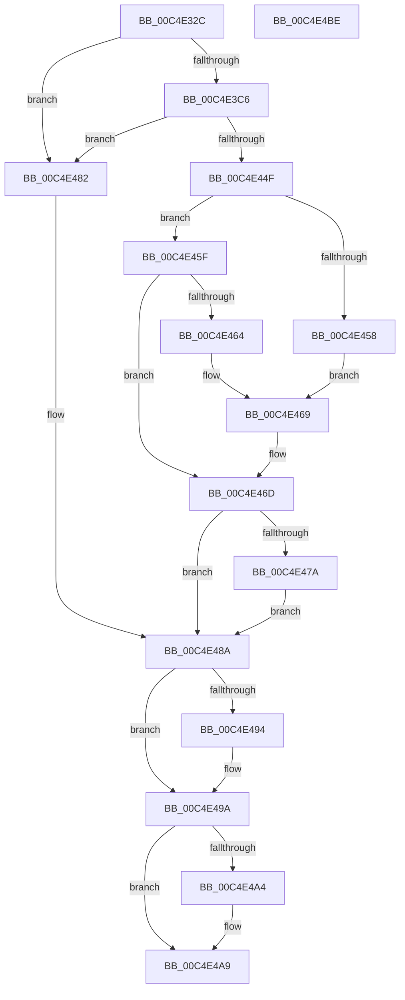

# EtwpReadConfigParameters

- RVA: `0x00C4E32C`–`0x00C4E4BF` (길이 `403` bytes)
- VA: `0x0000000140C4E32C`
- 실행 섹션: `INIT`
- PDB 이름 있음: `예`; PDB Function 태그: `아니요`
- unwind 정보 RVA: `0x000D36B4`
- 디코드: `96`개 명령, `403/403` bytes 표시
- 미해석 바이트: `0` (있으면 어셈블리에 `.byte`로 보존)

> 이 문서는 커널 이미지의 기계어와 PDB 기호를 분석해 생성했습니다. 4번과 5번은 함수 원형과 자료형을 바이너리 사용 방식에서 추정한 C 해석이며 원본 소스 복구 결과는 아닙니다.

## 1. Dependencies

- 직접 호출 지점: **6**; 고유 호출 대상: **6**
- 직접 호출자로 확인된 함수: **1**
- RIP 상대 이미지 참조: **7**

### Outgoing calls
- `0x00C4E37C` → [RtlInitUnicodeString](../../text/42/RtlInitUnicodeString_function_0042A780.md) (function, `0x0042A780`)
- `0x00C4E3B9` → [ZwOpenKey](../../text/6A/ZwOpenKey_function_006AD310.md) (function, `0x006AD310`)
- `0x00C4E3D2` → [memset](../../text/6C/memset_function_006C6C40.md) (function, `0x006C6C40`)
- `0x00C4E446` → [RtlQueryRegistryValuesEx](../../page/8C/RtlQueryRegistryValuesEx_function_008C8FF0.md) (function, `0x008C8FF0`)
- `0x00C4E4A4` → [ZwClose](../../text/6A/ZwClose_function_006AD2B0.md) (function, `0x006AD2B0`)
- `0x00C4E4B0` → [_security_check_cookie](../../text/6A/_security_check_cookie_function_006AC640.md) (function, `0x006AC640`)

### Direct callers
- [EtwpInitialize](EtwpInitialize_function_00C4DBCC.md) at `0x00C4DD74`

### Static image references
- `0x00C4E33A` → RVA `0x00E0A740` (`.data`; read)
- `0x00C4E34E` → RVA `0x00C7D850` (` ?? ::PBOPGDP::`string'`; read)
- `0x00C4E3DD` → RVA `0x007BEA40` (`EtwpQueryRegistryCallback`; read)
- `0x00C4E3FC` → RVA `0x00C7D820` (` ?? ::PBOPGDP::`string'`; read)
- `0x00C4E42A` → RVA `0x00C7D7F0` (` ?? ::PBOPGDP::`string'`; read)
- `0x00C4E48A` → RVA `0x00FD8190` (`PAGEDATA`; write)
- `0x00C4E494` → RVA `0x00E0EB30` (`.data`; write)

## 2. Other-region calls and transfers

- 다른 실행 섹션으로 향하는 call: **6**
  - `0x00C4E37C` → [RtlInitUnicodeString](../../text/42/RtlInitUnicodeString_function_0042A780.md) (`INIT` → `.text`)
  - `0x00C4E3B9` → [ZwOpenKey](../../text/6A/ZwOpenKey_function_006AD310.md) (`INIT` → `.text`)
  - `0x00C4E3D2` → [memset](../../text/6C/memset_function_006C6C40.md) (`INIT` → `.text`)
  - `0x00C4E446` → [RtlQueryRegistryValuesEx](../../page/8C/RtlQueryRegistryValuesEx_function_008C8FF0.md) (`INIT` → `PAGE`)
  - `0x00C4E4A4` → [ZwClose](../../text/6A/ZwClose_function_006AD2B0.md) (`INIT` → `.text`)
  - `0x00C4E4B0` → [_security_check_cookie](../../text/6A/_security_check_cookie_function_006AC640.md) (`INIT` → `.text`)
- 별도 외부 분기/꼬리 이동을 확인하지 못했습니다.

## 3. Assembly (complete function range)

```asm
00C4E32C  40 55                           push rbp
00C4E32E  48 8D 6C 24 90                  lea rbp, [rsp - 0x70]
00C4E333  48 81 EC 70 01 00 00            sub rsp, 0x170
00C4E33A  48 8B 05 FF C3 1B 00            mov rax, qword ptr [rip + 0x1bc3ff]
00C4E341  48 33 C4                        xor rax, rsp
00C4E344  48 89 45 60                     mov qword ptr [rbp + 0x60], rax
00C4E348  48 83 64 24 38 00               and qword ptr [rsp + 0x38], 0
00C4E34E  48 8D 15 FB F4 02 00            lea rdx, [rip + 0x2f4fb]
00C4E355  33 C0                           xor eax, eax
00C4E357  C7 44 24 30 0A 00 00 00         mov dword ptr [rsp + 0x30], 0xa
00C4E35F  21 44 24 6C                     and dword ptr [rsp + 0x6c], eax
00C4E363  48 8D 4C 24 40                  lea rcx, [rsp + 0x40]
00C4E368  21 44 24 34                     and dword ptr [rsp + 0x34], eax
00C4E36C  0F 57 C0                        xorps xmm0, xmm0
00C4E36F  89 44 24 54                     mov dword ptr [rsp + 0x54], eax
00C4E373  21 44 24 54                     and dword ptr [rsp + 0x54], eax
00C4E377  0F 11 44 24 40                  movups xmmword ptr [rsp + 0x40], xmm0
00C4E37C  E8 FF C3 7D FF                  call 0x14042a780
00C4E381  48 83 64 24 58 00               and qword ptr [rsp + 0x58], 0
00C4E387  48 8D 44 24 40                  lea rax, [rsp + 0x40]
00C4E38C  0F 57 C0                        xorps xmm0, xmm0
00C4E38F  48 89 44 24 60                  mov qword ptr [rsp + 0x60], rax
00C4E394  4C 8D 44 24 50                  lea r8, [rsp + 0x50]
00C4E399  C7 44 24 50 30 00 00 00         mov dword ptr [rsp + 0x50], 0x30
00C4E3A1  BA 19 00 02 00                  mov edx, 0x20019
00C4E3A6  C7 44 24 68 40 02 00 00         mov dword ptr [rsp + 0x68], 0x240
00C4E3AE  48 8D 4C 24 38                  lea rcx, [rsp + 0x38]
00C4E3B3  F3 0F 7F 44 24 70               movdqu xmmword ptr [rsp + 0x70], xmm0
00C4E3B9  E8 52 EF A5 FF                  call 0x1406ad310
00C4E3BE  85 C0                           test eax, eax
00C4E3C0  0F 88 BC 00 00 00               js 0x140c4e482
00C4E3C6  33 D2                           xor edx, edx
00C4E3C8  48 8D 4D B0                     lea rcx, [rbp - 0x50]
00C4E3CC  41 B8 A8 00 00 00               mov r8d, 0xa8
00C4E3D2  E8 69 88 A7 FF                  call 0x1406c6c40
00C4E3D7  48 83 64 24 20 00               and qword ptr [rsp + 0x20], 0
00C4E3DD  48 8D 0D 5C 06 B7 FF            lea rcx, [rip - 0x48f9a4]
00C4E3E4  BA 04 00 00 00                  mov edx, 4
00C4E3E9  48 89 4D B0                     mov qword ptr [rbp - 0x50], rcx
00C4E3ED  48 8D 45 80                     lea rax, [rbp - 0x80]
00C4E3F1  89 55 D0                        mov dword ptr [rbp - 0x30], edx
00C4E3F4  48 89 45 C8                     mov qword ptr [rbp - 0x38], rax
00C4E3F8  4C 8D 45 B0                     lea r8, [rbp - 0x50]
00C4E3FC  48 8D 05 1D F4 02 00            lea rax, [rip + 0x2f41d]
00C4E403  89 55 80                        mov dword ptr [rbp - 0x80], edx
00C4E406  48 89 45 C0                     mov qword ptr [rbp - 0x40], rax
00C4E40A  45 33 C9                        xor r9d, r9d
00C4E40D  48 8D 44 24 30                  lea rax, [rsp + 0x30]
00C4E412  48 89 4D E8                     mov qword ptr [rbp - 0x18], rcx
00C4E416  48 89 45 88                     mov qword ptr [rbp - 0x78], rax
00C4E41A  B9 00 00 00 40                  mov ecx, 0x40000000
00C4E41F  48 8D 45 90                     lea rax, [rbp - 0x70]
00C4E423  89 55 08                        mov dword ptr [rbp + 8], edx
00C4E426  48 89 45 00                     mov qword ptr [rbp], rax
00C4E42A  48 8D 05 BF F3 02 00            lea rax, [rip + 0x2f3bf]
00C4E431  48 89 45 F8                     mov qword ptr [rbp - 8], rax
00C4E435  48 8D 44 24 34                  lea rax, [rsp + 0x34]
00C4E43A  89 55 90                        mov dword ptr [rbp - 0x70], edx
00C4E43D  48 8B 54 24 38                  mov rdx, qword ptr [rsp + 0x38]
00C4E442  48 89 45 98                     mov qword ptr [rbp - 0x68], rax
00C4E446  E8 A5 AB C7 FF                  call 0x1408c8ff0
00C4E44B  85 C0                           test eax, eax
00C4E44D  78 33                           js 0x140c4e482
00C4E44F  8B 44 24 30                     mov eax, dword ptr [rsp + 0x30]
00C4E453  83 F8 32                        cmp eax, 0x32
00C4E456  76 07                           jbe 0x140c4e45f
00C4E458  B8 32 00 00 00                  mov eax, 0x32
00C4E45D  EB 0A                           jmp 0x140c4e469
00C4E45F  83 F8 0A                        cmp eax, 0xa
00C4E462  73 09                           jae 0x140c4e46d
00C4E464  B8 0A 00 00 00                  mov eax, 0xa
00C4E469  89 44 24 30                     mov dword ptr [rsp + 0x30], eax
00C4E46D  8B 4C 24 34                     mov ecx, dword ptr [rsp + 0x34]
00C4E471  BA 20 BF 02 00                  mov edx, 0x2bf20
00C4E476  3B CA                           cmp ecx, edx
00C4E478  76 10                           jbe 0x140c4e48a
00C4E47A  8B CA                           mov ecx, edx
00C4E47C  89 54 24 34                     mov dword ptr [rsp + 0x34], edx
00C4E480  EB 08                           jmp 0x140c4e48a
00C4E482  8B 44 24 30                     mov eax, dword ptr [rsp + 0x30]
00C4E486  8B 4C 24 34                     mov ecx, dword ptr [rsp + 0x34]
00C4E48A  89 05 00 9D 38 00               mov dword ptr [rip + 0x389d00], eax
00C4E490  85 C9                           test ecx, ecx
00C4E492  74 06                           je 0x140c4e49a
00C4E494  89 0D 96 06 1C 00               mov dword ptr [rip + 0x1c0696], ecx
00C4E49A  48 8B 4C 24 38                  mov rcx, qword ptr [rsp + 0x38]
00C4E49F  48 85 C9                        test rcx, rcx
00C4E4A2  74 05                           je 0x140c4e4a9
00C4E4A4  E8 07 EE A5 FF                  call 0x1406ad2b0
00C4E4A9  48 8B 4D 60                     mov rcx, qword ptr [rbp + 0x60]
00C4E4AD  48 33 CC                        xor rcx, rsp
00C4E4B0  E8 8B E1 A5 FF                  call 0x1406ac640
00C4E4B5  48 81 C4 70 01 00 00            add rsp, 0x170
00C4E4BC  5D                              pop rbp
00C4E4BD  C3                              ret
00C4E4BE  CC                              int3
```

## 4. C-style interpretation (structured pseudocode)

```c
__int64 __fastcall EtwpReadConfigParameters(__int64 a1, __int64 a2, __int64 a3, int a4)
{
    __int64 result;
    __int64 v_rsp;
    unsigned __int64 v_stack_m108;
    unsigned int v_stack_m10C;
    unsigned int v_stack_m110;
    unsigned __int64 v_stack_m118;
    unsigned __int64 v_stack_m120;
    unsigned int v_stack_m124;
    unsigned __int64 v_stack_m128;
    unsigned __int64 v_stack_m138;
    unsigned __int64 v_stack_m140;
    unsigned int v_stack_m144;
    unsigned int v_stack_m148;
    unsigned __int64 v_stack_m158;
    unsigned __int64 v_stack_m18;
    unsigned int v_stack_m70;
    unsigned __int64 v_stack_m78;
    unsigned __int64 v_stack_m80;
    unsigned __int64 v_stack_m90;
    unsigned int v_stack_mA8;
    unsigned __int64 v_stack_mB0;
    unsigned __int64 v_stack_mB8;
    unsigned __int64 v_stack_mC8;
    unsigned __int64 v_stack_mE0;
    unsigned __int64 v_stack_mE8;
    unsigned __int64 v_stack_mF0;
    unsigned __int64 v_stack_mF8;

    v_rsp = (v_rsp) - (368);
    result = (*(unsigned __int64 *)(v_rip + 1819647)) ^ (v_rsp);
    v_stack_m18 = result;
    result = 0;
    v_stack_m148 = 10;
    v_stack_m124 = 0;
    v_stack_m138 = v_xmm0;
    result = RtlInitUnicodeString(v_stack_m138, v_rip + 193787, a3, a4);
    v_stack_m118 = v_stack_m138;
    v_stack_m128 = 48;
    v_stack_m110 = 576;
    v_stack_m108 = v_xmm0;
    result = ZwOpenKey(v_stack_m140, (unsigned int)(0x20019ULL), v_stack_m128, a4);
    if (sign_flag) goto loc_00C4E482;
    a2 = 0;
    result = memset(v_stack_mC8, a2, 168, a4);
    v_stack_mC8 = v_rip - 4782500;
    v_stack_mA8 = 4;
    v_stack_mB0 = v_stack_mF8;
    v_stack_mF8 = 4;
    v_stack_mB8 = v_rip + 193565;
    a4 = 0;
    v_stack_m90 = v_rip - 4782500;
    v_stack_mF0 = v_stack_m148;
    v_stack_m70 = 4;
    v_stack_m78 = v_stack_mE8;
    v_stack_m80 = v_rip + 193471;
    v_stack_mE8 = 4;
    v_stack_mE0 = v_stack_m144;
    result = RtlQueryRegistryValuesEx((unsigned int)(0x40000000ULL), v_stack_m140, v_stack_mC8, a4);
    if (sign_flag) goto loc_00C4E482;
    if (((unsigned int)((unsigned int)(v_stack_m148))) <= 50) goto loc_00C4E45F;
    goto loc_00C4E469;
loc_00C4E45F:
    if (50 >= 10) goto loc_00C4E46D;
loc_00C4E469:
    v_stack_m148 = 10;
loc_00C4E46D:
    if (((unsigned int)((unsigned int)(v_stack_m144))) <= ((unsigned int)((unsigned int)(0x2BF20ULL)))) goto loc_00C4E48A;
    v_stack_m144 = (unsigned int)((unsigned int)(0x2BF20ULL));
    goto loc_00C4E48A;
loc_00C4E482:
loc_00C4E48A:
    *(unsigned int *)(v_rip + 3710208) = (unsigned int)((unsigned int)(v_stack_m148));
    if ((unsigned int)((unsigned int)(v_stack_m144)) != 0) {
        *(unsigned int *)(v_rip + 1836694) = (unsigned int)((unsigned int)(v_stack_m144));
    }
    result = (unsigned int)(v_stack_m148);
    if (v_stack_m140 != 0) {
        result = ZwClose(v_stack_m140, (unsigned int)(0x2BF20ULL), v_stack_mC8, a4);
    }
    a1 = (v_stack_m18) ^ (v_rsp);
    result = _security_check_cookie(a1, (unsigned int)(0x2BF20ULL), v_stack_mC8, a4);
    v_rsp = (v_rsp) + (368);
    return result;
}
```

## 5. (Beta) C Style

```c
int64_t EtwpReadConfigParameters(int64_t Arg1, int64_t Arg2, int64_t Arg3, int32_t Arg4)
{
    int64_t result;
    int64_t local_rsp;
    uint64_t v_stack_m108;
    uint32_t v_stack_m10C;
    uint32_t v_stack_m110;
    uint64_t v_stack_m118;
    uint64_t v_stack_m120;
    uint32_t v_stack_m124;
    uint64_t v_stack_m128;
    uint64_t v_stack_m138;
    uint64_t v_stack_m140;
    uint32_t v_stack_m144;
    uint32_t v_stack_m148;
    uint64_t v_stack_m158;
    uint64_t v_stack_m18;
    uint32_t v_stack_m70;
    uint64_t v_stack_m78;
    uint64_t v_stack_m80;
    uint64_t v_stack_m90;
    uint32_t v_stack_mA8;
    uint64_t v_stack_mB0;
    uint64_t v_stack_mB8;
    uint64_t v_stack_mC8;
    uint64_t v_stack_mE0;
    uint64_t v_stack_mE8;
    uint64_t v_stack_mF0;
    uint64_t v_stack_mF8;

    local_rsp = (local_rsp) - (368);
    result = (*(uint64_t *)(v_rip + 0x1BC3FF)) ^ (local_rsp);
    v_stack_m18 = result;
    result = 0;
    v_stack_m148 = 10;
    v_stack_m124 = 0;
    v_stack_m138 = v_xmm0;
    result = RtlInitUnicodeString(v_stack_m138, v_rip + 193787, Arg3, Arg4);
    v_stack_m118 = v_stack_m138;
    v_stack_m128 = 48;
    v_stack_m110 = 576;
    v_stack_m108 = v_xmm0;
    result = ZwOpenKey(v_stack_m140, (uint32_t)(0x20019ULL), v_stack_m128, Arg4);
    if (sign_flag) goto loc_00C4E482;
    Arg2 = 0;
    result = memset(v_stack_mC8, Arg2, 168, Arg4);
    v_stack_mC8 = v_rip - 4782500;
    v_stack_mA8 = 4;
    v_stack_mB0 = v_stack_mF8;
    v_stack_mF8 = 4;
    v_stack_mB8 = v_rip + 193565;
    Arg4 = 0;
    v_stack_m90 = v_rip - 4782500;
    v_stack_mF0 = v_stack_m148;
    v_stack_m70 = 4;
    v_stack_m78 = v_stack_mE8;
    v_stack_m80 = v_rip + 193471;
    v_stack_mE8 = 4;
    v_stack_mE0 = v_stack_m144;
    result = RtlQueryRegistryValuesEx((uint32_t)(0x40000000ULL), v_stack_m140, v_stack_mC8, Arg4);
    if (sign_flag) goto loc_00C4E482;
    if (((uint32_t)((uint32_t)(v_stack_m148))) <= 50) goto loc_00C4E45F;
    goto loc_00C4E469;
loc_00C4E45F:
    if (50 >= 10) goto loc_00C4E46D;
loc_00C4E469:
    v_stack_m148 = 10;
loc_00C4E46D:
    if (((uint32_t)((uint32_t)(v_stack_m144))) <= ((uint32_t)((uint32_t)(0x2BF20ULL)))) goto loc_00C4E48A;
    v_stack_m144 = (uint32_t)((uint32_t)(0x2BF20ULL));
    goto loc_00C4E48A;
loc_00C4E482:
loc_00C4E48A:
    *(uint32_t *)(v_rip + 0x389D00) = (uint32_t)((uint32_t)(v_stack_m148));
    if ((uint32_t)((uint32_t)(v_stack_m144)) != 0) {
        *(uint32_t *)(v_rip + 0x1C0696) = (uint32_t)((uint32_t)(v_stack_m144));
    }
    result = (uint32_t)(v_stack_m148);
    if (v_stack_m140 != 0) {
        result = ZwClose(v_stack_m140, (uint32_t)(0x2BF20ULL), v_stack_mC8, Arg4);
    }
    Arg1 = (v_stack_m18) ^ (local_rsp);
    result = _security_check_cookie(Arg1, (uint32_t)(0x2BF20ULL), v_stack_mC8, Arg4);
    local_rsp = (local_rsp) + (368);
    return result;
}
```

## 6. Execution-region graph

[열기: 2D/3D 그래프와 함수 탐색 컨트롤 패널](../../../control-panel.html?section=init&rva=0x00C4E32C&view=graph)

- 2D 그래프는 위에서 아래로 흐르고, 3D 그래프는 빈 공간을 드래그해 회전합니다. Shift+드래그는 이동, 휠은 확대·축소, 함수 노드 선택은 대상 보고서 이동입니다.

### Static fallback


