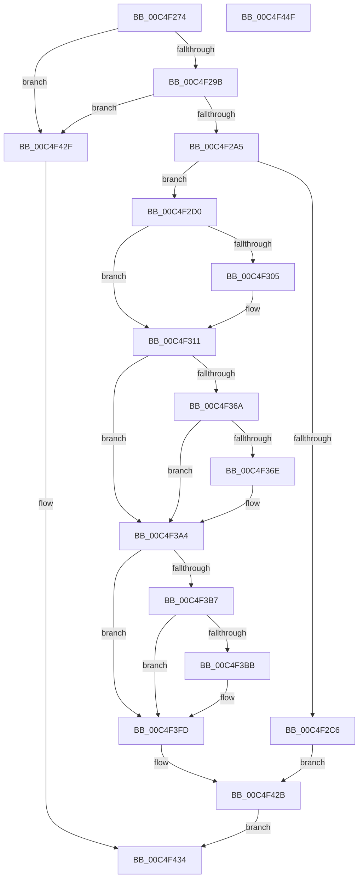

# EtwpStartBootLogger

- RVA: `0x00C4F274`–`0x00C4F450` (길이 `476` bytes)
- VA: `0x0000000140C4F274`
- 실행 섹션: `INIT`
- PDB 이름 있음: `예`; PDB Function 태그: `아니요`
- unwind 정보 RVA: `0x0005E6B4`
- 디코드: `114`개 명령, `476/476` bytes 표시
- 미해석 바이트: `0` (있으면 어셈블리에 `.byte`로 보존)

> 이 문서는 커널 이미지의 기계어와 PDB 기호를 분석해 생성했습니다. 4번과 5번은 함수 원형과 자료형을 바이너리 사용 방식에서 추정한 C 해석이며 원본 소스 복구 결과는 아닙니다.

## 1. Dependencies

- 직접 호출 지점: **7**; 고유 호출 대상: **5**
- 직접 호출자로 확인된 함수: **1**
- RIP 상대 이미지 참조: **1**

### Outgoing calls
- `0x00C4F2B9` → [ExAllocatePool2](../../poolcode/B8/ExAllocatePool2_function_00B820F0.md) (function, `0x00B820F0`)
- `0x00C4F2F7` → [RtlInitUnicodeString](../../text/42/RtlInitUnicodeString_function_0042A780.md) (function, `0x0042A780`)
- `0x00C4F30C` → [RtlInitUnicodeString](../../text/42/RtlInitUnicodeString_function_0042A780.md) (function, `0x0042A780`)
- `0x00C4F398` → [memcpy](../../text/6C/memcpy_function_006C6840.md) (function, `0x006C6840`)
- `0x00C4F3F1` → [memcpy](../../text/6C/memcpy_function_006C6840.md) (function, `0x006C6840`)
- `0x00C4F417` → [EtwpStartLogger](../../page/A9/EtwpStartLogger_function_00A99D80.md) (function, `0x00A99D80`)
- `0x00C4F426` → [ExFreePoolWithTag](../../poolcode/B8/ExFreePoolWithTag_function_00B82870.md) (function, `0x00B82870`)

### Direct callers
- [EtwpInitialize](EtwpInitialize_function_00C4DBCC.md) at `0x00C4DCDC`

### Static image references
- `0x00C4F407` → RVA `0x00FC6AA8` (`ALMOSTRO`; read)

## 2. Other-region calls and transfers

- 다른 실행 섹션으로 향하는 call: **7**
  - `0x00C4F2B9` → [ExAllocatePool2](../../poolcode/B8/ExAllocatePool2_function_00B820F0.md) (`INIT` → `POOLCODE`)
  - `0x00C4F2F7` → [RtlInitUnicodeString](../../text/42/RtlInitUnicodeString_function_0042A780.md) (`INIT` → `.text`)
  - `0x00C4F30C` → [RtlInitUnicodeString](../../text/42/RtlInitUnicodeString_function_0042A780.md) (`INIT` → `.text`)
  - `0x00C4F398` → [memcpy](../../text/6C/memcpy_function_006C6840.md) (`INIT` → `.text`)
  - `0x00C4F3F1` → [memcpy](../../text/6C/memcpy_function_006C6840.md) (`INIT` → `.text`)
  - `0x00C4F417` → [EtwpStartLogger](../../page/A9/EtwpStartLogger_function_00A99D80.md) (`INIT` → `PAGE`)
  - `0x00C4F426` → [ExFreePoolWithTag](../../poolcode/B8/ExFreePoolWithTag_function_00B82870.md) (`INIT` → `POOLCODE`)
- 별도 외부 분기/꼬리 이동을 확인하지 못했습니다.

## 3. Assembly (complete function range)

```asm
00C4F274  48 8B C4                        mov rax, rsp
00C4F277  48 89 58 08                     mov qword ptr [rax + 8], rbx
00C4F27B  48 89 68 10                     mov qword ptr [rax + 0x10], rbp
00C4F27F  48 89 70 18                     mov qword ptr [rax + 0x18], rsi
00C4F283  48 89 78 20                     mov qword ptr [rax + 0x20], rdi
00C4F287  41 56                           push r14
00C4F289  48 83 EC 20                     sub rsp, 0x20
00C4F28D  33 F6                           xor esi, esi
00C4F28F  48 8B F9                        mov rdi, rcx
00C4F292  48 85 C9                        test rcx, rcx
00C4F295  0F 84 94 01 00 00               je 0x140c4f42f
00C4F29B  48 39 71 10                     cmp qword ptr [rcx + 0x10], rsi
00C4F29F  0F 84 8A 01 00 00               je 0x140c4f42f
00C4F2A5  41 BE 00 01 00 00               mov r14d, 0x100
00C4F2AB  BA E4 04 00 00                  mov edx, 0x4e4
00C4F2B0  41 8B CE                        mov ecx, r14d
00C4F2B3  41 B8 45 74 77 50               mov r8d, 0x50777445
00C4F2B9  E8 32 2E F3 FF                  call 0x140b820f0
00C4F2BE  48 8B D8                        mov rbx, rax
00C4F2C1  48 85 C0                        test rax, rax
00C4F2C4  75 0A                           jne 0x140c4f2d0
00C4F2C6  BF 17 00 00 C0                  mov edi, 0xc0000017
00C4F2CB  E9 5B 01 00 00                  jmp 0x140c4f42b
00C4F2D0  C7 40 2C 00 00 02 00            mov dword ptr [rax + 0x2c], 0x20000
00C4F2D7  48 8D 8B 90 00 00 00            lea rcx, [rbx + 0x90]
00C4F2DE  8B 47 30                        mov eax, dword ptr [rdi + 0x30]
00C4F2E1  89 43 40                        mov dword ptr [rbx + 0x40], eax
00C4F2E4  8B 47 34                        mov eax, dword ptr [rdi + 0x34]
00C4F2E7  89 43 28                        mov dword ptr [rbx + 0x28], eax
00C4F2EA  0F 10 47 20                     movups xmm0, xmmword ptr [rdi + 0x20]
00C4F2EE  F3 0F 7F 43 18                  movdqu xmmword ptr [rbx + 0x18], xmm0
00C4F2F3  48 8B 57 10                     mov rdx, qword ptr [rdi + 0x10]
00C4F2F7  E8 84 B4 7D FF                  call 0x14042a780
00C4F2FC  48 8B 57 18                     mov rdx, qword ptr [rdi + 0x18]
00C4F300  48 85 D2                        test rdx, rdx
00C4F303  74 0C                           je 0x140c4f311
00C4F305  48 8D 8B 80 00 00 00            lea rcx, [rbx + 0x80]
00C4F30C  E8 6F B4 7D FF                  call 0x14042a780
00C4F311  8B 47 38                        mov eax, dword ptr [rdi + 0x38]
00C4F314  BD 01 00 00 00                  mov ebp, 1
00C4F319  89 43 30                        mov dword ptr [rbx + 0x30], eax
00C4F31C  8B 47 3C                        mov eax, dword ptr [rdi + 0x3c]
00C4F31F  89 43 34                        mov dword ptr [rbx + 0x34], eax
00C4F322  8B 47 40                        mov eax, dword ptr [rdi + 0x40]
00C4F325  89 43 38                        mov dword ptr [rbx + 0x38], eax
00C4F328  8B 47 44                        mov eax, dword ptr [rdi + 0x44]
00C4F32B  89 43 4C                        mov dword ptr [rbx + 0x4c], eax
00C4F32E  8B 47 48                        mov eax, dword ptr [rdi + 0x48]
00C4F331  81 4B 70 02 00 00 80            or dword ptr [rbx + 0x70], 0x80000002
00C4F338  C7 43 48 00 00 00 80            mov dword ptr [rbx + 0x48], 0x80000000
00C4F33F  89 43 3C                        mov dword ptr [rbx + 0x3c], eax
00C4F342  8D 45 1F                        lea eax, [rbp + 0x1f]
00C4F345  C6 43 4A FF                     mov byte ptr [rbx + 0x4a], 0xff
00C4F349  66 C7 43 48 B0 00               mov word ptr [rbx + 0x48], 0xb0
00C4F34F  C7 83 B0 00 00 00 01 00 00 00   mov dword ptr [rbx + 0xb0], 1
00C4F359  8B 4F 58                        mov ecx, dword ptr [rdi + 0x58]
00C4F35C  3B C8                           cmp ecx, eax
00C4F35E  0F 47 C8                        cmova ecx, eax
00C4F361  C1 E9 02                        shr ecx, 2
00C4F364  48 39 77 50                     cmp qword ptr [rdi + 0x50], rsi
00C4F368  74 3A                           je 0x140c4f3a4
00C4F36A  85 C9                           test ecx, ecx
00C4F36C  74 36                           je 0x140c4f3a4
00C4F36E  8D 04 29                        lea eax, [rcx + rbp]
00C4F371  66 89 AB B6 00 00 00            mov word ptr [rbx + 0xb6], bp
00C4F378  66 89 83 B4 00 00 00            mov word ptr [rbx + 0xb4], ax
00C4F37F  66 01 83 B0 00 00 00            add word ptr [rbx + 0xb0], ax
00C4F386  48 8B 57 50                     mov rdx, qword ptr [rdi + 0x50]
00C4F38A  44 8B C1                        mov r8d, ecx
00C4F38D  48 8D 8B B8 00 00 00            lea rcx, [rbx + 0xb8]
00C4F394  49 C1 E0 02                     shl r8, 2
00C4F398  E8 A3 74 A7 FF                  call 0x1406c6840
00C4F39D  66 01 AB B2 00 00 00            add word ptr [rbx + 0xb2], bp
00C4F3A4  8B 57 68                        mov edx, dword ptr [rdi + 0x68]
00C4F3A7  C1 EA 02                        shr edx, 2
00C4F3AA  41 3B D6                        cmp edx, r14d
00C4F3AD  41 0F 47 D6                     cmova edx, r14d
00C4F3B1  48 39 77 60                     cmp qword ptr [rdi + 0x60], rsi
00C4F3B5  74 46                           je 0x140c4f3fd
00C4F3B7  85 D2                           test edx, edx
00C4F3B9  74 42                           je 0x140c4f3fd
00C4F3BB  0F B7 8B B0 00 00 00            movzx ecx, word ptr [rbx + 0xb0]
00C4F3C2  8D 04 2A                        lea eax, [rdx + rbp]
00C4F3C5  44 8B C2                        mov r8d, edx
00C4F3C8  49 C1 E0 02                     shl r8, 2
00C4F3CC  66 C7 84 8B B2 00 00 00 03 00   mov word ptr [rbx + rcx*4 + 0xb2], 3
00C4F3D6  66 89 84 8B B0 00 00 00         mov word ptr [rbx + rcx*4 + 0xb0], ax
00C4F3DE  48 83 C1 2D                     add rcx, 0x2d
00C4F3E2  66 01 83 B0 00 00 00            add word ptr [rbx + 0xb0], ax
00C4F3E9  48 8B 57 60                     mov rdx, qword ptr [rdi + 0x60]
00C4F3ED  48 8D 0C 8B                     lea rcx, [rbx + rcx*4]
00C4F3F1  E8 4A 74 A7 FF                  call 0x1406c6840
00C4F3F6  66 01 AB B2 00 00 00            add word ptr [rbx + 0xb2], bp
00C4F3FD  0F B7 83 B0 00 00 00            movzx eax, word ptr [rbx + 0xb0]
00C4F404  48 8B D3                        mov rdx, rbx
00C4F407  48 8B 0D 9A 76 37 00            mov rcx, qword ptr [rip + 0x37769a]
00C4F40E  8D 04 85 B0 00 00 00            lea eax, [rax*4 + 0xb0]
00C4F415  89 03                           mov dword ptr [rbx], eax
00C4F417  E8 64 A9 E4 FF                  call 0x140a99d80
00C4F41C  8B F8                           mov edi, eax
00C4F41E  BA 45 74 77 50                  mov edx, 0x50777445
00C4F423  48 8B CB                        mov rcx, rbx
00C4F426  E8 45 34 F3 FF                  call 0x140b82870
00C4F42B  8B C7                           mov eax, edi
00C4F42D  EB 05                           jmp 0x140c4f434
00C4F42F  B8 0D 00 00 C0                  mov eax, 0xc000000d
00C4F434  48 8B 5C 24 30                  mov rbx, qword ptr [rsp + 0x30]
00C4F439  48 8B 6C 24 38                  mov rbp, qword ptr [rsp + 0x38]
00C4F43E  48 8B 74 24 40                  mov rsi, qword ptr [rsp + 0x40]
00C4F443  48 8B 7C 24 48                  mov rdi, qword ptr [rsp + 0x48]
00C4F448  48 83 C4 20                     add rsp, 0x20
00C4F44C  41 5E                           pop r14
00C4F44E  C3                              ret
00C4F44F  CC                              int3
```

## 4. C-style interpretation (structured pseudocode)

```c
__int64 __fastcall EtwpStartBootLogger(__int64 a1)
{
    __int64 result;
    __int64 v_rsi;
    __int64 v_rsp;
    unsigned __int64 v_stack_p10;
    unsigned __int64 v_stack_p18;
    unsigned __int64 v_stack_p20;
    unsigned __int64 v_stack_p8;

    *(unsigned __int64 *)(v_rsp + 8) = v_rbx;
    *(unsigned __int64 *)(v_rsp + 16) = v_rbp;
    *(unsigned __int64 *)(v_rsp + 24) = v_rsi;
    *(unsigned __int64 *)(v_rsp + 32) = v_rdi;
    v_rsp = (v_rsp) - (32);
    v_rsi = 0;
    if (a1 == 0) goto loc_00C4F42F;
    if ((*(unsigned __int64 *)(a1 + 16)) == 0) goto loc_00C4F42F;
    result = ExAllocatePool2(256, (unsigned int)(0x4E4ULL), (unsigned int)(0x50777445ULL), a4);
    if (result != 0) goto loc_00C4F2D0;
    goto loc_00C4F42B;
loc_00C4F2D0:
    *(unsigned int *)(result + 44) = 0x20000ULL;
    *(unsigned int *)(result + 64) = (unsigned int)((unsigned int)(*(unsigned int *)((unsigned int)(0xC0000017ULL) + 48)));
    *(unsigned int *)(result + 40) = (unsigned int)((unsigned int)(*(unsigned int *)((unsigned int)(0xC0000017ULL) + 52)));
    *(unsigned __int64 *)(result + 24) = v_xmm0;
    result = RtlInitUnicodeString(result + 144, *(unsigned __int64 *)((unsigned int)(0xC0000017ULL) + 16), (unsigned int)(0x50777445ULL), a4);
    if (*(unsigned __int64 *)((unsigned int)(0xC0000017ULL) + 24) != 0) {
        a1 = result + 128;
        result = RtlInitUnicodeString(a1, *(unsigned __int64 *)((unsigned int)(0xC0000017ULL) + 24), (unsigned int)(0x50777445ULL), a4);
    }
    *(unsigned int *)(result + 48) = (unsigned int)((unsigned int)(*(unsigned int *)((unsigned int)(0xC0000017ULL) + 56)));
    *(unsigned int *)(result + 52) = (unsigned int)((unsigned int)(*(unsigned int *)((unsigned int)(0xC0000017ULL) + 60)));
    *(unsigned int *)(result + 56) = (unsigned int)((unsigned int)(*(unsigned int *)((unsigned int)(0xC0000017ULL) + 64)));
    *(unsigned int *)(result + 76) = (unsigned int)((unsigned int)(*(unsigned int *)((unsigned int)(0xC0000017ULL) + 68)));
    *(unsigned int *)(result + 72) = 0x80000000ULL;
    *(unsigned int *)(result + 60) = (unsigned int)((unsigned int)(*(unsigned int *)((unsigned int)(0xC0000017ULL) + 72)));
    *(unsigned __int8 *)(result + 74) = 255;
    *(unsigned __int16 *)(result + 72) = 176;
    *(unsigned int *)(result + 176) = 1;
    a1 = (unsigned int)(*(unsigned int *)((unsigned int)(0xC0000017ULL) + 88));
    if (((unsigned int)((unsigned int)(*(unsigned int *)((unsigned int)(0xC0000017ULL) + 88)))) > ((unsigned int)(1 + 31))) { a1 = (unsigned int)(1 + 31); }
    a1 = (unsigned int)((a1) >> (2));
    if ((*(unsigned __int64 *)((unsigned int)(0xC0000017ULL) + 80)) == 0) goto loc_00C4F3A4;
    result = 1 + 31;
    if ((unsigned int)(a1) != 0) {
        result = a1 + 1 * 1;
        *(unsigned __int16 *)(result + 182) = 1;
        *(unsigned __int16 *)(result + 180) = (unsigned __int16)(result);
        a2 = *(unsigned __int64 *)((unsigned int)(0xC0000017ULL) + 80);
        a3 = (unsigned int)(a1);
        a1 = result + 184;
        a3 = (a3) << (2);
        result = memcpy(a1, a2, a3, a4);
    }
    a2 = (unsigned int)(((unsigned int)(*(unsigned int *)((unsigned int)(0xC0000017ULL) + 104))) >> (2));
    if (((unsigned int)(a2)) > 256) { a2 = 256; }
    if ((*(unsigned __int64 *)((unsigned int)(0xC0000017ULL) + 96)) == 0) goto loc_00C4F3FD;
    if ((unsigned int)(a2) != 0) {
        a1 = *(unsigned __int16 *)(result + 176);
        result = a2 + 1 * 1;
        a3 = (unsigned int)(a2);
        a3 = (a3) << (2);
        *(unsigned __int16 *)(result + a1 * 4 + 178) = 3;
        *(unsigned __int16 *)(result + a1 * 4 + 176) = (unsigned __int16)(result);
        a1 = (a1) + (45);
        a2 = *(unsigned __int64 *)((unsigned int)(0xC0000017ULL) + 96);
        a1 = result + a1 * 4;
        result = memcpy(a1, a2, a3, a4);
    }
    *(unsigned int *)(result) = (unsigned int)(*(unsigned __int16 *)(result + 176) * 4 + 176);
    result = EtwpStartLogger(*(unsigned __int64 *)(v_rip + 3634842), result, a3, a4);
    result = ExFreePoolWithTag(result, (unsigned int)(0x50777445ULL), a3, a4);
loc_00C4F42B:
    goto loc_00C4F434;
loc_00C4F42F:
loc_00C4F434:
    v_rsp = (v_rsp) + (32);
    return (unsigned int)(0xC000000DULL);
}
```

## 5. (Beta) C Style

```c
int64_t EtwpStartBootLogger(void *Arg1)
{
    uint8_t *arg1 = (uint8_t *)Arg1;

    int64_t result;
    int64_t local_rsi;
    int64_t local_rsp;
    uint64_t v_stack_p10;
    uint64_t v_stack_p18;
    uint64_t v_stack_p20;
    uint64_t v_stack_p8;

    *(uint64_t *)(local_rsp + 0x8) = local_rbx;
    *(uint64_t *)(local_rsp + 0x10) = local_rbp;
    *(uint64_t *)(local_rsp + 0x18) = local_rsi;
    *(uint64_t *)(local_rsp + 0x20) = local_rdi;
    local_rsp = (local_rsp) - (32);
    local_rsi = 0;
    if (Arg1 == NULL) goto loc_00C4F42F;
    if ((*(uint64_t *)(arg1 + 0x10)) == 0) goto loc_00C4F42F;
    result = ExAllocatePool2(256, (uint32_t)(0x4E4ULL), (uint32_t)(0x50777445ULL), a4);
    if (result != 0) goto loc_00C4F2D0;
    goto loc_00C4F42B;
loc_00C4F2D0:
    *(uint32_t *)(result + 0x2C) = 0x20000ULL;
    *(uint32_t *)(result + 0x40) = (uint32_t)((uint32_t)(*(uint32_t *)((uint32_t)(0xC0000017ULL) + 0x30)));
    *(uint32_t *)(result + 0x28) = (uint32_t)((uint32_t)(*(uint32_t *)((uint32_t)(0xC0000017ULL) + 0x34)));
    *(uint64_t *)(result + 0x18) = v_xmm0;
    result = RtlInitUnicodeString(result + 144, *(uint64_t *)((uint32_t)(0xC0000017ULL) + 0x10), (uint32_t)(0x50777445ULL), a4);
    if (*(uint64_t *)((uint32_t)(0xC0000017ULL) + 0x18) != 0) {
        Arg1 = result + 128;
        result = RtlInitUnicodeString(Arg1, *(uint64_t *)((uint32_t)(0xC0000017ULL) + 0x18), (uint32_t)(0x50777445ULL), a4);
    }
    *(uint32_t *)(result + 0x30) = (uint32_t)((uint32_t)(*(uint32_t *)((uint32_t)(0xC0000017ULL) + 0x38)));
    *(uint32_t *)(result + 0x34) = (uint32_t)((uint32_t)(*(uint32_t *)((uint32_t)(0xC0000017ULL) + 0x3C)));
    *(uint32_t *)(result + 0x38) = (uint32_t)((uint32_t)(*(uint32_t *)((uint32_t)(0xC0000017ULL) + 0x40)));
    *(uint32_t *)(result + 0x4C) = (uint32_t)((uint32_t)(*(uint32_t *)((uint32_t)(0xC0000017ULL) + 0x44)));
    *(uint32_t *)(result + 0x48) = 0x80000000ULL;
    *(uint32_t *)(result + 0x3C) = (uint32_t)((uint32_t)(*(uint32_t *)((uint32_t)(0xC0000017ULL) + 0x48)));
    *(uint8_t *)(result + 0x4A) = 255;
    *(uint16_t *)(result + 0x48) = 176;
    *(uint32_t *)(result + 0xB0) = 1;
    Arg1 = (uint32_t)(*(uint32_t *)((uint32_t)(0xC0000017ULL) + 0x58));
    if (((uint32_t)((uint32_t)(*(uint32_t *)((uint32_t)(0xC0000017ULL) + 0x58)))) > ((uint32_t)(1 + 31))) { Arg1 = (uint32_t)(1 + 31); }
    Arg1 = (uint32_t)((Arg1) >> (2));
    if ((*(uint64_t *)((uint32_t)(0xC0000017ULL) + 0x50)) == 0) goto loc_00C4F3A4;
    result = 1 + 31;
    if ((uint32_t)(Arg1) != 0) {
        result = Arg1 + 1 * 1;
        *(uint16_t *)(result + 0xB6) = 1;
        *(uint16_t *)(result + 0xB4) = (uint16_t)(result);
        a2 = *(uint64_t *)((uint32_t)(0xC0000017ULL) + 0x50);
        a3 = (uint32_t)(Arg1);
        Arg1 = result + 184;
        a3 = (a3) << (2);
        result = memcpy(Arg1, a2, a3, a4);
    }
    a2 = (uint32_t)(((uint32_t)(*(uint32_t *)((uint32_t)(0xC0000017ULL) + 0x68))) >> (2));
    if (((uint32_t)(a2)) > 256) { a2 = 256; }
    if ((*(uint64_t *)((uint32_t)(0xC0000017ULL) + 0x60)) == 0) goto loc_00C4F3FD;
    if ((uint32_t)(a2) != 0) {
        Arg1 = *(uint16_t *)(result + 0xB0);
        result = a2 + 1 * 1;
        a3 = (uint32_t)(a2);
        a3 = (a3) << (2);
        *(uint16_t *)(result + arg1 * 4 + 0xB2) = 3;
        *(uint16_t *)(result + arg1 * 4 + 0xB0) = (uint16_t)(result);
        Arg1 = (Arg1) + (45);
        a2 = *(uint64_t *)((uint32_t)(0xC0000017ULL) + 0x60);
        Arg1 = result + Arg1 * 4;
        result = memcpy(Arg1, a2, a3, a4);
    }
    *(uint32_t *)(result) = (uint32_t)(*(uint16_t *)(result + 0xB0) * 4 + 176);
    result = EtwpStartLogger(*(uint64_t *)(v_rip + 0x37769A), result, a3, a4);
    result = ExFreePoolWithTag(result, (uint32_t)(0x50777445ULL), a3, a4);
loc_00C4F42B:
    goto loc_00C4F434;
loc_00C4F42F:
loc_00C4F434:
    local_rsp = (local_rsp) + (32);
    return (uint32_t)(0xC000000DULL);
}
```

### 관측된 메모리 오프셋

구조체 형식이 확인되지 않은 접근은 인자 기준의 오프셋으로만 기록했습니다.

| 기준 인자 | 오프셋 표현 | 폭 (bit) | 접근 |
|---|---:|---:|---|
| `Arg1` | `+ 0x10` | `64` | `R` |
| `Arg1` | `+ 0x18` | `64` | `R` |
| `Arg1` | `+ 0x20` | `128` | `R` |
| `Arg1` | `+ 0x30` | `32` | `R` |
| `Arg1` | `+ 0x34` | `32` | `R` |
| `Arg1` | `+ 0x38` | `32` | `R` |
| `Arg1` | `+ 0x3C` | `32` | `R` |
| `Arg1` | `+ 0x40` | `32` | `R` |
| `Arg1` | `+ 0x44` | `32` | `R` |
| `Arg1` | `+ 0x48` | `32` | `R` |
| `Arg1` | `+ 0x50` | `64` | `R` |
| `Arg1` | `+ 0x58` | `32` | `R` |
| `Arg1` | `+ 0x60` | `64` | `R` |
| `Arg1` | `+ 0x68` | `32` | `R` |

## 6. Execution-region graph

[열기: 2D/3D 그래프와 함수 탐색 컨트롤 패널](../../../control-panel.html?section=init&rva=0x00C4F274&view=graph)

- 2D 그래프는 위에서 아래로 흐르고, 3D 그래프는 빈 공간을 드래그해 회전합니다. Shift+드래그는 이동, 휠은 확대·축소, 함수 노드 선택은 대상 보고서 이동입니다.

### Static fallback


