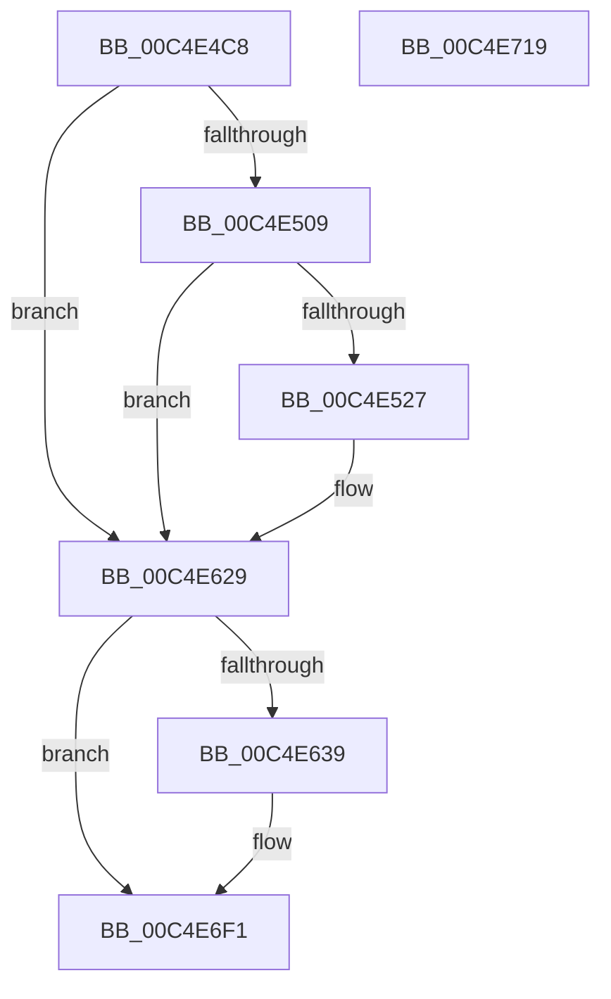

# EtwpTraceBootSystemTime

- RVA: `0x00C4E4C8`–`0x00C4E71A` (길이 `594` bytes)
- VA: `0x0000000140C4E4C8`
- 실행 섹션: `INIT`
- PDB 이름 있음: `예`; PDB Function 태그: `아니요`
- unwind 정보 RVA: `0x000D37F4`
- 디코드: `114`개 명령, `594/594` bytes 표시
- 미해석 바이트: `0` (있으면 어셈블리에 `.byte`로 보존)

> 이 문서는 커널 이미지의 기계어와 PDB 기호를 분석해 생성했습니다. 4번과 5번은 함수 원형과 자료형을 바이너리 사용 방식에서 추정한 C 해석이며 원본 소스 복구 결과는 아닙니다.

## 1. Dependencies

- 직접 호출 지점: **4**; 고유 호출 대상: **4**
- 직접 호출자로 확인된 함수: **1**
- RIP 상대 이미지 참조: **13**

### Outgoing calls
- `0x00C4E51A` → [tlgKeywordOn](../../text/42/tlgKeywordOn_function_0042EAA0.md) (function, `0x0042EAA0`)
- `0x00C4E624` → [tlgWriteTransfer_EtwWriteTransfer](../../text/42/tlgWriteTransfer_EtwWriteTransfer_function_004260E0.md) (function, `0x004260E0`)
- `0x00C4E6EC` → [EtwWriteEx](../../text/25/EtwWriteEx_function_0025F0D0.md) (function, `0x0025F0D0`)
- `0x00C4E6FB` → [_security_check_cookie](../../text/6A/_security_check_cookie_function_006AC640.md) (function, `0x006AC640`)

### Direct callers
- [EtwpTraceSystemInitialization](EtwpTraceSystemInitialization_function_00C4E720.md) at `0x00C4EAAD`

### Static image references
- `0x00C4E4E6` → RVA `0x00E0A740` (`.data`; read)
- `0x00C4E4F9` → RVA `0x00E09168` (`.data`; read)
- `0x00C4E527` → RVA `0x00FC70B8` (`ALMOSTRO`; read)
- `0x00C4E52E` → RVA `0x00053FA0` (`.rdata`; read)
- `0x00C4E551` → RVA `0x00FC70C0` (`ALMOSTRO`; read)
- `0x00C4E569` → RVA `0x00FC70C8` (`ALMOSTRO`; read)
- `0x00C4E57E` → RVA `0x00FC70D0` (`ALMOSTRO`; read)
- `0x00C4E591` → RVA `0x00E68570` (`.data`; read)
- `0x00C4E5A4` → RVA `0x00FC70D8` (`ALMOSTRO`; read)
- `0x00C4E5B7` → RVA `0x00FC70DC` (`ALMOSTRO`; read)
- `0x00C4E5CA` → RVA `0x00FC70E0` (`ALMOSTRO`; read)
- `0x00C4E629` → RVA `0x00EFFA28` (`.data`; read)
- `0x00C4E64A` → RVA `0x00022318` (`.rdata`; read)

## 2. Other-region calls and transfers

- 다른 실행 섹션으로 향하는 call: **4**
  - `0x00C4E51A` → [tlgKeywordOn](../../text/42/tlgKeywordOn_function_0042EAA0.md) (`INIT` → `.text`)
  - `0x00C4E624` → [tlgWriteTransfer_EtwWriteTransfer](../../text/42/tlgWriteTransfer_EtwWriteTransfer_function_004260E0.md) (`INIT` → `.text`)
  - `0x00C4E6EC` → [EtwWriteEx](../../text/25/EtwWriteEx_function_0025F0D0.md) (`INIT` → `.text`)
  - `0x00C4E6FB` → [_security_check_cookie](../../text/6A/_security_check_cookie_function_006AC640.md) (`INIT` → `.text`)
- 별도 외부 분기/꼬리 이동을 확인하지 못했습니다.

## 3. Assembly (complete function range)

```asm
00C4E4C8  48 8B C4                        mov rax, rsp
00C4E4CB  48 89 58 08                     mov qword ptr [rax + 8], rbx
00C4E4CF  48 89 70 10                     mov qword ptr [rax + 0x10], rsi
00C4E4D3  48 89 78 18                     mov qword ptr [rax + 0x18], rdi
00C4E4D7  55                              push rbp
00C4E4D8  48 8D A8 58 FF FF FF            lea rbp, [rax - 0xa8]
00C4E4DF  48 81 EC A0 01 00 00            sub rsp, 0x1a0
00C4E4E6  48 8B 05 53 C2 1B 00            mov rax, qword ptr [rip + 0x1bc253]
00C4E4ED  48 33 C4                        xor rax, rsp
00C4E4F0  48 89 85 90 00 00 00            mov qword ptr [rbp + 0x90], rax
00C4E4F7  33 DB                           xor ebx, ebx
00C4E4F9  83 3D 68 AC 1B 00 05            cmp dword ptr [rip + 0x1bac68], 5
00C4E500  8D 73 08                        lea esi, [rbx + 8]
00C4E503  0F 86 20 01 00 00               jbe 0x140c4e629
00C4E509  48 BA 00 00 00 00 00 20 00 00   movabs rdx, 0x200000000000
00C4E513  48 8D 0D 4E AC 1B 00            lea rcx, [rip + 0x1bac4e]
00C4E51A  E8 81 05 7E FF                  call 0x14042eaa0
00C4E51F  84 C0                           test al, al
00C4E521  0F 84 02 01 00 00               je 0x140c4e629
00C4E527  48 8B 05 8A 8B 37 00            mov rax, qword ptr [rip + 0x378b8a]
00C4E52E  48 8D 15 6B 5A 40 FF            lea rdx, [rip - 0xbfa595]
00C4E535  48 89 44 24 50                  mov qword ptr [rsp + 0x50], rax
00C4E53A  48 8D 0D 27 AC 1B 00            lea rcx, [rip + 0x1bac27]
00C4E541  48 8D 44 24 50                  lea rax, [rsp + 0x50]
00C4E546  48 89 75 18                     mov qword ptr [rbp + 0x18], rsi
00C4E54A  48 89 45 10                     mov qword ptr [rbp + 0x10], rax
00C4E54E  45 33 C9                        xor r9d, r9d
00C4E551  48 8B 05 68 8B 37 00            mov rax, qword ptr [rip + 0x378b68]
00C4E558  45 33 C0                        xor r8d, r8d
00C4E55B  48 89 44 24 58                  mov qword ptr [rsp + 0x58], rax
00C4E560  48 8D 44 24 58                  lea rax, [rsp + 0x58]
00C4E565  48 89 45 20                     mov qword ptr [rbp + 0x20], rax
00C4E569  48 8B 05 58 8B 37 00            mov rax, qword ptr [rip + 0x378b58]
00C4E570  48 89 44 24 60                  mov qword ptr [rsp + 0x60], rax
00C4E575  48 8D 44 24 60                  lea rax, [rsp + 0x60]
00C4E57A  48 89 45 30                     mov qword ptr [rbp + 0x30], rax
00C4E57E  8B 05 4C 8B 37 00               mov eax, dword ptr [rip + 0x378b4c]
00C4E584  89 44 24 44                     mov dword ptr [rsp + 0x44], eax
00C4E588  48 8D 44 24 44                  lea rax, [rsp + 0x44]
00C4E58D  48 89 45 40                     mov qword ptr [rbp + 0x40], rax
00C4E591  8A 05 D9 9F 21 00               mov al, byte ptr [rip + 0x219fd9]
00C4E597  88 44 24 40                     mov byte ptr [rsp + 0x40], al
00C4E59B  48 8D 44 24 40                  lea rax, [rsp + 0x40]
00C4E5A0  48 89 45 50                     mov qword ptr [rbp + 0x50], rax
00C4E5A4  8A 05 2E 8B 37 00               mov al, byte ptr [rip + 0x378b2e]
00C4E5AA  88 44 24 41                     mov byte ptr [rsp + 0x41], al
00C4E5AE  48 8D 44 24 41                  lea rax, [rsp + 0x41]
00C4E5B3  48 89 45 60                     mov qword ptr [rbp + 0x60], rax
00C4E5B7  8A 05 1F 8B 37 00               mov al, byte ptr [rip + 0x378b1f]
00C4E5BD  88 44 24 42                     mov byte ptr [rsp + 0x42], al
00C4E5C1  48 8D 44 24 42                  lea rax, [rsp + 0x42]
00C4E5C6  48 89 45 70                     mov qword ptr [rbp + 0x70], rax
00C4E5CA  8B 05 10 8B 37 00               mov eax, dword ptr [rip + 0x378b10]
00C4E5D0  89 44 24 48                     mov dword ptr [rsp + 0x48], eax
00C4E5D4  48 8D 44 24 48                  lea rax, [rsp + 0x48]
00C4E5D9  48 89 85 80 00 00 00            mov qword ptr [rbp + 0x80], rax
00C4E5E0  48 8D 45 F0                     lea rax, [rbp - 0x10]
00C4E5E4  48 89 44 24 28                  mov qword ptr [rsp + 0x28], rax
00C4E5E9  C7 44 24 20 0A 00 00 00         mov dword ptr [rsp + 0x20], 0xa
00C4E5F1  48 89 75 28                     mov qword ptr [rbp + 0x28], rsi
00C4E5F5  48 89 75 38                     mov qword ptr [rbp + 0x38], rsi
00C4E5F9  48 C7 45 48 04 00 00 00         mov qword ptr [rbp + 0x48], 4
00C4E601  48 C7 45 58 01 00 00 00         mov qword ptr [rbp + 0x58], 1
00C4E609  48 C7 45 68 01 00 00 00         mov qword ptr [rbp + 0x68], 1
00C4E611  48 C7 45 78 01 00 00 00         mov qword ptr [rbp + 0x78], 1
00C4E619  48 C7 85 88 00 00 00 04 00 00 00  mov qword ptr [rbp + 0x88], 4
00C4E624  E8 B7 7A 7D FF                  call 0x1404260e0
00C4E629  48 8B 0D F8 13 2B 00            mov rcx, qword ptr [rip + 0x2b13f8]
00C4E630  48 85 C9                        test rcx, rcx
00C4E633  0F 84 B8 00 00 00               je 0x140c4e6f1
00C4E639  48 8D 05 78 8A 37 00            lea rax, [rip + 0x378a78]
00C4E640  48 89 74 24 78                  mov qword ptr [rsp + 0x78], rsi
00C4E645  48 89 44 24 70                  mov qword ptr [rsp + 0x70], rax
00C4E64A  48 8D 15 C7 3C 3D FF            lea rdx, [rip - 0xc2c339]
00C4E651  48 8D 05 68 8A 37 00            lea rax, [rip + 0x378a68]
00C4E658  48 89 75 88                     mov qword ptr [rbp - 0x78], rsi
00C4E65C  48 89 45 80                     mov qword ptr [rbp - 0x80], rax
00C4E660  45 33 C9                        xor r9d, r9d
00C4E663  48 8D 05 5E 8A 37 00            lea rax, [rip + 0x378a5e]
00C4E66A  48 89 75 98                     mov qword ptr [rbp - 0x68], rsi
00C4E66E  48 89 45 90                     mov qword ptr [rbp - 0x70], rax
00C4E672  45 33 C0                        xor r8d, r8d
00C4E675  48 8D 05 54 8A 37 00            lea rax, [rip + 0x378a54]
00C4E67C  48 C7 45 A8 04 00 00 00         mov qword ptr [rbp - 0x58], 4
00C4E684  48 89 45 A0                     mov qword ptr [rbp - 0x60], rax
00C4E688  48 8D 05 E1 9E 21 00            lea rax, [rip + 0x219ee1]
00C4E68F  48 89 45 B0                     mov qword ptr [rbp - 0x50], rax
00C4E693  48 8D 05 3E 8A 37 00            lea rax, [rip + 0x378a3e]
00C4E69A  48 89 45 C0                     mov qword ptr [rbp - 0x40], rax
00C4E69E  48 8D 05 37 8A 37 00            lea rax, [rip + 0x378a37]
00C4E6A5  48 89 45 D0                     mov qword ptr [rbp - 0x30], rax
00C4E6A9  48 8D 05 30 8A 37 00            lea rax, [rip + 0x378a30]
00C4E6B0  48 89 45 E0                     mov qword ptr [rbp - 0x20], rax
00C4E6B4  48 8D 44 24 70                  lea rax, [rsp + 0x70]
00C4E6B9  48 89 44 24 38                  mov qword ptr [rsp + 0x38], rax
00C4E6BE  89 74 24 30                     mov dword ptr [rsp + 0x30], esi
00C4E6C2  48 89 5C 24 28                  mov qword ptr [rsp + 0x28], rbx
00C4E6C7  48 89 5C 24 20                  mov qword ptr [rsp + 0x20], rbx
00C4E6CC  48 C7 45 B8 04 00 00 00         mov qword ptr [rbp - 0x48], 4
00C4E6D4  48 C7 45 C8 04 00 00 00         mov qword ptr [rbp - 0x38], 4
00C4E6DC  48 C7 45 D8 04 00 00 00         mov qword ptr [rbp - 0x28], 4
00C4E6E4  48 C7 45 E8 04 00 00 00         mov qword ptr [rbp - 0x18], 4
00C4E6EC  E8 DF 09 61 FF                  call 0x14025f0d0
00C4E6F1  48 8B 8D 90 00 00 00            mov rcx, qword ptr [rbp + 0x90]
00C4E6F8  48 33 CC                        xor rcx, rsp
00C4E6FB  E8 40 DF A5 FF                  call 0x1406ac640
00C4E700  4C 8D 9C 24 A0 01 00 00         lea r11, [rsp + 0x1a0]
00C4E708  49 8B 5B 10                     mov rbx, qword ptr [r11 + 0x10]
00C4E70C  49 8B 73 18                     mov rsi, qword ptr [r11 + 0x18]
00C4E710  49 8B 7B 20                     mov rdi, qword ptr [r11 + 0x20]
00C4E714  49 8B E3                        mov rsp, r11
00C4E717  5D                              pop rbp
00C4E718  C3                              ret
00C4E719  CC                              int3
```

## 4. C-style interpretation (structured pseudocode)

```c
__int64 __fastcall EtwpTraceBootSystemTime(__int64 a1, __int64 a2, int a3, int a4)
{
    __int64 result;
    __int64 v_rbx;
    __int64 v_rsp;
    unsigned __int64 v_stack_m130;
    unsigned __int64 v_stack_m138;
    unsigned __int64 v_stack_m148;
    unsigned __int64 v_stack_m150;
    unsigned __int64 v_stack_m158;
    unsigned int v_stack_m160;
    unsigned int v_stack_m164;
    unsigned __int8 v_stack_m166;
    unsigned __int8 v_stack_m167;
    unsigned __int8 v_stack_m168;
    unsigned __int64 v_stack_m170;
    unsigned int v_stack_m178;
    unsigned __int64 v_stack_m180;
    unsigned int v_stack_m188;
    unsigned __int64 v_stack_m8;

    *(unsigned __int64 *)(v_rsp + 8) = v_rbx;
    *(unsigned __int64 *)(v_rsp + 16) = v_rsi;
    *(unsigned __int64 *)(v_rsp + 24) = v_rdi;
    v_rsp = (v_rsp) - (416);
    result = (*(unsigned __int64 *)(v_rip + 1819219)) ^ (v_rsp);
    *(unsigned __int64 *)(v_rsp - 168 + 144) = result;
    v_rbx = 0;
    if ((*(unsigned int *)(v_rip + 1813608)) <= 5) goto loc_00C4E629;
    result = tlgKeywordOn(v_rip + 1813582, a2, a3, a4);
    if ((unsigned __int8)(result) != 0) {
        result = *(unsigned __int64 *)(v_rip + 3640202);
        a2 = v_rip - 12559765;
        v_stack_m158 = result;
        a1 = v_rip + 1813543;
        result = v_stack_m158;
        *(unsigned __int64 *)(v_rsp - 168 + 24) = v_rbx + 8;
        *(unsigned __int64 *)(v_rsp - 168 + 16) = result;
        a4 = 0;
        result = *(unsigned __int64 *)(v_rip + 3640168);
        a3 = 0;
        v_stack_m150 = result;
        result = v_stack_m150;
        *(unsigned __int64 *)(v_rsp - 168 + 32) = result;
        result = *(unsigned __int64 *)(v_rip + 3640152);
        v_stack_m148 = result;
        result = v_stack_m148;
        *(unsigned __int64 *)(v_rsp - 168 + 48) = result;
        result = *(unsigned int *)(v_rip + 3640140);
        v_stack_m164 = (unsigned int)(result);
        result = v_stack_m164;
        *(unsigned __int64 *)(v_rsp - 168 + 64) = result;
        result = *(unsigned __int8 *)(v_rip + 2203609);
        v_stack_m168 = (unsigned __int8)(result);
        result = v_stack_m168;
        *(unsigned __int64 *)(v_rsp - 168 + 80) = result;
        result = *(unsigned __int8 *)(v_rip + 3640110);
        v_stack_m167 = (unsigned __int8)(result);
        result = v_stack_m167;
        *(unsigned __int64 *)(v_rsp - 168 + 96) = result;
        result = *(unsigned __int8 *)(v_rip + 3640095);
        v_stack_m166 = (unsigned __int8)(result);
        result = v_stack_m166;
        *(unsigned __int64 *)(v_rsp - 168 + 112) = result;
        result = *(unsigned int *)(v_rip + 3640080);
        v_stack_m160 = (unsigned int)(result);
        result = v_stack_m160;
        *(unsigned __int64 *)(v_rsp - 168 + 128) = result;
        result = v_rsp - 168 - 16;
        v_stack_m180 = result;
        v_stack_m188 = 10;
        *(unsigned __int64 *)(v_rsp - 168 + 40) = v_rbx + 8;
        *(unsigned __int64 *)(v_rsp - 168 + 56) = v_rbx + 8;
        *(unsigned __int64 *)(v_rsp - 168 + 72) = 4;
        *(unsigned __int64 *)(v_rsp - 168 + 88) = 1;
        *(unsigned __int64 *)(v_rsp - 168 + 104) = 1;
        *(unsigned __int64 *)(v_rsp - 168 + 120) = 1;
        *(unsigned __int64 *)(v_rsp - 168 + 136) = 4;
        result = tlgWriteTransfer_EtwWriteTransfer(a1, a2, a3, a4);
    }
    if (*(unsigned __int64 *)(v_rip + 2823160) != 0) {
        result = v_rip + 3639928;
        v_stack_m130 = v_rbx + 8;
        v_stack_m138 = result;
        a2 = v_rip - 12763961;
        result = v_rip + 3639912;
        *(unsigned __int64 *)(v_rsp - 168 - 120) = v_rbx + 8;
        *(unsigned __int64 *)(v_rsp - 168 - 128) = result;
        a4 = 0;
        result = v_rip + 3639902;
        *(unsigned __int64 *)(v_rsp - 168 - 104) = v_rbx + 8;
        *(unsigned __int64 *)(v_rsp - 168 - 112) = result;
        a3 = 0;
        result = v_rip + 3639892;
        *(unsigned __int64 *)(v_rsp - 168 - 88) = 4;
        *(unsigned __int64 *)(v_rsp - 168 - 96) = result;
        result = v_rip + 2203361;
        *(unsigned __int64 *)(v_rsp - 168 - 80) = result;
        result = v_rip + 3639870;
        *(unsigned __int64 *)(v_rsp - 168 - 64) = result;
        result = v_rip + 3639863;
        *(unsigned __int64 *)(v_rsp - 168 - 48) = result;
        result = v_rip + 3639856;
        *(unsigned __int64 *)(v_rsp - 168 - 32) = result;
        result = v_stack_m138;
        v_stack_m170 = result;
        v_stack_m178 = (unsigned int)(v_rbx + 8);
        v_stack_m180 = 0;
        v_stack_m188 = 0;
        *(unsigned __int64 *)(v_rsp - 168 - 72) = 4;
        *(unsigned __int64 *)(v_rsp - 168 - 56) = 4;
        *(unsigned __int64 *)(v_rsp - 168 - 40) = 4;
        *(unsigned __int64 *)(v_rsp - 168 - 24) = 4;
        result = EtwWriteEx(*(unsigned __int64 *)(v_rip + 2823160), a2, a3, a4);
    }
    a1 = (*(unsigned __int64 *)(v_rsp - 168 + 144)) ^ (v_rsp);
    result = _security_check_cookie(a1, a2, a3, a4);
    return result;
}
```

## 5. (Beta) C Style

```c
int64_t EtwpTraceBootSystemTime(int64_t Arg1, int64_t Arg2, int32_t Arg3, int32_t Arg4)
{
    int64_t result;
    int64_t local_rbx;
    int64_t local_rsp;
    uint64_t v_stack_m130;
    uint64_t v_stack_m138;
    uint64_t v_stack_m148;
    uint64_t v_stack_m150;
    uint64_t v_stack_m158;
    uint32_t v_stack_m160;
    uint32_t v_stack_m164;
    uint8_t v_stack_m166;
    uint8_t v_stack_m167;
    uint8_t v_stack_m168;
    uint64_t v_stack_m170;
    uint32_t v_stack_m178;
    uint64_t v_stack_m180;
    uint32_t v_stack_m188;
    uint64_t v_stack_m8;

    *(uint64_t *)(local_rsp + 0x8) = local_rbx;
    *(uint64_t *)(local_rsp + 0x10) = local_rsi;
    *(uint64_t *)(local_rsp + 0x18) = local_rdi;
    local_rsp = (local_rsp) - (416);
    result = (*(uint64_t *)(v_rip + 0x1BC253)) ^ (local_rsp);
    *(uint64_t *)(local_rsp - 0xA8 + 0x90) = result;
    local_rbx = 0;
    if ((*(uint32_t *)(v_rip + 0x1BAC68)) <= 5) goto loc_00C4E629;
    result = tlgKeywordOn(v_rip + 1813582, Arg2, Arg3, Arg4);
    if ((uint8_t)(result) != 0) {
        result = *(uint64_t *)(v_rip + 0x378B8A);
        Arg2 = v_rip - 12559765;
        v_stack_m158 = result;
        Arg1 = v_rip + 1813543;
        result = v_stack_m158;
        *(uint64_t *)(local_rsp - 0xA8 + 0x18) = local_rbx + 8;
        *(uint64_t *)(local_rsp - 0xA8 + 0x10) = result;
        Arg4 = 0;
        result = *(uint64_t *)(v_rip + 0x378B68);
        Arg3 = 0;
        v_stack_m150 = result;
        result = v_stack_m150;
        *(uint64_t *)(local_rsp - 0xA8 + 0x20) = result;
        result = *(uint64_t *)(v_rip + 0x378B58);
        v_stack_m148 = result;
        result = v_stack_m148;
        *(uint64_t *)(local_rsp - 0xA8 + 0x30) = result;
        result = *(uint32_t *)(v_rip + 0x378B4C);
        v_stack_m164 = (uint32_t)(result);
        result = v_stack_m164;
        *(uint64_t *)(local_rsp - 0xA8 + 0x40) = result;
        result = *(uint8_t *)(v_rip + 0x219FD9);
        v_stack_m168 = (uint8_t)(result);
        result = v_stack_m168;
        *(uint64_t *)(local_rsp - 0xA8 + 0x50) = result;
        result = *(uint8_t *)(v_rip + 0x378B2E);
        v_stack_m167 = (uint8_t)(result);
        result = v_stack_m167;
        *(uint64_t *)(local_rsp - 0xA8 + 0x60) = result;
        result = *(uint8_t *)(v_rip + 0x378B1F);
        v_stack_m166 = (uint8_t)(result);
        result = v_stack_m166;
        *(uint64_t *)(local_rsp - 0xA8 + 0x70) = result;
        result = *(uint32_t *)(v_rip + 0x378B10);
        v_stack_m160 = (uint32_t)(result);
        result = v_stack_m160;
        *(uint64_t *)(local_rsp - 0xA8 + 0x80) = result;
        result = local_rsp - 168 - 16;
        v_stack_m180 = result;
        v_stack_m188 = 10;
        *(uint64_t *)(local_rsp - 0xA8 + 0x28) = local_rbx + 8;
        *(uint64_t *)(local_rsp - 0xA8 + 0x38) = local_rbx + 8;
        *(uint64_t *)(local_rsp - 0xA8 + 0x48) = 4;
        *(uint64_t *)(local_rsp - 0xA8 + 0x58) = 1;
        *(uint64_t *)(local_rsp - 0xA8 + 0x68) = 1;
        *(uint64_t *)(local_rsp - 0xA8 + 0x78) = 1;
        *(uint64_t *)(local_rsp - 0xA8 + 0x88) = 4;
        result = tlgWriteTransfer_EtwWriteTransfer(Arg1, Arg2, Arg3, Arg4);
    }
    if (*(uint64_t *)(v_rip + 0x2B13F8) != 0) {
        result = v_rip + 3639928;
        v_stack_m130 = local_rbx + 8;
        v_stack_m138 = result;
        Arg2 = v_rip - 12763961;
        result = v_rip + 3639912;
        *(uint64_t *)(local_rsp - 0xA8 - 0x78) = local_rbx + 8;
        *(uint64_t *)(local_rsp - 0xA8 - 0x80) = result;
        Arg4 = 0;
        result = v_rip + 3639902;
        *(uint64_t *)(local_rsp - 0xA8 - 0x68) = local_rbx + 8;
        *(uint64_t *)(local_rsp - 0xA8 - 0x70) = result;
        Arg3 = 0;
        result = v_rip + 3639892;
        *(uint64_t *)(local_rsp - 0xA8 - 0x58) = 4;
        *(uint64_t *)(local_rsp - 0xA8 - 0x60) = result;
        result = v_rip + 2203361;
        *(uint64_t *)(local_rsp - 0xA8 - 0x50) = result;
        result = v_rip + 3639870;
        *(uint64_t *)(local_rsp - 0xA8 - 0x40) = result;
        result = v_rip + 3639863;
        *(uint64_t *)(local_rsp - 0xA8 - 0x30) = result;
        result = v_rip + 3639856;
        *(uint64_t *)(local_rsp - 0xA8 - 0x20) = result;
        result = v_stack_m138;
        v_stack_m170 = result;
        v_stack_m178 = (uint32_t)(local_rbx + 8);
        v_stack_m180 = 0;
        v_stack_m188 = 0;
        *(uint64_t *)(local_rsp - 0xA8 - 0x48) = 4;
        *(uint64_t *)(local_rsp - 0xA8 - 0x38) = 4;
        *(uint64_t *)(local_rsp - 0xA8 - 0x28) = 4;
        *(uint64_t *)(local_rsp - 0xA8 - 0x18) = 4;
        result = EtwWriteEx(*(uint64_t *)(v_rip + 0x2B13F8), Arg2, Arg3, Arg4);
    }
    Arg1 = (*(uint64_t *)(local_rsp - 0xA8 + 0x90)) ^ (local_rsp);
    result = _security_check_cookie(Arg1, Arg2, Arg3, Arg4);
    return result;
}
```

## 6. Execution-region graph

[열기: 2D/3D 그래프와 함수 탐색 컨트롤 패널](../../../control-panel.html?section=init&rva=0x00C4E4C8&view=graph)

- 2D 그래프는 위에서 아래로 흐르고, 3D 그래프는 빈 공간을 드래그해 회전합니다. Shift+드래그는 이동, 휠은 확대·축소, 함수 노드 선택은 대상 보고서 이동입니다.

### Static fallback


