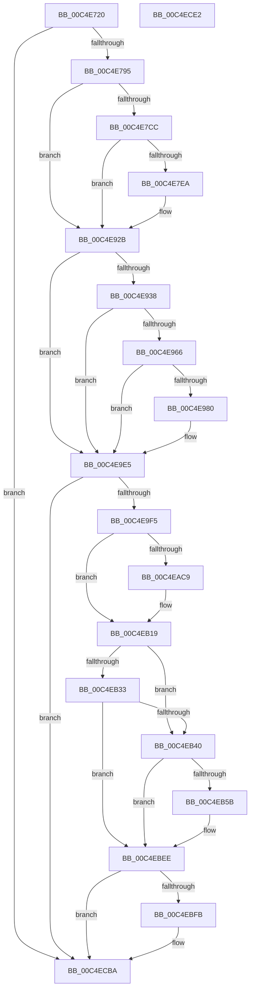

# EtwpTraceSystemInitialization

- RVA: `0x00C4E720`–`0x00C4ECE3` (길이 `1,475` bytes)
- VA: `0x0000000140C4E720`
- 실행 섹션: `INIT`
- PDB 이름 있음: `예`; PDB Function 태그: `아니요`
- unwind 정보 RVA: `0x000D3818`
- 디코드: `267`개 명령, `1,475/1,475` bytes 표시
- 미해석 바이트: `0` (있으면 어셈블리에 `.byte`로 보존)

> 이 문서는 커널 이미지의 기계어와 PDB 기호를 분석해 생성했습니다. 4번과 5번은 함수 원형과 자료형을 바이너리 사용 방식에서 추정한 C 해석이며 원본 소스 복구 결과는 아닙니다.

## 1. Dependencies

- 직접 호출 지점: **18**; 고유 호출 대상: **12**
- 직접 호출자로 확인된 함수: **1**
- RIP 상대 이미지 참조: **16**

### Outgoing calls
- `0x00C4E75B` → [memset](../../text/6C/memset_function_006C6C40.md) (function, `0x006C6C40`)
- `0x00C4E786` → [RtlGetVersion](../../page/A1/RtlGetVersion_function_00A19110.md) (function, `0x00A19110`)
- `0x00C4E7DD` → [tlgKeywordOn](../../text/42/tlgKeywordOn_function_0042EAA0.md) (function, `0x0042EAA0`)
- `0x00C4E926` → [tlgWriteTransfer_EtwWriteTransfer](../../text/42/tlgWriteTransfer_EtwWriteTransfer_function_004260E0.md) (function, `0x004260E0`)
- `0x00C4E92B` → [HviIsHypervisorVendorMicrosoft](../../text/66/HviIsHypervisorVendorMicrosoft_function_00666920.md) (function, `0x00666920`)
- `0x00C4E93C` → [HviGetHardwareFeatures](../../text/4A/HviGetHardwareFeatures_function_004ADBC0.md) (function, `0x004ADBC0`)
- `0x00C4E94C` → [HviGetHypervisorFeatures](../../text/66/HviGetHypervisorFeatures_function_00666630.md) (function, `0x00666630`)
- `0x00C4E977` → [tlgKeywordOn](../../text/42/tlgKeywordOn_function_0042EAA0.md) (function, `0x0042EAA0`)
- `0x00C4E9E0` → [tlgWriteTransfer_EtwWriteTransfer](../../text/42/tlgWriteTransfer_EtwWriteTransfer_function_004260E0.md) (function, `0x004260E0`)
- `0x00C4EAA8` → [EtwWriteEx](../../text/25/EtwWriteEx_function_0025F0D0.md) (function, `0x0025F0D0`)
- `0x00C4EAAD` → [EtwpTraceBootSystemTime](EtwpTraceBootSystemTime_function_00C4E4C8.md) (function, `0x00C4E4C8`)
- `0x00C4EAC0` → [EtwEventEnabled](../../text/39/EtwEventEnabled_function_00392450.md) (function, `0x00392450`)
- `0x00C4EB14` → [EtwWriteEx](../../text/25/EtwWriteEx_function_0025F0D0.md) (function, `0x0025F0D0`)
- `0x00C4EB4E` → [EtwEventEnabled](../../text/39/EtwEventEnabled_function_00392450.md) (function, `0x00392450`)
- `0x00C4EBE9` → [EtwWriteEx](../../text/25/EtwWriteEx_function_0025F0D0.md) (function, `0x0025F0D0`)
- `0x00C4EC1A` → [RtlGetSystemTimePrecise](../../text/37/RtlGetSystemTimePrecise_function_0037EDD0.md) (function, `0x0037EDD0`)
- `0x00C4ECB5` → [EtwWriteEx](../../text/25/EtwWriteEx_function_0025F0D0.md) (function, `0x0025F0D0`)
- `0x00C4ECC4` → [_security_check_cookie](../../text/6A/_security_check_cookie_function_006AC640.md) (function, `0x006AC640`)

### Direct callers
- [EtwpInitialize](EtwpInitialize_function_00C4DBCC.md) at `0x00C4E125`

### Static image references
- `0x00C4E73E` → RVA `0x00E0A740` (`.data`; read)
- `0x00C4E760` → RVA `0x00E0A748` (`.data`; read)
- `0x00C4E771` → RVA `0x00FC41C4` (`.data`; read)
- `0x00C4E795` → RVA `0x00FC6B20` (`ALMOSTRO`; read)
- `0x00C4E79F` → RVA `0x00FC6E28` (`ALMOSTRO`; read)
- `0x00C4E7BF` → RVA `0x00E09168` (`.data`; read)
- `0x00C4E7ED` → RVA `0x000541E8` (`.rdata`; read)
- `0x00C4E8A1` → RVA `0x00E65E48` (`.data`; read)
- `0x00C4E983` → RVA `0x000541B3` (`.rdata`; read)
- `0x00C4E9E5` → RVA `0x00EFFA28` (`.data`; read)
- `0x00C4EA07` → RVA `0x000217E0` (`.rdata`; read)
- `0x00C4EAB9` → RVA `0x000220D0` (`.rdata`; read)
- `0x00C4EAD0` → RVA `0x010087A0` (`INITDATA`; read)
- `0x00C4EB47` → RVA `0x00020FC8` (`.rdata`; read)
- `0x00C4EBEE` → RVA `0x00EFF058` (`.data`; reference)
- `0x00C4EC26` → RVA `0x00022820` (`.rdata`; read)

## 2. Other-region calls and transfers

- 다른 실행 섹션으로 향하는 call: **17**
  - `0x00C4E75B` → [memset](../../text/6C/memset_function_006C6C40.md) (`INIT` → `.text`)
  - `0x00C4E786` → [RtlGetVersion](../../page/A1/RtlGetVersion_function_00A19110.md) (`INIT` → `PAGE`)
  - `0x00C4E7DD` → [tlgKeywordOn](../../text/42/tlgKeywordOn_function_0042EAA0.md) (`INIT` → `.text`)
  - `0x00C4E926` → [tlgWriteTransfer_EtwWriteTransfer](../../text/42/tlgWriteTransfer_EtwWriteTransfer_function_004260E0.md) (`INIT` → `.text`)
  - `0x00C4E92B` → [HviIsHypervisorVendorMicrosoft](../../text/66/HviIsHypervisorVendorMicrosoft_function_00666920.md) (`INIT` → `.text`)
  - `0x00C4E93C` → [HviGetHardwareFeatures](../../text/4A/HviGetHardwareFeatures_function_004ADBC0.md) (`INIT` → `.text`)
  - `0x00C4E94C` → [HviGetHypervisorFeatures](../../text/66/HviGetHypervisorFeatures_function_00666630.md) (`INIT` → `.text`)
  - `0x00C4E977` → [tlgKeywordOn](../../text/42/tlgKeywordOn_function_0042EAA0.md) (`INIT` → `.text`)
  - `0x00C4E9E0` → [tlgWriteTransfer_EtwWriteTransfer](../../text/42/tlgWriteTransfer_EtwWriteTransfer_function_004260E0.md) (`INIT` → `.text`)
  - `0x00C4EAA8` → [EtwWriteEx](../../text/25/EtwWriteEx_function_0025F0D0.md) (`INIT` → `.text`)
  - `0x00C4EAC0` → [EtwEventEnabled](../../text/39/EtwEventEnabled_function_00392450.md) (`INIT` → `.text`)
  - `0x00C4EB14` → [EtwWriteEx](../../text/25/EtwWriteEx_function_0025F0D0.md) (`INIT` → `.text`)
  - `0x00C4EB4E` → [EtwEventEnabled](../../text/39/EtwEventEnabled_function_00392450.md) (`INIT` → `.text`)
  - `0x00C4EBE9` → [EtwWriteEx](../../text/25/EtwWriteEx_function_0025F0D0.md) (`INIT` → `.text`)
  - `0x00C4EC1A` → [RtlGetSystemTimePrecise](../../text/37/RtlGetSystemTimePrecise_function_0037EDD0.md) (`INIT` → `.text`)
  - `0x00C4ECB5` → [EtwWriteEx](../../text/25/EtwWriteEx_function_0025F0D0.md) (`INIT` → `.text`)
  - `0x00C4ECC4` → [_security_check_cookie](../../text/6A/_security_check_cookie_function_006AC640.md) (`INIT` → `.text`)
- 별도 외부 분기/꼬리 이동을 확인하지 못했습니다.

## 3. Assembly (complete function range)

```asm
00C4E720  48 8B C4                        mov rax, rsp
00C4E723  48 89 58 08                     mov qword ptr [rax + 8], rbx
00C4E727  48 89 70 10                     mov qword ptr [rax + 0x10], rsi
00C4E72B  48 89 78 18                     mov qword ptr [rax + 0x18], rdi
00C4E72F  55                              push rbp
00C4E730  48 8D A8 B8 FD FF FF            lea rbp, [rax - 0x248]
00C4E737  48 81 EC 40 03 00 00            sub rsp, 0x340
00C4E73E  48 8B 05 FB BF 1B 00            mov rax, qword ptr [rip + 0x1bbffb]
00C4E745  48 33 C4                        xor rax, rsp
00C4E748  48 89 85 30 02 00 00            mov qword ptr [rbp + 0x230], rax
00C4E74F  33 D2                           xor edx, edx
00C4E751  48 8D 4D A4                     lea rcx, [rbp - 0x5c]
00C4E755  41 B8 18 01 00 00               mov r8d, 0x118
00C4E75B  E8 E0 84 A7 FF                  call 0x1406c6c40
00C4E760  8B 05 E2 BF 1B 00               mov eax, dword ptr [rip + 0x1bbfe2]
00C4E766  48 8D 4D A0                     lea rcx, [rbp - 0x60]
00C4E76A  89 44 24 4C                     mov dword ptr [rsp + 0x4c], eax
00C4E76E  0F 57 C0                        xorps xmm0, xmm0
00C4E771  8B 05 4D 5A 37 00               mov eax, dword ptr [rip + 0x375a4d]
00C4E777  89 44 24 50                     mov dword ptr [rsp + 0x50], eax
00C4E77B  0F 11 45 90                     movups xmmword ptr [rbp - 0x70], xmm0
00C4E77F  C7 45 A0 1C 01 00 00            mov dword ptr [rbp - 0x60], 0x11c
00C4E786  E8 85 A9 DC FF                  call 0x140a19110
00C4E78B  33 DB                           xor ebx, ebx
00C4E78D  85 C0                           test eax, eax
00C4E78F  0F 88 25 05 00 00               js 0x140c4ecba
00C4E795  48 8B 05 84 83 37 00            mov rax, qword ptr [rip + 0x378384]
00C4E79C  8D 73 08                        lea esi, [rbx + 8]
00C4E79F  4C 8B 05 82 86 37 00            mov r8, qword ptr [rip + 0x378682]
00C4E7A6  8D 7B 04                        lea edi, [rbx + 4]
00C4E7A9  4C 89 44 24 70                  mov qword ptr [rsp + 0x70], r8
00C4E7AE  48 8B 88 F0 00 00 00            mov rcx, qword ptr [rax + 0xf0]
00C4E7B5  4C 8B 89 58 0A 00 00            mov r9, qword ptr [rcx + 0xa58]
00C4E7BC  4C 23 CE                        and r9, rsi
00C4E7BF  83 3D A2 A9 1B 00 05            cmp dword ptr [rip + 0x1ba9a2], 5
00C4E7C6  0F 86 5F 01 00 00               jbe 0x140c4e92b
00C4E7CC  48 BA 00 00 00 00 00 80 00 00   movabs rdx, 0x800000000000
00C4E7D6  48 8D 0D 8B A9 1B 00            lea rcx, [rip + 0x1ba98b]
00C4E7DD  E8 BE 02 7E FF                  call 0x14042eaa0
00C4E7E2  84 C0                           test al, al
00C4E7E4  0F 84 41 01 00 00               je 0x140c4e92b
00C4E7EA  8B 45 A4                        mov eax, dword ptr [rbp - 0x5c]
00C4E7ED  48 8D 15 F4 59 40 FF            lea rdx, [rip - 0xbfa60c]
00C4E7F4  89 44 24 54                     mov dword ptr [rsp + 0x54], eax
00C4E7F8  48 8D 0D 69 A9 1B 00            lea rcx, [rip + 0x1ba969]
00C4E7FF  48 8D 44 24 54                  lea rax, [rsp + 0x54]
00C4E804  4C 89 45 80                     mov qword ptr [rbp - 0x80], r8
00C4E808  48 89 85 50 01 00 00            mov qword ptr [rbp + 0x150], rax
00C4E80F  4D 85 C9                        test r9, r9
00C4E812  8B 45 A8                        mov eax, dword ptr [rbp - 0x58]
00C4E815  89 44 24 58                     mov dword ptr [rsp + 0x58], eax
00C4E819  0F 95 44 24 40                  setne byte ptr [rsp + 0x40]
00C4E81E  48 8D 44 24 58                  lea rax, [rsp + 0x58]
00C4E823  48 89 BD 58 01 00 00            mov qword ptr [rbp + 0x158], rdi
00C4E82A  48 89 85 60 01 00 00            mov qword ptr [rbp + 0x160], rax
00C4E831  45 33 C9                        xor r9d, r9d
00C4E834  8B 45 AC                        mov eax, dword ptr [rbp - 0x54]
00C4E837  45 33 C0                        xor r8d, r8d
00C4E83A  89 44 24 5C                     mov dword ptr [rsp + 0x5c], eax
00C4E83E  48 8D 44 24 5C                  lea rax, [rsp + 0x5c]
00C4E843  48 89 85 70 01 00 00            mov qword ptr [rbp + 0x170], rax
00C4E84A  48 8D 44 24 60                  lea rax, [rsp + 0x60]
00C4E84F  48 89 85 80 01 00 00            mov qword ptr [rbp + 0x180], rax
00C4E856  8B 44 24 4C                     mov eax, dword ptr [rsp + 0x4c]
00C4E85A  89 44 24 64                     mov dword ptr [rsp + 0x64], eax
00C4E85E  48 8D 44 24 64                  lea rax, [rsp + 0x64]
00C4E863  48 89 85 90 01 00 00            mov qword ptr [rbp + 0x190], rax
00C4E86A  0F B7 85 B4 00 00 00            movzx eax, word ptr [rbp + 0xb4]
00C4E871  66 89 44 24 44                  mov word ptr [rsp + 0x44], ax
00C4E876  48 8D 44 24 44                  lea rax, [rsp + 0x44]
00C4E87B  48 89 85 A0 01 00 00            mov qword ptr [rbp + 0x1a0], rax
00C4E882  8B 44 24 50                     mov eax, dword ptr [rsp + 0x50]
00C4E886  89 44 24 68                     mov dword ptr [rsp + 0x68], eax
00C4E88A  48 8D 44 24 68                  lea rax, [rsp + 0x68]
00C4E88F  48 89 85 B0 01 00 00            mov qword ptr [rbp + 0x1b0], rax
00C4E896  48 8D 45 80                     lea rax, [rbp - 0x80]
00C4E89A  48 89 85 C0 01 00 00            mov qword ptr [rbp + 0x1c0], rax
00C4E8A1  8B 05 A1 75 21 00               mov eax, dword ptr [rip + 0x2175a1]
00C4E8A7  89 44 24 48                     mov dword ptr [rsp + 0x48], eax
00C4E8AB  48 8D 44 24 48                  lea rax, [rsp + 0x48]
00C4E8B0  48 89 85 D0 01 00 00            mov qword ptr [rbp + 0x1d0], rax
00C4E8B7  48 8D 44 24 40                  lea rax, [rsp + 0x40]
00C4E8BC  48 89 85 E0 01 00 00            mov qword ptr [rbp + 0x1e0], rax
00C4E8C3  48 8D 85 30 01 00 00            lea rax, [rbp + 0x130]
00C4E8CA  48 89 44 24 28                  mov qword ptr [rsp + 0x28], rax
00C4E8CF  C7 44 24 20 0C 00 00 00         mov dword ptr [rsp + 0x20], 0xc
00C4E8D7  48 89 BD 68 01 00 00            mov qword ptr [rbp + 0x168], rdi
00C4E8DE  48 89 BD 78 01 00 00            mov qword ptr [rbp + 0x178], rdi
00C4E8E5  C7 44 24 60 01 00 00 00         mov dword ptr [rsp + 0x60], 1
00C4E8ED  48 89 BD 88 01 00 00            mov qword ptr [rbp + 0x188], rdi
00C4E8F4  48 89 BD 98 01 00 00            mov qword ptr [rbp + 0x198], rdi
00C4E8FB  48 C7 85 A8 01 00 00 02 00 00 00  mov qword ptr [rbp + 0x1a8], 2
00C4E906  48 89 BD B8 01 00 00            mov qword ptr [rbp + 0x1b8], rdi
00C4E90D  48 89 B5 C8 01 00 00            mov qword ptr [rbp + 0x1c8], rsi
00C4E914  48 89 BD D8 01 00 00            mov qword ptr [rbp + 0x1d8], rdi
00C4E91B  48 C7 85 E8 01 00 00 01 00 00 00  mov qword ptr [rbp + 0x1e8], 1
00C4E926  E8 B5 77 7D FF                  call 0x1404260e0
00C4E92B  E8 F0 7F A1 FF                  call 0x140666920
00C4E930  84 C0                           test al, al
00C4E932  0F 84 AD 00 00 00               je 0x140c4e9e5
00C4E938  48 8D 4D 90                     lea rcx, [rbp - 0x70]
00C4E93C  E8 7F F2 85 FF                  call 0x1404adbc0
00C4E941  0F 57 C0                        xorps xmm0, xmm0
00C4E944  48 8D 4D 80                     lea rcx, [rbp - 0x80]
00C4E948  0F 11 45 80                     movups xmmword ptr [rbp - 0x80], xmm0
00C4E94C  E8 DF 7C A1 FF                  call 0x140666630
00C4E951  4C 8B 45 80                     mov r8, qword ptr [rbp - 0x80]
00C4E955  49 C1 E8 2C                     shr r8, 0x2c
00C4E959  41 83 E0 01                     and r8d, 1
00C4E95D  83 3D 04 A8 1B 00 05            cmp dword ptr [rip + 0x1ba804], 5
00C4E964  76 7F                           jbe 0x140c4e9e5
00C4E966  48 BA 00 00 00 00 00 40 00 00   movabs rdx, 0x400000000000
00C4E970  48 8D 0D F1 A7 1B 00            lea rcx, [rip + 0x1ba7f1]
00C4E977  E8 24 01 7E FF                  call 0x14042eaa0
00C4E97C  84 C0                           test al, al
00C4E97E  74 65                           je 0x140c4e9e5
00C4E980  8B 45 90                        mov eax, dword ptr [rbp - 0x70]
00C4E983  48 8D 15 29 58 40 FF            lea rdx, [rip - 0xbfa7d7]
00C4E98A  C1 E8 0A                        shr eax, 0xa
00C4E98D  48 8D 0D D4 A7 1B 00            lea rcx, [rip + 0x1ba7d4]
00C4E994  83 E0 0F                        and eax, 0xf
00C4E997  44 88 44 24 40                  mov byte ptr [rsp + 0x40], r8b
00C4E99C  89 44 24 48                     mov dword ptr [rsp + 0x48], eax
00C4E9A0  45 33 C9                        xor r9d, r9d
00C4E9A3  48 8D 44 24 48                  lea rax, [rsp + 0x48]
00C4E9A8  48 89 BD 18 02 00 00            mov qword ptr [rbp + 0x218], rdi
00C4E9AF  48 89 85 10 02 00 00            mov qword ptr [rbp + 0x210], rax
00C4E9B6  45 33 C0                        xor r8d, r8d
00C4E9B9  48 8D 44 24 40                  lea rax, [rsp + 0x40]
00C4E9BE  48 C7 85 28 02 00 00 01 00 00 00  mov qword ptr [rbp + 0x228], 1
00C4E9C9  48 89 85 20 02 00 00            mov qword ptr [rbp + 0x220], rax
00C4E9D0  48 8D 85 F0 01 00 00            lea rax, [rbp + 0x1f0]
00C4E9D7  48 89 44 24 28                  mov qword ptr [rsp + 0x28], rax
00C4E9DC  89 7C 24 20                     mov dword ptr [rsp + 0x20], edi
00C4E9E0  E8 FB 76 7D FF                  call 0x1404260e0
00C4E9E5  48 8B 0D 3C 10 2B 00            mov rcx, qword ptr [rip + 0x2b103c]
00C4E9EC  48 85 C9                        test rcx, rcx
00C4E9EF  0F 84 C5 02 00 00               je 0x140c4ecba
00C4E9F5  48 8D 45 A4                     lea rax, [rbp - 0x5c]
00C4E9F9  48 89 BD C8 00 00 00            mov qword ptr [rbp + 0xc8], rdi
00C4EA00  48 89 85 C0 00 00 00            mov qword ptr [rbp + 0xc0], rax
00C4EA07  48 8D 15 D2 2D 3D FF            lea rdx, [rip - 0xc2d22e]
00C4EA0E  48 8D 45 A8                     lea rax, [rbp - 0x58]
00C4EA12  48 89 BD D8 00 00 00            mov qword ptr [rbp + 0xd8], rdi
00C4EA19  48 89 85 D0 00 00 00            mov qword ptr [rbp + 0xd0], rax
00C4EA20  45 33 C9                        xor r9d, r9d
00C4EA23  48 8D 45 AC                     lea rax, [rbp - 0x54]
00C4EA27  48 89 BD E8 00 00 00            mov qword ptr [rbp + 0xe8], rdi
00C4EA2E  48 89 85 E0 00 00 00            mov qword ptr [rbp + 0xe0], rax
00C4EA35  45 33 C0                        xor r8d, r8d
00C4EA38  48 8D 44 24 4C                  lea rax, [rsp + 0x4c]
00C4EA3D  48 89 BD F8 00 00 00            mov qword ptr [rbp + 0xf8], rdi
00C4EA44  48 89 85 F0 00 00 00            mov qword ptr [rbp + 0xf0], rax
00C4EA4B  48 8D 85 B4 00 00 00            lea rax, [rbp + 0xb4]
00C4EA52  48 89 85 00 01 00 00            mov qword ptr [rbp + 0x100], rax
00C4EA59  48 8D 44 24 50                  lea rax, [rsp + 0x50]
00C4EA5E  48 89 85 10 01 00 00            mov qword ptr [rbp + 0x110], rax
00C4EA65  48 8D 44 24 70                  lea rax, [rsp + 0x70]
00C4EA6A  48 89 85 20 01 00 00            mov qword ptr [rbp + 0x120], rax
00C4EA71  48 8D 85 C0 00 00 00            lea rax, [rbp + 0xc0]
00C4EA78  48 89 44 24 38                  mov qword ptr [rsp + 0x38], rax
00C4EA7D  C7 44 24 30 07 00 00 00         mov dword ptr [rsp + 0x30], 7
00C4EA85  48 89 5C 24 28                  mov qword ptr [rsp + 0x28], rbx
00C4EA8A  48 89 5C 24 20                  mov qword ptr [rsp + 0x20], rbx
00C4EA8F  48 C7 85 08 01 00 00 02 00 00 00  mov qword ptr [rbp + 0x108], 2
00C4EA9A  48 89 BD 18 01 00 00            mov qword ptr [rbp + 0x118], rdi
00C4EAA1  48 89 B5 28 01 00 00            mov qword ptr [rbp + 0x128], rsi
00C4EAA8  E8 23 06 61 FF                  call 0x14025f0d0
00C4EAAD  E8 16 FA FF FF                  call 0x140c4e4c8
00C4EAB2  48 8B 0D 6F 0F 2B 00            mov rcx, qword ptr [rip + 0x2b0f6f]
00C4EAB9  48 8D 15 10 36 3D FF            lea rdx, [rip - 0xc2c9f0]
00C4EAC0  E8 8B 39 74 FF                  call 0x140392450
00C4EAC5  84 C0                           test al, al
00C4EAC7  74 50                           je 0x140c4eb19
00C4EAC9  48 8B 0D 58 0F 2B 00            mov rcx, qword ptr [rip + 0x2b0f58]
00C4EAD0  48 8D 05 C9 9C 3B 00            lea rax, [rip + 0x3b9cc9]
00C4EAD7  48 89 85 C0 00 00 00            mov qword ptr [rbp + 0xc0], rax
00C4EADE  48 8D 15 EB 35 3D FF            lea rdx, [rip - 0xc2ca15]
00C4EAE5  48 8D 85 C0 00 00 00            lea rax, [rbp + 0xc0]
00C4EAEC  48 C7 85 C8 00 00 00 08 01 00 00  mov qword ptr [rbp + 0xc8], 0x108
00C4EAF7  48 89 44 24 38                  mov qword ptr [rsp + 0x38], rax
00C4EAFC  45 33 C9                        xor r9d, r9d
00C4EAFF  C7 44 24 30 01 00 00 00         mov dword ptr [rsp + 0x30], 1
00C4EB07  45 33 C0                        xor r8d, r8d
00C4EB0A  48 89 5C 24 28                  mov qword ptr [rsp + 0x28], rbx
00C4EB0F  48 89 5C 24 20                  mov qword ptr [rsp + 0x20], rbx
00C4EB14  E8 B7 05 61 FF                  call 0x14025f0d0
00C4EB19  48 8B 05 00 80 37 00            mov rax, qword ptr [rip + 0x378000]
00C4EB20  48 8B 88 F0 00 00 00            mov rcx, qword ptr [rax + 0xf0]
00C4EB27  F7 81 84 00 00 00 00 01 00 00   test dword ptr [rcx + 0x84], 0x100
00C4EB31  75 0D                           jne 0x140c4eb40
00C4EB33  48 39 99 E0 00 00 00            cmp qword ptr [rcx + 0xe0], rbx
00C4EB3A  0F 84 AE 00 00 00               je 0x140c4ebee
00C4EB40  48 8B 0D E1 0E 2B 00            mov rcx, qword ptr [rip + 0x2b0ee1]
00C4EB47  48 8D 15 7A 24 3D FF            lea rdx, [rip - 0xc2db86]
00C4EB4E  E8 FD 38 74 FF                  call 0x140392450
00C4EB53  84 C0                           test al, al
00C4EB55  0F 84 93 00 00 00               je 0x140c4ebee
00C4EB5B  48 8B 0D BE 7F 37 00            mov rcx, qword ptr [rip + 0x377fbe]
00C4EB62  48 8D 15 5F 24 3D FF            lea rdx, [rip - 0xc2dba1]
00C4EB69  45 33 C9                        xor r9d, r9d
00C4EB6C  45 33 C0                        xor r8d, r8d
00C4EB6F  48 8B 81 F0 00 00 00            mov rax, qword ptr [rcx + 0xf0]
00C4EB76  48 05 E0 00 00 00               add rax, 0xe0
00C4EB7C  48 89 B5 C8 00 00 00            mov qword ptr [rbp + 0xc8], rsi
00C4EB83  48 89 85 C0 00 00 00            mov qword ptr [rbp + 0xc0], rax
00C4EB8A  48 8B 81 F0 00 00 00            mov rax, qword ptr [rcx + 0xf0]
00C4EB91  48 05 C0 0D 00 00               add rax, 0xdc0
00C4EB97  48 C7 85 D8 00 00 00 40 00 00 00  mov qword ptr [rbp + 0xd8], 0x40
00C4EBA2  48 89 85 D0 00 00 00            mov qword ptr [rbp + 0xd0], rax
00C4EBA9  48 8B 81 F0 00 00 00            mov rax, qword ptr [rcx + 0xf0]
00C4EBB0  48 8B 0D 71 0E 2B 00            mov rcx, qword ptr [rip + 0x2b0e71]
00C4EBB7  48 05 18 0F 00 00               add rax, 0xf18
00C4EBBD  48 89 85 E0 00 00 00            mov qword ptr [rbp + 0xe0], rax
00C4EBC4  48 8D 85 C0 00 00 00            lea rax, [rbp + 0xc0]
00C4EBCB  48 89 44 24 38                  mov qword ptr [rsp + 0x38], rax
00C4EBD0  C7 44 24 30 03 00 00 00         mov dword ptr [rsp + 0x30], 3
00C4EBD8  48 89 5C 24 28                  mov qword ptr [rsp + 0x28], rbx
00C4EBDD  48 89 5C 24 20                  mov qword ptr [rsp + 0x20], rbx
00C4EBE2  48 89 B5 E8 00 00 00            mov qword ptr [rbp + 0xe8], rsi
00C4EBE9  E8 E2 04 61 FF                  call 0x14025f0d0
00C4EBEE  40 84 3D 63 04 2B 00            test byte ptr [rip + 0x2b0463], dil
00C4EBF5  0F 84 BF 00 00 00               je 0x140c4ecba
00C4EBFB  48 8B 05 1E 7F 37 00            mov rax, qword ptr [rip + 0x377f1e]
00C4EC02  48 8B 88 F0 00 00 00            mov rcx, qword ptr [rax + 0xf0]
00C4EC09  8B 81 58 0A 00 00               mov eax, dword ptr [rcx + 0xa58]
00C4EC0F  48 C1 E8 0E                     shr rax, 0xe
00C4EC13  83 E0 01                        and eax, 1
00C4EC16  89 44 24 6C                     mov dword ptr [rsp + 0x6c], eax
00C4EC1A  E8 B1 01 73 FF                  call 0x14037edd0
00C4EC1F  48 8B 0D FA 7E 37 00            mov rcx, qword ptr [rip + 0x377efa]
00C4EC26  48 8D 15 F3 3B 3D FF            lea rdx, [rip - 0xc2c40d]
00C4EC2D  48 89 44 24 78                  mov qword ptr [rsp + 0x78], rax
00C4EC32  45 33 C9                        xor r9d, r9d
00C4EC35  45 33 C0                        xor r8d, r8d
00C4EC38  48 8B 81 F0 00 00 00            mov rax, qword ptr [rcx + 0xf0]
00C4EC3F  48 05 80 0B 00 00               add rax, 0xb80
00C4EC45  48 89 B5 C8 00 00 00            mov qword ptr [rbp + 0xc8], rsi
00C4EC4C  48 89 85 C0 00 00 00            mov qword ptr [rbp + 0xc0], rax
00C4EC53  48 8D 44 24 78                  lea rax, [rsp + 0x78]
00C4EC58  48 89 85 D0 00 00 00            mov qword ptr [rbp + 0xd0], rax
00C4EC5F  48 89 B5 D8 00 00 00            mov qword ptr [rbp + 0xd8], rsi
00C4EC66  48 8B 81 F0 00 00 00            mov rax, qword ptr [rcx + 0xf0]
00C4EC6D  48 8B 0D B4 0D 2B 00            mov rcx, qword ptr [rip + 0x2b0db4]
00C4EC74  48 05 78 0B 00 00               add rax, 0xb78
00C4EC7A  48 89 85 E0 00 00 00            mov qword ptr [rbp + 0xe0], rax
00C4EC81  48 8D 44 24 6C                  lea rax, [rsp + 0x6c]
00C4EC86  48 89 85 F0 00 00 00            mov qword ptr [rbp + 0xf0], rax
00C4EC8D  48 8D 85 C0 00 00 00            lea rax, [rbp + 0xc0]
00C4EC94  48 89 44 24 38                  mov qword ptr [rsp + 0x38], rax
00C4EC99  89 7C 24 30                     mov dword ptr [rsp + 0x30], edi
00C4EC9D  48 89 5C 24 28                  mov qword ptr [rsp + 0x28], rbx
00C4ECA2  48 89 5C 24 20                  mov qword ptr [rsp + 0x20], rbx
00C4ECA7  48 89 BD E8 00 00 00            mov qword ptr [rbp + 0xe8], rdi
00C4ECAE  48 89 BD F8 00 00 00            mov qword ptr [rbp + 0xf8], rdi
00C4ECB5  E8 16 04 61 FF                  call 0x14025f0d0
00C4ECBA  48 8B 8D 30 02 00 00            mov rcx, qword ptr [rbp + 0x230]
00C4ECC1  48 33 CC                        xor rcx, rsp
00C4ECC4  E8 77 D9 A5 FF                  call 0x1406ac640
00C4ECC9  4C 8D 9C 24 40 03 00 00         lea r11, [rsp + 0x340]
00C4ECD1  49 8B 5B 10                     mov rbx, qword ptr [r11 + 0x10]
00C4ECD5  49 8B 73 18                     mov rsi, qword ptr [r11 + 0x18]
00C4ECD9  49 8B 7B 20                     mov rdi, qword ptr [r11 + 0x20]
00C4ECDD  49 8B E3                        mov rsp, r11
00C4ECE0  5D                              pop rbp
00C4ECE1  C3                              ret
00C4ECE2  CC                              int3
```

## 4. C-style interpretation (structured pseudocode)

```c
__int64 __fastcall EtwpTraceSystemInitialization(__int64 a1, int a2)
{
    __int64 result;
    __int64 v_rbx;
    __int64 v_rsp;
    unsigned __int64 v_stack_m2D0;
    unsigned __int64 v_stack_m2D8;
    unsigned int v_stack_m2DC;
    unsigned int v_stack_m2E0;
    unsigned int v_stack_m2E4;
    unsigned __int64 v_stack_m2E8;
    unsigned int v_stack_m2EC;
    unsigned int v_stack_m2F0;
    unsigned int v_stack_m2F4;
    unsigned int v_stack_m2F8;
    unsigned int v_stack_m2FC;
    unsigned int v_stack_m300;
    unsigned __int16 v_stack_m304;
    unsigned __int8 v_stack_m308;
    unsigned __int64 v_stack_m310;
    unsigned int v_stack_m318;
    unsigned __int64 v_stack_m320;
    unsigned int v_stack_m328;
    unsigned __int64 v_stack_m8;

    *(unsigned __int64 *)(v_rsp + 8) = v_rbx;
    *(unsigned __int64 *)(v_rsp + 16) = v_rsi;
    *(unsigned __int64 *)(v_rsp + 24) = v_rdi;
    v_rsp = (v_rsp) - (832);
    result = (*(unsigned __int64 *)(v_rip + 1818619)) ^ (v_rsp);
    *(unsigned __int64 *)(v_rsp - 584 + 560) = result;
    a2 = 0;
    result = memset(v_rsp - 584 - 92, a2, 280, a4);
    v_stack_m2FC = (unsigned int)((unsigned int)(*(unsigned int *)(v_rip + 1818594)));
    v_stack_m2F8 = (unsigned int)((unsigned int)(*(unsigned int *)(v_rip + 3627597)));
    *(unsigned __int64 *)(v_rsp - 584 - 112) = v_xmm0;
    *(unsigned int *)(v_rsp - 584 - 96) = 284;
    result = RtlGetVersion(v_rsp - 584 - 96, a2, 280, a4);
    v_rbx = 0;
    if (sign_flag) goto loc_00C4ECBA;
    v_stack_m2D8 = *(unsigned __int64 *)(v_rip + 3638914);
    a4 = (*(unsigned __int64 *)(*(unsigned __int64 *)(*(unsigned __int64 *)(v_rip + 3638148) + 240) + 2648)) & (v_rbx + 8);
    if ((*(unsigned int *)(v_rip + 1812898)) <= 5) goto loc_00C4E92B;
    result = tlgKeywordOn(v_rip + 1812875, a2, *(unsigned __int64 *)(v_rip + 3638914), a4);
    if ((unsigned __int8)(result) != 0) {
        result = *(unsigned int *)(v_rsp - 584 - 92);
        a2 = v_rip - 12559884;
        v_stack_m2F4 = (unsigned int)(result);
        a1 = v_rip + 1812841;
        result = v_stack_m2F4;
        *(unsigned __int64 *)(v_rsp - 584 - 128) = *(unsigned __int64 *)(v_rip + 3638914);
        *(unsigned __int64 *)(v_rsp - 584 + 336) = result;
        result = *(unsigned int *)(v_rsp - 584 - 88);
        v_stack_m2F0 = (unsigned int)(result);
        result = v_stack_m2F0;
        *(unsigned __int64 *)(v_rsp - 584 + 344) = v_rbx + 4;
        *(unsigned __int64 *)(v_rsp - 584 + 352) = result;
        a4 = 0;
        result = *(unsigned int *)(v_rsp - 584 - 84);
        a3 = 0;
        v_stack_m2EC = (unsigned int)(result);
        result = v_stack_m2EC;
        *(unsigned __int64 *)(v_rsp - 584 + 368) = result;
        result = v_stack_m2E8;
        *(unsigned __int64 *)(v_rsp - 584 + 384) = result;
        result = v_stack_m2FC;
        v_stack_m2E4 = (unsigned int)(result);
        result = v_stack_m2E4;
        *(unsigned __int64 *)(v_rsp - 584 + 400) = result;
        result = *(unsigned __int16 *)(v_rsp - 584 + 180);
        v_stack_m304 = (unsigned __int16)(result);
        result = v_stack_m304;
        *(unsigned __int64 *)(v_rsp - 584 + 416) = result;
        result = v_stack_m2F8;
        v_stack_m2E0 = (unsigned int)(result);
        result = v_stack_m2E0;
        *(unsigned __int64 *)(v_rsp - 584 + 432) = result;
        result = v_rsp - 584 - 128;
        *(unsigned __int64 *)(v_rsp - 584 + 448) = result;
        result = *(unsigned int *)(v_rip + 2192801);
        v_stack_m300 = (unsigned int)(result);
        result = v_stack_m300;
        *(unsigned __int64 *)(v_rsp - 584 + 464) = result;
        result = v_stack_m308;
        *(unsigned __int64 *)(v_rsp - 584 + 480) = result;
        result = v_rsp - 584 + 304;
        v_stack_m320 = result;
        v_stack_m328 = 12;
        *(unsigned __int64 *)(v_rsp - 584 + 360) = v_rbx + 4;
        *(unsigned __int64 *)(v_rsp - 584 + 376) = v_rbx + 4;
        v_stack_m2E8 = 1;
        *(unsigned __int64 *)(v_rsp - 584 + 392) = v_rbx + 4;
        *(unsigned __int64 *)(v_rsp - 584 + 408) = v_rbx + 4;
        *(unsigned __int64 *)(v_rsp - 584 + 424) = 2;
        *(unsigned __int64 *)(v_rsp - 584 + 440) = v_rbx + 4;
        *(unsigned __int64 *)(v_rsp - 584 + 456) = v_rbx + 8;
        *(unsigned __int64 *)(v_rsp - 584 + 472) = v_rbx + 4;
        *(unsigned __int64 *)(v_rsp - 584 + 488) = 1;
        result = tlgWriteTransfer_EtwWriteTransfer(a1, a2, a3, a4);
    }
    result = HviIsHypervisorVendorMicrosoft(a1, a2, a3, a4);
    if ((unsigned __int8)(result) == 0) goto loc_00C4E9E5;
    result = HviGetHardwareFeatures(v_rsp - 584 - 112, a2, a3, a4);
    *(unsigned __int64 *)(v_rsp - 584 - 128) = v_xmm0;
    result = HviGetHypervisorFeatures(v_rsp - 584 - 128, a2, a3, a4);
    a3 = (*(unsigned __int64 *)(v_rsp - 584 - 128)) >> (44);
    a3 = (unsigned int)((a3) & (1));
    if ((*(unsigned int *)(v_rip + 1812484)) <= 5) goto loc_00C4E9E5;
    result = tlgKeywordOn(v_rip + 1812465, a2, a3, a4);
    if ((unsigned __int8)(result) != 0) {
        result = *(unsigned int *)(v_rsp - 584 - 112);
        a2 = v_rip - 12560343;
        result = (unsigned int)((result) >> (10));
        a1 = v_rip + 1812436;
        result = (unsigned int)((result) & (15));
        v_stack_m308 = (unsigned __int8)(a3);
        v_stack_m300 = (unsigned int)(result);
        a4 = 0;
        result = v_stack_m300;
        *(unsigned __int64 *)(v_rsp - 584 + 536) = v_rbx + 4;
        *(unsigned __int64 *)(v_rsp - 584 + 528) = result;
        a3 = 0;
        result = v_stack_m308;
        *(unsigned __int64 *)(v_rsp - 584 + 552) = 1;
        *(unsigned __int64 *)(v_rsp - 584 + 544) = result;
        result = v_rsp - 584 + 496;
        v_stack_m320 = result;
        v_stack_m328 = (unsigned int)(v_rbx + 4);
        result = tlgWriteTransfer_EtwWriteTransfer(a1, a2, a3, a4);
    }
    if (*(unsigned __int64 *)(v_rip + 2822204) == 0) goto loc_00C4ECBA;
    *(unsigned __int64 *)(v_rsp - 584 + 200) = v_rbx + 4;
    *(unsigned __int64 *)(v_rsp - 584 + 192) = v_rsp - 584 - 92;
    *(unsigned __int64 *)(v_rsp - 584 + 216) = v_rbx + 4;
    *(unsigned __int64 *)(v_rsp - 584 + 208) = v_rsp - 584 - 88;
    a4 = 0;
    *(unsigned __int64 *)(v_rsp - 584 + 232) = v_rbx + 4;
    *(unsigned __int64 *)(v_rsp - 584 + 224) = v_rsp - 584 - 84;
    a3 = 0;
    *(unsigned __int64 *)(v_rsp - 584 + 248) = v_rbx + 4;
    *(unsigned __int64 *)(v_rsp - 584 + 240) = v_stack_m2FC;
    *(unsigned __int64 *)(v_rsp - 584 + 256) = v_rsp - 584 + 180;
    *(unsigned __int64 *)(v_rsp - 584 + 272) = v_stack_m2F8;
    *(unsigned __int64 *)(v_rsp - 584 + 288) = v_stack_m2D8;
    v_stack_m310 = v_rsp - 584 + 192;
    v_stack_m318 = 7;
    v_stack_m320 = 0;
    v_stack_m328 = 0;
    *(unsigned __int64 *)(v_rsp - 584 + 264) = 2;
    *(unsigned __int64 *)(v_rsp - 584 + 280) = v_rbx + 4;
    *(unsigned __int64 *)(v_rsp - 584 + 296) = v_rbx + 8;
    result = EtwWriteEx(*(unsigned __int64 *)(v_rip + 2822204), v_rip - 12767790, a3, a4);
    result = EtwpTraceBootSystemTime(*(unsigned __int64 *)(v_rip + 2822204), v_rip - 12767790, a3, a4);
    result = EtwEventEnabled(*(unsigned __int64 *)(v_rip + 2821999), v_rip - 12765680, a3, a4);
    if ((unsigned __int8)(result) != 0) {
        a1 = *(unsigned __int64 *)(v_rip + 2821976);
        result = v_rip + 3906761;
        *(unsigned __int64 *)(v_rsp - 584 + 192) = result;
        a2 = v_rip - 12765717;
        result = v_rsp - 584 + 192;
        *(unsigned __int64 *)(v_rsp - 584 + 200) = 264;
        v_stack_m310 = result;
        a4 = 0;
        v_stack_m318 = 1;
        a3 = 0;
        v_stack_m320 = 0;
        v_stack_m328 = 0;
        result = EtwWriteEx(a1, a2, a3, a4);
    }
    if (((*(unsigned int *)(*(unsigned __int64 *)(*(unsigned __int64 *)(v_rip + 3637248) + 240) + 132)) & (256)) != 0) goto loc_00C4EB40;
    if ((*(unsigned __int64 *)(*(unsigned __int64 *)(*(unsigned __int64 *)(v_rip + 3637248) + 240) + 224)) == 0) goto loc_00C4EBEE;
loc_00C4EB40:
    result = EtwEventEnabled(*(unsigned __int64 *)(v_rip + 2821857), v_rip - 12770182, a3, a4);
    if ((unsigned __int8)(result) != 0) {
        a1 = *(unsigned __int64 *)(v_rip + 3637182);
        a2 = v_rip - 12770209;
        a4 = 0;
        a3 = 0;
        result = *(unsigned __int64 *)(a1 + 240);
        result = (result) + (224);
        *(unsigned __int64 *)(v_rsp - 584 + 200) = v_rbx + 8;
        *(unsigned __int64 *)(v_rsp - 584 + 192) = result;
        result = *(unsigned __int64 *)(a1 + 240);
        result = (result) + (0xDC0ULL);
        *(unsigned __int64 *)(v_rsp - 584 + 216) = 64;
        *(unsigned __int64 *)(v_rsp - 584 + 208) = result;
        result = *(unsigned __int64 *)(a1 + 240);
        a1 = *(unsigned __int64 *)(v_rip + 2821745);
        result = (result) + (0xF18ULL);
        *(unsigned __int64 *)(v_rsp - 584 + 224) = result;
        result = v_rsp - 584 + 192;
        v_stack_m310 = result;
        v_stack_m318 = 3;
        v_stack_m320 = 0;
        v_stack_m328 = 0;
        *(unsigned __int64 *)(v_rsp - 584 + 232) = v_rbx + 8;
        result = EtwWriteEx(a1, a2, a3, a4);
    }
    if (((*(unsigned __int8 *)(v_rip + 2819171)) & ((unsigned __int8)(v_rbx + 4))) != 0) {
        result = *(unsigned __int64 *)(v_rip + 3637022);
        a1 = *(unsigned __int64 *)(result + 240);
        result = *(unsigned int *)(a1 + 2648);
        result = (result) >> (14);
        result = (unsigned int)((result) & (1));
        v_stack_m2DC = (unsigned int)(result);
        result = RtlGetSystemTimePrecise(a1, a2, a3, a4);
        a1 = *(unsigned __int64 *)(v_rip + 3636986);
        a2 = v_rip - 12764173;
        v_stack_m2D0 = result;
        a4 = 0;
        a3 = 0;
        result = *(unsigned __int64 *)(a1 + 240);
        result = (result) + (0xB80ULL);
        *(unsigned __int64 *)(v_rsp - 584 + 200) = v_rbx + 8;
        *(unsigned __int64 *)(v_rsp - 584 + 192) = result;
        result = v_stack_m2D0;
        *(unsigned __int64 *)(v_rsp - 584 + 208) = result;
        *(unsigned __int64 *)(v_rsp - 584 + 216) = v_rbx + 8;
        result = *(unsigned __int64 *)(a1 + 240);
        a1 = *(unsigned __int64 *)(v_rip + 2821556);
        result = (result) + (0xB78ULL);
        *(unsigned __int64 *)(v_rsp - 584 + 224) = result;
        result = v_stack_m2DC;
        *(unsigned __int64 *)(v_rsp - 584 + 240) = result;
        result = v_rsp - 584 + 192;
        v_stack_m310 = result;
        v_stack_m318 = (unsigned int)(v_rbx + 4);
        v_stack_m320 = 0;
        v_stack_m328 = 0;
        *(unsigned __int64 *)(v_rsp - 584 + 232) = v_rbx + 4;
        *(unsigned __int64 *)(v_rsp - 584 + 248) = v_rbx + 4;
        result = EtwWriteEx(a1, a2, a3, a4);
    }
    a1 = (*(unsigned __int64 *)(v_rsp - 584 + 560)) ^ (v_rsp);
    result = _security_check_cookie(a1, a2, a3, a4);
    return result;
}
```

## 5. (Beta) C Style

```c
int64_t EtwpTraceSystemInitialization(int64_t Arg1, int32_t Arg2)
{
    int64_t result;
    int64_t local_rbx;
    int64_t local_rsp;
    uint64_t v_stack_m2D0;
    uint64_t v_stack_m2D8;
    uint32_t v_stack_m2DC;
    uint32_t v_stack_m2E0;
    uint32_t v_stack_m2E4;
    uint64_t v_stack_m2E8;
    uint32_t v_stack_m2EC;
    uint32_t v_stack_m2F0;
    uint32_t v_stack_m2F4;
    uint32_t v_stack_m2F8;
    uint32_t v_stack_m2FC;
    uint32_t v_stack_m300;
    uint16_t v_stack_m304;
    uint8_t v_stack_m308;
    uint64_t v_stack_m310;
    uint32_t v_stack_m318;
    uint64_t v_stack_m320;
    uint32_t v_stack_m328;
    uint64_t v_stack_m8;

    *(uint64_t *)(local_rsp + 0x8) = local_rbx;
    *(uint64_t *)(local_rsp + 0x10) = local_rsi;
    *(uint64_t *)(local_rsp + 0x18) = local_rdi;
    local_rsp = (local_rsp) - (832);
    result = (*(uint64_t *)(v_rip + 0x1BBFFB)) ^ (local_rsp);
    *(uint64_t *)(local_rsp - 0x248 + 0x230) = result;
    Arg2 = 0;
    result = memset(local_rsp - 584 - 92, Arg2, 280, a4);
    v_stack_m2FC = (uint32_t)((uint32_t)(*(uint32_t *)(v_rip + 0x1BBFE2)));
    v_stack_m2F8 = (uint32_t)((uint32_t)(*(uint32_t *)(v_rip + 0x375A4D)));
    *(uint64_t *)(local_rsp - 0x248 - 0x70) = v_xmm0;
    *(uint32_t *)(local_rsp - 0x248 - 0x60) = 284;
    result = RtlGetVersion(local_rsp - 584 - 96, Arg2, 280, a4);
    local_rbx = 0;
    if (sign_flag) goto loc_00C4ECBA;
    v_stack_m2D8 = *(uint64_t *)(v_rip + 0x378682);
    a4 = (*(uint64_t *)(*(uint64_t *)(*(uint64_t *)(v_rip + 0x378384) + 0xF0) + 0xA58)) & (local_rbx + 8);
    if ((*(uint32_t *)(v_rip + 0x1BA9A2)) <= 5) goto loc_00C4E92B;
    result = tlgKeywordOn(v_rip + 1812875, Arg2, *(uint64_t *)(v_rip + 0x378682), a4);
    if ((uint8_t)(result) != 0) {
        result = *(uint32_t *)(local_rsp - 0x248 - 0x5C);
        Arg2 = v_rip - 12559884;
        v_stack_m2F4 = (uint32_t)(result);
        Arg1 = v_rip + 1812841;
        result = v_stack_m2F4;
        *(uint64_t *)(local_rsp - 0x248 - 0x80) = *(uint64_t *)(v_rip + 0x378682);
        *(uint64_t *)(local_rsp - 0x248 + 0x150) = result;
        result = *(uint32_t *)(local_rsp - 0x248 - 0x58);
        v_stack_m2F0 = (uint32_t)(result);
        result = v_stack_m2F0;
        *(uint64_t *)(local_rsp - 0x248 + 0x158) = local_rbx + 4;
        *(uint64_t *)(local_rsp - 0x248 + 0x160) = result;
        a4 = 0;
        result = *(uint32_t *)(local_rsp - 0x248 - 0x54);
        a3 = 0;
        v_stack_m2EC = (uint32_t)(result);
        result = v_stack_m2EC;
        *(uint64_t *)(local_rsp - 0x248 + 0x170) = result;
        result = v_stack_m2E8;
        *(uint64_t *)(local_rsp - 0x248 + 0x180) = result;
        result = v_stack_m2FC;
        v_stack_m2E4 = (uint32_t)(result);
        result = v_stack_m2E4;
        *(uint64_t *)(local_rsp - 0x248 + 0x190) = result;
        result = *(uint16_t *)(local_rsp - 0x248 + 0xB4);
        v_stack_m304 = (uint16_t)(result);
        result = v_stack_m304;
        *(uint64_t *)(local_rsp - 0x248 + 0x1A0) = result;
        result = v_stack_m2F8;
        v_stack_m2E0 = (uint32_t)(result);
        result = v_stack_m2E0;
        *(uint64_t *)(local_rsp - 0x248 + 0x1B0) = result;
        result = local_rsp - 584 - 128;
        *(uint64_t *)(local_rsp - 0x248 + 0x1C0) = result;
        result = *(uint32_t *)(v_rip + 0x2175A1);
        v_stack_m300 = (uint32_t)(result);
        result = v_stack_m300;
        *(uint64_t *)(local_rsp - 0x248 + 0x1D0) = result;
        result = v_stack_m308;
        *(uint64_t *)(local_rsp - 0x248 + 0x1E0) = result;
        result = local_rsp - 584 + 304;
        v_stack_m320 = result;
        v_stack_m328 = 12;
        *(uint64_t *)(local_rsp - 0x248 + 0x168) = local_rbx + 4;
        *(uint64_t *)(local_rsp - 0x248 + 0x178) = local_rbx + 4;
        v_stack_m2E8 = 1;
        *(uint64_t *)(local_rsp - 0x248 + 0x188) = local_rbx + 4;
        *(uint64_t *)(local_rsp - 0x248 + 0x198) = local_rbx + 4;
        *(uint64_t *)(local_rsp - 0x248 + 0x1A8) = 2;
        *(uint64_t *)(local_rsp - 0x248 + 0x1B8) = local_rbx + 4;
        *(uint64_t *)(local_rsp - 0x248 + 0x1C8) = local_rbx + 8;
        *(uint64_t *)(local_rsp - 0x248 + 0x1D8) = local_rbx + 4;
        *(uint64_t *)(local_rsp - 0x248 + 0x1E8) = 1;
        result = tlgWriteTransfer_EtwWriteTransfer(Arg1, Arg2, a3, a4);
    }
    result = HviIsHypervisorVendorMicrosoft(Arg1, Arg2, a3, a4);
    if ((uint8_t)(result) == 0) goto loc_00C4E9E5;
    result = HviGetHardwareFeatures(local_rsp - 584 - 112, Arg2, a3, a4);
    *(uint64_t *)(local_rsp - 0x248 - 0x80) = v_xmm0;
    result = HviGetHypervisorFeatures(local_rsp - 584 - 128, Arg2, a3, a4);
    a3 = (*(uint64_t *)(local_rsp - 0x248 - 0x80)) >> (44);
    a3 = (uint32_t)((a3) & (1));
    if ((*(uint32_t *)(v_rip + 0x1BA804)) <= 5) goto loc_00C4E9E5;
    result = tlgKeywordOn(v_rip + 1812465, Arg2, a3, a4);
    if ((uint8_t)(result) != 0) {
        result = *(uint32_t *)(local_rsp - 0x248 - 0x70);
        Arg2 = v_rip - 12560343;
        result = (uint32_t)((result) >> (10));
        Arg1 = v_rip + 1812436;
        result = (uint32_t)((result) & (15));
        v_stack_m308 = (uint8_t)(a3);
        v_stack_m300 = (uint32_t)(result);
        a4 = 0;
        result = v_stack_m300;
        *(uint64_t *)(local_rsp - 0x248 + 0x218) = local_rbx + 4;
        *(uint64_t *)(local_rsp - 0x248 + 0x210) = result;
        a3 = 0;
        result = v_stack_m308;
        *(uint64_t *)(local_rsp - 0x248 + 0x228) = 1;
        *(uint64_t *)(local_rsp - 0x248 + 0x220) = result;
        result = local_rsp - 584 + 496;
        v_stack_m320 = result;
        v_stack_m328 = (uint32_t)(local_rbx + 4);
        result = tlgWriteTransfer_EtwWriteTransfer(Arg1, Arg2, a3, a4);
    }
    if (*(uint64_t *)(v_rip + 0x2B103C) == 0) goto loc_00C4ECBA;
    *(uint64_t *)(local_rsp - 0x248 + 0xC8) = local_rbx + 4;
    *(uint64_t *)(local_rsp - 0x248 + 0xC0) = local_rsp - 584 - 92;
    *(uint64_t *)(local_rsp - 0x248 + 0xD8) = local_rbx + 4;
    *(uint64_t *)(local_rsp - 0x248 + 0xD0) = local_rsp - 584 - 88;
    a4 = 0;
    *(uint64_t *)(local_rsp - 0x248 + 0xE8) = local_rbx + 4;
    *(uint64_t *)(local_rsp - 0x248 + 0xE0) = local_rsp - 584 - 84;
    a3 = 0;
    *(uint64_t *)(local_rsp - 0x248 + 0xF8) = local_rbx + 4;
    *(uint64_t *)(local_rsp - 0x248 + 0xF0) = v_stack_m2FC;
    *(uint64_t *)(local_rsp - 0x248 + 0x100) = local_rsp - 584 + 180;
    *(uint64_t *)(local_rsp - 0x248 + 0x110) = v_stack_m2F8;
    *(uint64_t *)(local_rsp - 0x248 + 0x120) = v_stack_m2D8;
    v_stack_m310 = local_rsp - 584 + 192;
    v_stack_m318 = 7;
    v_stack_m320 = 0;
    v_stack_m328 = 0;
    *(uint64_t *)(local_rsp - 0x248 + 0x108) = 2;
    *(uint64_t *)(local_rsp - 0x248 + 0x118) = local_rbx + 4;
    *(uint64_t *)(local_rsp - 0x248 + 0x128) = local_rbx + 8;
    result = EtwWriteEx(*(uint64_t *)(v_rip + 0x2B103C), v_rip - 12767790, a3, a4);
    result = EtwpTraceBootSystemTime(*(uint64_t *)(v_rip + 0x2B103C), v_rip - 12767790, a3, a4);
    result = EtwEventEnabled(*(uint64_t *)(v_rip + 0x2B0F6F), v_rip - 12765680, a3, a4);
    if ((uint8_t)(result) != 0) {
        Arg1 = *(uint64_t *)(v_rip + 0x2B0F58);
        result = v_rip + 3906761;
        *(uint64_t *)(local_rsp - 0x248 + 0xC0) = result;
        Arg2 = v_rip - 12765717;
        result = local_rsp - 584 + 192;
        *(uint64_t *)(local_rsp - 0x248 + 0xC8) = 264;
        v_stack_m310 = result;
        a4 = 0;
        v_stack_m318 = 1;
        a3 = 0;
        v_stack_m320 = 0;
        v_stack_m328 = 0;
        result = EtwWriteEx(Arg1, Arg2, a3, a4);
    }
    if (((*(uint32_t *)(*(uint64_t *)(*(uint64_t *)(v_rip + 0x378000) + 0xF0) + 0x84)) & (256)) != 0) goto loc_00C4EB40;
    if ((*(uint64_t *)(*(uint64_t *)(*(uint64_t *)(v_rip + 0x378000) + 0xF0) + 0xE0)) == 0) goto loc_00C4EBEE;
loc_00C4EB40:
    result = EtwEventEnabled(*(uint64_t *)(v_rip + 0x2B0EE1), v_rip - 12770182, a3, a4);
    if ((uint8_t)(result) != 0) {
        Arg1 = *(uint64_t *)(v_rip + 0x377FBE);
        Arg2 = v_rip - 12770209;
        a4 = 0;
        a3 = 0;
        result = *(uint64_t *)(Arg1 + 0xF0);
        result = (result) + (224);
        *(uint64_t *)(local_rsp - 0x248 + 0xC8) = local_rbx + 8;
        *(uint64_t *)(local_rsp - 0x248 + 0xC0) = result;
        result = *(uint64_t *)(Arg1 + 0xF0);
        result = (result) + (0xDC0ULL);
        *(uint64_t *)(local_rsp - 0x248 + 0xD8) = 64;
        *(uint64_t *)(local_rsp - 0x248 + 0xD0) = result;
        result = *(uint64_t *)(Arg1 + 0xF0);
        Arg1 = *(uint64_t *)(v_rip + 0x2B0E71);
        result = (result) + (0xF18ULL);
        *(uint64_t *)(local_rsp - 0x248 + 0xE0) = result;
        result = local_rsp - 584 + 192;
        v_stack_m310 = result;
        v_stack_m318 = 3;
        v_stack_m320 = 0;
        v_stack_m328 = 0;
        *(uint64_t *)(local_rsp - 0x248 + 0xE8) = local_rbx + 8;
        result = EtwWriteEx(Arg1, Arg2, a3, a4);
    }
    if (((*(uint8_t *)(v_rip + 0x2B0463)) & ((uint8_t)(local_rbx + 4))) != 0) {
        result = *(uint64_t *)(v_rip + 0x377F1E);
        Arg1 = *(uint64_t *)(result + 0xF0);
        result = *(uint32_t *)(Arg1 + 0xA58);
        result = (result) >> (14);
        result = (uint32_t)((result) & (1));
        v_stack_m2DC = (uint32_t)(result);
        result = RtlGetSystemTimePrecise(Arg1, Arg2, a3, a4);
        Arg1 = *(uint64_t *)(v_rip + 0x377EFA);
        Arg2 = v_rip - 12764173;
        v_stack_m2D0 = result;
        a4 = 0;
        a3 = 0;
        result = *(uint64_t *)(Arg1 + 0xF0);
        result = (result) + (0xB80ULL);
        *(uint64_t *)(local_rsp - 0x248 + 0xC8) = local_rbx + 8;
        *(uint64_t *)(local_rsp - 0x248 + 0xC0) = result;
        result = v_stack_m2D0;
        *(uint64_t *)(local_rsp - 0x248 + 0xD0) = result;
        *(uint64_t *)(local_rsp - 0x248 + 0xD8) = local_rbx + 8;
        result = *(uint64_t *)(Arg1 + 0xF0);
        Arg1 = *(uint64_t *)(v_rip + 0x2B0DB4);
        result = (result) + (0xB78ULL);
        *(uint64_t *)(local_rsp - 0x248 + 0xE0) = result;
        result = v_stack_m2DC;
        *(uint64_t *)(local_rsp - 0x248 + 0xF0) = result;
        result = local_rsp - 584 + 192;
        v_stack_m310 = result;
        v_stack_m318 = (uint32_t)(local_rbx + 4);
        v_stack_m320 = 0;
        v_stack_m328 = 0;
        *(uint64_t *)(local_rsp - 0x248 + 0xE8) = local_rbx + 4;
        *(uint64_t *)(local_rsp - 0x248 + 0xF8) = local_rbx + 4;
        result = EtwWriteEx(Arg1, Arg2, a3, a4);
    }
    Arg1 = (*(uint64_t *)(local_rsp - 0x248 + 0x230)) ^ (local_rsp);
    result = _security_check_cookie(Arg1, Arg2, a3, a4);
    return result;
}
```

## 6. Execution-region graph

[열기: 2D/3D 그래프와 함수 탐색 컨트롤 패널](../../../control-panel.html?section=init&rva=0x00C4E720&view=graph)

- 2D 그래프는 위에서 아래로 흐르고, 3D 그래프는 빈 공간을 드래그해 회전합니다. Shift+드래그는 이동, 휠은 확대·축소, 함수 노드 선택은 대상 보고서 이동입니다.

### Static fallback


