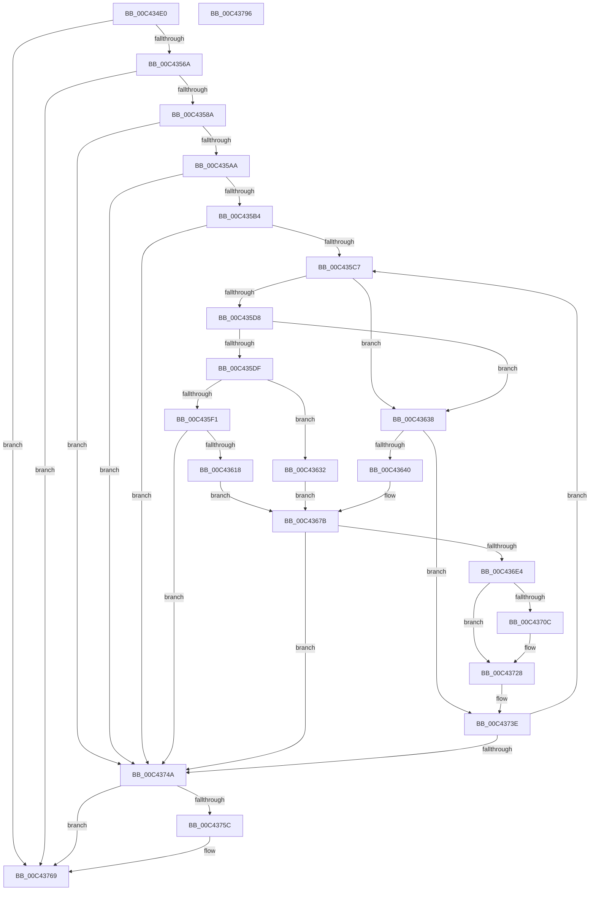

# PoFxRegisterDebugger

- RVA: `0x00C434E0`–`0x00C43797` (길이 `695` bytes)
- VA: `0x0000000140C434E0`
- 실행 섹션: `INIT`
- PDB 이름 있음: `예`; PDB Function 태그: `아니요`
- unwind 정보 RVA: `0x000CD1C0`
- 디코드: `174`개 명령, `695/695` bytes 표시
- 미해석 바이트: `0` (있으면 어셈블리에 `.byte`로 보존)

> 이 문서는 커널 이미지의 기계어와 PDB 기호를 분석해 생성했습니다. 4번과 5번은 함수 원형과 자료형을 바이너리 사용 방식에서 추정한 C 해석이며 원본 소스 복구 결과는 아닙니다.

## 1. Dependencies

- 직접 호출 지점: **16**; 고유 호출 대상: **10**
- 직접 호출자로 확인된 함수: **1**
- RIP 상대 이미지 참조: **5**

### Outgoing calls
- `0x00C43529` → [memset](../../text/6C/memset_function_006C6C40.md) (function, `0x006C6C40`)
- `0x00C4355A` → [guard_dispatch_icall](../../text/6B/guard_dispatch_icall_function_006BAAD0.md) (function, `0x006BAAD0`)
- `0x00C43579` → [ExAllocatePool2](../../poolcode/B8/ExAllocatePool2_function_00B820F0.md) (function, `0x00B820F0`)
- `0x00C4359D` → [guard_dispatch_icall](../../text/6B/guard_dispatch_icall_function_006BAAD0.md) (function, `0x006BAAD0`)
- `0x00C43607` → [ExAllocatePool2](../../poolcode/B8/ExAllocatePool2_function_00B820F0.md) (function, `0x00B820F0`)
- `0x00C43628` → [RtlStringCbPrintfW](../../text/40/RtlStringCbPrintfW_function_0040FB40.md) (function, `0x0040FB40`)
- `0x00C43672` → [RtlStringCbPrintfW](../../text/40/RtlStringCbPrintfW_function_0040FB40.md) (function, `0x0040FB40`)
- `0x00C43680` → [RtlInitUnicodeString](../../text/42/RtlInitUnicodeString_function_0042A780.md) (function, `0x0042A780`)
- `0x00C4369D` → [memset](../../text/6C/memset_function_006C6C40.md) (function, `0x006C6C40`)
- `0x00C436DB` → [PoFxRegisterCoreDevice](../../page/75/PoFxRegisterCoreDevice_function_00758800.md) (function, `0x00758800`)
- `0x00C43723` → [guard_dispatch_icall](../../text/6B/guard_dispatch_icall_function_006BAAD0.md) (function, `0x006BAAD0`)
- `0x00C43731` → [PoFxActivateComponent](../../text/2D/PoFxActivateComponent_function_002D9D30.md) (function, `0x002D9D30`)
- `0x00C43739` → [PoFxStartDevicePowerManagement](../../text/4B/PoFxStartDevicePowerManagement_function_004B5740.md) (function, `0x004B5740`)
- `0x00C43752` → [ExFreePoolWithTag](../../poolcode/B8/ExFreePoolWithTag_function_00B82870.md) (function, `0x00B82870`)
- `0x00C43764` → [ExFreePoolWithTag](../../poolcode/B8/ExFreePoolWithTag_function_00B82870.md) (function, `0x00B82870`)
- `0x00C43770` → [_security_check_cookie](../../text/6A/_security_check_cookie_function_006AC640.md) (function, `0x006AC640`)

### Direct callers
- [PoInitSystem](../C7/PoInitSystem_function_00C72358.md) at `0x00C72DD7`

### Static image references
- `0x00C43503` → RVA `0x00E0A740` (`.data`; read)
- `0x00C4352E` → RVA `0x00E00638` (`.data`; read)
- `0x00C4361E` → RVA `0x00C7C600` (` ?? ::PBOPGDP::`string'`; read)
- `0x00C43643` → RVA `0x00C7C5C0` (` ?? ::PBOPGDP::`string'`; read)
- `0x00C436B7` → RVA `0x005DA4A0` (`PopFxDebuggerPowerCriticalTransitionCallback`; read)

## 2. Other-region calls and transfers

- 다른 실행 섹션으로 향하는 call: **16**
  - `0x00C43529` → [memset](../../text/6C/memset_function_006C6C40.md) (`INIT` → `.text`)
  - `0x00C4355A` → [guard_dispatch_icall](../../text/6B/guard_dispatch_icall_function_006BAAD0.md) (`INIT` → `.text`)
  - `0x00C43579` → [ExAllocatePool2](../../poolcode/B8/ExAllocatePool2_function_00B820F0.md) (`INIT` → `POOLCODE`)
  - `0x00C4359D` → [guard_dispatch_icall](../../text/6B/guard_dispatch_icall_function_006BAAD0.md) (`INIT` → `.text`)
  - `0x00C43607` → [ExAllocatePool2](../../poolcode/B8/ExAllocatePool2_function_00B820F0.md) (`INIT` → `POOLCODE`)
  - `0x00C43628` → [RtlStringCbPrintfW](../../text/40/RtlStringCbPrintfW_function_0040FB40.md) (`INIT` → `.text`)
  - `0x00C43672` → [RtlStringCbPrintfW](../../text/40/RtlStringCbPrintfW_function_0040FB40.md) (`INIT` → `.text`)
  - `0x00C43680` → [RtlInitUnicodeString](../../text/42/RtlInitUnicodeString_function_0042A780.md) (`INIT` → `.text`)
  - `0x00C4369D` → [memset](../../text/6C/memset_function_006C6C40.md) (`INIT` → `.text`)
  - `0x00C436DB` → [PoFxRegisterCoreDevice](../../page/75/PoFxRegisterCoreDevice_function_00758800.md) (`INIT` → `PAGE`)
  - `0x00C43723` → [guard_dispatch_icall](../../text/6B/guard_dispatch_icall_function_006BAAD0.md) (`INIT` → `.text`)
  - `0x00C43731` → [PoFxActivateComponent](../../text/2D/PoFxActivateComponent_function_002D9D30.md) (`INIT` → `.text`)
  - `0x00C43739` → [PoFxStartDevicePowerManagement](../../text/4B/PoFxStartDevicePowerManagement_function_004B5740.md) (`INIT` → `.text`)
  - `0x00C43752` → [ExFreePoolWithTag](../../poolcode/B8/ExFreePoolWithTag_function_00B82870.md) (`INIT` → `POOLCODE`)
  - `0x00C43764` → [ExFreePoolWithTag](../../poolcode/B8/ExFreePoolWithTag_function_00B82870.md) (`INIT` → `POOLCODE`)
  - `0x00C43770` → [_security_check_cookie](../../text/6A/_security_check_cookie_function_006AC640.md) (`INIT` → `.text`)
- 별도 외부 분기/꼬리 이동을 확인하지 못했습니다.

## 3. Assembly (complete function range)

```asm
00C434E0  48 8B C4                        mov rax, rsp
00C434E3  48 89 58 08                     mov qword ptr [rax + 8], rbx
00C434E7  48 89 70 10                     mov qword ptr [rax + 0x10], rsi
00C434EB  48 89 78 18                     mov qword ptr [rax + 0x18], rdi
00C434EF  4C 89 60 20                     mov qword ptr [rax + 0x20], r12
00C434F3  55                              push rbp
00C434F4  41 56                           push r14
00C434F6  41 57                           push r15
00C434F8  48 8D 68 D8                     lea rbp, [rax - 0x28]
00C434FC  48 81 EC 10 01 00 00            sub rsp, 0x110
00C43503  48 8B 05 36 72 1C 00            mov rax, qword ptr [rip + 0x1c7236]
00C4350A  48 33 C4                        xor rax, rsp
00C4350D  48 89 45 08                     mov qword ptr [rbp + 8], rax
00C43511  33 C0                           xor eax, eax
00C43513  48 8D 4C 24 70                  lea rcx, [rsp + 0x70]
00C43518  0F 57 C0                        xorps xmm0, xmm0
00C4351B  48 89 45 D0                     mov qword ptr [rbp - 0x30], rax
00C4351F  33 D2                           xor edx, edx
00C43521  0F 11 45 C0                     movups xmmword ptr [rbp - 0x40], xmm0
00C43525  44 8D 40 50                     lea r8d, [rax + 0x50]
00C43529  E8 12 37 A8 FF                  call 0x1406c6c40
00C4352E  48 8B 05 03 D1 1B 00            mov rax, qword ptr [rip + 0x1bd103]
00C43535  4C 8D 4C 24 40                  lea r9, [rsp + 0x40]
00C4353A  48 83 64 24 48 00               and qword ptr [rsp + 0x48], 0
00C43540  33 D2                           xor edx, edx
00C43542  83 64 24 40 00                  and dword ptr [rsp + 0x40], 0
00C43547  0F 57 C0                        xorps xmm0, xmm0
00C4354A  45 33 C0                        xor r8d, r8d
00C4354D  45 33 F6                        xor r14d, r14d
00C43550  0F 11 44 24 58                  movups xmmword ptr [rsp + 0x58], xmm0
00C43555  8D 72 21                        lea esi, [rdx + 0x21]
00C43558  8B CE                           mov ecx, esi
00C4355A  E8 71 75 A7 FF                  call 0x1406baad0
00C4355F  3D 05 00 00 80                  cmp eax, 0x80000005
00C43564  0F 85 FF 01 00 00               jne 0x140c43769
00C4356A  8B 5C 24 40                     mov ebx, dword ptr [rsp + 0x40]
00C4356E  8D 4E 1F                        lea ecx, [rsi + 0x1f]
00C43571  8B D3                           mov edx, ebx
00C43573  41 B8 50 46 58 4D               mov r8d, 0x4d584650
00C43579  E8 72 EB F3 FF                  call 0x140b820f0
00C4357E  48 8B F8                        mov rdi, rax
00C43581  48 85 C0                        test rax, rax
00C43584  0F 84 DF 01 00 00               je 0x140c43769
00C4358A  48 8B 05 A7 D0 1B 00            mov rax, qword ptr [rip + 0x1bd0a7]
00C43591  4C 8D 4C 24 40                  lea r9, [rsp + 0x40]
00C43596  4C 8B C7                        mov r8, rdi
00C43599  8B D3                           mov edx, ebx
00C4359B  8B CE                           mov ecx, esi
00C4359D  E8 2E 75 A7 FF                  call 0x1406baad0
00C435A2  85 C0                           test eax, eax
00C435A4  0F 88 A0 01 00 00               js 0x140c4374a
00C435AA  39 5C 24 40                     cmp dword ptr [rsp + 0x40], ebx
00C435AE  0F 87 96 01 00 00               ja 0x140c4374a
00C435B4  45 33 E4                        xor r12d, r12d
00C435B7  48 8D 5F 04                     lea rbx, [rdi + 4]
00C435BB  45 33 FF                        xor r15d, r15d
00C435BE  44 39 27                        cmp dword ptr [rdi], r12d
00C435C1  0F 86 83 01 00 00               jbe 0x140c4374a
00C435C7  41 8B C4                        mov eax, r12d
00C435CA  48 03 D8                        add rbx, rax
00C435CD  8B 03                           mov eax, dword ptr [rbx]
00C435CF  44 8B 63 04                     mov r12d, dword ptr [rbx + 4]
00C435D3  83 F8 01                        cmp eax, 1
00C435D6  75 60                           jne 0x140c43638
00C435D8  8B 4B 08                        mov ecx, dword ptr [rbx + 8]
00C435DB  85 C9                           test ecx, ecx
00C435DD  74 59                           je 0x140c43638
00C435DF  65 48 8B 04 25 20 00 00 00      mov rax, qword ptr gs:[0x20]
00C435E8  80 B8 8D 00 00 00 02            cmp byte ptr [rax + 0x8d], 2
00C435EF  75 41                           jne 0x140c43632
00C435F1  8D 04 4D 16 00 00 00            lea eax, [rcx*2 + 0x16]
00C435F8  41 B8 50 46 58 4D               mov r8d, 0x4d584650
00C435FE  8B D0                           mov edx, eax
00C43600  B9 40 00 00 00                  mov ecx, 0x40
00C43605  8B F0                           mov esi, eax
00C43607  E8 E4 EA F3 FF                  call 0x140b820f0
00C4360C  4C 8B F0                        mov r14, rax
00C4360F  48 85 C0                        test rax, rax
00C43612  0F 84 32 01 00 00               je 0x140c4374a
00C43618  4C 8D 4B 0C                     lea r9, [rbx + 0xc]
00C4361C  8B D6                           mov edx, esi
00C4361E  4C 8D 05 DB 8F 03 00            lea r8, [rip + 0x38fdb]
00C43625  48 8B C8                        mov rcx, rax
00C43628  E8 13 C5 7C FF                  call 0x14040fb40
00C4362D  49 8B D6                        mov rdx, r14
00C43630  EB 49                           jmp 0x140c4367b
00C43632  48 8D 53 0C                     lea rdx, [rbx + 0xc]
00C43636  EB 43                           jmp 0x140c4367b
00C43638  85 C0                           test eax, eax
00C4363A  0F 85 FE 00 00 00               jne 0x140c4373e
00C43640  8B 43 10                        mov eax, dword ptr [rbx + 0x10]
00C43643  4C 8D 05 76 8F 03 00            lea r8, [rip + 0x38f76]
00C4364A  44 0F B7 4B 08                  movzx r9d, word ptr [rbx + 8]
00C4364F  8B C8                           mov ecx, eax
00C43651  C1 E9 05                        shr ecx, 5
00C43654  83 E0 1F                        and eax, 0x1f
00C43657  83 E1 07                        and ecx, 7
00C4365A  BA 30 00 00 00                  mov edx, 0x30
00C4365F  89 4C 24 30                     mov dword ptr [rsp + 0x30], ecx
00C43663  48 8D 4D D8                     lea rcx, [rbp - 0x28]
00C43667  89 44 24 28                     mov dword ptr [rsp + 0x28], eax
00C4366B  8B 43 0C                        mov eax, dword ptr [rbx + 0xc]
00C4366E  89 44 24 20                     mov dword ptr [rsp + 0x20], eax
00C43672  E8 C9 C4 7C FF                  call 0x14040fb40
00C43677  48 8D 55 D8                     lea rdx, [rbp - 0x28]
00C4367B  48 8D 4C 24 58                  lea rcx, [rsp + 0x58]
00C43680  E8 FB 70 7E FF                  call 0x14042a780
00C43685  33 C0                           xor eax, eax
00C43687  48 8D 4C 24 70                  lea rcx, [rsp + 0x70]
00C4368C  0F 57 C0                        xorps xmm0, xmm0
00C4368F  48 89 45 D0                     mov qword ptr [rbp - 0x30], rax
00C43693  33 D2                           xor edx, edx
00C43695  0F 11 45 C0                     movups xmmword ptr [rbp - 0x40], xmm0
00C43699  44 8D 40 50                     lea r8d, [rax + 0x50]
00C4369D  E8 9E 35 A8 FF                  call 0x1406c6c40
00C436A2  48 8D 45 C0                     lea rax, [rbp - 0x40]
00C436A6  C7 44 24 70 01 00 00 00         mov dword ptr [rsp + 0x70], 1
00C436AE  48 89 45 B8                     mov qword ptr [rbp - 0x48], rax
00C436B2  4C 8D 44 24 48                  lea r8, [rsp + 0x48]
00C436B7  48 8D 05 E2 6D 99 FF            lea rax, [rip - 0x66921e]
00C436BE  C7 44 24 74 01 00 00 00         mov dword ptr [rsp + 0x74], 1
00C436C6  48 8D 54 24 70                  lea rdx, [rsp + 0x70]
00C436CB  48 89 45 88                     mov qword ptr [rbp - 0x78], rax
00C436CF  48 8D 4C 24 58                  lea rcx, [rsp + 0x58]
00C436D4  C7 45 B0 01 00 00 00            mov dword ptr [rbp - 0x50], 1
00C436DB  E8 20 51 B1 FF                  call 0x140758800
00C436E0  85 C0                           test eax, eax
00C436E2  78 66                           js 0x140c4374a
00C436E4  48 8B 44 24 48                  mov rax, qword ptr [rsp + 0x48]
00C436E9  8B 88 60 03 00 00               mov ecx, dword ptr [rax + 0x360]
00C436EF  48 8B 74 24 48                  mov rsi, qword ptr [rsp + 0x48]
00C436F4  83 C9 02                        or ecx, 2
00C436F7  48 83 64 24 50 00               and qword ptr [rsp + 0x50], 0
00C436FD  89 8E 60 03 00 00               mov dword ptr [rsi + 0x360], ecx
00C43703  48 8B 4E 40                     mov rcx, qword ptr [rsi + 0x40]
00C43707  48 85 C9                        test rcx, rcx
00C4370A  74 1C                           je 0x140c43728
00C4370C  48 8B 46 48                     mov rax, qword ptr [rsi + 0x48]
00C43710  48 8D 54 24 50                  lea rdx, [rsp + 0x50]
00C43715  48 89 44 24 50                  mov qword ptr [rsp + 0x50], rax
00C4371A  48 8B 41 60                     mov rax, qword ptr [rcx + 0x60]
00C4371E  B9 15 00 00 00                  mov ecx, 0x15
00C43723  E8 A8 73 A7 FF                  call 0x1406baad0
00C43728  33 D2                           xor edx, edx
00C4372A  48 8B CE                        mov rcx, rsi
00C4372D  44 8D 42 01                     lea r8d, [rdx + 1]
00C43731  E8 FA 65 69 FF                  call 0x1402d9d30
00C43736  48 8B CE                        mov rcx, rsi
00C43739  E8 02 20 87 FF                  call 0x1404b5740
00C4373E  41 FF C7                        inc r15d
00C43741  44 3B 3F                        cmp r15d, dword ptr [rdi]
00C43744  0F 82 7D FE FF FF               jb 0x140c435c7
00C4374A  BA 50 46 58 4D                  mov edx, 0x4d584650
00C4374F  48 8B CF                        mov rcx, rdi
00C43752  E8 19 F1 F3 FF                  call 0x140b82870
00C43757  4D 85 F6                        test r14, r14
00C4375A  74 0D                           je 0x140c43769
00C4375C  BA 50 46 58 4D                  mov edx, 0x4d584650
00C43761  49 8B CE                        mov rcx, r14
00C43764  E8 07 F1 F3 FF                  call 0x140b82870
00C43769  48 8B 4D 08                     mov rcx, qword ptr [rbp + 8]
00C4376D  48 33 CC                        xor rcx, rsp
00C43770  E8 CB 8E A6 FF                  call 0x1406ac640
00C43775  4C 8D 9C 24 10 01 00 00         lea r11, [rsp + 0x110]
00C4377D  49 8B 5B 20                     mov rbx, qword ptr [r11 + 0x20]
00C43781  49 8B 73 28                     mov rsi, qword ptr [r11 + 0x28]
00C43785  49 8B 7B 30                     mov rdi, qword ptr [r11 + 0x30]
00C43789  4D 8B 63 38                     mov r12, qword ptr [r11 + 0x38]
00C4378D  49 8B E3                        mov rsp, r11
00C43790  41 5F                           pop r15
00C43792  41 5E                           pop r14
00C43794  5D                              pop rbp
00C43795  C3                              ret
00C43796  CC                              int3
```

## 4. C-style interpretation (structured pseudocode)

```c
__int64 __fastcall PoFxRegisterDebugger(__int64 a1, int a2)
{
    __int64 result;
    __int64 v_r12;
    __int64 v_r14;
    __int64 v_r15;
    __int64 v_rbx;
    __int64 v_rsp;
    unsigned int v_stack_m100;
    unsigned int v_stack_m108;
    unsigned __int64 v_stack_m18;
    unsigned int v_stack_mB4;
    unsigned __int64 v_stack_mB8;
    unsigned __int64 v_stack_mD0;
    unsigned __int64 v_stack_mD8;
    unsigned __int64 v_stack_mE0;
    unsigned __int64 v_stack_mE8;
    unsigned int v_stack_mF8;

    *(unsigned __int64 *)(v_rsp + 8) = v_rbx;
    *(unsigned __int64 *)(v_rsp + 16) = v_rsi;
    *(unsigned __int64 *)(v_rsp + 24) = v_rdi;
    *(unsigned __int64 *)(v_rsp + 32) = v_r12;
    v_rsp = (v_rsp) - (272);
    result = (*(unsigned __int64 *)(v_rip + 1864246)) ^ (v_rsp);
    *(unsigned __int64 *)(v_rsp - 40 + 8) = result;
    result = 0;
    *(unsigned __int64 *)(v_rsp - 40 - 48) = 0;
    a2 = 0;
    *(unsigned __int64 *)(v_rsp - 40 - 64) = v_xmm0;
    result = memset(v_stack_mB8, a2, result + 80, a4);
    a2 = 0;
    a3 = 0;
    v_r14 = 0;
    v_stack_mD0 = v_xmm0;
    result = guard_dispatch_icall((unsigned int)((unsigned int)(a2 + 33)), a2, a3, v_stack_mE8);
    if (((unsigned int)(result)) != 0x80000005ULL) goto loc_00C43769;
    result = ExAllocatePool2(a2 + 33 + 31, (unsigned int)((unsigned int)((unsigned int)(v_stack_mE8))), (unsigned int)(0x4D584650ULL), v_stack_mE8);
    if (result == 0) goto loc_00C43769;
    result = guard_dispatch_icall((unsigned int)((unsigned int)(a2 + 33)), (unsigned int)((unsigned int)((unsigned int)(v_stack_mE8))), result, v_stack_mE8);
    if (sign_flag) goto loc_00C4374A;
    if (v_stack_mE8 > ((unsigned int)((unsigned int)(v_stack_mE8)))) goto loc_00C4374A;
    v_r12 = 0;
    v_r15 = 0;
    if ((*(unsigned int *)(result)) <= 0) goto loc_00C4374A;
loc_00C435C7:
    v_rbx = (result + 4) + (0);
    if (((unsigned int)((unsigned int)(*(unsigned int *)(v_rbx)))) != 1) goto loc_00C43638;
    if ((unsigned int)((unsigned int)(*(unsigned int *)(v_rbx + 8))) == 0) goto loc_00C43638;
    if ((*(unsigned __int8 *)(*(unsigned __int64 *)(gs_base + (0 + 32)) + 141)) != 2) goto loc_00C43632;
    result = ExAllocatePool2(64, (unsigned int)((unsigned int)((unsigned int)(*(unsigned int *)(v_rbx + 8)) * 2 + 22)), (unsigned int)(0x4D584650ULL), v_stack_mE8);
    if (result == 0) goto loc_00C4374A;
    result = RtlStringCbPrintfW(result, (unsigned int)((unsigned int)((unsigned int)((unsigned int)((unsigned int)(*(unsigned int *)(v_rbx + 8)) * 2 + 22)))), v_rip + 233435, v_rbx + 12);
    goto loc_00C4367B;
loc_00C43632:
    goto loc_00C4367B;
loc_00C43638:
    if ((unsigned int)(result) != 0) goto loc_00C4373E;
    a1 = (unsigned int)(((unsigned int)((unsigned int)((unsigned int)(*(unsigned int *)(v_rbx + 16))))) >> (5));
    result = (unsigned int)(((unsigned int)(*(unsigned int *)(v_rbx + 16))) & (31));
    a1 = (unsigned int)((a1) & (7));
    v_stack_mF8 = (unsigned int)(a1);
    v_stack_m100 = (unsigned int)(result);
    v_stack_m108 = (unsigned int)((unsigned int)(*(unsigned int *)(v_rbx + 12)));
    result = RtlStringCbPrintfW(v_rsp - 40 - 40, 48, v_rip + 233334, *(unsigned __int16 *)(v_rbx + 8));
loc_00C4367B:
    result = RtlInitUnicodeString(v_stack_mD0, v_rsp - 40 - 40, v_rip + 233334, *(unsigned __int16 *)(v_rbx + 8));
    result = 0;
    *(unsigned __int64 *)(v_rsp - 40 - 48) = 0;
    a2 = 0;
    *(unsigned __int64 *)(v_rsp - 40 - 64) = v_xmm0;
    result = memset(v_stack_mB8, a2, result + 80, *(unsigned __int16 *)(v_rbx + 8));
    v_stack_mB8 = 1;
    *(unsigned __int64 *)(v_rsp - 40 - 72) = v_rsp - 40 - 64;
    v_stack_mB4 = 1;
    *(unsigned __int64 *)(v_rsp - 40 - 120) = v_rip - 6722078;
    *(unsigned int *)(v_rsp - 40 - 80) = 1;
    result = PoFxRegisterCoreDevice(v_stack_mD0, v_stack_mB8, v_stack_mE0, *(unsigned __int16 *)(v_rbx + 8));
    if (sign_flag) goto loc_00C4374A;
    a1 = (unsigned int)(((unsigned int)(*(unsigned int *)(v_stack_mE0 + 864))) | (2));
    *(unsigned int *)(v_stack_mE0 + 864) = (unsigned int)(a1);
    result = v_stack_mE0;
    if (*(unsigned __int64 *)(v_stack_mE0 + 64) != 0) {
        result = *(unsigned __int64 *)(v_stack_mE0 + 72);
        a2 = v_stack_mD8;
        v_stack_mD8 = result;
        result = *(unsigned __int64 *)(*(unsigned __int64 *)(v_stack_mE0 + 64) + 96);
        a1 = 21;
        result = guard_dispatch_icall(a1, a2, v_stack_mE0, *(unsigned __int16 *)(v_rbx + 8));
    }
    a2 = 0;
    result = PoFxActivateComponent(v_stack_mE0, a2, a2 + 1, *(unsigned __int16 *)(v_rbx + 8));
    result = PoFxStartDevicePowerManagement(v_stack_mE0, a2, a2 + 1, *(unsigned __int16 *)(v_rbx + 8));
loc_00C4373E:
    v_r15 = (unsigned int)((v_r15) + 1);
    if (((unsigned int)(v_r15)) < (*(unsigned int *)(result))) goto loc_00C435C7;
loc_00C4374A:
    result = ExFreePoolWithTag(result, (unsigned int)(0x4D584650ULL), a2 + 1, *(unsigned __int16 *)(v_rbx + 8));
    if (result != 0) {
        a2 = 0x4D584650ULL;
        a1 = result;
        result = ExFreePoolWithTag(a1, a2, a2 + 1, *(unsigned __int16 *)(v_rbx + 8));
    }
    a1 = (*(unsigned __int64 *)(v_rsp - 40 + 8)) ^ (v_rsp);
    result = _security_check_cookie(a1, a2, a2 + 1, *(unsigned __int16 *)(v_rbx + 8));
    return result;
}
```

## 5. (Beta) C Style

```c
int64_t PoFxRegisterDebugger(int64_t Arg1, int32_t Arg2)
{
    int64_t result;
    int64_t local_r12;
    int64_t local_r14;
    int64_t local_r15;
    int64_t local_rbx;
    int64_t local_rsp;
    uint32_t v_stack_m100;
    uint32_t v_stack_m108;
    uint64_t v_stack_m18;
    uint32_t v_stack_mB4;
    uint64_t v_stack_mB8;
    uint64_t v_stack_mD0;
    uint64_t v_stack_mD8;
    uint64_t v_stack_mE0;
    uint64_t v_stack_mE8;
    uint32_t v_stack_mF8;

    *(uint64_t *)(local_rsp + 0x8) = local_rbx;
    *(uint64_t *)(local_rsp + 0x10) = local_rsi;
    *(uint64_t *)(local_rsp + 0x18) = local_rdi;
    *(uint64_t *)(local_rsp + 0x20) = local_r12;
    local_rsp = (local_rsp) - (272);
    result = (*(uint64_t *)(v_rip + 0x1C7236)) ^ (local_rsp);
    *(uint64_t *)(local_rsp - 0x28 + 0x8) = result;
    result = 0;
    *(uint64_t *)(local_rsp - 0x28 - 0x30) = 0;
    Arg2 = 0;
    *(uint64_t *)(local_rsp - 0x28 - 0x40) = v_xmm0;
    result = memset(v_stack_mB8, Arg2, result + 80, a4);
    Arg2 = 0;
    a3 = 0;
    local_r14 = 0;
    v_stack_mD0 = v_xmm0;
    result = guard_dispatch_icall((uint32_t)((uint32_t)(Arg2 + 33)), Arg2, a3, v_stack_mE8);
    if (((uint32_t)(result)) != 0x80000005ULL) goto loc_00C43769;
    result = ExAllocatePool2(Arg2 + 33 + 31, (uint32_t)((uint32_t)((uint32_t)(v_stack_mE8))), (uint32_t)(0x4D584650ULL), v_stack_mE8);
    if (result == 0) goto loc_00C43769;
    result = guard_dispatch_icall((uint32_t)((uint32_t)(Arg2 + 33)), (uint32_t)((uint32_t)((uint32_t)(v_stack_mE8))), result, v_stack_mE8);
    if (sign_flag) goto loc_00C4374A;
    if (v_stack_mE8 > ((uint32_t)((uint32_t)(v_stack_mE8)))) goto loc_00C4374A;
    local_r12 = 0;
    local_r15 = 0;
    if ((*(uint32_t *)(result)) <= 0) goto loc_00C4374A;
loc_00C435C7:
    local_rbx = (result + 4) + (0);
    if (((uint32_t)((uint32_t)(*(uint32_t *)(local_rbx)))) != 1) goto loc_00C43638;
    if ((uint32_t)((uint32_t)(*(uint32_t *)(local_rbx + 0x8))) == 0) goto loc_00C43638;
    if ((*(uint8_t *)(*(uint64_t *)(gs_base + (0 + 0x20)) + 0x8D)) != 2) goto loc_00C43632;
    result = ExAllocatePool2(64, (uint32_t)((uint32_t)((uint32_t)(*(uint32_t *)(local_rbx + 0x8)) * 2 + 22)), (uint32_t)(0x4D584650ULL), v_stack_mE8);
    if (result == 0) goto loc_00C4374A;
    result = RtlStringCbPrintfW(result, (uint32_t)((uint32_t)((uint32_t)((uint32_t)((uint32_t)(*(uint32_t *)(local_rbx + 0x8)) * 2 + 22)))), v_rip + 233435, local_rbx + 12);
    goto loc_00C4367B;
loc_00C43632:
    goto loc_00C4367B;
loc_00C43638:
    if ((uint32_t)(result) != 0) goto loc_00C4373E;
    Arg1 = (uint32_t)(((uint32_t)((uint32_t)((uint32_t)(*(uint32_t *)(local_rbx + 0x10))))) >> (5));
    result = (uint32_t)(((uint32_t)(*(uint32_t *)(local_rbx + 0x10))) & (31));
    Arg1 = (uint32_t)((Arg1) & (7));
    v_stack_mF8 = (uint32_t)(Arg1);
    v_stack_m100 = (uint32_t)(result);
    v_stack_m108 = (uint32_t)((uint32_t)(*(uint32_t *)(local_rbx + 0xC)));
    result = RtlStringCbPrintfW(local_rsp - 40 - 40, 48, v_rip + 233334, *(uint16_t *)(local_rbx + 0x8));
loc_00C4367B:
    result = RtlInitUnicodeString(v_stack_mD0, local_rsp - 40 - 40, v_rip + 233334, *(uint16_t *)(local_rbx + 0x8));
    result = 0;
    *(uint64_t *)(local_rsp - 0x28 - 0x30) = 0;
    Arg2 = 0;
    *(uint64_t *)(local_rsp - 0x28 - 0x40) = v_xmm0;
    result = memset(v_stack_mB8, Arg2, result + 80, *(uint16_t *)(local_rbx + 0x8));
    v_stack_mB8 = 1;
    *(uint64_t *)(local_rsp - 0x28 - 0x48) = local_rsp - 40 - 64;
    v_stack_mB4 = 1;
    *(uint64_t *)(local_rsp - 0x28 - 0x78) = v_rip - 6722078;
    *(uint32_t *)(local_rsp - 0x28 - 0x50) = 1;
    result = PoFxRegisterCoreDevice(v_stack_mD0, v_stack_mB8, v_stack_mE0, *(uint16_t *)(local_rbx + 0x8));
    if (sign_flag) goto loc_00C4374A;
    Arg1 = (uint32_t)(((uint32_t)(*(uint32_t *)(v_stack_mE0 + 0x360))) | (2));
    *(uint32_t *)(v_stack_mE0 + 0x360) = (uint32_t)(Arg1);
    result = v_stack_mE0;
    if (*(uint64_t *)(v_stack_mE0 + 0x40) != 0) {
        result = *(uint64_t *)(v_stack_mE0 + 0x48);
        Arg2 = v_stack_mD8;
        v_stack_mD8 = result;
        result = *(uint64_t *)(*(uint64_t *)(v_stack_mE0 + 0x40) + 0x60);
        Arg1 = 21;
        result = guard_dispatch_icall(Arg1, Arg2, v_stack_mE0, *(uint16_t *)(local_rbx + 0x8));
    }
    Arg2 = 0;
    result = PoFxActivateComponent(v_stack_mE0, Arg2, Arg2 + 1, *(uint16_t *)(local_rbx + 0x8));
    result = PoFxStartDevicePowerManagement(v_stack_mE0, Arg2, Arg2 + 1, *(uint16_t *)(local_rbx + 0x8));
loc_00C4373E:
    local_r15 = (uint32_t)((local_r15) + 1);
    if (((uint32_t)(local_r15)) < (*(uint32_t *)(result))) goto loc_00C435C7;
loc_00C4374A:
    result = ExFreePoolWithTag(result, (uint32_t)(0x4D584650ULL), Arg2 + 1, *(uint16_t *)(local_rbx + 0x8));
    if (result != 0) {
        Arg2 = 0x4D584650ULL;
        Arg1 = result;
        result = ExFreePoolWithTag(Arg1, Arg2, Arg2 + 1, *(uint16_t *)(local_rbx + 0x8));
    }
    Arg1 = (*(uint64_t *)(local_rsp - 0x28 + 0x8)) ^ (local_rsp);
    result = _security_check_cookie(Arg1, Arg2, Arg2 + 1, *(uint16_t *)(local_rbx + 0x8));
    return result;
}
```

## 6. Execution-region graph

[열기: 2D/3D 그래프와 함수 탐색 컨트롤 패널](../../../control-panel.html?section=init&rva=0x00C434E0&view=graph)

- 2D 그래프는 위에서 아래로 흐르고, 3D 그래프는 빈 공간을 드래그해 회전합니다. Shift+드래그는 이동, 휠은 확대·축소, 함수 노드 선택은 대상 보고서 이동입니다.

### Static fallback


