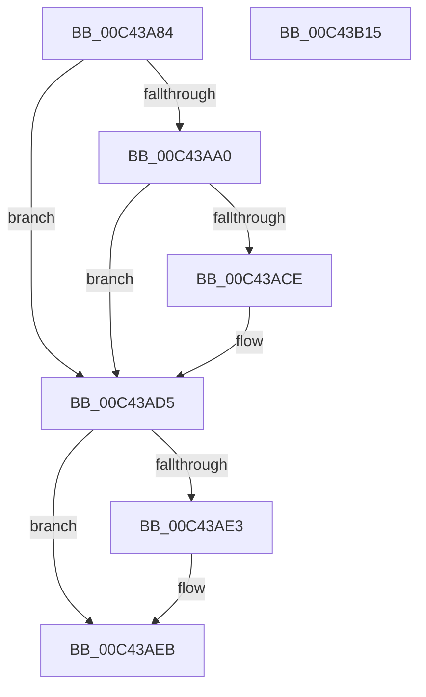

# PopAdaptiveInitializeBootContext

- RVA: `0x00C43A84`–`0x00C43B16` (길이 `146` bytes)
- VA: `0x0000000140C43A84`
- 실행 섹션: `INIT`
- PDB 이름 있음: `예`; PDB Function 태그: `아니요`
- unwind 정보 RVA: `0x00063458`
- 디코드: `33`개 명령, `146/146` bytes 표시
- 미해석 바이트: `0` (있으면 어셈블리에 `.byte`로 보존)

> 이 문서는 커널 이미지의 기계어와 PDB 기호를 분석해 생성했습니다. 4번과 5번은 함수 원형과 자료형을 바이너리 사용 방식에서 추정한 C 해석이며 원본 소스 복구 결과는 아닙니다.

## 1. Dependencies

- 직접 호출 지점: **2**; 고유 호출 대상: **2**
- 직접 호출자로 확인된 함수: **1**
- RIP 상대 이미지 참조: **7**

### Outgoing calls
- `0x00C43AB9` → [PopDiagTraceAdaptiveBootOverride](../C3/PopDiagTraceAdaptiveBootOverride_function_00C3F580.md) (function, `0x00C3F580`)
- `0x00C43B0B` → [ZwUpdateWnfStateData](../../text/6B/ZwUpdateWnfStateData_function_006B0D10.md) (function, `0x006B0D10`)

### Direct callers
- [PopInitializeAdpm](PopInitializeAdpm_function_00C43B1C.md) at `0x00C43BB9`

### Static image references
- `0x00C43A88` → RVA `0x00FC6B20` (`ALMOSTRO`; read)
- `0x00C43AA9` → RVA `0x00FD81F8` (`PAGEDATA`; write)
- `0x00C43ABE` → RVA `0x00FD81F8` (`PAGEDATA`; read)
- `0x00C43AC5` → RVA `0x00FD81F1` (`PAGEDATA`; write)
- `0x00C43ACE` → RVA `0x00FD81F0` (`PAGEDATA`; write)
- `0x00C43AD7` → RVA `0x00FD81F0` (`PAGEDATA`; read)
- `0x00C43AFB` → RVA `0x00020AE0` (`.rdata`; read)

## 2. Other-region calls and transfers

- 다른 실행 섹션으로 향하는 call: **1**
  - `0x00C43B0B` → [ZwUpdateWnfStateData](../../text/6B/ZwUpdateWnfStateData_function_006B0D10.md) (`INIT` → `.text`)
- 별도 외부 분기/꼬리 이동을 확인하지 못했습니다.

## 3. Assembly (complete function range)

```asm
00C43A84  48 83 EC 48                     sub rsp, 0x48
00C43A88  48 8B 05 91 30 38 00            mov rax, qword ptr [rip + 0x383091]
00C43A8F  48 8B 88 F0 00 00 00            mov rcx, qword ptr [rax + 0xf0]
00C43A96  8B 81 10 0F 00 00               mov eax, dword ptr [rcx + 0xf10]
00C43A9C  A8 02                           test al, 2
00C43A9E  74 35                           je 0x140c43ad5
00C43AA0  48 8B 89 48 0F 00 00            mov rcx, qword ptr [rcx + 0xf48]
00C43AA7  8A D1                           mov dl, cl
00C43AA9  48 89 0D 48 47 39 00            mov qword ptr [rip + 0x394748], rcx
00C43AB0  C0 EA 03                        shr dl, 3
00C43AB3  83 E1 07                        and ecx, 7
00C43AB6  80 E2 01                        and dl, 1
00C43AB9  E8 C2 BA FF FF                  call 0x140c3f580
00C43ABE  F6 05 33 47 39 00 07            test byte ptr [rip + 0x394733], 7
00C43AC5  C6 05 25 47 39 00 01            mov byte ptr [rip + 0x394725], 1
00C43ACC  74 07                           je 0x140c43ad5
00C43ACE  C6 05 1B 47 39 00 01            mov byte ptr [rip + 0x39471b], 1
00C43AD5  33 C0                           xor eax, eax
00C43AD7  38 05 13 47 39 00               cmp byte ptr [rip + 0x394713], al
00C43ADD  89 44 24 50                     mov dword ptr [rsp + 0x50], eax
00C43AE1  74 08                           je 0x140c43aeb
00C43AE3  C7 44 24 50 02 00 00 00         mov dword ptr [rsp + 0x50], 2
00C43AEB  89 44 24 30                     mov dword ptr [rsp + 0x30], eax
00C43AEF  48 8D 54 24 50                  lea rdx, [rsp + 0x50]
00C43AF4  45 33 C9                        xor r9d, r9d
00C43AF7  89 44 24 28                     mov dword ptr [rsp + 0x28], eax
00C43AFB  48 8D 0D DE CF 3D FF            lea rcx, [rip - 0xc23022]
00C43B02  48 89 44 24 20                  mov qword ptr [rsp + 0x20], rax
00C43B07  45 8D 41 04                     lea r8d, [r9 + 4]
00C43B0B  E8 00 D2 A6 FF                  call 0x1406b0d10
00C43B10  48 83 C4 48                     add rsp, 0x48
00C43B14  C3                              ret
00C43B15  CC                              int3
```

## 4. C-style interpretation (structured pseudocode)

```c
__int64 __fastcall PopAdaptiveInitializeBootContext(__int64 a1, __int64 a2, __int64 a3, int a4)
{
    __int64 result;
    __int64 v_rsp;
    unsigned int v_stack_m18;
    unsigned int v_stack_m20;
    unsigned __int64 v_stack_m28;
    unsigned int v_stack_p8;

    v_rsp = (v_rsp) - (72);
    if ((((unsigned __int8)((unsigned int)(*(unsigned int *)(*(unsigned __int64 *)(*(unsigned __int64 *)(v_rip + 3682449) + 240) + 3856)))) & (2)) == 0) goto loc_00C43AD5;
    *(unsigned __int64 *)(v_rip + 3753800) = *(unsigned __int64 *)(*(unsigned __int64 *)(*(unsigned __int64 *)(v_rip + 3682449) + 240) + 3912);
    a2 = (unsigned __int8)(((unsigned __int8)(*(unsigned __int64 *)(*(unsigned __int64 *)(*(unsigned __int64 *)(v_rip + 3682449) + 240) + 3912))) >> (3));
    a1 = (unsigned int)((*(unsigned __int64 *)(*(unsigned __int64 *)(*(unsigned __int64 *)(v_rip + 3682449) + 240) + 3912)) & (7));
    a2 = (unsigned __int8)((a2) & (1));
    result = PopDiagTraceAdaptiveBootOverride(a1, a2, a3, a4);
    *(unsigned __int8 *)(v_rip + 3753765) = 1;
    if (((*(unsigned __int8 *)(v_rip + 3753779)) & (7)) != 0) {
        *(unsigned __int8 *)(v_rip + 3753755) = 1;
    }
    result = 0;
    v_stack_p8 = 0;
    if ((*(unsigned __int8 *)(v_rip + 3753747)) != 0) {
        v_stack_p8 = 2;
    }
    v_stack_m18 = 0;
    a4 = 0;
    v_stack_m20 = 0;
    v_stack_m28 = 0;
    result = ZwUpdateWnfStateData(v_rip - 12726306, v_stack_p8, a4 + 4, a4);
    v_rsp = (v_rsp) + (72);
    return result;
}
```

## 5. (Beta) C Style

```c
int64_t PopAdaptiveInitializeBootContext(int64_t Arg1, int64_t Arg2, int64_t Arg3, int32_t Arg4)
{
    int64_t result;
    int64_t local_rsp;
    uint32_t v_stack_m18;
    uint32_t v_stack_m20;
    uint64_t v_stack_m28;
    uint32_t v_stack_p8;

    local_rsp = (local_rsp) - (72);
    if ((((uint8_t)((uint32_t)(*(uint32_t *)(*(uint64_t *)(*(uint64_t *)(v_rip + 0x383091) + 0xF0) + 0xF10)))) & (2)) == 0) goto loc_00C43AD5;
    *(uint64_t *)(v_rip + 0x394748) = *(uint64_t *)(*(uint64_t *)(*(uint64_t *)(v_rip + 0x383091) + 0xF0) + 0xF48);
    Arg2 = (uint8_t)(((uint8_t)(*(uint64_t *)(*(uint64_t *)(*(uint64_t *)(v_rip + 0x383091) + 0xF0) + 0xF48))) >> (3));
    Arg1 = (uint32_t)((*(uint64_t *)(*(uint64_t *)(*(uint64_t *)(v_rip + 0x383091) + 0xF0) + 0xF48)) & (7));
    Arg2 = (uint8_t)((Arg2) & (1));
    result = PopDiagTraceAdaptiveBootOverride(Arg1, Arg2, Arg3, Arg4);
    *(uint8_t *)(v_rip + 0x394725) = 1;
    if (((*(uint8_t *)(v_rip + 0x394733)) & (7)) != 0) {
        *(uint8_t *)(v_rip + 0x39471B) = 1;
    }
    result = 0;
    v_stack_p8 = 0;
    if ((*(uint8_t *)(v_rip + 0x394713)) != 0) {
        v_stack_p8 = 2;
    }
    v_stack_m18 = 0;
    Arg4 = 0;
    v_stack_m20 = 0;
    v_stack_m28 = 0;
    result = ZwUpdateWnfStateData(v_rip - 12726306, v_stack_p8, Arg4 + 4, Arg4);
    local_rsp = (local_rsp) + (72);
    return result;
}
```

## 6. Execution-region graph

[열기: 2D/3D 그래프와 함수 탐색 컨트롤 패널](../../../control-panel.html?section=init&rva=0x00C43A84&view=graph)

- 2D 그래프는 위에서 아래로 흐르고, 3D 그래프는 빈 공간을 드래그해 회전합니다. Shift+드래그는 이동, 휠은 확대·축소, 함수 노드 선택은 대상 보고서 이동입니다.

### Static fallback


