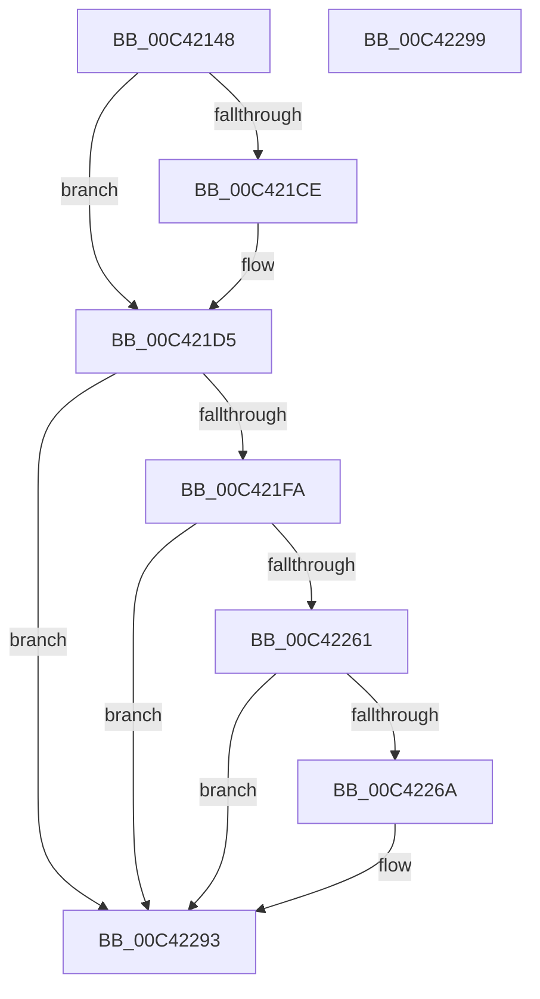

# PopBatteryInitPhaseTwo

- RVA: `0x00C42148`–`0x00C4229A` (길이 `338` bytes)
- VA: `0x0000000140C42148`
- 실행 섹션: `INIT`
- PDB 이름 있음: `예`; PDB Function 태그: `아니요`
- unwind 정보 RVA: `0x000C6ED0`
- 디코드: `68`개 명령, `338/338` bytes 표시
- 미해석 바이트: `0` (있으면 어셈블리에 `.byte`로 보존)

> 이 문서는 커널 이미지의 기계어와 PDB 기호를 분석해 생성했습니다. 4번과 5번은 함수 원형과 자료형을 바이너리 사용 방식에서 추정한 C 해석이며 원본 소스 복구 결과는 아닙니다.

## 1. Dependencies

- 직접 호출 지점: **10**; 고유 호출 대상: **7**
- 직접 호출자로 확인된 함수: **1**
- RIP 상대 이미지 참조: **17**

### Outgoing calls
- `0x00C42177` → [PopReadUlongPowerKey](../../text/5C/PopReadUlongPowerKey_function_005CEB5C.md) (function, `0x005CEB5C`)
- `0x00C421B0` → [PopReadUlongPowerKey](../../text/5C/PopReadUlongPowerKey_function_005CEB5C.md) (function, `0x005CEB5C`)
- `0x00C421C5` → [Feature_Servicing_BatteryTestExempt__private_IsEnabledDeviceUsageNoInline](../../text/5D/Feature_Servicing_BatteryTestExempt__private_IsEnabledDeviceUsageNoInline_function_005D12D8.md) (function, `0x005D12D8`)
- `0x00C421D0` → [PopBatteryTestExemptPolicyRegKeyAccess](../../page/76/PopBatteryTestExemptPolicyRegKeyAccess_function_00766E04.md) (function, `0x00766E04`)
- `0x00C421ED` → [EtwRegister](../../page/92/EtwRegister_function_00920960.md) (function, `0x00920960`)
- `0x00C42225` → [ExSubscribeWnfStateChange](../../page/9D/ExSubscribeWnfStateChange_function_009D4BC0.md) (function, `0x009D4BC0`)
- `0x00C4224E` → [ExSubscribeWnfStateChange](../../page/9D/ExSubscribeWnfStateChange_function_009D4BC0.md) (function, `0x009D4BC0`)
- `0x00C42253` → [PopBatteryReadOscBits](PopBatteryReadOscBits_function_00C422A0.md) (function, `0x00C422A0`)
- `0x00C42258` → [Feature_BatteryChargeLimitV2Support__private_IsEnabledDeviceUsageNoInline](../../text/5D/Feature_BatteryChargeLimitV2Support__private_IsEnabledDeviceUsageNoInline_function_005D9484.md) (function, `0x005D9484`)
- `0x00C4228E` → [ExSubscribeWnfStateChange](../../page/9D/ExSubscribeWnfStateChange_function_009D4BC0.md) (function, `0x009D4BC0`)

### Direct callers
- [PoInitSystem](../C7/PoInitSystem_function_00C72358.md) at `0x00C72DE4`

### Static image references
- `0x00C42169` → RVA `0x00E0B838` (`.data`; read)
- `0x00C42170` → RVA `0x00C7C500` (` ?? ::PBOPGDP::`string'`; read)
- `0x00C42186` → RVA `0x00E0B834` (`.data`; read)
- `0x00C42195` → RVA `0x00C7C4B0` (` ?? ::PBOPGDP::`string'`; read)
- `0x00C421AA` → RVA `0x00E0B838` (`.data`; write)
- `0x00C421BF` → RVA `0x00E0B834` (`.data`; write)
- `0x00C421D5` → RVA `0x00F09050` (`.data`; read)
- `0x00C421DF` → RVA `0x00766800` (`PopBatteryEtwCallback`; read)
- `0x00C421E6` → RVA `0x0002A840` (`.rdata`; read)
- `0x00C42200` → RVA `0x00768470` (`PopUsbErrorWNFNotificationCallback`; read)
- `0x00C42212` → RVA `0x00E678A8` (`.data`; write)
- `0x00C42219` → RVA `0x000209A8` (`.rdata`; read)
- `0x00C42230` → RVA `0x00767D30` (`PopPowerAdapterRecOverrideWnfCallback`; read)
- `0x00C42242` → RVA `0x00020988` (`.rdata`; read)
- `0x00C42261` → RVA `0x00F0C2C1` (`.data`; read)
- `0x00C42270` → RVA `0x00766670` (`PopBatteryChargeLimitSettingWnfCallback`; read)
- `0x00C42282` → RVA `0x00020BD0` (`.rdata`; read)

## 2. Other-region calls and transfers

- 다른 실행 섹션으로 향하는 call: **9**
  - `0x00C42177` → [PopReadUlongPowerKey](../../text/5C/PopReadUlongPowerKey_function_005CEB5C.md) (`INIT` → `.text`)
  - `0x00C421B0` → [PopReadUlongPowerKey](../../text/5C/PopReadUlongPowerKey_function_005CEB5C.md) (`INIT` → `.text`)
  - `0x00C421C5` → [Feature_Servicing_BatteryTestExempt__private_IsEnabledDeviceUsageNoInline](../../text/5D/Feature_Servicing_BatteryTestExempt__private_IsEnabledDeviceUsageNoInline_function_005D12D8.md) (`INIT` → `.text`)
  - `0x00C421D0` → [PopBatteryTestExemptPolicyRegKeyAccess](../../page/76/PopBatteryTestExemptPolicyRegKeyAccess_function_00766E04.md) (`INIT` → `PAGE`)
  - `0x00C421ED` → [EtwRegister](../../page/92/EtwRegister_function_00920960.md) (`INIT` → `PAGE`)
  - `0x00C42225` → [ExSubscribeWnfStateChange](../../page/9D/ExSubscribeWnfStateChange_function_009D4BC0.md) (`INIT` → `PAGE`)
  - `0x00C4224E` → [ExSubscribeWnfStateChange](../../page/9D/ExSubscribeWnfStateChange_function_009D4BC0.md) (`INIT` → `PAGE`)
  - `0x00C42258` → [Feature_BatteryChargeLimitV2Support__private_IsEnabledDeviceUsageNoInline](../../text/5D/Feature_BatteryChargeLimitV2Support__private_IsEnabledDeviceUsageNoInline_function_005D9484.md) (`INIT` → `.text`)
  - `0x00C4228E` → [ExSubscribeWnfStateChange](../../page/9D/ExSubscribeWnfStateChange_function_009D4BC0.md) (`INIT` → `PAGE`)
- 별도 외부 분기/꼬리 이동을 확인하지 못했습니다.

## 3. Assembly (complete function range)

```asm
00C42148  40 56                           push rsi
00C4214A  48 83 EC 30                     sub rsp, 0x30
00C4214E  BE 01 00 00 00                  mov esi, 1
00C42153  C7 44 24 28 64 00 00 00         mov dword ptr [rsp + 0x28], 0x64
00C4215B  44 8B CE                        mov r9d, esi
00C4215E  C7 44 24 20 0A 00 00 00         mov dword ptr [rsp + 0x20], 0xa
00C42166  44 8B C6                        mov r8d, esi
00C42169  48 8D 15 C8 96 1C 00            lea rdx, [rip + 0x1c96c8]
00C42170  48 8D 0D 89 A3 03 00            lea rcx, [rip + 0x3a389]
00C42177  E8 E0 C9 98 FF                  call 0x1405ceb5c
00C4217C  69 05 B2 96 1C 00 E8 03 00 00   imul eax, dword ptr [rip + 0x1c96b2], 0x3e8
00C42186  48 8D 15 A7 96 1C 00            lea rdx, [rip + 0x1c96a7]
00C4218D  C7 44 24 28 64 00 00 00         mov dword ptr [rsp + 0x28], 0x64
00C42195  48 8D 0D 14 A3 03 00            lea rcx, [rip + 0x3a314]
00C4219C  44 8B CE                        mov r9d, esi
00C4219F  C7 44 24 20 0A 00 00 00         mov dword ptr [rsp + 0x20], 0xa
00C421A7  44 8B C6                        mov r8d, esi
00C421AA  89 05 88 96 1C 00               mov dword ptr [rip + 0x1c9688], eax
00C421B0  E8 A7 C9 98 FF                  call 0x1405ceb5c
00C421B5  69 05 75 96 1C 00 E8 03 00 00   imul eax, dword ptr [rip + 0x1c9675], 0x3e8
00C421BF  89 05 6F 96 1C 00               mov dword ptr [rip + 0x1c966f], eax
00C421C5  E8 0E F1 98 FF                  call 0x1405d12d8
00C421CA  85 C0                           test eax, eax
00C421CC  74 07                           je 0x140c421d5
00C421CE  33 C9                           xor ecx, ecx
00C421D0  E8 2F 4C B2 FF                  call 0x140766e04
00C421D5  4C 8D 0D 74 6E 2C 00            lea r9, [rip + 0x2c6e74]
00C421DC  45 33 C0                        xor r8d, r8d
00C421DF  48 8D 15 1A 46 B2 FF            lea rdx, [rip - 0x4db9e6]
00C421E6  48 8D 0D 53 86 3E FF            lea rcx, [rip - 0xc179ad]
00C421ED  E8 6E E7 CD FF                  call 0x140920960
00C421F2  85 C0                           test eax, eax
00C421F4  0F 88 99 00 00 00               js 0x140c42293
00C421FA  48 83 64 24 28 00               and qword ptr [rsp + 0x28], 0
00C42200  48 8D 05 69 62 B2 FF            lea rax, [rip - 0x4d9d97]
00C42207  45 33 C9                        xor r9d, r9d
00C4220A  48 89 44 24 20                  mov qword ptr [rsp + 0x20], rax
00C4220F  44 8B C6                        mov r8d, esi
00C42212  40 88 35 8F 56 22 00            mov byte ptr [rip + 0x22568f], sil
00C42219  48 8D 15 88 E7 3D FF            lea rdx, [rip - 0xc21878]
00C42220  48 8D 4C 24 40                  lea rcx, [rsp + 0x40]
00C42225  E8 96 29 D9 FF                  call 0x1409d4bc0
00C4222A  48 83 64 24 28 00               and qword ptr [rsp + 0x28], 0
00C42230  48 8D 05 F9 5A B2 FF            lea rax, [rip - 0x4da507]
00C42237  45 33 C9                        xor r9d, r9d
00C4223A  48 89 44 24 20                  mov qword ptr [rsp + 0x20], rax
00C4223F  44 8B C6                        mov r8d, esi
00C42242  48 8D 15 3F E7 3D FF            lea rdx, [rip - 0xc218c1]
00C42249  48 8D 4C 24 40                  lea rcx, [rsp + 0x40]
00C4224E  E8 6D 29 D9 FF                  call 0x1409d4bc0
00C42253  E8 48 00 00 00                  call 0x140c422a0
00C42258  E8 27 72 99 FF                  call 0x1405d9484
00C4225D  85 C0                           test eax, eax
00C4225F  74 32                           je 0x140c42293
00C42261  80 3D 59 A0 2C 00 00            cmp byte ptr [rip + 0x2ca059], 0
00C42268  74 29                           je 0x140c42293
00C4226A  48 83 64 24 28 00               and qword ptr [rsp + 0x28], 0
00C42270  48 8D 05 F9 43 B2 FF            lea rax, [rip - 0x4dbc07]
00C42277  45 33 C9                        xor r9d, r9d
00C4227A  48 89 44 24 20                  mov qword ptr [rsp + 0x20], rax
00C4227F  44 8B C6                        mov r8d, esi
00C42282  48 8D 15 47 E9 3D FF            lea rdx, [rip - 0xc216b9]
00C42289  48 8D 4C 24 40                  lea rcx, [rsp + 0x40]
00C4228E  E8 2D 29 D9 FF                  call 0x1409d4bc0
00C42293  48 83 C4 30                     add rsp, 0x30
00C42297  5E                              pop rsi
00C42298  C3                              ret
00C42299  CC                              int3
```

## 4. C-style interpretation (structured pseudocode)

```c
__int64 __fastcall PopBatteryInitPhaseTwo(void)
{
    __int64 result;
    __int64 v_rsp;
    unsigned int v_stack_m10;
    unsigned int v_stack_m18;
    unsigned __int64 v_stack_p8;

    v_rsp = (v_rsp) - (48);
    v_stack_m10 = 100;
    v_stack_m18 = 10;
    result = PopReadUlongPowerKey(v_rip + 238473, v_rip + 1873608, 1, 1);
    result = (unsigned int)((result) * (*(unsigned int *)(v_rip + 1873586)));
    v_stack_m10 = 100;
    v_stack_m18 = 10;
    *(unsigned int *)(v_rip + 1873544) = (unsigned int)(result);
    result = PopReadUlongPowerKey(v_rip + 238356, v_rip + 1873575, 1, 1);
    result = (unsigned int)((result) * (*(unsigned int *)(v_rip + 1873525)));
    *(unsigned int *)(v_rip + 1873519) = (unsigned int)(result);
    result = Feature_Servicing_BatteryTestExempt__private_IsEnabledDeviceUsageNoInline(v_rip + 238356, v_rip + 1873575, 1, 1);
    if ((unsigned int)(result) != 0) {
        a1 = 0;
        result = PopBatteryTestExemptPolicyRegKeyAccess(a1, v_rip + 1873575, 1, 1);
    }
    a3 = 0;
    result = EtwRegister(v_rip - 12679597, v_rip - 5093862, a3, v_rip + 2911860);
    if (sign_flag) goto loc_00C42293;
    a4 = 0;
    v_stack_m18 = v_rip - 5086615;
    *(unsigned __int8 *)(v_rip + 2250383) = 1;
    result = ExSubscribeWnfStateChange(v_stack_p8, v_rip - 12720248, 1, a4);
    a4 = 0;
    v_stack_m18 = v_rip - 5088519;
    result = ExSubscribeWnfStateChange(v_stack_p8, v_rip - 12720321, 1, a4);
    result = PopBatteryReadOscBits(v_stack_p8, v_rip - 12720321, 1, a4);
    result = Feature_BatteryChargeLimitV2Support__private_IsEnabledDeviceUsageNoInline(v_stack_p8, v_rip - 12720321, 1, a4);
    if ((unsigned int)(result) == 0) goto loc_00C42293;
    if ((*(unsigned __int8 *)(v_rip + 2924633)) != 0) {
        result = v_rip - 5094407;
        a4 = 0;
        v_stack_m18 = result;
        a3 = 1;
        a2 = v_rip - 12719801;
        a1 = v_stack_p8;
        result = ExSubscribeWnfStateChange(a1, a2, a3, a4);
    }
    v_rsp = (v_rsp) + (48);
    return result;
}
```

## 5. (Beta) C Style

```c
void PopBatteryInitPhaseTwo(void)
{
    int64_t result;
    int64_t local_rsp;
    uint32_t v_stack_m10;
    uint32_t v_stack_m18;
    uint64_t v_stack_p8;

    local_rsp = (local_rsp) - (48);
    v_stack_m10 = 100;
    v_stack_m18 = 10;
    result = PopReadUlongPowerKey(v_rip + 238473, v_rip + 1873608, 1, 1);
    result = (uint32_t)((result) * (*(uint32_t *)(v_rip + 0x1C96B2)));
    v_stack_m10 = 100;
    v_stack_m18 = 10;
    *(uint32_t *)(v_rip + 0x1C9688) = (uint32_t)(result);
    result = PopReadUlongPowerKey(v_rip + 238356, v_rip + 1873575, 1, 1);
    result = (uint32_t)((result) * (*(uint32_t *)(v_rip + 0x1C9675)));
    *(uint32_t *)(v_rip + 0x1C966F) = (uint32_t)(result);
    result = Feature_Servicing_BatteryTestExempt__private_IsEnabledDeviceUsageNoInline(v_rip + 238356, v_rip + 1873575, 1, 1);
    if ((uint32_t)(result) != 0) {
        a1 = 0;
        result = PopBatteryTestExemptPolicyRegKeyAccess(a1, v_rip + 1873575, 1, 1);
    }
    a3 = 0;
    result = EtwRegister(v_rip - 12679597, v_rip - 5093862, a3, v_rip + 2911860);
    if (sign_flag) goto loc_00C42293;
    a4 = 0;
    v_stack_m18 = v_rip - 5086615;
    *(uint8_t *)(v_rip + 0x22568F) = 1;
    result = ExSubscribeWnfStateChange(v_stack_p8, v_rip - 12720248, 1, a4);
    a4 = 0;
    v_stack_m18 = v_rip - 5088519;
    result = ExSubscribeWnfStateChange(v_stack_p8, v_rip - 12720321, 1, a4);
    result = PopBatteryReadOscBits(v_stack_p8, v_rip - 12720321, 1, a4);
    result = Feature_BatteryChargeLimitV2Support__private_IsEnabledDeviceUsageNoInline(v_stack_p8, v_rip - 12720321, 1, a4);
    if ((uint32_t)(result) == 0) goto loc_00C42293;
    if ((*(uint8_t *)(v_rip + 0x2CA059)) != 0) {
        result = v_rip - 5094407;
        a4 = 0;
        v_stack_m18 = result;
        a3 = 1;
        a2 = v_rip - 12719801;
        a1 = v_stack_p8;
        result = ExSubscribeWnfStateChange(a1, a2, a3, a4);
    }
    local_rsp = (local_rsp) + (48);
    return result;
}
```

## 6. Execution-region graph

[열기: 2D/3D 그래프와 함수 탐색 컨트롤 패널](../../../control-panel.html?section=init&rva=0x00C42148&view=graph)

- 2D 그래프는 위에서 아래로 흐르고, 3D 그래프는 빈 공간을 드래그해 회전합니다. Shift+드래그는 이동, 휠은 확대·축소, 함수 노드 선택은 대상 보고서 이동입니다.

### Static fallback


