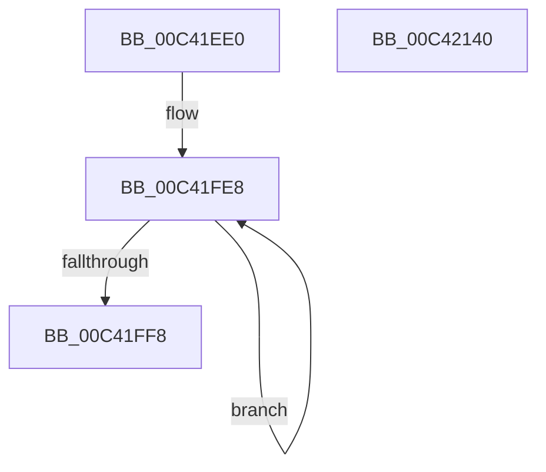

# PopBatteryInit

- RVA: `0x00C41EE0`–`0x00C42141` (길이 `609` bytes)
- VA: `0x0000000140C41EE0`
- 실행 섹션: `INIT`
- PDB 이름 있음: `예`; PDB Function 태그: `아니요`
- unwind 정보 RVA: `0x000DB714`
- 디코드: `94`개 명령, `609/609` bytes 표시
- 미해석 바이트: `0` (있으면 어셈블리에 `.byte`로 보존)

> 이 문서는 커널 이미지의 기계어와 PDB 기호를 분석해 생성했습니다. 4번과 5번은 함수 원형과 자료형을 바이너리 사용 방식에서 추정한 C 해석이며 원본 소스 복구 결과는 아닙니다.

## 1. Dependencies

- 직접 호출 지점: **0**; 고유 호출 대상: **0**
- 직접 호출자로 확인된 함수: **1**
- RIP 상대 이미지 참조: **80**

### Outgoing calls
- 직접 디코드된 call 명령이 없습니다.

### Direct callers
- [PoInitSystem](../C7/PoInitSystem_function_00C72358.md) at `0x00C729FE`

### Static image references
- `0x00C41EE2` → RVA `0x00F0C040` (`.data`; read)
- `0x00C41EEC` → RVA `0x00F0C048` (`.data`; write)
- `0x00C41EF3` → RVA `0x00F0C040` (`.data`; write)
- `0x00C41EFD` → RVA `0x00F0C050` (`.data`; read)
- `0x00C41F04` → RVA `0x00F0C20C` (`.data`; write)
- `0x00C41F0A` → RVA `0x00F0C058` (`.data`; write)
- `0x00C41F11` → RVA `0x00F0C050` (`.data`; write)
- `0x00C41F18` → RVA `0x00F0C2C8` (`.data`; read)
- `0x00C41F1F` → RVA `0x00F0C2D0` (`.data`; write)
- `0x00C41F26` → RVA `0x00F0C2C8` (`.data`; write)
- `0x00C41F2D` → RVA `0x00AE1650` (`PopBatteryWorker`; read)
- `0x00C41F34` → RVA `0x00F09030` (`.data`; write)
- `0x00C41F3B` → RVA `0x00F0C188` (`.data`; read)
- `0x00C41F42` → RVA `0x00F0C238` (`.data`; read)
- `0x00C41F49` → RVA `0x00F0C268` (`.data`; write)
- `0x00C41F4F` → RVA `0x00F0C248` (`.data`; read)
- `0x00C41F56` → RVA `0x00F0C26C` (`.data`; write)
- `0x00C41F5C` → RVA `0x00F0C270` (`.data`; write)
- `0x00C41F62` → RVA `0x00F0C274` (`.data`; write)
- `0x00C41F68` → RVA `0x00F0C278` (`.data`; write)
- `0x00C41F6E` → RVA `0x00F0C27C` (`.data`; write)
- `0x00C41F74` → RVA `0x00F0C280` (`.data`; write)
- `0x00C41F7A` → RVA `0x00F09040` (`.data`; write)
- `0x00C41F80` → RVA `0x00F09044` (`.data`; write)
- `0x00C41F89` → RVA `0x00F0C028` (`.data`; write)
- `0x00C41F90` → RVA `0x00F0C020` (`.data`; write)
- `0x00C41F97` → RVA `0x00F0C238` (`.data`; write)
- `0x00C41F9E` → RVA `0x00F09018` (`.data`; write)
- `0x00C41FA5` → RVA `0x00F09010` (`.data`; write)
- `0x00C41FAC` → RVA `0x00F0C258` (`.data`; read)
- `0x00C41FB3` → RVA `0x00F0C21C` (`.data`; write)
- `0x00C41FBA` → RVA `0x00F0C208` (`.data`; write)
- `0x00C41FC0` → RVA `0x00F0C248` (`.data`; write)
- `0x00C41FC7` → RVA `0x00F0C228` (`.data`; write)
- `0x00C41FCE` → RVA `0x00F0C218` (`.data`; write)
- `0x00C41FD4` → RVA `0x00F09048` (`.data`; write)
- `0x00C41FDA` → RVA `0x00F09038` (`.data`; write)
- `0x00C41FE1` → RVA `0x00F09020` (`.data`; write)
- `0x00C41FF8` → RVA `0x00F0C150` (`.data`; read)
- `0x00C41FFF` → RVA `0x00F0C0C8` (`.data`; write)
- `0x00C42006` → RVA `0x00F0C158` (`.data`; write)
- `0x00C4200D` → RVA `0x00F0C150` (`.data`; write)
- `0x00C42014` → RVA `0x005D9550` (`PopBatteryWakeDpc`; read)
- `0x00C4201B` → RVA `0x00F0C120` (`.data`; write)
- `0x00C42022` → RVA `0x00F0C0D0` (`.data`; read)
- `0x00C42029` → RVA `0x00F0C0D8` (`.data`; write)
- `0x00C42030` → RVA `0x00F0C0D0` (`.data`; write)
- `0x00C42037` → RVA `0x00A86FA0` (`PopBootBatteryStatusWorker`; read)
- `0x00C4203E` → RVA `0x00F0C170` (`.data`; write)
- `0x00C42045` → RVA `0x00F0C148` (`.data`; write)
- `0x00C4204E` → RVA `0x00F0C14A` (`.data`; write)
- `0x00C42055` → RVA `0x00F0C14C` (`.data`; write)
- `0x00C4205B` → RVA `0x00F0C230` (`.data`; write)
- `0x00C42062` → RVA `0x00F0C108` (`.data`; write)
- `0x00C4206C` → RVA `0x00F0C128` (`.data`; write)
- `0x00C42073` → RVA `0x00F0C140` (`.data`; write)
- `0x00C4207A` → RVA `0x00F0C118` (`.data`; write)
- `0x00C42088` → RVA `0x00F0C0E0` (`.data`; write)
- `0x00C4208F` → RVA `0x00F0C104` (`.data`; write)
- `0x00C42095` → RVA `0x00F0C100` (`.data`; write)
- `0x00C4209C` → RVA `0x00F0C178` (`.data`; write)
- `0x00C420A3` → RVA `0x00F0C160` (`.data`; write)
- `0x00C420AA` → RVA `0x00F0C038` (`.data`; write)
- `0x00C420B0` → RVA `0x00F0C0B8` (`.data`; write)
- `0x00C420C6` → RVA `0x00F090A0` (`.data`; write)
- `0x00C420CD` → RVA `0x00E0B810` (`.data`; write)
- `0x00C420D4` → RVA `0x005D95C0` (`PopRefreshEstimateAfterSpoilingDpc`; read)
- `0x00C420DB` → RVA `0x00F09078` (`.data`; write)
- `0x00C420E2` → RVA `0x00F090A8` (`.data`; read)
- `0x00C420E9` → RVA `0x00F090B0` (`.data`; write)
- `0x00C420F0` → RVA `0x00F090A8` (`.data`; write)
- `0x00C420F7` → RVA `0x00F09060` (`.data`; write)
- `0x00C42101` → RVA `0x00F09080` (`.data`; write)
- `0x00C42108` → RVA `0x00F09098` (`.data`; write)
- `0x00C4210F` → RVA `0x00F09070` (`.data`; write)
- `0x00C4211D` → RVA `0x00F090B8` (`.data`; write)
- `0x00C42124` → RVA `0x00F090DC` (`.data`; write)
- `0x00C4212A` → RVA `0x00F090D8` (`.data`; write)
- `0x00C42131` → RVA `0x00F0C180` (`.data`; write)
- `0x00C42138` → RVA `0x00E678A9` (`.data`; write)

## 2. Other-region calls and transfers

- 다른 실행 섹션으로 향하는 call: **0**
- 별도 외부 분기/꼬리 이동을 확인하지 못했습니다.

## 3. Assembly (complete function range)

```asm
00C41EE0  33 D2                           xor edx, edx
00C41EE2  48 8D 05 57 A1 2C 00            lea rax, [rip + 0x2ca157]
00C41EE9  83 C9 FF                        or ecx, 0xffffffff
00C41EEC  48 89 05 55 A1 2C 00            mov qword ptr [rip + 0x2ca155], rax
00C41EF3  48 89 05 46 A1 2C 00            mov qword ptr [rip + 0x2ca146], rax
00C41EFA  0F 57 C0                        xorps xmm0, xmm0
00C41EFD  48 8D 05 4C A1 2C 00            lea rax, [rip + 0x2ca14c]
00C41F04  89 0D 02 A3 2C 00               mov dword ptr [rip + 0x2ca302], ecx
00C41F0A  48 89 05 47 A1 2C 00            mov qword ptr [rip + 0x2ca147], rax
00C41F11  48 89 05 38 A1 2C 00            mov qword ptr [rip + 0x2ca138], rax
00C41F18  48 8D 05 A9 A3 2C 00            lea rax, [rip + 0x2ca3a9]
00C41F1F  48 89 05 AA A3 2C 00            mov qword ptr [rip + 0x2ca3aa], rax
00C41F26  48 89 05 9B A3 2C 00            mov qword ptr [rip + 0x2ca39b], rax
00C41F2D  48 8D 05 1C F7 E9 FF            lea rax, [rip - 0x1608e4]
00C41F34  48 89 05 F5 70 2C 00            mov qword ptr [rip + 0x2c70f5], rax
00C41F3B  48 8D 05 46 A2 2C 00            lea rax, [rip + 0x2ca246]
00C41F42  0F 11 05 EF A2 2C 00            movups xmmword ptr [rip + 0x2ca2ef], xmm0
00C41F49  89 0D 19 A3 2C 00               mov dword ptr [rip + 0x2ca319], ecx
00C41F4F  0F 11 05 F2 A2 2C 00            movups xmmword ptr [rip + 0x2ca2f2], xmm0
00C41F56  89 0D 10 A3 2C 00               mov dword ptr [rip + 0x2ca310], ecx
00C41F5C  89 0D 0E A3 2C 00               mov dword ptr [rip + 0x2ca30e], ecx
00C41F62  89 0D 0C A3 2C 00               mov dword ptr [rip + 0x2ca30c], ecx
00C41F68  89 0D 0A A3 2C 00               mov dword ptr [rip + 0x2ca30a], ecx
00C41F6E  89 0D 08 A3 2C 00               mov dword ptr [rip + 0x2ca308], ecx
00C41F74  89 0D 06 A3 2C 00               mov dword ptr [rip + 0x2ca306], ecx
00C41F7A  89 0D C0 70 2C 00               mov dword ptr [rip + 0x2c70c0], ecx
00C41F80  89 0D BE 70 2C 00               mov dword ptr [rip + 0x2c70be], ecx
00C41F86  8D 4A 04                        lea ecx, [rdx + 4]
00C41F89  48 89 15 98 A0 2C 00            mov qword ptr [rip + 0x2ca098], rdx
00C41F90  48 89 15 89 A0 2C 00            mov qword ptr [rip + 0x2ca089], rdx
00C41F97  48 89 15 9A A2 2C 00            mov qword ptr [rip + 0x2ca29a], rdx
00C41F9E  48 89 15 73 70 2C 00            mov qword ptr [rip + 0x2c7073], rdx
00C41FA5  48 89 15 64 70 2C 00            mov qword ptr [rip + 0x2c7064], rdx
00C41FAC  0F 11 05 A5 A2 2C 00            movups xmmword ptr [rip + 0x2ca2a5], xmm0
00C41FB3  48 89 15 62 A2 2C 00            mov qword ptr [rip + 0x2ca262], rdx
00C41FBA  88 15 48 A2 2C 00               mov byte ptr [rip + 0x2ca248], dl
00C41FC0  C6 05 81 A2 2C 00 01            mov byte ptr [rip + 0x2ca281], 1
00C41FC7  48 89 15 5A A2 2C 00            mov qword ptr [rip + 0x2ca25a], rdx
00C41FCE  89 15 44 A2 2C 00               mov dword ptr [rip + 0x2ca244], edx
00C41FD4  89 15 6E 70 2C 00               mov dword ptr [rip + 0x2c706e], edx
00C41FDA  48 89 15 57 70 2C 00            mov qword ptr [rip + 0x2c7057], rdx
00C41FE1  48 89 15 38 70 2C 00            mov qword ptr [rip + 0x2c7038], rdx
00C41FE8  C7 00 02 00 00 00               mov dword ptr [rax], 2
00C41FEE  48 8D 40 20                     lea rax, [rax + 0x20]
00C41FF2  48 83 E9 01                     sub rcx, 1
00C41FF6  75 F0                           jne 0x140c41fe8
00C41FF8  48 8D 05 51 A1 2C 00            lea rax, [rip + 0x2ca151]
00C41FFF  48 89 15 C2 A0 2C 00            mov qword ptr [rip + 0x2ca0c2], rdx
00C42006  48 89 05 4B A1 2C 00            mov qword ptr [rip + 0x2ca14b], rax
00C4200D  48 89 05 3C A1 2C 00            mov qword ptr [rip + 0x2ca13c], rax
00C42014  48 8D 05 35 75 99 FF            lea rax, [rip - 0x668acb]
00C4201B  48 89 05 FE A0 2C 00            mov qword ptr [rip + 0x2ca0fe], rax
00C42022  48 8D 05 A7 A0 2C 00            lea rax, [rip + 0x2ca0a7]
00C42029  48 89 05 A8 A0 2C 00            mov qword ptr [rip + 0x2ca0a8], rax
00C42030  48 89 05 99 A0 2C 00            mov qword ptr [rip + 0x2ca099], rax
00C42037  48 8D 05 62 4F E4 FF            lea rax, [rip - 0x1bb09e]
00C4203E  48 89 05 2B A1 2C 00            mov qword ptr [rip + 0x2ca12b], rax
00C42045  66 C7 05 FA A0 2C 00 01 00      mov word ptr [rip + 0x2ca0fa], 1
00C4204E  C6 05 F5 A0 2C 00 06            mov byte ptr [rip + 0x2ca0f5], 6
00C42055  89 15 F1 A0 2C 00               mov dword ptr [rip + 0x2ca0f1], edx
00C4205B  48 89 15 CE A1 2C 00            mov qword ptr [rip + 0x2ca1ce], rdx
00C42062  C7 05 9C A0 2C 00 13 01 00 00   mov dword ptr [rip + 0x2ca09c], 0x113
00C4206C  48 89 15 B5 A0 2C 00            mov qword ptr [rip + 0x2ca0b5], rdx
00C42073  48 89 15 C6 A0 2C 00            mov qword ptr [rip + 0x2ca0c6], rdx
00C4207A  48 89 15 97 A0 2C 00            mov qword ptr [rip + 0x2ca097], rdx
00C42081  C6 05 40 A0 2C 00 08            mov byte ptr [rip + 0x2ca040], 8
00C42088  48 89 15 51 A0 2C 00            mov qword ptr [rip + 0x2ca051], rdx
00C4208F  89 15 6F A0 2C 00               mov dword ptr [rip + 0x2ca06f], edx
00C42095  66 89 15 64 A0 2C 00            mov word ptr [rip + 0x2ca064], dx
00C4209C  48 89 15 D5 A0 2C 00            mov qword ptr [rip + 0x2ca0d5], rdx
00C420A3  48 89 15 B6 A0 2C 00            mov qword ptr [rip + 0x2ca0b6], rdx
00C420AA  88 15 88 9F 2C 00               mov byte ptr [rip + 0x2c9f88], dl
00C420B0  89 15 02 A0 2C 00               mov dword ptr [rip + 0x2ca002], edx
00C420B6  48 A1 08 00 00 00 80 F7 FF FF   movabs rax, qword ptr [0xfffff78000000008]
00C420C0  48 05 00 A3 E1 11               add rax, 0x11e1a300
00C420C6  48 89 15 D3 6F 2C 00            mov qword ptr [rip + 0x2c6fd3], rdx
00C420CD  48 89 05 3C 97 1C 00            mov qword ptr [rip + 0x1c973c], rax
00C420D4  48 8D 05 E5 74 99 FF            lea rax, [rip - 0x668b1b]
00C420DB  48 89 05 96 6F 2C 00            mov qword ptr [rip + 0x2c6f96], rax
00C420E2  48 8D 05 BF 6F 2C 00            lea rax, [rip + 0x2c6fbf]
00C420E9  48 89 05 C0 6F 2C 00            mov qword ptr [rip + 0x2c6fc0], rax
00C420F0  48 89 05 B1 6F 2C 00            mov qword ptr [rip + 0x2c6fb1], rax
00C420F7  C7 05 5F 6F 2C 00 13 01 00 00   mov dword ptr [rip + 0x2c6f5f], 0x113
00C42101  48 89 15 78 6F 2C 00            mov qword ptr [rip + 0x2c6f78], rdx
00C42108  48 89 15 89 6F 2C 00            mov qword ptr [rip + 0x2c6f89], rdx
00C4210F  48 89 15 5A 6F 2C 00            mov qword ptr [rip + 0x2c6f5a], rdx
00C42116  C6 05 83 6F 2C 00 08            mov byte ptr [rip + 0x2c6f83], 8
00C4211D  48 89 15 94 6F 2C 00            mov qword ptr [rip + 0x2c6f94], rdx
00C42124  89 15 B2 6F 2C 00               mov dword ptr [rip + 0x2c6fb2], edx
00C4212A  66 89 15 A7 6F 2C 00            mov word ptr [rip + 0x2c6fa7], dx
00C42131  C6 05 48 A0 2C 00 01            mov byte ptr [rip + 0x2ca048], 1
00C42138  C6 05 6A 57 22 00 01            mov byte ptr [rip + 0x22576a], 1
00C4213F  C3                              ret
00C42140  CC                              int3
```

## 4. C-style interpretation (structured pseudocode)

```c
__int64 __fastcall PopBatteryInit(int a1, int a2)
{
    __int64 result;

    a2 = 0;
    a1 = (unsigned int)((a1) | (0xFFFFFFFFULL));
    *(unsigned __int64 *)(v_rip + 2924885) = v_rip + 2924887;
    *(unsigned __int64 *)(v_rip + 2924870) = v_rip + 2924887;
    *(unsigned int *)(v_rip + 2925314) = a1;
    *(unsigned __int64 *)(v_rip + 2924871) = v_rip + 2924876;
    *(unsigned __int64 *)(v_rip + 2924856) = v_rip + 2924876;
    *(unsigned __int64 *)(v_rip + 2925482) = v_rip + 2925481;
    *(unsigned __int64 *)(v_rip + 2925467) = v_rip + 2925481;
    *(unsigned __int64 *)(v_rip + 2912501) = v_rip - 1444068;
    *(unsigned __int64 *)(v_rip + 2925295) = v_xmm0;
    *(unsigned int *)(v_rip + 2925337) = a1;
    *(unsigned __int64 *)(v_rip + 2925298) = v_xmm0;
    *(unsigned int *)(v_rip + 2925328) = a1;
    *(unsigned int *)(v_rip + 2925326) = a1;
    *(unsigned int *)(v_rip + 2925324) = a1;
    *(unsigned int *)(v_rip + 2925322) = a1;
    *(unsigned int *)(v_rip + 2925320) = a1;
    *(unsigned int *)(v_rip + 2925318) = a1;
    *(unsigned int *)(v_rip + 2912448) = a1;
    *(unsigned int *)(v_rip + 2912446) = a1;
    *(unsigned __int64 *)(v_rip + 2924696) = 0;
    *(unsigned __int64 *)(v_rip + 2924681) = 0;
    *(unsigned __int64 *)(v_rip + 2925210) = 0;
    *(unsigned __int64 *)(v_rip + 2912371) = 0;
    *(unsigned __int64 *)(v_rip + 2912356) = 0;
    *(unsigned __int64 *)(v_rip + 2925221) = v_xmm0;
    *(unsigned __int64 *)(v_rip + 2925154) = 0;
    *(unsigned __int8 *)(v_rip + 2925128) = 0;
    *(unsigned __int8 *)(v_rip + 2925185) = 1;
    *(unsigned __int64 *)(v_rip + 2925146) = 0;
    *(unsigned int *)(v_rip + 2925124) = 0;
    *(unsigned int *)(v_rip + 2912366) = 0;
    *(unsigned __int64 *)(v_rip + 2912343) = 0;
    *(unsigned __int64 *)(v_rip + 2912312) = 0;
loc_00C41FE8:
    *(unsigned int *)(v_rip + 2925126) = 2;
    a1 = (a2 + 4) - (1);
    if (condition_is_not_equal) goto loc_00C41FE8;
    *(unsigned __int64 *)(v_rip + 2924738) = 0;
    *(unsigned __int64 *)(v_rip + 2924875) = v_rip + 2924881;
    *(unsigned __int64 *)(v_rip + 2924860) = v_rip + 2924881;
    *(unsigned __int64 *)(v_rip + 2924798) = v_rip - 6720203;
    *(unsigned __int64 *)(v_rip + 2924712) = v_rip + 2924711;
    *(unsigned __int64 *)(v_rip + 2924697) = v_rip + 2924711;
    *(unsigned __int64 *)(v_rip + 2924843) = v_rip - 1814686;
    *(unsigned __int16 *)(v_rip + 2924794) = 1;
    *(unsigned __int8 *)(v_rip + 2924789) = 6;
    *(unsigned int *)(v_rip + 2924785) = 0;
    *(unsigned __int64 *)(v_rip + 2925006) = 0;
    *(unsigned int *)(v_rip + 2924700) = 275;
    *(unsigned __int64 *)(v_rip + 2924725) = 0;
    *(unsigned __int64 *)(v_rip + 2924742) = 0;
    *(unsigned __int64 *)(v_rip + 2924695) = 0;
    *(unsigned __int8 *)(v_rip + 2924608) = 8;
    *(unsigned __int64 *)(v_rip + 2924625) = 0;
    *(unsigned int *)(v_rip + 2924655) = 0;
    *(unsigned __int16 *)(v_rip + 2924644) = 0;
    *(unsigned __int64 *)(v_rip + 2924757) = 0;
    *(unsigned __int64 *)(v_rip + 2924726) = 0;
    *(unsigned __int8 *)(v_rip + 2924424) = 0;
    *(unsigned int *)(v_rip + 2924546) = 0;
    result = (v_rip - 1814686) + (0x11E1A300ULL);
    *(unsigned __int64 *)(v_rip + 2912211) = 0;
    *(unsigned __int64 *)(v_rip + 1873724) = result;
    *(unsigned __int64 *)(v_rip + 2912150) = v_rip - 6720283;
    *(unsigned __int64 *)(v_rip + 2912192) = v_rip + 2912191;
    *(unsigned __int64 *)(v_rip + 2912177) = v_rip + 2912191;
    *(unsigned int *)(v_rip + 2912095) = 275;
    *(unsigned __int64 *)(v_rip + 2912120) = 0;
    *(unsigned __int64 *)(v_rip + 2912137) = 0;
    *(unsigned __int64 *)(v_rip + 2912090) = 0;
    *(unsigned __int8 *)(v_rip + 2912131) = 8;
    *(unsigned __int64 *)(v_rip + 2912148) = 0;
    *(unsigned int *)(v_rip + 2912178) = 0;
    *(unsigned __int16 *)(v_rip + 2912167) = 0;
    *(unsigned __int8 *)(v_rip + 2924616) = 1;
    *(unsigned __int8 *)(v_rip + 2250602) = 1;
    return v_rip + 2912191;
}
```

## 5. (Beta) C Style

```c
int64_t PopBatteryInit(int32_t Arg1, int32_t Arg2)
{
    int64_t result;

    Arg2 = 0;
    Arg1 = (uint32_t)((Arg1) | (0xFFFFFFFFULL));
    *(uint64_t *)(v_rip + 0x2CA155) = v_rip + 2924887;
    *(uint64_t *)(v_rip + 0x2CA146) = v_rip + 2924887;
    *(uint32_t *)(v_rip + 0x2CA302) = Arg1;
    *(uint64_t *)(v_rip + 0x2CA147) = v_rip + 2924876;
    *(uint64_t *)(v_rip + 0x2CA138) = v_rip + 2924876;
    *(uint64_t *)(v_rip + 0x2CA3AA) = v_rip + 2925481;
    *(uint64_t *)(v_rip + 0x2CA39B) = v_rip + 2925481;
    *(uint64_t *)(v_rip + 0x2C70F5) = v_rip - 1444068;
    *(uint64_t *)(v_rip + 0x2CA2EF) = v_xmm0;
    *(uint32_t *)(v_rip + 0x2CA319) = Arg1;
    *(uint64_t *)(v_rip + 0x2CA2F2) = v_xmm0;
    *(uint32_t *)(v_rip + 0x2CA310) = Arg1;
    *(uint32_t *)(v_rip + 0x2CA30E) = Arg1;
    *(uint32_t *)(v_rip + 0x2CA30C) = Arg1;
    *(uint32_t *)(v_rip + 0x2CA30A) = Arg1;
    *(uint32_t *)(v_rip + 0x2CA308) = Arg1;
    *(uint32_t *)(v_rip + 0x2CA306) = Arg1;
    *(uint32_t *)(v_rip + 0x2C70C0) = Arg1;
    *(uint32_t *)(v_rip + 0x2C70BE) = Arg1;
    *(uint64_t *)(v_rip + 0x2CA098) = 0;
    *(uint64_t *)(v_rip + 0x2CA089) = 0;
    *(uint64_t *)(v_rip + 0x2CA29A) = 0;
    *(uint64_t *)(v_rip + 0x2C7073) = 0;
    *(uint64_t *)(v_rip + 0x2C7064) = 0;
    *(uint64_t *)(v_rip + 0x2CA2A5) = v_xmm0;
    *(uint64_t *)(v_rip + 0x2CA262) = 0;
    *(uint8_t *)(v_rip + 0x2CA248) = 0;
    *(uint8_t *)(v_rip + 0x2CA281) = 1;
    *(uint64_t *)(v_rip + 0x2CA25A) = 0;
    *(uint32_t *)(v_rip + 0x2CA244) = 0;
    *(uint32_t *)(v_rip + 0x2C706E) = 0;
    *(uint64_t *)(v_rip + 0x2C7057) = 0;
    *(uint64_t *)(v_rip + 0x2C7038) = 0;
loc_00C41FE8:
    *(uint32_t *)(v_rip + 0x2CA246) = 2;
    Arg1 = (Arg2 + 4) - (1);
    if (condition_is_not_equal) goto loc_00C41FE8;
    *(uint64_t *)(v_rip + 0x2CA0C2) = 0;
    *(uint64_t *)(v_rip + 0x2CA14B) = v_rip + 2924881;
    *(uint64_t *)(v_rip + 0x2CA13C) = v_rip + 2924881;
    *(uint64_t *)(v_rip + 0x2CA0FE) = v_rip - 6720203;
    *(uint64_t *)(v_rip + 0x2CA0A8) = v_rip + 2924711;
    *(uint64_t *)(v_rip + 0x2CA099) = v_rip + 2924711;
    *(uint64_t *)(v_rip + 0x2CA12B) = v_rip - 1814686;
    *(uint16_t *)(v_rip + 0x2CA0FA) = 1;
    *(uint8_t *)(v_rip + 0x2CA0F5) = 6;
    *(uint32_t *)(v_rip + 0x2CA0F1) = 0;
    *(uint64_t *)(v_rip + 0x2CA1CE) = 0;
    *(uint32_t *)(v_rip + 0x2CA09C) = 275;
    *(uint64_t *)(v_rip + 0x2CA0B5) = 0;
    *(uint64_t *)(v_rip + 0x2CA0C6) = 0;
    *(uint64_t *)(v_rip + 0x2CA097) = 0;
    *(uint8_t *)(v_rip + 0x2CA040) = 8;
    *(uint64_t *)(v_rip + 0x2CA051) = 0;
    *(uint32_t *)(v_rip + 0x2CA06F) = 0;
    *(uint16_t *)(v_rip + 0x2CA064) = 0;
    *(uint64_t *)(v_rip + 0x2CA0D5) = 0;
    *(uint64_t *)(v_rip + 0x2CA0B6) = 0;
    *(uint8_t *)(v_rip + 0x2C9F88) = 0;
    *(uint32_t *)(v_rip + 0x2CA002) = 0;
    result = (v_rip - 1814686) + (0x11E1A300ULL);
    *(uint64_t *)(v_rip + 0x2C6FD3) = 0;
    *(uint64_t *)(v_rip + 0x1C973C) = result;
    *(uint64_t *)(v_rip + 0x2C6F96) = v_rip - 6720283;
    *(uint64_t *)(v_rip + 0x2C6FC0) = v_rip + 2912191;
    *(uint64_t *)(v_rip + 0x2C6FB1) = v_rip + 2912191;
    *(uint32_t *)(v_rip + 0x2C6F5F) = 275;
    *(uint64_t *)(v_rip + 0x2C6F78) = 0;
    *(uint64_t *)(v_rip + 0x2C6F89) = 0;
    *(uint64_t *)(v_rip + 0x2C6F5A) = 0;
    *(uint8_t *)(v_rip + 0x2C6F83) = 8;
    *(uint64_t *)(v_rip + 0x2C6F94) = 0;
    *(uint32_t *)(v_rip + 0x2C6FB2) = 0;
    *(uint16_t *)(v_rip + 0x2C6FA7) = 0;
    *(uint8_t *)(v_rip + 0x2CA048) = 1;
    *(uint8_t *)(v_rip + 0x22576A) = 1;
    return v_rip + 2912191;
}
```

## 6. Execution-region graph

[열기: 2D/3D 그래프와 함수 탐색 컨트롤 패널](../../../control-panel.html?section=init&rva=0x00C41EE0&view=graph)

- 2D 그래프는 위에서 아래로 흐르고, 3D 그래프는 빈 공간을 드래그해 회전합니다. Shift+드래그는 이동, 휠은 확대·축소, 함수 노드 선택은 대상 보고서 이동입니다.

### Static fallback


