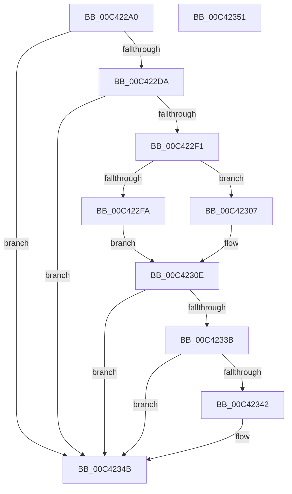

# PopBatteryReadOscBits

- RVA: `0x00C422A0`–`0x00C42352` (길이 `178` bytes)
- VA: `0x0000000140C422A0`
- 실행 섹션: `INIT`
- PDB 이름 있음: `예`; PDB Function 태그: `아니요`
- unwind 정보 RVA: `0x00064C80`
- 디코드: `44`개 명령, `178/178` bytes 표시
- 미해석 바이트: `0` (있으면 어셈블리에 `.byte`로 보존)

> 이 문서는 커널 이미지의 기계어와 PDB 기호를 분석해 생성했습니다. 4번과 5번은 함수 원형과 자료형을 바이너리 사용 방식에서 추정한 C 해석이며 원본 소스 복구 결과는 아닙니다.

## 1. Dependencies

- 직접 호출 지점: **3**; 고유 호출 대상: **2**
- 직접 호출자로 확인된 함수: **1**
- RIP 상대 이미지 참조: **7**

### Outgoing calls
- `0x00C422D1` → [PopReadRegKeyValue](../../text/4B/PopReadRegKeyValue_function_004B5F64.md) (function, `0x004B5F64`)
- `0x00C422E8` → [Feature_BatteryChargeLimitV2Support__private_IsEnabledDeviceUsageNoInline](../../text/5D/Feature_BatteryChargeLimitV2Support__private_IsEnabledDeviceUsageNoInline_function_005D9484.md) (function, `0x005D9484`)
- `0x00C42332` → [PopReadRegKeyValue](../../text/4B/PopReadRegKeyValue_function_004B5F64.md) (function, `0x004B5F64`)

### Direct callers
- [PopBatteryInitPhaseTwo](PopBatteryInitPhaseTwo_function_00C42148.md) at `0x00C42253`

### Static image references
- `0x00C422B3` → RVA `0x00F0C2C0` (`.data`; write)
- `0x00C422BA` → RVA `0x0002A860` (`.rdata`; read)
- `0x00C422C6` → RVA `0x000239E0` (`.rdata`; read)
- `0x00C422F1` → RVA `0x00F0C2C0` (`.data`; read)
- `0x00C422FF` → RVA `0x00F0C2C1` (`.data`; write)
- `0x00C42320` → RVA `0x0002A918` (`.rdata`; read)
- `0x00C42327` → RVA `0x0002A890` (`.rdata`; read)

## 2. Other-region calls and transfers

- 다른 실행 섹션으로 향하는 call: **3**
  - `0x00C422D1` → [PopReadRegKeyValue](../../text/4B/PopReadRegKeyValue_function_004B5F64.md) (`INIT` → `.text`)
  - `0x00C422E8` → [Feature_BatteryChargeLimitV2Support__private_IsEnabledDeviceUsageNoInline](../../text/5D/Feature_BatteryChargeLimitV2Support__private_IsEnabledDeviceUsageNoInline_function_005D9484.md) (`INIT` → `.text`)
  - `0x00C42332` → [PopReadRegKeyValue](../../text/4B/PopReadRegKeyValue_function_004B5F64.md) (`INIT` → `.text`)
- 별도 외부 분기/꼬리 이동을 확인하지 못했습니다.

## 3. Assembly (complete function range)

```asm
00C422A0  40 53                           push rbx
00C422A2  48 83 EC 30                     sub rsp, 0x30
00C422A6  83 64 24 40 00                  and dword ptr [rsp + 0x40], 0
00C422AB  48 8D 44 24 40                  lea rax, [rsp + 0x40]
00C422B0  45 33 C9                        xor r9d, r9d
00C422B3  C6 05 06 A0 2C 00 00            mov byte ptr [rip + 0x2ca006], 0
00C422BA  48 8D 15 9F 85 3E FF            lea rdx, [rip - 0xc17a61]
00C422C1  48 89 44 24 20                  mov qword ptr [rsp + 0x20], rax
00C422C6  48 8D 0D 13 17 3E FF            lea rcx, [rip - 0xc1e8ed]
00C422CD  45 8D 41 04                     lea r8d, [r9 + 4]
00C422D1  E8 8E 3C 87 FF                  call 0x1404b5f64
00C422D6  85 C0                           test eax, eax
00C422D8  78 71                           js 0x140c4234b
00C422DA  8B 5C 24 40                     mov ebx, dword ptr [rsp + 0x40]
00C422DE  8A C3                           mov al, bl
00C422E0  24 01                           and al, 1
00C422E2  88 05 D8 9F 2C 00               mov byte ptr [rip + 0x2c9fd8], al
00C422E8  E8 97 71 99 FF                  call 0x1405d9484
00C422ED  85 C0                           test eax, eax
00C422EF  74 5A                           je 0x140c4234b
00C422F1  80 3D C8 9F 2C 00 00            cmp byte ptr [rip + 0x2c9fc8], 0
00C422F8  74 0D                           je 0x140c42307
00C422FA  D0 EB                           shr bl, 1
00C422FC  80 E3 01                        and bl, 1
00C422FF  88 1D BC 9F 2C 00               mov byte ptr [rip + 0x2c9fbc], bl
00C42305  EB 07                           jmp 0x140c4230e
00C42307  C6 05 B3 9F 2C 00 00            mov byte ptr [rip + 0x2c9fb3], 0
00C4230E  83 64 24 40 00                  and dword ptr [rsp + 0x40], 0
00C42313  48 8D 44 24 40                  lea rax, [rsp + 0x40]
00C42318  45 33 C9                        xor r9d, r9d
00C4231B  48 89 44 24 20                  mov qword ptr [rsp + 0x20], rax
00C42320  48 8D 15 F1 85 3E FF            lea rdx, [rip - 0xc17a0f]
00C42327  48 8D 0D 62 85 3E FF            lea rcx, [rip - 0xc17a9e]
00C4232E  45 8D 41 04                     lea r8d, [r9 + 4]
00C42332  E8 2D 3C 87 FF                  call 0x1404b5f64
00C42337  85 C0                           test eax, eax
00C42339  78 10                           js 0x140c4234b
00C4233B  F6 44 24 40 01                  test byte ptr [rsp + 0x40], 1
00C42340  74 09                           je 0x140c4234b
00C42342  66 C7 05 75 9F 2C 00 01 01      mov word ptr [rip + 0x2c9f75], 0x101
00C4234B  48 83 C4 30                     add rsp, 0x30
00C4234F  5B                              pop rbx
00C42350  C3                              ret
00C42351  CC                              int3
```

## 4. C-style interpretation (structured pseudocode)

```c
__int64 __fastcall PopBatteryReadOscBits(__int64 a1, __int64 a2, __int64 a3, int a4)
{
    __int64 result;
    __int64 v_rbx;
    __int64 v_rsp;
    unsigned __int64 v_stack_m18;
    unsigned int v_stack_p8;

    v_rsp = (v_rsp) - (48);
    a4 = 0;
    *(unsigned __int8 *)(v_rip + 2924550) = 0;
    v_stack_m18 = v_stack_p8;
    result = PopReadRegKeyValue(v_rip - 12708077, v_rip - 12679777, a4 + 4, a4);
    if (sign_flag) goto loc_00C4234B;
    result = (unsigned __int8)(((unsigned __int8)((unsigned int)(v_stack_p8))) & (1));
    *(unsigned __int8 *)(v_rip + 2924504) = (unsigned __int8)(result);
    result = Feature_BatteryChargeLimitV2Support__private_IsEnabledDeviceUsageNoInline(v_rip - 12708077, v_rip - 12679777, a4 + 4, a4);
    if ((unsigned int)(result) == 0) goto loc_00C4234B;
    if ((*(unsigned __int8 *)(v_rip + 2924488)) == 0) goto loc_00C42307;
    v_rbx = (unsigned __int8)(((unsigned int)(v_stack_p8)) >> (1));
    v_rbx = (unsigned __int8)((v_rbx) & (1));
    *(unsigned __int8 *)(v_rip + 2924476) = (unsigned __int8)(v_rbx);
    goto loc_00C4230E;
loc_00C42307:
    *(unsigned __int8 *)(v_rip + 2924467) = 0;
loc_00C4230E:
    a4 = 0;
    v_stack_m18 = v_stack_p8;
    result = PopReadRegKeyValue(v_rip - 12679838, v_rip - 12679695, a4 + 4, a4);
    if (sign_flag) goto loc_00C4234B;
    if (((v_stack_p8) & (1)) != 0) {
        *(unsigned __int16 *)(v_rip + 2924405) = 257;
    }
    v_rsp = (v_rsp) + (48);
    return result;
}
```

## 5. (Beta) C Style

```c
int64_t PopBatteryReadOscBits(int64_t Arg1, int64_t Arg2, int64_t Arg3, int32_t Arg4)
{
    int64_t result;
    int64_t local_rbx;
    int64_t local_rsp;
    uint64_t v_stack_m18;
    uint32_t v_stack_p8;

    local_rsp = (local_rsp) - (48);
    Arg4 = 0;
    *(uint8_t *)(v_rip + 0x2CA006) = 0;
    v_stack_m18 = v_stack_p8;
    result = PopReadRegKeyValue(v_rip - 12708077, v_rip - 12679777, Arg4 + 4, Arg4);
    if (sign_flag) goto loc_00C4234B;
    result = (uint8_t)(((uint8_t)((uint32_t)(v_stack_p8))) & (1));
    *(uint8_t *)(v_rip + 0x2C9FD8) = (uint8_t)(result);
    result = Feature_BatteryChargeLimitV2Support__private_IsEnabledDeviceUsageNoInline(v_rip - 12708077, v_rip - 12679777, Arg4 + 4, Arg4);
    if ((uint32_t)(result) == 0) goto loc_00C4234B;
    if ((*(uint8_t *)(v_rip + 0x2C9FC8)) == 0) goto loc_00C42307;
    local_rbx = (uint8_t)(((uint32_t)(v_stack_p8)) >> (1));
    local_rbx = (uint8_t)((local_rbx) & (1));
    *(uint8_t *)(v_rip + 0x2C9FBC) = (uint8_t)(local_rbx);
    goto loc_00C4230E;
loc_00C42307:
    *(uint8_t *)(v_rip + 0x2C9FB3) = 0;
loc_00C4230E:
    Arg4 = 0;
    v_stack_m18 = v_stack_p8;
    result = PopReadRegKeyValue(v_rip - 12679838, v_rip - 12679695, Arg4 + 4, Arg4);
    if (sign_flag) goto loc_00C4234B;
    if (((v_stack_p8) & (1)) != 0) {
        *(uint16_t *)(v_rip + 0x2C9F75) = 257;
    }
    local_rsp = (local_rsp) + (48);
    return result;
}
```

## 6. Execution-region graph

[열기: 2D/3D 그래프와 함수 탐색 컨트롤 패널](../../../control-panel.html?section=init&rva=0x00C422A0&view=graph)

- 2D 그래프는 위에서 아래로 흐르고, 3D 그래프는 빈 공간을 드래그해 회전합니다. Shift+드래그는 이동, 휠은 확대·축소, 함수 노드 선택은 대상 보고서 이동입니다.

### Static fallback


