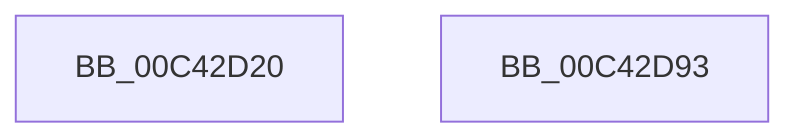

# PopCreateIdlePhaseWatchdog

- RVA: `0x00C42D20`–`0x00C42D94` (길이 `116` bytes)
- VA: `0x0000000140C42D20`
- 실행 섹션: `INIT`
- PDB 이름 있음: `예`; PDB Function 태그: `아니요`
- unwind 정보 RVA: `0x000AA4F0`
- 디코드: `22`개 명령, `116/116` bytes 표시
- 미해석 바이트: `0` (있으면 어셈블리에 `.byte`로 보존)

> 이 문서는 커널 이미지의 기계어와 PDB 기호를 분석해 생성했습니다. 4번과 5번은 함수 원형과 자료형을 바이너리 사용 방식에서 추정한 C 해석이며 원본 소스 복구 결과는 아닙니다.

## 1. Dependencies

- 직접 호출 지점: **2**; 고유 호출 대상: **2**
- 직접 호출자로 확인된 함수: **1**
- RIP 상대 이미지 참조: **3**

### Outgoing calls
- `0x00C42D39` → [memset](../../text/6C/memset_function_006C6C40.md) (function, `0x006C6C40`)
- `0x00C42D65` → [ZwPowerInformation](../../text/6A/ZwPowerInformation_function_006ADCB0.md) (function, `0x006ADCB0`)

### Direct callers
- [PoInitSystem](../C7/PoInitSystem_function_00C72358.md) at `0x00C73150`

### Static image references
- `0x00C42D75` → RVA `0x00F08488` (`.data`; read)
- `0x00C42D7C` → RVA `0x00F08488` (`.data`; read/write)
- `0x00C42D84` → RVA `0x00F08480` (`.data`; write)

## 2. Other-region calls and transfers

- 다른 실행 섹션으로 향하는 call: **2**
  - `0x00C42D39` → [memset](../../text/6C/memset_function_006C6C40.md) (`INIT` → `.text`)
  - `0x00C42D65` → [ZwPowerInformation](../../text/6A/ZwPowerInformation_function_006ADCB0.md) (`INIT` → `.text`)
- 별도 외부 분기/꼬리 이동을 확인하지 못했습니다.

## 3. Assembly (complete function range)

```asm
00C42D20  48 8B C4                        mov rax, rsp
00C42D23  48 81 EC 98 00 00 00            sub rsp, 0x98
00C42D2A  48 83 60 08 00                  and qword ptr [rax + 8], 0
00C42D2F  48 8D 48 9C                     lea rcx, [rax - 0x64]
00C42D33  33 D2                           xor edx, edx
00C42D35  44 8D 42 5C                     lea r8d, [rdx + 0x5c]
00C42D39  E8 02 3F A8 FF                  call 0x1406c6c40
00C42D3E  41 B8 60 00 00 00               mov r8d, 0x60
00C42D44  C7 44 24 30 15 00 00 00         mov dword ptr [rsp + 0x30], 0x15
00C42D4C  4C 8D 8C 24 A0 00 00 00         lea r9, [rsp + 0xa0]
00C42D54  C7 44 24 20 08 00 00 00         mov dword ptr [rsp + 0x20], 8
00C42D5C  48 8D 54 24 30                  lea rdx, [rsp + 0x30]
00C42D61  41 8D 48 F7                     lea ecx, [r8 - 9]
00C42D65  E8 46 AF A6 FF                  call 0x1406adcb0
00C42D6A  48 8B 84 24 A0 00 00 00         mov rax, qword ptr [rsp + 0xa0]
00C42D72  0F 57 C0                        xorps xmm0, xmm0
00C42D75  0F 11 05 0C 57 2C 00            movups xmmword ptr [rip + 0x2c570c], xmm0
00C42D7C  48 83 25 04 57 2C 00 00         and qword ptr [rip + 0x2c5704], 0
00C42D84  48 89 05 F5 56 2C 00            mov qword ptr [rip + 0x2c56f5], rax
00C42D8B  48 81 C4 98 00 00 00            add rsp, 0x98
00C42D92  C3                              ret
00C42D93  CC                              int3
```

## 4. C-style interpretation (structured pseudocode)

```c
__int64 __fastcall PopCreateIdlePhaseWatchdog(__int64 a1, int a2)
{
    __int64 result;
    __int64 v_rsp;
    unsigned int v_stack_m68;
    unsigned int v_stack_m78;
    unsigned __int64 v_stack_p8;

    v_rsp = (v_rsp) - (152);
    a2 = 0;
    result = memset(v_rsp - 100, a2, a2 + 92, a4);
    v_stack_m68 = 21;
    v_stack_m78 = 8;
    result = ZwPowerInformation(96 - 9, v_stack_m68, 96, v_stack_p8);
    *(unsigned __int64 *)(v_rip + 2905868) = v_xmm0;
    *(unsigned __int64 *)(v_rip + 2905845) = v_stack_p8;
    v_rsp = (v_rsp) + (152);
    return v_stack_p8;
}
```

## 5. (Beta) C Style

```c
int64_t PopCreateIdlePhaseWatchdog(int64_t Arg1, int32_t Arg2)
{
    int64_t result;
    int64_t local_rsp;
    uint32_t v_stack_m68;
    uint32_t v_stack_m78;
    uint64_t v_stack_p8;

    local_rsp = (local_rsp) - (152);
    Arg2 = 0;
    result = memset(local_rsp - 100, Arg2, Arg2 + 92, a4);
    v_stack_m68 = 21;
    v_stack_m78 = 8;
    result = ZwPowerInformation(96 - 9, v_stack_m68, 96, v_stack_p8);
    *(uint64_t *)(v_rip + 0x2C570C) = v_xmm0;
    *(uint64_t *)(v_rip + 0x2C56F5) = v_stack_p8;
    local_rsp = (local_rsp) + (152);
    return v_stack_p8;
}
```

## 6. Execution-region graph

[열기: 2D/3D 그래프와 함수 탐색 컨트롤 패널](../../../control-panel.html?section=init&rva=0x00C42D20&view=graph)

- 2D 그래프는 위에서 아래로 흐르고, 3D 그래프는 빈 공간을 드래그해 회전합니다. Shift+드래그는 이동, 휠은 확대·축소, 함수 노드 선택은 대상 보고서 이동입니다.

### Static fallback


