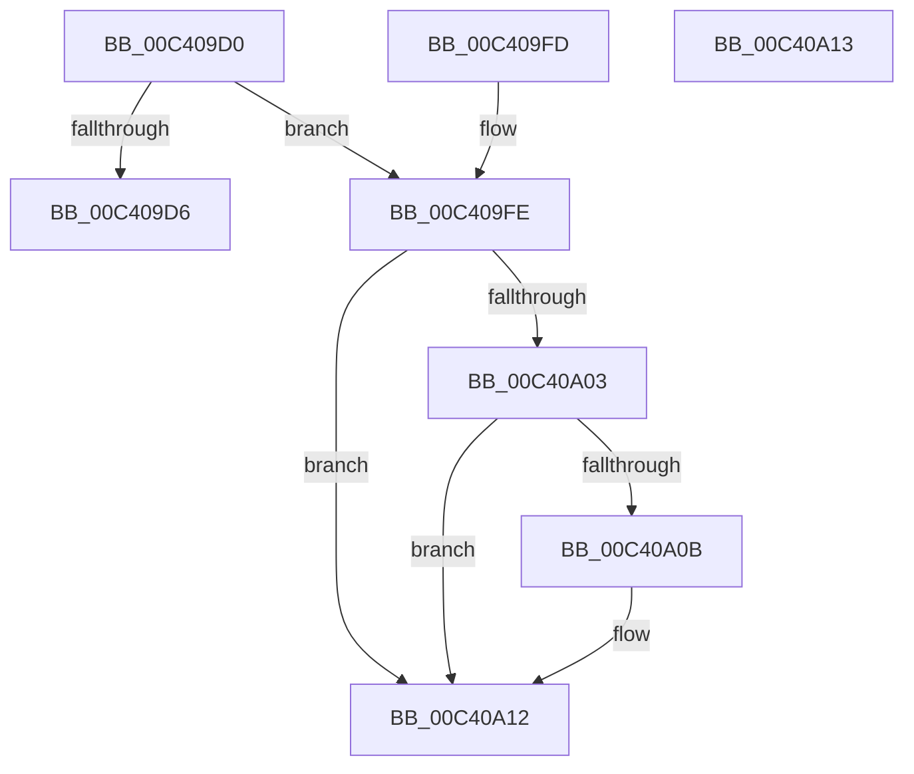

# PopDeepSleepInitialize

- RVA: `0x00C409D0`–`0x00C40A14` (길이 `68` bytes)
- VA: `0x0000000140C409D0`
- 실행 섹션: `INIT`
- PDB 이름 있음: `예`; PDB Function 태그: `아니요`
- unwind 정보 RVA: `0x000DB714`
- 디코드: `17`개 명령, `68/68` bytes 표시
- 미해석 바이트: `0` (있으면 어셈블리에 `.byte`로 보존)

> 이 문서는 커널 이미지의 기계어와 PDB 기호를 분석해 생성했습니다. 4번과 5번은 함수 원형과 자료형을 바이너리 사용 방식에서 추정한 C 해석이며 원본 소스 복구 결과는 아닙니다.

## 1. Dependencies

- 직접 호출 지점: **0**; 고유 호출 대상: **0**
- 직접 호출자로 확인된 함수: **1**
- RIP 상대 이미지 참조: **7**

### Outgoing calls
- 직접 디코드된 call 명령이 없습니다.

### Direct callers
- [PoInitSystem](../C7/PoInitSystem_function_00C72358.md) at `0x00C729E1`
- [PoInitSystem](../C7/PoInitSystem_function_00C72358.md) at `0x00C73074`

### Static image references
- `0x00C409D6` → RVA `0x00469F10` (`PopDeepSleepEvaluateCallback`; read)
- `0x00C409DD` → RVA `0x00F09330` (`.data`; write)
- `0x00C409E7` → RVA `0x00F09310` (`.data`; write)
- `0x00C409EE` → RVA `0x00F09318` (`.data`; write)
- `0x00C409F5` → RVA `0x00F09300` (`.data`; write)
- `0x00C40A03` → RVA `0x00F0CED4` (`.data`; read)
- `0x00C40A0B` → RVA `0x00F09330` (`.data`; read/write)

## 2. Other-region calls and transfers

- 다른 실행 섹션으로 향하는 call: **0**
- 별도 외부 분기/꼬리 이동을 확인하지 못했습니다.

## 3. Assembly (complete function range)

```asm
00C409D0  33 D2                           xor edx, edx
00C409D2  85 C9                           test ecx, ecx
00C409D4  75 28                           jne 0x140c409fe
00C409D6  48 8D 05 33 95 82 FF            lea rax, [rip - 0x7d6acd]
00C409DD  C7 05 49 89 2C 00 41 00 00 00   mov dword ptr [rip + 0x2c8949], 0x41
00C409E7  48 89 05 22 89 2C 00            mov qword ptr [rip + 0x2c8922], rax
00C409EE  48 89 15 23 89 2C 00            mov qword ptr [rip + 0x2c8923], rdx
00C409F5  48 89 15 04 89 2C 00            mov qword ptr [rip + 0x2c8904], rdx
00C409FC  C3                              ret
00C409FD  CC                              int3
00C409FE  83 F9 03                        cmp ecx, 3
00C40A01  75 0F                           jne 0x140c40a12
00C40A03  38 15 CB C4 2C 00               cmp byte ptr [rip + 0x2cc4cb], dl
00C40A09  75 07                           jne 0x140c40a12
00C40A0B  83 0D 1E 89 2C 00 02            or dword ptr [rip + 0x2c891e], 2
00C40A12  C3                              ret
00C40A13  CC                              int3
```

## 4. C-style interpretation (structured pseudocode)

```c
__int64 __fastcall PopDeepSleepInitialize(int a1, int a2)
{
    a2 = 0;
    if (a1 != 0) goto loc_00C409FE;
    *(unsigned int *)(v_rip + 2918729) = 65;
    *(unsigned __int64 *)(v_rip + 2918690) = v_rip - 8219341;
    *(unsigned __int64 *)(v_rip + 2918691) = 0;
    *(unsigned __int64 *)(v_rip + 2918660) = 0;
    return v_rip - 8219341;
loc_00C409FE:
    if (a1 != 3) goto loc_00C40A12;
    if ((*(unsigned __int8 *)(v_rip + 2933963)) == 0) {
    }
    return v_rip - 8219341;
}
```

## 5. (Beta) C Style

```c
int64_t PopDeepSleepInitialize(int32_t Arg1, int32_t Arg2)
{
    Arg2 = 0;
    if (Arg1 != 0) goto loc_00C409FE;
    *(uint32_t *)(v_rip + 0x2C8949) = 65;
    *(uint64_t *)(v_rip + 0x2C8922) = v_rip - 8219341;
    *(uint64_t *)(v_rip + 0x2C8923) = 0;
    *(uint64_t *)(v_rip + 0x2C8904) = 0;
    return v_rip - 8219341;
loc_00C409FE:
    if (Arg1 != 3) goto loc_00C40A12;
    if ((*(uint8_t *)(v_rip + 0x2CC4CB)) == 0) {
    }
    return v_rip - 8219341;
}
```

## 6. Execution-region graph

[열기: 2D/3D 그래프와 함수 탐색 컨트롤 패널](../../../control-panel.html?section=init&rva=0x00C409D0&view=graph)

- 2D 그래프는 위에서 아래로 흐르고, 3D 그래프는 빈 공간을 드래그해 회전합니다. Shift+드래그는 이동, 휠은 확대·축소, 함수 노드 선택은 대상 보고서 이동입니다.

### Static fallback


