# PopDetectSimulatedHeteroProcessors

- RVA: `0x00C40DD8`–`0x00C41131` (길이 `857` bytes)
- VA: `0x0000000140C40DD8`
- 실행 섹션: `INIT`
- PDB 이름 있음: `예`; PDB Function 태그: `아니요`
- unwind 정보 RVA: `0x00075C18`
- 디코드: `252`개 명령, `857/857` bytes 표시
- 미해석 바이트: `0` (있으면 어셈블리에 `.byte`로 보존)

> 이 문서는 커널 이미지의 기계어와 PDB 기호를 분석해 생성했습니다. 4번과 5번은 함수 원형과 자료형을 바이너리 사용 방식에서 추정한 C 해석이며 원본 소스 복구 결과는 아닙니다.

## 1. Dependencies

- 직접 호출 지점: **14**; 고유 호출 대상: **7**
- 직접 호출자로 확인된 함수: **1**
- RIP 상대 이미지 참조: **9**

### Outgoing calls
- `0x00C40DFC` → [KeQueryMaximumProcessorCountEx](../../text/26/KeQueryMaximumProcessorCountEx_function_00264D60.md) (function, `0x00264D60`)
- `0x00C40E09` → [PsIsCurrentThreadInServerSilo](../../text/43/PsIsCurrentThreadInServerSilo_function_004362E0.md) (function, `0x004362E0`)
- `0x00C40E1A` → [PopReadSimulatedArchitecturalClasses](PopReadSimulatedArchitecturalClasses_function_00C41284.md) (function, `0x00C41284`)
- `0x00C40E50` → [PopReadSimulatedHGSClasses](PopReadSimulatedHGSClasses_function_00C41470.md) (function, `0x00C41470`)
- `0x00C40E98` → [ExAllocatePool2](../../poolcode/B8/ExAllocatePool2_function_00B820F0.md) (function, `0x00B820F0`)
- `0x00C40EB5` → [ExAllocatePool2](../../poolcode/B8/ExAllocatePool2_function_00B820F0.md) (function, `0x00B820F0`)
- `0x00C40ED1` → [ExAllocatePool2](../../poolcode/B8/ExAllocatePool2_function_00B820F0.md) (function, `0x00B820F0`)
- `0x00C40EEE` → [ExAllocatePool2](../../poolcode/B8/ExAllocatePool2_function_00B820F0.md) (function, `0x00B820F0`)
- `0x00C40F27` → [PopReadSimulatedArchitecturalClasses](PopReadSimulatedArchitecturalClasses_function_00C41284.md) (function, `0x00C41284`)
- `0x00C41048` → [KeGetPrcb](../../text/2D/KeGetPrcb_function_002D85D0.md) (function, `0x002D85D0`)
- `0x00C410D4` → [PopReadSimulatedHGSClasses](PopReadSimulatedHGSClasses_function_00C41470.md) (function, `0x00C41470`)
- `0x00C410F2` → [ExFreePoolWithTag](../../poolcode/B8/ExFreePoolWithTag_function_00B82870.md) (function, `0x00B82870`)
- `0x00C41103` → [ExFreePoolWithTag](../../poolcode/B8/ExFreePoolWithTag_function_00B82870.md) (function, `0x00B82870`)
- `0x00C4110E` → [ExFreePoolWithTag](../../poolcode/B8/ExFreePoolWithTag_function_00B82870.md) (function, `0x00B82870`)

### Direct callers
- [PoInitSystem](../C7/PoInitSystem_function_00C72358.md) at `0x00C72DBB`

### Static image references
- `0x00C40E22` → RVA `0x00FC6C84` (`ALMOSTRO`; read)
- `0x00C40E30` → RVA `0x00FC6A94` (`ALMOSTRO`; read)
- `0x00C40E37` → RVA `0x00FC6C84` (`ALMOSTRO`; write)
- `0x00C40E3F` → RVA `0x00E0B804` (`.data`; read)
- `0x00C40F97` → RVA `0x00FC50B4` (`ALMOSTRO`; read)
- `0x00C40FAB` → RVA `0x00FC6C34` (`ALMOSTRO`; write)
- `0x00C41062` → RVA `0x00FC6C34` (`ALMOSTRO`; read)
- `0x00C41086` → RVA `0x00E0B800` (`.data`; write)
- `0x00C410D9` → RVA `0x00FC6EC0` (`ALMOSTRO`; write)

## 2. Other-region calls and transfers

- 다른 실행 섹션으로 향하는 call: **10**
  - `0x00C40DFC` → [KeQueryMaximumProcessorCountEx](../../text/26/KeQueryMaximumProcessorCountEx_function_00264D60.md) (`INIT` → `.text`)
  - `0x00C40E09` → [PsIsCurrentThreadInServerSilo](../../text/43/PsIsCurrentThreadInServerSilo_function_004362E0.md) (`INIT` → `.text`)
  - `0x00C40E98` → [ExAllocatePool2](../../poolcode/B8/ExAllocatePool2_function_00B820F0.md) (`INIT` → `POOLCODE`)
  - `0x00C40EB5` → [ExAllocatePool2](../../poolcode/B8/ExAllocatePool2_function_00B820F0.md) (`INIT` → `POOLCODE`)
  - `0x00C40ED1` → [ExAllocatePool2](../../poolcode/B8/ExAllocatePool2_function_00B820F0.md) (`INIT` → `POOLCODE`)
  - `0x00C40EEE` → [ExAllocatePool2](../../poolcode/B8/ExAllocatePool2_function_00B820F0.md) (`INIT` → `POOLCODE`)
  - `0x00C41048` → [KeGetPrcb](../../text/2D/KeGetPrcb_function_002D85D0.md) (`INIT` → `.text`)
  - `0x00C410F2` → [ExFreePoolWithTag](../../poolcode/B8/ExFreePoolWithTag_function_00B82870.md) (`INIT` → `POOLCODE`)
  - `0x00C41103` → [ExFreePoolWithTag](../../poolcode/B8/ExFreePoolWithTag_function_00B82870.md) (`INIT` → `POOLCODE`)
  - `0x00C4110E` → [ExFreePoolWithTag](../../poolcode/B8/ExFreePoolWithTag_function_00B82870.md) (`INIT` → `POOLCODE`)
- 별도 외부 분기/꼬리 이동을 확인하지 못했습니다.

## 3. Assembly (complete function range)

```asm
00C40DD8  48 89 5C 24 08                  mov qword ptr [rsp + 8], rbx
00C40DDD  48 89 6C 24 10                  mov qword ptr [rsp + 0x10], rbp
00C40DE2  48 89 74 24 18                  mov qword ptr [rsp + 0x18], rsi
00C40DE7  57                              push rdi
00C40DE8  41 54                           push r12
00C40DEA  41 55                           push r13
00C40DEC  41 56                           push r14
00C40DEE  41 57                           push r15
00C40DF0  48 83 EC 20                     sub rsp, 0x20
00C40DF4  B9 FF FF 00 00                  mov ecx, 0xffff
00C40DF9  40 B5 FF                        mov bpl, 0xff
00C40DFC  E8 5F 3F 62 FF                  call 0x140264d60
00C40E01  8B F8                           mov edi, eax
00C40E03  41 BE 01 00 00 00               mov r14d, 1
00C40E09  E8 D2 54 7F FF                  call 0x1404362e0
00C40E0E  84 C0                           test al, al
00C40E10  0F 85 FD 02 00 00               jne 0x140c41113
00C40E16  8B D7                           mov edx, edi
00C40E18  33 C9                           xor ecx, ecx
00C40E1A  E8 65 04 00 00                  call 0x140c41284
00C40E1F  0F B6 C8                        movzx ecx, al
00C40E22  8B 05 5C 5E 38 00               mov eax, dword ptr [rip + 0x385e5c]
00C40E28  41 23 CE                        and ecx, r14d
00C40E2B  83 E0 FE                        and eax, 0xfffffffe
00C40E2E  0B C8                           or ecx, eax
00C40E30  80 3D 5D 5C 38 00 00            cmp byte ptr [rip + 0x385c5d], 0
00C40E37  89 0D 47 5E 38 00               mov dword ptr [rip + 0x385e47], ecx
00C40E3D  74 2F                           je 0x140c40e6e
00C40E3F  44 8B 35 BE A9 1C 00            mov r14d, dword ptr [rip + 0x1ca9be]
00C40E46  44 8B C7                        mov r8d, edi
00C40E49  45 8B CE                        mov r9d, r14d
00C40E4C  33 D2                           xor edx, edx
00C40E4E  33 C9                           xor ecx, ecx
00C40E50  E8 1B 06 00 00                  call 0x140c41470
00C40E55  0F B6 C8                        movzx ecx, al
00C40E58  8B 05 26 5E 38 00               mov eax, dword ptr [rip + 0x385e26]
00C40E5E  83 E1 01                        and ecx, 1
00C40E61  03 C9                           add ecx, ecx
00C40E63  83 E0 FD                        and eax, 0xfffffffd
00C40E66  0B C8                           or ecx, eax
00C40E68  89 0D 16 5E 38 00               mov dword ptr [rip + 0x385e16], ecx
00C40E6E  85 C9                           test ecx, ecx
00C40E70  0F 84 9D 02 00 00               je 0x140c41113
00C40E76  41 8B C6                        mov eax, r14d
00C40E79  41 BF 50 50 4D 70               mov r15d, 0x704d5050
00C40E7F  0F AF C7                        imul eax, edi
00C40E82  41 BC 00 01 00 00               mov r12d, 0x100
00C40E88  45 8B C7                        mov r8d, r15d
00C40E8B  41 8B CC                        mov ecx, r12d
00C40E8E  C1 E0 02                        shl eax, 2
00C40E91  48 63 D0                        movsxd rdx, eax
00C40E94  48 83 C2 18                     add rdx, 0x18
00C40E98  E8 53 12 F4 FF                  call 0x140b820f0
00C40E9D  48 8B D8                        mov rbx, rax
00C40EA0  48 85 C0                        test rax, rax
00C40EA3  0F 84 6A 02 00 00               je 0x140c41113
00C40EA9  45 8B C7                        mov r8d, r15d
00C40EAC  48 8B D7                        mov rdx, rdi
00C40EAF  41 8B CC                        mov ecx, r12d
00C40EB2  4C 8B EF                        mov r13, rdi
00C40EB5  E8 36 12 F4 FF                  call 0x140b820f0
00C40EBA  48 8B F0                        mov rsi, rax
00C40EBD  48 85 C0                        test rax, rax
00C40EC0  0F 84 42 02 00 00               je 0x140c41108
00C40EC6  45 8B C7                        mov r8d, r15d
00C40EC9  BA 02 00 00 00                  mov edx, 2
00C40ECE  41 8B CC                        mov ecx, r12d
00C40ED1  E8 1A 12 F4 FF                  call 0x140b820f0
00C40ED6  4C 8B F8                        mov r15, rax
00C40ED9  48 85 C0                        test rax, rax
00C40EDC  0F 84 15 02 00 00               je 0x140c410f7
00C40EE2  41 B8 50 50 4D 70               mov r8d, 0x704d5050
00C40EE8  48 8B D7                        mov rdx, rdi
00C40EEB  41 8B CC                        mov ecx, r12d
00C40EEE  E8 FD 11 F4 FF                  call 0x140b820f0
00C40EF3  4C 8B E0                        mov r12, rax
00C40EF6  48 85 C0                        test rax, rax
00C40EF9  0F 84 EB 01 00 00               je 0x140c410ea
00C40EFF  4C 89 7B 10                     mov qword ptr [rbx + 0x10], r15
00C40F03  41 BF 01 00 00 00               mov r15d, 1
00C40F09  44 89 73 04                     mov dword ptr [rbx + 4], r14d
00C40F0D  89 3B                           mov dword ptr [rbx], edi
00C40F0F  48 89 73 08                     mov qword ptr [rbx + 8], rsi
00C40F13  8B 0D 6B 5D 38 00               mov ecx, dword ptr [rip + 0x385d6b]
00C40F19  41 84 CF                        test r15b, cl
00C40F1C  0F 84 6B 01 00 00               je 0x140c4108d
00C40F22  8B D7                           mov edx, edi
00C40F24  48 8B C8                        mov rcx, rax
00C40F27  E8 58 03 00 00                  call 0x140c41284
00C40F2C  85 FF                           test edi, edi
00C40F2E  74 1E                           je 0x140c40f4e
00C40F30  49 8B D4                        mov rdx, r12
00C40F33  4C 8B C7                        mov r8, rdi
00C40F36  0F B6 0A                        movzx ecx, byte ptr [rdx]
00C40F39  40 3A E9                        cmp bpl, cl
00C40F3C  40 0F B6 C5                     movzx eax, bpl
00C40F40  0F 43 C1                        cmovae eax, ecx
00C40F43  49 03 D7                        add rdx, r15
00C40F46  40 8A E8                        mov bpl, al
00C40F49  4D 2B C7                        sub r8, r15
00C40F4C  75 E8                           jne 0x140c40f36
00C40F4E  40 32 F6                        xor sil, sil
00C40F51  8B D7                           mov edx, edi
00C40F53  41 83 C9 FF                     or r9d, 0xffffffff
00C40F57  45 32 C0                        xor r8b, r8b
00C40F5A  85 FF                           test edi, edi
00C40F5C  74 1C                           je 0x140c40f7a
00C40F5E  49 8B C4                        mov rax, r12
00C40F61  48 8B CF                        mov rcx, rdi
00C40F64  40 38 28                        cmp byte ptr [rax], bpl
00C40F67  75 09                           jne 0x140c40f72
00C40F69  45 8A C7                        mov r8b, r15b
00C40F6C  40 88 30                        mov byte ptr [rax], sil
00C40F6F  41 03 D1                        add edx, r9d
00C40F72  49 03 C7                        add rax, r15
00C40F75  49 2B CF                        sub rcx, r15
00C40F78  75 EA                           jne 0x140c40f64
00C40F7A  85 D2                           test edx, edx
00C40F7C  74 19                           je 0x140c40f97
00C40F7E  41 8D 04 37                     lea eax, [r15 + rsi]
00C40F82  41 02 EF                        add bpl, r15b
00C40F85  0F B6 C8                        movzx ecx, al
00C40F88  45 84 C0                        test r8b, r8b
00C40F8B  40 0F B6 C6                     movzx eax, sil
00C40F8F  0F 44 C8                        cmove ecx, eax
00C40F92  40 8A F1                        mov sil, cl
00C40F95  EB C0                           jmp 0x140c40f57
00C40F97  8B 05 17 41 38 00               mov eax, dword ptr [rip + 0x384117]
00C40F9D  41 3B C1                        cmp eax, r9d
00C40FA0  75 09                           jne 0x140c40fab
00C40FA2  33 C0                           xor eax, eax
00C40FA4  40 80 FE 02                     cmp sil, 2
00C40FA8  0F 93 C0                        setae al
00C40FAB  89 05 83 5C 38 00               mov dword ptr [rip + 0x385c83], eax
00C40FB1  85 C0                           test eax, eax
00C40FB3  75 23                           jne 0x140c40fd8
00C40FB5  40 84 F6                        test sil, sil
00C40FB8  40 0F 95 C6                     setne sil
00C40FBC  85 FF                           test edi, edi
00C40FBE  74 18                           je 0x140c40fd8
00C40FC0  49 8B CC                        mov rcx, r12
00C40FC3  80 39 00                        cmp byte ptr [rcx], 0
00C40FC6  0F 95 C0                        setne al
00C40FC9  88 01                           mov byte ptr [rcx], al
00C40FCB  49 03 CF                        add rcx, r15
00C40FCE  4D 2B EF                        sub r13, r15
00C40FD1  75 F0                           jne 0x140c40fc3
00C40FD3  45 33 C9                        xor r9d, r9d
00C40FD6  EB 07                           jmp 0x140c40fdf
00C40FD8  45 33 C9                        xor r9d, r9d
00C40FDB  85 FF                           test edi, edi
00C40FDD  74 61                           je 0x140c41040
00C40FDF  4D 8B D4                        mov r10, r12
00C40FE2  45 33 DB                        xor r11d, r11d
00C40FE5  41 8A 02                        mov al, byte ptr [r10]
00C40FE8  48 8B 4B 08                     mov rcx, qword ptr [rbx + 8]
00C40FEC  41 88 04 0B                     mov byte ptr [r11 + rcx], al
00C40FF0  8B 05 8E 5C 38 00               mov eax, dword ptr [rip + 0x385c8e]
00C40FF6  A8 02                           test al, 2
00C40FF8  75 38                           jne 0x140c41032
00C40FFA  8B 43 04                        mov eax, dword ptr [rbx + 4]
00C40FFD  33 ED                           xor ebp, ebp
00C40FFF  85 C0                           test eax, eax
00C41001  74 2F                           je 0x140c41032
00C41003  48 8B 4B 10                     mov rcx, qword ptr [rbx + 0x10]
00C41007  41 0F AF C1                     imul eax, r9d
00C4100B  8D 14 28                        lea edx, [rax + rbp]
00C4100E  41 8A 02                        mov al, byte ptr [r10]
00C41011  88 44 93 19                     mov byte ptr [rbx + rdx*4 + 0x19], al
00C41015  40 8A C6                        mov al, sil
00C41018  41 2A 02                        sub al, byte ptr [r10]
00C4101B  88 44 93 18                     mov byte ptr [rbx + rdx*4 + 0x18], al
00C4101F  40 88 34 69                     mov byte ptr [rcx + rbp*2], sil
00C41023  40 88 74 69 01                  mov byte ptr [rcx + rbp*2 + 1], sil
00C41028  41 03 EF                        add ebp, r15d
00C4102B  8B 43 04                        mov eax, dword ptr [rbx + 4]
00C4102E  3B E8                           cmp ebp, eax
00C41030  72 D1                           jb 0x140c41003
00C41032  45 03 CF                        add r9d, r15d
00C41035  4D 03 DF                        add r11, r15
00C41038  4D 03 D7                        add r10, r15
00C4103B  44 3B CF                        cmp r9d, edi
00C4103E  72 A5                           jb 0x140c40fe5
00C41040  33 ED                           xor ebp, ebp
00C41042  39 2B                           cmp dword ptr [rbx], ebp
00C41044  76 3D                           jbe 0x140c41083
00C41046  8B CD                           mov ecx, ebp
00C41048  E8 83 75 69 FF                  call 0x1402d85d0
00C4104D  48 8B 4B 08                     mov rcx, qword ptr [rbx + 8]
00C41051  44 8A 44 0D 00                  mov r8b, byte ptr [rbp + rcx]
00C41056  44 88 80 08 8A 00 00            mov byte ptr [rax + 0x8a08], r8b
00C4105D  45 84 C0                        test r8b, r8b
00C41060  74 13                           je 0x140c41075
00C41062  83 3D CB 5B 38 00 00            cmp dword ptr [rip + 0x385bcb], 0
00C41069  75 0A                           jne 0x140c41075
00C4106B  44 88 B8 08 8A 00 00            mov byte ptr [rax + 0x8a08], r15b
00C41072  45 8A C7                        mov r8b, r15b
00C41075  41 03 EF                        add ebp, r15d
00C41078  44 88 80 4D 8A 00 00            mov byte ptr [rax + 0x8a4d], r8b
00C4107F  3B 2B                           cmp ebp, dword ptr [rbx]
00C41081  72 C3                           jb 0x140c41046
00C41083  41 02 F7                        add sil, r15b
00C41086  40 88 35 73 A7 1C 00            mov byte ptr [rip + 0x1ca773], sil
00C4108D  8B 05 F1 5B 38 00               mov eax, dword ptr [rip + 0x385bf1]
00C41093  A8 02                           test al, 2
00C41095  74 42                           je 0x140c410d9
00C41097  45 33 C0                        xor r8d, r8d
00C4109A  85 FF                           test edi, edi
00C4109C  74 29                           je 0x140c410c7
00C4109E  33 D2                           xor edx, edx
00C410A0  45 85 F6                        test r14d, r14d
00C410A3  74 1A                           je 0x140c410bf
00C410A5  45 8B D6                        mov r10d, r14d
00C410A8  45 0F AF D0                     imul r10d, r8d
00C410AC  41 8D 04 12                     lea eax, [r10 + rdx]
00C410B0  41 03 D7                        add edx, r15d
00C410B3  66 C7 44 83 18 01 01            mov word ptr [rbx + rax*4 + 0x18], 0x101
00C410BA  41 3B D6                        cmp edx, r14d
00C410BD  72 ED                           jb 0x140c410ac
00C410BF  45 03 C7                        add r8d, r15d
00C410C2  44 3B C7                        cmp r8d, edi
00C410C5  72 D7                           jb 0x140c4109e
00C410C7  48 8D 4B 18                     lea rcx, [rbx + 0x18]
00C410CB  45 8B CE                        mov r9d, r14d
00C410CE  44 8B C7                        mov r8d, edi
00C410D1  49 8B D4                        mov rdx, r12
00C410D4  E8 97 03 00 00                  call 0x140c41470
00C410D9  48 89 1D E0 5D 38 00            mov qword ptr [rip + 0x385de0], rbx
00C410E0  BA 50 50 4D 70                  mov edx, 0x704d5050
00C410E5  49 8B CC                        mov rcx, r12
00C410E8  EB 24                           jmp 0x140c4110e
00C410EA  BA 50 50 4D 70                  mov edx, 0x704d5050
00C410EF  49 8B CF                        mov rcx, r15
00C410F2  E8 79 17 F4 FF                  call 0x140b82870
00C410F7  41 BF 50 50 4D 70               mov r15d, 0x704d5050
00C410FD  48 8B CE                        mov rcx, rsi
00C41100  41 8B D7                        mov edx, r15d
00C41103  E8 68 17 F4 FF                  call 0x140b82870
00C41108  41 8B D7                        mov edx, r15d
00C4110B  48 8B CB                        mov rcx, rbx
00C4110E  E8 5D 17 F4 FF                  call 0x140b82870
00C41113  48 8B 5C 24 50                  mov rbx, qword ptr [rsp + 0x50]
00C41118  48 8B 6C 24 58                  mov rbp, qword ptr [rsp + 0x58]
00C4111D  48 8B 74 24 60                  mov rsi, qword ptr [rsp + 0x60]
00C41122  48 83 C4 20                     add rsp, 0x20
00C41126  41 5F                           pop r15
00C41128  41 5E                           pop r14
00C4112A  41 5D                           pop r13
00C4112C  41 5C                           pop r12
00C4112E  5F                              pop rdi
00C4112F  C3                              ret
00C41130  CC                              int3
```

## 4. C-style interpretation (structured pseudocode)

```c
__int64 __fastcall PopDetectSimulatedHeteroProcessors(void)
{
    __int64 result;
    __int64 v_r10;
    __int64 v_r11;
    __int64 v_r13;
    __int64 v_r14;
    __int64 v_rbp;
    __int64 v_rsi;
    __int64 v_rsp;
    unsigned __int64 v_stack_p10;
    unsigned __int64 v_stack_p18;
    unsigned __int64 v_stack_p8;

    v_stack_p8 = v_rbx;
    v_stack_p10 = v_rbp;
    v_stack_p18 = v_rsi;
    v_rsp = (v_rsp) - (32);
    result = KeQueryMaximumProcessorCountEx((unsigned int)(0xFFFFULL), a2, a3, a4);
    result = PsIsCurrentThreadInServerSilo((unsigned int)(0xFFFFULL), a2, a3, a4);
    if ((unsigned __int8)(result) != 0) goto loc_00C41113;
    a1 = 0;
    result = PopReadSimulatedArchitecturalClasses(a1, (unsigned int)((unsigned int)((unsigned int)((unsigned int)(result)))), a3, a4);
    a1 = (unsigned int)(((unsigned __int8)(result)) & (1));
    result = (unsigned int)(((unsigned int)(*(unsigned int *)(v_rip + 3694172))) & (0xFFFFFFFEULL));
    a1 = (unsigned int)((a1) | ((unsigned int)(result)));
    *(unsigned int *)(v_rip + 3694151) = (unsigned int)(a1);
    v_r14 = 1;
    if ((*(unsigned __int8 *)(v_rip + 3693661)) != 0) {
        v_r14 = *(unsigned int *)(v_rip + 1878462);
        a3 = (unsigned int)((unsigned int)((unsigned int)(result)));
        a4 = (unsigned int)(v_r14);
        a2 = 0;
        a1 = 0;
        result = PopReadSimulatedHGSClasses(a1, a2, a3, a4);
        a1 = (unsigned __int8)(result);
        result = *(unsigned int *)(v_rip + 3694118);
        a1 = (unsigned int)((a1) & (1));
        a1 = (unsigned int)((a1) + ((unsigned int)(a1)));
        result = (unsigned int)((result) & (0xFFFFFFFDULL));
        a1 = (unsigned int)((a1) | ((unsigned int)(result)));
        *(unsigned int *)(v_rip + 3694102) = (unsigned int)(a1);
    }
    if ((unsigned int)(a1) == 0) goto loc_00C41113;
    result = (unsigned int)(((unsigned int)((unsigned int)(v_r14))) * ((unsigned int)((unsigned int)((unsigned int)(result)))));
    result = (unsigned int)((result) << (2));
    a2 = ((int)((unsigned int)(result))) + (24);
    result = ExAllocatePool2(256, a2, (unsigned int)((unsigned int)((unsigned int)(0x704D5050ULL))), a4);
    if (result == 0) goto loc_00C41113;
    result = ExAllocatePool2(256, (unsigned int)((unsigned int)(result)), (unsigned int)((unsigned int)((unsigned int)(0x704D5050ULL))), a4);
    if (result == 0) goto loc_00C41108;
    result = ExAllocatePool2(256, 2, (unsigned int)((unsigned int)((unsigned int)(0x704D5050ULL))), a4);
    if (result == 0) goto loc_00C410F7;
    result = ExAllocatePool2(256, (unsigned int)((unsigned int)(result)), (unsigned int)(0x704D5050ULL), a4);
    if (result == 0) goto loc_00C410EA;
    *(unsigned __int64 *)(result + 16) = result;
    *(unsigned int *)(result + 4) = (unsigned int)(v_r14);
    *(unsigned int *)(result) = (unsigned int)((unsigned int)((unsigned int)(result)));
    *(unsigned __int64 *)(result + 8) = result;
    if (((1) & ((unsigned __int8)((unsigned int)(*(unsigned int *)(v_rip + 3693931))))) == 0) goto loc_00C4108D;
    result = PopReadSimulatedArchitecturalClasses(result, (unsigned int)((unsigned int)((unsigned int)((unsigned int)(result)))), (unsigned int)(0x704D5050ULL), a4);
    if ((unsigned int)((unsigned int)((unsigned int)(result))) == 0) goto loc_00C40F4E;
loc_00C40F36:
    result = 255;
    if (255 >= ((unsigned __int8)(*(unsigned __int8 *)(result)))) { result = (unsigned int)(*(unsigned __int8 *)(result)); }
    a2 = (result) + (1);
    a3 = ((unsigned int)((unsigned int)(result))) - (1);
    if (condition_is_not_equal) goto loc_00C40F36;
loc_00C40F4E:
    v_rsi = 0;
    a4 = (unsigned int)((a4) | (0xFFFFFFFFULL));
loc_00C40F57:
    a3 = 0;
    if ((unsigned int)((unsigned int)((unsigned int)(result))) == 0) goto loc_00C40F7A;
loc_00C40F64:
    if ((*(unsigned __int8 *)(result)) == ((unsigned __int8)((unsigned __int8)(result)))) {
        a3 = 1;
        *(unsigned __int8 *)(result) = 0;
        a2 = (unsigned int)(((unsigned int)((unsigned int)((unsigned int)((unsigned int)(result))))) + ((unsigned int)(a4)));
    }
    result = (result) + (1);
    a1 = ((unsigned int)((unsigned int)(result))) - (1);
    if (condition_is_not_equal) goto loc_00C40F64;
loc_00C40F7A:
    if ((unsigned int)(a2) == 0) goto loc_00C40F97;
    v_rbp = (unsigned __int8)(((unsigned __int8)(result)) + (1));
    a1 = (unsigned __int8)(1 + v_rsi * 1);
    if ((unsigned __int8)(a3) == 0) { a1 = 0; }
    goto loc_00C40F57;
loc_00C40F97:
    result = (unsigned int)(*(unsigned int *)(v_rip + 3686679));
    if (((unsigned int)((unsigned int)(*(unsigned int *)(v_rip + 3686679)))) == ((unsigned int)(a4))) {
        result = 0;
        result = (((unsigned __int8)((unsigned __int8)(a1))) >= 2) ? 1 : 0;
    }
    *(unsigned int *)(v_rip + 3693699) = (unsigned int)(result);
    if ((unsigned int)(result) != 0) goto loc_00C40FD8;
    v_rsi = ((unsigned __int8)((unsigned __int8)(a1)) != 0) ? 1 : 0;
    if ((unsigned int)((unsigned int)((unsigned int)(result))) == 0) goto loc_00C40FD8;
loc_00C40FC3:
    result = ((*(unsigned __int8 *)(result)) != 0) ? 1 : 0;
    *(unsigned __int8 *)(result) = (unsigned __int8)(result);
    a1 = (result) + (1);
    v_r13 = ((unsigned int)((unsigned int)(result))) - (1);
    if (condition_is_not_equal) goto loc_00C40FC3;
    a4 = 0;
    goto loc_00C40FDF;
loc_00C40FD8:
    a4 = 0;
    if ((unsigned int)((unsigned int)((unsigned int)(result))) == 0) goto loc_00C41040;
loc_00C40FDF:
    v_r11 = 0;
loc_00C40FE5:
    *(unsigned __int8 *)(v_r11 + *(unsigned __int64 *)(result + 8) * 1) = (unsigned __int8)(*(unsigned __int8 *)(result));
    if ((((unsigned __int8)((unsigned int)(*(unsigned int *)(v_rip + 3693710)))) & (2)) != 0) goto loc_00C41032;
    v_rbp = 0;
    if ((unsigned int)((unsigned int)(*(unsigned int *)(result + 4))) == 0) goto loc_00C41032;
loc_00C41003:
    result = (unsigned int)(((unsigned int)(*(unsigned int *)(result + 4))) * (0));
    *(unsigned __int8 *)(result + result + v_rbp * 1 * 4 + 25) = (unsigned __int8)(*(unsigned __int8 *)(result));
    result = (unsigned __int8)(((unsigned __int8)(v_rsi)) - (*(unsigned __int8 *)(result)));
    *(unsigned __int8 *)(result + result + v_rbp * 1 * 4 + 24) = (unsigned __int8)(result);
    *(unsigned __int8 *)(*(unsigned __int64 *)(result + 16) + v_rbp * 2) = (unsigned __int8)(v_rsi);
    *(unsigned __int8 *)(*(unsigned __int64 *)(result + 16) + v_rbp * 2 + 1) = (unsigned __int8)(v_rsi);
    v_rbp = (unsigned int)((v_rbp) + (1));
    if (((unsigned int)(v_rbp)) < ((unsigned int)((unsigned int)(*(unsigned int *)(result + 4))))) goto loc_00C41003;
loc_00C41032:
    a4 = (unsigned int)((a4) + (1));
    v_r11 = (v_r11) + (1);
    v_r10 = (result) + (1);
    if (((unsigned int)(a4)) < ((unsigned int)((unsigned int)((unsigned int)(result))))) goto loc_00C40FE5;
loc_00C41040:
    v_rbp = 0;
    if ((*(unsigned int *)(result)) <= 0) goto loc_00C41083;
loc_00C41046:
    result = KeGetPrcb(0, result + v_rbp * 1, a3, a4);
    *(unsigned __int8 *)(result + 35336) = (unsigned __int8)(*(unsigned __int8 *)(v_rbp + *(unsigned __int64 *)(result + 8) * 1));
    if ((unsigned __int8)(*(unsigned __int8 *)(v_rbp + *(unsigned __int64 *)(result + 8) * 1)) == 0) goto loc_00C41075;
    if ((*(unsigned int *)(v_rip + 3693515)) == 0) {
        *(unsigned __int8 *)(result + 35336) = 1;
        a3 = 1;
    }
    v_rbp = (unsigned int)((v_rbp) + (1));
    *(unsigned __int8 *)(result + 35405) = (unsigned __int8)(a3);
    if (((unsigned int)(v_rbp)) < (*(unsigned int *)(result))) goto loc_00C41046;
loc_00C41083:
    v_rsi = (unsigned __int8)((v_rsi) + (1));
    *(unsigned __int8 *)(v_rip + 1877875) = (unsigned __int8)(v_rsi);
loc_00C4108D:
    if ((((unsigned __int8)((unsigned int)(*(unsigned int *)(v_rip + 3693553)))) & (2)) == 0) goto loc_00C410D9;
    a3 = 0;
    if ((unsigned int)((unsigned int)((unsigned int)(result))) == 0) goto loc_00C410C7;
loc_00C4109E:
    a2 = 0;
    if ((unsigned int)(v_r14) == 0) goto loc_00C410BF;
    v_r10 = (unsigned int)(((unsigned int)((unsigned int)(v_r14))) * (0));
loc_00C410AC:
    a2 = (unsigned int)((a2) + (1));
    *(unsigned __int16 *)(result + v_r10 + a2 * 1 * 4 + 24) = 257;
    if (((unsigned int)(a2)) < ((unsigned int)(v_r14))) goto loc_00C410AC;
loc_00C410BF:
    a3 = (unsigned int)((a3) + (1));
    if (((unsigned int)(a3)) < ((unsigned int)((unsigned int)((unsigned int)(result))))) goto loc_00C4109E;
loc_00C410C7:
    result = PopReadSimulatedHGSClasses(result + 24, result, (unsigned int)((unsigned int)((unsigned int)((unsigned int)(result)))), (unsigned int)((unsigned int)(v_r14)));
loc_00C410D9:
    *(unsigned __int64 *)(v_rip + 3694048) = result;
    goto loc_00C4110E;
loc_00C410EA:
    result = ExFreePoolWithTag(1, (unsigned int)(0x704D5050ULL), (unsigned int)((unsigned int)((unsigned int)((unsigned int)(result)))), (unsigned int)((unsigned int)(v_r14)));
loc_00C410F7:
    result = ExFreePoolWithTag(v_rsi, (unsigned int)((unsigned int)((unsigned int)(0x704D5050ULL))), (unsigned int)((unsigned int)((unsigned int)((unsigned int)(result)))), (unsigned int)((unsigned int)(v_r14)));
loc_00C41108:
loc_00C4110E:
    result = ExFreePoolWithTag(result, (unsigned int)((unsigned int)((unsigned int)(0x704D5050ULL))), (unsigned int)((unsigned int)((unsigned int)((unsigned int)(result)))), (unsigned int)((unsigned int)(v_r14)));
loc_00C41113:
    v_rsp = (v_rsp) + (32);
    return result;
}
```

## 5. (Beta) C Style

```c
void PopDetectSimulatedHeteroProcessors(void)
{
    int64_t result;
    int64_t local_r10;
    int64_t local_r11;
    int64_t local_r13;
    int64_t local_r14;
    int64_t local_rbp;
    int64_t local_rsi;
    int64_t local_rsp;
    uint64_t v_stack_p10;
    uint64_t v_stack_p18;
    uint64_t v_stack_p8;

    v_stack_p8 = local_rbx;
    v_stack_p10 = local_rbp;
    v_stack_p18 = local_rsi;
    local_rsp = (local_rsp) - (32);
    result = KeQueryMaximumProcessorCountEx((uint32_t)(0xFFFFULL), a2, a3, a4);
    result = PsIsCurrentThreadInServerSilo((uint32_t)(0xFFFFULL), a2, a3, a4);
    if ((uint8_t)(result) != 0) goto loc_00C41113;
    a1 = 0;
    result = PopReadSimulatedArchitecturalClasses(a1, (uint32_t)((uint32_t)((uint32_t)((uint32_t)(result)))), a3, a4);
    a1 = (uint32_t)(((uint8_t)(result)) & (1));
    result = (uint32_t)(((uint32_t)(*(uint32_t *)(v_rip + 0x385E5C))) & (0xFFFFFFFEULL));
    a1 = (uint32_t)((a1) | ((uint32_t)(result)));
    *(uint32_t *)(v_rip + 0x385E47) = (uint32_t)(a1);
    local_r14 = 1;
    if ((*(uint8_t *)(v_rip + 0x385C5D)) != 0) {
        local_r14 = *(uint32_t *)(v_rip + 0x1CA9BE);
        a3 = (uint32_t)((uint32_t)((uint32_t)(result)));
        a4 = (uint32_t)(local_r14);
        a2 = 0;
        a1 = 0;
        result = PopReadSimulatedHGSClasses(a1, a2, a3, a4);
        a1 = (uint8_t)(result);
        result = *(uint32_t *)(v_rip + 0x385E26);
        a1 = (uint32_t)((a1) & (1));
        a1 = (uint32_t)((a1) + ((uint32_t)(a1)));
        result = (uint32_t)((result) & (0xFFFFFFFDULL));
        a1 = (uint32_t)((a1) | ((uint32_t)(result)));
        *(uint32_t *)(v_rip + 0x385E16) = (uint32_t)(a1);
    }
    if ((uint32_t)(a1) == 0) goto loc_00C41113;
    result = (uint32_t)(((uint32_t)((uint32_t)(local_r14))) * ((uint32_t)((uint32_t)((uint32_t)(result)))));
    result = (uint32_t)((result) << (2));
    a2 = ((int32_t)((uint32_t)(result))) + (24);
    result = ExAllocatePool2(256, a2, (uint32_t)((uint32_t)((uint32_t)(0x704D5050ULL))), a4);
    if (result == 0) goto loc_00C41113;
    result = ExAllocatePool2(256, (uint32_t)((uint32_t)(result)), (uint32_t)((uint32_t)((uint32_t)(0x704D5050ULL))), a4);
    if (result == 0) goto loc_00C41108;
    result = ExAllocatePool2(256, 2, (uint32_t)((uint32_t)((uint32_t)(0x704D5050ULL))), a4);
    if (result == 0) goto loc_00C410F7;
    result = ExAllocatePool2(256, (uint32_t)((uint32_t)(result)), (uint32_t)(0x704D5050ULL), a4);
    if (result == 0) goto loc_00C410EA;
    *(uint64_t *)(result + 0x10) = result;
    *(uint32_t *)(result + 0x4) = (uint32_t)(local_r14);
    *(uint32_t *)(result) = (uint32_t)((uint32_t)((uint32_t)(result)));
    *(uint64_t *)(result + 0x8) = result;
    if (((1) & ((uint8_t)((uint32_t)(*(uint32_t *)(v_rip + 0x385D6B))))) == 0) goto loc_00C4108D;
    result = PopReadSimulatedArchitecturalClasses(result, (uint32_t)((uint32_t)((uint32_t)((uint32_t)(result)))), (uint32_t)(0x704D5050ULL), a4);
    if ((uint32_t)((uint32_t)((uint32_t)(result))) == 0) goto loc_00C40F4E;
loc_00C40F36:
    result = 255;
    if (255 >= ((uint8_t)(*(uint8_t *)(result)))) { result = (uint32_t)(*(uint8_t *)(result)); }
    a2 = (result) + (1);
    a3 = ((uint32_t)((uint32_t)(result))) - (1);
    if (condition_is_not_equal) goto loc_00C40F36;
loc_00C40F4E:
    local_rsi = 0;
    a4 = (uint32_t)((a4) | (0xFFFFFFFFULL));
loc_00C40F57:
    a3 = 0;
    if ((uint32_t)((uint32_t)((uint32_t)(result))) == 0) goto loc_00C40F7A;
loc_00C40F64:
    if ((*(uint8_t *)(result)) == ((uint8_t)((uint8_t)(result)))) {
        a3 = 1;
        *(uint8_t *)(result) = 0;
        a2 = (uint32_t)(((uint32_t)((uint32_t)((uint32_t)((uint32_t)(result))))) + ((uint32_t)(a4)));
    }
    result = (result) + (1);
    a1 = ((uint32_t)((uint32_t)(result))) - (1);
    if (condition_is_not_equal) goto loc_00C40F64;
loc_00C40F7A:
    if ((uint32_t)(a2) == 0) goto loc_00C40F97;
    local_rbp = (uint8_t)(((uint8_t)(result)) + (1));
    a1 = (uint8_t)(1 + local_rsi * 1);
    if ((uint8_t)(a3) == 0) { a1 = 0; }
    goto loc_00C40F57;
loc_00C40F97:
    result = (uint32_t)(*(uint32_t *)(v_rip + 0x384117));
    if (((uint32_t)((uint32_t)(*(uint32_t *)(v_rip + 0x384117)))) == ((uint32_t)(a4))) {
        result = 0;
        result = (((uint8_t)((uint8_t)(a1))) >= 2) ? 1 : 0;
    }
    *(uint32_t *)(v_rip + 0x385C83) = (uint32_t)(result);
    if ((uint32_t)(result) != 0) goto loc_00C40FD8;
    local_rsi = ((uint8_t)((uint8_t)(a1)) != 0) ? 1 : 0;
    if ((uint32_t)((uint32_t)((uint32_t)(result))) == 0) goto loc_00C40FD8;
loc_00C40FC3:
    result = ((*(uint8_t *)(result)) != 0) ? 1 : 0;
    *(uint8_t *)(result) = (uint8_t)(result);
    a1 = (result) + (1);
    local_r13 = ((uint32_t)((uint32_t)(result))) - (1);
    if (condition_is_not_equal) goto loc_00C40FC3;
    a4 = 0;
    goto loc_00C40FDF;
loc_00C40FD8:
    a4 = 0;
    if ((uint32_t)((uint32_t)((uint32_t)(result))) == 0) goto loc_00C41040;
loc_00C40FDF:
    local_r11 = 0;
loc_00C40FE5:
    *(uint8_t *)(local_r11 + *(uint64_t *)(result + 0x8) * 1) = (uint8_t)(*(uint8_t *)(result));
    if ((((uint8_t)((uint32_t)(*(uint32_t *)(v_rip + 0x385C8E)))) & (2)) != 0) goto loc_00C41032;
    local_rbp = 0;
    if ((uint32_t)((uint32_t)(*(uint32_t *)(result + 0x4))) == 0) goto loc_00C41032;
loc_00C41003:
    result = (uint32_t)(((uint32_t)(*(uint32_t *)(result + 0x4))) * (0));
    *(uint8_t *)(result + result + local_rbp * 1 * 4 + 0x19) = (uint8_t)(*(uint8_t *)(result));
    result = (uint8_t)(((uint8_t)(local_rsi)) - (*(uint8_t *)(result)));
    *(uint8_t *)(result + result + local_rbp * 1 * 4 + 0x18) = (uint8_t)(result);
    *(uint8_t *)(*(uint64_t *)(result + 0x10) + local_rbp * 2) = (uint8_t)(local_rsi);
    *(uint8_t *)(*(uint64_t *)(result + 0x10) + local_rbp * 2 + 0x1) = (uint8_t)(local_rsi);
    local_rbp = (uint32_t)((local_rbp) + (1));
    if (((uint32_t)(local_rbp)) < ((uint32_t)((uint32_t)(*(uint32_t *)(result + 0x4))))) goto loc_00C41003;
loc_00C41032:
    a4 = (uint32_t)((a4) + (1));
    local_r11 = (local_r11) + (1);
    local_r10 = (result) + (1);
    if (((uint32_t)(a4)) < ((uint32_t)((uint32_t)((uint32_t)(result))))) goto loc_00C40FE5;
loc_00C41040:
    local_rbp = 0;
    if ((*(uint32_t *)(result)) <= 0) goto loc_00C41083;
loc_00C41046:
    result = KeGetPrcb(0, result + local_rbp * 1, a3, a4);
    *(uint8_t *)(result + 0x8A08) = (uint8_t)(*(uint8_t *)(local_rbp + *(uint64_t *)(result + 0x8) * 1));
    if ((uint8_t)(*(uint8_t *)(local_rbp + *(uint64_t *)(result + 0x8) * 1)) == 0) goto loc_00C41075;
    if ((*(uint32_t *)(v_rip + 0x385BCB)) == 0) {
        *(uint8_t *)(result + 0x8A08) = 1;
        a3 = 1;
    }
    local_rbp = (uint32_t)((local_rbp) + (1));
    *(uint8_t *)(result + 0x8A4D) = (uint8_t)(a3);
    if (((uint32_t)(local_rbp)) < (*(uint32_t *)(result))) goto loc_00C41046;
loc_00C41083:
    local_rsi = (uint8_t)((local_rsi) + (1));
    *(uint8_t *)(v_rip + 0x1CA773) = (uint8_t)(local_rsi);
loc_00C4108D:
    if ((((uint8_t)((uint32_t)(*(uint32_t *)(v_rip + 0x385BF1)))) & (2)) == 0) goto loc_00C410D9;
    a3 = 0;
    if ((uint32_t)((uint32_t)((uint32_t)(result))) == 0) goto loc_00C410C7;
loc_00C4109E:
    a2 = 0;
    if ((uint32_t)(local_r14) == 0) goto loc_00C410BF;
    local_r10 = (uint32_t)(((uint32_t)((uint32_t)(local_r14))) * (0));
loc_00C410AC:
    a2 = (uint32_t)((a2) + (1));
    *(uint16_t *)(result + local_r10 + a2 * 1 * 4 + 0x18) = 257;
    if (((uint32_t)(a2)) < ((uint32_t)(local_r14))) goto loc_00C410AC;
loc_00C410BF:
    a3 = (uint32_t)((a3) + (1));
    if (((uint32_t)(a3)) < ((uint32_t)((uint32_t)((uint32_t)(result))))) goto loc_00C4109E;
loc_00C410C7:
    result = PopReadSimulatedHGSClasses(result + 24, result, (uint32_t)((uint32_t)((uint32_t)((uint32_t)(result)))), (uint32_t)((uint32_t)(local_r14)));
loc_00C410D9:
    *(uint64_t *)(v_rip + 0x385DE0) = result;
    goto loc_00C4110E;
loc_00C410EA:
    result = ExFreePoolWithTag(1, (uint32_t)(0x704D5050ULL), (uint32_t)((uint32_t)((uint32_t)((uint32_t)(result)))), (uint32_t)((uint32_t)(local_r14)));
loc_00C410F7:
    result = ExFreePoolWithTag(local_rsi, (uint32_t)((uint32_t)((uint32_t)(0x704D5050ULL))), (uint32_t)((uint32_t)((uint32_t)((uint32_t)(result)))), (uint32_t)((uint32_t)(local_r14)));
loc_00C41108:
loc_00C4110E:
    result = ExFreePoolWithTag(result, (uint32_t)((uint32_t)((uint32_t)(0x704D5050ULL))), (uint32_t)((uint32_t)((uint32_t)((uint32_t)(result)))), (uint32_t)((uint32_t)(local_r14)));
loc_00C41113:
    local_rsp = (local_rsp) + (32);
    return result;
}
```

## 6. Execution-region graph

[열기: 2D/3D 그래프와 함수 탐색 컨트롤 패널](../../../control-panel.html?section=init&rva=0x00C40DD8&view=graph)

- 2D 그래프는 위에서 아래로 흐르고, 3D 그래프는 빈 공간을 드래그해 회전합니다. Shift+드래그는 이동, 휠은 확대·축소, 함수 노드 선택은 대상 보고서 이동입니다.

### Static fallback

```mermaid
flowchart TD
  bb_00C40DD8[BB_00C40DD8]
  bb_00C40E16[BB_00C40E16]
  bb_00C40E3F[BB_00C40E3F]
  bb_00C40E6E[BB_00C40E6E]
  bb_00C40E76[BB_00C40E76]
  bb_00C40EA9[BB_00C40EA9]
  bb_00C40EC6[BB_00C40EC6]
  bb_00C40EE2[BB_00C40EE2]
  bb_00C40EFF[BB_00C40EFF]
  bb_00C40F22[BB_00C40F22]
  bb_00C40F30[BB_00C40F30]
  bb_00C40F36[BB_00C40F36]
  bb_00C40F4E[BB_00C40F4E]
  bb_00C40F57[BB_00C40F57]
  bb_00C40F5E[BB_00C40F5E]
  bb_00C40F64[BB_00C40F64]
  bb_00C40F69[BB_00C40F69]
  bb_00C40F72[BB_00C40F72]
  bb_00C40F7A[BB_00C40F7A]
  bb_00C40F7E[BB_00C40F7E]
  bb_00C40F97[BB_00C40F97]
  bb_00C40FA2[BB_00C40FA2]
  bb_00C40FAB[BB_00C40FAB]
  bb_00C40FB5[BB_00C40FB5]
  bb_00C40FC0[BB_00C40FC0]
  bb_00C40FC3[BB_00C40FC3]
  bb_00C40FD3[BB_00C40FD3]
  bb_00C40FD8[BB_00C40FD8]
  bb_00C40FDF[BB_00C40FDF]
  bb_00C40FE5[BB_00C40FE5]
  bb_00C40FFA[BB_00C40FFA]
  bb_00C41003[BB_00C41003]
  bb_00C41032[BB_00C41032]
  bb_00C41040[BB_00C41040]
  bb_00C41046[BB_00C41046]
  bb_00C41062[BB_00C41062]
  bb_00C4106B[BB_00C4106B]
  bb_00C41075[BB_00C41075]
  bb_00C41083[BB_00C41083]
  bb_00C4108D[BB_00C4108D]
  bb_00C41097[BB_00C41097]
  bb_00C4109E[BB_00C4109E]
  bb_00C410A5[BB_00C410A5]
  bb_00C410AC[BB_00C410AC]
  bb_00C410BF[BB_00C410BF]
  bb_00C410C7[BB_00C410C7]
  bb_00C410D9[BB_00C410D9]
  bb_00C410EA[BB_00C410EA]
  bb_00C410F7[BB_00C410F7]
  bb_00C41108[BB_00C41108]
  bb_00C4110E[BB_00C4110E]
  bb_00C41113[BB_00C41113]
  bb_00C41130[BB_00C41130]
  bb_00C40DD8 -->|branch| bb_00C41113
  bb_00C40DD8 -->|fallthrough| bb_00C40E16
  bb_00C40E16 -->|branch| bb_00C40E6E
  bb_00C40E16 -->|fallthrough| bb_00C40E3F
  bb_00C40E3F -->|flow| bb_00C40E6E
  bb_00C40E6E -->|branch| bb_00C41113
  bb_00C40E6E -->|fallthrough| bb_00C40E76
  bb_00C40E76 -->|branch| bb_00C41113
  bb_00C40E76 -->|fallthrough| bb_00C40EA9
  bb_00C40EA9 -->|branch| bb_00C41108
  bb_00C40EA9 -->|fallthrough| bb_00C40EC6
  bb_00C40EC6 -->|branch| bb_00C410F7
  bb_00C40EC6 -->|fallthrough| bb_00C40EE2
  bb_00C40EE2 -->|branch| bb_00C410EA
  bb_00C40EE2 -->|fallthrough| bb_00C40EFF
  bb_00C40EFF -->|branch| bb_00C4108D
  bb_00C40EFF -->|fallthrough| bb_00C40F22
  bb_00C40F22 -->|branch| bb_00C40F4E
  bb_00C40F22 -->|fallthrough| bb_00C40F30
  bb_00C40F30 -->|flow| bb_00C40F36
  bb_00C40F36 -->|branch| bb_00C40F36
  bb_00C40F36 -->|fallthrough| bb_00C40F4E
  bb_00C40F4E -->|flow| bb_00C40F57
  bb_00C40F57 -->|branch| bb_00C40F7A
  bb_00C40F57 -->|fallthrough| bb_00C40F5E
  bb_00C40F5E -->|flow| bb_00C40F64
  bb_00C40F64 -->|branch| bb_00C40F72
  bb_00C40F64 -->|fallthrough| bb_00C40F69
  bb_00C40F69 -->|flow| bb_00C40F72
  bb_00C40F72 -->|branch| bb_00C40F64
  bb_00C40F72 -->|fallthrough| bb_00C40F7A
  bb_00C40F7A -->|branch| bb_00C40F97
  bb_00C40F7A -->|fallthrough| bb_00C40F7E
  bb_00C40F7E -->|branch| bb_00C40F57
  bb_00C40F97 -->|branch| bb_00C40FAB
  bb_00C40F97 -->|fallthrough| bb_00C40FA2
  bb_00C40FA2 -->|flow| bb_00C40FAB
  bb_00C40FAB -->|branch| bb_00C40FD8
  bb_00C40FAB -->|fallthrough| bb_00C40FB5
  bb_00C40FB5 -->|branch| bb_00C40FD8
  bb_00C40FB5 -->|fallthrough| bb_00C40FC0
  bb_00C40FC0 -->|flow| bb_00C40FC3
  bb_00C40FC3 -->|branch| bb_00C40FC3
  bb_00C40FC3 -->|fallthrough| bb_00C40FD3
  bb_00C40FD3 -->|branch| bb_00C40FDF
  bb_00C40FD8 -->|branch| bb_00C41040
  bb_00C40FD8 -->|fallthrough| bb_00C40FDF
  bb_00C40FDF -->|flow| bb_00C40FE5
  bb_00C40FE5 -->|branch| bb_00C41032
  bb_00C40FE5 -->|fallthrough| bb_00C40FFA
  bb_00C40FFA -->|branch| bb_00C41032
  bb_00C40FFA -->|fallthrough| bb_00C41003
  bb_00C41003 -->|branch| bb_00C41003
  bb_00C41003 -->|fallthrough| bb_00C41032
  bb_00C41032 -->|branch| bb_00C40FE5
  bb_00C41032 -->|fallthrough| bb_00C41040
  bb_00C41040 -->|branch| bb_00C41083
  bb_00C41040 -->|fallthrough| bb_00C41046
  bb_00C41046 -->|branch| bb_00C41075
  bb_00C41046 -->|fallthrough| bb_00C41062
  bb_00C41062 -->|branch| bb_00C41075
  bb_00C41062 -->|fallthrough| bb_00C4106B
  bb_00C4106B -->|flow| bb_00C41075
  bb_00C41075 -->|branch| bb_00C41046
  bb_00C41075 -->|fallthrough| bb_00C41083
  bb_00C41083 -->|flow| bb_00C4108D
  bb_00C4108D -->|branch| bb_00C410D9
  bb_00C4108D -->|fallthrough| bb_00C41097
  bb_00C41097 -->|branch| bb_00C410C7
  bb_00C41097 -->|fallthrough| bb_00C4109E
  bb_00C4109E -->|branch| bb_00C410BF
  bb_00C4109E -->|fallthrough| bb_00C410A5
  bb_00C410A5 -->|flow| bb_00C410AC
  bb_00C410AC -->|branch| bb_00C410AC
  bb_00C410AC -->|fallthrough| bb_00C410BF
  bb_00C410BF -->|branch| bb_00C4109E
  bb_00C410BF -->|fallthrough| bb_00C410C7
  bb_00C410C7 -->|flow| bb_00C410D9
  bb_00C410D9 -->|branch| bb_00C4110E
  bb_00C410EA -->|flow| bb_00C410F7
  bb_00C410F7 -->|flow| bb_00C41108
  bb_00C41108 -->|flow| bb_00C4110E
  bb_00C4110E -->|flow| bb_00C41113
```


