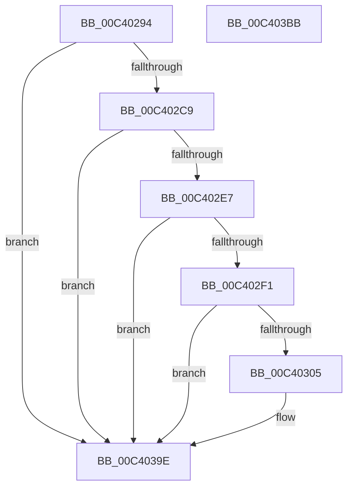

# PopDiagTraceInvalidBootStat

- RVA: `0x00C40294`–`0x00C403BC` (길이 `296` bytes)
- VA: `0x0000000140C40294`
- 실행 섹션: `INIT`
- PDB 이름 있음: `예`; PDB Function 태그: `아니요`
- unwind 정보 RVA: `0x0006FCAC`
- 디코드: `65`개 명령, `296/296` bytes 표시
- 미해석 바이트: `0` (있으면 어셈블리에 `.byte`로 보존)

> 이 문서는 커널 이미지의 기계어와 PDB 기호를 분석해 생성했습니다. 4번과 5번은 함수 원형과 자료형을 바이너리 사용 방식에서 추정한 C 해석이며 원본 소스 복구 결과는 아닙니다.

## 1. Dependencies

- 직접 호출 지점: **4**; 고유 호출 대상: **3**
- 직접 호출자로 확인된 함수: **1**
- RIP 상대 이미지 참조: **3**

### Outgoing calls
- `0x00C402DA` → [tlgKeywordOn](../../text/42/tlgKeywordOn_function_0042EAA0.md) (function, `0x0042EAA0`)
- `0x00C402F8` → [tlgKeywordOn](../../text/42/tlgKeywordOn_function_0042EAA0.md) (function, `0x0042EAA0`)
- `0x00C40399` → [tlgWriteTransfer_EtwWriteTransfer](../../text/42/tlgWriteTransfer_EtwWriteTransfer_function_004260E0.md) (function, `0x004260E0`)
- `0x00C403A5` → [_security_check_cookie](../../text/6A/_security_check_cookie_function_006AC640.md) (function, `0x006AC640`)

### Direct callers
- [PopCheckShutdownMarker](../C3/PopCheckShutdownMarker_function_00C3DAD4.md) at `0x00C3DC0F`

### Static image references
- `0x00C402A6` → RVA `0x00E0A740` (`.data`; read)
- `0x00C402B4` → RVA `0x00E07748` (`.data`; read)
- `0x00C40311` → RVA `0x0004BFF8` (`.rdata`; read)

## 2. Other-region calls and transfers

- 다른 실행 섹션으로 향하는 call: **4**
  - `0x00C402DA` → [tlgKeywordOn](../../text/42/tlgKeywordOn_function_0042EAA0.md) (`INIT` → `.text`)
  - `0x00C402F8` → [tlgKeywordOn](../../text/42/tlgKeywordOn_function_0042EAA0.md) (`INIT` → `.text`)
  - `0x00C40399` → [tlgWriteTransfer_EtwWriteTransfer](../../text/42/tlgWriteTransfer_EtwWriteTransfer_function_004260E0.md) (`INIT` → `.text`)
  - `0x00C403A5` → [_security_check_cookie](../../text/6A/_security_check_cookie_function_006AC640.md) (`INIT` → `.text`)
- 별도 외부 분기/꼬리 이동을 확인하지 못했습니다.

## 3. Assembly (complete function range)

```asm
00C40294  48 89 5C 24 08                  mov qword ptr [rsp + 8], rbx
00C40299  55                              push rbp
00C4029A  48 8D 6C 24 A9                  lea rbp, [rsp - 0x57]
00C4029F  48 81 EC D0 00 00 00            sub rsp, 0xd0
00C402A6  48 8B 05 93 A4 1C 00            mov rax, qword ptr [rip + 0x1ca493]
00C402AD  48 33 C4                        xor rax, rsp
00C402B0  48 89 45 47                     mov qword ptr [rbp + 0x47], rax
00C402B4  44 8B 15 8D 74 1C 00            mov r10d, dword ptr [rip + 0x1c748d]
00C402BB  44 8B DA                        mov r11d, edx
00C402BE  8B D9                           mov ebx, ecx
00C402C0  45 85 D2                        test r10d, r10d
00C402C3  0F 84 D5 00 00 00               je 0x140c4039e
00C402C9  48 BA 00 00 00 00 00 80 00 00   movabs rdx, 0x800000000000
00C402D3  48 8D 0D 6E 74 1C 00            lea rcx, [rip + 0x1c746e]
00C402DA  E8 C1 E7 7E FF                  call 0x14042eaa0
00C402DF  84 C0                           test al, al
00C402E1  0F 84 B7 00 00 00               je 0x140c4039e
00C402E7  41 83 FA 05                     cmp r10d, 5
00C402EB  0F 86 AD 00 00 00               jbe 0x140c4039e
00C402F1  48 8D 0D 50 74 1C 00            lea rcx, [rip + 0x1c7450]
00C402F8  E8 A3 E7 7E FF                  call 0x14042eaa0
00C402FD  84 C0                           test al, al
00C402FF  0F 84 99 00 00 00               je 0x140c4039e
00C40305  83 65 03 00                     and dword ptr [rbp + 3], 0
00C40309  48 8D 45 BB                     lea rax, [rbp - 0x45]
00C4030D  83 65 13 00                     and dword ptr [rbp + 0x13], 0
00C40311  48 8D 15 E0 BC 40 FF            lea rdx, [rip - 0xbf4320]
00C40318  83 65 23 00                     and dword ptr [rbp + 0x23], 0
00C4031C  B9 04 00 00 00                  mov ecx, 4
00C40321  83 65 33 00                     and dword ptr [rbp + 0x33], 0
00C40325  83 65 43 00                     and dword ptr [rbp + 0x43], 0
00C40329  48 89 45 F7                     mov qword ptr [rbp - 9], rax
00C4032D  48 8D 45 BF                     lea rax, [rbp - 0x41]
00C40331  48 89 45 07                     mov qword ptr [rbp + 7], rax
00C40335  48 8D 45 C3                     lea rax, [rbp - 0x3d]
00C40339  48 89 45 17                     mov qword ptr [rbp + 0x17], rax
00C4033D  48 8D 45 B7                     lea rax, [rbp - 0x49]
00C40341  48 89 45 27                     mov qword ptr [rbp + 0x27], rax
00C40345  48 8D 45 C7                     lea rax, [rbp - 0x39]
00C40349  48 89 45 37                     mov qword ptr [rbp + 0x37], rax
00C4034D  48 8D 45 D7                     lea rax, [rbp - 0x29]
00C40351  89 4D FF                        mov dword ptr [rbp - 1], ecx
00C40354  89 4D 0F                        mov dword ptr [rbp + 0xf], ecx
00C40357  44 89 45 C3                     mov dword ptr [rbp - 0x3d], r8d
00C4035B  45 33 C0                        xor r8d, r8d
00C4035E  89 4D 1F                        mov dword ptr [rbp + 0x1f], ecx
00C40361  48 8D 0D E0 73 1C 00            lea rcx, [rip + 0x1c73e0]
00C40368  44 88 4D B7                     mov byte ptr [rbp - 0x49], r9b
00C4036C  45 33 C9                        xor r9d, r9d
00C4036F  48 89 44 24 28                  mov qword ptr [rsp + 0x28], rax
00C40374  C7 44 24 20 07 00 00 00         mov dword ptr [rsp + 0x20], 7
00C4037C  89 5D BB                        mov dword ptr [rbp - 0x45], ebx
00C4037F  44 89 5D BF                     mov dword ptr [rbp - 0x41], r11d
00C40383  C7 45 2F 01 00 00 00            mov dword ptr [rbp + 0x2f], 1
00C4038A  48 C7 45 C7 00 00 00 01         mov qword ptr [rbp - 0x39], 0x1000000
00C40392  C7 45 3F 08 00 00 00            mov dword ptr [rbp + 0x3f], 8
00C40399  E8 42 5D 7E FF                  call 0x1404260e0
00C4039E  48 8B 4D 47                     mov rcx, qword ptr [rbp + 0x47]
00C403A2  48 33 CC                        xor rcx, rsp
00C403A5  E8 96 C2 A6 FF                  call 0x1406ac640
00C403AA  48 8B 9C 24 E0 00 00 00         mov rbx, qword ptr [rsp + 0xe0]
00C403B2  48 81 C4 D0 00 00 00            add rsp, 0xd0
00C403B9  5D                              pop rbp
00C403BA  C3                              ret
00C403BB  CC                              int3
```

## 4. C-style interpretation (structured pseudocode)

```c
__int64 __fastcall PopDiagTraceInvalidBootStat(int a1, int a2, int a3, int a4)
{
    __int64 result;
    __int64 v_rsp;
    unsigned __int64 v_stack_m18;
    unsigned int v_stack_m1C;
    unsigned int v_stack_m20;
    unsigned __int64 v_stack_m28;
    unsigned int v_stack_m2C;
    unsigned int v_stack_m30;
    unsigned __int64 v_stack_m38;
    unsigned int v_stack_m3C;
    unsigned int v_stack_m40;
    unsigned __int64 v_stack_m48;
    unsigned int v_stack_m4C;
    unsigned int v_stack_m50;
    unsigned __int64 v_stack_m58;
    unsigned int v_stack_m5C;
    unsigned __int64 v_stack_m5F;
    unsigned int v_stack_m60;
    unsigned __int64 v_stack_m68;
    unsigned __int64 v_stack_m88;
    unsigned __int64 v_stack_m98;
    unsigned __int64 v_stack_m9C;
    unsigned __int64 v_stack_mA0;
    unsigned __int64 v_stack_mA4;
    unsigned __int64 v_stack_mA8;
    unsigned __int64 v_stack_mB0;
    unsigned int v_stack_mB8;
    unsigned __int64 v_stack_p8;

    v_stack_p8 = v_rbx;
    v_rsp = (v_rsp) - (208);
    result = (*(unsigned __int64 *)(v_rip + 1877139)) ^ (v_rsp);
    v_stack_m18 = result;
    if ((unsigned int)((unsigned int)(*(unsigned int *)(v_rip + 1864845))) == 0) goto loc_00C4039E;
    result = tlgKeywordOn(v_rip + 1864814, a2, a3, a4);
    if ((unsigned __int8)(result) == 0) goto loc_00C4039E;
    if (((unsigned int)((unsigned int)(*(unsigned int *)(v_rip + 1864845)))) <= 5) goto loc_00C4039E;
    result = tlgKeywordOn(v_rip + 1864784, a2, a3, a4);
    if ((unsigned __int8)(result) != 0) {
        result = v_stack_mA4;
        a2 = v_rip - 12534560;
        a1 = 4;
        v_stack_m68 = result;
        result = v_stack_mA0;
        v_stack_m58 = result;
        result = v_stack_m9C;
        v_stack_m48 = result;
        result = v_stack_mA8;
        v_stack_m38 = result;
        result = v_stack_m98;
        v_stack_m28 = result;
        result = v_stack_m88;
        v_stack_m60 = a1;
        v_stack_m50 = a1;
        v_stack_m9C = a3;
        a3 = 0;
        v_stack_m40 = a1;
        a1 = v_rip + 1864672;
        v_stack_mA8 = (unsigned __int8)(a4);
        a4 = 0;
        v_stack_mB0 = result;
        v_stack_mB8 = 7;
        v_stack_mA4 = (unsigned int)((unsigned int)(a1));
        v_stack_mA0 = (unsigned int)((unsigned int)(a2));
        v_stack_m30 = 1;
        v_stack_m98 = 0x1000000ULL;
        v_stack_m20 = 8;
        result = tlgWriteTransfer_EtwWriteTransfer(a1, a2, a3, a4);
    }
    a1 = (v_stack_m18) ^ (v_rsp);
    result = _security_check_cookie(a1, a2, a3, a4);
    v_rsp = (v_rsp) + (208);
    return result;
}
```

## 5. (Beta) C Style

```c
int64_t PopDiagTraceInvalidBootStat(int32_t Arg1, int32_t Arg2, int32_t Arg3, int32_t Arg4)
{
    int64_t result;
    int64_t local_rsp;
    uint64_t v_stack_m18;
    uint32_t v_stack_m1C;
    uint32_t v_stack_m20;
    uint64_t v_stack_m28;
    uint32_t v_stack_m2C;
    uint32_t v_stack_m30;
    uint64_t v_stack_m38;
    uint32_t v_stack_m3C;
    uint32_t v_stack_m40;
    uint64_t v_stack_m48;
    uint32_t v_stack_m4C;
    uint32_t v_stack_m50;
    uint64_t v_stack_m58;
    uint32_t v_stack_m5C;
    uint64_t v_stack_m5F;
    uint32_t v_stack_m60;
    uint64_t v_stack_m68;
    uint64_t v_stack_m88;
    uint64_t v_stack_m98;
    uint64_t v_stack_m9C;
    uint64_t v_stack_mA0;
    uint64_t v_stack_mA4;
    uint64_t v_stack_mA8;
    uint64_t v_stack_mB0;
    uint32_t v_stack_mB8;
    uint64_t v_stack_p8;

    v_stack_p8 = local_rbx;
    local_rsp = (local_rsp) - (208);
    result = (*(uint64_t *)(v_rip + 0x1CA493)) ^ (local_rsp);
    v_stack_m18 = result;
    if ((uint32_t)((uint32_t)(*(uint32_t *)(v_rip + 0x1C748D))) == 0) goto loc_00C4039E;
    result = tlgKeywordOn(v_rip + 1864814, Arg2, Arg3, Arg4);
    if ((uint8_t)(result) == 0) goto loc_00C4039E;
    if (((uint32_t)((uint32_t)(*(uint32_t *)(v_rip + 0x1C748D)))) <= 5) goto loc_00C4039E;
    result = tlgKeywordOn(v_rip + 1864784, Arg2, Arg3, Arg4);
    if ((uint8_t)(result) != 0) {
        result = v_stack_mA4;
        Arg2 = v_rip - 12534560;
        Arg1 = 4;
        v_stack_m68 = result;
        result = v_stack_mA0;
        v_stack_m58 = result;
        result = v_stack_m9C;
        v_stack_m48 = result;
        result = v_stack_mA8;
        v_stack_m38 = result;
        result = v_stack_m98;
        v_stack_m28 = result;
        result = v_stack_m88;
        v_stack_m60 = Arg1;
        v_stack_m50 = Arg1;
        v_stack_m9C = Arg3;
        Arg3 = 0;
        v_stack_m40 = Arg1;
        Arg1 = v_rip + 1864672;
        v_stack_mA8 = (uint8_t)(Arg4);
        Arg4 = 0;
        v_stack_mB0 = result;
        v_stack_mB8 = 7;
        v_stack_mA4 = (uint32_t)((uint32_t)(Arg1));
        v_stack_mA0 = (uint32_t)((uint32_t)(Arg2));
        v_stack_m30 = 1;
        v_stack_m98 = 0x1000000ULL;
        v_stack_m20 = 8;
        result = tlgWriteTransfer_EtwWriteTransfer(Arg1, Arg2, Arg3, Arg4);
    }
    Arg1 = (v_stack_m18) ^ (local_rsp);
    result = _security_check_cookie(Arg1, Arg2, Arg3, Arg4);
    local_rsp = (local_rsp) + (208);
    return result;
}
```

## 6. Execution-region graph

[열기: 2D/3D 그래프와 함수 탐색 컨트롤 패널](../../../control-panel.html?section=init&rva=0x00C40294&view=graph)

- 2D 그래프는 위에서 아래로 흐르고, 3D 그래프는 빈 공간을 드래그해 회전합니다. Shift+드래그는 이동, 휠은 확대·축소, 함수 노드 선택은 대상 보고서 이동입니다.

### Static fallback


