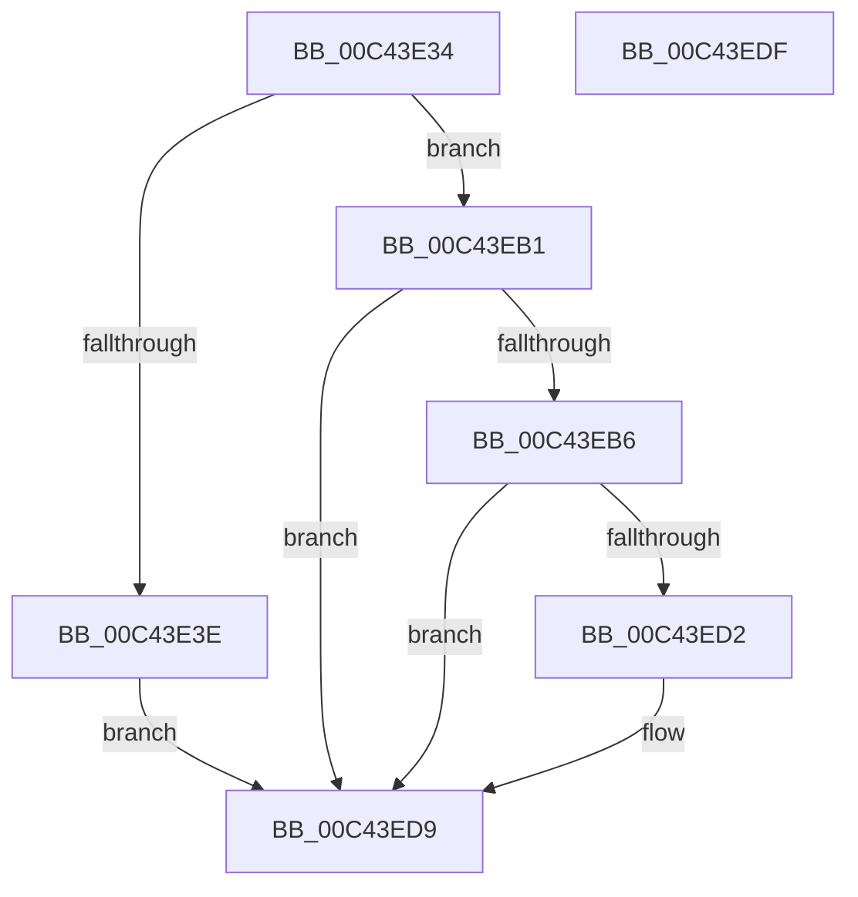

# PopDirectedDripsDiagInitialize

- RVA: `0x00C43E34`–`0x00C43EE0` (길이 `172` bytes)
- VA: `0x0000000140C43E34`
- 실행 섹션: `INIT`
- PDB 이름 있음: `예`; PDB Function 태그: `아니요`
- unwind 정보 RVA: `0x0005CF00`
- 디코드: `36`개 명령, `172/172` bytes 표시
- 미해석 바이트: `0` (있으면 어셈블리에 `.byte`로 보존)

> 이 문서는 커널 이미지의 기계어와 PDB 기호를 분석해 생성했습니다. 4번과 5번은 함수 원형과 자료형을 바이너리 사용 방식에서 추정한 C 해석이며 원본 소스 복구 결과는 아닙니다.

## 1. Dependencies

- 직접 호출 지점: **3**; 고유 호출 대상: **3**
- 직접 호출자로 확인된 함수: **2**
- RIP 상대 이미지 참조: **14**

### Outgoing calls
- `0x00C43E4C` → [RtlInitUnicodeString](../../text/42/RtlInitUnicodeString_function_0042A780.md) (function, `0x0042A780`)
- `0x00C43E6B` → [memset](../../text/6C/memset_function_006C6C40.md) (function, `0x006C6C40`)
- `0x00C43EC9` → [TraceLoggingRegisterEx_EtwRegister_EtwSetInformation](../../page/92/TraceLoggingRegisterEx_EtwRegister_EtwSetInformation_function_009208A0.md) (function, `0x009208A0`)

### Direct callers
- [PopDirectedDripsInitializePhase0](../C3/PopDirectedDripsInitializePhase0_function_00C3E4BC.md) at `0x00C3E57E`
- [PopDirectedDripsInitializePhase3](../C3/PopDirectedDripsInitializePhase3_function_00C3E594.md) at `0x00C3E5B8`

### Static image references
- `0x00C43E3E` → RVA `0x00C7A210` (` ?? ::PBOPGDP::`string'`; read)
- `0x00C43E45` → RVA `0x00F07400` (`.data`; read)
- `0x00C43E51` → RVA `0x00F07650` (`.data`; read/write)
- `0x00C43E59` → RVA `0x00F07420` (`.data`; read)
- `0x00C43E70` → RVA `0x00F07450` (`.data`; read/write)
- `0x00C43E78` → RVA `0x00F07430` (`.data`; read)
- `0x00C43E7F` → RVA `0x00F07438` (`.data`; write)
- `0x00C43E86` → RVA `0x00F07430` (`.data`; write)
- `0x00C43E8D` → RVA `0x00F07428` (`.data`; write)
- `0x00C43E94` → RVA `0x00F07420` (`.data`; write)
- `0x00C43E9B` → RVA `0x00F07640` (`.data`; write)
- `0x00C43EA5` → RVA `0x00F07644` (`.data`; write)
- `0x00C43EB9` → RVA `0x00F07410` (`.data`; write)
- `0x00C43EC2` → RVA `0x00FD8900` (`PAGEDATA`; read)

## 2. Other-region calls and transfers

- 다른 실행 섹션으로 향하는 call: **3**
  - `0x00C43E4C` → [RtlInitUnicodeString](../../text/42/RtlInitUnicodeString_function_0042A780.md) (`INIT` → `.text`)
  - `0x00C43E6B` → [memset](../../text/6C/memset_function_006C6C40.md) (`INIT` → `.text`)
  - `0x00C43EC9` → [TraceLoggingRegisterEx_EtwRegister_EtwSetInformation](../../page/92/TraceLoggingRegisterEx_EtwRegister_EtwSetInformation_function_009208A0.md) (`INIT` → `PAGE`)
- 별도 외부 분기/꼬리 이동을 확인하지 못했습니다.

## 3. Assembly (complete function range)

```asm
00C43E34  40 53                           push rbx
00C43E36  48 83 EC 20                     sub rsp, 0x20
00C43E3A  85 C9                           test ecx, ecx
00C43E3C  75 73                           jne 0x140c43eb1
00C43E3E  48 8D 15 CB 63 03 00            lea rdx, [rip + 0x363cb]
00C43E45  48 8D 0D B4 35 2C 00            lea rcx, [rip + 0x2c35b4]
00C43E4C  E8 2F 69 7E FF                  call 0x14042a780
00C43E51  48 83 25 F7 37 2C 00 00         and qword ptr [rip + 0x2c37f7], 0
00C43E59  48 8D 1D C0 35 2C 00            lea rbx, [rip + 0x2c35c0]
00C43E60  48 8B CB                        mov rcx, rbx
00C43E63  33 D2                           xor edx, edx
00C43E65  41 B8 30 02 00 00               mov r8d, 0x230
00C43E6B  E8 D0 2D A8 FF                  call 0x1406c6c40
00C43E70  48 83 25 D8 35 2C 00 00         and qword ptr [rip + 0x2c35d8], 0
00C43E78  48 8D 05 B1 35 2C 00            lea rax, [rip + 0x2c35b1]
00C43E7F  48 89 05 B2 35 2C 00            mov qword ptr [rip + 0x2c35b2], rax
00C43E86  48 89 05 A3 35 2C 00            mov qword ptr [rip + 0x2c35a3], rax
00C43E8D  48 89 1D 94 35 2C 00            mov qword ptr [rip + 0x2c3594], rbx
00C43E94  48 89 1D 85 35 2C 00            mov qword ptr [rip + 0x2c3585], rbx
00C43E9B  C7 05 9B 37 2C 00 01 00 00 00   mov dword ptr [rip + 0x2c379b], 1
00C43EA5  C7 05 95 37 2C 00 01 00 00 00   mov dword ptr [rip + 0x2c3795], 1
00C43EAF  EB 28                           jmp 0x140c43ed9
00C43EB1  83 F9 03                        cmp ecx, 3
00C43EB4  75 23                           jne 0x140c43ed9
00C43EB6  45 33 C0                        xor r8d, r8d
00C43EB9  C6 05 50 35 2C 00 00            mov byte ptr [rip + 0x2c3550], 0
00C43EC0  33 D2                           xor edx, edx
00C43EC2  48 8D 0D 37 4A 39 00            lea rcx, [rip + 0x394a37]
00C43EC9  E8 D2 C9 CD FF                  call 0x1409208a0
00C43ECE  85 C0                           test eax, eax
00C43ED0  78 07                           js 0x140c43ed9
00C43ED2  C6 05 37 35 2C 00 01            mov byte ptr [rip + 0x2c3537], 1
00C43ED9  48 83 C4 20                     add rsp, 0x20
00C43EDD  5B                              pop rbx
00C43EDE  C3                              ret
00C43EDF  CC                              int3
```

## 4. C-style interpretation (structured pseudocode)

```c
__int64 __fastcall PopDirectedDripsDiagInitialize(int a1)
{
    __int64 result;
    __int64 v_rsp;

    v_rsp = (v_rsp) - (32);
    if (a1 != 0) goto loc_00C43EB1;
    result = RtlInitUnicodeString(v_rip + 2897332, v_rip + 222155, a3, a4);
    a2 = 0;
    result = memset(v_rip + 2897344, a2, 560, a4);
    *(unsigned __int64 *)(v_rip + 2897330) = v_rip + 2897329;
    *(unsigned __int64 *)(v_rip + 2897315) = v_rip + 2897329;
    *(unsigned __int64 *)(v_rip + 2897300) = v_rip + 2897344;
    *(unsigned __int64 *)(v_rip + 2897285) = v_rip + 2897344;
    *(unsigned int *)(v_rip + 2897819) = 1;
    *(unsigned int *)(v_rip + 2897813) = 1;
    goto loc_00C43ED9;
loc_00C43EB1:
    if (((unsigned int)(v_rip + 2897344)) != 3) goto loc_00C43ED9;
    a3 = 0;
    *(unsigned __int8 *)(v_rip + 2897232) = 0;
    a2 = 0;
    result = TraceLoggingRegisterEx_EtwRegister_EtwSetInformation(v_rip + 3754551, a2, a3, a4);
    if (!(sign_flag)) {
        *(unsigned __int8 *)(v_rip + 2897207) = 1;
    }
    v_rsp = (v_rsp) + (32);
    return result;
}
```

## 5. (Beta) C Style

```c
int64_t PopDirectedDripsDiagInitialize(int32_t Arg1)
{
    int64_t result;
    int64_t local_rsp;

    local_rsp = (local_rsp) - (32);
    if (Arg1 != 0) goto loc_00C43EB1;
    result = RtlInitUnicodeString(v_rip + 2897332, v_rip + 222155, a3, a4);
    a2 = 0;
    result = memset(v_rip + 2897344, a2, 560, a4);
    *(uint64_t *)(v_rip + 0x2C35B2) = v_rip + 2897329;
    *(uint64_t *)(v_rip + 0x2C35A3) = v_rip + 2897329;
    *(uint64_t *)(v_rip + 0x2C3594) = v_rip + 2897344;
    *(uint64_t *)(v_rip + 0x2C3585) = v_rip + 2897344;
    *(uint32_t *)(v_rip + 0x2C379B) = 1;
    *(uint32_t *)(v_rip + 0x2C3795) = 1;
    goto loc_00C43ED9;
loc_00C43EB1:
    if (((uint32_t)(v_rip + 2897344)) != 3) goto loc_00C43ED9;
    a3 = 0;
    *(uint8_t *)(v_rip + 0x2C3550) = 0;
    a2 = 0;
    result = TraceLoggingRegisterEx_EtwRegister_EtwSetInformation(v_rip + 3754551, a2, a3, a4);
    if (!(sign_flag)) {
        *(uint8_t *)(v_rip + 0x2C3537) = 1;
    }
    local_rsp = (local_rsp) + (32);
    return result;
}
```

## 6. Execution-region graph

[열기: 2D/3D 그래프와 함수 탐색 컨트롤 패널](../../../control-panel.html?section=init&rva=0x00C43E34&view=graph)

- 2D 그래프는 위에서 아래로 흐르고, 3D 그래프는 빈 공간을 드래그해 회전합니다. Shift+드래그는 이동, 휠은 확대·축소, 함수 노드 선택은 대상 보고서 이동입니다.

### Static fallback


