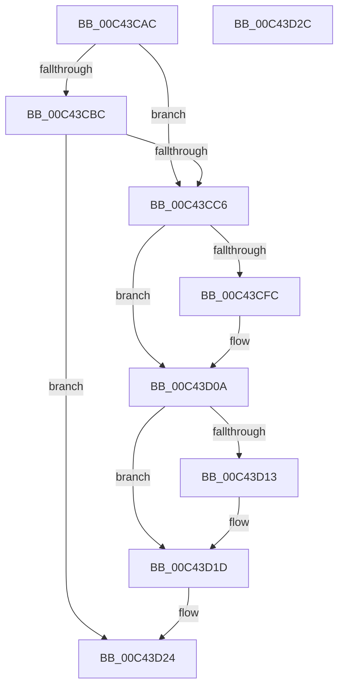

# PopDripsWatchdogInitializeCallbackTimer

- RVA: `0x00C43CAC`–`0x00C43D2D` (길이 `129` bytes)
- VA: `0x0000000140C43CAC`
- 실행 섹션: `INIT`
- PDB 이름 있음: `예`; PDB Function 태그: `아니요`
- unwind 정보 RVA: `0x00064C80`
- 디코드: `32`개 명령, `129/129` bytes 표시
- 미해석 바이트: `0` (있으면 어셈블리에 `.byte`로 보존)

> 이 문서는 커널 이미지의 기계어와 PDB 기호를 분석해 생성했습니다. 4번과 5번은 함수 원형과 자료형을 바이너리 사용 방식에서 추정한 C 해석이며 원본 소스 복구 결과는 아닙니다.

## 1. Dependencies

- 직접 호출 지점: **1**; 고유 호출 대상: **1**
- 직접 호출자로 확인된 함수: **1**
- RIP 상대 이미지 참조: **11**

### Outgoing calls
- `0x00C43CED` → [PopInitializeTimer](../../page/75/PopInitializeTimer_function_00754078.md) (function, `0x00754078`)

### Direct callers
- [PopDripsWatchdogInitialize](PopDripsWatchdogInitialize_function_00C43BCC.md) at `0x00C43C4A`

### Static image references
- `0x00C43CB2` → RVA `0x00FC50F4` (`ALMOSTRO`; read)
- `0x00C43CBC` → RVA `0x00FC50A4` (`ALMOSTRO`; read)
- `0x00C43CC6` → RVA `0x00F07EA0` (`.data`; read)
- `0x00C43CCD` → RVA `0x00F07FC0` (`.data`; write)
- `0x00C43CD3` → RVA `0x0076C360` (`PopDripsWatchdogCallbackWorker`; read)
- `0x00C43CDF` → RVA `0x004BE460` (`PopDripsWatchdogTimerCallback`; read)
- `0x00C43CE6` → RVA `0x00F07F10` (`.data`; read)
- `0x00C43CF2` → RVA `0x00E0C3A0` (`.data`; read)
- `0x00C43D04` → RVA `0x00F07E90` (`.data`; write)
- `0x00C43D0A` → RVA `0x00F07E90` (`.data`; read)
- `0x00C43D1D` → RVA `0x00F07FC4` (`.data`; read/write)

## 2. Other-region calls and transfers

- 다른 실행 섹션으로 향하는 call: **1**
  - `0x00C43CED` → [PopInitializeTimer](../../page/75/PopInitializeTimer_function_00754078.md) (`INIT` → `PAGE`)
- 별도 외부 분기/꼬리 이동을 확인하지 못했습니다.

## 3. Assembly (complete function range)

```asm
00C43CAC  40 53                           push rbx
00C43CAE  48 83 EC 30                     sub rsp, 0x30
00C43CB2  8B 1D 3C 14 38 00               mov ebx, dword ptr [rip + 0x38143c]
00C43CB8  85 DB                           test ebx, ebx
00C43CBA  75 0A                           jne 0x140c43cc6
00C43CBC  8B 1D E2 13 38 00               mov ebx, dword ptr [rip + 0x3813e2]
00C43CC2  85 DB                           test ebx, ebx
00C43CC4  74 5E                           je 0x140c43d24
00C43CC6  4C 8D 05 D3 41 2C 00            lea r8, [rip + 0x2c41d3]
00C43CCD  89 1D ED 42 2C 00               mov dword ptr [rip + 0x2c42ed], ebx
00C43CD3  4C 8D 0D 86 86 B2 FF            lea r9, [rip - 0x4d797a]
00C43CDA  4C 89 44 24 20                  mov qword ptr [rsp + 0x20], r8
00C43CDF  48 8D 15 7A A7 87 FF            lea rdx, [rip - 0x785886]
00C43CE6  48 8D 0D 23 42 2C 00            lea rcx, [rip + 0x2c4223]
00C43CED  E8 86 03 B1 FF                  call 0x140754078
00C43CF2  8B 05 A8 86 1C 00               mov eax, dword ptr [rip + 0x1c86a8]
00C43CF8  85 C0                           test eax, eax
00C43CFA  74 0E                           je 0x140c43d0a
00C43CFC  FF C8                           dec eax
00C43CFE  33 D2                           xor edx, edx
00C43D00  F7 F3                           div ebx
00C43D02  FF C0                           inc eax
00C43D04  89 05 86 41 2C 00               mov dword ptr [rip + 0x2c4186], eax
00C43D0A  83 3D 7F 41 2C 00 01            cmp dword ptr [rip + 0x2c417f], 1
00C43D11  75 0A                           jne 0x140c43d1d
00C43D13  C7 05 73 41 2C 00 02 00 00 00   mov dword ptr [rip + 0x2c4173], 2
00C43D1D  83 0D A0 42 2C 00 01            or dword ptr [rip + 0x2c42a0], 1
00C43D24  33 C0                           xor eax, eax
00C43D26  48 83 C4 30                     add rsp, 0x30
00C43D2A  5B                              pop rbx
00C43D2B  C3                              ret
00C43D2C  CC                              int3
```

## 4. C-style interpretation (structured pseudocode)

```c
__int64 __fastcall PopDripsWatchdogInitializeCallbackTimer(void)
{
    __int64 result;
    __int64 v_rsp;
    unsigned __int64 v_stack_m18;

    v_rsp = (v_rsp) - (48);
    if ((unsigned int)((unsigned int)(*(unsigned int *)(v_rip + 3675196))) != 0) goto loc_00C43CC6;
    if ((unsigned int)((unsigned int)(*(unsigned int *)(v_rip + 3675106))) == 0) goto loc_00C43D24;
loc_00C43CC6:
    *(unsigned int *)(v_rip + 2900717) = (unsigned int)((unsigned int)(*(unsigned int *)(v_rip + 3675106)));
    v_stack_m18 = v_rip + 2900435;
    result = PopInitializeTimer(v_rip + 2900515, v_rip - 7886982, v_rip + 2900435, v_rip - 5077370);
    result = (unsigned int)(*(unsigned int *)(v_rip + 1869480));
    if ((unsigned int)((unsigned int)(*(unsigned int *)(v_rip + 1869480))) != 0) {
        result = (unsigned int)(((unsigned int)(*(unsigned int *)(v_rip + 1869480))) - 1);
        a2 = 0;
        result = (unsigned int)((result) + 1);
        *(unsigned int *)(v_rip + 2900358) = (unsigned int)(result);
    }
    if ((*(unsigned int *)(v_rip + 2900351)) == 1) {
        *(unsigned int *)(v_rip + 2900339) = 2;
    }
loc_00C43D24:
    result = 0;
    v_rsp = (v_rsp) + (48);
    return result;
}
```

## 5. (Beta) C Style

```c
void PopDripsWatchdogInitializeCallbackTimer(void)
{
    int64_t result;
    int64_t local_rsp;
    uint64_t v_stack_m18;

    local_rsp = (local_rsp) - (48);
    if ((uint32_t)((uint32_t)(*(uint32_t *)(v_rip + 0x38143C))) != 0) goto loc_00C43CC6;
    if ((uint32_t)((uint32_t)(*(uint32_t *)(v_rip + 0x3813E2))) == 0) goto loc_00C43D24;
loc_00C43CC6:
    *(uint32_t *)(v_rip + 0x2C42ED) = (uint32_t)((uint32_t)(*(uint32_t *)(v_rip + 0x3813E2)));
    v_stack_m18 = v_rip + 2900435;
    result = PopInitializeTimer(v_rip + 2900515, v_rip - 7886982, v_rip + 2900435, v_rip - 5077370);
    result = (uint32_t)(*(uint32_t *)(v_rip + 0x1C86A8));
    if ((uint32_t)((uint32_t)(*(uint32_t *)(v_rip + 0x1C86A8))) != 0) {
        result = (uint32_t)(((uint32_t)(*(uint32_t *)(v_rip + 0x1C86A8))) - 1);
        a2 = 0;
        result = (uint32_t)((result) + 1);
        *(uint32_t *)(v_rip + 0x2C4186) = (uint32_t)(result);
    }
    if ((*(uint32_t *)(v_rip + 0x2C417F)) == 1) {
        *(uint32_t *)(v_rip + 0x2C4173) = 2;
    }
loc_00C43D24:
    result = 0;
    local_rsp = (local_rsp) + (48);
    return result;
}
```

## 6. Execution-region graph

[열기: 2D/3D 그래프와 함수 탐색 컨트롤 패널](../../../control-panel.html?section=init&rva=0x00C43CAC&view=graph)

- 2D 그래프는 위에서 아래로 흐르고, 3D 그래프는 빈 공간을 드래그해 회전합니다. Shift+드래그는 이동, 휠은 확대·축소, 함수 노드 선택은 대상 보고서 이동입니다.

### Static fallback


