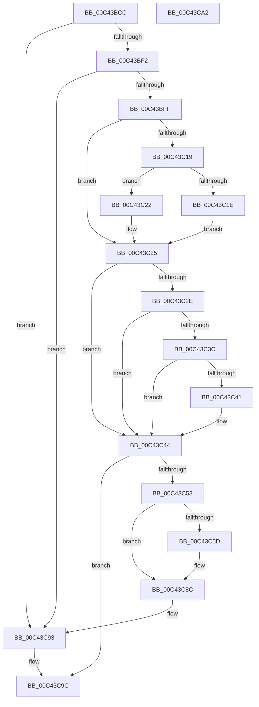

# PopDripsWatchdogInitialize

- RVA: `0x00C43BCC`–`0x00C43CA3` (길이 `215` bytes)
- VA: `0x0000000140C43BCC`
- 실행 섹션: `INIT`
- PDB 이름 있음: `예`; PDB Function 태그: `아니요`
- unwind 정보 RVA: `0x00064C80`
- 디코드: `55`개 명령, `215/215` bytes 표시
- 미해석 바이트: `0` (있으면 어셈블리에 `.byte`로 보존)

> 이 문서는 커널 이미지의 기계어와 PDB 기호를 분석해 생성했습니다. 4번과 5번은 함수 원형과 자료형을 바이너리 사용 방식에서 추정한 C 해석이며 원본 소스 복구 결과는 아닙니다.

## 1. Dependencies

- 직접 호출 지점: **5**; 고유 호출 대상: **5**
- 직접 호출자로 확인된 함수: **1**
- RIP 상대 이미지 참조: **13**

### Outgoing calls
- `0x00C43BDF` → [ExInitializeResourceLite2](../../text/41/ExInitializeResourceLite2_function_0041F710.md) (function, `0x0041F710`)
- `0x00C43C25` → [PopIsDirectedDripsEnabled](../../page/AB/PopIsDirectedDripsEnabled_function_00AB3D54.md) (function, `0x00AB3D54`)
- `0x00C43C32` → [PopCapturePlatformRole](../../page/A8/PopCapturePlatformRole_function_00A864AC.md) (function, `0x00A864AC`)
- `0x00C43C4A` → [PopDripsWatchdogInitializeCallbackTimer](PopDripsWatchdogInitializeCallbackTimer_function_00C43CAC.md) (function, `0x00C43CAC`)
- `0x00C43C80` → [PopInitializeTimer](../../page/75/PopInitializeTimer_function_00754078.md) (function, `0x00754078`)

### Direct callers
- [PoInitSystem](../C7/PoInitSystem_function_00C72358.md) at `0x00C731BE`

### Static image references
- `0x00C43BD2` → RVA `0x00F07EA0` (`.data`; read)
- `0x00C43BE4` → RVA `0x00E673A0` (`.data`; read)
- `0x00C43BF2` → RVA `0x00E6739C` (`.data`; read)
- `0x00C43BFF` → RVA `0x00FC5324` (`ALMOSTRO`; read)
- `0x00C43C0D` → RVA `0x00FC5108` (`ALMOSTRO`; read)
- `0x00C43C44` → RVA `0x00F07F0C` (`.data`; write)
- `0x00C43C53` → RVA `0x00FC51EC` (`ALMOSTRO`; read)
- `0x00C43C5D` → RVA `0x0076C600` (`PopDripsWatchdogDiagnosticWorker`; read)
- `0x00C43C64` → RVA `0x00F080C8` (`.data`; write)
- `0x00C43C72` → RVA `0x004BE460` (`PopDripsWatchdogTimerCallback`; read)
- `0x00C43C79` → RVA `0x00F08018` (`.data`; read)
- `0x00C43C85` → RVA `0x00F080CC` (`.data`; read/write)
- `0x00C43C8C` → RVA `0x00F07F08` (`.data`; read/write)

## 2. Other-region calls and transfers

- 다른 실행 섹션으로 향하는 call: **4**
  - `0x00C43BDF` → [ExInitializeResourceLite2](../../text/41/ExInitializeResourceLite2_function_0041F710.md) (`INIT` → `.text`)
  - `0x00C43C25` → [PopIsDirectedDripsEnabled](../../page/AB/PopIsDirectedDripsEnabled_function_00AB3D54.md) (`INIT` → `PAGE`)
  - `0x00C43C32` → [PopCapturePlatformRole](../../page/A8/PopCapturePlatformRole_function_00A864AC.md) (`INIT` → `PAGE`)
  - `0x00C43C80` → [PopInitializeTimer](../../page/75/PopInitializeTimer_function_00754078.md) (`INIT` → `PAGE`)
- 별도 외부 분기/꼬리 이동을 확인하지 못했습니다.

## 3. Assembly (complete function range)

```asm
00C43BCC  40 53                           push rbx
00C43BCE  48 83 EC 30                     sub rsp, 0x30
00C43BD2  48 8D 1D C7 42 2C 00            lea rbx, [rip + 0x2c42c7]
00C43BD9  83 CA FF                        or edx, 0xffffffff
00C43BDC  48 8B CB                        mov rcx, rbx
00C43BDF  E8 2C BB 7D FF                  call 0x14041f710
00C43BE4  8B 05 B6 37 22 00               mov eax, dword ptr [rip + 0x2237b6]
00C43BEA  85 C0                           test eax, eax
00C43BEC  0F 84 A1 00 00 00               je 0x140c43c93
00C43BF2  80 3D A3 37 22 00 00            cmp byte ptr [rip + 0x2237a3], 0
00C43BF9  0F 84 94 00 00 00               je 0x140c43c93
00C43BFF  8B 05 1F 17 38 00               mov eax, dword ptr [rip + 0x38171f]
00C43C05  B9 FD FF FF FF                  mov ecx, 0xfffffffd
00C43C0A  0F B6 D0                        movzx edx, al
00C43C0D  8B 05 F5 14 38 00               mov eax, dword ptr [rip + 0x3814f5]
00C43C13  FF C8                           dec eax
00C43C15  3B C1                           cmp eax, ecx
00C43C17  77 0C                           ja 0x140c43c25
00C43C19  F6 C2 10                        test dl, 0x10
00C43C1C  75 04                           jne 0x140c43c22
00C43C1E  23 D1                           and edx, ecx
00C43C20  EB 03                           jmp 0x140c43c25
00C43C22  83 CA 02                        or edx, 2
00C43C25  E8 2A 01 E7 FF                  call 0x140ab3d54
00C43C2A  84 C0                           test al, al
00C43C2C  74 16                           je 0x140c43c44
00C43C2E  0F BA EA 08                     bts edx, 8
00C43C32  E8 75 28 E4 FF                  call 0x140a864ac
00C43C37  83 F8 02                        cmp eax, 2
00C43C3A  74 08                           je 0x140c43c44
00C43C3C  83 F8 08                        cmp eax, 8
00C43C3F  74 03                           je 0x140c43c44
00C43C41  83 CA 01                        or edx, 1
00C43C44  89 15 C2 42 2C 00               mov dword ptr [rip + 0x2c42c2], edx
00C43C4A  E8 5D 00 00 00                  call 0x140c43cac
00C43C4F  85 C0                           test eax, eax
00C43C51  78 49                           js 0x140c43c9c
00C43C53  8B 05 93 15 38 00               mov eax, dword ptr [rip + 0x381593]
00C43C59  85 C0                           test eax, eax
00C43C5B  74 2F                           je 0x140c43c8c
00C43C5D  4C 8D 0D 9C 89 B2 FF            lea r9, [rip - 0x4d7664]
00C43C64  89 05 5E 44 2C 00               mov dword ptr [rip + 0x2c445e], eax
00C43C6A  4C 8B C3                        mov r8, rbx
00C43C6D  48 89 5C 24 20                  mov qword ptr [rsp + 0x20], rbx
00C43C72  48 8D 15 E7 A7 87 FF            lea rdx, [rip - 0x785819]
00C43C79  48 8D 0D 98 43 2C 00            lea rcx, [rip + 0x2c4398]
00C43C80  E8 F3 03 B1 FF                  call 0x140754078
00C43C85  83 0D 40 44 2C 00 01            or dword ptr [rip + 0x2c4440], 1
00C43C8C  83 0D 75 42 2C 00 02            or dword ptr [rip + 0x2c4275], 2
00C43C93  33 C0                           xor eax, eax
00C43C95  83 0D 6C 42 2C 00 01            or dword ptr [rip + 0x2c426c], 1
00C43C9C  48 83 C4 30                     add rsp, 0x30
00C43CA0  5B                              pop rbx
00C43CA1  C3                              ret
00C43CA2  CC                              int3
```

## 4. C-style interpretation (structured pseudocode)

```c
__int64 __fastcall PopDripsWatchdogInitialize(__int64 a1, int a2)
{
    __int64 result;
    __int64 v_rsp;
    unsigned __int64 v_stack_m18;

    v_rsp = (v_rsp) - (48);
    a2 = (unsigned int)((a2) | (0xFFFFFFFFULL));
    result = ExInitializeResourceLite2(v_rip + 2900679, a2, a3, a4);
    if ((unsigned int)((unsigned int)(*(unsigned int *)(v_rip + 2242486))) == 0) goto loc_00C43C93;
    if ((*(unsigned __int8 *)(v_rip + 2242467)) == 0) goto loc_00C43C93;
    result = (unsigned int)(((unsigned int)(*(unsigned int *)(v_rip + 3675381))) - 1);
    if (((unsigned int)(result)) > ((unsigned int)((unsigned int)(0xFFFFFFFDULL)))) goto loc_00C43C25;
    if ((((unsigned __int8)((unsigned __int8)((unsigned int)(*(unsigned int *)(v_rip + 3675935))))) & (16)) != 0) goto loc_00C43C22;
    a2 = (unsigned int)(((unsigned __int8)((unsigned int)(*(unsigned int *)(v_rip + 3675935)))) & ((unsigned int)((unsigned int)(0xFFFFFFFDULL))));
    goto loc_00C43C25;
loc_00C43C22:
    a2 = (unsigned int)((a2) | (2));
loc_00C43C25:
    result = PopIsDirectedDripsEnabled((unsigned int)(0xFFFFFFFDULL), a2, a3, a4);
    if ((unsigned __int8)(result) == 0) goto loc_00C43C44;
    result = PopCapturePlatformRole((unsigned int)(0xFFFFFFFDULL), a2, a3, a4);
    if (((unsigned int)(result)) == 2) goto loc_00C43C44;
    if (((unsigned int)(result)) != 8) {
        a2 = (unsigned int)((a2) | (1));
    }
    *(unsigned int *)(v_rip + 2900674) = a2;
    result = PopDripsWatchdogInitializeCallbackTimer((unsigned int)(0xFFFFFFFDULL), a2, a3, a4);
    if (sign_flag) goto loc_00C43C9C;
    result = (unsigned int)(*(unsigned int *)(v_rip + 3675539));
    if ((unsigned int)((unsigned int)(*(unsigned int *)(v_rip + 3675539))) != 0) {
        a4 = v_rip - 5076580;
        *(unsigned int *)(v_rip + 2901086) = (unsigned int)((unsigned int)(*(unsigned int *)(v_rip + 3675539)));
        a3 = v_rip + 2900679;
        v_stack_m18 = v_rip + 2900679;
        a2 = v_rip - 7886873;
        a1 = v_rip + 2900888;
        result = PopInitializeTimer(a1, a2, a3, a4);
    }
loc_00C43C93:
    result = 0;
loc_00C43C9C:
    v_rsp = (v_rsp) + (48);
    return result;
}
```

## 5. (Beta) C Style

```c
int64_t PopDripsWatchdogInitialize(int64_t Arg1, int32_t Arg2)
{
    int64_t result;
    int64_t local_rsp;
    uint64_t v_stack_m18;

    local_rsp = (local_rsp) - (48);
    Arg2 = (uint32_t)((Arg2) | (0xFFFFFFFFULL));
    result = ExInitializeResourceLite2(v_rip + 2900679, Arg2, a3, a4);
    if ((uint32_t)((uint32_t)(*(uint32_t *)(v_rip + 0x2237B6))) == 0) goto loc_00C43C93;
    if ((*(uint8_t *)(v_rip + 0x2237A3)) == 0) goto loc_00C43C93;
    result = (uint32_t)(((uint32_t)(*(uint32_t *)(v_rip + 0x3814F5))) - 1);
    if (((uint32_t)(result)) > ((uint32_t)((uint32_t)(0xFFFFFFFDULL)))) goto loc_00C43C25;
    if ((((uint8_t)((uint8_t)((uint32_t)(*(uint32_t *)(v_rip + 0x38171F))))) & (16)) != 0) goto loc_00C43C22;
    Arg2 = (uint32_t)(((uint8_t)((uint32_t)(*(uint32_t *)(v_rip + 0x38171F)))) & ((uint32_t)((uint32_t)(0xFFFFFFFDULL))));
    goto loc_00C43C25;
loc_00C43C22:
    Arg2 = (uint32_t)((Arg2) | (2));
loc_00C43C25:
    result = PopIsDirectedDripsEnabled((uint32_t)(0xFFFFFFFDULL), Arg2, a3, a4);
    if ((uint8_t)(result) == 0) goto loc_00C43C44;
    result = PopCapturePlatformRole((uint32_t)(0xFFFFFFFDULL), Arg2, a3, a4);
    if (((uint32_t)(result)) == 2) goto loc_00C43C44;
    if (((uint32_t)(result)) != 8) {
        Arg2 = (uint32_t)((Arg2) | (1));
    }
    *(uint32_t *)(v_rip + 0x2C42C2) = Arg2;
    result = PopDripsWatchdogInitializeCallbackTimer((uint32_t)(0xFFFFFFFDULL), Arg2, a3, a4);
    if (sign_flag) goto loc_00C43C9C;
    result = (uint32_t)(*(uint32_t *)(v_rip + 0x381593));
    if ((uint32_t)((uint32_t)(*(uint32_t *)(v_rip + 0x381593))) != 0) {
        a4 = v_rip - 5076580;
        *(uint32_t *)(v_rip + 0x2C445E) = (uint32_t)((uint32_t)(*(uint32_t *)(v_rip + 0x381593)));
        a3 = v_rip + 2900679;
        v_stack_m18 = v_rip + 2900679;
        Arg2 = v_rip - 7886873;
        Arg1 = v_rip + 2900888;
        result = PopInitializeTimer(Arg1, Arg2, a3, a4);
    }
loc_00C43C93:
    result = 0;
loc_00C43C9C:
    local_rsp = (local_rsp) + (48);
    return result;
}
```

## 6. Execution-region graph

[열기: 2D/3D 그래프와 함수 탐색 컨트롤 패널](../../../control-panel.html?section=init&rva=0x00C43BCC&view=graph)

- 2D 그래프는 위에서 아래로 흐르고, 3D 그래프는 빈 공간을 드래그해 회전합니다. Shift+드래그는 이동, 휠은 확대·축소, 함수 노드 선택은 대상 보고서 이동입니다.

### Static fallback


