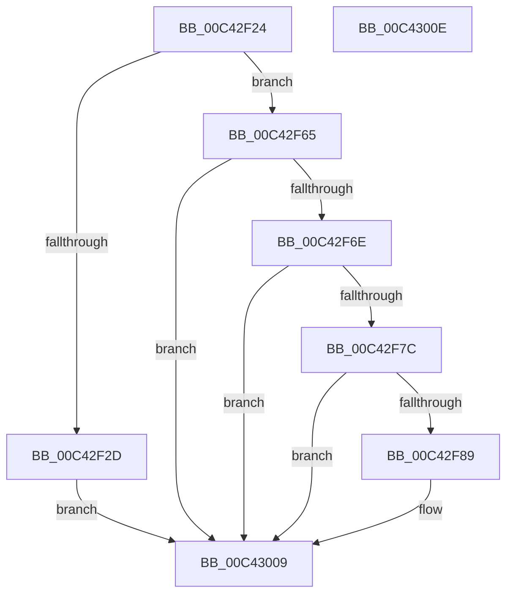

# PopEsInit

- RVA: `0x00C42F24`–`0x00C4300F` (길이 `235` bytes)
- VA: `0x0000000140C42F24`
- 실행 섹션: `INIT`
- PDB 이름 있음: `예`; PDB Function 태그: `아니요`
- unwind 정보 RVA: `0x0005D2F4`
- 디코드: `45`개 명령, `235/235` bytes 표시
- 미해석 바이트: `0` (있으면 어셈블리에 `.byte`로 보존)

> 이 문서는 커널 이미지의 기계어와 PDB 기호를 분석해 생성했습니다. 4번과 5번은 함수 원형과 자료형을 바이너리 사용 방식에서 추정한 C 해석이며 원본 소스 복구 결과는 아닙니다.

## 1. Dependencies

- 직접 호출 지점: **6**; 고유 호출 대상: **5**
- 직접 호출자로 확인된 함수: **1**
- RIP 상대 이미지 참조: **15**

### Outgoing calls
- `0x00C42F5B` → [PopEsWorkItemSchedule](../../page/A4/PopEsWorkItemSchedule_function_00A4A5DC.md) (function, `0x00A4A5DC`)
- `0x00C42F90` → [PopAcquireRwLockExclusive](../../text/43/PopAcquireRwLockExclusive_function_00430B44.md) (function, `0x00430B44`)
- `0x00C42FAE` → [PoRegisterPowerSettingCallback](../../page/A8/PoRegisterPowerSettingCallback_function_00A82150.md) (function, `0x00A82150`)
- `0x00C42FCC` → [PoRegisterPowerSettingCallback](../../page/A8/PoRegisterPowerSettingCallback_function_00A82150.md) (function, `0x00A82150`)
- `0x00C42FF8` → [ExSubscribeWnfStateChange](../../page/9D/ExSubscribeWnfStateChange_function_009D4BC0.md) (function, `0x009D4BC0`)
- `0x00C43004` → [PopReleaseRwLock](../../text/2D/PopReleaseRwLock_function_002DFBBC.md) (function, `0x002DFBBC`)

### Direct callers
- [PoInitSystem](../C7/PoInitSystem_function_00C72358.md) at `0x00C72D0A`
- [PoInitSystem](../C7/PoInitSystem_function_00C72358.md) at `0x00C73102`

### Static image references
- `0x00C42F2D` → RVA `0x00F08448` (`.data`; read/write)
- `0x00C42F35` → RVA `0x00AC6EE0` (`PopEsWorker`; read)
- `0x00C42F3C` → RVA `0x00F08440` (`.data`; read/write)
- `0x00C42F44` → RVA `0x00E679F8` (`.data`; read/write)
- `0x00C42F4C` → RVA `0x00E679E0` (`.data`; read/write)
- `0x00C42F54` → RVA `0x00E679F0` (`.data`; write)
- `0x00C42F6E` → RVA `0x00E673A0` (`.data`; read)
- `0x00C42F7C` → RVA `0x00E6739C` (`.data`; read)
- `0x00C42F89` → RVA `0x00F08440` (`.data`; read)
- `0x00C42F9B` → RVA `0x00769830` (`PopEsInStandbyAcDcCallback`; read)
- `0x00C42FA5` → RVA `0x0001A610` (`.rdata`; read)
- `0x00C42FB9` → RVA `0x00A4A230` (`PopEsInStandbyLowPowerEpochCallback`; read)
- `0x00C42FC3` → RVA `0x0001C740` (`.rdata`; read)
- `0x00C42FE6` → RVA `0x000209F8` (`.rdata`; read)
- `0x00C42FED` → RVA `0x00F08428` (`.data`; read)

## 2. Other-region calls and transfers

- 다른 실행 섹션으로 향하는 call: **6**
  - `0x00C42F5B` → [PopEsWorkItemSchedule](../../page/A4/PopEsWorkItemSchedule_function_00A4A5DC.md) (`INIT` → `PAGE`)
  - `0x00C42F90` → [PopAcquireRwLockExclusive](../../text/43/PopAcquireRwLockExclusive_function_00430B44.md) (`INIT` → `.text`)
  - `0x00C42FAE` → [PoRegisterPowerSettingCallback](../../page/A8/PoRegisterPowerSettingCallback_function_00A82150.md) (`INIT` → `PAGE`)
  - `0x00C42FCC` → [PoRegisterPowerSettingCallback](../../page/A8/PoRegisterPowerSettingCallback_function_00A82150.md) (`INIT` → `PAGE`)
  - `0x00C42FF8` → [ExSubscribeWnfStateChange](../../page/9D/ExSubscribeWnfStateChange_function_009D4BC0.md) (`INIT` → `PAGE`)
  - `0x00C43004` → [PopReleaseRwLock](../../text/2D/PopReleaseRwLock_function_002DFBBC.md) (`INIT` → `.text`)
- 별도 외부 분기/꼬리 이동을 확인하지 못했습니다.

## 3. Assembly (complete function range)

```asm
00C42F24  48 83 EC 38                     sub rsp, 0x38
00C42F28  83 F9 01                        cmp ecx, 1
00C42F2B  75 38                           jne 0x140c42f65
00C42F2D  48 83 25 13 55 2C 00 00         and qword ptr [rip + 0x2c5513], 0
00C42F35  48 8D 05 A4 3F E8 FF            lea rax, [rip - 0x17c05c]
00C42F3C  48 83 25 FC 54 2C 00 00         and qword ptr [rip + 0x2c54fc], 0
00C42F44  48 83 25 AC 4A 22 00 00         and qword ptr [rip + 0x224aac], 0
00C42F4C  48 83 25 8C 4A 22 00 00         and qword ptr [rip + 0x224a8c], 0
00C42F54  48 89 05 95 4A 22 00            mov qword ptr [rip + 0x224a95], rax
00C42F5B  E8 7C 76 E0 FF                  call 0x140a4a5dc
00C42F60  E9 A4 00 00 00                  jmp 0x140c43009
00C42F65  83 F9 03                        cmp ecx, 3
00C42F68  0F 85 9B 00 00 00               jne 0x140c43009
00C42F6E  8B 05 2C 44 22 00               mov eax, dword ptr [rip + 0x22442c]
00C42F74  85 C0                           test eax, eax
00C42F76  0F 84 8D 00 00 00               je 0x140c43009
00C42F7C  80 3D 19 44 22 00 00            cmp byte ptr [rip + 0x224419], 0
00C42F83  0F 84 80 00 00 00               je 0x140c43009
00C42F89  48 8D 0D B0 54 2C 00            lea rcx, [rip + 0x2c54b0]
00C42F90  E8 AF DB 7E FF                  call 0x140430b44
00C42F95  48 83 64 24 20 00               and qword ptr [rsp + 0x20], 0
00C42F9B  4C 8D 05 8E 68 B2 FF            lea r8, [rip - 0x4d9772]
00C42FA2  45 33 C9                        xor r9d, r9d
00C42FA5  48 8D 15 64 76 3D FF            lea rdx, [rip - 0xc2899c]
00C42FAC  33 C9                           xor ecx, ecx
00C42FAE  E8 9D F1 E3 FF                  call 0x140a82150
00C42FB3  48 83 64 24 20 00               and qword ptr [rsp + 0x20], 0
00C42FB9  4C 8D 05 70 72 E0 FF            lea r8, [rip - 0x1f8d90]
00C42FC0  45 33 C9                        xor r9d, r9d
00C42FC3  48 8D 15 76 97 3D FF            lea rdx, [rip - 0xc2688a]
00C42FCA  33 C9                           xor ecx, ecx
00C42FCC  E8 7F F1 E3 FF                  call 0x140a82150
00C42FD1  48 83 64 24 28 00               and qword ptr [rsp + 0x28], 0
00C42FD7  48 8D 05 52 72 E0 FF            lea rax, [rip - 0x1f8dae]
00C42FDE  45 33 C9                        xor r9d, r9d
00C42FE1  48 89 44 24 20                  mov qword ptr [rsp + 0x20], rax
00C42FE6  48 8D 15 0B DA 3D FF            lea rdx, [rip - 0xc225f5]
00C42FED  48 8D 0D 34 54 2C 00            lea rcx, [rip + 0x2c5434]
00C42FF4  45 8D 41 01                     lea r8d, [r9 + 1]
00C42FF8  E8 C3 1B D9 FF                  call 0x1409d4bc0
00C42FFD  48 8D 0D 3C 54 2C 00            lea rcx, [rip + 0x2c543c]
00C43004  E8 B3 CB 69 FF                  call 0x1402dfbbc
00C43009  48 83 C4 38                     add rsp, 0x38
00C4300D  C3                              ret
00C4300E  CC                              int3
```

## 4. C-style interpretation (structured pseudocode)

```c
__int64 __fastcall PopEsInit(int a1, __int64 a2, __int64 a3, int a4)
{
    __int64 result;
    __int64 v_rsp;
    unsigned __int64 v_stack_m10;
    unsigned __int64 v_stack_m18;

    v_rsp = (v_rsp) - (56);
    if (a1 != 1) goto loc_00C42F65;
    *(unsigned __int64 *)(v_rip + 2247317) = v_rip - 1556572;
    result = PopEsWorkItemSchedule(a1, a2, a3, a4);
    goto loc_00C43009;
loc_00C42F65:
    if (a1 != 3) goto loc_00C43009;
    if ((unsigned int)((unsigned int)(*(unsigned int *)(v_rip + 2245676))) == 0) goto loc_00C43009;
    result = (unsigned int)(*(unsigned int *)(v_rip + 2245676));
    if ((*(unsigned __int8 *)(v_rip + 2245657)) != 0) {
        a1 = v_rip + 2905264;
        result = PopAcquireRwLockExclusive(a1, a2, a3, a4);
        a3 = v_rip - 5085042;
        a4 = 0;
        a2 = v_rip - 12749212;
        a1 = 0;
        result = PoRegisterPowerSettingCallback(a1, a2, a3, a4);
        a3 = v_rip - 2067856;
        a4 = 0;
        a2 = v_rip - 12740746;
        a1 = 0;
        result = PoRegisterPowerSettingCallback(a1, a2, a3, a4);
        result = v_rip - 2067886;
        a4 = 0;
        v_stack_m18 = result;
        a2 = v_rip - 12723701;
        a1 = v_rip + 2905140;
        a3 = a4 + 1;
        result = ExSubscribeWnfStateChange(a1, a2, a3, a4);
        a1 = v_rip + 2905148;
        result = PopReleaseRwLock(a1, a2, a3, a4);
    }
    v_rsp = (v_rsp) + (56);
    return result;
}
```

## 5. (Beta) C Style

```c
int64_t PopEsInit(int32_t Arg1, int64_t Arg2, int64_t Arg3, int32_t Arg4)
{
    int64_t result;
    int64_t local_rsp;
    uint64_t v_stack_m10;
    uint64_t v_stack_m18;

    local_rsp = (local_rsp) - (56);
    if (Arg1 != 1) goto loc_00C42F65;
    *(uint64_t *)(v_rip + 0x224A95) = v_rip - 1556572;
    result = PopEsWorkItemSchedule(Arg1, Arg2, Arg3, Arg4);
    goto loc_00C43009;
loc_00C42F65:
    if (Arg1 != 3) goto loc_00C43009;
    if ((uint32_t)((uint32_t)(*(uint32_t *)(v_rip + 0x22442C))) == 0) goto loc_00C43009;
    result = (uint32_t)(*(uint32_t *)(v_rip + 0x22442C));
    if ((*(uint8_t *)(v_rip + 0x224419)) != 0) {
        Arg1 = v_rip + 2905264;
        result = PopAcquireRwLockExclusive(Arg1, Arg2, Arg3, Arg4);
        Arg3 = v_rip - 5085042;
        Arg4 = 0;
        Arg2 = v_rip - 12749212;
        Arg1 = 0;
        result = PoRegisterPowerSettingCallback(Arg1, Arg2, Arg3, Arg4);
        Arg3 = v_rip - 2067856;
        Arg4 = 0;
        Arg2 = v_rip - 12740746;
        Arg1 = 0;
        result = PoRegisterPowerSettingCallback(Arg1, Arg2, Arg3, Arg4);
        result = v_rip - 2067886;
        Arg4 = 0;
        v_stack_m18 = result;
        Arg2 = v_rip - 12723701;
        Arg1 = v_rip + 2905140;
        Arg3 = Arg4 + 1;
        result = ExSubscribeWnfStateChange(Arg1, Arg2, Arg3, Arg4);
        Arg1 = v_rip + 2905148;
        result = PopReleaseRwLock(Arg1, Arg2, Arg3, Arg4);
    }
    local_rsp = (local_rsp) + (56);
    return result;
}
```

## 6. Execution-region graph

[열기: 2D/3D 그래프와 함수 탐색 컨트롤 패널](../../../control-panel.html?section=init&rva=0x00C42F24&view=graph)

- 2D 그래프는 위에서 아래로 흐르고, 3D 그래프는 빈 공간을 드래그해 회전합니다. Shift+드래그는 이동, 휠은 확대·축소, 함수 노드 선택은 대상 보고서 이동입니다.

### Static fallback


