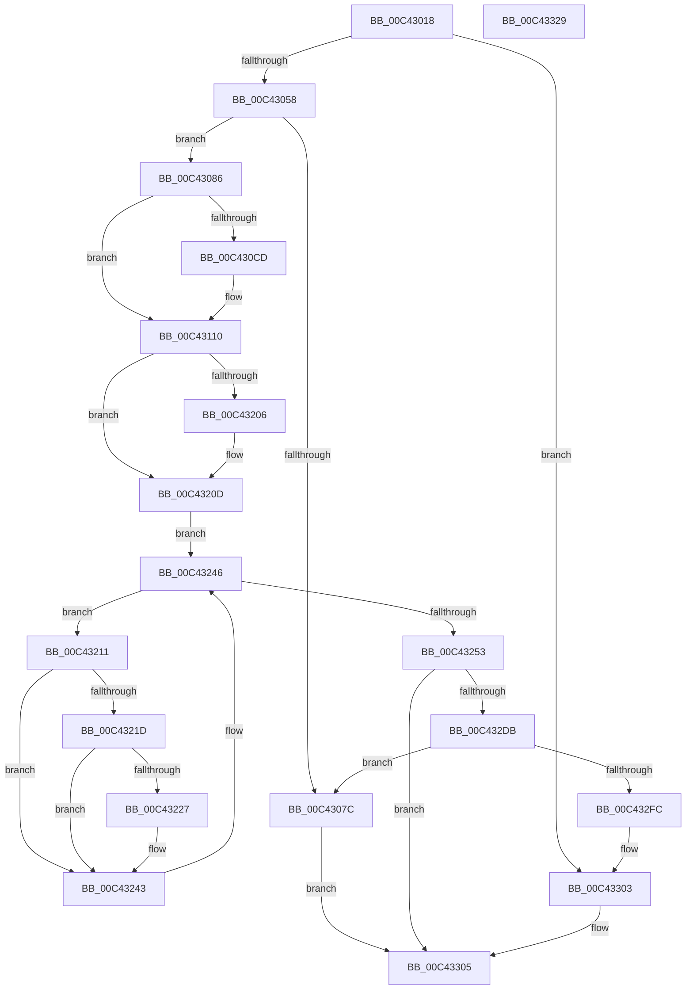

# PopEtInit

- RVA: `0x00C43018`–`0x00C4332A` (길이 `786` bytes)
- VA: `0x0000000140C43018`
- 실행 섹션: `INIT`
- PDB 이름 있음: `예`; PDB Function 태그: `아니요`
- unwind 정보 RVA: `0x000CD168`
- 디코드: `159`개 명령, `786/786` bytes 표시
- 미해석 바이트: `0` (있으면 어셈블리에 `.byte`로 보존)

> 이 문서는 커널 이미지의 기계어와 PDB 기호를 분석해 생성했습니다. 4번과 5번은 함수 원형과 자료형을 바이너리 사용 방식에서 추정한 C 해석이며 원본 소스 복구 결과는 아닙니다.

## 1. Dependencies

- 직접 호출 지점: **18**; 고유 호출 대상: **12**
- 직접 호출자로 확인된 함수: **1**
- RIP 상대 이미지 참조: **19**

### Outgoing calls
- `0x00C43068` → [ExAllocatePool2](../../poolcode/B8/ExAllocatePool2_function_00B820F0.md) (function, `0x00B820F0`)
- `0x00C43092` → [memset](../../text/6C/memset_function_006C6C40.md) (function, `0x006C6C40`)
- `0x00C430B4` → [memset](../../text/6C/memset_function_006C6C40.md) (function, `0x006C6C40`)
- `0x00C430C4` → [RtlGetVersion](../../page/A1/RtlGetVersion_function_00A19110.md) (function, `0x00A19110`)
- `0x00C43161` → [RtlInternTableInitialize](../../page/79/RtlInternTableInitialize_function_00795008.md) (function, `0x00795008`)
- `0x00C4316D` → [PoEnergyContextInitialize](../../page/A6/PoEnergyContextInitialize_function_00A6E5E4.md) (function, `0x00A6E5E4`)
- `0x00C4318E` → [PopEtInitializeBuiltinAppId](../../page/76/PopEtInitializeBuiltinAppId_function_0076A3B0.md) (function, `0x0076A3B0`)
- `0x00C431A1` → [PopEtInitializeBuiltinAppId](../../page/76/PopEtInitializeBuiltinAppId_function_0076A3B0.md) (function, `0x0076A3B0`)
- `0x00C431B4` → [PopEtInitializeBuiltinAppId](../../page/76/PopEtInitializeBuiltinAppId_function_0076A3B0.md) (function, `0x0076A3B0`)
- `0x00C431CA` → [PopEtInitializeBuiltinAppId](../../page/76/PopEtInitializeBuiltinAppId_function_0076A3B0.md) (function, `0x0076A3B0`)
- `0x00C431EE` → [PopEtInitializeBuiltinAppId](../../page/76/PopEtInitializeBuiltinAppId_function_0076A3B0.md) (function, `0x0076A3B0`)
- `0x00C4323E` → [PoEnergyContextStart](../../page/98/PoEnergyContextStart_function_0098EAD4.md) (function, `0x0098EAD4`)
- `0x00C43246` → [PsGetNextProcess](../../page/91/PsGetNextProcess_function_0091C900.md) (function, `0x0091C900`)
- `0x00C4325F` → [RtlInitUnicodeString](../../text/42/RtlInitUnicodeString_function_0042A780.md) (function, `0x0042A780`)
- `0x00C43273` → [memset](../../text/6C/memset_function_006C6C40.md) (function, `0x006C6C40`)
- `0x00C432D2` → [ObCreateObjectType](../../page/70/ObCreateObjectType_function_00705230.md) (function, `0x00705230`)
- `0x00C432E0` → [PopEtAllocate](../../page/98/PopEtAllocate_function_0098C8E0.md) (function, `0x0098C8E0`)
- `0x00C4330F` → [_security_check_cookie](../../text/6A/_security_check_cookie_function_006AC640.md) (function, `0x006AC640`)

### Direct callers
- [PoInitSystem](../C7/PoInitSystem_function_00C72358.md) at `0x00C72D14`

### Static image references
- `0x00C43032` → RVA `0x00E0A740` (`.data`; read)
- `0x00C43043` → RVA `0x00F0EFD0` (`.data`; read)
- `0x00C4306D` → RVA `0x00E67A30` (`.data`; write)
- `0x00C430CD` → RVA `0x00E67A30` (`.data`; read)
- `0x00C43117` → RVA `0x00A89140` (`PopEtInternerAllocate`; read)
- `0x00C43135` → RVA `0x0098DEA0` (`PopEtInternerFree`; read)
- `0x00C43140` → RVA `0x0098DEC0` (`PopEtInternerLock`; read)
- `0x00C4314B` → RVA `0x0098DE80` (`PopEtInternerUnlock`; read)
- `0x00C43156` → RVA `0x00A6F0E0` (`PopEtInternerEntryInitialize`; read)
- `0x00C43172` → RVA `0x00FC6B70` (`ALMOSTRO`; read)
- `0x00C43179` → RVA `0x0002AD50` (`.rdata`; read)
- `0x00C4319A` → RVA `0x0002AD88` (`.rdata`; read)
- `0x00C431AD` → RVA `0x0002AD70` (`.rdata`; read)
- `0x00C431C3` → RVA `0x0002AD60` (`.rdata`; read)
- `0x00C431E7` → RVA `0x00011BA8` (`.rdata`; read)
- `0x00C431F3` → RVA `0x00FC6AB0` (`ALMOSTRO`; read)
- `0x00C43253` → RVA `0x00C7C5A0` (` ?? ::PBOPGDP::`string'`; read)
- `0x00C4327F` → RVA `0x00769EA0` (`PopEtEnergyTrackerClose`; read)
- `0x00C4329A` → RVA `0x0076A1D0` (`PopEtEnergyTrackerDelete`; read)

## 2. Other-region calls and transfers

- 다른 실행 섹션으로 향하는 call: **18**
  - `0x00C43068` → [ExAllocatePool2](../../poolcode/B8/ExAllocatePool2_function_00B820F0.md) (`INIT` → `POOLCODE`)
  - `0x00C43092` → [memset](../../text/6C/memset_function_006C6C40.md) (`INIT` → `.text`)
  - `0x00C430B4` → [memset](../../text/6C/memset_function_006C6C40.md) (`INIT` → `.text`)
  - `0x00C430C4` → [RtlGetVersion](../../page/A1/RtlGetVersion_function_00A19110.md) (`INIT` → `PAGE`)
  - `0x00C43161` → [RtlInternTableInitialize](../../page/79/RtlInternTableInitialize_function_00795008.md) (`INIT` → `PAGE`)
  - `0x00C4316D` → [PoEnergyContextInitialize](../../page/A6/PoEnergyContextInitialize_function_00A6E5E4.md) (`INIT` → `PAGE`)
  - `0x00C4318E` → [PopEtInitializeBuiltinAppId](../../page/76/PopEtInitializeBuiltinAppId_function_0076A3B0.md) (`INIT` → `PAGE`)
  - `0x00C431A1` → [PopEtInitializeBuiltinAppId](../../page/76/PopEtInitializeBuiltinAppId_function_0076A3B0.md) (`INIT` → `PAGE`)
  - `0x00C431B4` → [PopEtInitializeBuiltinAppId](../../page/76/PopEtInitializeBuiltinAppId_function_0076A3B0.md) (`INIT` → `PAGE`)
  - `0x00C431CA` → [PopEtInitializeBuiltinAppId](../../page/76/PopEtInitializeBuiltinAppId_function_0076A3B0.md) (`INIT` → `PAGE`)
  - `0x00C431EE` → [PopEtInitializeBuiltinAppId](../../page/76/PopEtInitializeBuiltinAppId_function_0076A3B0.md) (`INIT` → `PAGE`)
  - `0x00C4323E` → [PoEnergyContextStart](../../page/98/PoEnergyContextStart_function_0098EAD4.md) (`INIT` → `PAGE`)
  - `0x00C43246` → [PsGetNextProcess](../../page/91/PsGetNextProcess_function_0091C900.md) (`INIT` → `PAGE`)
  - `0x00C4325F` → [RtlInitUnicodeString](../../text/42/RtlInitUnicodeString_function_0042A780.md) (`INIT` → `.text`)
  - `0x00C43273` → [memset](../../text/6C/memset_function_006C6C40.md) (`INIT` → `.text`)
  - `0x00C432D2` → [ObCreateObjectType](../../page/70/ObCreateObjectType_function_00705230.md) (`INIT` → `PAGE`)
  - `0x00C432E0` → [PopEtAllocate](../../page/98/PopEtAllocate_function_0098C8E0.md) (`INIT` → `PAGE`)
  - `0x00C4330F` → [_security_check_cookie](../../text/6A/_security_check_cookie_function_006AC640.md) (`INIT` → `.text`)
- 별도 외부 분기/꼬리 이동을 확인하지 못했습니다.

## 3. Assembly (complete function range)

```asm
00C43018  48 89 5C 24 08                  mov qword ptr [rsp + 8], rbx
00C4301D  48 89 7C 24 10                  mov qword ptr [rsp + 0x10], rdi
00C43022  55                              push rbp
00C43023  48 8D AC 24 20 FF FF FF         lea rbp, [rsp - 0xe0]
00C4302B  48 81 EC E0 01 00 00            sub rsp, 0x1e0
00C43032  48 8B 05 07 77 1C 00            mov rax, qword ptr [rip + 0x1c7707]
00C43039  48 33 C4                        xor rax, rsp
00C4303C  48 89 85 D0 00 00 00            mov qword ptr [rbp + 0xd0], rax
00C43043  80 3D 86 BF 2C 00 00            cmp byte ptr [rip + 0x2cbf86], 0
00C4304A  0F 57 C0                        xorps xmm0, xmm0
00C4304D  0F 11 44 24 20                  movups xmmword ptr [rsp + 0x20], xmm0
00C43052  0F 84 AB 02 00 00               je 0x140c43303
00C43058  BA 50 04 00 00                  mov edx, 0x450
00C4305D  B9 40 00 00 00                  mov ecx, 0x40
00C43062  41 B8 50 6F 45 54               mov r8d, 0x54456f50
00C43068  E8 83 F0 F3 FF                  call 0x140b820f0
00C4306D  48 89 05 BC 49 22 00            mov qword ptr [rip + 0x2249bc], rax
00C43074  48 8B D8                        mov rbx, rax
00C43077  48 85 C0                        test rax, rax
00C4307A  75 0A                           jne 0x140c43086
00C4307C  B8 9A 00 00 C0                  mov eax, 0xc000009a
00C43081  E9 7F 02 00 00                  jmp 0x140c43305
00C43086  48 8D 48 20                     lea rcx, [rax + 0x20]
00C4308A  33 D2                           xor edx, edx
00C4308C  41 B8 30 04 00 00               mov r8d, 0x430
00C43092  E8 A9 3B A8 FF                  call 0x1406c6c40
00C43097  48 83 63 18 00                  and qword ptr [rbx + 0x18], 0
00C4309C  48 8D 4D B4                     lea rcx, [rbp - 0x4c]
00C430A0  48 83 63 10 00                  and qword ptr [rbx + 0x10], 0
00C430A5  33 D2                           xor edx, edx
00C430A7  41 B8 18 01 00 00               mov r8d, 0x118
00C430AD  48 89 5B 08                     mov qword ptr [rbx + 8], rbx
00C430B1  48 89 1B                        mov qword ptr [rbx], rbx
00C430B4  E8 87 3B A8 FF                  call 0x1406c6c40
00C430B9  48 8D 4D B0                     lea rcx, [rbp - 0x50]
00C430BD  C7 45 B0 1C 01 00 00            mov dword ptr [rbp - 0x50], 0x11c
00C430C4  E8 47 60 DD FF                  call 0x140a19110
00C430C9  85 C0                           test eax, eax
00C430CB  78 43                           js 0x140c43110
00C430CD  48 8B 0D 5C 49 22 00            mov rcx, qword ptr [rip + 0x22495c]
00C430D4  BA FF FF 00 00                  mov edx, 0xffff
00C430D9  39 55 B4                        cmp dword ptr [rbp - 0x4c], edx
00C430DC  8B C2                           mov eax, edx
00C430DE  0F 42 45 B4                     cmovb eax, dword ptr [rbp - 0x4c]
00C430E2  39 55 B8                        cmp dword ptr [rbp - 0x48], edx
00C430E5  66 89 81 2E 04 00 00            mov word ptr [rcx + 0x42e], ax
00C430EC  8B C2                           mov eax, edx
00C430EE  0F 42 45 B8                     cmovb eax, dword ptr [rbp - 0x48]
00C430F2  39 55 BC                        cmp dword ptr [rbp - 0x44], edx
00C430F5  66 89 81 2C 04 00 00            mov word ptr [rcx + 0x42c], ax
00C430FC  0F 42 55 BC                     cmovb edx, dword ptr [rbp - 0x44]
00C43100  66 89 91 2A 04 00 00            mov word ptr [rcx + 0x42a], dx
00C43107  66 C7 81 28 04 00 00 EF 25      mov word ptr [rcx + 0x428], 0x25ef
00C43110  48 8B 3D 19 49 22 00            mov rdi, qword ptr [rip + 0x224919]
00C43117  48 8D 05 22 60 E4 FF            lea rax, [rip - 0x1b9fde]
00C4311E  0F 57 C0                        xorps xmm0, xmm0
00C43121  0F 11 47 28                     movups xmmword ptr [rdi + 0x28], xmm0
00C43125  48 83 67 28 00                  and qword ptr [rdi + 0x28], 0
00C4312A  48 8D 57 58                     lea rdx, [rdi + 0x58]
00C4312E  48 89 02                        mov qword ptr [rdx], rax
00C43131  48 8D 4F 38                     lea rcx, [rdi + 0x38]
00C43135  48 8D 05 64 AD D4 FF            lea rax, [rip - 0x2b529c]
00C4313C  48 89 47 60                     mov qword ptr [rdi + 0x60], rax
00C43140  48 8D 05 79 AD D4 FF            lea rax, [rip - 0x2b5287]
00C43147  48 89 47 68                     mov qword ptr [rdi + 0x68], rax
00C4314B  48 8D 05 2E AD D4 FF            lea rax, [rip - 0x2b52d2]
00C43152  48 89 47 70                     mov qword ptr [rdi + 0x70], rax
00C43156  48 8D 05 83 BF E2 FF            lea rax, [rip - 0x1d407d]
00C4315D  48 89 47 78                     mov qword ptr [rdi + 0x78], rax
00C43161  E8 A2 1E B5 FF                  call 0x140795008
00C43166  48 8D 8F 80 00 00 00            lea rcx, [rdi + 0x80]
00C4316D  E8 72 B4 E2 FF                  call 0x140a6e5e4
00C43172  48 8B 1D F7 39 38 00            mov rbx, qword ptr [rip + 0x3839f7]
00C43179  48 8D 15 D0 7B 3E FF            lea rdx, [rip - 0xc18430]
00C43180  48 89 8B 68 06 00 00            mov qword ptr [rbx + 0x668], rcx
00C43187  48 8D 8F 18 03 00 00            lea rcx, [rdi + 0x318]
00C4318E  E8 1D 72 B2 FF                  call 0x14076a3b0
00C43193  48 8D 8F 70 03 00 00            lea rcx, [rdi + 0x370]
00C4319A  48 8D 15 E7 7B 3E FF            lea rdx, [rip - 0xc18419]
00C431A1  E8 0A 72 B2 FF                  call 0x14076a3b0
00C431A6  48 8D 8F C8 03 00 00            lea rcx, [rdi + 0x3c8]
00C431AD  48 8D 15 BC 7B 3E FF            lea rdx, [rip - 0xc18444]
00C431B4  E8 F7 71 B2 FF                  call 0x14076a3b0
00C431B9  4C 8D 9F C0 02 00 00            lea r11, [rdi + 0x2c0]
00C431C0  49 8B CB                        mov rcx, r11
00C431C3  48 8D 15 96 7B 3E FF            lea rdx, [rip - 0xc1846a]
00C431CA  E8 E1 71 B2 FF                  call 0x14076a3b0
00C431CF  48 8B 93 68 06 00 00            mov rdx, qword ptr [rbx + 0x668]
00C431D6  48 81 C7 68 02 00 00            add rdi, 0x268
00C431DD  48 8B CF                        mov rcx, rdi
00C431E0  4C 89 9A C8 01 00 00            mov qword ptr [rdx + 0x1c8], r11
00C431E7  48 8D 15 BA E9 3C FF            lea rdx, [rip - 0xc31646]
00C431EE  E8 BD 71 B2 FF                  call 0x14076a3b0
00C431F3  48 8B 15 B6 38 38 00            mov rdx, qword ptr [rip + 0x3838b6]
00C431FA  48 8B 82 68 06 00 00            mov rax, qword ptr [rdx + 0x668]
00C43201  48 85 C0                        test rax, rax
00C43204  74 07                           je 0x140c4320d
00C43206  48 89 B8 C8 01 00 00            mov qword ptr [rax + 0x1c8], rdi
00C4320D  33 C9                           xor ecx, ecx
00C4320F  EB 35                           jmp 0x140c43246
00C43211  48 8B 8B 68 06 00 00            mov rcx, qword ptr [rbx + 0x668]
00C43218  48 85 C9                        test rcx, rcx
00C4321B  74 26                           je 0x140c43243
00C4321D  48 83 B9 C8 01 00 00 00         cmp qword ptr [rcx + 0x1c8], 0
00C43225  75 1C                           jne 0x140c43243
00C43227  48 8B 05 02 48 22 00            mov rax, qword ptr [rip + 0x224802]
00C4322E  48 05 18 03 00 00               add rax, 0x318
00C43234  48 89 81 C8 01 00 00            mov qword ptr [rcx + 0x1c8], rax
00C4323B  48 8B CB                        mov rcx, rbx
00C4323E  E8 91 B8 D4 FF                  call 0x14098ead4
00C43243  48 8B CB                        mov rcx, rbx
00C43246  E8 B5 96 CD FF                  call 0x14091c900
00C4324B  48 8B D8                        mov rbx, rax
00C4324E  48 85 C0                        test rax, rax
00C43251  75 BE                           jne 0x140c43211
00C43253  48 8D 15 46 93 03 00            lea rdx, [rip + 0x39346]
00C4325A  48 8D 4C 24 20                  lea rcx, [rsp + 0x20]
00C4325F  E8 1C 75 7E FF                  call 0x14042a780
00C43264  BB 78 00 00 00                  mov ebx, 0x78
00C43269  48 8D 4C 24 30                  lea rcx, [rsp + 0x30]
00C4326E  44 8B C3                        mov r8d, ebx
00C43271  33 D2                           xor edx, edx
00C43273  E8 C8 39 A8 FF                  call 0x1406c6c40
00C43278  4C 8B 0D B1 47 22 00            mov r9, qword ptr [rip + 0x2247b1]
00C4327F  48 8D 05 1A 6C B2 FF            lea rax, [rip - 0x4d93e6]
00C43286  80 4C 24 32 04                  or byte ptr [rsp + 0x32], 4
00C4328B  48 8D 54 24 30                  lea rdx, [rsp + 0x30]
00C43290  48 89 44 24 70                  mov qword ptr [rsp + 0x70], rax
00C43295  48 8D 4C 24 20                  lea rcx, [rsp + 0x20]
00C4329A  48 8D 05 2F 6F B2 FF            lea rax, [rip - 0x4d90d1]
00C432A1  66 89 5C 24 30                  mov word ptr [rsp + 0x30], bx
00C432A6  49 83 C1 20                     add r9, 0x20
00C432AA  48 89 44 24 78                  mov qword ptr [rsp + 0x78], rax
00C432AF  45 33 C0                        xor r8d, r8d
00C432B2  C7 44 24 54 01 00 00 00         mov dword ptr [rsp + 0x54], 1
00C432BA  C7 44 24 58 98 02 00 00         mov dword ptr [rsp + 0x58], 0x298
00C432C2  C7 44 24 38 92 01 00 00         mov dword ptr [rsp + 0x38], 0x192
00C432CA  C7 44 24 4C 01 00 1F 00         mov dword ptr [rsp + 0x4c], 0x1f0001
00C432D2  E8 59 1F AC FF                  call 0x140705230
00C432D7  85 C0                           test eax, eax
00C432D9  78 2A                           js 0x140c43305
00C432DB  B9 70 02 00 00                  mov ecx, 0x270
00C432E0  E8 FB 95 D4 FF                  call 0x14098c8e0
00C432E5  48 8B 0D 44 47 22 00            mov rcx, qword ptr [rip + 0x224744]
00C432EC  48 89 81 40 04 00 00            mov qword ptr [rcx + 0x440], rax
00C432F3  48 85 C0                        test rax, rax
00C432F6  0F 84 80 FD FF FF               je 0x140c4307c
00C432FC  83 89 48 04 00 00 FF            or dword ptr [rcx + 0x448], 0xffffffff
00C43303  33 C0                           xor eax, eax
00C43305  48 8B 8D D0 00 00 00            mov rcx, qword ptr [rbp + 0xd0]
00C4330C  48 33 CC                        xor rcx, rsp
00C4330F  E8 2C 93 A6 FF                  call 0x1406ac640
00C43314  4C 8D 9C 24 E0 01 00 00         lea r11, [rsp + 0x1e0]
00C4331C  49 8B 5B 10                     mov rbx, qword ptr [r11 + 0x10]
00C43320  49 8B 7B 18                     mov rdi, qword ptr [r11 + 0x18]
00C43324  49 8B E3                        mov rsp, r11
00C43327  5D                              pop rbp
00C43328  C3                              ret
00C43329  CC                              int3
```

## 4. C-style interpretation (structured pseudocode)

```c
__int64 __fastcall PopEtInit(void)
{
    __int64 result;
    __int64 v_rdi;
    __int64 v_rsp;
    unsigned int v_stack_m12C;
    unsigned int v_stack_m130;
    unsigned __int64 v_stack_m134;
    unsigned __int64 v_stack_m138;
    unsigned __int64 v_stack_m170;
    unsigned __int64 v_stack_m178;
    unsigned __int64 v_stack_m18;
    unsigned int v_stack_m190;
    unsigned int v_stack_m194;
    unsigned int v_stack_m19C;
    unsigned int v_stack_m1B0;
    unsigned __int8 v_stack_m1B6;
    unsigned __int64 v_stack_m1B8;
    unsigned __int64 v_stack_m1C8;
    unsigned __int64 v_stack_m8;
    unsigned __int64 v_stack_mE8;
    unsigned __int64 v_stack_p10;
    unsigned __int64 v_stack_p8;

    v_stack_p8 = v_rbx;
    v_stack_p10 = v_rdi;
    v_rsp = (v_rsp) - (480);
    result = (*(unsigned __int64 *)(v_rip + 1865479)) ^ (v_rsp);
    v_stack_m18 = result;
    v_stack_m1C8 = v_xmm0;
    if ((*(unsigned __int8 *)(v_rip + 2932614)) == 0) goto loc_00C43303;
    result = ExAllocatePool2(64, (unsigned int)(0x450ULL), (unsigned int)(0x54456F50ULL), a4);
    *(unsigned __int64 *)(v_rip + 2247100) = result;
    if (result != 0) goto loc_00C43086;
loc_00C4307C:
    goto loc_00C43305;
loc_00C43086:
    a2 = 0;
    result = memset((unsigned int)(0xC000009AULL) + 32, a2, (unsigned int)(0x430ULL), a4);
    a2 = 0;
    *(unsigned __int64 *)(result + 8) = result;
    *(unsigned __int64 *)(result) = result;
    result = memset(v_stack_m134, a2, 280, a4);
    v_stack_m138 = 284;
    result = RtlGetVersion(v_stack_m138, a2, 280, a4);
    if (!(sign_flag)) {
        a1 = *(unsigned __int64 *)(v_rip + 2247004);
        a2 = 0xFFFFULL;
        result = (unsigned int)(a2);
        if (v_stack_m134 < ((unsigned int)(a2))) { result = v_stack_m134; }
        *(unsigned __int16 *)(a1 + 1070) = (unsigned __int16)(result);
        result = (unsigned int)(a2);
        if (v_stack_m130 < ((unsigned int)(a2))) { result = v_stack_m130; }
        *(unsigned __int16 *)(a1 + 1068) = (unsigned __int16)(result);
        if (v_stack_m12C < ((unsigned int)(a2))) { a2 = v_stack_m12C; }
        *(unsigned __int16 *)(a1 + 1066) = (unsigned __int16)(a2);
        *(unsigned __int16 *)(a1 + 1064) = 0x25EFULL;
    }
    *(unsigned __int64 *)(*(unsigned __int64 *)(v_rip + 2246937) + 40) = v_xmm0;
    *(unsigned __int64 *)(*(unsigned __int64 *)(v_rip + 2246937) + 88) = v_rip - 1810398;
    *(unsigned __int64 *)(*(unsigned __int64 *)(v_rip + 2246937) + 96) = v_rip - 2839196;
    *(unsigned __int64 *)(*(unsigned __int64 *)(v_rip + 2246937) + 104) = v_rip - 2839175;
    *(unsigned __int64 *)(*(unsigned __int64 *)(v_rip + 2246937) + 112) = v_rip - 2839250;
    *(unsigned __int64 *)(*(unsigned __int64 *)(v_rip + 2246937) + 120) = v_rip - 1917053;
    result = RtlInternTableInitialize(*(unsigned __int64 *)(v_rip + 2246937) + 56, *(unsigned __int64 *)(v_rip + 2246937) + 88, 280, a4);
    result = PoEnergyContextInitialize(*(unsigned __int64 *)(v_rip + 2246937) + 128, *(unsigned __int64 *)(v_rip + 2246937) + 88, 280, a4);
    *(unsigned __int64 *)(*(unsigned __int64 *)(v_rip + 3684855) + 1640) = *(unsigned __int64 *)(v_rip + 2246937) + 128;
    result = PopEtInitializeBuiltinAppId(*(unsigned __int64 *)(v_rip + 2246937) + 792, v_rip - 12682288, 280, a4);
    result = PopEtInitializeBuiltinAppId(*(unsigned __int64 *)(v_rip + 2246937) + 880, v_rip - 12682265, 280, a4);
    result = PopEtInitializeBuiltinAppId(*(unsigned __int64 *)(v_rip + 2246937) + 968, v_rip - 12682308, 280, a4);
    result = PopEtInitializeBuiltinAppId(*(unsigned __int64 *)(v_rip + 2246937) + 704, v_rip - 12682346, 280, a4);
    v_rdi = (*(unsigned __int64 *)(v_rip + 2246937)) + (616);
    *(unsigned __int64 *)(*(unsigned __int64 *)(*(unsigned __int64 *)(v_rip + 3684855) + 1640) + 456) = *(unsigned __int64 *)(v_rip + 2246937) + 704;
    result = PopEtInitializeBuiltinAppId(v_rdi, v_rip - 12785222, 280, a4);
    if (*(unsigned __int64 *)(*(unsigned __int64 *)(v_rip + 3684534) + 1640) != 0) {
        *(unsigned __int64 *)(*(unsigned __int64 *)(*(unsigned __int64 *)(v_rip + 3684534) + 1640) + 456) = v_rdi;
    }
    a1 = 0;
    goto loc_00C43246;
loc_00C43211:
    if (*(unsigned __int64 *)(*(unsigned __int64 *)(v_rip + 3684855) + 1640) == 0) goto loc_00C43243;
    result = *(unsigned __int64 *)(*(unsigned __int64 *)(v_rip + 3684534) + 1640);
    if ((*(unsigned __int64 *)(*(unsigned __int64 *)(*(unsigned __int64 *)(v_rip + 3684855) + 1640) + 456)) == 0) {
        result = *(unsigned __int64 *)(v_rip + 2246658);
        result = (result) + (792);
        *(unsigned __int64 *)(*(unsigned __int64 *)(*(unsigned __int64 *)(v_rip + 3684855) + 1640) + 456) = result;
        a1 = *(unsigned __int64 *)(v_rip + 3684855);
        result = PoEnergyContextStart(a1, *(unsigned __int64 *)(v_rip + 3684534), 280, a4);
    }
loc_00C43246:
    result = PsGetNextProcess(*(unsigned __int64 *)(v_rip + 3684855), *(unsigned __int64 *)(v_rip + 3684534), 280, a4);
    if (result != 0) goto loc_00C43211;
    result = RtlInitUnicodeString(v_stack_m1C8, v_rip + 234310, 280, a4);
    a2 = 0;
    result = memset(v_stack_m1B8, a2, 120, a4);
    v_stack_m178 = v_rip - 5084134;
    v_stack_m1B8 = 120;
    a4 = (*(unsigned __int64 *)(v_rip + 2246577)) + (32);
    v_stack_m170 = v_rip - 5083345;
    a3 = 0;
    v_stack_m194 = 1;
    v_stack_m190 = 664;
    v_stack_m1B0 = 402;
    v_stack_m19C = 0x1F0001ULL;
    result = ObCreateObjectType(v_stack_m1C8, v_stack_m1B8, a3, a4);
    if (sign_flag) goto loc_00C43305;
    result = PopEtAllocate(624, v_stack_m1B8, a3, a4);
    *(unsigned __int64 *)(*(unsigned __int64 *)(v_rip + 2246468) + 1088) = result;
    if (result == 0) goto loc_00C4307C;
loc_00C43303:
    result = 0;
loc_00C43305:
    a1 = (v_stack_m18) ^ (v_rsp);
    result = _security_check_cookie(a1, v_stack_m1B8, a3, a4);
    return result;
}
```

## 5. (Beta) C Style

```c
void PopEtInit(void)
{
    int64_t result;
    int64_t local_rdi;
    int64_t local_rsp;
    uint32_t v_stack_m12C;
    uint32_t v_stack_m130;
    uint64_t v_stack_m134;
    uint64_t v_stack_m138;
    uint64_t v_stack_m170;
    uint64_t v_stack_m178;
    uint64_t v_stack_m18;
    uint32_t v_stack_m190;
    uint32_t v_stack_m194;
    uint32_t v_stack_m19C;
    uint32_t v_stack_m1B0;
    uint8_t v_stack_m1B6;
    uint64_t v_stack_m1B8;
    uint64_t v_stack_m1C8;
    uint64_t v_stack_m8;
    uint64_t v_stack_mE8;
    uint64_t v_stack_p10;
    uint64_t v_stack_p8;

    v_stack_p8 = local_rbx;
    v_stack_p10 = local_rdi;
    local_rsp = (local_rsp) - (480);
    result = (*(uint64_t *)(v_rip + 0x1C7707)) ^ (local_rsp);
    v_stack_m18 = result;
    v_stack_m1C8 = v_xmm0;
    if ((*(uint8_t *)(v_rip + 0x2CBF86)) == 0) goto loc_00C43303;
    result = ExAllocatePool2(64, (uint32_t)(0x450ULL), (uint32_t)(0x54456F50ULL), a4);
    *(uint64_t *)(v_rip + 0x2249BC) = result;
    if (result != 0) goto loc_00C43086;
loc_00C4307C:
    goto loc_00C43305;
loc_00C43086:
    a2 = 0;
    result = memset((uint32_t)(0xC000009AULL) + 32, a2, (uint32_t)(0x430ULL), a4);
    a2 = 0;
    *(uint64_t *)(result + 0x8) = result;
    *(uint64_t *)(result) = result;
    result = memset(v_stack_m134, a2, 280, a4);
    v_stack_m138 = 284;
    result = RtlGetVersion(v_stack_m138, a2, 280, a4);
    if (!(sign_flag)) {
        a1 = *(uint64_t *)(v_rip + 0x22495C);
        a2 = 0xFFFFULL;
        result = (uint32_t)(a2);
        if (v_stack_m134 < ((uint32_t)(a2))) { result = v_stack_m134; }
        *(uint16_t *)(a1 + 0x42E) = (uint16_t)(result);
        result = (uint32_t)(a2);
        if (v_stack_m130 < ((uint32_t)(a2))) { result = v_stack_m130; }
        *(uint16_t *)(a1 + 0x42C) = (uint16_t)(result);
        if (v_stack_m12C < ((uint32_t)(a2))) { a2 = v_stack_m12C; }
        *(uint16_t *)(a1 + 0x42A) = (uint16_t)(a2);
        *(uint16_t *)(a1 + 0x428) = 0x25EFULL;
    }
    *(uint64_t *)(*(uint64_t *)(v_rip + 0x224919) + 0x28) = v_xmm0;
    *(uint64_t *)(*(uint64_t *)(v_rip + 0x224919) + 0x58) = v_rip - 1810398;
    *(uint64_t *)(*(uint64_t *)(v_rip + 0x224919) + 0x60) = v_rip - 2839196;
    *(uint64_t *)(*(uint64_t *)(v_rip + 0x224919) + 0x68) = v_rip - 2839175;
    *(uint64_t *)(*(uint64_t *)(v_rip + 0x224919) + 0x70) = v_rip - 2839250;
    *(uint64_t *)(*(uint64_t *)(v_rip + 0x224919) + 0x78) = v_rip - 1917053;
    result = RtlInternTableInitialize(*(uint64_t *)(v_rip + 0x224919) + 56, *(uint64_t *)(v_rip + 0x224919) + 88, 280, a4);
    result = PoEnergyContextInitialize(*(uint64_t *)(v_rip + 0x224919) + 128, *(uint64_t *)(v_rip + 0x224919) + 88, 280, a4);
    *(uint64_t *)(*(uint64_t *)(v_rip + 0x3839F7) + 0x668) = *(uint64_t *)(v_rip + 0x224919) + 128;
    result = PopEtInitializeBuiltinAppId(*(uint64_t *)(v_rip + 0x224919) + 792, v_rip - 12682288, 280, a4);
    result = PopEtInitializeBuiltinAppId(*(uint64_t *)(v_rip + 0x224919) + 880, v_rip - 12682265, 280, a4);
    result = PopEtInitializeBuiltinAppId(*(uint64_t *)(v_rip + 0x224919) + 968, v_rip - 12682308, 280, a4);
    result = PopEtInitializeBuiltinAppId(*(uint64_t *)(v_rip + 0x224919) + 704, v_rip - 12682346, 280, a4);
    local_rdi = (*(uint64_t *)(v_rip + 0x224919)) + (616);
    *(uint64_t *)(*(uint64_t *)(*(uint64_t *)(v_rip + 0x3839F7) + 0x668) + 0x1C8) = *(uint64_t *)(v_rip + 0x224919) + 704;
    result = PopEtInitializeBuiltinAppId(local_rdi, v_rip - 12785222, 280, a4);
    if (*(uint64_t *)(*(uint64_t *)(v_rip + 0x3838B6) + 0x668) != 0) {
        *(uint64_t *)(*(uint64_t *)(*(uint64_t *)(v_rip + 0x3838B6) + 0x668) + 0x1C8) = local_rdi;
    }
    a1 = 0;
    goto loc_00C43246;
loc_00C43211:
    if (*(uint64_t *)(*(uint64_t *)(v_rip + 0x3839F7) + 0x668) == 0) goto loc_00C43243;
    result = *(uint64_t *)(*(uint64_t *)(v_rip + 0x3838B6) + 0x668);
    if ((*(uint64_t *)(*(uint64_t *)(*(uint64_t *)(v_rip + 0x3839F7) + 0x668) + 0x1C8)) == 0) {
        result = *(uint64_t *)(v_rip + 0x224802);
        result = (result) + (792);
        *(uint64_t *)(*(uint64_t *)(*(uint64_t *)(v_rip + 0x3839F7) + 0x668) + 0x1C8) = result;
        a1 = *(uint64_t *)(v_rip + 0x3839F7);
        result = PoEnergyContextStart(a1, *(uint64_t *)(v_rip + 0x3838B6), 280, a4);
    }
loc_00C43246:
    result = PsGetNextProcess(*(uint64_t *)(v_rip + 0x3839F7), *(uint64_t *)(v_rip + 0x3838B6), 280, a4);
    if (result != 0) goto loc_00C43211;
    result = RtlInitUnicodeString(v_stack_m1C8, v_rip + 234310, 280, a4);
    a2 = 0;
    result = memset(v_stack_m1B8, a2, 120, a4);
    v_stack_m178 = v_rip - 5084134;
    v_stack_m1B8 = 120;
    a4 = (*(uint64_t *)(v_rip + 0x2247B1)) + (32);
    v_stack_m170 = v_rip - 5083345;
    a3 = 0;
    v_stack_m194 = 1;
    v_stack_m190 = 664;
    v_stack_m1B0 = 402;
    v_stack_m19C = 0x1F0001ULL;
    result = ObCreateObjectType(v_stack_m1C8, v_stack_m1B8, a3, a4);
    if (sign_flag) goto loc_00C43305;
    result = PopEtAllocate(624, v_stack_m1B8, a3, a4);
    *(uint64_t *)(*(uint64_t *)(v_rip + 0x224744) + 0x440) = result;
    if (result == 0) goto loc_00C4307C;
loc_00C43303:
    result = 0;
loc_00C43305:
    a1 = (v_stack_m18) ^ (local_rsp);
    result = _security_check_cookie(a1, v_stack_m1B8, a3, a4);
    return result;
}
```

## 6. Execution-region graph

[열기: 2D/3D 그래프와 함수 탐색 컨트롤 패널](../../../control-panel.html?section=init&rva=0x00C43018&view=graph)

- 2D 그래프는 위에서 아래로 흐르고, 3D 그래프는 빈 공간을 드래그해 회전합니다. Shift+드래그는 이동, 휠은 확대·축소, 함수 노드 선택은 대상 보고서 이동입니다.

### Static fallback


