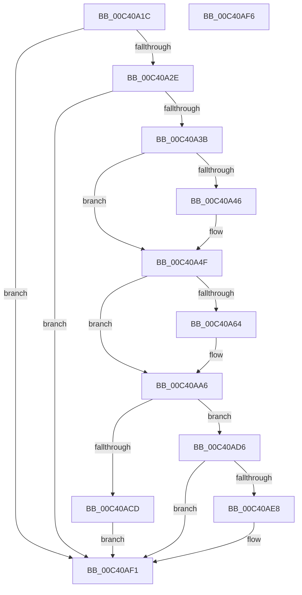

# PopEvaluateInputSuppressionRequired

- RVA: `0x00C40A1C`–`0x00C40AF7` (길이 `219` bytes)
- VA: `0x0000000140C40A1C`
- 실행 섹션: `INIT`
- PDB 이름 있음: `예`; PDB Function 태그: `아니요`
- unwind 정보 RVA: `0x0005C788`
- 디코드: `47`개 명령, `219/219` bytes 표시
- 미해석 바이트: `0` (있으면 어셈블리에 `.byte`로 보존)

> 이 문서는 커널 이미지의 기계어와 PDB 기호를 분석해 생성했습니다. 4번과 5번은 함수 원형과 자료형을 바이너리 사용 방식에서 추정한 C 해석이며 원본 소스 복구 결과는 아닙니다.

## 1. Dependencies

- 직접 호출 지점: **3**; 고유 호출 대상: **3**
- 직접 호출자로 확인된 함수: **1**
- RIP 상대 이미지 참조: **10**

### Outgoing calls
- `0x00C40A8B` → [wil_details_FeatureReporting_ReportUsageToService](../../text/53/wil_details_FeatureReporting_ReportUsageToService_function_0053E6E4.md) (function, `0x0053E6E4`)
- `0x00C40AA1` → [wil_details_FeatureStateCache_TryEnableDeviceUsageFastPath](../../text/53/wil_details_FeatureStateCache_TryEnableDeviceUsageFastPath_function_0053E774.md) (function, `0x0053E774`)
- `0x00C40AC1` → [EmClientQueryRuleState](../../pagelk/B7/EmClientQueryRuleState_function_00B77D70.md) (function, `0x00B77D70`)

### Direct callers
- [PoInitSystem](../C7/PoInitSystem_function_00C72358.md) at `0x00C73210`

### Static image references
- `0x00C40A20` → RVA `0x00E673A0` (`.data`; read)
- `0x00C40A2E` → RVA `0x00E6739C` (`.data`; read)
- `0x00C40A3B` → RVA `0x00E0B7FC` (`.data`; read)
- `0x00C40A48` → RVA `0x00E6788C` (`.data`; write)
- `0x00C40A55` → RVA `0x00FC4780` (`.data`; read)
- `0x00C40A7B` → RVA `0x000DD6A0` (`.rdata`; read)
- `0x00C40AAB` → RVA `0x00E67885` (`.data`; write)
- `0x00C40AB2` → RVA `0x000296C8` (`.rdata`; read)
- `0x00C40ACD` → RVA `0x00E67894` (`.data`; write)
- `0x00C40AD6` → RVA `0x00E0B7F8` (`.data`; read)

## 2. Other-region calls and transfers

- 다른 실행 섹션으로 향하는 call: **3**
  - `0x00C40A8B` → [wil_details_FeatureReporting_ReportUsageToService](../../text/53/wil_details_FeatureReporting_ReportUsageToService_function_0053E6E4.md) (`INIT` → `.text`)
  - `0x00C40AA1` → [wil_details_FeatureStateCache_TryEnableDeviceUsageFastPath](../../text/53/wil_details_FeatureStateCache_TryEnableDeviceUsageFastPath_function_0053E774.md) (`INIT` → `.text`)
  - `0x00C40AC1` → [EmClientQueryRuleState](../../pagelk/B7/EmClientQueryRuleState_function_00B77D70.md) (`INIT` → `PAGELK`)
- 별도 외부 분기/꼬리 이동을 확인하지 못했습니다.

## 3. Assembly (complete function range)

```asm
00C40A1C  48 83 EC 28                     sub rsp, 0x28
00C40A20  8B 05 7A 69 22 00               mov eax, dword ptr [rip + 0x22697a]
00C40A26  85 C0                           test eax, eax
00C40A28  0F 84 C3 00 00 00               je 0x140c40af1
00C40A2E  80 3D 67 69 22 00 00            cmp byte ptr [rip + 0x226967], 0
00C40A35  0F 84 B6 00 00 00               je 0x140c40af1
00C40A3B  8B 05 BB AD 1C 00               mov eax, dword ptr [rip + 0x1cadbb]
00C40A41  83 F8 FF                        cmp eax, -1
00C40A44  74 09                           je 0x140c40a4f
00C40A46  85 C0                           test eax, eax
00C40A48  0F 95 05 3D 6E 22 00            setne byte ptr [rip + 0x226e3d]
00C40A4F  48 83 64 24 30 00               and qword ptr [rsp + 0x30], 0
00C40A55  8B 0D 25 3D 38 00               mov ecx, dword ptr [rip + 0x383d25]
00C40A5B  89 4C 24 30                     mov dword ptr [rsp + 0x30], ecx
00C40A5F  F6 C1 10                        test cl, 0x10
00C40A62  75 42                           jne 0x140c40aa6
00C40A64  48 8B 44 24 30                  mov rax, qword ptr [rsp + 0x30]
00C40A69  83 C9 01                        or ecx, 1
00C40A6C  48 89 44 24 30                  mov qword ptr [rsp + 0x30], rax
00C40A71  41 B9 01 00 00 00               mov r9d, 1
00C40A77  89 4C 24 30                     mov dword ptr [rsp + 0x30], ecx
00C40A7B  48 8D 0D 1E CC 49 FF            lea rcx, [rip - 0xb633e2]
00C40A82  48 8B 54 24 30                  mov rdx, qword ptr [rsp + 0x30]
00C40A87  45 8D 41 02                     lea r8d, [r9 + 2]
00C40A8B  E8 54 DC 8F FF                  call 0x14053e6e4
00C40A90  48 8B 4C 24 30                  mov rcx, qword ptr [rsp + 0x30]
00C40A95  4C 8D 05 04 CC 49 FF            lea r8, [rip - 0xb633fc]
00C40A9C  BA 03 00 00 00                  mov edx, 3
00C40AA1  E8 CE DC 8F FF                  call 0x14053e774
00C40AA6  48 8D 54 24 30                  lea rdx, [rsp + 0x30]
00C40AAB  C6 05 D3 6D 22 00 01            mov byte ptr [rip + 0x226dd3], 1
00C40AB2  48 8D 0D 0F 8C 3E FF            lea rcx, [rip - 0xc173f1]
00C40AB9  C7 44 24 30 01 00 00 00         mov dword ptr [rsp + 0x30], 1
00C40AC1  E8 AA 72 F3 FF                  call 0x140b77d70
00C40AC6  83 7C 24 30 02                  cmp dword ptr [rsp + 0x30], 2
00C40ACB  75 09                           jne 0x140c40ad6
00C40ACD  C6 05 C0 6D 22 00 01            mov byte ptr [rip + 0x226dc0], 1
00C40AD4  EB 1B                           jmp 0x140c40af1
00C40AD6  8B 05 1C AD 1C 00               mov eax, dword ptr [rip + 0x1cad1c]
00C40ADC  C6 05 B1 6D 22 00 00            mov byte ptr [rip + 0x226db1], 0
00C40AE3  83 F8 FF                        cmp eax, -1
00C40AE6  74 09                           je 0x140c40af1
00C40AE8  85 C0                           test eax, eax
00C40AEA  0F 95 05 A3 6D 22 00            setne byte ptr [rip + 0x226da3]
00C40AF1  48 83 C4 28                     add rsp, 0x28
00C40AF5  C3                              ret
00C40AF6  CC                              int3
```

## 4. C-style interpretation (structured pseudocode)

```c
__int64 __fastcall PopEvaluateInputSuppressionRequired(void)
{
    __int64 result;
    __int64 v_rsp;
    unsigned __int64 v_stack_p8;

    v_rsp = (v_rsp) - (40);
    if ((unsigned int)((unsigned int)(*(unsigned int *)(v_rip + 2255226))) == 0) goto loc_00C40AF1;
    if ((*(unsigned __int8 *)(v_rip + 2255207)) == 0) goto loc_00C40AF1;
    if (((unsigned int)((unsigned int)(*(unsigned int *)(v_rip + 1879483)))) != -1) {
    }
    v_stack_p8 = (unsigned int)((unsigned int)(*(unsigned int *)(v_rip + 3685669)));
    result = (unsigned int)(*(unsigned int *)(v_rip + 1879483));
    if ((((unsigned __int8)((unsigned int)(*(unsigned int *)(v_rip + 3685669)))) & (16)) == 0) {
        result = v_stack_p8;
        a1 = (unsigned int)(((unsigned int)(*(unsigned int *)(v_rip + 3685669))) | (1));
        v_stack_p8 = result;
        a4 = 1;
        v_stack_p8 = (unsigned int)(a1);
        a1 = v_rip - 11940834;
        a2 = v_stack_p8;
        a3 = a4 + 2;
        result = wil_details_FeatureReporting_ReportUsageToService(a1, a2, a3, a4);
        a1 = v_stack_p8;
        a3 = v_rip - 11940860;
        a2 = 3;
        result = wil_details_FeatureStateCache_TryEnableDeviceUsageFastPath(a1, a2, a3, a4);
    }
    *(unsigned __int8 *)(v_rip + 2256339) = 1;
    v_stack_p8 = 1;
    result = EmClientQueryRuleState(v_rip - 12678129, v_stack_p8, a3, a4);
    if (v_stack_p8 != 2) goto loc_00C40AD6;
    *(unsigned __int8 *)(v_rip + 2256320) = 1;
    goto loc_00C40AF1;
loc_00C40AD6:
    *(unsigned __int8 *)(v_rip + 2256305) = 0;
    if (((unsigned int)((unsigned int)(*(unsigned int *)(v_rip + 1879324)))) != -1) {
    }
    v_rsp = (v_rsp) + (40);
    return (unsigned int)(*(unsigned int *)(v_rip + 1879324));
}
```

## 5. (Beta) C Style

```c
void PopEvaluateInputSuppressionRequired(void)
{
    int64_t result;
    int64_t local_rsp;
    uint64_t v_stack_p8;

    local_rsp = (local_rsp) - (40);
    if ((uint32_t)((uint32_t)(*(uint32_t *)(v_rip + 0x22697A))) == 0) goto loc_00C40AF1;
    if ((*(uint8_t *)(v_rip + 0x226967)) == 0) goto loc_00C40AF1;
    if (((uint32_t)((uint32_t)(*(uint32_t *)(v_rip + 0x1CADBB)))) != -1) {
    }
    v_stack_p8 = (uint32_t)((uint32_t)(*(uint32_t *)(v_rip + 0x383D25)));
    result = (uint32_t)(*(uint32_t *)(v_rip + 0x1CADBB));
    if ((((uint8_t)((uint32_t)(*(uint32_t *)(v_rip + 0x383D25)))) & (16)) == 0) {
        result = v_stack_p8;
        a1 = (uint32_t)(((uint32_t)(*(uint32_t *)(v_rip + 0x383D25))) | (1));
        v_stack_p8 = result;
        a4 = 1;
        v_stack_p8 = (uint32_t)(a1);
        a1 = v_rip - 11940834;
        a2 = v_stack_p8;
        a3 = a4 + 2;
        result = wil_details_FeatureReporting_ReportUsageToService(a1, a2, a3, a4);
        a1 = v_stack_p8;
        a3 = v_rip - 11940860;
        a2 = 3;
        result = wil_details_FeatureStateCache_TryEnableDeviceUsageFastPath(a1, a2, a3, a4);
    }
    *(uint8_t *)(v_rip + 0x226DD3) = 1;
    v_stack_p8 = 1;
    result = EmClientQueryRuleState(v_rip - 12678129, v_stack_p8, a3, a4);
    if (v_stack_p8 != 2) goto loc_00C40AD6;
    *(uint8_t *)(v_rip + 0x226DC0) = 1;
    goto loc_00C40AF1;
loc_00C40AD6:
    *(uint8_t *)(v_rip + 0x226DB1) = 0;
    if (((uint32_t)((uint32_t)(*(uint32_t *)(v_rip + 0x1CAD1C)))) != -1) {
    }
    local_rsp = (local_rsp) + (40);
    return (uint32_t)(*(uint32_t *)(v_rip + 0x1CAD1C));
}
```

## 6. Execution-region graph

[열기: 2D/3D 그래프와 함수 탐색 컨트롤 패널](../../../control-panel.html?section=init&rva=0x00C40A1C&view=graph)

- 2D 그래프는 위에서 아래로 흐르고, 3D 그래프는 빈 공간을 드래그해 회전합니다. Shift+드래그는 이동, 휠은 확대·축소, 함수 노드 선택은 대상 보고서 이동입니다.

### Static fallback


