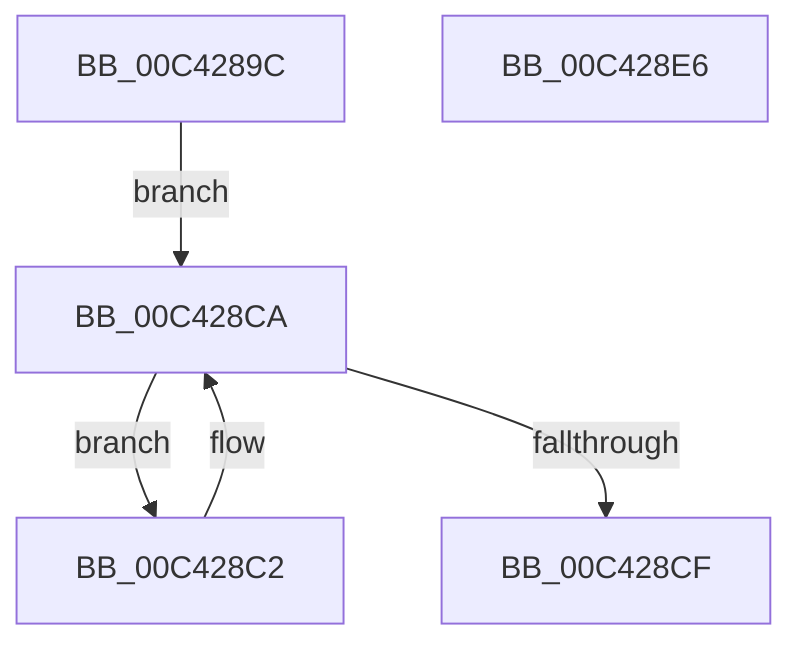

# PopFanReportBootStartDevices

- RVA: `0x00C4289C`–`0x00C428E7` (길이 `75` bytes)
- VA: `0x0000000140C4289C`
- 실행 섹션: `INIT`
- PDB 이름 있음: `예`; PDB Function 태그: `아니요`
- unwind 정보 RVA: `0x0005CAAC`
- 디코드: `19`개 명령, `75/75` bytes 표시
- 미해석 바이트: `0` (있으면 어셈블리에 `.byte`로 보존)

> 이 문서는 커널 이미지의 기계어와 PDB 기호를 분석해 생성했습니다. 4번과 5번은 함수 원형과 자료형을 바이너리 사용 방식에서 추정한 C 해석이며 원본 소스 복구 결과는 아닙니다.

## 1. Dependencies

- 직접 호출 지점: **3**; 고유 호출 대상: **3**
- 직접 호출자로 확인된 함수: **1**
- RIP 상대 이미지 참조: **2**

### Outgoing calls
- `0x00C428AD` → [PopAcquireRwLockShared](../../text/2D/PopAcquireRwLockShared_function_002D9A40.md) (function, `0x002D9A40`)
- `0x00C428C2` → [PopSqmFanEnumeration](../../page/77/PopSqmFanEnumeration_function_007725FC.md) (function, `0x007725FC`)
- `0x00C428D6` → [PopReleaseRwLock](../../text/2D/PopReleaseRwLock_function_002DFBBC.md) (function, `0x002DFBBC`)

### Direct callers
- [PoInitSystem](../C7/PoInitSystem_function_00C72358.md) at `0x00C72EF9`

### Static image references
- `0x00C428A6` → RVA `0x00F0C900` (`.data`; read)
- `0x00C428B2` → RVA `0x00F0CE90` (`.data`; read)

## 2. Other-region calls and transfers

- 다른 실행 섹션으로 향하는 call: **3**
  - `0x00C428AD` → [PopAcquireRwLockShared](../../text/2D/PopAcquireRwLockShared_function_002D9A40.md) (`INIT` → `.text`)
  - `0x00C428C2` → [PopSqmFanEnumeration](../../page/77/PopSqmFanEnumeration_function_007725FC.md) (`INIT` → `PAGE`)
  - `0x00C428D6` → [PopReleaseRwLock](../../text/2D/PopReleaseRwLock_function_002DFBBC.md) (`INIT` → `.text`)
- 별도 외부 분기/꼬리 이동을 확인하지 못했습니다.

## 3. Assembly (complete function range)

```asm
00C4289C  48 89 5C 24 08                  mov qword ptr [rsp + 8], rbx
00C428A1  57                              push rdi
00C428A2  48 83 EC 20                     sub rsp, 0x20
00C428A6  48 8D 0D 53 A0 2C 00            lea rcx, [rip + 0x2ca053]
00C428AD  E8 8E 71 69 FF                  call 0x1402d9a40
00C428B2  48 8B 1D D7 A5 2C 00            mov rbx, qword ptr [rip + 0x2ca5d7]
00C428B9  48 8D 3D D0 A5 2C 00            lea rdi, [rip + 0x2ca5d0]
00C428C0  EB 08                           jmp 0x140c428ca
00C428C2  E8 35 FD B2 FF                  call 0x1407725fc
00C428C7  48 8B 1B                        mov rbx, qword ptr [rbx]
00C428CA  48 3B DF                        cmp rbx, rdi
00C428CD  75 F3                           jne 0x140c428c2
00C428CF  48 8D 0D 2A A0 2C 00            lea rcx, [rip + 0x2ca02a]
00C428D6  E8 E1 D2 69 FF                  call 0x1402dfbbc
00C428DB  48 8B 5C 24 30                  mov rbx, qword ptr [rsp + 0x30]
00C428E0  48 83 C4 20                     add rsp, 0x20
00C428E4  5F                              pop rdi
00C428E5  C3                              ret
00C428E6  CC                              int3
```

## 4. C-style interpretation (structured pseudocode)

```c
__int64 __fastcall PopFanReportBootStartDevices(void)
{
    __int64 result;
    __int64 v_rsp;
    unsigned __int64 v_stack_p8;

    v_stack_p8 = v_rbx;
    v_rsp = (v_rsp) - (32);
    result = PopAcquireRwLockShared(v_rip + 2924627, a2, a3, a4);
    goto loc_00C428CA;
loc_00C428C2:
    result = PopSqmFanEnumeration(v_rip + 2924627, a2, a3, a4);
loc_00C428CA:
    if ((*(unsigned __int64 *)(*(unsigned __int64 *)(v_rip + 2926039))) != (v_rip + 2926032)) goto loc_00C428C2;
    result = PopReleaseRwLock(v_rip + 2924586, a2, a3, a4);
    v_rsp = (v_rsp) + (32);
    return result;
}
```

## 5. (Beta) C Style

```c
void PopFanReportBootStartDevices(void)
{
    int64_t result;
    int64_t local_rsp;
    uint64_t v_stack_p8;

    v_stack_p8 = local_rbx;
    local_rsp = (local_rsp) - (32);
    result = PopAcquireRwLockShared(v_rip + 2924627, a2, a3, a4);
    goto loc_00C428CA;
loc_00C428C2:
    result = PopSqmFanEnumeration(v_rip + 2924627, a2, a3, a4);
loc_00C428CA:
    if ((*(uint64_t *)(*(uint64_t *)(v_rip + 0x2CA5D7))) != (v_rip + 2926032)) goto loc_00C428C2;
    result = PopReleaseRwLock(v_rip + 2924586, a2, a3, a4);
    local_rsp = (local_rsp) + (32);
    return result;
}
```

## 6. Execution-region graph

[열기: 2D/3D 그래프와 함수 탐색 컨트롤 패널](../../../control-panel.html?section=init&rva=0x00C4289C&view=graph)

- 2D 그래프는 위에서 아래로 흐르고, 3D 그래프는 빈 공간을 드래그해 회전합니다. Shift+드래그는 이동, 휠은 확대·축소, 함수 노드 선택은 대상 보고서 이동입니다.

### Static fallback


