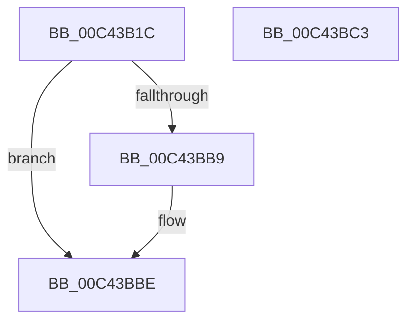

# PopInitializeAdpm

- RVA: `0x00C43B1C`–`0x00C43BC4` (길이 `168` bytes)
- VA: `0x0000000140C43B1C`
- 실행 섹션: `INIT`
- PDB 이름 있음: `예`; PDB Function 태그: `아니요`
- unwind 정보 RVA: `0x0005D2F4`
- 디코드: `32`개 명령, `168/168` bytes 표시
- 미해석 바이트: `0` (있으면 어셈블리에 `.byte`로 보존)

> 이 문서는 커널 이미지의 기계어와 PDB 기호를 분석해 생성했습니다. 4번과 5번은 함수 원형과 자료형을 바이너리 사용 방식에서 추정한 C 해석이며 원본 소스 복구 결과는 아닙니다.

## 1. Dependencies

- 직접 호출 지점: **5**; 고유 호출 대상: **5**
- 직접 호출자로 확인된 함수: **1**
- RIP 상대 이미지 참조: **13**

### Outgoing calls
- `0x00C43B2A` → [ExInitializeResourceLite2](../../text/41/ExInitializeResourceLite2_function_0041F710.md) (function, `0x0041F710`)
- `0x00C43B3C` → [memset](../../text/6C/memset_function_006C6C40.md) (function, `0x006C6C40`)
- `0x00C43B63` → [PopExtendConnectionState](../../page/76/PopExtendConnectionState_function_0076BBB8.md) (function, `0x0076BBB8`)
- `0x00C43BAB` → [ExSubscribeWnfStateChange](../../page/9D/ExSubscribeWnfStateChange_function_009D4BC0.md) (function, `0x009D4BC0`)
- `0x00C43BB9` → [PopAdaptiveInitializeBootContext](PopAdaptiveInitializeBootContext_function_00C43A84.md) (function, `0x00C43A84`)

### Direct callers
- [PoInitSystem](../C7/PoInitSystem_function_00C72358.md) at `0x00C730FA`

### Static image references
- `0x00C43B23` → RVA `0x00F08140` (`.data`; read)
- `0x00C43B31` → RVA `0x00F08220` (`.data`; read)
- `0x00C43B41` → RVA `0x00F08238` (`.data`; read/write)
- `0x00C43B4A` → RVA `0x00F081D8` (`.data`; read/write)
- `0x00C43B51` → RVA `0x00F081D0` (`.data`; read/write)
- `0x00C43B59` → RVA `0x00F0823C` (`.data`; write)
- `0x00C43B6E` → RVA `0x0076BA80` (`PopAdaptiveUpdateIdleContextWorker`; read)
- `0x00C43B75` → RVA `0x00F08218` (`.data`; read/write)
- `0x00C43B7D` → RVA `0x00020970` (`.rdata`; read)
- `0x00C43B84` → RVA `0x00F08200` (`.data`; read/write)
- `0x00C43B94` → RVA `0x00F08210` (`.data`; write)
- `0x00C43B9B` → RVA `0x0076BAB0` (`PopAdaptiveWnfCallback`; read)
- `0x00C43BB0` → RVA `0x00EEFB78` (`.data`; read)

## 2. Other-region calls and transfers

- 다른 실행 섹션으로 향하는 call: **4**
  - `0x00C43B2A` → [ExInitializeResourceLite2](../../text/41/ExInitializeResourceLite2_function_0041F710.md) (`INIT` → `.text`)
  - `0x00C43B3C` → [memset](../../text/6C/memset_function_006C6C40.md) (`INIT` → `.text`)
  - `0x00C43B63` → [PopExtendConnectionState](../../page/76/PopExtendConnectionState_function_0076BBB8.md) (`INIT` → `PAGE`)
  - `0x00C43BAB` → [ExSubscribeWnfStateChange](../../page/9D/ExSubscribeWnfStateChange_function_009D4BC0.md) (`INIT` → `PAGE`)
- 별도 외부 분기/꼬리 이동을 확인하지 못했습니다.

## 3. Assembly (complete function range)

```asm
00C43B1C  48 83 EC 38                     sub rsp, 0x38
00C43B20  83 CA FF                        or edx, 0xffffffff
00C43B23  48 8D 0D 16 46 2C 00            lea rcx, [rip + 0x2c4616]
00C43B2A  E8 E1 BB 7D FF                  call 0x14041f710
00C43B2F  33 D2                           xor edx, edx
00C43B31  48 8D 0D E8 46 2C 00            lea rcx, [rip + 0x2c46e8]
00C43B38  44 8D 42 50                     lea r8d, [rdx + 0x50]
00C43B3C  E8 FF 30 A8 FF                  call 0x1406c6c40
00C43B41  83 0D F0 46 2C 00 FF            or dword ptr [rip + 0x2c46f0], 0xffffffff
00C43B48  33 C9                           xor ecx, ecx
00C43B4A  83 25 87 46 2C 00 00            and dword ptr [rip + 0x2c4687], 0
00C43B51  48 83 25 77 46 2C 00 00         and qword ptr [rip + 0x2c4677], 0
00C43B59  C7 05 D9 46 2C 00 03 00 00 00   mov dword ptr [rip + 0x2c46d9], 3
00C43B63  E8 50 80 B2 FF                  call 0x14076bbb8
00C43B68  48 83 64 24 28 00               and qword ptr [rsp + 0x28], 0
00C43B6E  48 8D 05 0B 7F B2 FF            lea rax, [rip - 0x4d80f5]
00C43B75  48 83 25 9B 46 2C 00 00         and qword ptr [rip + 0x2c469b], 0
00C43B7D  48 8D 15 EC CD 3D FF            lea rdx, [rip - 0xc23214]
00C43B84  48 83 25 74 46 2C 00 00         and qword ptr [rip + 0x2c4674], 0
00C43B8C  48 8D 4C 24 40                  lea rcx, [rsp + 0x40]
00C43B91  45 33 C9                        xor r9d, r9d
00C43B94  48 89 05 75 46 2C 00            mov qword ptr [rip + 0x2c4675], rax
00C43B9B  48 8D 05 0E 7F B2 FF            lea rax, [rip - 0x4d80f2]
00C43BA2  48 89 44 24 20                  mov qword ptr [rsp + 0x20], rax
00C43BA7  45 8D 41 01                     lea r8d, [r9 + 1]
00C43BAB  E8 10 10 D9 FF                  call 0x1409d4bc0
00C43BB0  83 3D C1 BF 2A 00 00            cmp dword ptr [rip + 0x2abfc1], 0
00C43BB7  75 05                           jne 0x140c43bbe
00C43BB9  E8 C6 FE FF FF                  call 0x140c43a84
00C43BBE  48 83 C4 38                     add rsp, 0x38
00C43BC2  C3                              ret
00C43BC3  CC                              int3
```

## 4. C-style interpretation (structured pseudocode)

```c
__int64 __fastcall PopInitializeAdpm(__int64 a1, int a2, __int64 a3, int a4)
{
    __int64 result;
    __int64 v_rsp;
    unsigned __int64 v_stack_m10;
    unsigned __int64 v_stack_m18;
    unsigned __int64 v_stack_p8;

    v_rsp = (v_rsp) - (56);
    a2 = (unsigned int)((a2) | (0xFFFFFFFFULL));
    result = ExInitializeResourceLite2(v_rip + 2901526, a2, a3, a4);
    a2 = 0;
    result = memset(v_rip + 2901736, a2, a2 + 80, a4);
    a1 = 0;
    *(unsigned int *)(v_rip + 2901721) = 3;
    result = PopExtendConnectionState(a1, a2, a2 + 80, a4);
    a4 = 0;
    *(unsigned __int64 *)(v_rip + 2901621) = v_rip - 5079285;
    v_stack_m18 = v_rip - 5079282;
    result = ExSubscribeWnfStateChange(v_stack_p8, v_rip - 12726804, a4 + 1, a4);
    if ((*(unsigned int *)(v_rip + 2801601)) == 0) {
        result = PopAdaptiveInitializeBootContext(v_stack_p8, v_rip - 12726804, a4 + 1, a4);
    }
    v_rsp = (v_rsp) + (56);
    return result;
}
```

## 5. (Beta) C Style

```c
int64_t PopInitializeAdpm(int64_t Arg1, int32_t Arg2, int64_t Arg3, int32_t Arg4)
{
    int64_t result;
    int64_t local_rsp;
    uint64_t v_stack_m10;
    uint64_t v_stack_m18;
    uint64_t v_stack_p8;

    local_rsp = (local_rsp) - (56);
    Arg2 = (uint32_t)((Arg2) | (0xFFFFFFFFULL));
    result = ExInitializeResourceLite2(v_rip + 2901526, Arg2, Arg3, Arg4);
    Arg2 = 0;
    result = memset(v_rip + 2901736, Arg2, Arg2 + 80, Arg4);
    Arg1 = 0;
    *(uint32_t *)(v_rip + 0x2C46D9) = 3;
    result = PopExtendConnectionState(Arg1, Arg2, Arg2 + 80, Arg4);
    Arg4 = 0;
    *(uint64_t *)(v_rip + 0x2C4675) = v_rip - 5079285;
    v_stack_m18 = v_rip - 5079282;
    result = ExSubscribeWnfStateChange(v_stack_p8, v_rip - 12726804, Arg4 + 1, Arg4);
    if ((*(uint32_t *)(v_rip + 0x2ABFC1)) == 0) {
        result = PopAdaptiveInitializeBootContext(v_stack_p8, v_rip - 12726804, Arg4 + 1, Arg4);
    }
    local_rsp = (local_rsp) + (56);
    return result;
}
```

## 6. Execution-region graph

[열기: 2D/3D 그래프와 함수 탐색 컨트롤 패널](../../../control-panel.html?section=init&rva=0x00C43B1C&view=graph)

- 2D 그래프는 위에서 아래로 흐르고, 3D 그래프는 빈 공간을 드래그해 회전합니다. Shift+드래그는 이동, 휠은 확대·축소, 함수 노드 선택은 대상 보고서 이동입니다.

### Static fallback


